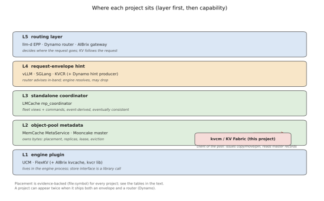
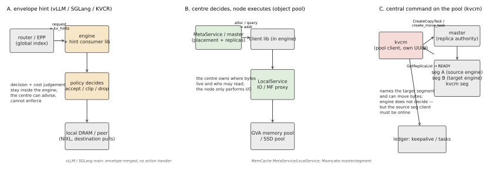
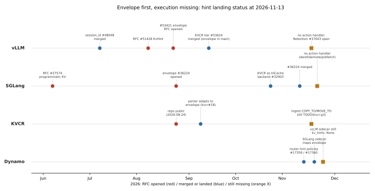
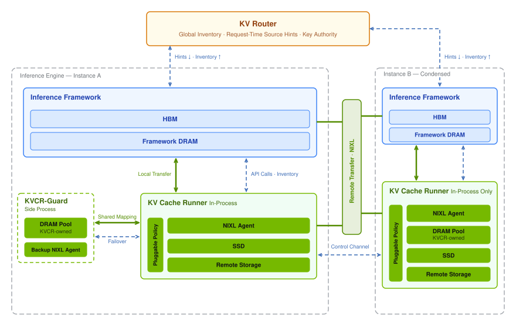
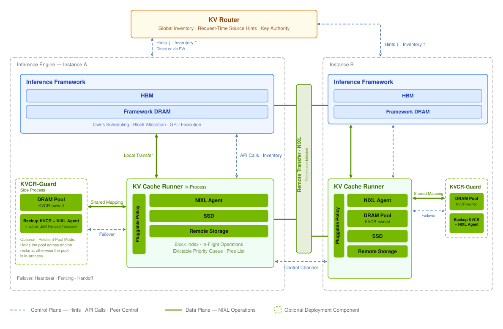
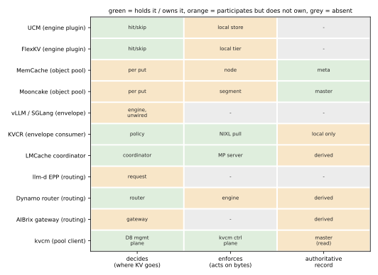

# kvcm / KV Fabric 与开源方案对比（调研）

> 调研快照：2026-11-13。上游源码快照：vLLM `93eeae69`、SGLang `5792cf6e`、UCM `57ddbb26`、KVCR `b7aa81d0`、LMCache `58c11e38`、MemCache `14b4e35e`、FlexKV `55ad438e`、llm-d-router `647ca7ca`、Dynamo `b20fe6fe`、AIBrix `17652f54`；kvcm 基线 `4d9dd33`（D8/D9/D10 已入 main）。
> 性质：开源方案对照研究，不是设计决策文档。kvcm 自身的设计在 [`kvcm/design/`](../../kvcm/design/D10-kv-fabric-roadmap.md)，本文只做外部调研与边界核对。
> 读法：§1 分层 → §2 三种分发形态 → §3 逐层符号级事实 → §4 上游架构图与许可 → §5 能力矩阵 → §6 我方短板 → §7 未复核条目。

---

## 1. 分层：先问「在哪一层」，再问「谁说了算」



（自绘图，由 [`kvcm-vs-oss/figures/plot_kvcm_vs_oss.py`](kvcm-vs-oss/figures/plot_kvcm_vs_oss.py) 生成。分层的判据是「这段代码跑在谁的进程里、持有什么状态」，逐条依据在 §3。全部图源与许可见 [`kvcm-vs-oss/figures/README.md`](kvcm-vs-oss/figures/README.md)。）

| 层 | 项目 | 这一层在做什么 | 与 kvcm 的关系 |
|---|---|---|---|
| L5 路由层 | llm-d EPP、Dynamo router、AIBrix gateway | 决定请求落到哪个实例；KV 随请求流动 | kvcm 的上游：它们决定「去哪」，kvcm 决定「KV 放哪」 |
| L4 请求信封 hint | vLLM、SGLang、KVCR（+ Dynamo 的 hint 生产侧） | 中心在请求里捎一段结构化意图，引擎解析后自行取舍 | 与我们正交；它们的 action 面尚未执行 |
| L3 独立协调器 | LMCache `mp_coordinator` | 带独立进程、fleet 视图与命令面，事件派生 | 形态最接近的一家，权威性不同 |
| L2 对象池元数据 | MemCache `MetaService`、Mooncake master | 拥有字节：放置、副本、租约、驱逐 | **kvcm 就站在这一层之上**，是池的 client |
| L1 引擎插件 | UCM、FlexKV（AIBrix `aibrix_kvcache` 同级） | 活在引擎进程里，store 接口是库调用 | kvcm 复用的接入样板 |

两个项目会同时出现在两层：Dynamo 既是 L5 的路由器、也是 L4 的 hint 生产者；AIBrix 既有网关侧索引（L5）也有引擎旁卸载框架（L1）。

**kvcm 的位置**：L2 的 client，不是新的池。它持有自己的 UUID 连到池的 master，读副本权威记录（`GetReplicaList` / `batch_query_keys`），并直接对池下发 copy / move / pin 等动作。这条「在 L2 之上加一层执行面」的做法，与 L1 插件（改引擎）、L3 协调器（自建 fleet 视图）、L5 路由（只改请求落点）都不同层。

---

## 2. 三种分发/控制形态

「hint 推 vs 中心命令」只是本节的 A 与 C 两种；B 是一大类被漏掉的中形态。



（自绘图，同上脚本。）

### 2.1 A：请求信封 hint —— 中心建议，引擎决定

中心把意图写进请求元数据（`KvHintsEnvelope`），引擎解析后可以 accept / clip / defer / reject。代表：vLLM、SGLang、KVCR。

关键性质：决策与成本判断留在引擎进程内，中心无法强制。三条符号级依据见 §3.4。

### 2.2 B：中心分发、节点执行 —— 池的中心化形态

中心持放置与副本权威，节点只做 I/O。这不是「hint」，也不是「引擎自己决定」，而是一种真正的分布式形态：

- **MemCache**：`MetaService` 管整个集群内存池的分配与 `LocalService` 加入/退出，`LocalService` 只提供内存与 IO 代理（`README.md`「核心组件」；`src/memcache/csrc/meta_service/mmc_meta_manager.cpp::MmcMetaManager`）。
- **Mooncake**：master 持 key→副本权威记录，segment 所在 client 执行字节搬运（`master_client.h::CreateCopyTask` / `CreateMoveTask`）。
- **UCM 的 DRAM store**：`ucm/store/dram/cc/dram_store.cc` 有 `Role::SCHEDULER` / `Role::WORKER` 两种角色，scheduler 用一致性哈希（`ucm/shared/router/router.h::Router::RouteKeys`）把 block 派给节点，worker 注册 KV buffer 执行传输。UCM 不是「没有中心」的纯插件。

### 2.3 C：中心对池下命令 —— kvcm 的做法

kvcm 是池的 client，向 master 提交任务，master 协调、派任务给源/目标 segment 所在 client 执行：

```text
kvcm（Mooncake client，自己的 UUID）
  → CreateCopyTask / create_move_task(key, src_seg, tgt_seg) / 空写 pin / Remove
  → master 协调，派任务给源、目标 seg 所在 client
  → kvcm 用 query_task + GET /batch_query_keys + GetReplicaList 核验
  → 得到 READY 上报管理面
```

与 B 的差别是**目标由谁指定**：B 的中心按自身策略挑位置（MemCache 由 `AllocOptions{preferredRank_, flags_}` 挑 rank、Mooncake 动态副本按热度准入），C 的调用方点名目标段。kvcm 的 `CreateCopyTask(key, [B.seg])` 就是点名的；Mooncake 动态副本虽有 `preferred_target_segment` 字段，但要过热准入闸（§3.2）。

### 2.4 三种形态并不互斥

同一套系统可以同时具备多种：Mooncake 既有「按热度自动加副本」（B）也可被 client 点名 copy（C）；Dynamo 既路由（L5）也生产 hint（L4）；UCM 既是插件（L1）也有 DRAM store 的调度/执行分离（B）。讨论「谁说了算」时必须先说清是哪一层、哪种形态，否则容易把不同层的东西当同一层比。

---

## 3. 逐层事实（符号级出处）

### 3.1 L1 引擎插件：UCM / FlexKV

**UCM**（ModelEngine，MIT 附加条件）

| 事实 | 出处 |
|---|---|
| 走 `KVConnectorBase_V1` 接入；有多套 connector 分型（direct / layerwise / PD / lite / mock），另有稀疏框架 | `ucm/integration/vllm/ucm_connector.py`：`UCMDirectConnector`(1622)、`UCMLayerWiseConnector`(2883)、`UCMCPConnector`(3370)、`UCMPDConnector`(3486)、`UCMLiteConnector`(3569)、`UCMConnector`(3718) |
| 版本补丁树：按引擎版本分目录，另有 common 与根级补丁脚本 | `ucm/integration/vllm/patch/`：`0.9.2`、`0.11.0`、`v0110`…`v0300`、`common` 共 16 个目录 + `apply_patch.py`、`boot_patch.py` 等 11 个根级 patch 模块 |
| store 抽象只有 lookup / prefetch / load / dump / wait 一族 | `ucm/store/ucmstore_v1.py::UcmKVStoreBaseV1`；C++ 面 `ucm/store/ucmstore_v1.h::StoreV1`（`Lookup`/`LookupOnPrefix`/`LookupOnReverse`/`Prefetch`/`Load`/`Dump`/`Check`/`Wait`） |
| v1 store 无 move / retain；prefetch 只作 GC 热度提示 | `grep -rn "def move\|def retain" ucm/` 无命中；`ucm_connector.py` 注释 "Prefetch is only a GC hotness hint" |
| v2 store 有 request 作用域的 `Pin`/`Unpin`（窗口协议，传输期防驱逐） | `ucm/v2/store/store.h::Pin` / `Unpin`；`ucm/v2/proxy/store_scheduler.h::StoreScheduler`（Prepare/Complete 窗口）、`store_worker.h::StoreWorker`、`store_peer.h::StorePeer`（同时实现两面） |
| DRAM store 有 scheduler / worker 角色分离 + 一致性哈希派发 | `ucm/store/dram/cc/config.h::Role{SCHEDULER,WORKER}`；`dram_store.cc::DramStore::Setup`；`task_manager.cc::TaskManager::BuildRequests` 调 `router->RouteKeys` |
| 全仓无 kv_hints / 无 hint 平面 | `grep -rn "kv_hints\|KvHint" ucm/` 为空 |
| PD 三种传输拓扑（HBM 直传 / DRAM 中介 / 统一池），主推经池 | `docs/source/user-guide/pd-disaggregation/index.md` + `_static/images/pd_disaggregation.jpg` |

判读：UCM 是「引擎插件 + 可插拔 store」，同时在其 DRAM store 内部实现了「中心调度、节点执行」。它没有跨集群的控制面，也不是 kvcm 的对手；它是 kvcm 复用接入形态的样板，也是「B 形态可以藏在插件内部」的反例。

**FlexKV**（腾讯云 TACO）

| 事实 | 出处 |
|---|---|
| 引擎旁独立 server 进程，ZMQ 请求面 | `flexkv/server/request.py`：`PutRequest` / `GetRequest` / `PrefetchRequest` / `PutMatchRequest` / `GetMatchRequest` / `LaunchTaskRequest` / `CancelTaskRequest` / `WaitRequest`；`flexkv/server/server.py::KVServer` |
| 本机分层的 radix（CPU / SSD / REMOTE） | `flexkv/cache/`（`radix_shmem_engine.py`、`radixtree.py`、`radix_remote.py`） |
| 有远端 radix 共享：Redis 元数据通道 + 分布式 radix，带 `lease_renew_ms` | `flexkv/cache/radix_remote.py::DistributedRadixTree`（构造参数 `lease_renew_ms` 默认 5000）、`flexkv/cache/redis_meta.py::RedisMetaChannel` / `NodeState` |
| 有预取协调器（session 级预取计划与配额） | `flexkv/prefetch/coordinator.py`（"Single-owner session scheduler. The backend owns cache plans, not policy."）、`prefetch/policy.py`、`prefetch/runtime.py` |
| 无请求路由、无扩缩 | `grep -rn "router\|controller" --include=*.py flexkv/` 无命中 |

判读：FlexKV 管「这台机的 KV 放哪层」，附带一套远端 radix 的租约式元数据；它不管「放到哪台机」。它比「纯本机卸载库」复杂，但仍在 L1。

### 3.2 L2 对象池：MemCache / Mooncake

**MemCache**（Ascend，MulanPSL2）

| 事实 | 出处 |
|---|---|
| 对象级 API：put / get / query / batch_query / exist / batch_exist / remove / batch_remove | `src/memcache/include/mmc_client.h`（`mmcc_put`、`mmcc_get`、`mmcc_batch_query`、`mmcc_batch_exist`、`mmcc_batch_remove`…） |
| put 可指定介质、副本数与**偏好 LocalService**（≤8 副本） | `src/memcache/include/mmc_def.h::mmc_put_options{mediaType, policy, replicaNum, preferredLocalServiceIDs}`；MAX_BLOB_COPIES=8 |
| 中心有「按 rank 强制分配」的放置能力 | `meta_service/mmc_meta_manager.cpp::MmcMetaManager::CopyBlob`（`AllocOptions.preferredRank_` + `ALLOC_FORCE_BY_RANK`）；`mmc_locality_strategy.h::AllocFlags` |
| 内部有 move / replicate（copy + 释放源），但只被驱逐回调使用，无对外 RPC | `mmc_meta_manager.cpp::MoveBlob` / `ReplicateBlob`；唯一调用点 `EvictCallBackFunction`（多级淘汰时 MoveBlob）；`grep -rn "MoveBlob(\|ReplicateBlob("` 除定义与驱逐回调外无命中 |
| 有 lease：读/写状态机在 ALLOCATED / READABLE 上加租约，删除时等租约清零 | `entities/mmc_blob_state.cpp::BlobStateMachine::GetGlobalTransTable`（`LeaseAdd` / `LeaseRemove` / `LeaseWait`）、`entities/mmc_meta_lease_manager.h::MmcMetaLeaseManager`（TTL = `MMC_DATA_TTL_MS`） |
| MetaService 支持 HA（K8s Lease 选主） | `python/memcache_hybrid/meta_service_leader_election.py::MetaServiceLeaderElection`；`README.md`「HA 模式」 |
| 管理面 HTTP：query / batch_query / segments / capacity，drain job 未支持 | `meta_service/mmc_http_server.cpp`（`/query_key`、`/batch_query_keys`、`/get_all_segments`、`/api/v1/capacity/*`，`/api/v1/drain_jobs` → `notSupportedHandler`） |
| 不认前缀语义、无 hint | `grep -rni "router\|hint" src/memcache/` 无命中 |

判读：MemCache 与 Mooncake master 同层，是 kvcm 的后端候选。它有完整的「中心持元数据 + 节点执行」，也有租约与内部多级搬迁；对外只暴露对象级 API，没有 KV 语义的位置视图查询接口（要自己用 `/batch_query_keys` 拼）。

**Mooncake**（kvcache-ai，v0.3.13.post1）

| 事实 | 出处 |
|---|---|
| 副本权威记录可查 | `mooncake-store/include/master_client.h::GetReplicaList` / `BatchGetReplicaList` |
| 点名目标的 copy / move | `master_client.h::CreateCopyTask` / `CreateMoveTask`（同文件 597/612 行区） |
| 动态副本可「偏好」目标段，但过热准入闸 | `include/rpc_types.h::ReplicaActionProposal{preferred_target_segment}`；`src/master_service.cpp`：`preferred_target_segment` 只在 `is_valid_target` 成立时被采纳（8332-8342），且入口先过 `DynamicReplicationHeatAdmitted`（8033，要求窗口内命中数达标） |
| 动态副本做不到「无条件点名」 | 同上：热度不足直接 `INVALID_PARAMS`；kvcm 的 `CreateCopyTask` 走任务通道，不受热准入限制 |

判读：旧对照表里「动态副本做不到指定实例」不准确——它有 `preferred_target_segment`，但受热度与冷却窗约束，属「池按自身策略放置」；kvcm 需要的是「调用方点名 + 有完成信号」，只有任务通道满足。

### 3.3 L3 独立协调器：LMCache

`mp_coordinator` 自 2026-06-03（#3488 "add mp coordinator backbone"）起替代旧的进程内 `cache_controller`。旧的 `lmcache/v1/cache_controller/` 于 2026-10-22 被移到 `lmcache/v1/inprocess/v1/cache_controller/`（#5970），又于 2026-11-06 整体移出主仓（#6254 "Remove in-tree InProcess implementation"，代码迁到独立仓 `LMCache_inprocess`）。**main 上不存在 `cache_controller/` 目录，也不存在 `RegistryTree` / `KVController` / `LMCacheControllerManager` / `LMCacheWorker` 这些符号。**

| 事实 | 出处 |
|---|---|
| 独立进程、FastAPI 服务，默认只监听回环 | `lmcache/v1/mp_coordinator/app.py::create_app`；`docs/source/mp/coordinator.rst`（`lmcache coordinator`，默认 `127.0.0.1:9300`） |
| fleet 级 key 目录：`ObjectKey → placements(instance, tier, backend, size)`，事件派生、最终一致、**答案只是 hint，必须在 owner 处验证** | `views/key_directory.py::KeyDirectory`（模块 docstring："Eventually consistent: lookups are hints to be validated at the owner"）、`lookup`(305) |
| 目录只由 CacheEvent 批次构建，可 checkpoint / 回放 | `ingest/event_gate.py::EventGate`、`ingest/event_broadcaster.py`、`cache_events.py::CacheEventSink`、`events_replay.py::replay`、`persistence/checkpoint.py` |
| 实例注册与心跳、超时剔除 | `http_apis/instances_api.py`（`POST /instances`、`PUT /instances/{id}/heartbeat`、`DELETE /instances/{id}`）、`views/instance_registry.py::InstanceRegistry`、`registrar.py::keep_registered` |
| 预取能指定实例 | `http_apis/cache_api.py::request_prefetch`（`POST /cache/prefetches`，body 带 `instance_id`；未知实例 404）、`controllers/prefetch_manager.py::PrefetchManager.submit_prefetch` |
| pin 是「排除在该协调器自己的 L2 驱逐计划外」的计数，不是按时间续租 | `controllers/eviction_controller.py::FleetEvictionController.pin` / `unpin`（`_pin_counts` 计数）；`controllers/eviction_http_api.py::request_pin`（`POST/DELETE /cache/pins`） |
| 无 lease / keepalive 语义 | `grep -rni "lease\|keepalive" lmcache/v1/mp_coordinator/` 仅命中无关的 `_release_locked` |
| 无 move 路由 | 全部路由：`/cache/prefetches`、`/cache/pins`、`/cache/delete`、`/quota*`、`/directory/*`、`/instances*`、`/events`、`/config/chunk-size`、`/status`、`/metrics`、`/healthz` |
| 目录查询可按 key 或 token 序列 | `http_apis/directory_api.py::lookup_placements`（`POST /directory/lookup`）、`blend_lookup` |

判读：形态上与 kvcm 最接近（独立进程、fleet 视图、可指定实例的预取），差别在两点：它的位置知识是事件派生的最终一致视图（kvcm 直接读池 master 的副本记录），且它管的是自己的 L2 层，不碰「引擎 HBM + 池」这整套。

### 3.4 L4 请求信封：vLLM / SGLang / KVCR



（自绘时间线；日期取自各 RFC/PR 的 `created_at` / `closed_at`，2026-11-13 核对。合并状态见下表。）

| 事实 | 出处 |
|---|---|
| vLLM 信封结构 | `vllm/v1/kv_hints/protocol.py::KvHintsEnvelope` / `KvHintAction{action_id, action_type, action_version, payload}` |
| vLLM 信封贯穿请求链 | `v1/request.py`(208)、`v1/engine/__init__.py`(222)、`v1/engine/llm_engine.py`(241)、`v1/engine/async_llm.py`(429)、`v1/engine/input_processor.py`(549)、`v1/kv_offload/base.py::ReqContext.kv_hints` |
| vLLM 只有信封、无 action handler | `grep -rn "action_type" vllm/v1/` 仅 `kv_hints/protocol.py:13` 一处定义 |
| vLLM 唯一消费者是 KVCR 二级层 | `v1/kv_offload/tiering/kvcr/manager.py::KVCRSecondaryTierManager.on_new_request` → `self._kvcr.submit_hint(request_id=..., hints=hint)` |
| SGLang 同构信封 + 入口形状校验 | `python/sglang/srt/managers/kv_hints.py::KvHintsEnvelope` / `KvHintAction` / `decode_kv_hints_envelope`；`managers/io_struct.py`(667-670) |
| SGLang 信封挂进调度批次，但无 action 分派 | `managers/schedule_batch.py`(814)、`managers/scheduler.py`(3353)；`grep -rn "action_type" python/sglang/srt/` 仅 `kv_hints.py:20,23` |
| KVCR 支持三种 hint | `src/kvcr/hints/hint_types.py::_KVFetchHint`(kv.fetch) / `_KVPrefetchHint`(kv.prefetch) / `_KVMoveHint`(kv.move)；`hints/dispatcher.py::_HINT_TYPES` |
| KVCR 拒绝 `no_retain` 与「无来源端点」的 hint | `src/kvcr/hints/parser.py::_parse_payload`（`if "no_retain" in payload: raise ValueError(...)`；`{peer}-less hints are not currently supported`） |
| KVCR 源侧先判「有无托管 DRAM / 是不是自己」，不合格直接拒 | `src/kvcr/hints/hint_handler.py::_IndependentHintHandler.submit`（`source_has_no_managed_dram` / `key_adapter_unavailable` / `self_destination`） |
| KVCR 准入可被 policy 否决 | `src/kvcr/policy.py::KVCachePolicy.decide_ingest`；`runtime/policy_runtime.py::_PolicyInvoker` |
| KVCR 入池时的 COPY_TO / MOVE_TO 放置仍是 TODO | `src/kvcr/runtime/policy_runtime.py:67`（`TODO(kvcr-g3): Wire ingest-time COPY_TO and MOVE_TO placement.`）、`runtime/core.py:503` |
| KVCR 主动搬运 = 目的地 `fetch`，`submit_hint` 只建连接 | `src/kvcr/api.py::submit_hint`、`backends/remote_fw_dram.py::submit_hint` |
| 库存上报复用 router 全局视图 | `src/kvcr/runtime/core.py::_publish_inventory`、`types.py::InventoryEvent` |

判读：两家引擎把「接口形状」标准化了，把「谁执行、怎么执行」留给编排层。对 kvcm 的含义是：不必等上游合 action handler，也不必改引擎；同时也不能指望「下发 hint 就会动」——今天没有任何一家引擎会因为一个信封而主动搬字节。

### 3.5 L5 路由层：llm-d / Dynamo / AIBrix

| 事实 | 出处 |
|---|---|
| llm-d：逐块索引 + 加权打分插件 | `pkg/kvcache/indexer.go::Indexer`、`pkg/kvcache/kvblock/`、`pkg/epp/scheduling/weighted_scorer.go` |
| llm-d P2P：目的地发起，sidecar 把来源塞进 `kv_transfer_params` 让目标引擎自己去取 | `pkg/sidecar/proxy/connector_p2p.go::decodeWithP2PSource`(425)、`kvSourceFromBody`(334)、`dispatch.go`（`KVCacheSourceHeader` 路由头） |
| Dynamo：router 侧有类型化 hint 与传输候选解析，且有「强制 / 偏好」两级 | `lib/router/scheduler/src/kv_hints.rs::resolve_transfer_sources`；`lib/router/kv-hints/src/keys.rs::KvTransferEnforcement{Required, Preferred}`；`lib/router/kv-indexer/src/kv_hints.rs::KvTransferCandidates` |
| Dynamo：hint 由可插拔 policy 产出 | `lib/router/scheduler/src/kv_hints.rs` 头注释 + 提交 `#17359` / `#17360`（2026-11-12） |
| Dynamo：SGLang sidecar 把 hint 映射成信封下发 | `lib/sidecar/sglang/src/protocol.rs::kv_hint_to_proto`（281） |
| Dynamo：vLLM sidecar 仍然发 `kv_hints: None` | `lib/sidecar/vllm/src/convert.rs:296` |
| AIBrix：网关侧前缀哈希表 + 事件同步双路线 | `pkg/utils/prefixcacheindexer/hash.go::PrefixHashTable`、`pkg/utils/syncprefixcacheindexer/sync_hash.go::SyncPrefixHashTable` |
| AIBrix：引擎旁 L1/L2 卸载框架，L2 的 "pinned" 指页锁定内存，不是防驱逐 pin | `python/aibrix_kvcache/aibrix_kvcache/l1/l1_cache.py::L1Cache.acquire`；`l2/l2_cache.py::L2Cache.allocate`（docstring："Allocate pinned memory regions to store the kv tensors"）；驱逐策略 `l1/eviction_policy/{lru,fifo,s3fifo}.py` |
| AIBrix：元数据服务只管集群成员信息 | `meta_service/meta_service.py::MetaService`、`redis_meta_service.py::RedisMetaService`（`get_cluster_metadata` / `get_connection_info`） |

判读：这三家决定「请求去哪」。它们与 kvcm 互补：kvcm 缺这一层（D8 的 SC 尚未落地），它们缺「能对池下命令、能保活、能搬」这层。

### 3.6 kvcm 站在 L2 之上

| 事实 | 出处 |
|---|---|
| 八项操作的接口面 | `kvcm/kvcm/ops/base.py::KvOps`：`copy` / `move` / `register_keepalive` / `pin` / `demote` / `promote` / `retain` / `remove` |
| 池侧身份 = 一个 client（注册 UUID + 心跳，`global_segment_size=0`） | `kvcm/kvcm/backends/mooncake/client.py` 模块 docstring |
| copy / move 提交走任务通道，READY 由目标侧副本核验得出 | `backends/mooncake/backend.py::copy`(570)、`move`(988)、`query_task`(673) |
| retain 未接 | `backends/mooncake/backend.py:1326`：`raise NotImplementedError("retain：做法见 D2 §4，尚未接通")` |
| soft pin 依赖空写 + 单副本前置条件，hard pin 不能事后设置 | `backend.py::pin`(1119)：`hard pin 不能事后设置`；`soft pin 空写只支持 put_step=1` |
| demote 走「停保活 → 等满 lease TTL → 确认盘副本」 | `backend.py::demote`(1189)、`_restore_demote_keepalive`(1237) |
| 能力按后端版本显式声明（rpc × channel 两维） | `kvcm/kvcm/ops/capability.py::BackendCapability` |
| 保活循环 | `kvcm/kvcm/loops.py::KeepaliveLoop`(30) |

---

## 4. 上游架构图与许可

原则：优先用上游原图；每张图标注来源、许可与版本；自绘图只用于「对照工件」（分层、控制流、能力矩阵、定位）；上游图许可不清或取不到时，链接原图并另绘小示意，且明确写「redrawn from」。

### 4.1 UCM：链接上游 + 自绘示意

- 上游原图：[`docs/source/_static/architecture.svg`](https://github.com/ModelEngine-Group/unified-cache-management/blob/main/docs/source/_static/architecture.svg)（`README.md` / `README_zh.md`「架构」节引用，Excalidraw 导出，1244×950）。**未复制进本仓**：UCM 的 `LICENSE` 文件全文是标准 MIT，但 README 声明「MIT license with additional conditions」且仓内没有写明附加条款，许可边界不清，按保守处理只链接。
- PD 三拓扑原图：[`docs/source/_static/images/pd_disaggregation.jpg`](https://github.com/ModelEngine-Group/unified-cache-management/blob/main/docs/source/_static/images/pd_disaggregation.jpg)（`docs/source/user-guide/pd-disaggregation/index.md` Figure 1，三种传输模式并列）。同上，只链接。
- 补丁树结构：`ucm/integration/vllm/patch/`（`0.9.2`、`0.11.0`、`v0110`…`v0300`、`common` 共 16 个版本目录 + 根级 `apply_patch.py` / `boot_patch.py` / `load_failure_patch.py` 等）。这棵树本身就是「不改引擎就得长期跟版本」的证据。
- 本地分析见 [`ucm/architecture.md`](ucm/architecture.md)。


（**本仓自绘**，非上游原图：redrawn from unified-cache-management `docs/source/_static/architecture.svg`，MIT with additional conditions，快照 `57ddbb26`（2026-11-13）。只保留本文用到的三层命名，布局以原图为准。）

### 4.2 MemCache：复制上游原图


（**上游原图**：Ascend MemCache `doc/source/memcache_architecture.png`，MulanPSL2，快照 `14b4e35e`（2026-06-02）。来源仓库 [gitcode.com/Ascend/memcache](https://gitcode.com/Ascend/memcache)，README「概述」节引用。图中三层：引擎 connector（vLLM/SGLang/MindIE）→ MetaService + Client Library（LocalService：IO Proxy / MF Proxy / Meta backup）→ GVA 内存池与 SSD 池；控制面走 RPC Server，数据面由 LocalService 本地直连池。MulanPSL2 允许复制与再分发，保留本署名即可。）

本地分析见 [`memcache/architecture.md`](memcache/architecture.md)。

### 4.3 KVCR：复用仓内已有的上游图



（**上游原图**，已在仓内：[`kvcr/figures/kv-architecture-light.svg`](kvcr/figures/kv-architecture-light.svg)，来自 ai-dynamo/kvcr `docs/figures/kv-architecture-light.svg`，Apache-2.0，快照 `b7aa81d0`（2026-11-10）。）



（**上游原图**，已在仓内：[`kvcr/figures/kv-architecture-detailed-light.svg`](kvcr/figures/kv-architecture-detailed-light.svg)，同上来源与许可。）

图在 [kvcr/overview.md](kvcr/overview.md) 已逐框解释（Framework/Engine、KV Router、KVCR、KVCR-Guard、kvcr_service），本文不重复。

### 4.4 vLLM / SGLang：无上游架构图，用时间线

两家都没有可引用的 hint 架构图；相关内容在 RFC issue 与代码里。本文用 §3.4 的时间线表达「信封先落地、执行缺位」，并在 §3.4 与 [vllm/kv-session-roadmap.md](vllm/kv-session-roadmap.md) §2.7、[sglang/agentic-kv-roadmap.md](sglang/agentic-kv-roadmap.md) §2.2 里给出坐标与 action 清单。时间线图是本仓自绘（同上脚本），不声称来自上游。

---

## 5. 能力矩阵（两张）

一张矩阵把插件、对象池、信封、路由、协调器并排放，会诱导「不同层当同层比」。拆成两张。

### 5.1 按层：谁在哪层，该层考什么

每层有自己的能力清单；跨层比「有没有 move」没有意义。

| 层 | 项目 | 该层的核心能力 | 该层**不承担**的能力 |
|---|---|---|---|
| L1 引擎插件 | UCM | 前缀命中查询（`lookup_on_prefix`）、load/dump、layer-wise 传输、PD 三拓扑、按引擎版本维护补丁树 | 跨实例放置、生命周期保活、跨引擎保留 |
| L1 引擎插件 | FlexKV | 本机 CPU/SSD/远端分层、radix 匹配、session 预取协调、远端 radix 租约 | 请求路由、集群扩缩 |
| L2 对象池 | MemCache | 对象 put/get/query、副本数 + 偏好节点、租约、内部多级搬迁、MetaService HA | KV 语义（前缀）、hint 通道、跨引擎保留语义 |
| L2 对象池 | Mooncake master | 副本权威记录、点名 copy/move 任务、动态副本（热度准入）、租约 | 前缀索引、请求路由 |
| L3 协调器 | LMCache `mp_coordinator` | fleet key 目录（最终一致）、实例注册/心跳、指定实例预取、L2 pin 计数、配额驱逐、checkpoint | 数据面搬运、跨引擎字节保留、move |
| L4 信封 | vLLM / SGLang | 版本化信封的传输与形状校验、请求链携带 | action 执行（未接）、成本判断（在引擎内） |
| L4 信封 | KVCR | 三种 hint 解析与拒绝语义、目的地发起 P2P、policy 可插拔、库存上报 | 入池放置（TODO）、跨请求保留 |
| L5 路由 | llm-d EPP | 逐块索引、推测条目、插件化打分、P2P 来源交接 | 对池下命令、保活 |
| L5 路由 | Dynamo router | 类型化 hint（强制/偏好两级）、传输候选解析、可插拔 hint policy | 引擎内执行（SGLang sidecar 已接，vLLM sidecar 未接） |
| L5 路由 | AIBrix gateway | 前缀哈希索引（本地 / 事件同步）、PodAutoscaler、L1/L2 卸载框架 | 对池下命令、租约保活 |
| L2 之上 | kvcm | 池 client 身份、点名 copy/move、8 个操作的接口面、READY 核验、keepalive 循环 | 前缀索引与选路（D8 管理面）、HBM/APC 可见性 |

### 5.2 按控制权：谁决定、谁执行、谁持权威记录



（自绘图，同上脚本。绿 = 持有，橙 = 参与但不拥有，灰 = 无。）

| 项目（层） | 决定「KV 去哪」 | 执行「动字节」 | 权威记录 |
|---|---|---|---|
| UCM（L1） | 引擎：命中就 load，不命中重算 | 自己的 store 层 | 无（每实例各记各的） |
| FlexKV（L1） | 本机 radix + session 预取计划 | 本机各层 + 远端 radix | 无（Redis 侧只是块元数据通道） |
| MemCache（L2） | put 时由调用方给副本数/偏好节点，中心分配 | LocalService | MetaService |
| Mooncake（L2） | 任务通道由调用方点名；动态副本由池按热度 | segment 所在 client | master |
| vLLM / SGLang（L4） | 引擎（信封未被消费） | 无 | 无 |
| KVCR（L4） | 引擎内 policy（`decide_ingest` / `decide_eviction`） | 目的地 `fetch`，NIXL 点对点 | 只记本节点 |
| LMCache（L3） | 协调器（预取/pin/配额） | MP server | 事件派生目录（最终一致） |
| llm-d EPP（L5） | 只选请求落点 | 无（目标引擎自己去取） | 索引派生 |
| Dynamo router（L5） | 选落点 + 出 hint（可 Required） | 引擎执行 | 索引派生 |
| AIBrix gateway（L5） | 只选请求落点 | 无 | 网关索引派生 |
| **kvcm** | D8 管理面决定（当前未落地，控制面只执行 intent） | kvcm 控制面发起，master 协调、segment 执行 | 读 master 的副本记录 |

一行读法：**权威记录只在两个对象池（MetaService / master）手里；kvcm 不复制这份记录，直接读它。** 其余各家的位置知识都是事件派生的视图。决定与执行的拆分，则只有 kvcm 明确成两个平面（D8 管理面决定、控制面执行）。

### 5.3 按子系统：kvcm 的每一块分别像谁

kvcm 的各子系统分别对应不同的上游，整体对照会失真。逐块看：

| kvcm 部分 | 最像的开源组件 | 依据 |
|---|---|---|
| D9 控制面执行 | LMCache coordinator 的 prefetch / pin / delete API | 对面是「按实例下发、带完成查询」的命令面：`mp_coordinator/http_apis/cache_api.py::request_prefetch`（提交 + `GET /cache/prefetches/{instance_id}/{request_id}` 轮询）、`controllers/eviction_http_api.py::request_pin` / `request_delete`。kvcm 侧对应 `ops/base.py::KvOps` 的 copy / move / pin / remove + `query_task` |
| D8 L0 请求路由 | llm-d EPP、Dynamo KV Smart Router | EPP：`pkg/kvcache/indexer.go::Indexer` + `pkg/epp/scheduling/weighted_scorer.go` 的插件化打分；Dynamo：`lib/router/kv-indexer/src/kv_hints.rs::KvTransferCandidates` + `lib/router/scheduler/src/kv_hints.rs::resolve_transfer_sources`。kvcm 这一环尚未实现（D8 的 SC） |
| D8 L1 KV 生命周期 | LMCache coordinator、KVCR | LMCache：预取 / pin / 配额驱逐三个控制器（`controllers/{prefetch_manager,eviction_controller}.py`）；KVCR：`policy.py::KVCachePolicy` 的 `decide_ingest` / `decide_eviction` 钩子 + 入池放置 TODO |
| D8 L2 容量扩缩 | Dynamo Planner、AIBrix PodAutoscaler | `components/src/dynamo/planner/core/{load_scaling,throughput_scaling}.py` 的 `LoadScalingMixin` / `ThroughputScalingMixin`（慢快双环）；`pkg/controller/podautoscaler/autoscaler.go::DefaultAutoScaler`（KPA 指标驱动，`AutoScaler` 接口在 42 行）。kvcm 一侧只出容量事实与建议，执行归外部编排 |
| 池元数据权威 | Mooncake master | `mooncake-store/include/master_client.h::GetReplicaList` / `BatchGetReplicaList` / `CreateCopyTask` / `CreateMoveTask`。kvcm 是它的 client（`backends/mooncake/client.py::StoreClient`，`global_segment_size=0` 的纯控制身份），不是它本身 |
| 引擎接入池 | UCM / FlexKV / LMCache 的 connector | UCM：`ucm/integration/vllm/ucm_connector.py` 下的 `UCMConnector` / `UCMDirectConnector` / `UCMPDConnector` 一族；FlexKV：`examples/vllm_adaption/*-flexkv-connector.patch` 打出的 `FlexKVConnectorV1(KVConnectorBase_V1)`；LMCache：`integration/vllm/lmcache_mp_connector.py::LMCacheMPConnector`。kvcm 不依赖其中任何一个（轴五） |

汇成一句判断：**单看组件，kvcm 最像 LMCache `mp_coordinator`；看整栈，最像 Dynamo（KV Smart Router + KVBM/KVCR + Planner），但那是三个东西，且其中 KVBM 已 sunset（见 [dynamo/overview.md](dynamo/overview.md)「KVBM 变局」），KVCR 是它的继任者；池权威这一块依附 Mooncake master；耦合方式与上述任一都不同。**

这条「最像 LMCache coordinator」有边界，写清楚免得读成对等：LMCache coordinator 只像 kvcm 的**控制面外形**（独立进程、按实例下命令、带完成查询），不是完整管理面——它不做请求路由、不做扩缩，目录是事件派生的最终一致视图，而 kvcm 读的是 master 的副本记录（§3.3、§5.2）。

---

## 6. 我方边界与短板

### 6.1 四处口径纠正

旧版对照里有四句与 D8/D9 的职责划分或与实际情况冲突，逐条改：

1. **「控制面决定」→「D8 管理面决定，kvcm 控制面执行」**
   - 旧：「控制面决定，直接对池下命令，引擎不必参与」。
   - 新：「D8 管理面决定（选路、保留、放置、扩缩），kvcm 控制面执行（copy/move/pin/keepalive/remove + 核验 + 记账 + 发布）」。依据：D8 §0 第 4 条「控制面做 KV 执行 + 核验 + 记账 + 发布，不做选路、不做扩缩、不持有前缀索引」，与 D9 §0「D8 决策、控制面执行」。

2. **「八项操作齐全」→「接口面覆盖八项，retain 未接」**
   - 旧：「八项操作（copy/move/keepalive/pin/demote/promote/retain/remove）在一个控制面里，且各有完成信号」。
   - 新：「接口面覆盖八项；当前可用 copy / move / keepalive / pin / demote / promote / remove，retain 未接（`backend.py:1326` 抛 `NotImplementedError`）。pin 有条件：soft pin 只支持单内存副本 + `put_step=1`，hard pin 不能事后设置；copy / move 无取消 RPC。」

3. **「不要求引擎改造」→「KV 动作不需要改引擎，但接入仍有已知补丁」**
   - 旧：「不要求引擎改代码 / 不要求引擎改造。引擎跑官方 connector，KV 进池即可」。
   - 新：「KV 动作不需要改引擎——引擎跑官方 connector 把 KV 写进池即可，之后的 copy/move/pin 都在池上做。机制上是**耦合点不同**：kvcm 接的是池的 backend，不是引擎的 connector，所以换引擎不换 backend（§6.3 轴五）。接入仍有已知兼容补丁：异构 TP 场景 vllm-ascend v0.26.0rc1 需要 #15835 backport（`kvcm/demo/README.md`）；key 计算必须与引擎逐字节一致（`kvcm/kvcm/engines/vllm/keys.py`），`PYTHONHASHSEED` 未设会静默漂移。」

4. **「引擎不必参与」→「不需要引擎参与决策，但源 client 必须在线」**
   - 旧：「引擎不必参与」「只要源 seg 的 client 在线」两句被当作互不相干的两件事写在不同处。
   - 新：「不需要引擎参与决策；但源 seg 的 client 必须在线，数据面仍依赖它。源引擎进程死了，内存里那份就搬不出来（D2 §4）。」

### 6.2 可核对的短板

1. **看不见引擎 HBM / APC。** kvcm 在池侧，只能看到「DRAM 副本 READY」。HBM 命中判定必须靠引擎事件或壳请求（D8 §3.1）。开源侧因为住在引擎里，这项天然有。
2. **数据面依赖源 seg client 在线**（同 6.1 第 4 条）。这条不是 kvcm 独有：KVCR 的主动搬运也要求源节点在场，而它的入池放置还是 TODO（`policy_runtime.py:67`）。
3. **retain 未接**：`backend.py:1326`。跨引擎存活目前只能靠 move 到活段，或 kvcm 自挂盘（D2 §4）。
4. **pin 有前置条件**：soft pin 依赖手写 `_empty_pin.so`，只对 Mooncake v0.3.13.post1 成立，升 wheel 要重编，且无运行时 ABI 闸（`kvcm/summary.md`）。
5. **要自己对齐 key**：前缀 → 池 key 的算法必须与引擎逐字节一致（`engines/vllm/keys.py`）。
6. **copy / move 无取消**：两版本都无取消 RPC（D2 事实基线「copy / move 机制」、`summary.md` P9），请求改道时只能弃置 + 事后清副本。
7. **缺 L5**：D8 的 SC 尚未实现，选路仍要外部 router。

### 6.3 收敛后的差异表述

旧的「中心命令 vs hint 推」二分作为**一条轴**仍成立：在「谁能对 KV 字节强制动手」这条轴上，kvcm 与对象池的调用方（不是池自己）站在「能点名、能拿完成信号」的一端，信封路线站在「只能建议」的一端。但它不是唯一的轴：

- 轴一（层）：插件 / 对象池 / 协调器 / 信封 / 路由（§1）。
- 轴二（分发形态）：引擎自决 / 中心分发节点执行 / 调用方点名（§2）。
- 轴三（权威）：事件派生视图 / 池 master 权威（§5.2）。
- 轴四（决定权归属）：管理面决定 / 引擎内 policy 决定 / router 决定（§6.1 第 1 条）。
- 轴五（耦合点）：接引擎 connector / 接池 backend（本节末）。

**轴五：connector-coupled 与 backend-coupled。** 这一条决定「换引擎要不要重做」，LMCache 与 kvcm 在这一点上形状不同。

kvcm 的耦合点在池：`backend.py::copy` 只拿 key 列表与目标 segment，调 `self._client.create_copy_task(key, [seg])`；`move` 调 `self._client.create_move_task(key, src_seg, tgt_seg)`；`remove` 调 `self._client.batch_remove(keys, force)`。三个方法的入参里没有引擎侧句柄、回调或事件接口。全包 `grep -rni "connector" kvcm/kvcm/` 零命中。引擎相关的代码只有 `kvcm/kvcm/engines/vllm/keys.py::KeyComputer`（token 序列 → 池 key）与 `topology.py::RankTopology`（rank ↔ seg 对号），产出都是池认得的东西。

```text
kvcm
  → backend adapter / StoreClient
  → Mooncake master（副本权威）
  → 池里的 KV

vLLM / vLLM-Ascend / SGLang
  → 各自的 connector（AscendStoreConnector 等）
  → 同一个 Mooncake 池
```

两侧在池上相遇。只要引擎们用的是同一个池、且 key / block hash 对齐，kvcm 的 KV 操作层对它们一视同仁，不需要为某个引擎写 connector——connector 是引擎接入池的方式，不是 kvcm 的前置条件。

LMCache 在另一头：它驱动的是装在引擎里的进程内服务。`mp_coordinator/http_apis/cache_api.py::request_prefetch` 先在 `InstanceRegistry` 里解析 `instance_id`（`MPInstance{ip, http_port}`），再把 `POST /cache/prefetches` 代理到那台 server（`PrefetchManager.submit_prefetch`）；驱逐同样按实例投递 `DELETE /cache/objects`（`controllers/eviction_controller.py::execute_evictions`）。这些 server 是 `MPCacheServer`（`v1/multiprocess/server.py`），由 LMCache 自己的 connector 拉起或等待（`integration/vllm/vllm_multi_process_adapter.py` 调 `maybe_start_mp_server_from_url` / `wait_for_mp_server_from_url`，实现在 `integration/vllm/mp_server_launcher.py`）。没有那个 connector，注册表里就没有实例，协调器无从下发。

结果是：kvcm 换引擎不动 backend，换后端不动引擎侧（`ops/base.py::KvOps` 是抽象基类，`backends/` 下目前只有 `mooncake`）；LMCache 的协调器离开自家 connector 就失去作用对象。这是「与引擎的接缝放在哪一层」的取舍——LMCache 放 connector，kvcm 放 backend。

回到差异本身：kvcm 落在轴三、轴四与轴五——权威记录在池 master 且直接读，决定权在独立的管理面，接缝在池的 backend。这三条都可核对，不依赖「中心命令」这个说法。

---

## 7. 未能复核的条目

1. **SGLang `kv.deref` / `kv.demote` / `kv.prefetch` 的 action handler 是否已在非 main 分支实现。** 只核了 main（`grep -rn "action_type" python/sglang/srt/` 无分派）。分支情况未查，本文按 main 记「无」。
2. **KVCR 入池放置的完成时间。** `TODO(kvcr-g3)` 仍在 `runtime/policy_runtime.py:67`；上游无对应 issue 可锚定时间表。本文只记现状。
3. **Mooncake `CreateCopyTask` / `CreateMoveTask` 的完成信号语义**（READY 判定、失败重试）依赖 kvcm D2 的实测结论，本文只核到 API 存在与声明（`master_client.h:597/612`），未逐一复核任务状态机。
4. **MemCache `MoveBlob` / `ReplicateBlob` 是否有计划对外暴露。** 本快照内无对外 RPC（只有驱逐回调调用）；是否在后续版本开放未查。
5. **AIBrix 网关路由的决策路径细节。** 只核到索引数据结构与卸载框架（`prefixcacheindexer` / `aibrix_kvcache`），未逐条走 gateway plugin 的打分链路；矩阵里按「只选请求落点」记。
6. **llm-d P2P 的逐条拓扑覆盖**（哪些 connector 组合支持 pull）未做全矩阵核对，只核到 `decodeWithP2PSource` 与 `kvSourceFromBody` 的控制流。

已解决的旧悬置项（原 §6）：llm-d P2P 的「指定目标」= 目标引擎自己去 peer 取（§3.5）；AIBrix L2 的 "pinned" = 页锁定内存，不是防驱逐 pin（§3.5）；Dynamo 是否消费 hint = router 侧有类型化 hint 与 policy，SGLang sidecar 已接、vLLM sidecar 仍发 `None`（§3.5）；UCM 是否有未公开控制面 = v2 有 store 侧的 scheduler/worker 分离与一致性哈希派发（§2.2、§3.1）。

---

## 8. 代码索引

> 沿代码回溯用。符号锚定，行号会漂移。

| 概念 | 文件:符号 |
|---|---|
| kvcm 操作接口面 | `kvcm/kvcm/ops/base.py::KvOps` |
| kvcm 能力声明 | `kvcm/kvcm/ops/capability.py::BackendCapability` |
| kvcm 池 client | `kvcm/kvcm/backends/mooncake/client.py`（`setup` = 注册 UUID + 心跳） |
| kvcm copy / move / query | `kvcm/kvcm/backends/mooncake/backend.py::copy` / `move` / `query_task` |
| kvcm retain（未接） | `kvcm/kvcm/backends/mooncake/backend.py:1326` |
| kvcm soft pin（空写） | `kvcm/kvcm/backends/mooncake/backend.py::pin`；`kvcm/kvcm/native/empty_soft_pin.cpp` |
| kvcm 保活循环 | `kvcm/kvcm/loops.py::KeepaliveLoop` |
| kvcm key 对齐 | `kvcm/kvcm/engines/vllm/keys.py::keys_for_tokens` |
| UCM connector | `ucm/integration/vllm/ucm_connector.py::UCMConnector` / `UCMDirectConnector` / `UCMPDConnector` |
| UCM store 抽象 | `ucm/store/ucmstore_v1.py::UcmKVStoreBaseV1`；`ucm/store/ucmstore_v1.h::StoreV1` |
| UCM v2 窗口 / pin | `ucm/v2/proxy/store_scheduler.h::StoreScheduler`；`ucm/v2/store/store.h::Pin` / `Unpin` / `Alloc` / `Commit` |
| UCM v2 拓扑编排 | `ucm/v2/proxy/store_peer.h::StorePeer`；`store_entry.h::StoreEntry` |
| UCM DRAM store 角色与派发 | `ucm/store/dram/cc/config.h::Role`；`ucm/store/dram/cc/task_manager.cc::TaskManager::BuildRequests` |
| UCM 一致性哈希 | `ucm/shared/router/router.h::Router::RouteKeys` / `RingHashRouter` / `RouterType` |
| UCM 补丁树 | `ucm/integration/vllm/patch/`（按版本目录 + 根级 patch 模块） |
| MemCache 对象 API | `src/memcache/include/mmc_client.h`；`mmc_def.h::mmc_put_options` |
| MemCache 中心实现 | `src/memcache/csrc/meta_service/mmc_meta_manager.cpp::MmcMetaManager`（`Query` / `MoveBlob` / `CopyBlob` / `ReplicateBlob`） |
| MemCache 放置策略 | `meta_service/mmc_locality_strategy.h::AllocFlags`（`ALLOC_FORCE_BY_RANK`） |
| MemCache 租约 | `entities/mmc_blob_state.cpp::BlobStateMachine::GetGlobalTransTable`；`entities/mmc_meta_lease_manager.h::MmcMetaLeaseManager` |
| MemCache 管理 HTTP | `meta_service/mmc_http_server.cpp`（`/query_key`、`/batch_query_keys`、`/get_all_segments`、`/api/v1/capacity/*`） |
| MemCache HA | `python/memcache_hybrid/meta_service_leader_election.py::MetaServiceLeaderElection` |
| Mooncake 副本权威 | `mooncake-store/include/master_client.h::GetReplicaList` / `BatchGetReplicaList` |
| Mooncake 点名任务 | `master_client.h::CreateCopyTask` / `CreateMoveTask` |
| Mooncake 动态副本 | `include/rpc_types.h::ReplicaActionProposal`；`src/master_service.cpp::SubmitReplicaActionProposal`、`DynamicReplicationHeatAdmitted` |
| LMCache 协调器入口 | `lmcache/v1/mp_coordinator/app.py::create_app`；`docs/source/mp/coordinator.rst` |
| LMCache 控制器协议 | `mp_coordinator/controllers/base.py::Controller` |
| LMCache fleet 目录 | `mp_coordinator/views/key_directory.py::KeyDirectory.lookup` |
| LMCache 实例注册 | `mp_coordinator/views/instance_registry.py::InstanceRegistry`；`http_apis/instances_api.py` |
| LMCache 预取 | `mp_coordinator/http_apis/cache_api.py::request_prefetch`；`controllers/prefetch_manager.py::PrefetchManager` |
| LMCache pin / 驱逐 | `mp_coordinator/controllers/eviction_controller.py::FleetEvictionController`；`controllers/eviction_http_api.py::request_pin` |
| LMCache 事件管线 | `mp_coordinator/cache_events.py::CacheEventSink`；`mp_coordinator/ingest/event_gate.py::EventGate` |
| LMCache 发现与持久化 | `mp_coordinator/discovery.py::Registry`；`mp_coordinator/persistence/checkpoint.py` |
| LMCache 目录查询 API | `mp_coordinator/http_apis/directory_api.py::lookup_placements` |
| vLLM hint 信封 | `vllm/v1/kv_hints/protocol.py::KvHintsEnvelope` / `KvHintAction` |
| vLLM hint 消费 | `vllm/v1/kv_offload/tiering/kvcr/manager.py::KVCRSecondaryTierManager.on_new_request` |
| SGLang hint 信封 | `python/sglang/srt/managers/kv_hints.py::KvHintsEnvelope` / `decode_kv_hints_envelope` |
| KVCR hint 分派 | `src/kvcr/hints/dispatcher.py::_HINT_TYPES`；`hints/hint_types.py` |
| KVCR hint 拒绝 | `src/kvcr/hints/parser.py::_parse_payload`；`hints/hint_handler.py::_IndependentHintHandler.submit` |
| KVCR 策略 | `src/kvcr/policy.py::KVCachePolicy.decide_ingest`；`runtime/policy_runtime.py::_PolicyInvoker` |
| KVCR 主动放置 TODO | `src/kvcr/runtime/policy_runtime.py`（`TODO(kvcr-g3)`） |
| llm-d P2P 目的地发起 | `pkg/sidecar/proxy/connector_p2p.go::decodeWithP2PSource` / `kvSourceFromBody` |
| llm-d 索引 | `pkg/kvcache/indexer.go::Indexer`；`pkg/epp/scheduling/weighted_scorer.go` |
| Dynamo hint 解析 | `lib/router/scheduler/src/kv_hints.rs::resolve_transfer_sources` |
| Dynamo hint 强度 | `lib/router/kv-hints/src/keys.rs::KvTransferEnforcement` |
| Dynamo SGLang sidecar | `lib/sidecar/sglang/src/protocol.rs::kv_hint_to_proto` |
| Dynamo vLLM sidecar（未接） | `lib/sidecar/vllm/src/convert.rs`（`kv_hints: None`） |
| AIBrix 前缀索引 | `pkg/utils/prefixcacheindexer/hash.go::PrefixHashTable`；`pkg/utils/syncprefixcacheindexer/sync_hash.go::SyncPrefixHashTable` |
| AIBrix 卸载框架 | `python/aibrix_kvcache/aibrix_kvcache/l1/l1_cache.py::L1Cache`；`l2/l2_cache.py::L2Cache` |
| FlexKV 请求面 | `flexkv/server/request.py`；`flexkv/server/server.py::KVServer` |
| FlexKV 远端 radix | `flexkv/cache/radix_remote.py::DistributedRadixTree`；`flexkv/cache/redis_meta.py::RedisMetaChannel` |
| FlexKV 预取协调 | `flexkv/prefetch/coordinator.py` |
| kvcm 耦合点在池（copy/move/remove 的入参只有 key + seg） | `kvcm/kvcm/backends/mooncake/backend.py::copy` / `move` / `remove`（`create_copy_task` / `create_move_task` / `batch_remove`） |
| kvcm 引擎侧只做 key 与 rank 对号 | `kvcm/kvcm/engines/vllm/keys.py::KeyComputer`；`kvcm/kvcm/engines/vllm/topology.py::RankTopology` |
| LMCache 耦合点在 connector（协调器按实例投递） | `mp_coordinator/http_apis/cache_api.py::request_prefetch`（`InstanceRegistry` 解析 → 代理 `POST /cache/prefetches`）；`controllers/eviction_controller.py::execute_evictions`（`DELETE /cache/objects`） |
| LMCache 进程内 server 由自家 connector 拉起 | `integration/vllm/vllm_multi_process_adapter.py`（`maybe_start_mp_server_from_url` / `wait_for_mp_server_from_url`）；`integration/vllm/mp_server_launcher.py`；`v1/multiprocess/server.py::MPCacheServer` |
| Dynamo 扩缩（慢快双环） | `components/src/dynamo/planner/core/load_scaling.py::LoadScalingMixin`；`throughput_scaling.py::ThroughputScalingMixin` |
| AIBrix 扩缩（KPA 指标） | `pkg/controller/podautoscaler/autoscaler.go::AutoScaler` / `DefaultAutoScaler` |
