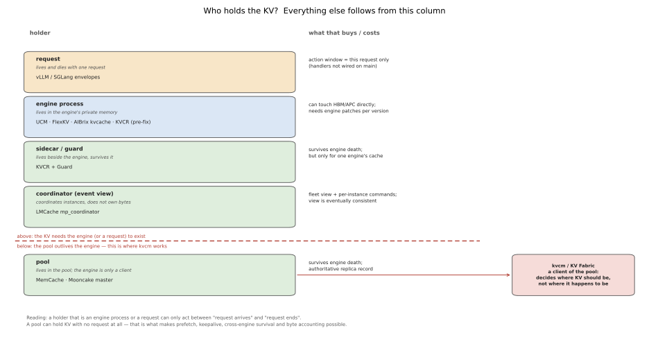
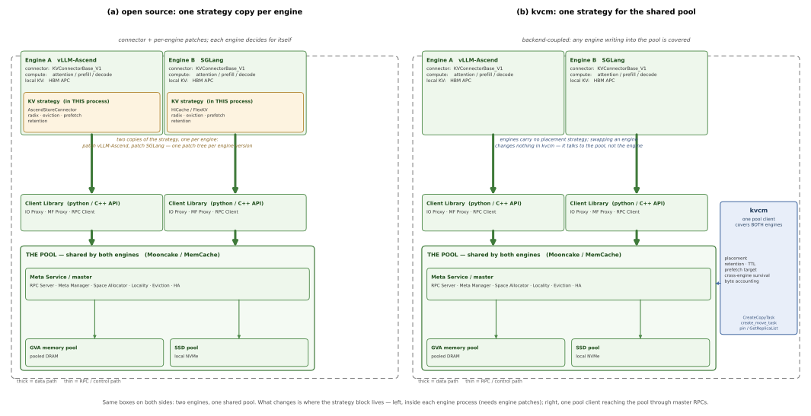
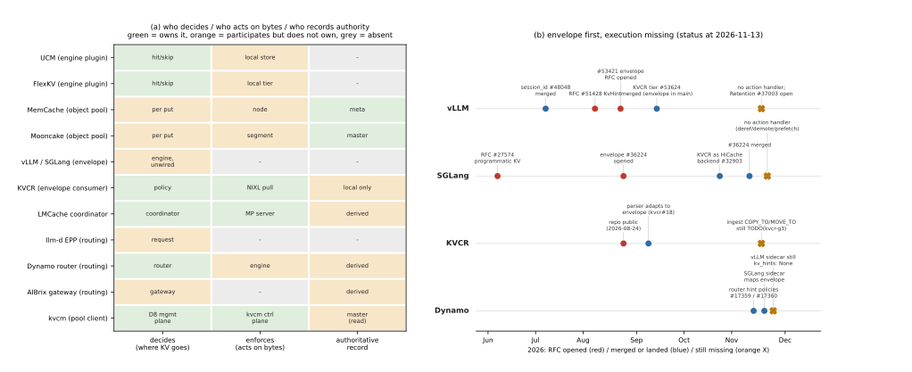
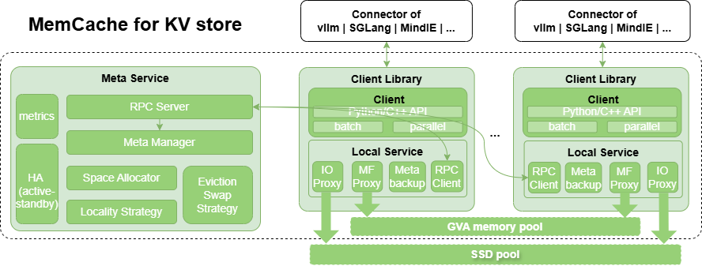

# kvcm / KV Fabric 与开源方案对比（调研）

> 调研快照：2026-11-13。上游源码快照：vLLM `93eeae69`、SGLang `5792cf6e`、UCM `57ddbb26`、KVCR `b7aa81d0`、LMCache `58c11e38`、MemCache `14b4e35e`、FlexKV `55ad438e`、llm-d-router `647ca7ca`、Dynamo `b20fe6fe`、AIBrix `17652f54`；kvcm 基线 `4d9dd33`。
> 性质：开源方案对照研究，不是设计决策文档。kvcm 自身的设计在 [`kvcm/design/`](../../kvcm/design/D10-kv-fabric-roadmap.md)。
> 读法：§1 立场 → §2 这条差别决定什么 → §3 三个场景看差异 → §4 代价 → §5 各家归类 → 附录 A 符号级事实 / B 未复核 / C 代码索引。

---

## 1. 一句话立场

**开源方案里，KV 是引擎进程的状态；kvcm 里，KV 是池里的一等对象。**

这句话看起来抽象，但它决定了后面所有事。展开说：

开源方案的共同前提是「KV 依附于某个持有它的实体」——引擎进程、某个请求、或某个 connector 自己维护的目录。所以它们的思路都是同一个方向：引擎要用 KV，怎么让它用得更好。加钩子（UCM/FlexKV）、加信封（vLLM/SGLang）、加目录（LMCache/KVCR）、加路由（llm-d/Dynamo/AIBrix），都是这个方向下的不同做法。

这些做法的生命周期也是被引擎定的：动作从「引擎要这个 KV」开始，到「这个请求结束」为止。KV 什么时候消失，由引擎决定。

kvcm 把 KV 从引擎手里拿了出来。key 是池里的对象，副本有主、有位置，池自己记权威记录。于是「这块 KV 在哪、还活着吗、该不该搬」变成了一个**和任何引擎进程无关的问题**。

（自绘图，由 [`kvcm-vs-oss/figures/plot_kvcm_vs_oss.py`](kvcm-vs-oss/figures/plot_kvcm_vs_oss.py) 生成。红线上方是「KV 必须有引擎或请求才能存在」，下方是「池比引擎活得久」。kvcm 站在池这一行的右侧：它不是池，是池的调用方。全部图源与许可见 [`kvcm-vs-oss/figures/README.md`](kvcm-vs-oss/figures/README.md)。）

换到具体部件上看，两边的差别只有一个格子：**KV 控制策略画在哪个进程里**。图 (a)(b) 的引擎、Client Library、Meta Service / master、GVA 内存池、SSD 池完全一样，只有策略块换了位置。

（自绘图，同上脚本。粗箭头是数据面，细箭头是 RPC / 控制面。部件命名沿用 MemCache 上游架构图，便于和 §A.2 那张原图对照。）

- **(a) 开源侧**：策略是引擎进程内的一块，和 connector 一起编译进去。它决定这次请求取多少 KV、驱逐谁、要不要预取，然后由引擎自己动手。这就是为什么要跟着引擎版本打补丁——策略和引擎代码在同一进程里，接口一变就得跟着改。
- **(b) kvcm**：引擎只做自己的事（算 attention、命中了就读本机 APC）。策略块挪到池的 client 上，通过 `CreateCopyTask` / `create_move_task` / `pin` / `GetReplicaList` 这些 master RPC 对池动手。**引擎换成哪一个都不影响这块策略**——它认的是池，不是引擎。

同一张图也能看出 (b) 的代价：kvcm 没有引擎内那条细箭头，所以它拿不到 HBM/APC 里的信息（§4）。

## 2. 这条差别决定什么

下面五条不是五个并列的功能，是同一件事的五个面：

| 因为 KV 是池的对象 | 所以 | 引擎侧方案能不能做到 |
|---|---|---|
| 不依附于请求 | 没有请求也能存在：策略预取、空闲时预热 | 不能——动作的起点必须是某个请求 |
| 不依附于请求的生命周期 | 活过请求：保活、降层、按 TTL 留 | 部分——只能随请求结束顺带做 |
| 不依附于产生它的引擎 | 活过引擎：retain 的设计目标 | 不能——字节在进程私有内存里 |
| 有主人，可以换主人 | 引擎之间转移副本（move） | 不能——换主人意味着改引擎的状态 |
| 可被度量、归属、设预算 | 按前缀/租户记字节与带宽 | 不能——跨实例没有统一账本 |

「不能」那一列不是能力不足，是**立场不同导致的必然**。举例：UCM 没有 move，不是它做得差，是「把副本从 A 机挪到 B 机」根本不发生在引擎内插件的职责里——插件只知道「这次请求要用的 KV 在哪」，不知道「集群里还有哪些副本、该不该合并」。

同样，我们和 UCM/FlexKV 不是替代关系。引擎用 UCM 把 KV 写进 Mooncake，kvcm 照样能对同一批 key 下 copy/move。前者管「这次请求怎么取」，后者管「这块 KV 该在哪」。

**retain 未接，是接线没做完，不是架构上做不到。** 判断这条差异时不该看当前实现状态，而该看：一旦接上，它属于谁的职责范围。retain 只有在「KV 是池的对象」这个前提下才成立——所以它是我们的题目，不是 UCM 的题目。

## 3. 三个场景看差异

抽象说完了，看三个具体场景，各家的处理有什么不同。

### 3.1 引擎要下线（滚动升级、缩容、故障）

这是最能区分立场的一个场景。**KV 能不能活下来，取决于它依附于谁。**

| 方案 | 引擎下线时 KV 会怎样 | 为什么 |
|---|---|---|
| UCM / FlexKV | 该引擎进程内的一切随之消失 | KV 的持有者就是那个进程。插件没有「让别的进程接管」这个概念 |
| vLLM / SGLang | 一样。信封是请求元数据，随请求结束而结束 | 没有「请求之外的 KV」这个概念 |
| LMCache | L2 层的字节还在（在共享存储上），但目录里的条目要等事件或超时才对上 | 目录是事件派生的，实例消失后要靠心跳超时剔除 |
| KVCR | Guard 旁挂进程能接管，这是它专门解决的问题 | 它把「KV 的归属」从引擎进程挪到了 Guard |
| Mooncake / MemCache | **池里的副本不受影响**，只有挂在死掉那台引擎 segment 上的副本会清 | 池是独立进程，引擎只是它的一个 client |
| **kvcm** | 同上——而且可以**在引擎死前**主动把副本搬到活着的 segment，或挪进自己的段 | 因为它能对池点名搬 |

KVCR 和 kvcm 在这里走到一起了：两家都意识到「KV 必须脱离引擎进程才能活过引擎」。区别在做法——KVCR 在引擎旁挂一个进程，kvcm 直接把 KV 交给池。

这条也正是 D2 §4 定的四条 retain 路径的来源（见 [`kvcm/design/D2-kv-operations.md`](../../kvcm/design/D2-kv-operations.md) §4）。retain 未接不等于这条路走不通：今天就能用 move 把副本搬到活段。

### 3.2 引擎升级版本

| 方案 | 升级时要做什么 | 代价 |
|---|---|---|
| UCM | 维护 **16 个版本补丁目录**（`0.9.2`、`0.11.0`、`v0110`…`v0300`、`common`）。点开看：[`ucm/integration/vllm/patch/`](https://github.com/ModelEngine-Group/unified-cache-management/tree/develop/ucm/integration/vllm/patch) | 每跟一个引擎版本，补丁要重打、重测 |
| FlexKV | **5 份 vLLM 补丁，377–528 行，最多触及 13 个 vLLM 文件**（含 `v1/core/sched/scheduler.py`）。点开看：[`examples/vllm_adaption/`](https://github.com/taco-project/FlexKV/tree/main/examples/vllm_adaption) | 同上，且直接改调度器 |
| LMCache | 跟随 LMCache 自己的 connector 与 MP server 版本。官方维护一份 [vLLM × LMCache 兼容矩阵](https://github.com/LMCache/LMCache/blob/main/docs/source/getting_started/Installation_compatibility_matrix.csv)（[说明页](https://github.com/LMCache/LMCache/blob/main/docs/source/getting_started/compatibility.rst)） | 引擎与协调器要一起升级 |
| **kvcm** | **不需要出补丁** | — |

LMCache 那张矩阵能直接看出负担：横轴是 8 个 LMCache 版本（0.3.10 → 0.4.2），纵轴是 vLLM 的每个次版本（0.11.2 → 0.18.0），逐格标是否验证过。文档开头自己写着「vLLM 和 LMCache 独立发版，新的 LMCache 发布不意味着旧版 vLLM 能加载每一个 connector，新的 vLLM 发布也可能改掉集成所依赖的 KV-cache API」。所以它跟 UCM/FlexKV 是两种形态的同一件事：它们打补丁，LMCache 维护兼容矩阵——都要跟着引擎版本走，只是记录方式不同。

两个目录一眼能看出来。UCM 那个目录名就是引擎版本号，`0.9.2` 到 `v0300` 排成一列，跟一个版本就多一个目录；FlexKV 那边是文件名带版本，`vllm_0_10_1_1`、`vllm_0_16_0`、`vllm_up_0_14_1`、`vllm_main`，一份补丁对一个版本。LMCache 没有补丁目录，负担变成了维护那张矩阵的每一行每一格。

UCM 的 `patch/v0300/mamba_layer_hooks_patch.py` 值得单独看一眼：它不是在装钩子，而是在判断某一类层（线性注意力 / GDN / KDA）在 `VLLM_COMPILE` 模式下钩子会不会被 Dynamo 追踪剪掉，剪掉了就退化成 `--enforce-eager`。也就是说，补丁要跟的不只是版本号，还有引擎编译器的行为。

这不是说别家做得笨。**它们必须待在引擎里，因为它们的答案要影响引擎的行为**：什么时候取 KV、取多少、在哪一层插进去。要影响引擎，就得改引擎。

kvcm 的答案不影响引擎行为，只影响「KV 在哪」，所以它可以待在引擎外。`grep -rni "connector" kvcm/kvcm/` 全包零命中——这不是巧合，是定位的直接后果。

### 3.3 下一轮请求提前量

Agent 场景里，一轮结束到下一轮开始之间可能有几秒到几分钟。这段时间里，KV 应该被保留、预热、还是释放。

| 方案 | 能做到什么 | 边界 |
|---|---|---|
| UCM | 本次请求内按层预取 | 请求边界之外没有动作 |
| LMCache | 能按实例预取（`POST /cache/prefetches`），也能 pin | 只管自己的 L1/L2，pin 是「排除在自己驱逐计划外」的计数，没有 TTL/续租概念 |
| KVCR | 能按 hint 从远端拉 | 入池放置仍是 `TODO(kvcr-g3)`；`no_retain` 明确拒绝 |
| **kvcm** | 保活（lease 续租）、降层、搬到指定段、按 TTL 留 | retain 未接；copy/move 无取消 |

这一场各家都能做一部分，差异没有前两个场景那么大。真正的差别在**保留用什么机制**：LMCache 用驱逐计划里的计数，我们用池的 lease。lease 是池的语义，引擎不参与；计数是协调器自己记的，它挂了就没了。

## 4. 代价：引擎内部你看不见

这条立场有且只有一个必然代价，其他「不如别家」的地方都是它的派生。

**HBM / APC 在引擎进程里，你在池外就摸不到。** 池只知道「DRAM 副本 READY」，不知道那块 KV 有没有被引擎读进显存、现在还在不在。要判定 HBM 命中，只能靠引擎事件或壳请求推断（D8 §3.1）。别家住在引擎里，这项天然有。

派生的代价还有几条：

- **不能插在引擎 forward 中间**。UCM 可以在第 N 层算完就把 KV 传走，我们只能整块搬。
- **能做的事受池 API 限制**。池没有的能力我们也没有。比如池没有「按 key 查询 client_id」的 RPC，pin 就只能靠空写（`_empty_pin.so`）。
- **数据面依赖源 seg client 在线**。源引擎进程死了，内存里那份就搬不出来——这条不是我们独有，KVCR 的主动搬运同样要求源节点在场。

这几条都写在附录 B 的短板清单里，不藏。

---

## 5. 各家归类

一句话一个，看清各自站在这个立场的哪一侧。

| 项目 | 一句话 | KV 依附于谁 |
|---|---|---|
| UCM | 引擎内插件 + 可插拔 store，管「这次请求怎么取 KV」 | 引擎进程 |
| FlexKV | 引擎旁卸载库，管「这台机的 KV 放哪层」 | 引擎进程 |
| MemCache | 昇腾对象池，MetaService 管分配与副本 | 池（本身就是池） |
| Mooncake | 对象池 + 传输引擎；master 持副本权威 | 池（本身就是池） |
| LMCache | 独立协调器 + 进程内 MP server，管自己的 L1/L2 | 引擎侧 MP server 进程 |
| vLLM / SGLang | 请求信封的传输层，执行尚未接 | 请求 |
| KVCR | 引擎内二级存储 + hint 驱动 P2P + Guard 容错 | Guard 进程（刻意的例外） |
| llm-d EPP | 路由层，逐块索引 + 插件化打分 | 不持有 KV |
| Dynamo | 路由层 + 类型化 hint + Planner，整栈最全 | 引擎 + 派生索引 |
| AIBrix | K8s 平台积木，网关索引 + 引擎旁卸载 | 引擎 + 网关索引 |
| **kvcm** | **池的 client：对池点名搬、保活、核验、记账** | **池** |

从这一列能看出：**只有 MemCache / Mooncake / kvcm 三者的 KV 完全脱离引擎进程。** 前两个本身就是池，kvcm 是池的调用方——池负责「KV 在哪」，kvcm 负责「KV 该在哪」。

（自绘图，同上脚本。左栏把「谁决定、谁动字节、谁的记录算权威」拆开填格：绿 = 持有，橙 = 参与但不拥有，灰 = 无。可以看到权威记录只落在两个对象池手里，其余各家的位置知识都是派生视图。右栏是请求信封的落地时间线：两家引擎都把信封形状定下来了，但 action 执行都还没接。日期取自各 RFC/PR 的 `created_at` / `closed_at`，2026-11-13 核对。）

---

## 附录 A：逐家符号级事实

前面说的是立场，这里给证据。每条都能在源码里对上。

### A.1 引擎内插件：UCM / FlexKV

（**本仓自绘**，非上游原图：redrawn from unified-cache-management `docs/source/_static/architecture.svg`，MIT with additional conditions，快照 `57ddbb26`（2026-11-13）。只保留本文用到的三层命名，布局以原图为准。上游原图 [在此](https://github.com/ModelEngine-Group/unified-cache-management/blob/main/docs/source/_static/architecture.svg)，未复制进本仓：`LICENSE` 是标准 MIT，但 README 写「MIT with additional conditions」且未写明附加条款，许可边界不清，按保守处理只链接。）

**UCM**（ModelEngine，MIT 附加条件）

| 事实 | 出处 |
|---|---|
| 走 `KVConnectorBase_V1` 接入；多套 connector 分型（direct / layerwise / PD / lite / mock），另有稀疏框架 | `ucm/integration/vllm/ucm_connector.py`：`UCMDirectConnector`、`UCMLayerWiseConnector`、`UCMCPConnector`、`UCMPDConnector`、`UCMLiteConnector`、`UCMConnector` |
| 版本补丁树：按引擎版本分目录，另有 common 与根级补丁脚本 | [`ucm/integration/vllm/patch/`](https://github.com/ModelEngine-Group/unified-cache-management/tree/develop/ucm/integration/vllm/patch)：`0.9.2`、`0.11.0`、`v0110`…`v0300`、`common` 共 16 个目录 + `apply_patch.py` / `boot_patch.py` 等根级模块 |
| store 抽象只有 lookup / prefetch / load / dump / wait 一族 | `ucm/store/ucmstore_v1.py::UcmKVStoreBaseV1`；`ucm/store/ucmstore_v1.h::StoreV1` |
| v1 store 无 move / retain；prefetch 只作 GC 热度提示 | `grep -rn "def move\|def retain" ucm/` 无命中；`ucm_connector.py` 注释 "Prefetch is only a GC hotness hint" |
| v2 store 有 request 作用域的 `Pin`/`Unpin`（传输期防驱逐窗口） | `ucm/v2/store/store.h::Pin` / `Unpin`；`ucm/v2/proxy/store_scheduler.h::StoreScheduler`、`store_worker.h::StoreWorker`、`store_peer.h::StorePeer` |
| DRAM store 有 scheduler / worker 角色分离 + 一致性哈希派发 | `ucm/store/dram/cc/config.h::Role{SCHEDULER,WORKER}`；`task_manager.cc::TaskManager::BuildRequests` → `router->RouteKeys` |
| 全仓无 kv_hints / 无 hint 平面 | `grep -rn "kv_hints\|KvHint" ucm/` 为空 |
| PD 三种传输拓扑（HBM 直传 / DRAM 中介 / 统一池），主推经池 | `docs/source/user-guide/pd-disaggregation/index.md` |

**FlexKV**（腾讯云 TACO）

| 事实 | 出处 |
|---|---|
| 引擎旁独立 server 进程，ZMQ 请求面 | `flexkv/server/request.py`：`PutRequest` / `GetRequest` / `PrefetchRequest` / `LaunchTaskRequest` / `CancelTaskRequest` / `WaitRequest`；`flexkv/server/server.py::KVServer` |
| 本机分层的 radix（CPU / SSD / REMOTE） | `flexkv/cache/`（`radix_shmem_engine.py`、`radixtree.py`、`radix_remote.py`） |
| 远端 radix 共享：Redis 元数据通道 + 分布式 radix，带 `lease_renew_ms` | `flexkv/cache/radix_remote.py::DistributedRadixTree`、`flexkv/cache/redis_meta.py::RedisMetaChannel` |
| 有预取协调器（session 级预取计划与配额） | `flexkv/prefetch/coordinator.py`（"Single-owner session scheduler. The backend owns cache plans, not policy."）、`prefetch/policy.py` |
| 无请求路由、无扩缩 | `grep -rn "router\|controller" --include=*.py flexkv/` 无命中 |
| vLLM 补丁（5 份，按引擎版本分） | [`examples/vllm_adaption/`](https://github.com/taco-project/FlexKV/tree/main/examples/vllm_adaption)；`vllm_0_10_1_1` / `vllm_0_16_0` / `vllm_up_0_14_1` / `vllm_main-flexkv-layerwise-wrapper`；`vllm_0_10_1_1-flexkv-connector-namespace.patch` 触及 13 个 vLLM 文件（含 `v1/core/sched/scheduler.py`） |

### A.2 对象池：MemCache / Mooncake

（**上游原图**：Ascend MemCache `doc/source/memcache_architecture.png`，MulanPSL2，快照 `14b4e35e`（2026-06-02）。来源仓库 [gitcode.com/Ascend/memcache](https://gitcode.com/Ascend/memcache)，README「概述」节引用。图中三层：引擎 connector（vLLM/SGLang/MindIE）→ MetaService + Client Library（LocalService：IO Proxy / MF Proxy / Meta backup）→ GVA 内存池与 SSD 池；控制面走 RPC Server，数据面由 LocalService 本地直连池。MulanPSL2 允许复制与再分发，保留本署名即可。）

**MemCache**（Ascend，MulanPSL2）

| 事实 | 出处 |
|---|---|
| 对象级 API：put / get / query / batch_query / exist / batch_exist / remove / batch_remove | `src/memcache/include/mmc_client.h` |
| put 可指定介质、副本数与偏好 LocalService（≤8 副本） | `mmc_def.h::mmc_put_options{mediaType, policy, replicaNum, preferredLocalServiceIDs}`；MAX_BLOB_COPIES=8 |
| 中心有「按 rank 强制分配」的放置能力 | `meta_service/mmc_meta_manager.cpp::MmcMetaManager::CopyBlob`（`AllocOptions.preferredRank_` + `ALLOC_FORCE_BY_RANK`）；`mmc_locality_strategy.h::AllocFlags` |
| 内部有 move / replicate，但只被驱逐回调使用，无对外 RPC | `MmcMetaManager::MoveBlob` / `ReplicateBlob`；唯一调用点 `EvictCallBackFunction` |
| lease：读/写状态机上加租约，删除时等租约清零 | `entities/mmc_blob_state.cpp::BlobStateMachine::GetGlobalTransTable`（`LeaseAdd` / `LeaseWait`）、`entities/mmc_meta_lease_manager.h::MmcMetaLeaseManager` |
| MetaService 支持 HA（K8s Lease 选主） | `python/memcache_hybrid/meta_service_leader_election.py::MetaServiceLeaderElection` |
| 不认前缀语义、无 hint | `grep -rni "router\|hint" src/memcache/` 无命中 |

**Mooncake**（kvcache-ai，v0.3.13.post1）

| 事实 | 出处 |
|---|---|
| 副本权威记录可查 | `mooncake-store/include/master_client.h::GetReplicaList` / `BatchGetReplicaList` |
| 点名目标的 copy / move | `master_client.h::CreateCopyTask` / `CreateMoveTask` |
| 动态副本可「偏好」目标段，但受热度准入闸约束 | `include/rpc_types.h::ReplicaActionProposal{preferred_target_segment}`；`src/master_service.cpp`：入口先过 `DynamicReplicationHeatAdmitted`，`preferred_target_segment` 只在 `is_valid_target` 成立时被采纳 |

### A.3 独立协调器：LMCache

`mp_coordinator` 自 2026-06-03（#3488）替代旧的进程内 `cache_controller`。旧目录于 2026-10-22 移入 `lmcache/v1/inprocess/v1/cache_controller/`（#5970），2026-11-06 整体移出主仓（#6254）。**main 上不存在 `cache_controller/`，也不存在 `RegistryTree` / `KVController` / `LMCacheControllerManager`。**

| 事实 | 出处 |
|---|---|
| 与 vLLM 的兼容性靠官方矩阵维护，不靠补丁目录 | [`docs/source/getting_started/Installation_compatibility_matrix.csv`](https://github.com/LMCache/LMCache/blob/main/docs/source/getting_started/Installation_compatibility_matrix.csv)；[`compatibility.rst`](https://github.com/LMCache/LMCache/blob/main/docs/source/getting_started/compatibility.rst) 开头即写明「vLLM 与 LMCache 独立发版，新版 LMCache 不保证旧版 vLLM 能加载每个 connector」 |
| 独立进程、FastAPI 服务，默认只监听回环 | `lmcache/v1/mp_coordinator/app.py::create_app`；`docs/source/mp/coordinator.rst`（默认 `127.0.0.1:9300`） |
| fleet 级 key 目录，事件派生、最终一致，**答案只是 hint，必须在 owner 处验证** | `views/key_directory.py::KeyDirectory`（docstring: "Eventually consistent: lookups are hints to be validated at the owner"）、`lookup` |
| 目录只由 CacheEvent 批次构建，可 checkpoint / 回放 | `ingest/event_gate.py::EventGate`、`cache_events.py::CacheEventSink`、`events_replay.py::replay`、`persistence/checkpoint.py` |
| 实例注册与心跳、超时剔除 | `http_apis/instances_api.py`、`views/instance_registry.py::InstanceRegistry`、`registrar.py::keep_registered` |
| 预取能指定实例 | `http_apis/cache_api.py::request_prefetch`（body 带 `instance_id`；未知实例 404）、`controllers/prefetch_manager.py::PrefetchManager.submit_prefetch` |
| pin 是「排除在自己 L2 驱逐计划外」的计数，不是按时间续租 | `controllers/eviction_controller.py::FleetEvictionController.pin`（`_pin_counts`）、`controllers/eviction_http_api.py::request_pin` |
| 无 lease / keepalive 语义 | `grep -rni "lease\|keepalive" lmcache/v1/mp_coordinator/` 仅命中无关的 `_release_locked` |
| 无 move 路由 | 全部路由：`/cache/prefetches`、`/cache/pins`、`/cache/delete`、`/quota*`、`/directory/*`、`/instances*`、`/events`、`/config/chunk-size`、`/status`、`/metrics`、`/healthz` |

### A.4 请求信封：vLLM / SGLang / KVCR

| 事实 | 出处 |
|---|---|
| vLLM 信封结构 | `vllm/v1/kv_hints/protocol.py::KvHintsEnvelope` / `KvHintAction{action_id, action_type, action_version, payload}` |
| vLLM 信封贯穿请求链 | `v1/request.py`、`v1/engine/llm_engine.py`、`v1/engine/async_llm.py`、`v1/kv_offload/base.py::ReqContext.kv_hints` |
| vLLM 只有信封、无 action handler | `grep -rn "action_type" vllm/v1/` 仅 `kv_hints/protocol.py` 一处定义 |
| vLLM 唯一消费者是 KVCR 二级层 | `v1/kv_offload/tiering/kvcr/manager.py::KVCRSecondaryTierManager.on_new_request` → `submit_hint` |
| SGLang 同构信封 + 入口形状校验，但无 action 分派 | `managers/kv_hints.py::KvHintsEnvelope` / `decode_kv_hints_envelope`；`grep -rn "action_type" python/sglang/srt/` 仅 `kv_hints.py` |
| KVCR 支持三种 hint | `src/kvcr/hints/hint_types.py::_KVFetchHint` / `_KVPrefetchHint` / `_KVMoveHint`；`hints/dispatcher.py::_HINT_TYPES` |
| KVCR 拒绝 `no_retain` 与「无来源端点」的 hint | `src/kvcr/hints/parser.py::_parse_payload` |
| KVCR 源侧先判「有无托管 DRAM / 是不是自己」，不合格直接拒 | `src/kvcr/hints/hint_handler.py::_IndependentHintHandler.submit` |
| KVCR 入池放置仍是 TODO | `src/kvcr/runtime/policy_runtime.py`（`TODO(kvcr-g3)`） |
| KVCR 主动搬运 = 目的地 `fetch`，`submit_hint` 只建连接 | `src/kvcr/api.py::submit_hint`、`backends/remote_fw_dram.py` |

### A.5 路由层：llm-d / Dynamo / AIBrix

| 事实 | 出处 |
|---|---|
| llm-d：逐块索引 + 加权打分插件 | `pkg/kvcache/indexer.go::Indexer`、`pkg/epp/scheduling/weighted_scorer.go` |
| llm-d P2P：目的地发起，sidecar 把来源塞进 `kv_transfer_params` 让目标引擎自己取 | `pkg/sidecar/proxy/connector_p2p.go::decodeWithP2PSource` / `kvSourceFromBody` |
| Dynamo：router 侧有类型化 hint 与「强制 / 偏好」两级 | `lib/router/scheduler/src/kv_hints.rs::resolve_transfer_sources`；`lib/router/kv-hints/src/keys.rs::KvTransferEnforcement{Required, Preferred}` |
| Dynamo：SGLang sidecar 已映射信封；vLLM sidecar 仍发 `kv_hints: None` | `lib/sidecar/sglang/src/protocol.rs::kv_hint_to_proto`；`lib/sidecar/vllm/src/convert.rs` |
| AIBrix：网关侧前缀哈希表 + 事件同步双路线 | `pkg/utils/prefixcacheindexer/hash.go::PrefixHashTable`、`pkg/utils/syncprefixcacheindexer/sync_hash.go::SyncPrefixHashTable` |
| AIBrix：L2 的 "pinned" 指页锁定内存，不是防驱逐 pin | `python/aibrix_kvcache/aibrix_kvcache/l2/l2_cache.py::L2Cache.allocate`（docstring: "Allocate pinned memory regions"） |

### A.6 kvcm 站在池之上

| 事实 | 出处 |
|---|---|
| 八项操作的接口面 | `kvcm/kvcm/ops/base.py::KvOps` |
| 池侧身份 = 一个 client（注册 UUID + 心跳，`global_segment_size=0`） | `kvcm/kvcm/backends/mooncake/client.py` 模块 docstring |
| copy / move 提交走任务通道，READY 由目标侧副本核验得出 | `backends/mooncake/backend.py::copy` / `move` / `query_task` |
| 操作入参只有 key 与 segment，无引擎侧句柄 | `backend.py::copy` → `create_copy_task(key, [seg])`；`move` → `create_move_task(key, src_seg, tgt_seg)`；`remove` → `batch_remove(keys, force)` |
| 引擎相关代码只做 key 与 rank 对号 | `engines/vllm/keys.py::KeyComputer`、`engines/vllm/topology.py::RankTopology` |
| retain 未接 | `backend.py::retain`：`raise NotImplementedError` |
| 能力按后端版本显式声明 | `ops/capability.py::BackendCapability` |
| 保活循环 | `loops.py::KeepaliveLoop` |

---

## 附录 B：可核对的短板与未复核条目

### B.1 短板

1. **看不见引擎 HBM / APC**（§4）。HBM 命中判定必须靠引擎事件或壳请求。
2. **retain 未接**：`backend.py::retain` 抛 `NotImplementedError`。跨引擎存活目前只能靠 move 到活段，或 kvcm 自挂盘（D2 §4）。
3. **数据面依赖源 seg client 在线**。不是我们独有：KVCR 的主动搬运同样要求源节点在场。
4. **copy / move 无取消**：两版本都无取消 RPC，请求改道时只能弃置 + 事后清副本。
5. **pin 有前置条件**：soft pin 依赖手写 `_empty_pin.so`，只对 Mooncake v0.3.13.post1 成立，升 wheel 要重编，且无运行时 ABI 闸。
6. **要自己对齐 key**：前缀 → 池 key 的算法必须与引擎逐字节一致；`PYTHONHASHSEED` 未设会静默漂移。这是内容上的耦合，不是代码上的。
7. **接入仍有已知补丁**：异构 TP 场景 vllm-ascend v0.26.0rc1 需要 #15835 backport。这部分成本没有消失，只是从 kvcm 转移到了「引擎接入池」这一步——而这一步本来就要做，不管有没有 kvcm。
8. **缺路由层**：D8 的 SC 尚未实现，选路仍要外部 router。

### B.2 未复核

1. **SGLang `kv.deref` / `kv.demote` / `kv.prefetch` 的 action handler 是否已在非 main 分支实现。** 只核了 main。按 main 记「无」。
2. **KVCR 入池放置的完成时间**。`TODO(kvcr-g3)` 仍在，上游无 issue 可锚定时间表。
3. **Mooncake `CreateCopyTask` / `CreateMoveTask` 的完成信号语义**（READY 判定、失败重试）依赖 kvcm D2 的实测结论，本文只核到 API 存在与声明。
4. **MemCache `MoveBlob` / `ReplicateBlob` 是否有计划对外暴露。** 本快照内无对外 RPC。
5. **AIBrix 网关路由的决策路径细节。** 只核到索引数据结构与卸载框架，未逐条走 gateway plugin 的打分链路。
6. **llm-d P2P 的逐条拓扑覆盖**（哪些 connector 组合支持 pull）未做全矩阵核对。

---

## 附录 C：代码索引

> 沿代码回溯用。符号锚定，行号会漂移。

| 概念 | 文件:符号 |
|---|---|
| kvcm 操作接口面 | `kvcm/kvcm/ops/base.py::KvOps` |
| kvcm 池 client | `kvcm/kvcm/backends/mooncake/client.py`（`setup` = 注册 UUID + 心跳） |
| kvcm copy / move / query | `kvcm/kvcm/backends/mooncake/backend.py::copy` / `move` / `query_task` |
| kvcm retain（未接） | `kvcm/kvcm/backends/mooncake/backend.py::retain` |
| kvcm soft pin（空写） | `backend.py::pin`；`kvcm/kvcm/native/empty_soft_pin.cpp` |
| kvcm 保活循环 | `kvcm/kvcm/loops.py::KeepaliveLoop` |
| kvcm key 对齐 | `kvcm/kvcm/engines/vllm/keys.py::KeyComputer`；`engines/vllm/topology.py::RankTopology` |
| UCM connector | `ucm/integration/vllm/ucm_connector.py::UCMConnector` / `UCMDirectConnector` / `UCMPDConnector` |
| UCM store 抽象 | `ucm/store/ucmstore_v1.py::UcmKVStoreBaseV1`；`ucm/store/ucmstore_v1.h::StoreV1` |
| UCM v2 窗口 / pin | `ucm/v2/proxy/store_scheduler.h::StoreScheduler`；`ucm/v2/store/store.h::Pin` / `Unpin` |
| UCM DRAM store 角色与派发 | `ucm/store/dram/cc/config.h::Role`；`ucm/store/dram/cc/task_manager.cc::TaskManager::BuildRequests` |
| UCM 一致性哈希 | `ucm/shared/router/router.h::Router::RouteKeys` |
| UCM 补丁树 | [`ucm/integration/vllm/patch/`](https://github.com/ModelEngine-Group/unified-cache-management/tree/develop/ucm/integration/vllm/patch) |
| MemCache 对象 API | `src/memcache/include/mmc_client.h`；`mmc_def.h::mmc_put_options` |
| MemCache 中心实现 | `src/memcache/csrc/meta_service/mmc_meta_manager.cpp::MmcMetaManager` |
| MemCache 租约 | `entities/mmc_blob_state.cpp::BlobStateMachine::GetGlobalTransTable`；`entities/mmc_meta_lease_manager.h::MmcMetaLeaseManager` |
| MemCache HA | `python/memcache_hybrid/meta_service_leader_election.py::MetaServiceLeaderElection` |
| Mooncake 副本权威 | `mooncake-store/include/master_client.h::GetReplicaList` / `BatchGetReplicaList` |
| Mooncake 点名任务 | `master_client.h::CreateCopyTask` / `CreateMoveTask` |
| Mooncake 动态副本 | `include/rpc_types.h::ReplicaActionProposal`；`src/master_service.cpp::DynamicReplicationHeatAdmitted` |
| LMCache 协调器入口 | `lmcache/v1/mp_coordinator/app.py::create_app` |
| LMCache 控制器协议 | `mp_coordinator/controllers/base.py::Controller` |
| LMCache fleet 目录 | `mp_coordinator/views/key_directory.py::KeyDirectory` |
| LMCache 实例注册 | `mp_coordinator/views/instance_registry.py::InstanceRegistry` |
| LMCache 预取 | `mp_coordinator/http_apis/cache_api.py::request_prefetch` |
| LMCache pin / 驱逐 | `mp_coordinator/controllers/eviction_controller.py::FleetEvictionController` |
| LMCache 事件管线 | `mp_coordinator/cache_events.py::CacheEventSink`；`ingest/event_gate.py::EventGate` |
| LMCache 进程内 server 由自家 connector 拉起 | `integration/vllm/vllm_multi_process_adapter.py`；`v1/multiprocess/server.py::MPCacheServer` |
| vLLM hint 信封 | `vllm/v1/kv_hints/protocol.py::KvHintsEnvelope` |
| vLLM hint 消费 | `vllm/v1/kv_offload/tiering/kvcr/manager.py::KVCRSecondaryTierManager.on_new_request` |
| SGLang hint 信封 | `python/sglang/srt/managers/kv_hints.py::KvHintsEnvelope` |
| KVCR hint 分派 | `src/kvcr/hints/dispatcher.py::_HINT_TYPES` |
| KVCR hint 拒绝 | `src/kvcr/hints/parser.py::_parse_payload` |
| KVCR 主动放置 TODO | `src/kvcr/runtime/policy_runtime.py`（`TODO(kvcr-g3)`） |
| llm-d P2P 目的地发起 | `pkg/sidecar/proxy/connector_p2p.go::decodeWithP2PSource` |
| llm-d 索引 | `pkg/kvcache/indexer.go::Indexer` |
| Dynamo hint 解析 | `lib/router/scheduler/src/kv_hints.rs::resolve_transfer_sources` |
| Dynamo hint 强度 | `lib/router/kv-hints/src/keys.rs::KvTransferEnforcement` |
| Dynamo vLLM sidecar（未接） | `lib/sidecar/vllm/src/convert.rs`（`kv_hints: None`） |
| AIBrix 前缀索引 | `pkg/utils/prefixcacheindexer/hash.go::PrefixHashTable` |
| AIBrix 卸载框架 | `python/aibrix_kvcache/aibrix_kvcache/l1/l1_cache.py::L1Cache`；`l2/l2_cache.py::L2Cache` |
| FlexKV 请求面 | `flexkv/server/request.py`；`flexkv/server/server.py::KVServer` |
| FlexKV 远端 radix | `flexkv/cache/radix_remote.py::DistributedRadixTree`；`flexkv/cache/redis_meta.py::RedisMetaChannel` |
| FlexKV 预取协调 | `flexkv/prefetch/coordinator.py` |
| Dynamo 扩缩 | `components/src/dynamo/planner/core/load_scaling.py::LoadScalingMixin`；`throughput_scaling.py::ThroughputScalingMixin` |
| AIBrix 扩缩 | `pkg/controller/podautoscaler/autoscaler.go::DefaultAutoScaler` |
