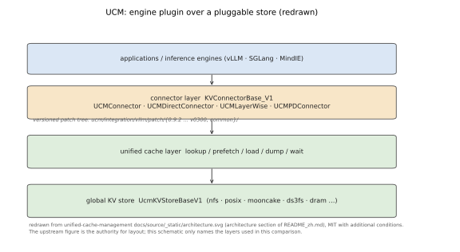

# kvcm / KV Fabric 与开源方案对比（调研）

> 调研快照：2026-11-13。上游源码快照：vLLM `93eeae69`、SGLang `5792cf6e`、UCM `57ddbb26`、KVCR `b7aa81d0`、LMCache `58c11e38`、MemCache `14b4e35e`、FlexKV `55ad438e`、llm-d-router `647ca7ca`、Dynamo `b20fe6fe`、AIBrix `17652f54`；kvcm 基线 `4d9dd33`。
> 范围：开源方案对照研究。kvcm 自身的设计在 [`kvcm/design/`](../../kvcm/design/D10-kv-fabric-roadmap.md)。
> 读法：§1 必要性 → §2 角色与耦合 → §3 四个问题 → §4 三个场景 → §5 各家归类 → §6 今天与目标 → 附录 A 符号级事实 / B 短板与待确认 / C 代码索引。

---

## 1. kvcm 架构的必要性

### 1.1 三类信息分属三个系统

决定 KV 放在哪，需要三类信息同时在场。

| 信息 | 归属 | 谁拿得到 | 谁拿不到 |
|---|---|---|---|
| 请求侧需求：下一轮何时来、去哪台、什么前缀、预算多少 | 网关 / agent | 入口组件（llm-d EPP、Dynamo router） | 引擎、池 |
| 池侧库存：哪个 segment 有哪个 key 的副本、lease 多久、容量余量 | 池 master | 池的 client | 引擎、路由层 |
| 执行能力：指名搬副本、保活、核验到位 | 池 API | 池的 client | 引擎侧插件 |

开源栈里没有任何组件同时握有两者以上。vLLM 可以加一种 hint 类型，但它看不到集群里 KV 的分布；Mooncake 可以加一个 API，但它看不到请求流。要凑齐这三样，得同时改三个项目并维护它们之间的胶水，而胶水本身要跟着三个项目各自的接口演进。

补丁负担由此而来：**缺的不是某个功能，是那个同时满足「能看见请求」与「能拿到池权威」的位置。**

### 1.2 中心基于什么做决定

Mooncake 已经是中心化放置，但依据和时机与我们不同。

| | 依据 | 时机 |
|---|---|---|
| Mooncake 动态副本 | 过去的热度（`DynamicReplicationHeatAdmitted` 要求窗口内命中数达标） | 已经热了之后 |
| kvcm | 未来的需求（hook 给出的 ETA、会话、前缀） | 请求到达之前 |

两者都是中心说了算，区别在中心的输入。前者只能反应，后者可以前置。而看见未来的需求这件事，池做不到——它不在请求路径上。

**kvcm 占的位置**：池的 client（拿得到权威与执行能力），同时接收 hook（看得见请求侧需求）。

## 2. kvcm 的角色

### 2.1 三层身份

| 层 | 是什么 | 现状 |
|---|---|---|
| **接入身份** | 池的一个 client：自己的 UUID、心跳、`global_segment_size=0`（不持有存储） | 已实现 |
| **逻辑角色** | master 的 facade：封装 RPC，加上生命周期、核验、记账 | 已实现 |
| **控制面** | D9 执行（copy/move/pin/keepalive/demote/promote/remove + 核验 + 台账） | 已实现（retain 除外） |
| | D8 决策（选路、保留、放置、扩缩） | **未实现** |
| **终局** | KV Fabric：master 权威 + D9 控制面 + D8 联合调度 + 多引擎/多后端/多集群 + 租户/QoS/账本 | 目标 |

**权威始终在 master，不在 kvcm。** kvcm 是 master 的 client 侧控制面封装——读权威、按权威下指令，但它不是权威本身。它的价值在于「在权威之上加了一层决策与核验」，不在于持有记录。

### 2.2 耦合点

| | LMCache | UCM / FlexKV | kvcm |
|---|---|---|---|
| 耦合点 | connector-coupled | engine plugin / patch | **backend-coupled** |
| 换引擎 | 要接 LMCache connector | 要改引擎或打 patch | 只要同一个 backend + key 对齐 |
| 换 backend | 不适用 | 不适用 | 换 backend adapter |

```text
kvcm
  → backend adapter
  → Mooncake store / master

vLLM / vLLM-Ascend / SGLang
  → 各自的 connector / store
  → 同一个 Mooncake 池
```

**kvcm 不依赖 connector；connector 是引擎接入池的方式。** 引擎用 UCM 还是 SGLang 原生 connector 把 KV 写进池，与 kvcm 无关——只要写进同一个池、key 算法一致。

### 2.3 补丁是兼容性代价

| 方案 | 负担形态 |
|---|---|
| UCM | 16 个版本补丁目录（[`patch/`](https://github.com/ModelEngine-Group/unified-cache-management/tree/develop/ucm/integration/vllm/patch)） |
| FlexKV | 5 份 vLLM 补丁，377–528 行，最多触及 13 个 vLLM 文件（[`vllm_adaption/`](https://github.com/taco-project/FlexKV/tree/main/examples/vllm_adaption)） |
| LMCache | 维护 [vLLM × LMCache 兼容矩阵](https://github.com/LMCache/LMCache/blob/main/docs/source/getting_started/Installation_compatibility_matrix.csv) |
| kvcm | 不打补丁 |

**要碰 HBM，打 patch 或提 PR 无法避免；kvcm 暂时不做这个选择。** 代价是看不见 HBM/APC，收益是不跟引擎版本绑死。这两条是同一枚硬币的两面。

## 3. 四个问题

按「数据归属」讲不清楚差异，按这四个问题可以。

### 3.1 元数据有没有权威中心

| 方案 | 权威记录 | 性质 |
|---|---|---|
| Mooncake master | 有 | 单写者、段级、lease/驱逐都在它手里 |
| MemCache MetaService | 有 | 同上 |
| LMCache `KeyDirectory` | 无 | 事件派生、最终一致；docstring 写明「lookups are hints to be validated at the owner」 |
| llm-d / Dynamo / AIBrix | 无 | 派生索引，只服务于选路 |
| **kvcm** | **借用 master 的** | 自己不持记录，读 master、按 master 下指令 |

kvcm 读 `GetReplicaList` / `BatchGetReplicaList` 拿副本位置，用 `query_task` 核验任务，用账本记录自己发起的操作。这三样是权威的使用与观察，不是权威本身。

### 3.2 全局视野覆盖到哪

「全局」必须限定到具体范围，否则是空话。

| 范围 | kvcm | 说明 |
|---|---|---|
| 池内（哪些段有副本、容量、lease） | 有 | 读 master，段级精度 |
| 引擎 HBM / APC | **没有** | 在引擎进程内，池外不可见；判定 HBM 命中只能靠引擎事件或壳请求 |
| 跨引擎的前缀视图 | 有（目标） | D8 的 KVT 是 master 的派生视图 |
| 多集群 | 目标，非现状 | 单集群设计 |

第二行是最重要的限制。kvcm 选择待在池外，换来「不跟引擎版本绑死」，代价就是看不见引擎内部（§2.3）。

### 3.3 是否做全局管理

这一问看的不是能否 copy，而是管不管放置、生命周期、预算、租户、QoS、账本。

| 方案 | 管什么 |
|---|---|
| UCM / FlexKV | 这次请求怎么取 KV；范围在本机、本请求 |
| MemCache / Mooncake | 池内放置与容量；按自身热度策略，不感知请求与预算 |
| LMCache 协调器 | 自己的 L1/L2：fleet 目录、按实例预取、L2 配额与驱逐 |
| llm-d / Dynamo / AIBrix | 请求去哪；不碰 KV 字节 |
| **kvcm** | 目标：KV 该在哪、活多久、给谁用。现状：按指令执行 + 保活 + 记账；放置决策仍靠人工或简单策略 |

### 3.4 是否做请求 + KV + 扩缩联合调度

这一条是开源侧普遍没有的，但也是我们尚未实现的。

```text
L0 请求路由      —— 决定去哪    （D8，未实现；现在靠外部 router）
L1 KV 生命周期   —— 决定留多久  （D8 部分；D9 执行已有）
L2 容量扩缩      —— 决定扩不扩  （D8，未实现；外部 HPA/KEDA）
共享 KVT / 预算 / 账本           （KVT 未实现；账本在 D9）
```

Dynamo 是唯一在形态上做齐三层的（Smart Router + KVBM/KVCR + Planner），但它是三个组件拼装，且 KVBM 已 sunset、KVCR 接棒，三者之间靠 hint 与事件松耦合，不共享同一份预算与账本。

## 4. 三个场景


（自绘图，由 [`kvcm-vs-oss/figures/plot_kvcm_vs_oss.py`](kvcm-vs-oss/figures/plot_kvcm_vs_oss.py) 生成。红线上方是「KV 必须有引擎或请求才能存在」，下方是「池比引擎活得久」。kvcm 站在池这一行：它是池的调用方，不是池本身。全部图源与许可见 [`kvcm-vs-oss/figures/README.md`](kvcm-vs-oss/figures/README.md)。）

### 4.1 引擎要下线（滚动升级、缩容、故障）

| 方案 | 引擎下线时 KV 会怎样 | 为什么 |
|---|---|---|
| UCM / FlexKV | 该引擎进程内的一切消失 | KV 的持有者是那个进程 |
| vLLM / SGLang | 一样，信封随请求结束 | 没有「请求之外的 KV」 |
| LMCache | L2 字节还在，目录要等心跳超时才对上 | 目录事件派生 |
| KVCR | Guard 旁挂进程接管 | 它把归属从引擎挪到了 Guard |
| Mooncake / MemCache | 池里的副本不受影响，只清挂在死引擎 segment 上的 | 池是独立进程 |
| **kvcm** | 同上，且能在引擎死前把副本搬到活段 | 能对池点名搬 |

KVCR 和 kvcm 在这里是同一认识、两种做法：一家在引擎旁挂进程，一家把 KV 交给池。

### 4.2 引擎升级版本

见 §2.3 的补丁与矩阵表。核心差异在**接缝放在哪**：放引擎里就要跟版本，放池上就只跟 key 算法。

### 4.3 下一轮请求提前量

| 方案 | 预取入口 | 能否脱离请求 |
|---|---|---|
| UCM | `get_num_new_matched_tokens(request, num_computed_tokens)`；`_prefetch_store` 只在这条链上 | 不能，取不到 `request.request_id` 就算不出 block id |
| FlexKV | SGLang 钩子 `prefetch_from_storage(rid, ...)`；另有 `prefetch_control(action, **payload)` 独立 IPC 通道，但无 ETA 与保留语义 | 主路径不能 |
| KVCR | `submit_hint(hints, request_id=None)` | `request_id` 可省，但 `discard_hint` 必填、远端来源按 request 存，作用域仍绑请求 |
| LMCache MP server | `POST /cache/prefetches`（模型 + token 序列） | 能 |
| **kvcm** | D8 决策 + D9 执行（`copy` / `register_keepalive`） | 能，但 D8 未实现 |

保留用什么机制也不同：LMCache 用驱逐计划里的计数（`_pin_counts`，进程内存，重启即失），我们用池的 lease（master 计时，续租一停就过期，与 kvcm 进程无关）。

## 5. 各家归类

| 项目 | 一句话 | 关键位置 |
|---|---|---|
| UCM | 引擎内插件 + 可插拔 store，管「这次请求怎么取 KV」 | 引擎进程内 |
| FlexKV | 引擎旁卸载库，管「这台机的 KV 放哪层」 | 引擎进程内 |
| MemCache | 昇腾对象池，MetaService 管分配与副本 | 池（本身是池） |
| Mooncake | 对象池 + 传输引擎；master 持副本权威，动态副本按热度 | 池（本身是池） |
| LMCache | 独立协调器 + 进程内 MP server，管自己的 L1/L2 | 引擎侧 server 进程 + 协调器 |
| vLLM / SGLang | 请求信封的传输层，action 执行未接 | 请求 |
| KVCR | 引擎内二级存储 + hint 驱动 P2P + Guard 容错 | Guard 进程 |
| llm-d EPP | 路由层，逐块索引 + 插件化打分 | 不持有 KV |
| Dynamo | 路由 + 类型化 hint + Planner，形态最全但不共享预算 | 引擎 + 派生索引 |
| AIBrix | K8s 平台积木，网关索引 + 引擎旁卸载 | 引擎 + 网关索引 |
| **kvcm** | master 的 client 侧控制面：读权威、下指令、核验、记账 | 池外 |

## 6. 今天与目标

写清差距，避免把目标当成已有能力。

| | 今天 | 目标 | 差距 |
|---|---|---|---|
| 接入 | 池 client（UUID、心跳、不持存储） | 多后端 adapter | 只有 `mooncake` 一个实现 |
| 权威使用 | 读 master 副本记录 | 同上 | 无 |
| 执行 | copy / move / pin / keepalive / demote / promote / remove + 核验 | 同 + retain | `retain` 未接 |
| 决策 | 按指令执行；无自动放置策略 | D8：请求 + KV + 扩缩联合 | D8 的 SC 未实现 |
| 视野 | 池内段级 | + 前缀视图（KVT） | KVT 未实现 |
| 账本 | 操作台账（sqlite） | + 字节/带宽归因与预算 | 未实现 |
| HBM | 不可见 | 不做（架构选择） | — |

一句话：**今天是一个「按指令执行 + 核验 + 记账」的控制面；目标才是 Fabric。** 中间的差距几乎全在 D8。

---

## 附录 A：逐家符号级事实

前面是判断，这里是证据。每条都能在源码里对上。

### A.1 引擎内插件：UCM / FlexKV



（**本仓自绘**，非上游原图：redrawn from unified-cache-management `docs/source/_static/architecture.svg`，MIT with additional conditions，快照 `57ddbb26`（2026-11-13）。只保留本文用到的三层命名，布局以原图为准。上游原图 [在此](https://github.com/ModelEngine-Group/unified-cache-management/blob/main/docs/source/_static/architecture.svg)，未复制进本仓：`LICENSE` 是标准 MIT，但 README 写「MIT with additional conditions」且未写明附加条款，许可边界不清，按保守处理只链接。）

**UCM**（ModelEngine，MIT 附加条件）

| 事实 | 出处 |
|---|---|
| 走 `KVConnectorBase_V1` 接入；多套 connector 分型（direct / layerwise / PD / lite / mock），另有稀疏框架 | `ucm/integration/vllm/ucm_connector.py`：`UCMDirectConnector`、`UCMLayerWiseConnector`、`UCMCPConnector`、`UCMPDConnector`、`UCMLiteConnector`、`UCMConnector` |
| 版本补丁树：按引擎版本分目录，另有 common 与根级补丁脚本 | [`ucm/integration/vllm/patch/`](https://github.com/ModelEngine-Group/unified-cache-management/tree/develop/ucm/integration/vllm/patch)：`0.9.2`、`0.11.0`、`v0110`…`v0300`、`common` 共 16 个目录 + `apply_patch.py` / `boot_patch.py` 等根级模块 |
| store 抽象只有 lookup / prefetch / load / dump / wait 一族 | `ucm/store/ucmstore_v1.py::UcmKVStoreBaseV1`；`ucm/store/ucmstore_v1.h::StoreV1` |
| v1 store 无 move / retain；prefetch 只作 GC 热度提示 | `grep -rn "def move\|def retain" ucm/` 无命中；`ucm_connector.py` 注释 "Prefetch is only a GC hotness hint" |
| v2 store 有 request 作用域的 `Pin`/`Unpin`（传输期防驱逐窗口） | `ucm/v2/store/store.h::Pin` / `Unpin`；`ucm/v2/proxy/store_scheduler.h::StoreScheduler`、`store_worker.h::StoreWorker`、`store_peer.h::StorePeer` |
| DRAM store 有 scheduler / worker 角色分离 + 一致性哈希派发 | `ucm/store/dram/cc/config.h::Role{SCHEDULER,WORKER}`；`task_manager.cc::TaskManager::BuildRequests` → `router->RouteKeys` |
| 全仓无 kv_hints / 无 action hint 平面 | `grep -rn "kv_hints\|KvHint" ucm/` 为空 |
| PD 三种传输拓扑（HBM 直传 / DRAM 中介 / 统一池），主推经池 | `docs/source/user-guide/pd-disaggregation/index.md` |

**FlexKV**（腾讯云 TACO）

| 事实 | 出处 |
|---|---|
| 引擎旁独立 server 进程，ZMQ 请求面 | `flexkv/server/request.py`：`PutRequest` / `GetRequest` / `PrefetchRequest` / `LaunchTaskRequest` / `CancelTaskRequest` / `WaitRequest`；`flexkv/server/server.py::KVServer` |
| 本机分层的 radix（CPU / SSD / REMOTE） | `flexkv/cache/`（`radix_shmem_engine.py`、`radixtree.py`、`radix_remote.py`） |
| 远端 radix 共享：Redis 元数据通道 + 分布式 radix，带 `lease_renew_ms` | `flexkv/cache/radix_remote.py::DistributedRadixTree`、`flexkv/cache/redis_meta.py::RedisMetaChannel` |
| 有预取协调器（session 级预取计划与配额） | `flexkv/prefetch/coordinator.py`（"Single-owner session scheduler. The backend owns cache plans, not policy."）、`prefetch/policy.py` |
| 无请求路由、无扩缩 | `grep -rn "router\|controller" --include=*.py flexkv/` 无命中 |
| vLLM 补丁（5 份，按引擎版本分） | [`examples/vllm_adaption/`](https://github.com/taco-project/FlexKV/tree/main/examples/vllm_adaption)；`vllm_0_10_1_1` / `vllm_0_16_0` / `vllm_up_0_14_1` / `vllm_main-flexkv-layerwise-wrapper`；`vllm_0_10_1_1-flexkv-connector-namespace.patch` 触及 13 个 vLLM 文件（含 `v1/core/sched/scheduler.py`） |

### A.2 对象池：MemCache / Mooncake


（**上游原图**：Ascend MemCache `doc/source/memcache_architecture.png`，MulanPSL2，快照 `14b4e35e`（2026-06-02）。来源仓库 [gitcode.com/Ascend/memcache](https://gitcode.com/Ascend/memcache)，README「概述」节引用。图中三层：引擎 connector（vLLM/SGLang/MindIE）→ MetaService + Client Library（LocalService：IO Proxy / MF Proxy / Meta backup）→ GVA 内存池与 SSD 池；控制面走 RPC Server，数据面由 LocalService 本地直连池。MulanPSL2 允许复制与再分发，保留本署名即可。）

**MemCache**（Ascend，MulanPSL2）

| 事实 | 出处 |
|---|---|
| 对象级 API：put / get / query / batch_query / exist / batch_exist / remove / batch_remove | `src/memcache/include/mmc_client.h` |
| put 可指定介质、副本数与偏好 LocalService（≤8 副本） | `mmc_def.h::mmc_put_options{mediaType, policy, replicaNum, preferredLocalServiceIDs}`；MAX_BLOB_COPIES=8 |
| 中心有「按 rank 强制分配」的放置能力 | `meta_service/mmc_meta_manager.cpp::MmcMetaManager::CopyBlob`（`AllocOptions.preferredRank_` + `ALLOC_FORCE_BY_RANK`）；`mmc_locality_strategy.h::AllocFlags` |
| 内部有 move / replicate，但只被驱逐回调使用，无对外 RPC | `MmcMetaManager::MoveBlob` / `ReplicateBlob`；唯一调用点 `EvictCallBackFunction` |
| lease：读/写状态机上加租约，删除时等租约清零 | `entities/mmc_blob_state.cpp::BlobStateMachine::GetGlobalTransTable`（`LeaseAdd` / `LeaseWait`）、`entities/mmc_meta_lease_manager.h::MmcMetaLeaseManager` |
| MetaService 支持 HA（K8s Lease 选主） | `python/memcache_hybrid/meta_service_leader_election.py::MetaServiceLeaderElection` |
| 不认前缀语义、无 action hint | `grep -rni "router\|hint" src/memcache/` 无命中 |

**Mooncake**（kvcache-ai，v0.3.13.post1）

| 事实 | 出处 |
|---|---|
| 副本权威记录可查 | `mooncake-store/include/master_client.h::GetReplicaList` / `BatchGetReplicaList` |
| 点名目标的 copy / move（**Mooncake master 的 API**，不是 kvcm 的） | `master_client.h::CreateCopyTask(key, targets)` 只给 key 与目标 segment 列表，源由 master 从现有副本里挑；`CreateMoveTask(key, source, target)` 唯一能指定源，完成后删源 |
| 动态副本可「偏好」目标段，但受热度准入闸约束 | `include/rpc_types.h::ReplicaActionProposal{preferred_target_segment}`；`src/master_service.cpp`：入口先过 `DynamicReplicationHeatAdmitted`，`preferred_target_segment` 只在 `is_valid_target` 成立时被采纳 |

### A.3 独立协调器：LMCache

协调器是独立进程（`lmcache/v1/mp_coordinator/`），与引擎进程分开部署，只持元数据与命令面。

和 Mooncake master 的差别在一个维度：master 对外提供 `CreateCopyTask` / `CreateMoveTask`，知道副本挂在哪个 segment，能按段指派搬迁；协调器没有对等的搬迁能力，它只知道「这个实例有这个 tier 的这个 backend 上有一份」，粒度为实例而非段，命令面只有预取 / pin / 删除 / 配额。

| 事实 | 出处 |
|---|---|
| 与 vLLM 的兼容性靠官方矩阵维护，不靠补丁目录 | [`docs/source/getting_started/Installation_compatibility_matrix.csv`](https://github.com/LMCache/LMCache/blob/main/docs/source/getting_started/Installation_compatibility_matrix.csv)；[`compatibility.rst`](https://github.com/LMCache/LMCache/blob/main/docs/source/getting_started/compatibility.rst) 开头即说明 vLLM 与 LMCache 独立发版，新版 LMCache 不保证能加载到每个较早的 vLLM 版本上 |
| 独立进程、FastAPI 服务，默认只监听回环 | `lmcache/v1/mp_coordinator/app.py::create_app`；`docs/source/mp/coordinator.rst`（默认 `127.0.0.1:9300`） |
| fleet 级 key 目录，事件派生、最终一致，**答案只是 hint，必须在 owner 处验证** | `views/key_directory.py::KeyDirectory`（docstring: "Eventually consistent: lookups are hints to be validated at the owner"）、`lookup` |
| 目录只由 CacheEvent 批次构建，可 checkpoint / 回放 | `ingest/event_gate.py::EventGate`、`cache_events.py::CacheEventSink`、`events_replay.py::replay`、`persistence/checkpoint.py` |
| 实例注册与心跳、超时剔除 | `http_apis/instances_api.py`、`views/instance_registry.py::InstanceRegistry`、`registrar.py::keep_registered` |
| 预取能指定实例 | `http_apis/cache_api.py::request_prefetch`（body 带 `instance_id`；未知实例 404）、`controllers/prefetch_manager.py::PrefetchManager.submit_prefetch` |
| L1 驱逐在每个 MP server 本地，coordinator 只做 L2 | `distributed/storage_manager.py` 建 `L1EvictionController`（`eviction_policy/` 可选 `arc` / `lru` / `isolated_lru` / `noop`）；coordinator 侧 `controllers/eviction_controller.py::FleetEvictionController` 的 docstring 写 "Per-cache_salt L2 eviction controller for the fleet" |
| pin 是「排除在自己 L2 驱逐计划外」的计数，不是按时间续租 | `FleetEvictionController.pin`（`_pin_counts`）、`controllers/eviction_http_api.py::request_pin` |
| 无 lease / keepalive 语义 | `grep -rni "lease\|keepalive" lmcache/v1/mp_coordinator/` 仅命中无关的 `_release_locked` |
| 无 move 路由 | 全部路由：`/cache/prefetches`、`/cache/pins`、`/cache/delete`、`/quota*`、`/directory/*`、`/instances*`、`/events`、`/config/chunk-size`、`/status`、`/metrics`、`/healthz` |

### A.4 请求信封：vLLM / SGLang / KVCR

| 事实 | 出处 |
|---|---|
| vLLM 信封结构 | `vllm/v1/kv_hints/protocol.py::KvHintsEnvelope` / `KvHintAction{action_id, action_type, action_version, payload}` |
| vLLM 信封贯穿请求链 | `v1/request.py`、`v1/engine/llm_engine.py`、`v1/engine/async_llm.py`、`v1/kv_offload/base.py::ReqContext.kv_hints` |
| vLLM 只有信封、无 action handler | `grep -rn "action_type" vllm/v1/` 仅 `kv_hints/protocol.py` 一处定义 |
| vLLM 唯一消费者是 KVCR 二级层 | `v1/kv_offload/tiering/kvcr/manager.py::KVCRSecondaryTierManager.on_new_request` → `submit_hint` |
| SGLang 同构信封 + 入口形状校验，但无 action 分派 | `managers/kv_hints.py::KvHintsEnvelope` / `decode_kv_hints_envelope`；`grep -rn "action_type" python/sglang/srt/` 仅 `kv_hints.py` |
| KVCR 支持三种 hint | `src/kvcr/hints/hint_types.py::_KVFetchHint` / `_KVPrefetchHint` / `_KVMoveHint`；`hints/dispatcher.py::_HINT_TYPES` |
| KVCR 拒绝 `no_retain` 与「无来源端点」的 hint | `src/kvcr/hints/parser.py::_parse_payload` |
| KVCR 源侧先判「有无托管 DRAM / 是不是自己」，不合格直接拒 | `src/kvcr/hints/hint_handler.py::_IndependentHintHandler.submit` |
| KVCR 入池放置仍是 TODO | `src/kvcr/runtime/policy_runtime.py`（`TODO(kvcr-g3)`） |
| KVCR 主动搬运 = 目的地 `fetch`，`submit_hint` 只建连接 | `src/kvcr/api.py::submit_hint`、`backends/remote_fw_dram.py` |

### A.5 路由层：llm-d / Dynamo / AIBrix

| 事实 | 出处 |
|---|---|
| llm-d：逐块索引 + 加权打分插件 | `pkg/kvcache/indexer.go::Indexer`、`pkg/epp/scheduling/weighted_scorer.go` |
| llm-d P2P：目的地发起，sidecar 把来源塞进 `kv_transfer_params` 让目标引擎自己取 | `pkg/sidecar/proxy/connector_p2p.go::decodeWithP2PSource` / `kvSourceFromBody` |
| Dynamo：router 侧有类型化 hint 与「强制 / 偏好」两级 | `lib/router/scheduler/src/kv_hints.rs::resolve_transfer_sources`；`lib/router/kv-hints/src/keys.rs::KvTransferEnforcement{Required, Preferred}` |
| Dynamo：SGLang sidecar 已映射信封；vLLM sidecar 仍发 `kv_hints: None` | `lib/sidecar/sglang/src/protocol.rs::kv_hint_to_proto`；`lib/sidecar/vllm/src/convert.rs` |
| AIBrix：网关侧前缀哈希表 + 事件同步双路线 | `pkg/utils/prefixcacheindexer/hash.go::PrefixHashTable`、`pkg/utils/syncprefixcacheindexer/sync_hash.go::SyncPrefixHashTable` |
| AIBrix：L2 的 "pinned" 指页锁定内存，不是防驱逐 pin | `python/aibrix_kvcache/aibrix_kvcache/l2/l2_cache.py::L2Cache.allocate`（docstring: "Allocate pinned memory regions"） |

### A.6 kvcm 站在池之上


（自绘图，同上脚本。同一组部件，两种控制位置：左侧策略在引擎进程内，右侧在池的 client 上。粗箭头是数据面，细箭头是 RPC / 控制面。部件命名沿用 MemCache 上游架构图。）

| 事实 | 出处 |
|---|---|
| 八项操作的接口面 | `kvcm/kvcm/ops/base.py::KvOps` |
| 池侧身份 = 一个 client（注册 UUID + 心跳，`global_segment_size=0`） | `kvcm/kvcm/backends/mooncake/client.py` 模块 docstring |
| copy / move 提交走任务通道，READY 由目标侧副本核验得出 | `backends/mooncake/backend.py::copy` / `move` / `query_task` |
| 操作入参只有 key 与 segment，无引擎侧句柄 | `backend.py::copy` → `create_copy_task(key, [seg])`；`move` → `create_move_task(key, src_seg, tgt_seg)`；`remove` → `batch_remove(keys, force)` |
| 引擎相关代码只做 key 与 rank 对号 | `engines/vllm/keys.py::KeyComputer`、`engines/vllm/topology.py::RankTopology` |
| retain 未接 | `backend.py::retain`：`raise NotImplementedError` |
| 能力按后端版本显式声明 | `ops/capability.py::BackendCapability` |
| 保活循环 | `loops.py::KeepaliveLoop` |

### A.7 操作矩阵（证据，非主结构）

接口面覆盖 copy / move / keepalive / pin / demote / promote / retain / remove 八项；当前可用七项，`retain` 仍在接线。逐项能力与限制：

| 操作 | 状态 | 限制 |
|---|---|---|
| copy | 可用 | 无取消 RPC |
| move | 可用 | 无取消 RPC；源 seg client 必须在线 |
| keepalive | 可用 | lease 窗口 = master 的 `default_kv_lease_ttl` |
| pin | 有条件 | soft 依赖手写 `_empty_pin.so`，只对 Mooncake v0.3.13.post1；hard 不能事后设置 |
| demote | 可用 | 写回模式下时机不可控 |
| promote | 可用 | 触发式，非确定 |
| retain | **未接** | `backend.py::retain` 抛 `NotImplementedError` |
| remove | 可用 | 按 key 全副本删除 |

---

## 附录 B：短板与待确认

### B.1 短板

1. **看不见引擎 HBM / APC**（§3.2）。HBM 命中判定必须靠引擎事件或壳请求。
2. **retain 未接**：`backend.py::retain` 抛 `NotImplementedError`。跨引擎存活目前只能靠 move 到活段，或 kvcm 自挂盘（D2 §4）。
3. **数据面依赖源 seg client 在线**。不是我们独有：KVCR 的主动搬运同样要求源节点在场。
4. **copy / move 无取消**：两个版本都无取消 RPC，请求改道时只能弃置 + 事后清副本。
5. **pin 有前置条件**：soft pin 依赖手写 `_empty_pin.so`，升 wheel 要重编，且无运行时 ABI 闸。
6. **要自己对齐 key**：前缀 → 池 key 的算法必须与引擎逐字节一致；`PYTHONHASHSEED` 未设会静默漂移。这是内容上的耦合，不是代码上的。
7. **接入仍有已知补丁**：异构 TP 场景 vllm-ascend v0.26.0rc1 需要 #15835 backport。这部分成本落在「引擎接入池」这一步，不管有没有 kvcm 都要做。
8. **缺 D8**：选路、放置决策、扩缩都尚未实现，现在只做执行。

### B.2 待确认

1. **SGLang `kv.deref` / `kv.demote` / `kv.prefetch` 的 action handler 是否已在非 main 分支实现？** 本文只核 main，按 main 记「无」。
2. **KVCR 入池放置何时完成？** `TODO(kvcr-g3)` 仍在，上游无 issue 可锚定时间表。
3. **Mooncake `CreateCopyTask` / `CreateMoveTask` 的完成信号语义**（READY 判定、失败重试）——依赖 kvcm D2 的实测结论，本文只核到 API 存在与声明。
4. **MemCache `MoveBlob` / `ReplicateBlob` 是否有计划对外暴露？** 本快照内无对外 RPC。
5. **AIBrix 网关路由的决策路径细节**——本文只核到索引数据结构与卸载框架，未逐条走 gateway plugin 的打分链路。
6. **llm-d P2P 的逐条拓扑覆盖**（哪些 connector 组合支持 pull）——未做全矩阵核对。

---

## 附录 C：代码索引

> 沿代码回溯用。符号锚定，行号会漂移。

| 概念 | 文件:符号 |
|---|---|
| kvcm 操作接口面 | `kvcm/kvcm/ops/base.py::KvOps` |
| kvcm 池 client | `kvcm/kvcm/backends/mooncake/client.py`（`setup` = 注册 UUID + 心跳） |
| kvcm copy / move / query | `kvcm/kvcm/backends/mooncake/backend.py::copy` / `move` / `query_task` |
| kvcm retain（未接） | `kvcm/kvcm/backends/mooncake/backend.py::retain` |
| kvcm soft pin（空写） | `backend.py::pin`；`kvcm/kvcm/native/empty_soft_pin.cpp` |
| kvcm 保活循环 | `kvcm/kvcm/loops.py::KeepaliveLoop` |
| kvcm key 对齐 | `kvcm/kvcm/engines/vllm/keys.py::KeyComputer`；`engines/vllm/topology.py::RankTopology` |
| UCM connector | `ucm/integration/vllm/ucm_connector.py::UCMConnector` / `UCMDirectConnector` / `UCMPDConnector` |
| UCM store 抽象 | `ucm/store/ucmstore_v1.py::UcmKVStoreBaseV1`；`ucm/store/ucmstore_v1.h::StoreV1` |
| UCM v2 窗口 / pin | `ucm/v2/proxy/store_scheduler.h::StoreScheduler`；`ucm/v2/store/store.h::Pin` / `Unpin` |
| UCM DRAM store 角色与派发 | `ucm/store/dram/cc/config.h::Role`；`ucm/store/dram/cc/task_manager.cc::TaskManager::BuildRequests` |
| UCM 一致性哈希 | `ucm/shared/router/router.h::Router::RouteKeys` |
| UCM 补丁树 | [`ucm/integration/vllm/patch/`](https://github.com/ModelEngine-Group/unified-cache-management/tree/develop/ucm/integration/vllm/patch) |
| MemCache 对象 API | `src/memcache/include/mmc_client.h`；`mmc_def.h::mmc_put_options` |
| MemCache 中心实现 | `src/memcache/csrc/meta_service/mmc_meta_manager.cpp::MmcMetaManager` |
| MemCache 租约 | `entities/mmc_blob_state.cpp::BlobStateMachine::GetGlobalTransTable`；`entities/mmc_meta_lease_manager.h::MmcMetaLeaseManager` |
| MemCache HA | `python/memcache_hybrid/meta_service_leader_election.py::MetaServiceLeaderElection` |
| Mooncake 副本权威 | `mooncake-store/include/master_client.h::GetReplicaList` / `BatchGetReplicaList` |
| Mooncake 点名任务 | `master_client.h::CreateCopyTask` / `CreateMoveTask` |
| Mooncake 动态副本 | `include/rpc_types.h::ReplicaActionProposal`；`src/master_service.cpp::DynamicReplicationHeatAdmitted` |
| LMCache 协调器入口 | `lmcache/v1/mp_coordinator/app.py::create_app` |
| LMCache 控制器协议 | `mp_coordinator/controllers/base.py::Controller` |
| LMCache fleet 目录 | `mp_coordinator/views/key_directory.py::KeyDirectory` |
| LMCache 实例注册 | `mp_coordinator/views/instance_registry.py::InstanceRegistry` |
| LMCache 预取 | `mp_coordinator/http_apis/cache_api.py::request_prefetch` |
| LMCache L1 驱逐 | `distributed/storage_manager.py`（`L1EvictionController`）；`distributed/eviction_policy/` |
| LMCache L2 驱逐 / pin | `mp_coordinator/controllers/eviction_controller.py::FleetEvictionController` |
| LMCache 事件管线 | `mp_coordinator/cache_events.py::CacheEventSink`；`ingest/event_gate.py::EventGate` |
| LMCache 进程内 server 由自家 connector 拉起 | `integration/vllm/vllm_multi_process_adapter.py`；`v1/multiprocess/server.py::MPCacheServer` |
| vLLM hint 信封 | `vllm/v1/kv_hints/protocol.py::KvHintsEnvelope` |
| vLLM hint 消费 | `vllm/v1/kv_offload/tiering/kvcr/manager.py::KVCRSecondaryTierManager.on_new_request` |
| SGLang hint 信封 | `python/sglang/srt/managers/kv_hints.py::KvHintsEnvelope` |
| KVCR hint 分派 | `src/kvcr/hints/dispatcher.py::_HINT_TYPES` |
| KVCR hint 拒绝 | `src/kvcr/hints/parser.py::_parse_payload` |
| KVCR 主动放置 TODO | `src/kvcr/runtime/policy_runtime.py`（`TODO(kvcr-g3)`） |
| llm-d P2P 目的地发起 | `pkg/sidecar/proxy/connector_p2p.go::decodeWithP2PSource` |
| llm-d 索引 | `pkg/kvcache/indexer.go::Indexer` |
| Dynamo hint 解析 | `lib/router/scheduler/src/kv_hints.rs::resolve_transfer_sources` |
| Dynamo hint 强度 | `lib/router/kv-hints/src/keys.rs::KvTransferEnforcement` |
| Dynamo vLLM sidecar（未接） | `lib/sidecar/vllm/src/convert.rs`（`kv_hints: None`） |
| AIBrix 前缀索引 | `pkg/utils/prefixcacheindexer/hash.go::PrefixHashTable` |
| AIBrix 卸载框架 | `python/aibrix_kvcache/aibrix_kvcache/l1/l1_cache.py::L1Cache`；`l2/l2_cache.py::L2Cache` |
| FlexKV 请求面 | `flexkv/server/request.py`；`flexkv/server/server.py::KVServer` |
| FlexKV 远端 radix | `flexkv/cache/radix_remote.py::DistributedRadixTree`；`flexkv/cache/redis_meta.py::RedisMetaChannel` |
| FlexKV 预取协调 | `flexkv/prefetch/coordinator.py` |
| Dynamo 扩缩 | `components/src/dynamo/planner/core/load_scaling.py::LoadScalingMixin`；`throughput_scaling.py::ThroughputScalingMixin` |
| AIBrix 扩缩 | `pkg/controller/podautoscaler/autoscaler.go::DefaultAutoScaler` |
