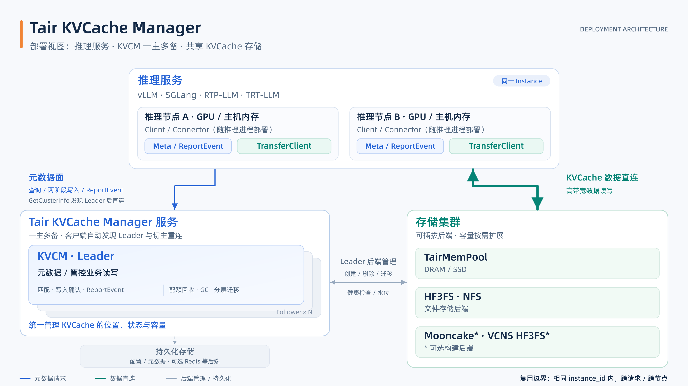
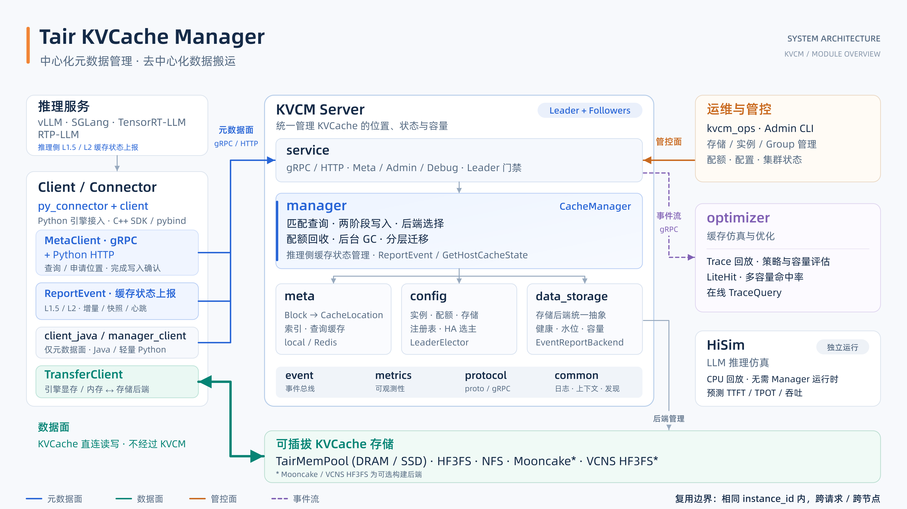
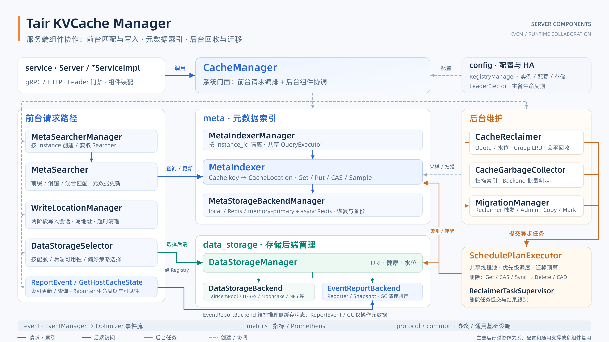

# Tair KVCache — 总览

> 源码:`3rdparty/tair-kvcache`(submodule),检出 `934c03dc`(2026-11-20,`[manager] parallelize leader recovery and bound Redis handshakes (#453)`)。
> 上游:[README](https://github.com/alibaba/tair-kvcache/blob/main/README.md) · [中文 README](https://github.com/alibaba/tair-kvcache/blob/main/README_zh.md) · [模块架构](https://github.com/alibaba/tair-kvcache/blob/main/docs/design/module_architecture.md) · [文章](https://mp.weixin.qq.com/s/KyNYH03PfamPcAJY7BRMwg)

## 一句话定位

Tair KVCache 是阿里云面向 LLM 推理的 KVCache 系统。当前开源的是两块：

- **Tair KVCache Manager(KVCM)**：全局 KVCache 元数据管理服务；
- **HiSim**：CPU 推理仿真器（旧版已停止维护，上游迁到 SGLang/vLLM simulator）。

本文只讨论 **Tair KVCM**。它不跑推理、不搬 KV 字节，回答的是：

> 这个前缀的 KV 在哪些存储位置、是否可读、该写到哪、什么时候回收。

数据由推理引擎经 Client / Connector 直接读写存储后端，KVCM 不在数据路径上。

## 设计哲学

- **中心化元数据 + 去中心化数据**：KVCM 只回答“在哪、是否可读、该写哪”，数据由 Client 直连存储后端。
- **元数据保留 LLM 语义**：不是通用 KV 目录，而是懂 Block 前缀、TP/PP、混合注意力、LocationSpec。
- **三个面分开**：元数据面、数据面、管控面各自演进；KVCM 不在数据路径上。
- **存储后端可插拔**：TairMemPool、HF3FS、NFS、Mooncake 都只是 Storage 实现。
- **服务端权威 + 客户端执行**：位置与状态在 KVCM，字节搬运在 Client/引擎；两阶段写保证“未确认不可读”。

## 架构

### 部署视图



（上游原图：`docs/image/kvcm-deployment-zh.png`。三个面：推理侧 Client/Connector；KVCM 一主多备；共享 KVCache 存储。元数据走 KVCM，数据走 Client → 存储后端直连。）

### 模块视图



（上游原图：`docs/image/kvcm-architecture-overview-zh.png`。这是偏展示的模块视图；完整依赖方向见上游 `docs/design/module_architecture.md`。）

### 服务端组件



（上游原图：`docs/image/kvcm-server-components-zh.png`。前台查询/写入、元数据索引、存储后端、回收/GC/迁移/共享执行器，以及推理侧 ReportEvent 的 L1.5/L2 状态上报。）

## 三个面

| 面 | 谁负责 | 做什么 |
|---|---|---|
| 元数据面 | KVCM `MetaService` + Client/Connector | 查询、两阶段写入、`ReportEvent`、`GetHostCacheState`；不在数据路径上 |
| 数据面 | Client `TransferClient` / 引擎 connector | 按 KVCM 返回的 URI，在引擎显存/内存与存储后端之间直接搬运 KV |
| 管控面 | KVCM `AdminService` + `kvcm_ops` | Storage、Instance Group、Instance、配额、迁移、配置快照、Leader 运维 |

KVCM 的核心原则是**中心化元数据 + 去中心化数据搬运**。

## 核心对象

| 对象 | 含义 |
|---|---|
| **Storage** | 一套存储系统；可以是 TairMemPool、HF3FS、NFS、Mooncake 等 |
| **Instance Group** | 共享配额的范围；一个 Group 可挂多个 Storage |
| **Instance** | 一个 KVCache 实例；**只有同一个 Instance 内才复用 KVCache，跨 Instance 不复用** |
| **Block** | 一段固定长度 token；Block 之间有前缀依赖 |
| **CacheLocation** | 一个 Block 的一个存储位置；状态 `writing → serving → deleting` |
| **LocationSpec** | 一个 CacheLocation 的一部分数据；统一用 URI 表达，支持 TP/PP/混合注意力的多 spec |

这里最容易被忽略的是 **Instance 边界**：Tair KVCM 的“全局”是**单个 Instance 跨节点**，不是跨 Instance 的全局池。

## 读写路径

### 读

```text
引擎 / Connector
→ GetCacheLocation / GetCacheLocationsByBackend / GetHostCacheState
→ KVCM 返回可服务的 CacheLocation
→ Client TransferClient 按 URI 直接读存储后端
```

`GetHostCacheState` 额外用于判断本机 L1.5/L2 命中；KVCM 只返回元数据，不搬字节。

### 写：两阶段

```text
StartWriteCache：预留写入位置，状态 writing
→ Client 写数据到存储后端
→ FinishWriteCache：确认完成，状态 serving
→ 之后的请求才可读
```

只有 `serving` 的 Location 可读。这个两阶段写和 Mooncake 的 `PutStart/PutEnd` 是同一种控制思想，但 Tair KVCM 自己维护 Location 状态机。

## 关键能力

### 1. LLM-aware matching

不是简单的 key-value 查询，而是按 LLM 的前缀/注意力结构匹配：

- prefix matching；
- reverse rolling sliding-window matching；
- hybrid attention(Mamba/SWA)；
- batch block key query；
- 一个 Block 多个 `LocationSpec`，支持 TP/PP/混合注意力。

这使 KVCM 不只是“对象目录”，而是懂 Block 前缀关系的缓存目录。

### 2. 分层与配额

- DRAM/SSD 冷热层；水位触发 Copy/Mark 迁移；
- Instance Group 级配额；
- Group LRU / usage-proportional 回收；
- 后台异步回收，不阻塞前台请求；
- `CacheReclaimer` / `CacheGarbageCollector` / `MigrationManager` 分工。

### 3. L1.5/L2 状态上报

推理侧通过 `ReportEvent` 增量上报 L1.5/L2 缓存状态，可选 snapshot 对账。  
这让 KVCM 能看到“引擎/主机本地已有什么”，而不只是它自己管的存储。

### 4. HA 与运维

- KVCM 一主多备；Leader 选举支持 Redis/File/Memory；
- Client 侧自动发现 Leader 并重连；
- Prometheus/KMonitor、访问日志、RequestContext tracing、crash handler；
- `kvcm_ops` 管 Storage / Instance / Group / 配置；
- optimizer 支持离线 trace 回放、LiteHit 容量投影、在线事件回放。

## 接入方式

- **引擎侧 connector**：vLLM、SGLang、RTP-LLM、TRT-LLM；
- **Client 形态**：C++/pybind、Python HTTP、Java；
- **角色**：`SCHEDULER` 只做元数据匹配/写地址申请，`WORKER` 只做数据搬运，`HYBRID` 两者都有。

这说明 Tair KVCM 的接入不是“只给一个 HTTP API”，而是**元数据面 + 数据面 SDK + 引擎 connector** 的组合。

## 分布式模型

| 维度 | Tair KVCM |
|---|---|
| 拓扑 | 星型：KVCM leader/follower + Client/Connector + Storage 后端 |
| 元数据权威 | KVCM `MetaIndexer`；Instance 级 |
| 同步机制 | Client RPC 查询/写入；`ReportEvent` 上报 L1.5/L2；Leader/Follower 复制 |
| 一致性 | 元数据由 leader 单写者维护；数据由存储后端负责；两阶段写控制可见性 |
| HA | KVCM 一主多备；Leader 选举 Redis/File/Memory；Client 自动发现 Leader |
| 复用边界 | 同一 Instance 内跨节点；跨 Instance 不复用 |
| 扩展瓶颈 | 单 Instance 边界；leader 元数据内存/吞吐；存储后端容量 |

## 技术栈

- **服务端**：C++17 + Bazel；gRPC/HTTP；Redis/File/Memory 协调后端。
- **客户端/Connector**：C++/pybind、Python HTTP、Java；vLLM/SGLang/RTP-LLM/TRT-LLM connector。
- **可观测/运维**：Prometheus/KMonitor、RequestContext、crash handler、`kvcm_ops`。
- **仿真/优化**：Python optimizer / LiteHit；HiSim（旧版，已停止维护）。

## 优势

1. **完整的全局 KV 元数据服务**：匹配、两阶段写、配额、分层、GC、迁移、HA 都在一个服务里。
2. **LLM-aware**：Block 前缀/混合注意力/多 LocationSpec 都在元数据层表达。
3. **数据和元数据分离**：KVCM 不搬字节，不成为带宽瓶颈。
4. **多后端**：TairMemPool / HF3FS / NFS / Mooncake 可插拔。
5. **工程化程度高**：Leader 选举、自动故障转移、Prometheus、crash handler、运维 CLI、optimizer。

## 局限

1. **复用边界是 Instance**：跨 Instance 不复用；这和 lake 的全局池目标不同。
2. **不做请求路由/扩缩**：optimizer 做容量/策略分析，不是在线 request router 或 autoscaler。
3. **不做请求 + KV + 扩缩联合调度**：KVCM 管 KV 元数据，不决定请求去哪个实例、何时扩缩。
4. **接入依赖 connector/client**：不同引擎需要对应 connector；不是纯 backend-coupled 的单一接口。
5. **数据面仍是客户端直连存储**：KVCM 不控制传输路径的调度，只给位置。

## 与 kvcm 的关系

见 [`vs-kvcm.md`](vs-kvcm.md)。先给结论：

> Tair KVCM 和 lake kvcm 在“全局 KV 元数据 + 共享存储 + 客户端直连数据面”这一层很像；但 Tair KVCM 是**自己持有全局索引的权威元数据服务**，lake kvcm 是**Mooncake master 之上的 client/facade + 管理面设计**。lake 的增量在请求/KV/扩缩联合调度，不在“再加一个 KV 目录”。

## 代码索引

> 符号锚点；行号会漂移，找不到时 `grep -n "符号名" 3rdparty/tair-kvcache/<路径>`。

| 机制 | 文件:符号 |
|---|---|
| 服务编排 | `kv_cache_manager/manager/cache_manager.h`::`CacheManager` |
| 元数据索引 | `kv_cache_manager/meta/meta_indexer.h`::`MetaIndexer`；`meta_indexer_manager.h`::`MetaIndexerManager` |
| 前缀/混合注意力匹配 | `kv_cache_manager/manager/meta_searcher.h`::`MetaSearcher`；`meta_searcher_manager.h`::`MetaSearcherManager` |
| 两阶段写 | `kv_cache_manager/manager/write_location_manager.h`::`WriteLocationManager`；proto `StartWriteCache` / `FinishWriteCache` |
| 存储选择 | `kv_cache_manager/manager/data_storage_selector.h`::`DataStorageSelector` |
| 存储后端管理 | `kv_cache_manager/data_storage/data_storage_manager.h`::`DataStorageManager` |
| 回收/GC/迁移 | `kv_cache_manager/manager/cache_reclaimer.h`::`CacheReclaimer`；`cache_garbage_collector.h`::`CacheGarbageCollector`；`migration_manager.h`::`MigrationManager` |
| HA / 选主 | `kv_cache_manager/config/leader_elector.h`::`LeaderElector` |
| Client 元数据面 | `kv_cache_manager/client/include/manager_client.h`::`ManagerClient` |
| Client 数据面 | `kv_cache_manager/client/include/transfer_client.h`::`TransferClient` |
| ReportEvent | `kv_cache_manager/service/util/report_event_json_parser.h`；`docs/api/report_event.md` |
| 运维 CLI | `package/kvcm_ops/` |
| 仿真/优化 | `kv_cache_manager/optimizer/`；`hisim/`（旧版） |
