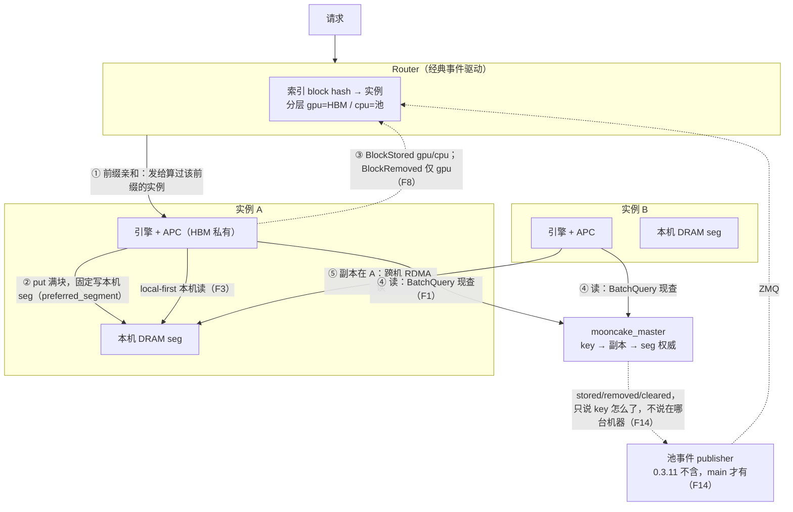
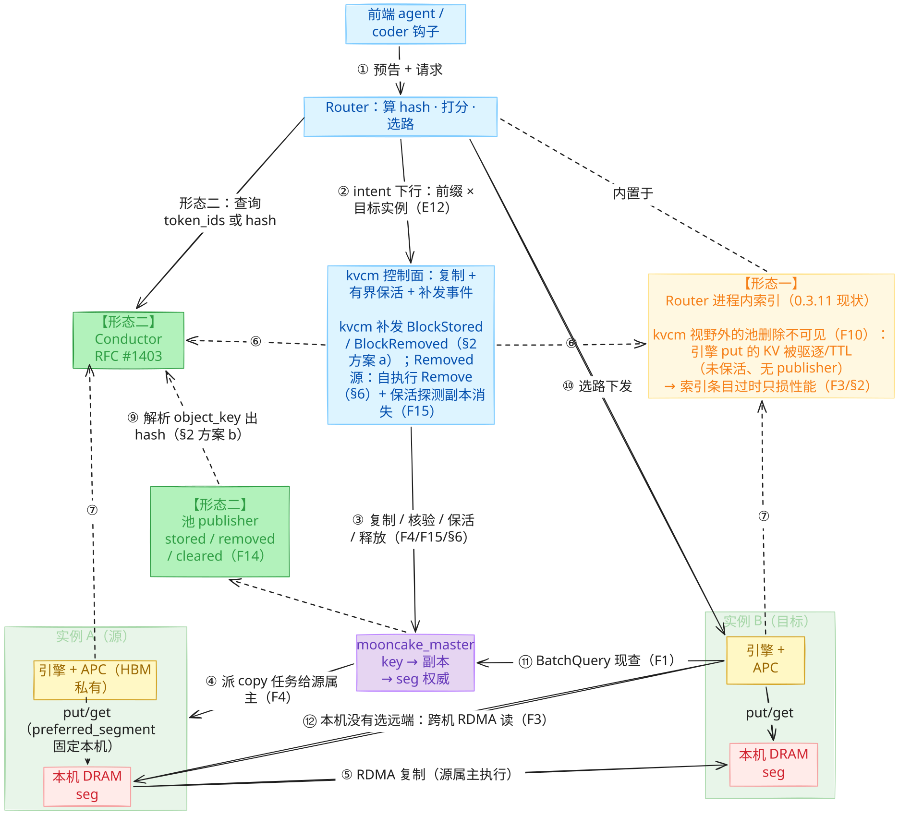
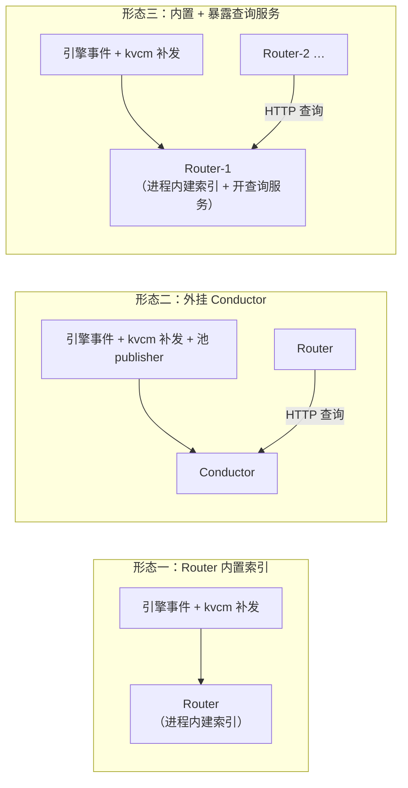

# D1: Router 集成与请求调度（预复制的选路侧）

- 状态: **已闭环**——事实基线（F1-F15）已核实；六个设计问题全部闭环
- 上游问题: [backlog.md](backlog.md) D1——Router 如何感知预复制副本并据此选实例；「谁预取、何时放行」的进程形态归 D4
- 角色约定: kvcm 目前没有 router 组件。本文选路面逻辑上分两层（§1）：**索引**（订阅事件流建索引）与 **Router**（查索引、决定请求发往哪个实例；gateway 侧扩展 / 独立 router 进程 / 编排内置均有可能）。索引进程形态（内置 Router / 外挂组件）归 D4

## 参考实现

kvcm 是独立原型，以下仅作参考，不构成约束。

| 参考 | 锚点 | 借什么 | 关键差异 |
|------|------|--------|----------|
| lake 选路面 | `../go/router/modeselect.go::SelectExecMode` + `prefixHint`；[`../docs/architecture/kv-cache-pool.md`](../docs/architecture/kv-cache-pool.md)「权威、镜像与本地 overlay」 | 反向过时也不回查（只损性能）、miss 回退权威的经验 | lake router 是池感知组件（持位置视图镜像）；kvcm router 走经典事件驱动，不碰池位置 |
| lake 命中定义 | [`../docs/features/features.md`](../docs/features/features.md)「Pool 命中 vs 本地命中」 | 术语：Pool 命中（省重算需传输）≠ 本地命中（省传输） | lake 本地命中指 L0/HBM 池放置；kvcm 的「本机」含 HBM 与本机 DRAM 两层，经 gpu/cpu 事件均可观测（§3） |
| lake 单向边界 | [`../docs/architecture/kv-cache-pool.md`](../docs/architecture/kv-cache-pool.md)「池放置·调度读视图」 | 调度读视图、不反向指挥放置的边界形态 | lake 的池有自主放置能力；Mooncake 池没有，放置智能只能在外置控制面 |
| llm-d Router | [`../docs/research/llm-d/overview.md`](../docs/research/llm-d/overview.md)「核心结论」；[`../docs/research/llm-d/architecture.md`](../docs/research/llm-d/architecture.md) §4 | 推测索引（事件确认前先用推测条目顶上，TTL 2s 自动过期） | llm-d 索引是事件流派生的副本视图（引擎才是真相）；master 直读没有该窗口 |
| Dynamo router | [`../docs/research/dynamo/overview.md`](../docs/research/dynamo/overview.md)「Router(KV-aware)」 | 成本模型（分层命中×权重 + decode 占用 + 在途请求）；分层计价 device 1.0 / host 0.75 / disk 0.25；在途负载无权威、router 本地记账 | Dynamo 缓存状态权威在 worker 本地索引，router 靠事件逼近（丢事件需 gap→快照重放）；直读 master 无此失效模式。外部重算 block hash 链 Dynamo 已为先例（keys.py 同款） |
| Mooncake Conductor | mooncake 仓内 `mooncake-conductor/`：`object_key_parser.cpp::ParseVllmObjectKey`；HTTP 契约 RFC #1403（F14） | 现成外挂索引组件：订阅引擎/池事件建全局前缀索引，Router 走 HTTP 查询；object_key 解析已覆盖 vLLM-Ascend key 布局（keys.py 一族） | Conductor 是只读索引，不管复制/保活/补发——与 kvcm 职责互补；组件级替代评估归 backlog D4 |
| Dynamo standalone indexer | dynamo 仓内 `lib/kv-router/src/services/indexer/`；`standalone-indexer.md` | RFC #1403 契约参照实现：`/register`（含 replay_endpoint）/ `/query` / **`/query_by_hash`**；gap 检测 + replay；P2P recovery（`--peers` 外挂索引 HA 答案）；`/query` 按 gpu/cpu/disk 分层返回 | 它只订引擎事件不订池。只有引擎一个事件源时，外挂索引进程建出来的表和 router 自己建的内容完全一样，还多绕一跳网络——所以 Dynamo 的主流形态（kv-router）把索引放在 router 进程内，池视图另用 shared_cache 直订 master（F14）；`/register` 端点注册、`/query_by_hash`、gap replay、P2P recovery 可直接对标 |
| Dynamo router 形态谱系 | dynamo 仓内 `router-operations.md`「Dynamo-Native Remote Indexer」；`configuration-and-tuning.md`「KV Indexer / Approx KV Indexer」 | 「索引放哪」在 Dynamo 是部署选项而不是架构定律，三种摆法：① 索引建在 router 进程内（默认）；② 独立 indexer 进程（索引与查询都移出 router）；③ 索引仍建在 router 进程内，但该 router 把查询开成 HTTP 服务（`--serve-indexer`），别的 router 来查（`--use-remote-indexer`）、自己不再建索引。另有 predict-on-route side indexer：router 把每次选路决定先写进一棵短 TTL 的辅助树，查询时主树辅树取较大值——解决「同前缀的一批请求同时到达、引擎还没来得及发 stored」被全部当 miss 打散的问题；辅助树要单独开，因为 router 自算的 hash 与引擎的 hash 口径不同，写进主树会把同一物理块挂成两个条目 | 辅助树那个约束我们不背：kvcm 补发用 keys.py 复算，与引擎同口径，可直接进主树（§2 方案 a）；「批内竞态要不要辅助树」归 D4 |
| Mooncake 界限 | [`../docs/architecture/kv-cache-pool.md`](../docs/architecture/kv-cache-pool.md)「为何池必须自长 radix」 | Mooncake store 只存不透明字节块（无内容寻址、无前缀匹配）——预复制控制面是外置的「懂前缀 + 懂位置」层 | 不照搬 lake 的池内 radix：keys.py 按 key 逐把算，不建树；前缀匹配退化为「连续满块命中长度」 |

## 事实基线（代码核实）

以下事实已核实，作为讨论输入。Mooncake 锚点 @ `1fc27b62`（submodule）；vllm-ascend 锚点 @ 0.26（rc1）；上游 vLLM 锚点 @ submodule `027b6f3a2`。编号按核实先后（F15 后补，主题属副本生命周期，列于「池与副本」），小节按主题归类。

**池与副本**

- **F1 mooncake_master 是放置权威**：key → 副本 → seg 由 mooncake_master 记录；读路径 get 时 `BatchQuery` 现查（`real_client.cpp` 8 处调用点，客户端无位置缓存）；没有其他位置通知通道（池 publisher 不带位置，F14）。
- **F2 一把 key = 一个满块在一个 rank 上的切片**：KV 按 block 切开（本模型 128 token 一块）；TP 下每个 rank 只持有块的一部分，同一块在不同 rank 内容不同——「满块 × rank」的每一片是池里一个独立对象 = 一把 key，尾部带 rank 编号（`head_or_tp_rank`）。例：801 token 前缀 = 6 个满块（768 token，余 33 不满一块不进池），TP=2 → 6 × 2 = **12 把 key**（详见 README「三个对象」）。
- **F3 读路径：先查后选，本机优先**：引擎读池分两步——先向 master 查副本列表（`BatchQuery`，F1），再开读会话搬数据。非 layerwise 读时 `SelectBestReplica` 本机内存副本优先（`replica_selection.h:122`）。layerwise 的读会话（get session）建立时从列表里选定一个副本（本机优先，`SelectCompleteMemoryReplica`，`real_client.cpp:470`），整个会话只从它读（读时校验锁定的必须恰好一个，否则报 `INVALID_REPLICA`，`:6470`）；会话本身带租约，建立后一个 TTL 窗口内有效（`:6464`）。推论：复制必须在会话建立前落位，本次才用得上；赶不上，选择器自动挑远端副本，跨机读，只影响当前这一次请求（[kv-prefetch.md](kv-prefetch.md) 时序节）。
- **F4 复制 API**：`create_copy_task(key, [seg])`（Python 绑定 `mooncake-integration/store/store_py.cpp:3362`）；master 只校验 key 存在 + 目标 seg 可分配（`master_service.cpp:13677 CreateCopyTask`）；整对象复制；源属主客户端（写入该 key 的引擎）必须在线；副本落位用 `batch_get_replica_desc` 核验（`store_py.cpp:3340`）。
- **F5 副本无 pin：READY 后随时可能被池驱逐**：
  - 复制路径不加 pin / lease（F15），副本落位后不受保护，池驱逐策略说收就收。
  - 属主实例（最初写入 key 的引擎）下线后，master 把它写入的 key 连同这些 key 在**所有机器**上的副本一起删除——**我们预热到 B 的副本也在其中，一起没**（实测：属主下线后 exist 0/32，机制与时机待确认 → E5；记录见 [EXPERIMENTS.md](EXPERIMENTS.md)）。
  - mooncake main 有 pin 机制，但都挂在写路径上（`PutStart` / `UpsertStart` 收 `ReplicateConfig`，`master_service.h:452` / `:515`）：
    - **soft pin**（`soft_pin_action`，`replica.h:64-68`）：key 粒度的**限时**驱逐保护——默认 30min、上限 24h（`types.h:85-89`），到期自动失效（`CleanupExpiredSoftPins`，`master_service.h:1468`）；驱逐两轮制把它排最后——第一轮只驱逐无 soft pin 的对象，第一轮凑不够且 `allow_evict_soft_pinned_objects`（默认 true，`types.h:90`）时软 pin 也可被驱逐（`master_service.h:987-995`），所以叫「软」。
    - **hard pin**（`with_hard_pin`，`replica.h:113`）：显式 pin，不可驱逐——写入时设置并固化进对象元数据（`master_service.cpp:6068`），全驱逐路径检查 `IsHardPinned`（`:8117` / `:11918` / `:12213` / `:12434`）。
  - **`CreateCopyTask` 没有 config 参数（`master_service.h:844-846`），预复制路径带不了 pin**；也没有给已有 key 事后加/解 pin 的独立 RPC——`SubmitReplicaActionProposal` 不是 pin（action 只有 ADD，`rpc_types.h:17-19`）。预热副本要保护只能池侧扩展，归 D2。
- **F6 引擎 APC（HBM 前缀缓存）私有**：APC 是引擎私有 LRU——无 pin、无池元数据、外部不可见（kv-prefetch.md 方案 A 注意节）。
- **F15 lease 是 key 粒度：读续租、复制不续租、删 key 释放全部副本**：
  - lease 挂在 key 的元数据上（`metadata.lease_`，group 内共享 `RegisterGroupMember:1669`），副本没有独立 TTL。
  - 读路径续租：`GrantReadLease(default_kv_lease_ttl_)`（`ExistKeyImpl:3299` / `GetReplicaList:4401` / `BatchGetReplicaList:4566`）；`CopyStart` 不触碰 lease（`:6444` 起）。
  - 删除与驱逐：TTL 到期 / 驱逐一律走 `EraseMetadata`——删 key 元数据并释放**全部**副本（`:2308-2313` 注释、`:2374-2375`）；驱逐候选必须 lease 已过期（`:8117` / `:8299` / `:12434`）。
  - 续租 API：`ExistKey` / `BatchExistKey` 顺带续租（`grant_lease=true`，`:3271` / `:3307`）；`ProbeKey` / `BatchProbeKey` 不续租（`:3276` / `:3312`）；默认 `default_kv_lease_ttl=10s`（`types.h:84`，部署以 master 配置为准）。
  - 推论一：lease 在 key 上，不存在「原副本 TTL 到、复制的副本没到」的状态；removed 是 key 全局事件，无需位置。
  - 推论二：复制不续租，READY 后一个 TTL 窗口内无流量即进入可驱逐状态——控制面需有界保活（周期 `batch_is_exist`，kvcm 现成调用）；保活必须有界，无限续租事实上等于 pin，池永远收不走这些 key。保活策略归 D3。

**引擎 kv event**

- **F7 事件 schema 带介质字段**：`MEDIUM_GPU` / `MEDIUM_CPU`（上游 `vllm/distributed/kv_events.py:51-52`）；`BlockStored{block_hashes, parent_block_hash, token_ids, block_size, medium}`（`:56-68`）。medium 标记 KV 在哪种介质上——gpu = HBM 显存、cpu = DRAM 内存池；router 据此区分命中层级（§5 计价）。
- **F8 事件有两个发布源**：
  1. **引擎核（GPU/APC 块）**：上游 `BlockPool` 在块进 HBM 缓存时发 `BlockStored(medium="gpu")`、驱逐时发 `BlockRemoved(medium="gpu")`（上游 `vllm/v1/core/block_pool.py:362` / `:548` / `:621`）；vllm-ascend 的 coordinator patch 原样建 `BlockPool` 并透传门控（`patch_kv_cache_coordinator.py:150-154`）。
  2. **连接器（池 put）**：worker 侧在引擎自己 put 成功后生成 `BlockStored(medium="cpu")`（`kv_transfer.py:1162`、`pool_worker.py:3111`），跨 rank `KVEventAggregator` 聚合后经 `take_events()` 发出（`ascend_store_connector.py:213`）；门控 `enable_kv_cache_events`（`pool_scheduler.py:108`）。池副本的删除/驱逐不在这条引擎通道上发——那是 master publisher 的事（另一条通道，F14，0.3.11 不含）。
  - 范围：本部署只挂 AscendStoreConnector；`preempt_offload` connector 另有事件路径（`preempt_offload/manager.py:732`，cpu_block_pool 事件），不在本部署范围。
- **F9 盲区一：预复制在两条通道上都不会自动产生事件**：引擎事件只在引擎处理请求时产生（F8 两条路径都要过引擎代码），`create_copy_task` 完全在引擎之外 → 引擎通道**结构上**不会有预复制事件；master publisher（F14，0.3.12 起）是另一条通道，其复制路径同样零发布——所以预复制落位只能由 kvcm 补发（§2 方案 a）。
- **F10 盲区二：引擎事件通道上看不到池副本的删除**：vllm-ascend 全仓零 `BlockRemoved` → 池副本消失（驱逐 / TTL / 属主下线删除，F5）对引擎事件消费者不可见。注意三条通道别混淆：HBM 淘汰有 Removed（引擎通道，F8-1）；池删除有 removed（master publisher 通道，F14，0.3.11 不含）；引擎通道的池 put 只有 Stored 没有 Removed。
- **F14 池原生事件流（main 有，0.3.11 无）**：mooncake main 有 `KvEventPublisher`（`mooncake-store/include/kv_event/kv_event_publisher.h`），ZMQ 传输，schema 套用 RFC #1527。
  - **schema 从哪来、为谁设计**：RFC #1527 是「推理引擎 → KV 感知 router/indexer」的事件线格式（原文：事件告知 router 每个 worker 上哪些块被存/删，供缓存感知调度），hash 是核心字段。mooncake 存储侧套用了这个 schema，但**池是内容无关的字节块存储——只认识 PoolKey 字符串，不知道 token 与 hash 链（hash 只有写入方知道）**，所以字段名兼容 vLLM（legacy `type:"BlockStored"` / `block_hashes` / `parent_block_hash`）但**内容全空/nil**（`kv_event_publisher.cpp:440-462`；config 注释「parent_hash and token_ids are not interpreted by the storage publisher」）。
  - **配套的索引契约（RFC #1403，KV-Store Indexer API）**：消费侧的标准形态是**逻辑分层**——索引组件订阅事件流建索引，Router 查索引而不订阅流。事件源（引擎或池）向索引组件 `/register` 注册端点（`type` 支持 vLLM / Mooncake / SGLang，附 `endpoint` 与 `replay_endpoint`）；Router 侧 `/query` 查询，**支持 token_ids 或 block hash key 两种入参**（`/query_by_hash`）——Router 自算请求的 hash 链查 hash 接口即可，不依赖原始 token 文本。Conductor 与 Dynamo standalone indexer 是该契约的两个实现。
  - **有效载荷** = `object_key`（PoolKey 字符串）+ `medium` + tenant/group + 固定上下文（`model_name` / `backend_id` / `block_size` / `dp_rank`），**不含 seg/机器位置**（事件只说哪把 key 怎么了，不说 key 在哪台机器上）；`backend_id` 标识池级流（一 master 一端点，非实例级）。
  - **消费者现状（多方核实）**：
    - **Mooncake Conductor（自家索引器，真实消费方）**：仓内 `mooncake-conductor/`，消费 KV 事件建全局前缀索引，对外提供 RFC #1403 的 HTTP 查询契约（`docs/source/design/conductor/conductor-architecture-design.md`）。对「只有 object_key」的池事件，它用 **`object_key_parser`** 解析出 hash 入索引——`ParseSglangObjectKey`（SGLang 的 SHA-256 key）与 `ParseVllmObjectKey`（注释原话：为「Mooncake publisher 只转发 raw key」场景准备的 vLLM/vLLM-Ascend 连接器 key 兼容解析器，`object_key_parser.h:28-30`），支持 `model@hash@head_or_tp_rank`、`@pcp@dcp@head_or_tp_rank:` 等 vLLM-Ascend 布局（`object_key_parser.cpp:160-276`）——正是 keys.py 的 PoolKey 一族。已知使用方：华为 MindIE Motor（官方「KV Cache 亲和性调度」，见下条）；社区试用见 Discussion #1967（vllm-router + conductor 搭 XpYd 验证）。
    - **Dynamo kv-router（真实消费方）**：`lib/llm/src/kv_router/shared_cache.rs` 的 `HicacheSharedKvCache`——SGLang HiCache + Mooncake L3 场景，文件头注释原话 "Tracks those object keys from the Mooncake master's KV event stream"（`:4-12`）：从 SGLang worker runtime config 读 master 事件端点（`:164-210`），ZMQ SUB 直连（`:316-323`），解析 `MooncakeEventBatch = (timestamp_ms, events, dp_rank)`（`:86-88`）与 `MooncakeObjectEvent{event_type, object_key, tenant_id, group_id}`（`:76`），自己按 SGLang page hash 规则把前缀展开成 object key、跟踪 `present_keys`；sequence gap → 清空状态重建（`:228`）。消费方自持「hash ↔ key」映射，与解析 object_key 同构。
    - **华为 MindIE Motor（真实消费方，经 Conductor）**：官方文档「KV Cache 亲和性调度」——P 实例 `kv-events-config`（zmq）发引擎事件 → Conductor 建全局位置表 → Coordinator 查 Conductor 做亲和调度；`kvevent_instance` 支持注册 `type: "Mooncake"` 事件源（即 master publisher 一路）。对接经 Conductor 完成，网关不自订事件流。
    - **vLLM / SGLang**：未订阅 master publisher——各自只有自己的引擎事件体系（vLLM `kv_events.py`、SGLang `disaggregation/kv_events`）。
    - **LMCache**：未订阅 master publisher——只把 Mooncake Store 当存储后端用（数据面 connector，无事件订阅代码）。
    - **GitHub 全仓搜 `KvEventPublisher`**：除上述外无其他第三方订阅方实现；mooncake 仓内订阅代码只有测试（`kv_event_publisher_test.cpp` 的 ScopedSubscriber）。
    - 结论：**事件不带 hash 是共识现状，消费方的标准做法是自己解析 object_key（Conductor 路径）或自持 hash↔key 映射（Dynamo 路径）拿回 hash**。对我们的价值只在 removed/cleared（删除面）；stored 不取（hash 全空，且引擎自己发得更全）。
  - 发布点（精确到宿主函数）：

    | 事件 | 发布点 |
    |------|--------|
    | stored | `PutEnd:5372`（引擎 put 提交，唯一） |
    | removed | `EraseMetadata:2338`（删除 / 属主下线）+ 驱逐四路径（`:8161`/`:8314`/`:11366`/`:12549`） |
    | cleared | `RemoveAll` |
    | 复制路径（`CopyStart:6444` / `CopyEnd:6666`） | **零发布——预复制副本落位不会自动产生池事件** |

  - 开关：编译 `ENABLE_KV_EVENTS`（CMake 默认 OFF，官方 wheel 构建显式 ON）+ 运行 `enable_kv_events`（`master_config.h:220`，默认 false）。
  - **版本口径：publisher 代码在 v0.3.11 之后才进仓（v0.3.11 tag 无 `kv_event/` 目录、CMake 与 wheel 构建均无此开关）→ 0.3.11.post1 不含此机制，要用须升级 mooncake**。vllm-ascend 不消费它。

**复制幂等性（重复发 copy 的后果）**

- **F11 重发安全，三层防护都在 CopyStart（`master_service.cpp:6444`），不依赖任何事件**：
  1. **目标 seg 已有副本 → 跳过**：按 seg 粒度去重——`GetReplicaBySegmentName(tgt) == nullptr` 才计数（`:6498`）、才分配（`:6595`）；全部目标已有副本 → 返回空 targets → 客户端 `replica_copy_skipped / target_replicas_already_exist`，按**成功** no-op（`client_service.cpp:4363`）。同 seg 不会产生第二份同 key 副本。
  2. **同 key 有在途任务 → 拒绝**：`HasReplicationTask()` → 第二个 `CopyStart` 失败 `OBJECT_HAS_REPLICATION_TASK`（`:6488`）——并发重发不会建两个任务；但这是**任务失败**（`query_task` 可见）不是静默成功，控制面重发时要把该错误码按「已在途」处理，不当失败。
  3. **部分重叠按 seg 粒度**：targets 中部分 seg 已有副本 → 只给缺失的 seg 建副本，非全有或全无。
- **F12 提交层无去重**：`CreateCopyTask`（`master_service.cpp:13677`）只校验 key 存在 + 目标 seg 可分配，不查目标已有副本、不查在途任务——两个 `create_copy_task` 都会拿到任务 ID；去重发生在源属主执行 `Copy→CopyStart` 时（F11），时序：先执行者赢，后者按 F11-2 失败。
- **F13 同机不同 seg 的重复是设计内**：防护是 per-(key, seg)；同机多实例各有 seg，同 key 在同机不同 seg 各一份是异构同机的正常工作形态（README 异构 TP 节）。key 不同的内容重复（不同模型/hash 命名空间）不在防护范围。

## 基线：无 kvcm 时怎么运作

要点：

- **事件来源实例 = 物理位置**：写被 `preferred_segment` 固定在本机 seg → router 做前缀亲和即拿到本机读。「router 怎么知道 KV 在哪台机器」：不是靠事件带位置——谁 put 的，KV 就在谁本机。
- **引擎是唯一写者** → 引擎事件的并集 ≈ 池内容；缺口是池侧删除面（引擎通道无 Removed，F10；池原生 publisher 有但默认关，F14）。
- **任何实例都能读任何前缀**：`BatchQuery` 现查 master，副本在哪都能读（跨机 RDMA）；位置只影响快慢，不影响正确性（F3）。

## 目标形态：kvcm 就位后的全链路

图源：[kvcm-arch.excalidraw](kvcm-arch.excalidraw)（拖入 excalidraw.com 编辑；[在线快照](https://excalidraw.com/#json=cPeGPZYWCAnFHGbByq4up,EhiF60uCucmnmiz21HERxw)为旧版，以仓内源文件为准）。

读图：

- 图分三区：**中列**主流程竖链（控制面 + 数据面，①② → ③④⑤）；**右上**形态一（Router 进程内索引）；**主链左侧**形态二两框（Conductor / 池 publisher）。事件 / 索引两种部署形态二选一，kvcm 补发端点与格式相同。
- 布局：实例 A（左下）/ B（右下）横排、⑤ RDMA 横边相连；事件上行 ⑥ 由 kvcm 右进形态一、左进 Conductor；master 与池 publisher 虚线相连（publisher 内嵌 master，F14）。
- **两条单向通道（§4）**：intent 下行 ②（Router → kvcm），事件上行 ⑥（kvcm → 索引）。
- **选路面逻辑分层（§1）**：Router 不订阅事件流——索引订阅事件建索引，Router 自算请求的 hash 链查索引（token_ids 或 hash 两种入参，不依赖原始 token 文本），拿命中分数选路（⑩）。
- **索引部署两种形态**（右上形态一 / 主链左侧形态二）：0.3.11 现状没有池 publisher、没有 Conductor，事件只有引擎 ⑦ 与 kvcm 补发 ⑥ 两条源，由 Router 进程内索引消费——kvcm 视野外的池删除不可见（引擎 put 的 KV 被驱逐/TTL），索引条目过时只损性能（F3/§2）；升级 mooncake 后 publisher 与 Conductor 就位，Conductor 消费三条源（⑥⑦⑨），Router 走 HTTP 查询。kvcm 补发在两种形态下走同一套端点、同一套引擎格式（§2 方案 a 形态无关性），差异只在编排层注册动作。
- **kvcm 只碰控制面**：复制 / 核验 / 保活 / 释放走 master RPC（③，含 §6 停保活 / demote / Remove 三手段）；数据面复制（⑤ RDMA）由 master 派单（④）、源属主执行。池驱逐兜底不在图上（master 内部行为）。
- ① 是「提前备」的提前量来源（§4）：前端钩子比请求早到，Router 拿到预告后按 ② 表达意图，复制与否由 kvcm 决策。
- 请求不等复制完成（⑩ 直接下发）；读路径先查后选（⑪ BatchQuery → ⑫ 跨机读兜底，F1/F3）——预复制只是提高本地命中概率，不是读路径前提。

## 设计决策

### 1. 选路方需要哪些输入

决策：选路输入是一张「block hash → 实例」索引，逻辑上分两层——**索引**（订阅事件流、维护索引）与**查询**（Router 自算请求的 hash 链查索引、拿命中分数选实例）。逻辑分层是社区共识形态（Conductor / Dynamo standalone indexer / MindIE 同构），查询契约已标准化（RFC #1403：`/query` 支持 token_ids 或 block hash key 两种入参——Router 查 hash 接口即可，不依赖原始 token 文本）。**进程形态留 D4**：全量索引只建一份，形态三条——内置 Router 进程（llm-d EPP / Dynamo kv-router 式）、外挂独立组件（Conductor 式）、内置但暴露查询服务（Dynamo remote indexer 式：`--serve-indexer` 的 router 保持本地事件摄入并暴露 `kv_indexer_query`，consumer 查远端而不建本地全量）；三种形态全量索引内容完全相同（「block hash → 实例 × 介质」），差别在组件归属、请求路径是否多一跳、HA 与消费者数量，权衡见本节末「留待 D4」。全量索引之外还可叠加**本地辅助预测树**（Dynamo predict-on-route side indexer：路由决策写进短 TTL 侧树、打分取两树 max，解决兄弟请求批内竞态；与 llm-d 推测索引 TTL 2s 同构）——辅助树与主树分离是因为 router 自算 hash 与引擎 hash 口径不同、写入主树会污染（Dynamo 原话：同一物理块会挂在两个 key 下）；kvcm 补发与引擎同口径（keys.py），无此约束（§2 方案 a）。索引的事件来源两个，**kvcm 负责补齐引擎看不到的部分**：

1. **引擎原生事件**：引擎自己的动作——HBM 块的存入与淘汰（medium=gpu）、池 put 的存入（medium=cpu）（F7/F8）。
2. **kvcm 补发的事件**：预复制落位（放置，§2 方案 a）。删除面升级 mooncake 后由**索引侧直接订阅池 publisher、解析 object_key 出 hash**（首选，Conductor/Dynamo 已为先例，§2 方案 b）；kvcm 订阅翻译重发降级为备选。

索引消费引擎格式（`BlockStored` / `BlockRemoved` / `AllBlocksCleared`）为主，不读 master（§2 方案 c 排除理由）；删除面接通后另订阅池 publisher 一条流（解析 object_key，Conductor 现成实现，§2 方案 b）。Router 全程不碰池格式——它只查索引。事件由引擎发出，来源实例直接可知，不需要额外的 seg→实例映射表；kvcm 补发按目标实例端点发，归属同样直接（§2「方案 a 落地」）。

事实约束：引擎事件只覆盖引擎自己的动作（F8）——HBM 淘汰有 Removed，但池侧删除/驱逐/预复制都不产生引擎事件（F9/F10），这些正是 kvcm 要补的部分。事件里的 medium 字段标记 KV 在哪种介质上（gpu=HBM / cpu=DRAM 池），供 §5 分层计价（Dynamo 计价 device 1.0 / host 0.75 / disk 0.25，standalone indexer `/query` 按 gpu/cpu/disk 分层返回）。

留待 D4：事件开关与传输接线（`enable_kv_cache_events` 默认关，需打开才有事件，F8；ZMQ 端点配置、索引订阅方式）在部署形态下怎么接。**消费侧索引形态（Router 团队选型，kvcm 接口不变——§2 方案 a 形态无关性）**，两种方案：A. Router 内置索引（llm-d EPP / Dynamo kv-router：索引是打分用的摘要、与 scorer 紧耦合，llm-d 架构 §2 原话「是给打分用的摘要，不是存储元数据」；请求路径少一跳；代价是订阅/索引/gap 处理自写；变体：Dynamo remote indexer，内置但暴露查询服务给多 consumer）；B. 外挂 Conductor（现成：object_key parser、RFC #1403、vLLM 格式解码已核实；多事件源聚合、独立 HA；代价是请求路径多一跳 HTTP——同步选路路径的毫秒级延迟预算；缓解：提前查询、异步化）。**辅助预测树**（兄弟请求批内竞态：一批同前缀请求同时到达、引擎尚未发 stored——Dynamo side indexer / llm-d 推测索引先例）与形态无关，独立决策。Conductor 组件级评估见 backlog D4。

三种索引形态对比（三种摆法索引内容相同，区别只在谁建索引、查询是否跨进程；kvcm 补发端点三形态相同，零适配）：

### 2. 可见性：router 的索引怎么知道预复制放置

预复制绕开引擎、不产生引擎事件（F9）→ router 的事件索引永远只知道「前缀在 A」，不知道拷完后「B 也有了」。这里有两个问题：**放置**（router 不知道 B 有了）与**删除**（副本没了，router 还当它存在）。

结论：**放置靠控制面补发事件（方案 a）；删除靠升级 mooncake 后打开池 publisher，首选索引侧直接订阅、解析 object_key 出 hash（方案 b；kvcm 订阅翻译重发降级为备选）**。Router 自始至终不碰池格式——它只查索引。对账与 TTL 不做，直读 master 排除。

候选与裁决：

- **a. 控制面补发事件（选定，管放置）**：copy 完成后控制面按引擎格式补发 `BlockStored`，索引与 Router 零改动。放置归属任何版本都只能靠它（池事件无位置、复制路径零发布，F14）。补发还有两层 master 给不了的语义：一是 kvcm 在 READY 核验全 rank 落位后才发，事件语义是「该实例全 rank 齐备、可路由」；master 即使肯发 `CopyEnd` 也只是单 key 粒度的「字节落位」——「几个 rank 算齐」的聚合语义只有控制面能给（引擎侧同构：全 rank put 齐才由 `KVEventAggregator` 聚合发出，F8-2）。二是补发的 hash 与引擎**同口径**（keys.py 复算同一 hash 链），补发条目直接进**主索引树**、与引擎自发条目同树合并——对照 Dynamo predict-on-route 侧树：它分立的根因正是 router 自算 hash 与引擎口径不同、写入主树会污染（§1），我们不背这个约束。实现见下方「方案 a 落地」。
- **b. 池侧事件流（管删除，升级后索引侧直订为首选）**：升级后打开 master publisher（F14），removed/cleared 正是删除面需要的（删除是 key 全局事件、全部副本一起删，无需位置，F15）。**首选：索引侧直接订阅 master 的 ZMQ 端点，把事件里的 PoolKey 解析出 block hash 入索引**——Conductor 的 `ParseVllmObjectKey` 是现成实现（已覆盖 vLLM-Ascend key 布局，F14），Dynamo kv-router 自持 hash↔key 映射同构（`shared_cache.rs`，F14）；同一逻辑块的多个 rank key 由索引侧去重成一条。**备选：kvcm 订阅后翻译成引擎格式 `BlockRemoved` / `AllBlocksCleared` 重发**——仅当索引侧坚持只消费引擎格式时（keys.py 已知格式，翻译逻辑现成）。两条路 Router 都不碰池格式。stored 事件不取（hash 全空，且引擎自己发得更全，F14）。管不了放置：复制路径零发布 + 载荷无位置；「升级后让它顺便管放置」不成立——加发布点加位置 = fork mooncake（submodule 只读，fork 后长期自己维护），事件仍是池 schema，放置反被绑上升级节奏，而方案 a 在 0.3.11 即可跑。**0.3.11.post1 不含 publisher（E8 已核），要用须升级 mooncake 版本**——删除问题随之解决，不另做机制。
- **c. router 直读 master（排除）**：放置删除都能解决（现查现准），但要求 router 懂 PoolKey / seg / rank 映射，变成池感知组件，脱离经典事件驱动架构，且是全新增机制。
- **kvcm 轮询对账（不做）**：周期拉 master 全量快照、与自己的记录 diff——唯一价值在删除面（能发现副本没了）；只为删除做一个对账器得不偿失，删除由升级解决。
- **router 条目 TTL（当前不做）**：纯删除兜底，与预复制放置无关（它不携带「B 有了」的任何信息）；router 侧独立机制，不需要任何新通道。升级前若删除面要兜底可再议。

**索引条目过时的后果**：删除面接通前，池副本被删（驱逐 / TTL / 属主下线，F5/F10）router 收不到通知 → 索引里 cpu 条目只增不减，会把请求导向其实已经没有副本的实例。后果只是变慢：请求打过去 get miss，引擎自动跨机读或重算（F3），不出错。HBM 条目有淘汰事件（F8-1），不过时。

**方案 a 落地（复用与身份）**

事件体每个字段都是 keys.py 的现成中间产物，发布类直接 import 上游，新增代码只有一个薄模块（拼事件 + 管理 publisher 实例）：

| 事件字段 | 来源 |
|----------|------|
| `block_hashes` | keys.py `_hash_prompt` 的 hash 链（`hash_block_tokens` 逐块结果，转 hex 前的原值） |
| `parent_block_hash` | 同上，链首块的 parent |
| `token_ids` | `_hash_prompt` 的 tokenizer 输出 |
| `block_size` | 参数 |
| `medium` | 与引擎池 put 事件对齐（F8；上游常量 `MEDIUM_CPU`，`kv_events.py:51`） |

- **发布组件**：直接 import 上游 `ZmqEventPublisher`（`kv_events.py:305`）——构造给 `endpoint`/`topic`，`publish(EventBatch)` 一次调用；wire 格式（topic + seq + msgpack 三帧）与 replay buffer 内置。kvcm 容器路径本就已 import vllm / vllm_ascend（keys.py），零新增依赖；沿用 keys.py/common.py 的 lazy import 形态，debug 路径不背 vllm。
- **身份（哪台机器）**：事件体无实例字段（仅 `data_parallel_rank`，`kv_events.py:39`），上游机制是**身份 = 端点**——索引按订阅端点把事件归入实例；一个实例多个端点有现成先例（DP rank 端口偏移 `offset_endpoint_port`，`kv_events.py:528`）。因此 kvcm **每个目标实例开一个发布端点**，由编排把「端点 → 实例」注册给索引（外挂形态走 RFC #1403 `/register`，与引擎端点同一通道；内置形态同理，归 D4/E13）；索引把补发端点并入该实例的端点集合即可，不需要新概念。ZMQ topic 是消息分拣标签（订阅端按它过滤消息），多个发布者可共用同一个 topic——它标不出「来自哪台机器」，所以身份只能走端点。
- **发布时机**：READY 核验通过（`precopy.py::assert_targets_have_replicas`）后，一次预复制发一条 `BlockStored`（block_hashes = 前缀连续满块链；引擎侧经 `KVEventAggregator` 跨 rank 聚合后同语义）。
- **幂等**：索引是集合语义，补发与引擎自发重复无害；重复预热重复补发亦无害（池层幂等 F11）。
- **形态无关性（设计性质）**：补发接口与消费侧形态无关——**一套端点、一套格式**（引擎格式 + 身份 = 端点），「Router 内置索引」与「外挂 Conductor」两种方案 kvcm 零适配、零分支；差异 100% 在编排层注册动作（端点配置给 Router vs 调 Conductor `/register`）。成立依据是两种消费侧吃的是同一种格式：Conductor 的实现证据 `mooncake-conductor/src/zmq/msg_decoder.cpp::ParseVllmEvent:365`（vLLM 的 `BlockStored` / `BlockRemoved` / `AllBlocksCleared` 全解析，`DecodeVllmEventBatch:886`），Router 内置索引（llm-d/Dynamo 形态）订的同样是该格式。消费侧选型归 Router 团队，不构成 kvcm 的设计变量。

### 3. 「哪个实例拥有前缀」怎么定义

问题：副本在 B 的 seg ≠ B 引擎 radix 里有该前缀——master 视图 / 引擎 kv event / 控制面 copy 记录三来源覆盖范围不同，§2 闭环后统一为索引声称一个口径。

定义：**实例 X 拥有前缀 P = P 的连续满块链的 KV 在 X 本机**——HBM（APC，gpu 事件）或本机池 seg（cpu 事件 / kvcm 补发）都算；命中长度 = 连续满块数 × block_size，不满一块的尾巴由引擎重算（801 token 命中前 768）。HBM 与本机 DRAM 的差异不在定义层区分，留 §5 打分。

成立条件（已核事实）：

- **Router 口径即索引声称**：Router 不读 master（§2），「拥有」= 索引中 P 的连续满块链每个 block hash 都有 X 的条目。条目可能过时（cpu 侧只增不减，F10），选错由读路径兜底（F3），只损性能。
- **rank 维度由事件语义消除**：引擎侧全 rank put 才发（`KVEventAggregator`，F8-2）；kvcm 侧全 rank READY 核验才补发（`assert_targets_have_replicas`）。一条事件 = 该实例全 rank 齐备，router 无需 per-rank 索引。MLA（`put_step>1`）时 KV 只按 rank 0 存（copy plan 全落 targets[0]），判定退化为单 rank，未实测（E7）。
- **本机 = 事件归属实例**：cpu 条目的物理位置 = 发布端点归属的实例（引擎 put 固定写本机 seg；kvcm 按目标实例端点补发，§2）。同机多实例各持 seg 的细分（本机他实例 seg 算不算「本机」）当前部署不出现，出现时按 seg→实例注册细化，归 D4/E13。

### 4. 时序：预热与选路的先后

问题：复制要秒级，请求来了等不等；复制什么时候动手。

结论：

- **请求不等 READY**：不做「让请求排队等复制完成」——请求按本机有 / 池远端有 / 重算照常走（F3 兜底链），复制在后台进行，本条赶不上不错只慢。测试床里「READY 后才放行请求」只是实验操作顺序（[kv-prefetch.md](kv-prefetch.md)「与请求调度联动」），生产不设这种等待。
- **复制三个时机并存**：
  1. **顺手补**：请求打到无本地副本的实例，本次跨机读，控制面观测后异步补复制，后续请求受益；
  2. **提前备**：多轮会话首轮选定实例后异步预热，第二轮起本地命中；提前量的最终来源是前端 agent/coder——它的钩子在请求发出前先把信号给控制面（信号形态与通道归 D4）；
  3. **挑现成的**：索引里已有的实例优先选——这是 router 消费事件后的本职（前缀亲和），不是第三种复制时机，也不是 kvcm 决策。
- **预热中到达照常下发**：引擎读池时先查副本列表选一个——本机没有就选远端，跨机读，慢一些不出错；选择只管当前这一次请求（F3），复制完成后，之后的请求自然用上本机副本。
- **intent 去重**：控制面以（前缀 × 目标实例）为幂等键，在途不重复发、完成不重复发；重发由池层幂等兜底（F11）。

职责边界：kvcm 管复制 / 保活 / 补发事件（让 KV 到位、告诉 Router KV 在哪），不决策选路、**不持有索引**——「告诉 Router KV 在哪」的方式是补发事件，不是自持索引对外查询；索引归 Router 侧组件（内置或外挂 Conductor，形态归 D4）。kvcm 兼做索引已否决：前缀索引、查询服务、HA 是选路面的既有轮子（Conductor / Dynamo standalone indexer 现成），kvcm 另起一套等于重造轮子，还会把它从后台控制面拖成在线服务。Router 管索引与选路，不直接下复制命令——它不懂池（容量 / 在途任务 / 副本现状），只向 kvcm 表达意图（intent：某前缀接下来在实例 B 上用，通道归 E12），复制与否、何时、去重由 kvcm 决策（它懂池）。两条单向通道：intent 下行（Router → kvcm），事件上行（kvcm → 索引）。

### 5. 目标函数（归 router 内部实现）

口径：目标函数是 router 的内部问题，kvcm 侧无决策——§1-§3 闭环后 router 的输入已齐（引擎事件 + kvcm 补发 + medium 分层），怎么打分由 router 实现自定。候选方案记录在案：

- **分级兜底（最简）**：全本地 > 池远端 > 重算，字典序定档，档内按负载选。
- **打分制**：命中收益（连续本地满块数 × 分层计价；Dynamo 计价 device 1.0 / host 0.75 / disk 0.25 可借作初值）− 负载惩罚（队列长 / in-flight；在途负载无权威，router 本地记账，参考实现·Dynamo）。
- **传输成本两档**：显式比较（跨机字节 / 有效带宽 vs 重算成本，不划算换实例重算）或简化（远端副本固定扣分）。
- **传输繁忙的测量（「有效带宽」怎么来）**：网卡/链路计数器采样——Linux RDMA 计数器（`/sys/class/infiniband/*/ports/*/counters`）或 ethtool 统计，按 Δbytes / (链路速率 × Δt) 估链路利用率；实例上报或控制面采集，router 打分把「目标实例传输忙」计入负载惩罚，kvcm 预热/搬迁据此避让与限速（E15）。参考实现：vLLM-Ascend AI-QoS（`tools/ai_qos/` + 官方介绍 `docs/source/user_guide/feature_guide/Ai_QoS_introduction_en.md`，vllm-project/vllm-ascend）——它证明 KVCache 传输与集合通信/算子下发在交换机上真实冲突（生产级问题）；它的解法是执行层流量分级（NPU channel 优先级映射 UB 交换机 Virtual Lane，严格优先级调度），与我们互补：它管「冲突时谁先走」（单机/交换机 QoS），本条管「什么时候搬、往哪台调度」（集群层避让）。

权重待真机校准（与 P7 耦合）；layerwise 下逐层远端更贵，远端计价按 D6 选型修正。

### 6. release 与放置的边界

分工：router 提供线索（会话结束 / 迁移 / 超时），控制面（kvcm）决策执行，池策略兜底。router 不直接下释放命令——与 §4 不直接下复制命令同一条边界。依据：router 知道「谁还会用」，池知道「谁还在」，释放决策需要两者。

前提事实：删除与 lease 都是 key 粒度（F15）——「只删 B 的副本、保留 A 的」不存在也不需要：B 的副本占 B 自己的内存，该让位时由池驱逐处理，不归释放决策。于是 release 只剩「整个前缀（所有副本）怎么处理」。

手段三个 + 兜底一个：

- **主路径·停保活（软释放）**：副本活着是因为有读在续租、或控制面在保活（F15）——释放不需要新动作，停止动作就行：控制面停掉某前缀的保活，租约到期池自然收走。保护机制：任何实例还在读这个前缀，读路径会自动续租，key 不受影响——停保活只是控制面不再续租，动不了仍在使用的数据。
- **中间档·demote（降层）**：不删除，DRAM → SSD，前缀还在池里可读（更慢）。两个用途：「近期不用、但可能还会用」的前缀降层省 DRAM；**实例计划下线前把它的 KV 降层保存，避免属主下线 key 被整批删除（F5）**——下线删除是否连 disk 副本一起清未核实（归 E5/D3），核实前此用途按候选记账。操作集归 D2（`enable_ssd_offload` / `EvictDiskReplica`）。
- **例外通道·主动 Remove（硬释放）**：等不了自然过期、要立即腾地方时用；key 全局删除（A 的原本一起删），门槛 = 确认前缀谁都不再用（会话明确结束、前缀一次性）。`Remove` / `BatchRemove` 现成（D2）。
- **兜底·池驱逐（非手段）**：即使控制面出错（没停保活、没发 Remove），池的 TTL 与驱逐也会最终回收——不会出现没人记得、永远占着内存的孤儿副本。三个手段只让回收更快更准，正确性不靠它们。

已知缺口（登记，不归 D1）：显式 pin（hard pin）只在写路径可设，无事后加/解 pin 的独立 RPC，预复制带不了（F5 → D2）；属主下线副本一并移除（F5 → D3/D5）。

## 留给后续

编号登记处（含 P/E 系列、状态与依赖）：[backlog.md](backlog.md)。

- **D2**：KV 调度操作集（pin/demote/prefetch/retain/release；master 无显式 pin → `SubmitReplicaActionProposal` lease 机制；释放有 `Remove`/`BatchRemove` 现成）
- **D3**：副本生命周期与 READY 语义（F5 属主下线移除、TTL、属主下线后的副本归属）
- **D4**：编排进程形态（预复制控制面独立进程或并入选路方；READY 确认接 gateway；seg→实例与「端点→实例」注册通道；预复制视图由控制面补发事件注入，§2）
- **D5**：故障衔接（源属主掉线 copy 失败（F4）、与重路由的先后）
- **D6**：layerwise 选型（[../docs/research/vllm-ascend/layerwise-taxonomy.md](../docs/research/vllm-ascend/layerwise-taxonomy.md)）
- **D7**：方案 A（壳请求进 HBM）去留与叠加顺序
