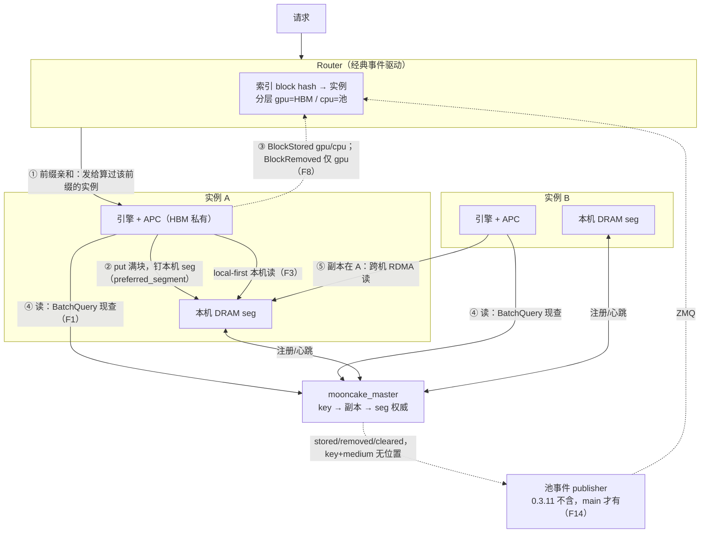

# D1: Router 集成与请求调度（预复制的选路侧）

- 状态: **讨论中**——事实基线（F1-F14）已核实；待定问题 §1/§2 已闭环，§3-§6 未拍板
- 上游问题: [backlog.md](backlog.md) D1——Router 如何感知预复制副本并据此选实例；「谁预取、何时放行」的进程形态归 D4
- 角色约定: kvcm 目前没有 router 组件。本文「选路方 / router」指未来消费引擎 kv event、决定请求发往哪个实例的组件（gateway 侧扩展 / 独立 router 进程 / 编排内置均有可能），进程形态归 D4

## 参考实现

kvcm 是独立原型，以下仅作参考，不构成约束。

| 参考 | 锚点 | 借什么 | 关键差异 |
|------|------|--------|----------|
| lake 选路面 | `../go/router/modeselect.go::SelectExecMode` + `prefixHint`；[`../docs/architecture/kv-cache-pool.md`](../docs/architecture/kv-cache-pool.md)「权威、镜像与本地 overlay」 | 反向陈旧不查（只损性能）、miss 回退权威的经验 | lake router 是池感知组件（持位置视图镜像）；kvcm router 走经典事件驱动，不碰池位置 |
| lake 命中定义 | [`../docs/features/features.md`](../docs/features/features.md)「Pool 命中 vs 本地命中」 | 术语：Pool 命中（省重算需传输）≠ 本地命中（省传输） | lake 本地命中指 L0/HBM 池放置；kvcm 场景选路方可观测的是本机 DRAM 副本（F6） |
| lake 单向边界 | [`../docs/architecture/kv-cache-pool.md`](../docs/architecture/kv-cache-pool.md)「池放置·调度读视图」 | 调度读视图、不反向指挥放置的边界形态 | lake 的池有自主放置能力；Mooncake 池没有，放置智能只能在外置控制面 |
| llm-d Router | [`../docs/research/llm-d/overview.md`](../docs/research/llm-d/overview.md)「核心结论」；[`../docs/research/llm-d/architecture.md`](../docs/research/llm-d/architecture.md) §4 | 推测索引（TTL 2s）是派生索引系统补决策-确认窗口的手法 | llm-d 索引是事件流派生的副本视图（引擎才是真相）；master 直读没有该窗口 |
| Dynamo router | [`../docs/research/dynamo/overview.md`](../docs/research/dynamo/overview.md)「Router(KV-aware)」 | 成本模型（分层命中×权重 + decode 占用 + 在途请求）；分层计价 device 1.0 / host 0.75 / disk 0.25；在途负载无权威、router 本地记账 | Dynamo 缓存状态权威在 worker 本地索引，router 靠事件逼近（丢事件需 gap→快照重放）；直读 master 无此失效模式。外部重算 block hash 链 Dynamo 已为先例（keys.py 同款） |
| Mooncake 界限 | [`../docs/architecture/kv-cache-pool.md`](../docs/architecture/kv-cache-pool.md)「为何池必须自长 radix」 | Mooncake store 是 dumb blob 池（无内容寻址、无前缀匹配）——预复制控制面是外置的「懂前缀 + 懂位置」层 | 不照搬 lake 的池内 radix：keys.py 按 key 逐把算，不建树；前缀匹配退化为「连续满块命中长度」 |

## 事实基线（代码核实）

以下事实已核实，作为讨论输入。Mooncake 锚点 @ `1fc27b62`（submodule）；vllm-ascend 锚点 @ 0.26（rc1）；上游 vLLM 锚点 @ submodule `027b6f3a2`。

**池与副本**

- **F1 master 是放置权威**：key → 副本 → seg 由 master 记录；读路径 get 时 `BatchQuery` 现查（`real_client.cpp` 8 处调用点，客户端无位置缓存）；没有其他位置通知通道（池 publisher 不带位置，F14）。
- **F2 key = 满块 × rank 切片**：每个满块 × 每个 rank 的切片 = 一把 key，尾带 `head_or_tp_rank`；801 token 前缀 × TP=2 → 12 把 key（README「三个对象」）。
- **F3 副本选择 local-first**：非 layerwise 读时 `SelectBestReplica` 本机内存副本优先（`replica_selection.h:122`）；layerwise get session 建立时 `SelectCompleteMemoryReplica` 选一次副本（`real_client.cpp:471`），且 session 要求恰好一个副本（`:6470` 附近，`replicas.size() != 1 → INVALID_REPLICA`）→ 复制必须先于 session 完成，错过只影响当前请求（[kv-prefetch.md](kv-prefetch.md) 时序节）。
- **F4 复制 API**：`create_copy_task(key, [seg])`（Python 绑定 `mooncake-integration/store/store_py.cpp:3362`）；master 只校验 key 存在 + 目标 seg 可分配（`master_service.cpp:13677 CreateCopyTask`）；整对象复制；源属主客户端必须在线；副本落位用 `batch_get_replica_desc` 核验（`store_py.cpp:3340`）。
- **F5 副本无 pin**：READY 后受池驱逐策略管理；属主实例下线，key 连同远端副本被 master 移除（实测观察，机制与时机待确认 → E5；记录见 [EXPERIMENTS.md](EXPERIMENTS.md)）。
- **F6 引擎 APC 私有**：HBM 侧前缀缓存是引擎私有 LRU——无 pin、无池元数据、外部不可见（kv-prefetch.md 方案 A 注意节）。
- **F15 lease 是 key 粒度：读续租、复制不续租、删 key 释放全部副本**：lease 挂在 key 的元数据上（`metadata.lease_`，group 内共享 `RegisterGroupMember:1669`），副本无独立 TTL。读路径续租（`GrantReadLease(default_kv_lease_ttl_)`：`GetReplicaList:3299` / `BatchQuery:4337` / `:4566`）；`CopyStart` 不触碰 lease（`:6444` 起）。TTL 到期 / 驱逐一律走 `EraseMetadata`——删 key 元数据并释放**全部**副本（`:2308-2313` 注释、`:2374-2375`；驱逐候选必须 lease 过期，`:8117` / `:8299` / `:12434`）。续租 API：`ExistKey` / `BatchExistKey` 顺带续租（`grant_lease=true`，`:3271` / `:3307`），`ProbeKey` / `BatchProbeKey` 不续租（`:3276` / `:3312`）；默认 `default_kv_lease_ttl=10s`（`types.h:84`，部署以 master 配置为准）。推论一：「原副本 TTL 到、复制的副本没到」的状态不存在；removed 是 key 全局事件，无需位置。推论二：预复制不续租，READY 后一个 TTL 窗口内无流量即进入可驱逐状态——控制面需有界保活（周期 `batch_is_exist`，kvcm 现成调用；无限续租 = 变相 pin，违背 F5），保活策略归 D3。

**引擎 kv event**

- **F7 事件 schema 带介质字段**：`MEDIUM_GPU` / `MEDIUM_CPU`（上游 `vllm/distributed/kv_events.py:51-52`）；`BlockStored{block_hashes, parent_block_hash, token_ids, block_size, medium}`（`:56-68`）。
- **F8 事件有两个发布源**：
  1. **引擎核（GPU/APC 块）**：上游 `BlockPool` 在块进 HBM 缓存时发 `BlockStored(medium="gpu")`、驱逐时发 `BlockRemoved(medium="gpu")`（上游 `vllm/v1/core/block_pool.py:362` / `:548` / `:621`）；vllm-ascend 的 coordinator patch 原样建 `BlockPool` 并透传门控（`patch_kv_cache_coordinator.py:150-154`）。
  2. **连接器（池 put）**：worker 侧在引擎自己 put 成功后生成 `BlockStored(medium="cpu")`（`kv_transfer.py:1162`、`pool_worker.py:3111`），跨 rank `KVEventAggregator` 聚合后经 `take_events()` 发出（`ascend_store_connector.py:213`）；门控 `enable_kv_cache_events`（`pool_scheduler.py:108`）。池侧无对应 Removed。
  - 范围：本部署只挂 AscendStoreConnector；`preempt_offload` connector 另有事件路径（`preempt_offload/manager.py:732`，cpu_block_pool 事件），不在本部署范围。
- **F9 盲区一：预复制无事件**：事件只在引擎处理请求时产生（F8 两条路径都要过引擎代码）；`create_copy_task` 不经任何引擎代码 → 预复制副本**结构上无事件**，任何引擎事件消费者都看不到。
- **F10 盲区二：引擎事件通道上池侧无 Removed**：vllm-ascend 仓零 `BlockRemoved` → 池副本消失（驱逐 / TTL / F5 连坐）对引擎事件消费者不可见。GPU 侧有 Removed（F8-1，上游既有）；池原生 publisher 有 removed（F14），三条通道别混淆。
- **F14 池原生事件流（main 有，0.3.11 无）**：mooncake main 有 `KvEventPublisher`（`mooncake-store/include/kv_event/kv_event_publisher.h`），ZMQ 传输，RFC #1527 schema。字段名兼容 vLLM（legacy `type:"BlockStored"` / `block_hashes` / `parent_block_hash`）但**内容全空/nil**（`kv_event_publisher.cpp:440-462`；config 注释「parent_hash and token_ids are not interpreted by the storage publisher」）——有效载荷 = `object_key`（PoolKey 字符串）+ `medium` + tenant/group + 固定上下文（`model_name` / `backend_id` / `block_size` / `dp_rank`），**不含 seg/机器位置**；`backend_id` 标识池级流（一 master 一端点，非实例级）。stored 事件对 router 无可用 hash 内容。
  - 发布点（精确到宿主函数）：

    | 事件 | 发布点 |
    |------|--------|
    | stored | `PutEnd:5372`（引擎 put 提交，唯一） |
    | removed | `EraseMetadata:2338`（删除/属主连坐）+ 驱逐四路径（`:8161`/`:8314`/`:11366`/`:12549`） |
    | cleared | `RemoveAll` |
    | 复制路径（`CopyStart:6444` / `CopyEnd:6666`） | **零发布——预复制副本落位不会自动产生池事件** |

  - 开关：编译 `ENABLE_KV_EVENTS`（CMake 默认 OFF，官方 wheel 构建显式 ON）+ 运行 `enable_kv_events`（`master_config.h:220`，默认 false）。
  - **版本口径：publisher 代码在 v0.3.11 之后才进仓（v0.3.11 tag 无 `kv_event/` 目录、CMake 与 wheel 构建均无此开关）→ 0.3.11.post1 不含此机制，要用须升级 mooncake**。vllm-ascend 不消费它。

**复制幂等性（重复发 copy 的后果）**

- **F11 重发安全，三层防护都在 CopyStart（`master_service.cpp:6444`），不依赖任何事件**：
  1. **目标 seg 已有副本 → 跳过**：按 seg 粒度去重——`GetReplicaBySegmentName(tgt) == nullptr` 才计数（`:6498`）、才分配（`:6595`）；全部目标已有副本 → 返回空 targets → 客户端 `replica_copy_skipped / target_replicas_already_exist`，按**成功** no-op（`client_service.cpp:4363`）。同 seg 不会产生第二份同 key 副本。
  2. **同 key 有在途任务 → 拒绝**：`HasReplicationTask()` → 第二个 `CopyStart` 失败 `OBJECT_HAS_REPLICATION_TASK`（`:6488`）——并发重发不会建两个任务；但这是**任务失败**（`query_task` 可见）不是静默成功，控制面重发时要把该错误码按「已在途」处理，不当失败。
  3. **部分重叠按 seg 粒度**：targets 中部分 seg 已有副本 → 只给缺失的 seg 建副本，非全有或全无。
- **F12 提交层无去重**：`CreateCopyTask`（`master_service.cpp:13677`）只校验 key 存在 + 目标 seg 可分配，不查目标已有副本、不查在途任务——两个 `create_copy_task` 都会拿到任务 ID；去重发生在源属主执行 `Copy→CopyStart` 时（F11），时序：先执行者赢，后者按 F11-2 失败。
- **F13 同机不同 seg 的重复是设计内**：防护是 per-(key, seg)；同机多实例各有 seg，同 key 在同机不同 seg 各一份是异构同机的正常工作形态（README 异构 TP 节）。key 不同的内容重复（不同模型/hash 命名空间）不在防护范围。

## 基线：无 kvcm 时怎么运作

要点：

- **事件来源实例 = 物理位置**：写被 `preferred_segment` 钉在本机 seg → router 做前缀亲和即拿到本机读。这是「router 知道 KV 在哪台机器」的机制——不是事件带位置，而是 put 者即位置。
- **引擎是唯一写者** → 引擎事件的并集 ≈ 池内容；缺口是池侧删除面（引擎通道无 Removed，F10；池原生 publisher 有但默认关，F14）。
- **任何实例都能读任何前缀**：`BatchQuery` 现查 master，副本在哪都能读（跨机 RDMA）；位置只影响快慢，不影响正确性（F3）。

## 待定问题

### 1. 选路方需要哪些输入（已闭环）

经典做法：router 消费引擎 kv event，维护「block hash → 实例」索引；新请求按同一 hash 链算前缀 block hash，查最长匹配（Dynamo/llm-d 同构）。事件由引擎发出，来源实例天然可知，不需要额外的 seg→实例映射表。

事实约束：引擎 kv event 只覆盖引擎自己的 put（F8），载荷是引擎 block hash + token ids + medium（F7），不含池位置（seg/副本）。池位置是控制面平面的事（keys.py 算 PoolKey、master 记副本），不进 router。

待定：事件门控与通道（`enable_kv_cache_events`，F8）在部署形态下怎么接 → 归 D4。

### 2. 可见性：router 的索引怎么知道预复制放置（已闭环）

预复制绕开引擎、不产生引擎事件（F9）→ router 的事件索引永远只知道「前缀在 A」，不知道拷完后「B 也有了」。这里有两个问题：**放置**（router 不知道 B 有了）与**删除**（副本没了，router 还当它存在）。

结论：**放置靠控制面补发事件（方案 a），删除靠升级 mooncake 用池 publisher（方案 b）**；对账与 TTL 不做，直读 master 排除。

候选与裁决：

- **a. 控制面补发事件（选定，管放置）**：copy 完成后控制面按引擎格式补发 `BlockStored`，router 零改动。放置归属任何版本都只能靠它（池事件无位置、复制路径零发布，F14）。实现见下方「方案 a 落地」。
- **b. 池侧事件流（管删除，升级后接管）**：mooncake main 的原生 publisher（F14）对 put / 删除 / **驱逐**都发事件——正是删除面需要的（删除不需要位置：删除是 key 粒度，全部副本连坐释放，F15）。管不了放置：载荷只有 key+medium、**不含机器位置**（位置恰是放置的核心），且**复制路径零发布**。「升级后让它顺便管放置」不成立：复制路径加发布点 + 载荷加位置 = fork mooncake（submodule 只读，改动须 fork 长期维护），事件仍是池 schema（PoolKey 字符串、per-rank 切片、无链序与 parent），router 消费它就变池感知组件（同 c 的排除理由），放置反被绑上升级节奏——方案 a 在 0.3.11 即可跑。**0.3.11.post1 不含此机制（E8 已核），要用须升级 mooncake 版本**——删除问题随之解决，不另做机制。
- **c. router 直读 master（排除）**：放置删除都能解决（现查现准），但要求 router 懂 PoolKey / seg / rank 映射，变成池感知组件，脱离经典事件驱动架构，且是全新增机制。
- **kvcm 轮询对账（不做）**：唯一价值在删除面（周期拉 master 快照 diff 能发现副本没了）；只为删除做一个对账器得不偿失，删除由升级解决。
- **router 条目 TTL（当前不做）**：纯删除兜底，与预复制放置无关（它不携带「B 有了」的任何信息）；router 侧独立机制，不需要任何新通道。升级前若删除面要兜底可再议。

陈旧：引擎事件通道上池侧无 Removed（F10）→ 池副本条目只增不减；副本被驱逐 / 属主连坐删除（F5）router 收不到通知。GPU 侧条目有 Removed（F8-1），能正常过期。选错不致命：请求打到实例后 get miss，引擎自动远端读 / 重算（F3），只损性能不损正确性。

**方案 a 落地（复用与身份）**

事件体每个字段都是 keys.py 的现成中间产物，发布类直接 import 上游，新增代码只有一个薄模块（拼事件 + 管理 publisher 实例）：

| 事件字段 | 来源 |
|----------|------|
| `block_hashes` | keys.py `_hash_prompt` 的 hash 链（`hash_block_tokens` 逐块结果，转 hex 前的原值） |
| `parent_block_hash` | 同上，链首块的 parent |
| `token_ids` | `_hash_prompt` 的 tokenizer 输出 |
| `block_size` | 参数 |
| `medium` | 与引擎池 put 事件对齐（F8；上游常量 `MEDIUM_CPU`，`kv_events.py:51`） |

- **发布组件**：直接 import 上游 `ZmqEventPublisher`（`kv_events.py:305`）——构造给 `endpoint`/`topic`，`publish(EventBatch)` 一次调用；wire 格式（topic + seq + msgpack 三帧）与 replay buffer 内置。kvcm 容器路径本就已 import vllm / vllm_ascend（keys.py），零新增依赖；沿用 keys.py/common.py 的 lazy import 形态，debug 路径不背 vllm。
- **身份（哪台机器）**：事件体无实例字段（仅 `data_parallel_rank`，`kv_events.py:39`），上游机制是**身份 = 端点**——router 按订阅端点把事件归入实例；一个实例多个端点有现成先例（DP rank 端口偏移 `offset_endpoint_port`，`kv_events.py:528`）。因此 kvcm **每个目标实例开一个发布端点**，由编排把「端点 → 实例」注册给 router（与引擎端点同一注册通道，归 D4/E13）；router 把补发端点并入该实例的端点集合，零新概念。topic 只是订阅过滤（默认空），不是身份机制。
- **发布时机**：READY 核验通过（`precopy.py::assert_targets_have_replicas`）后，一次预复制发一条 `BlockStored`（block_hashes = 前缀连续满块链；引擎侧经 `KVEventAggregator` 跨 rank 聚合后同语义）。
- **幂等**：router 索引是集合语义，补发与引擎自发重复无害；重复预热重复补发亦无害（池层幂等 F11）。

### 3. 「哪个实例拥有前缀」怎么定义

问题：副本在 B 的 seg ≠ B 引擎 radix 里有该前缀。

三个来源覆盖范围不同：

- master 视图（key → 副本 → seg，F1）：预复制副本唯一完备的信息源。
- 引擎 kv event：只覆盖引擎自己的 put（F8），池侧无 Removed（F10），APC 命中不进任何事件（F6）。
- 控制面 copy 记录：只覆盖预复制动作。

建议定义（待确认）：**本地命中 = 前缀连续满块集合中，目标实例每个 rank 的 key 都在本机 seg 上有 DRAM 副本**（master 视图口径）。全 rank 齐备 = 零跨机；部分 rank 本地按块比例计入（F3：get session 每 rank 独立选副本）。命中 token 数 = 连续满块数 × block_size，尾巴由引擎重算（801 token 命中 768 口径，README「三个对象」）。MLA（`put_step>1`）key 折叠到 rank 0，判定退化为单 rank，该映射未实测（README 边界节）。

### 4. 时序：预热与选路的先后

问题：先选路再预热（等 READY 增加 TTFT）vs 预测性预热引导选路（请求没来就浪费，P7）；预热中请求到达的兜底（容忍本次远端读）。

已知事实：读路径 local-first 是既有行为（F3），副本未就绪时 get session 自动选远端副本，不阻塞请求；session 锁副本是 per-request 的，错过只影响当前请求。

候选形态（可并存）：

- **会话级预测**：会话首次路由按负载/亲和选实例 → 控制面预热该会话前缀到选定实例 → 后续轮次本地命中（agent 多轮场景主收益；首轮走兜底）
- **请求级回报**：视图里已有本地副本 → 选路方优先选该实例
- **反应式兜底**：副本未就绪照常下发，控制面观测后异步补复制，后续请求受益
- **是否设等待式选路**（hold 请求等 READY）：倾向不设——READY 栅栏归编排放行（[kv-prefetch.md](kv-prefetch.md)「与请求调度联动」），不进请求热路径；待确认

intent 去重：控制面以（前缀 × 目标实例）为幂等键，在途不重复发、完成不重复发；重发由池层幂等兜底（F11）。

### 5. 目标函数

候选分级：

1. 全 rank 连续本地副本（零跨机 RDMA）
2. 池远端副本（省重算，需跨机读；layerwise 下逐层远端更贵）
3. 无命中（全量重算）

打分项候选：命中收益（连续本地满块数 × 权重；Dynamo 分层计价 device 1.0 / host 0.75 / disk 0.25 可借初值）；负载惩罚（队列长 / in-flight——在途负载无权威，需选路方本地记账，参考实现·Dynamo）；传输成本（前缀字节 / 有效带宽，与重算成本比较，不划算则换实例重算）。权重待真机校准（与 P7 耦合）。

### 6. release 与放置的边界

候选切分（待讨论）：选路方不指挥放置与释放——副本生命周期归池策略（TTL / 驱逐；副本无 pin，F5）；选路方只出两类 hint：

- **预热 intent**：路由决策（选定实例 → 预热到该实例）+ 热度观测（辅助）→ 控制面决定复制到哪、何时复制
- **释放 hint**：会话生命周期（结束 / 迁移 / 超时）→ 控制面评估后按 D2 操作集释放（`Remove` / `BatchRemove` 现成）

依据：选路方知道「谁还会用」，池知道「谁还在」，释放决策需要两者。

已知缺口（登记，不归 D1）：master 无显式 pin API（lease 机制 → D2）；属主下线副本连坐移除（F5 → D3/D5）。

## 留给后续

编号登记处（含 P/E 系列、状态与依赖）：[backlog.md](backlog.md)。

- **D2**：KV 调度操作集（pin/demote/prefetch/retain/release；master 无显式 pin → `SubmitReplicaActionProposal` lease 机制；释放有 `Remove`/`BatchRemove` 现成）
- **D3**：副本生命周期与 READY 语义（F5 连坐移除、TTL、属主下线后的副本归属）
- **D4**：编排进程形态（预复制控制面独立进程或并入选路方；READY 栅栏接 gateway；seg→实例注册通道；若最终部署的 router 框架消费引擎 kv event，预复制视图需带外注入，见 §2）
- **D5**：故障衔接（源属主掉线 copy 失败（F4）、与重路由的先后）
- **D6**：layerwise 选型（[../docs/research/vllm-ascend/layerwise-taxonomy.md](../docs/research/vllm-ascend/layerwise-taxonomy.md)）
- **D7**：方案 A（壳请求进 HBM）去留与叠加顺序
