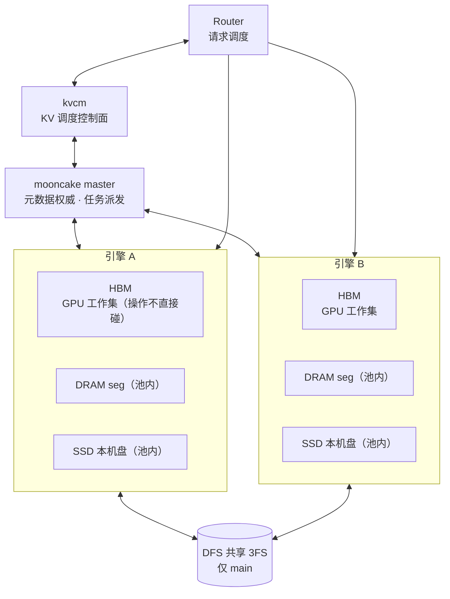
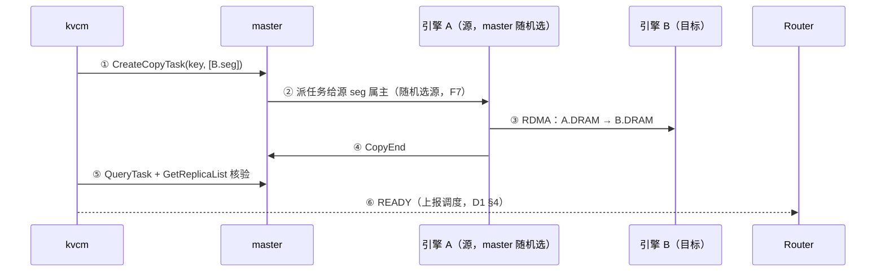
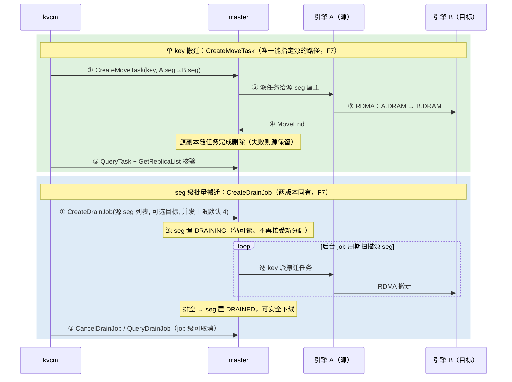
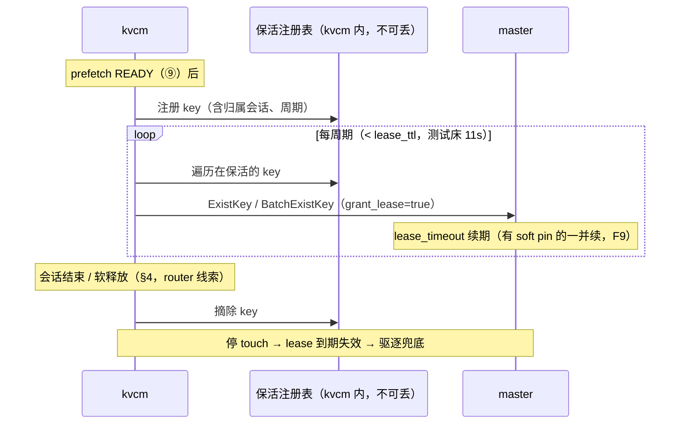
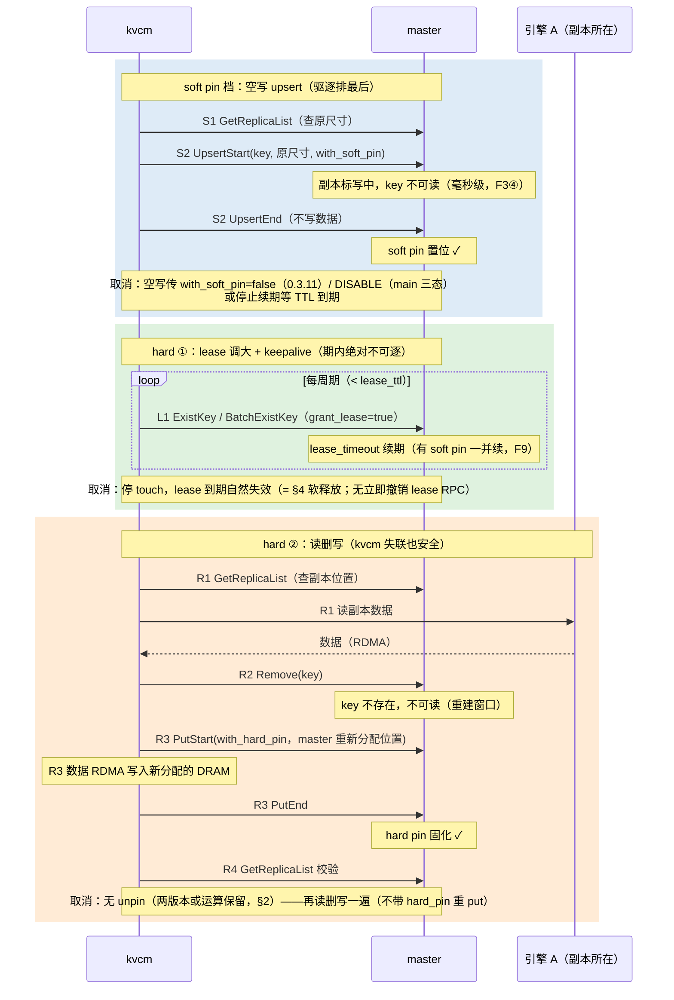
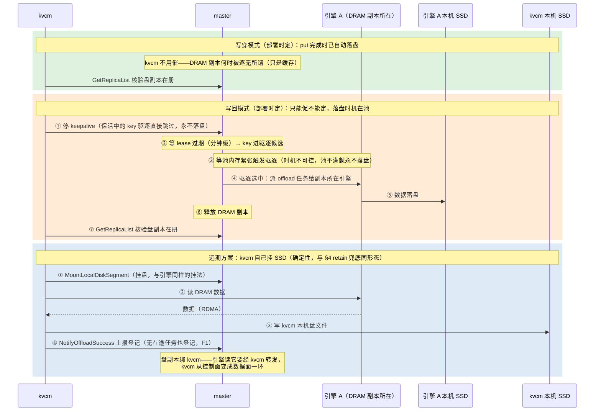
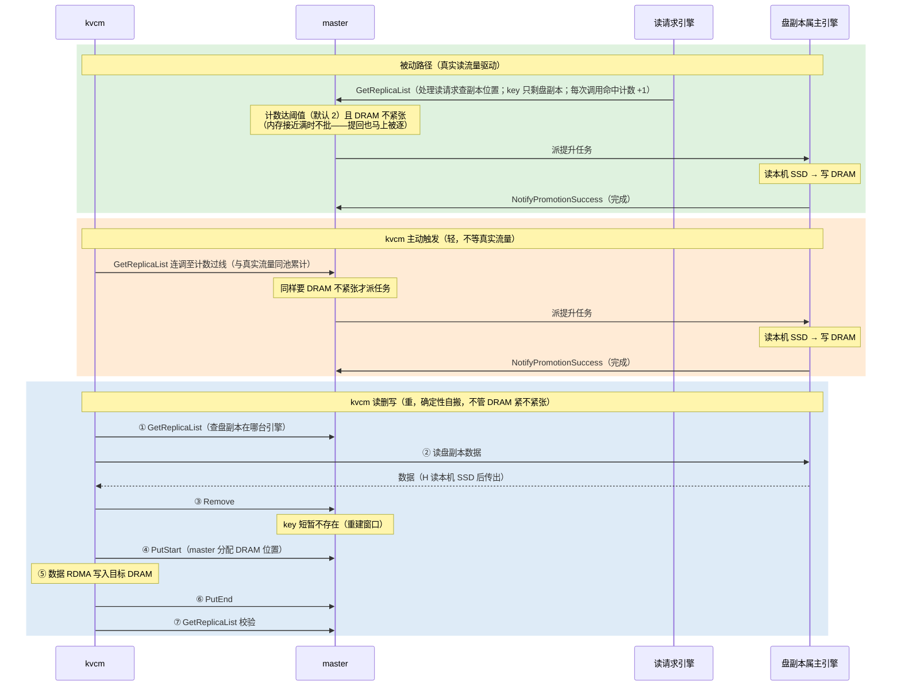
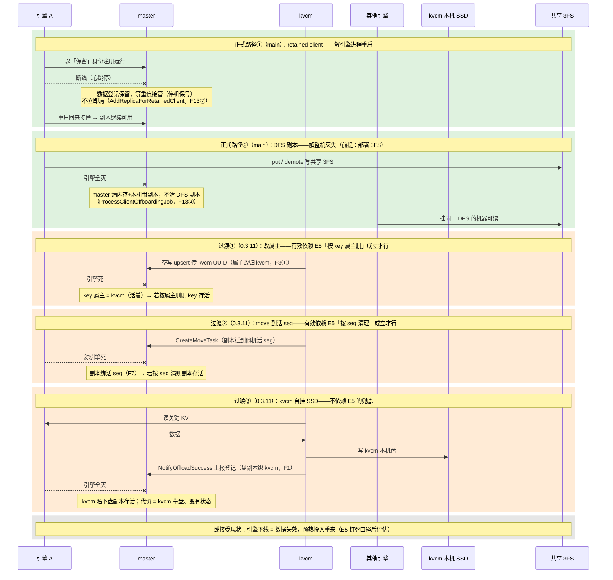
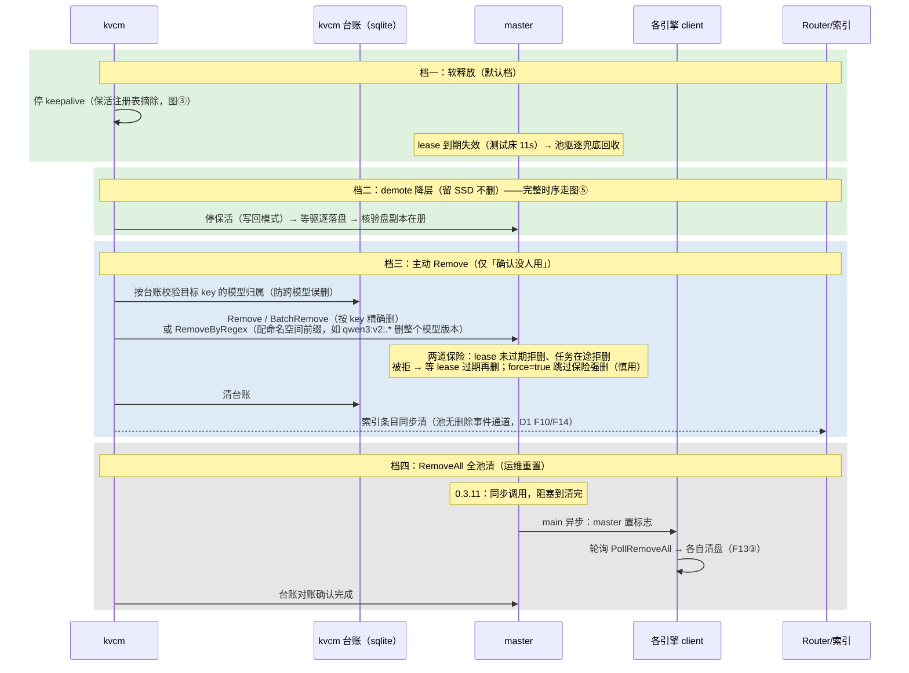
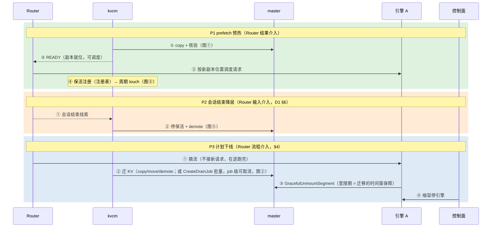

# D2: KV 调度操作集

- 本文解决什么问题
  - kvcm（独立 KV 管理控制面）需要对池里的 KV 做调度操作（复制、防驱逐、降层、保留、释放）
  - 本文定这些操作的语义、实现机制、失败处理
- 状态：**设计完成**
  - §1 操作集框架：闭环——八项操作业界逐项对照、完备性审计、kvcm 能力边界（只能被动等池的真缺口 2 条，归池侧扩展 vs 无专用 RPC 但组合可达 7 条）
  - §2 pin：候选已摆平；落地裁决依赖外部条件（mooncake 可改性、kvcm 语言），不阻塞
  - §3 demote / promote：设计完成
  - §4 retain / release：定型；retain 的池机制正式路径在 main（retained client 或 DFS 副本，F13），0.3.11 下的过渡手段待 E5 实验裁决（F6b）
  - 未决问题（详见 backlog）：copy 期间源前缀还在增长、新 block 谁补（P3）；copy 任务无法中途取消（P9）；级联删除「代码 vs 实测」口径不一致（E5）
- 上游问题：backlog D2（kvcm 对池内 KV 的操作面）
- 版本锚点（mooncake 两个版本并存引用，文中标注 `@版本`）
  - **0.3.11.post1**：测试床实际部署的 wheel
  - **main @ 1fc27b62**：submodule 源码，代表升级后获得的能力

## 参考实现

| 参考 | 锚点 | 借什么 | 关键差异 |
|------|------|--------|----------|
| Mooncake master 写路径 | mooncake 仓内 `master_service.cpp::UpsertStart`（@0.3.11） | 已有 key 事后加/解 soft pin 的唯一现成通道：同尺寸 upsert 会顺带设置/清除 soft pin（F3） | 该路径为「覆盖写」设计；本文的「空写」（声明更新但不写数据，只为触发元数据变更）是复用其副作用，非官方用法 |
| LMCache 后端接口 + controller | `lmcache/v1/storage_backend/storage_backend_interface.py`（七方法）+ `lmcache/v1/cache_controller`（lookup/pin/move/clear） | 与 kvcm 八项操作近一一对应，操作集合理性的直接证据 | LMCache 无全局强一致元数据（controller 是协调非权威）；kvcm 有 master 权威视图 |
| KVCR | `src/kvcr/remote_fw_dram.py`（hint/query/fetch 时序）+ Guard 组件 | 传输窗口 pin（`claim/pin`→`release_pin`）；Guard 旁挂进程持池（retain 对照） | KVCR 目的地发起 + 派生索引 hint；kvcm 集中式 + master 权威视图 |

- 八项操作的逐项业界对照见 §1 末；各产品降层机制对照见 §3；mooncake 机制锚点散布在事实基线各 F 条目

## 事实基线（代码核实）

### 背景概念

- **key 与副本**：池里一把 key 一份元数据，元数据里挂着副本列表；同一 key 可有多个副本（replica），落在不同机器的 segment（seg，一段注册进池的 DRAM）上
- **副本 = 元数据里的一条记录**：内容是「数据在某 seg 的某块 buffer 上」+ 状态。所以副本天然有**两个关联**——逻辑上属于 key（它是 key 元数据的一部分），物理上位于 seg（buffer 分配在 seg 上，seg 注册在 client 名下）。后文「副本跟 seg 死活」「按 key 删副本」分别对应这两个关联
- **副本两个状态**：写中（PROCESSING，不可读）与就绪（COMPLETE，可读）
- **属主（owner）**：每把 key 的元数据里记录 `client_id` = 最后写入它的客户端 UUID。注意三层区分，后文反复用到
  - 属主是 **key 级**字段：一把 key 一个属主，与它有几个副本无关；用途**只是鉴权**（谁有权中止写、谁有权定点清副本，F6），不是副本的归属声明
  - **副本自身没有属主字段**：副本的存亡由它**所在的 seg** 决定——client 死 → seg 被摘 → 挂在死 seg 上的副本记录被清，扫描按 seg 走、不看 key 属主（F7）
  - 清理路径分三种、权限各不同（F6 末尾全图）：整 key 删（Remove 系，**不鉴权**，kvcm 可用）/ 定点清单个副本（`BatchReplicaClear`，**限 key 属主自调**，kvcm 调不动）/ 级联清理（client 死亡自动触发）
- **lease（读租约）**
  - 读路径（`GetReplicaList` / `ExistKey`）授予，lease 期内该 key **绝对不可逐**（驱逐硬过滤直接跳过，F8）
  - **新 put 的 key 出生无租约**：`PutEnd` 里 `GrantLease(0, ...)` 把 lease_timeout 设为 now——「the object has no lease at beginning」（`master_service.cpp:1422` 注释 @0.3.11）；第一次被读/touch 才获得保护
- **kvcm 自身 = mooncake client**：client 是库不是独立进程；kvcm 调 copy/move/upsert 必须链接它，构造时自动持有一个 UUID——§2 方案一中「kvcm 自己的 UUID」零额外成本

### pin 机制

- **F1 pin 的两种形态**
  - **soft pin** = 限时驱逐保护
    - 到期自动失效，需保活续期才能长期有效
    - 保护不是绝对的：master 驱逐分两轮——第一轮只从无 soft pin 的 key 里挑；凑不够且 `allow_evict_soft_pinned_objects`（默认 true）时，第二轮才逐有 soft pin 的。语义 =「最后才被逐」，不是「不逐」
  - **hard pin** = 不可驱逐（绝对保护，无到期概念）；被 hard pin 的 key 仍可正常读写、upsert
  - 设置方式（per-key，config 随每次写请求携带）
    - 0.3.11：`ReplicateConfig.with_soft_pin / with_hard_pin` 布尔开关（`replica.h:84-85`）；soft pin 时长取全局配置 `default_kv_soft_pin_ttl`
      - 坑：布尔默认 false——upsert 一个已有 pin 的 key 时忘带 true，已有 pin 被清除（F3②）
    - main：soft pin 升级**三态** `SoftPinAction`（`replica.h:64-68`）——`PRESERVE`（=0，**默认值**，不动现状）/ `ENABLE`（开启，可带 `soft_pin_ttl_ms` 单次覆盖，省略用 master 默认 30min、上限 24h，`types.h:85-89`）/ `DISABLE`（清除）——三态修掉了 0.3.11 的布尔坑；无新增 RPC 入口
  - 可达性（关键约束）
    - 新建 key：写入时两种 pin 都可带
    - 已有 key：只能改 soft pin（经 upsert，F3）；hard pin 创建时固化、之后改不了（`master_service.cpp:1737` 注释 @0.3.11）
  - `CreateCopyTask` 不接受写请求配置（两版本同）→ kvcm 的复制路径带不了 pin，pin 必须事后单独加
  - 排除项：`AddReplica`（`master_service.cpp:1426` @0.3.11）
    - 是磁盘副本登记接口，只收 LOCAL_DISK、不带 pin——对「已有 key 事后加 pin」此路不通
    - **两版本都不是独立 RPC**：是 `NotifyOffloadSuccess` 的内部步骤（`master_service.cpp:2735` @0.3.11）
    - 「客户端本地盘存了数据后上报 master 登记」的完整通道 = `MountLocalDiskSegment`（挂盘）+ 写盘 + `NotifyOffloadSuccess`（上报登记）
- **F2 UpsertStart 的三种情形**（`master_service.cpp:1564` @0.3.11）
  - master 按「key 是否存在、尺寸是否一致」分三条路径
    - Case A（key 不存在）：按新 key 分配 buffer
    - Case B（存在且尺寸一致）：**原位更新**——复用原有 buffer 地址，不重新分配；pin 相关行为都发生在这条路径（F3）
    - Case C（存在但尺寸不同）：丢弃旧副本、按新尺寸重分配；旧 pin 设置保留/合并到新元数据
  - 拒绝条件
    - 该 key 的副本正被任务引用（copy/offload 在途，refcnt>0）→ `OBJECT_REPLICA_BUSY`（改写中的 buffer 会破坏在途 RDMA 读；检查是 per-key 的，不影响其他 key）
    - 该 key 有 copy/offload 任务在途 → `OBJECT_HAS_REPLICATION_TASK`
  - 参数校验在分支判断之前：要求副本数等配置合法（`replica_num≥1`）——空写虽不走分配，config 也须填合法值
- **F3 Case B 的四个行为**（`:1698-1737` @0.3.11）
  1. **改写属主**：`metadata.client_id = client_id` 无条件执行——「谁最后写，谁是属主」是 upsert 的固有语义，真实写数据与空写都触发
  2. **设置/清除 soft pin**：按 config 的 `with_soft_pin`——true 且当前无 pin → 授予；false 且当前有 pin → 清除
  3. **hard pin 不动**（F1 可达性）
  4. **副本标为写中**：COMPLETE→PROCESSING，该 key 对所有读者不可见，直到 UpsertEnd 标回——空写的「不可读窗口」来自这里
- **F4 UpsertStart 不验身份**
  - 对调用方 client_id 无任何校验（不要求等于原属主、不要求活跃注册，只查参数合法性）
  - 推论：kvcm 调用时把**原属主的 UUID 原样传回**，行为 1 就把属主赋回它自己 = 属主实际不变，pin 照加（「借名」方案的机制基础）
  - 一个例外条件：upsert 开头 master 顺手做**单 key 惰性清理**（`CleanupStaleHandles`，`:2530`）——只遍历当前这把 key 自己的副本（O(副本数)），把挂在已死客户端 seg 上的副本清掉；若清完无有效副本，请求落入 Case A 新建。所以借名 upsert 要求原属主当时在线（预热场景成立）
- **F5 Revoke = 写中止**
  - `UpsertEnd / UpsertRevoke` 直通 `PutEnd / PutRevoke`（`:1770` 附近 @0.3.11）
  - 用途：PutStart/UpsertStart 分配了 buffer、副本标为写中之后，客户端写失败或放弃 → 调 Revoke 把写中的副本释放掉
  - 约束
    - 校验属主：非属主调用 → `ILLEGAL_CLIENT`（只有发起写的人能中止）
    - 只撤写中副本；副本已就绪则拒绝 → `INVALID_WRITE`
  - 与 kvcm 的关系：空写若在 Start/End 之间崩溃，副本卡写中——恢复时扫描任务记录，补 End 或 Revoke 清理（归 §1 状态记录①的崩溃恢复）

### 属主字段与级联删除

- **F6 属主字段代码上管三件事**（`metadata.client_id` 全库共四处使用）
  1. **写中止权限**：`PutRevoke` / `UpsertRevoke` 校验属主身份（`:1364` / `:1482` @0.3.11，F5）
  2. **副本清理权限**：`BatchReplicaClear` 校验请求者必须是属主（`:937` @0.3.11）——kvcm 非属主调不动
  3. **upsert 改写**：「谁最后写谁是属主」（F3①）
  - **不管**：copy / move / get / exist——复制与读取路径完全不读属主字段（F7 代码核实）；且 copy 的副本登记走独立 RPC 对 `CopyStart`/`CopyEnd`（不经 Put/Upsert），全程不碰 `client_id`——**copy 后 key 属主不变**，仍是最初写入的引擎（`master_service.cpp:1849` @0.3.11）
- **清理路径全图**（「清理 API 能不能清到某副本」的完整答案）
  1. **整 key 删**：`Remove` / `BatchRemove` / `RemoveByRegex` / `RemoveAll`——key 元数据连同全部副本一起删（不管副本在哪个 seg）；**不鉴权**，kvcm 可用（§4 release）
  2. **定点清单个副本**：`BatchReplicaClear(keys, client_id, seg)`——只清指定 client 指定 seg 上的副本、其他 seg 的保留；**限 key 属主自调**（F6②），kvcm 调不动 → kvcm 做不了「只清 A seg 副本、留着 B seg」的定点手术
  3. **级联清理**：client 死亡 → 其 seg 全摘 → 挂在死 seg 上的副本记录清掉（disk 副本随死 client 清）——按 seg/client 维度扫，**不看 key 属主**；master 自动触发（F6b 有代码与实测的口径矛盾，归 E5）
- **F6b 级联删除：实测现象与代码核实不一致（归因归 E5）**
  - **实测**（D1 F5 / EXPERIMENTS #3）：属主 A 重启 → client TTL 过期 → key 记录连同全部副本记录（**含预热到 B seg 上的**）消失，`batch_is_exist` 0/32；现象疑似「副本存活性绑定属主 client」
  - **代码核实**（0.3.11.post1）：client 过期处理（`master_service.cpp:4930-5015`）= unmount 该 client 全部 seg + `ClearInvalidHandles` 全量扫——清理是**副本级**的（`CleanupStaleHandles :2530`）：内存副本随死 seg 清、disk 副本随死登记 client 清。**活 seg 上其他 client 的副本按代码不该被清**；全库无「按 key 属主删」路径
  - **不一致点**：实测时 B 的 seg 活着、B 副本 COMPLETE 可读（B 命中 88.2%），按代码应存活，实测却消失——待 E5 对照实验厘清（master 是否同机陪葬 / 副本实际状态 / 其他清理路径）
  - **设计含义**：0.3.11 过渡期的 retain 手段有效性依赖口径裁决（§4）——E5 证实「按 key 属主删」则改属主有效，证实「按 seg 清理」则 move 到活 seg 有效；main 的池机制（retained client / DFS 副本，F13）不依赖此口径，是 E5 之外的独立解

### copy / move 机制

- **F7 CreateCopyTask**（`master_service.cpp:5777` @0.3.11）
  - 入参：key + 目标 seg 名列表；**调用方不能指定从哪个副本复制**
  - 源选择：master 从该 key 现有副本所在的 seg 里**随机挑一个**（`:5816`）
  - 执行模型：master 不搬数据，只生成任务记录；任务派给「源 seg 所属的客户端进程」执行——复制要求源属主在线
  - 校验：key 存在、目标 seg 已挂载可分配
- **CreateMoveTask**（key, source, target，`:5845`）
  - 唯一能指定源的路径；语义是**移动**——完成后源副本删除
  - 执行模型与 copy 相同：任务派给源 seg 属主执行（`GetClientIdBySegmentName(source)`），同样要求源在线；失败则源保留
- **CreateDrainJob**（两版本同有：`master_service.cpp:5970` @0.3.11，`ProcessDrainJobs` `:6354` @0.3.11 / `:14434` @main）
  - seg 级批量搬迁：入参 = 一批源 seg 名 + 可选目标 seg 列表 + 并发上限（默认 4，`CreateDrainJobRequest` 字段两版本一字不差）
  - 语义：源 seg 置 DRAINING（仍可读、不再接受新分配，`segment.h:24` 注释 @0.3.11）→ master 后台 job 线程（`JobDispatchThreadFunc` → `ProcessDrainJobs`）周期扫源 seg 上的 key、逐个派搬迁任务 → 排空后 seg 置 DRAINED，可安全下线
  - 与 CreateMoveTask 对比：粒度 = seg 批量 vs key 单发；驱动 = 后台 job 循环调度 vs 即时单任务；**可取消性 = job 有 `CancelDrainJob` / `QueryDrainJob`，task 无取消（P9）**——下线场景白得取消能力
  - 用途：计划下线（§4）
- **副本没有属主字段，生死跟随所在 seg**：copy 到 B 的副本属 B 的 seg——源引擎下线不影响它；目标引擎（B）下线它才随 seg 失效（代码口径；与实测的不一致见 F6b）
- **介质边界：copy/move 只在 DRAM seg 之间，接不了 SSD**（两版本一致）
  - disk seg 不在 seg 名字空间：0.3.11 挂盘单独登记在 client 名下（`segment.cpp:133` `MountLocalDiskSegment`，不进 seg 名注册表）；main 改由 `local_ssd_manager_.RegisterClient` 按 client 登记（`master_service.cpp:8407`），同样没有 seg 名——copy/move 的目标校验只认内存 seg 名，**disk 做不了目标**
  - copy 源从「副本的 seg 名」里挑，而 disk 副本没有 seg 名（`replica.h:610` `get_segment_names`，两版本同一实现）——**SSD 副本做不了源**
  - 推论：跨介质迁移只能走池自己的通道——offload（降 SSD）/ promotion（提 DRAM），copy/move 帮不上忙（§3）

### lease 与驱逐

- **F8 驱逐算法的完整过滤与排序**（`BatchEvict`，`master_service.cpp:4467` 起 @0.3.11）
  - 硬过滤（两轮通用，满足任一即跳过）
    - hard pin → 永不候选
    - lease 未过期 → 跳过（lease 期内绝对安全）
    - 副本 refcnt>0（正被任务引用：copy/move/offload/promotion 在途；无读者引用机制，§2 读锁否决条）→ 该副本不可逐（per-副本字段 `get_refcnt()`）
  - 第一轮：无 soft pin 的候选；不够且 `allow_evict_soft_pinned_objects_` 时进第二轮：soft pin 候选
  - **两轮排序依据都是 `lease_timeout`（租约到期早晚 ≈ 最近被读时间）**，不是 LRU 计数、也不是 soft pin 剩余 TTL
    - soft pin TTL 的作用仅是「pin 还有效吗」——决定进哪一轮，不作排序依据
    - kvcm 同周期 touch 的 key 剩余 TTL 趋同，本就无排序区分度
- **F9 一次 touch 同续两个时钟**（`GrantLease`，`master_service.h:938` @0.3.11）
  - `lease_timeout` 续到 `now + default_kv_lease_ttl`；若 key 已有 soft pin，`soft_pin_timeout` 续到 `now + default_kv_soft_pin_ttl`（max 语义，只延不缩）
  - 配置值
    - 0.3.11：两个 TTL 均为 master 必填配置（`master_config.h:119-120`）；测试床配 `default_kv_lease_ttl=11s`（`start_master.sh:34`），soft pin TTL 未显式配置
    - main：soft pin TTL 默认 30min（`types.h:86`）；lease TTL 仍必填
  - `ExistKey` / `BatchExistKey` 顺带续租（`grant_lease=true`）；`ProbeKey` 不续（纯探测：结果为 true 只说「调用那一刻在」，`master_service.h:268` @main）——kvcm 的 touch 用前者；**`ProbeKey` 为 main 新增、0.3.11 不含**
- **F10 lease 时长是全局读租约，不是 kvcm 私有参数**
  - 调大（如 5min）的连锁反应：任何 key 被读一次 → 窗口内不可逐 → 驱逐候选池缩小；极端（高流量池）候选不足时，压力集中到无 lease 的 key——**新 put 的 key 恰好出生无租约（背景概念），首当其冲**
  - soft pin 的设计意义正是解耦：lease 保持短（驱逐候选充足）+ pin 给少数 key 定向长保护

### UUID 与客户端接口

- **F11 kvcm 拿不到引擎的 client UUID**
  - UUID 在客户端进程构造时随机生成（`client_service.cpp:431`），无法按实例名推算
  - C++ 客户端有公开 `getClientId()`（`client_service.h:67`），但 **Python 绑定 0.3.11 与 main 都未暴露**——vLLM 走 Python，读不到自己的 UUID
  - master 的 RPC 没有「key → 属主 UUID」查询
    - `GetReplicaList` 返回副本描述符（副本的位置信息），内存副本的只有 seg 名和地址，不含 client_id（`replica.h:240`）
    - master 内部有现成的「seg 名 → client UUID」查询 `GetClientIdBySegmentName`（CreateCopyTask 自己就在用），但没暴露成 RPC
  - kvcm 与引擎之间**没有直接通道**：kvcm 的视野来自 master 的 segment 信息（seg 名 = `IP:rpc_port`，见 [README.md](README.md)）；「端点 → 实例」的注册方向是 kvcm 注册给索引（backlog D4/E13），不是引擎注册给 kvcm
- **F11b 核验通道的版本分工**（main 新增 `GetReplicaListForAdmin` / `BatchGetReplicaListForAdmin`，`master_service.h:424` @main）
  - 与 `GetReplicaList` 返回相同内容，但**零副作用**：不授 lease、不触发 promote、不污染命中统计——正是 kvcm 核验/对账想要的语义（`GetReplicaList` 的授 lease 副作用对核验是污染、对 touch 才是目的）
  - 分工：touch 续租用 `ExistKey`（F9，要的就是续租）；副本状态核验在 main 用 admin 查询，0.3.11 只能用 `GetReplicaList` 连带副作用
- **F12 空写的发送通道**
  - master 协议层：`UpsertStart` / `UpsertEnd` 是公开 RPC（`master_service.h:331/:338` @0.3.11）
  - Python 绑定：只有「带数据、一次完成」的一体化接口 `upsert_tensor`，没有 start/end 分开调的接口——空写从 Python 发不出来
  - kvcm 要实现空写
    - 用编译型语言客户端库（C++/Go/Rust）或直接按协议发 master RPC → 不用改 mooncake
    - 继续用 Python → 需要给绑定层打补丁（改 mooncake）

### F13 main 相对 0.3.11 的能力增量（按「对 kvcm 有什么用」分六组；各处引用统一指向本条）

- **消费方四分总纲**（读六组前先立框架）：main 的能力补齐分四个消费方向
  - **master 内部自治**：动态副本、热度统计——按访问统计自动调节，不对外
  - **引擎 client**：任务改为自己来取（master 把任务放内存队列、client 定期取）；另有驱逐/容量上报、retained 注册——client 从单纯存取数据变成帮池子干活
  - **控制面/管理面**：Admin 命名查询、DrainJob 三件套两版本同有；main 补齐零副作用查询（`GetReplicaListForAdmin`）、租户配额五件套、DFS 容量管理——**kvcm 的位置**
  - **master 自身 HA**：`RestoreFromStandby`，supervisor 主备
  - 前两层与 kvcm 不冲突：自治层按统计自动调节、kvcm 按业务语义指定目标，分工互补

**① 多模型隔离**（kvcm 按模型管 KV 的底座）
- 每把 key 归属一个**租户**（tenant），main 所有 RPC 都要带租户名——同 key 不同租户是两份数据
- 租户有独立**配额**（能写多少字节）和独立的**驱逐账**（池满时按租户各自算账，水位默认 90%）；落盘也有租户级上限，超限的 key 被强逐**不落盘**
  - 配额管理五件套（main）：`UpsertTenantQuotaPolicy`（设/改）、`DeleteTenantQuotaPolicy`、`GetTenantQuotaSnapshot`、`ListTenantQuotaSnapshots`、`GetTenantQuotaAllocatableCapacityBytes`（池子还剩多少可分配）
  - tenant 在 `Client::Create` 时绑定（默认 `"default"`）——粒度 = client 级：一个引擎跑一个模型版本时，client 级 tenant 天然就是「一模型版本一租户」；单引擎服务多模型需各起 client 各挂 tenant
- 多把 key 可绑成一个**生命周期组**（`group_ids`）：驱逐时整组同进退——kvcm 的「前缀族」在 main 可以整体绑组，不再逐 key 各自为政
- kvcm 用法：一个模型版本 = 一个租户（0.3.11 只能靠 key 名前缀模拟，§4 release）

**② 数据跨引擎存活**（retain 的正式路径，§4）
- **retained client**：client 断线，master 不立即清它的数据，留时间让它重连接管——解「引擎进程重启」
- **DFS 副本**：数据直接写共享文件系统（3FS，多机挂同一目录）——谁死了文件都在，任何挂同一 DFS 的机器都能读——解「整机灭失」
  - 硬事实：引擎下线时 master 只清「内存副本 + 本机盘副本」，**不清 DFS 副本**（`ProcessClientOffboardingJob`，`master_service.cpp:2965-2973`）；DFS 副本只在整 key 删除时释放
  - 前提：部署 3FS（测试床没有）

**③ 下线与运维**
- `UnmountLocalDiskSegment`（main 新增——0.3.11 挂了本地盘就摘不掉）：引擎死前主动摘掉盘的登记（效果等同死后被清，但更干净可控）
- `RemoveAll` 改异步（main）：master 置个标志，各 client 轮询到（`PollRemoveAll`）后各自清盘——全池清空不再是同步调用
- `EvictDiskReplica` / `BatchEvictDiskReplica`（两版本同有）：client 盘副本被逐后向 master **上报**、清元数据（通知型，不是「命令 master 驱逐」）。鉴权分介质：
  - `LOCAL_DISK`：限盘副本属主（descriptor 的 client_id 须匹配，`master_service.cpp:6336-6346` @main）
  - `DISK`（DFS 副本）：不验 client_id——kvcm 调用可清 DFS 副本
    - 机制事实登记；语义是「驱逐上报」，拿它当主动删除属于误用，release 不走这条路（§4）

**④ 查询与核验**（kvcm 的台账/对账工具）
- `GetReplicaListForAdmin`：查副本状态但**零副作用**（不续租、不触发 promote、不计命中统计）——核验专用（F11b）
- `GetAllKeys` / `GetReplicaListByRegex`：全量/模式列举 key——台账对账重建用
- `ProbeKey`：纯探测在不在，不续租（F9）；实现确认也不喂命中统计（`ExistKeyImpl(grant_lease=false)` 不触发 promote 计数与动态副本观测）——main 下最轻的存在性核验
- 副本位置无需补环：`GetReplicaList` 的副本 descriptor 自带 `transport_endpoint_`（内存副本 `AllocatedBuffer::Descriptor`，`allocator.h`；盘副本 `LocalDiskDescriptor` 还外加 `client_id`）——「副本在哪台机器」一跳到位。`BatchQueryIp`（client_id → IP，两版本同有）对 kvcm 仅边角用途：已登记引擎 UUID 重连后查当前地址——注意它答的是「client 在哪」，答不了「key 属主是谁」（属主 = 最初写入引擎，copy 后不变；key→属主无查询接口，F13⑥，台账只能写入时自登）
- `GetStorageUsageSnapshot`（main）：分层容量快照——demote 触发条件「DRAM 压力」的数据源
- 台账失效通知增强（main）：KV 事件流（ZMQ，stored/removed/cleared，D1 F14）的 removed/cleared 事件可让台账条目立即失效，不必等下轮全量对账；stored 不含 seg/位置（D1 F14 已析），替不了对账——索引面用途归 D1，kvcm 台账只借失效通知

**⑤ 任务机制变化**
- offload / promotion 任务两版本都是**引擎来取**：master 把任务放进引擎的盘任务队列（mailbox），引擎的 store worker 心跳来取执行（`OffloadObjectHeartbeat` / `PromotionObjectHeartbeat`，两版本同有——0.3.11 实现确认从 `promotion_objects` 队列取任务，`master_service.cpp:2920` @0.3.11）；`PromotionAllocStart`（引擎主动开口要）两版本同有
- **offload 取消不对外**：`CancelQueuedOffloadTask` 是 master 内部方法（RPC 层未注册；唯一调用点 = `UpsertStart` 接管 key 时清掉还在排队的 offload，`master_service.cpp:5892` @main）——kvcm 没有取消 offload 任务的入口
- **copy/move 任务仍无取消**（两版本同，P9）
- `SubmitReplicaActionProposal`：master **内部**动态副本机制（热 key 自动加 DRAM 副本）
  - 全链路：
    1. `GetReplicaList` 观测点——与 promote 观测并排（`master_service.cpp:4441` @main），**一次调用同时给两个机制计数**
    2. 滑窗计数——窗口内命中 ≥ `ceil(QPS 阈值 × 窗长)` 时，恰好到线那次入队
    3. 三档模式：`kOff`（默认）/ `kObserve`（只打日志）/ `kEnforce`
    4. 准入线程批量提交 proposal
    5. 校验链：lease 幂等 + 冷却 + version_epoch 乐观锁
    6. 落 `REPLICA_COPY` 任务，派源 seg 属主执行
  - **不对外暴露**：`rpc_service.h` 未注册、`master_client` 无
  - 动作类型只有 `ADD`（`rpc_types.h:17-19` @main），**不能用来降层**
  - **kvcm 能触发、但结果不满足 copy 语义**
    - 能触发：连调 `GetReplicaList` 使滑窗计数过线，master 即自动加副本（与 promote 同一种触发手法）
    - 不满足语义：目标 seg 由 master 自选（异机优先 → 最空优先 → 稳定哈希决胜，`SelectDynamicReplicaPlan:9511` @main），kvcm 指定不了（`preferred_target_segment` 字段只是预留，且 proposal RPC 不对外）
    - 结论：预热要的是「放到指定引擎」，这条路只适合「不加区分给热 key 加一份」的池级自动调节场景，且要求 master 配 `kEnforce` + 副本数未达上限
  - 「无 per-key 立即降层 RPC」的结论两版本成立

**⑥ main 仍没有的**（别去找了）
- per-key 立即降层 RPC、copy/move 任务取消、Python 绑定的空写通道、key→属主 UUID 查询

## §1 操作集框架

- **本节与专节的分工**：本节是八项操作的公共面（语义界定、分工、完成信号、业界对照、能力边界、操作图解）；专节只给需要方案取舍或缺口分析的操作——§2 pin（三方案 + 属主问题）、§3 demote/promote（组合路径 + 真功能缺口）、§4 retain/release（多机制组合）。copy / move / keepalive 不设专节：单 RPC 操作、无候选分歧，机制在事实基线（F7 / F9）、语义分工在本节、缺口在能力边界表——三处合读即全覆盖
- **操作集八项**：copy / move / keepalive / pin / demote / promote / retain / remove
  - 按性质分三类
    - **原子动作**：copy / move / keepalive / demote / promote / remove——原子指**语义**：一个操作一个效果、无中间态对外。实现上 copy/move/keepalive/remove 各对应单 RPC；demote/promote 是组合动作（池通道或 kvcm 读写组合 + 核验，§3），对外仍呈现单步语义
    - **元数据标记**：pin——设一次长期有效的标记
    - **目的型**：retain——「副本跨实例存亡活着」是目的不是机制，由 demote / move / pin 组合实现（§4）
  - 复合流程由原子操作编排而成（策略层组合），不写成一体状态机
  - 理由：kvcm 定位是通用 KV 管理控制面，不只是为预热一个场景服务

| 复合流程 | 编排 |
|---|---|
| prefetch（预热） | copy + 核验 + 保活注册（READY 后通常接 keepalive 防驱逐） |
| 会话结束降层 | 停 keepalive + demote（写回模式的必要前置，写穿模式可直接 demote；§3） |
| 下线迁移 | copy + remove（或 move 一步完成） |

- **操作完成信号**：每个原子操作都有完成确认——任务类（copy/move）查 `QueryTask`，再统一核验副本状态（`GetReplicaList`；main 用零副作用的 admin 版，F11b），kvcm 据以更新台账
- **READY** 是完成信号里特指「可以把请求调度过来」的那一类
  - 含义：目标实例的 DRAM 副本已写好、kvcm 核验通过后，上报 Router（D1 §4）
  - 有 READY（3 个）：**copy（预热）、move、promote**
    - 共同点：做完之后，某个实例新具备了「请求发过来就能直接用本机 KV」的条件
    - 核验方式相同：查 `QueryTask` 确认任务结束，再查 `GetReplicaList` 确认副本状态（F7）
    - move 多一件事：源副本被删，要同步通知索引「源实例不再有这份 KV」
  - 无 READY（5 个）：
    - keepalive / pin / retain：不动数据，RPC 返回即完成，记台账即可
    - demote：完成信号 = 「盘副本在册」，只记台账——降层后请求本来就不能直接发过去，没有「可调度」可上报
    - release：语义相反——不是「可以发过去」，而是「别再发过来」：清台账 + 同步索引删除

- copy 与 move 的分工
  - **copy 保副本数**：新增副本，源由 master 随机选（F7）
  - **move 减副本数/搬迁**：指定源→目标，完成后源删（F7）
  - 用途：下线迁移、副本归拢用 move
- **防驱逐相关操作的语义界定**（keepalive / pin / retain 的区别）
  - **keepalive**（动作）：周期 touch 续 lease（F9）——窗口 = lease_ttl、轻、高频；kvcm 断线，lease 过期即失效
  - **pin**（元数据标记）：设一次长期有效——soft = 驱逐排最后 + TTL 窗口；hard = 绝对不可逐
  - **retain**（目的，不是机制）：「属主下线/长期未命中时副本继续活着」——手段组合见 §4
  - touch 哪些 key、何时开始、周期多少 = **kvcm 策略层逻辑**（保活注册表驱动），不是原子操作语义的一部分
- **状态记录四类**（按可丢性分级）
  1. **任务状态机**（可丢）：在途任务进度；丢了可重发——master 侧操作幂等（重复 copy 同 key 同目标不产生重复副本）
  2. **保活注册表**（不可丢）：哪些 key 在保活循环里；丢了就停止保活，等效提前释放
  3. **副本台账**（半可丢）：「前缀 × 目标实例」分布；丢了可从 master 查询重建，代价一轮全量对账
  4. **会话绑定**（不可丢）：key 与会话的归属；丢了不知何时停保活——保活永不停 = 事实永久 pin
- **部署形态**
  - kvcm 单实例跟随 mooncake master：master 单实例则 kvcm 单实例；master 将来多实例时再议 kvcm 的 HA 与共享存储
  - 状态存 **sqlite**（零新组件；上 HA 时再换 Redis/etcd）

### 参考实现对照（八项操作逐项）

| kvcm 操作 | 业界对应 | 异同 |
|---|---|---|
| copy | LMCache `P2PBackend` 跨实例直传 + controller 命令（lookup/pin/**move**/clear，`lmcache/v1/cache_controller`）；KVCR hint 驱动 P2P（**目的地发起**，源侧 `claim/pin` 配合）；llm-d P2P（索引只作 hint、握手兜底）；HiCache `prefetch_from_storage`（L3→L2→L1，三策略终止）；mooncake 动态副本（main 内部机制，热度驱动自动加副本） | 命令面与数据面分离是各家共同形态。kvcm 的 `CreateCopyTask`（master 指派源端执行）与 LMCache controller 同为集中式；KVCR/llm-d 的「目的地发起」依赖派生索引 + 握手，kvcm 有 master 权威视图，集中式成立。mooncake 动态副本 kvcm 能触发不能指定目标（连调 `GetReplicaList` 同一种手法，F13⑤）——只适合池级自动调节，不满足预热「指定目标」语义 |
| move | LMCache controller 命令集含 `move`；KVCR `deliver`（纯搬运层模式） | move 作控制面原语在多家存在；`CreateMoveTask` 指定源、删源，语义一致 |
| keepalive | LMCache 后端接口 `touch_cache`；FlexKV lease「保证传输期间块有效」；llm-d 推测索引 TTL 2s（`defaultSpeculativeTTL`，代码注释自承是经验值） | 周期 touch 续租在多家存在；llm-d 的「TTL 是经验值」提示 lease_ttl 须真机校准（F10 已记） |
| pin | LMCache `pin`/`unpin`（后端接口级）；KVCR `claim/pin`/`release_pin`（**传输窗口专用**，`FETCHABLE` 须等 pin 成功才确定）；TensorCast `pinned` policy（必须驻留 + 溢出**拒绝写入**）；HiCache `lock_ref`（`protected_size_` vs `evictable_size_`，dec 到 0 ≠ 释放、仍可命中） | mooncake 三件套（lease/soft/hard）比多数系统细。差异：TensorCast `pinned` 溢出拒绝写入，mooncake hard pin 无此语义（创建时固化、之后改不了，F1）；KVCR 的传输窗口 pin 在 mooncake 由「copy 任务在途拒 upsert」覆盖（F2） |
| demote | §3 专节（FlexKV/LMCache/UCM/KVBM/MemCache 对照 + HiCache 写穿/写回） | —— |
| promote | HiCache `load_back`（L2→L1 提回）；FlexKV SSD→GPU 的 H2D 回填；KVCR `fetch`；mooncake `promotion_on_hit`（命中达阈值自动提回） | 被动提升（读命中驱动）是各家主路径；kvcm 另有主动两条：`GetReplicaList` 连调至命中计数过线触发 / 读删写自搬（§3） |
| retain | KVCR-Guard（**旁挂进程持池** + fencing 隔离失效者 + backup KVCR 接管，引擎崩溃后缓存仍可供远端读）；TensorCast 所有权二分（System-Owned vs **Caller-Leased**：KV 是调用者租借）；LMCache daemon/远程后端；FlexKV REMOTE | 「副本归引擎外实体」是多家共同选择；kvcm 的正式路径 = main 的 retained client 机制（client 断线数据保留，§4），存储统一在 mooncake。TensorCast Caller-Leased 对应 kvcm 的定位：kvcm 对引擎 KV 是**租借管理权**（只加保护，不没收读写）。KVCR 的 fencing（防「死而复活」：旧实例断线又回来、拿旧身份继续发号施令时把它挡在门外，常用任期号/令牌实现）在 kvcm 不需要——kvcm 对池没有需要排他防护的权限：属主管辖的 API 只有 Revoke / BatchReplicaClear（F6），kvcm 本就不是属主 |
| remove | LMCache `remove`/`clear`；SGLang 分层放弃（`block-lifecycle.md`）：无 L3 时 `evict` 删叶 = 彻底；**有 L3 时引擎永不主动放弃**——删除下放 L3 后端独立 LRU/TTL，引擎看不到 | SGLang 的「释放 = 逐层剥离」（L1 摘节点降层 → L2 摘除 → L3 后端自决）对应 kvcm 三档（软释放 / demote / remove）。「L3 删除引擎不可见」提醒：kvcm remove 后索引侧条目需同步清（D1 已知：池副本删除事件通道缺失） |

- **总观察**
  1. LMCache 后端七方法 + controller 命令集与 kvcm 八项近一一对应——操作集合理性的直接证据
  2. TensorCast policy 预设（`cache/durable/ha/cold/warm/pinned`，`tensorcast/api/_config.py::StorePolicyProfile`）是声明式放置契约：kvcm 的操作可视为给 key 改 policy（demote≈`cold`、pin≈`pinned`、默认≈`cache`）；API 形态（声明式 policy vs 命令式操作）留待 E11 协议设计时参考
  3. SGLang「释放是逐层剥离不是单动作」——kvcm 软释放/demote/remove 三档粒度与之相同

### 操作集完备性审计（双向对照）

- **别人有、kvcm 没有的**

| 操作 | 出处 | 评估 |
|---|---|---|
| **prefetch 终止/取消** | HiCache `can_terminate_prefetch` / `mark_terminate`（三策略：best_effort / wait_complete / timeout） | **真缺口**：请求改道 / 源消失时 copy 白耗带宽只能等自生自灭；**copy/move 任务两版本都无取消 RPC**（main 只有 `CancelQueuedOffloadTask` 能取消 offload 任务、且镜像被取走即失败，F13）——补法：池侧扩展（改 mooncake）或「弃置 + 事后清副本」（kvcm 侧可做的弱版）。已登记 backlog P9 |
| compress（KV 压缩） | LMCache controller 命令集 | 远期能力，当前不补 |
| health / full_sync（对账） | LMCache controller 命令集 | 半缺口：状态记录③有「全量对账重建台账」概念但未操作化——应列为运维操作 |
| 在途状态查询 | KVCR `query` 四态（HIT / **FETCHING** / FETCHABLE / MISS） | 半缺口：kvcm 有 `QueryTask`（任务视角）+ exist（在/不在），缺 KVCR 那种 **key 视角**四态；「预热中」状态存于 sqlite 任务状态机，是否暴露给索引归 D4 接口设计 |

- **kvcm 有、别人不做的**

| 操作 | 别人为什么不做 | kvcm 为什么要 |
|---|---|---|
| pin 显式标记 | UCM/FlexKV 交给后端 LRU/TTL；SGLang 有 L3 时引擎**永不主动放弃**（删除下放后端容量管理） | 预热副本**没有读者**，「读即续租」保不住——预热场景特有 |
| keepalive 独立保活 | 多数系统靠读路径被动续租，无控制面保活 | 同上（LMCache `touch_cache` 是同类例外） |
| move 显式搬迁 | FlexKV/UCM/HiCache 层间移动是驱逐/prefetch 的副作用，无显式 move | 下线迁移/副本归拢要确定性搬迁（LMCache controller 有 move，不孤立） |
| retain 属主下线存续 | 引擎插件层（FlexKV/UCM/HiCache L1L2）引擎死缓存失效拉倒；KVCR-Guard/LMCache daemon 才做 | kvcm 是独立控制面：预热投入要跨实例存亡保住 |

- **审计结论**：不做 pin/keepalive/retain 的系统，共同点是有读者替它们保活、或引擎死了认栽——kvcm 的预热副本恰好「无读者 + 要跨实例存亡」，这三样是定位需要，不是冗余。**唯一真缺口 = prefetch 终止**（backlog P9）

### kvcm 能力边界（功能视角分级）

判据是**功能目标能否用现有原语组合达成**，不是有没有专用 RPC。与上节审计的关系：审计对照「别人有、kvcm 没有」，本节按功能视角给 kvcm 自身能力定级——真被动 2 条（含审计识别的 P9，另加 §3 的确定性 demote），组合可达 7 条。

**无法操作，只能被动（真功能缺口，归池侧扩展）**

| 功能 | 卡点 | kvcm 现状手段 |
|---|---|---|
| 写回模式确定性 demote（含「只清 DRAM 副本、留盘副本」） | 无 per-key 降层 RPC（两版本同）+ `BatchReplicaClear` 限 key 属主（F6②） | 停保活进驱逐候选，时机不可控；远期：kvcm 自己挂 SSD + 上报登记（§3） |
| 在途 copy/move 任务取消（止损） | 无任务取消 RPC（两版本同，P9） | 弃置 + 事后清副本——止不住在途带宽，只清结果 |

**功能对齐，组合实现（mooncake 无直接可用接口）**

| 功能 | 组合路径 | 代价 / 延迟 |
|---|---|---|
| promote | `GetReplicaList` 连调至命中计数过线触发 / 读删写自搬（§3） | 触发要 DRAM 不紧张才批；自搬数据过本地 |
| hard pin 取消 | 再读删写一遍（§2） | 数据过本地 |
| lease 撤销（软释放） | 停 touch 等过期（§4） | 固定延迟 = TTL（分钟级，确定） |
| 指定源 copy | `CreateMoveTask`（要保源则 move 完再 copy 回，F7） | 绕一步 |
| 死引擎副本清理 | `Remove` / `RemoveByRegex`（不鉴权，§4） | 比等心跳扫描快 |
| 给新 put 腾 DRAM | `Remove` 冷 key | —— |
| 冷热观测 | kvcm 自建台账（sqlite，§3） | 不依赖池的 CountMinSketch（不对外） |

### 操作图解

统一布局（各操作图复用这套角色，只画涉及的部分）：

- 连线语义：master↔引擎 = RPC + RDMA（任务派发与数据面）；Router→引擎 = 推理请求；Router↔kvcm = READY/会话线索/摘流；kvcm↔master = 全部 KV 操作指令。**kvcm 与引擎之间没有直连**（F11）
- HBM 标「不直接碰」：八项操作都作用于**池内副本**（DRAM/SSD/DFS）；HBM 工作集由引擎自己的读写路径加载，不在 kvcm 操作面
- 图例：①-⑨ 均为时序图——`->>` 调用/数据流向；`-->>` 响应/知会；`--x` 断线（心跳停）；`loop` 周期循环；`rect` 底色区分并列方案（各图题注明）；消息箭头标签即数据流内容时（如「RDMA：A.DRAM → B.DRAM」）表示 KV 本体流动，其余为控制指令

**① copy（预热核心；时序）**

- main 内部机制（不对外 RPC，F13⑤）：`SubmitReplicaActionProposal`——master 看热度自动加副本（动作仅 ADD）+ lease 幂等，终点同为 REPLICA_COPY 任务——kvcm 用不了
- 缺口：copy 任务无取消 RPC（两版本同，P9）——请求改道/源消失只能弃置 + 事后清副本（弱版）

**② move（下线迁移/副本归拢；两形态时序：绿 = 单 key、蓝 = seg 级批量）**

- 缺口：copy/move 的单个任务无取消 RPC（两版本同，P9）——下线场景用 DrainJob 白得 job 级取消；`SubmitReplicaActionProposal` 不做 move（动作仅 ADD，F13⑤）

**③ keepalive（注册表驱动的周期 touch，无数据流）**

- 读路径 `GetReplicaList` 也授 lease——kvcm 的 touch 不用它（F11b 分工）；`ProbeKey` 不续租（纯探测，仅 main）

**④ pin（三方案时序，rect 底色区分：蓝 = soft pin 档、绿 = hard 档①、橙 = hard 档②，§2）**

- S2 与 R3 的**发起方身份 = 新属主**（F3①）：传自己 UUID 改归 kvcm / 传原属主 UUID 借名（需 master 加查询 RPC）——两选择的取舍见 §2「属主问题」节
- 效果与代价（保护语义、断线窗口、持续开销）见 §2 对比表；取消方式的机制依据见「pin 的取消」节

**⑤ demote（DRAM→SSD；三形态时序：绿 = 写穿、橙 = 写回、蓝 = 远期 kvcm 自挂 SSD，§3）**

- 「立即清 DRAM 副本、只留盘副本」走不通：`BatchReplicaClear` 限 key 属主（F6②）——与「写回模式无确定性 demote」同属真功能缺口（§1 能力边界）

**⑥ promote（SSD→DRAM；三路径时序：绿 = 被动、橙 = kvcm 主动触发、蓝 = kvcm 读删写，§3）**

- 绿色与橙色的差别**只在触发者**（真实读流量 vs kvcm 连调），master 派任务后的搬运链路完全相同——kvcm 触发同样依赖盘副本属主引擎在线
- `ExistKey` 触发不了 promote（只授 lease、不计命中次数）；池的主动 RPC 链（`PromotionAllocStart`）只许盘副本属主引擎执行，kvcm 用不了——以上两条 kvcm 路径不依赖它；copy/move 接不了 SSD（F7 介质边界）

**⑦ retain（属主下线后副本存续；六方案时序：绿 = main 正式路径两条、橙 = 0.3.11 过渡三手段、灰 = 接受现状，§4）**

- 先说清 demote 在 0.3.11 解不了 retain：盘副本绑登记它的引擎 client，引擎死照样清（§3）——所以过渡手段里没有 demote

**⑧ remove（release 四档时序：绿 = 软释放、蓝 = 主动 Remove、灰 = 全池清；决策归 D1 §6，§4）**

- `BatchReplicaClear`（定点清单个副本）**不进图**：限 key 属主自调（F6②），kvcm 调不动——仅引擎下线前自清理场景归引擎用

**⑨ 复合流程——Router 的介入点（全在流程层，不在原子操作层；三段时序）**

- 总结：原子操作由 kvcm 与 master/池完成；Router 只在复合流程的输入（会话线索）、结果（READY）、编排（下线）三处出现——「kvcm 管 KV、Router 管请求」的职责分界

## §2 pin

### 要解决的问题

- kvcm 预热的副本在池中无任何驱逐保护（D1 F5），池满被 LRU 逐掉则预热白做
- pin 操作 = kvcm 把指定 key 保护起来，不被驱逐

### 被否决的候选

- **不做，靠驱逐兜底**
  - kvcm 只 pin 自己预热的少数 key，pin 与未 pin 的差异正是优先级语义——不能没有
- **引擎写入时源头带 pin**
  - 侵入改引擎；且引擎不知道哪些该 pin，全 pin 则第一轮驱逐无候选、直接进第二轮——pin 失去区分度 = 没有 pin
- **读锁（kvcm 持续持有读引用挡驱逐）——机制不存在**
  - 设想：refcnt>0 的副本被驱逐硬过滤跳过（F8），kvcm 挂住一个读引用即可 pin
  - 实情：读者的保护是 lease 不是 refcnt——`GetReplicaList` 两版本只授 lease（`master_service.cpp:1112` @0.3.11），不碰 refcnt；refcnt 的增减全在 copy/move/offload/promotion 任务路径（`:1936`/`:2151`/`:2890` @0.3.11），是**任务级**保护、master 内部自用——两版本均无「读者持引用」RPC，kvcm 无锁可持
  - 想要此形态只能池侧扩展（给 mooncake 加读者引用 RPC），不作现役方案

### soft pin 档（驱逐排最后，极端情况可逐）：空写 upsert 设 soft pin

- 做法：`UpsertStart`(key, 原尺寸, with_soft_pin) → 不写数据 → `UpsertEnd`；原尺寸由 `GetReplicaList` 查
- mooncake 代码：不改（前提：空写通道不落 Python，F12）
- 属主问题：**有**（upsert 必改写属主，F3①——见「属主问题」节）
- 保护语义：驱逐两轮里只排第二轮（F8），第一轮候选凑不够时仍可逐——这是 mooncake soft pin 的本义，与「防驱逐」有缝，接受才用
- kvcm 失联：TTL 内保护自持（时钟在池里，main 默认 30min），到期不续才失效
- 持续开销：每 key 每 TTL 一次空写续期
- 副作用：两 RPC 之间 key 不可读（毫秒级，F3④）；0.3.11 布尔坑——忘带 true 的 upsert 顺手清 pin（F1）

### hard pin 档（绝对不可驱逐）：两个候选

| | ① lease 调大 + keepalive | ② 读删写 |
|---|---|---|
| 做法 | master 配置 `default_kv_lease_ttl` 调大（如 5min）+ kvcm 周期 touch（F9） | 读出数据 → `Remove` → 带 hard_pin 重新 put → 校验副本 |
| 保护强度 | lease 期内绝对不可逐 | 绝对不可逐，创建时固化、无到期概念（F1） |
| mooncake 代码 | **不改** | 不改 |
| 属主问题 | **无**（不碰写路径） | **有**（Remove 后走 Case A 新建，PutStart 传谁 UUID 谁是属主——见「属主问题」节） |
| kvcm 失联 | 保护剩 lease_ttl 余量，到期失效 | **失联也安全**——保护存于池内元数据，不依赖任何角色存活 |
| 持续开销 | 每 key 每窗口一次 touch | 一次重建，零持续开销 |
| 副作用 | 全局读租约变长（F10：驱逐候选缩小，调参项，需真机观察定值） | 重建窗口 key 短暂不可读；数据过 kvcm 本地（带宽）；kvcm 本地持有数据直到校验成功，只有本地也丢才真丢 |

- 选择：要「kvcm 长期失联也安全」→ 只有读删写；接受「kvcm 活着才保护」→ ①更轻（零属主问题、不动数据、可随时停）
- ① 的保护来自 lease（F9），与 mooncake 的 hard pin 机制无关——放此档是按驱逐过滤下的实际效果（lease 未过期 = 硬过滤跳过，F8）；两者取消语义不同（见下节）

### pin 的取消

- **①**：停止 touch，lease 到期自然失效（= §4 软释放档）；无「立即撤销 lease」RPC，等待窗口 = TTL（分钟级）
- **空写 soft pin**：主动取消 = 空写传 `with_soft_pin=false`（0.3.11）/ `SoftPinAction::DISABLE`（main 三态，`replica.h:64-68` @main）；或停止续期等 TTL 到期自动失效。注意 0.3.11 下取消可能**被动发生**（布尔坑，F1）
- **读删写（hard pin）**：**没有 unpin**——两版本都是或运算保留（`with_hard_pin || IsHardPinned()`，`master_service.cpp:1741-1742` @0.3.11 / `:6068` @main；`hard_pinned is const`，`:1696` @0.3.11）——取消 = 再读删写一遍（读出 → Remove → 不带 hard_pin 重 put）
- 操作集因此不单列 unpin：取消分别由 停 keepalive（软释放）/ pin 同机制逆操作 / remove 系 覆盖

### 属主问题：两个并列方案（空写与读删写重建共同面对）

- 起因：upsert/put 必然把属主改成调用方（F3①）

| | 方案一：属主改归 kvcm | 方案二：不改属主（借名） |
|---|---|---|
| 做法 | kvcm 传自己的 UUID（自己就是 client，天然持有；sqlite 持久化，重启同 id 重注册） | kvcm 先查得原属主 UUID，调用时原样传回（F4） |
| mooncake 代码 | **不改**（前提：空写通道不落 Python，F12） | **要改**：master 加「key → 属主 UUID」查询 RPC（数据内部现成，纯暴露，F11） |
| 属主语义 | **改变**：引擎下线后 key 不再级联删除（retain 收益——**有效性依赖 E5 口径**：若级联按 key 属主删则成立；若按 seg 维度清理则 seg 失效照清副本、与 key 属主无关，见 F6b）；代价 = kvcm 下线 → 名下 key 全删（新单点；缓解 = UUID 持久化 + 重启快于 master 心跳超时） | **不变**：引擎下线 key 删（维持现状语义） |
| 引擎配合 | 无 | 无（补丁打在 master，引擎零感知） |

- **决策条件（外部依赖，非单方可定）**
  1. mooncake 代码可改性——多人合作的开源项目，不是单方说了算
     - 上游提 PR（纯暴露只读接口，接受度预期高，节奏不可控）或 fork 维护本地 patch——是**独立成本**；升级拿 publisher 是官方功能零 patch，与此无关
  2. kvcm 实现语言（backlog E10/E11 未定）
     - 若落 Python，空写通道也需绑定补丁 → 方案一同样改 mooncake
- 属主语义若要变，与 retain 议题（§4）统一评估，不在 pin 单独定
- **注意**：若 pin 全走 hard pin 档 ①（lease 调大），属主问题只剩读删写一处触发，权重下降

## §3 demote / promote（层间迁移）

### 语义

- **demote**（原子操作）：把 key 从 DRAM 层降到 SSD 层，**不删**——数据还在池里，读路径照常可用（client 读优先级：内存副本 → 本地盘副本 → 远端盘副本，`real_client.cpp:2523-2553` @0.3.11）
- **promote**（原子操作）：demote 的逆操作，把 key 从 SSD 层提回 DRAM 层
- **触发由策略层决策**，典型场景
  - 会话结束：KV 留 SSD 等会话回来
  - KV 变冷：长期未命中，省 DRAM——冷热判定依据 kvcm 自己的台账与命中观测（sqlite）；池内部的命中统计（CountMinSketch）只服务池自己的 promote 准入、不对外查询
  - **DRAM 压力冷热分级**：DRAM 快满时把冷的挤到 SSD，热的留 DRAM——存储分层的标准用法
  - 实例计划下线：下线前把 KV 降层保存
- demote/promote 与 keepalive 是**独立操作**，但写回模式下有一处机制依赖：落盘由驱逐触发，而保活中的 key（lease 未过期）被驱逐硬过滤跳过（F8）——所以写回模式下 demote 想生效，须先停保活并等 lease 过期，否则驱逐永远轮不到它。写穿模式（put 时已落盘）和 promote（读盘写 DRAM，不经驱逐）都不受保活影响。「停保活」不等于「降层」，它是策略层的动作，不是 demote 语义的一部分
- **存储形态：mooncake 统一管理**——引擎实例挂本机 SSD（`MountLocalDiskSegment`），DRAM + SSD 构成多级 tier；**kvcm 不持存储**（主路径），只发控制指令；远期 kvcm 也可挂本机 SSD（与引擎同样的挂法）把空闲资源用满——挂后 kvcm 名下盘副本可作 retain 的兜底（§4）
- **copy/move 对两个方向都用不上**（F7 介质边界，两版本一致）：disk 不在 seg 名字空间——demote 拿 disk 当不了 copy/move 的**目标**；SSD 副本没有 seg 名——promote 拿它当不了 copy/move 的**源**。跨介质只有三条路：池通道（offload / promotion）、kvcm 读写组合（读删写）、（远期）kvcm 自己挂 SSD 登记
- **版本说明**：本节的机制结论（介质边界、offload/promotion 通道、无立即降层入口）0.3.11 与 main 一致（main 增量全清单见 F13，均不改变本节主路径）

### 存储领域的冷热分级对照

- mooncake 的两种 offload 模式正好对应存储分层的两种经典写策略
  - **写穿（write-through）**：写入时同时落 DRAM 和 SSD——mooncake eager offload（`enable_offload=true, offload_on_evict=false`，put 完成即异步落盘）
  - **写回（write-back）**：先只写 DRAM，驱逐时才落 SSD——mooncake `offload_on_evict=true`
  - 对照：HiCache 的 `write_through` / `write_back` 策略（`hiradix_cache.py`，write_back 走 `_evict_write_back` 驱逐时回写）——同名同义
- FlexKV 是 inclusive 分层（put 先写 CPU 层、再补 SSD 层未命中块）；demote/promote 是存储分层的标准术语对（tiering：冷数据下沉、热数据上浮）
- 各产品降层对照（详见 [../docs/research/hbm-tier-and-offload.md](../docs/research/hbm-tier-and-offload.md)）

| 产品 | 触发 | 搬运者 | 引擎死后副本 |
|---|---|---|---|
| FlexKV | 请求结束（`request_finished`→D2H） | 卸载组件自己 | 本机失效；REMOTE（Mooncake store 等）保留 |
| LMCache | forward 内逐层 `save_kv_layer` | 自己（`from_gpu`） | daemon / 远程后端保留 |
| UCM | 策略调 `dump` | connector 自己 | store 保留 |
| Dynamo KVBM | `request_finished` settlement | OffloadEngine | G4 保留，G2/G3 随实例 |
| MemCache（昇腾） | put 时定介质 | LocalService | 池对象 Meta 保留 |

### demote 实现

- **前提（部署时定）**：池开 `enable_offload`，引擎实例挂本机 SSD；两种模式二选一（见上「写穿/写回」）
- **没有「立即降层」的单接口**：master 没有一个 RPC 能对它说「把 key X 现在搬去 SSD」——落盘只在两个时刻发生：写入时（写穿）/ 被驱逐时（写回）。所以 kvcm 的 demote 不是一个 RPC，而是一组动作的组合
- **kvcm 动作**
  - 写回模式下先停 keepalive、等 lease 过期（否则驱逐轮不到它，永不落盘）
  - 落盘时机（kvcm 只能促、不能定）
    - 写穿模式：SSD 副本**写入时已有**——数据早已在盘上，DRAM 副本待自然驱逐释放即可（何时释放无所谓，它只是个缓存副本）
    - 写回模式：key 进驱逐候选后，池驱逐时自动先落 SSD 再释放 DRAM（`BatchEvict` 里 `PushOffloadingQueue`，`master_service.cpp:11622` @0.3.11）——时机不可控：池不满就不驱逐、不落盘
  - **核验**：`GetReplicaList` 确认 disk 副本在册（降层完成的判定）
- **缺口（真功能缺口，归池侧扩展）**
  - **写回模式下无确定性 demote**：offload 任务的入队时机只有 put 完成时（写穿）和驱逐选中时（写回）两处（两版本同）——kvcm 想让指定 key 立刻、确定性地落盘，做不到；池不满就永不落盘
  - 「立即清掉内存副本、只留盘副本」同属此缺口：`BatchReplicaClear` 校验请求者必须是 key 属主（F6②），kvcm 非属主调不动
- **远期可行性方案（与 §4「kvcm 挂 SSD」形态绑定）**
  - 流程：kvcm `MountLocalDiskSegment` 挂盘 → 读 DRAM 数据 → 写自己本机盘文件 → `NotifyOffloadSuccess` 上报登记盘副本
  - 要点：`AddReplica` 两版本均非独立 RPC，是该上报的内部步骤、无在途 offload 任务时同样登记（F1）；只收 LOCAL_DISK、不带 pin
  - 效果：副本绑 kvcm 的 client 与本机盘，引擎读它走远端盘路径、经 kvcm 转发读数
  - 代价：kvcm 从纯控制面变成数据面一环（要承担带宽与可用性责任），故不作现役路径

### promote 实现

- **被动路径（流量驱动）**：池开 `promotion_on_hit=true`——master 统计读命中频率（CountMinSketch），只剩盘副本的 key 命中达阈值（`promotion_admission_threshold`，默认 2 次）时，自动把提升任务派给盘副本属主 client：该 client 读盘 → 写 DRAM → 上报完成。会话回来、引擎开始读，热的盘副本被自动提回
- **kvcm 主动路径一：触发池的自动提回（轻，不等真实流量）**——对只剩盘副本的 key 连调 `GetReplicaList` 至命中计数过线（默认 2 次）：计数规则是「每次 `GetReplicaList` 调用 +1」（`TryPushPromotionQueue` 的频率门 @0.3.11），kvcm 的调用与真实流量同池累计，到线即触发上面的被动路径
  - 前提：`promotion_on_hit` 开启 + DRAM 还没满到要驱逐的程度（内存紧张时 master 不批——提回来也马上被逐）+ 盘副本属主引擎在线
  - 触发必须用 `GetReplicaList`——`ExistKey` 触发不了（只授 lease、不计命中次数，`master_service.cpp:752-770` @0.3.11）；触发顺带授 lease（F11b 的副作用在此是正作用：提回期间防逐）
- **kvcm 主动路径二：读删写（重，确定性自搬）**——读盘副本数据 → `Remove` → `PutStart` 新建 DRAM 副本 → 写数据 → `PutEnd` → 校验
  - 为什么不能更省事：`PutStart` 对已存在 key 报 `OBJECT_ALREADY_EXISTS`（@0.3.11）；`UpsertStart` 对已有 key 是原位更新（Case B 复用现有 buffer 地址，`:1693` @0.3.11；main 注释同一行为——同 size 复用现有 buffer）——只剩盘副本时原位写的是盘 buffer，提不回 DRAM。所以必须 Remove 后重 put（Upsert 否决结论两版本成立）
  - 属主问题同 §2 读删写（PutStart 传谁 UUID 谁是属主）；数据过 kvcm 本地（带宽）
  - 对比触发路径：不等计数、不管 DRAM 紧不紧张，**确定性**——「必须提回」的场景用它
- **池的主动 RPC 链（`PromotionAllocStart` → 搬运 → `NotifyPromotionSuccess`，`master_service.h:559-590` @0.3.11）kvcm 用不了**——必须先有 master 准入的在途任务（只由命中驱动产生）、只许盘副本属主 client 执行。这只是池通道的内部机制说明，不妨碍上面两条 kvcm 路径成立

### 副本归属与引擎下线

- disk 副本的登记者 = 写盘的 client——写穿/写回两种模式下都是**引擎自己**（master 把 offload 任务派给源副本所在 seg 的属主 client）
- 引擎进程死亡（心跳超时）后的连锁清理：master 的例行扫描发现「这个 client 心跳断了」→ 摘掉它名下的盘登记 → 它登记在盘上的副本一并清除（`CleanupStaleHandles` @0.3.11；main 由 client 过期分支做同样的事，引擎也可死前主动 `UnmountLocalDiskSegment` 摘登记）
- 所以 **0.3.11 下「引擎下线后盘副本继续存活」没有池机制**（main 有：retained client / DFS 副本，F13）——这是 retain 要解决的问题，见 §4

## §4 retain / release

### retain（属主下线后副本存续）：机制定型

- **目标**：写入引擎（属主）下线后，它写的 KV 副本仍可用
- **副本生死的绑定关系**（代码口径；与实测的不一致见 F6b）
  - 内存副本绑 seg：seg 属主死 → seg 失效 → 副本清
  - disk 副本绑「写盘的 client」：该 client 死 → 副本清（§3）
  - **DFS 副本不绑任何 client 生死**（main，F13）——清理谓词不覆盖它，释放只走 key 级删除
  - copy 到他机的副本绑他机 seg（F7）——源引擎下线不影响它
- **正式路径 = main 的池机制，两条并列**（0.3.11 都没有，升级获得；均不依赖 E5 口径）
  - **retained client**：client 以「保留」身份注册后，即使断线，master 也不立刻清它的数据，留时间让它重连接管——类似「停机保号」
    - 入口：`AddReplicaForRetainedClient`（`master_service.cpp:5400` @main）
    - 注册侧在 client 库：`BufferRegistrationAction::kRetained`（`dummy_client.h:260` @main）——引擎与 kvcm 链接同一 client 库，**kvcm 同样能以保留身份注册**
    - 前提：引擎以此身份运行
  - **DFS 副本**：demote 的目标层选共享 3FS 而非本机 SSD——副本天然跨 client 存亡存活（F13）。前提：部署 3FS
  - 两条不互斥：retained client 解「引擎进程下线」，DFS 解「整机/整实例灭失 + 跨机可读」
- **0.3.11 过渡期手段**（正式形态是上面的池机制）
  - **先说清 demote 在 0.3.11 解不了 retain**：盘副本绑登记它的 client，而 client 库活在引擎进程内——引擎进程死 = client 死 = 盘副本清（§3）。demote 落的是引擎自己的盘，引擎一死照样带走
  - **改属主 / move**：有效性依赖 E5 口径（F6b）——E5 证实「按 key 属主删」则改属主有效；证实「按 seg 清理」则 move 到活 seg 有效
  - **kvcm 自己挂 SSD（0.3.11 下唯一不依赖 E5 的兜底）**：kvcm 以独立 client 身份挂本机盘（`MountLocalDiskSegment`，与引擎同样的挂法），把关键 KV 落一份到自己名下、`NotifyOffloadSuccess` 上报登记（F1）
    - 效果：盘副本绑 kvcm 而非引擎，引擎全灭仍存活；也是远期「资源用满」的形态（§3 存储形态）
    - 代价：kvcm 机器要带盘、kvcm 自身变有状态
    - **main 下此方案再强化**：kvcm 以 retained client 身份注册（client 库 `kRetained`，上条）——连 kvcm 自己死亡，名下盘副本也保留，等新 kvcm 接管
    - 挂盘另一形态：`MountNoFSegment`（两版本同有）挂 NVMe-oF 远端盘——盘在远端阵列、不绑 kvcm 机器，比挂本地盘更接近「kvcm 死也保留」
    - 排除项：`ReMountSegment` 是 client 重连后重新申报 seg（幂等），不是死掉副本的复活——retain 走不了这条
  - 或接受现状：「引擎下线 = 池内数据失效」，预热投入重来——由 E5 钉死口径后评估是否可接受
- **计划下线的编排**（控制面主导，四步）
  1. **Router 摘流**：该实例不再接新请求，在途请求跑完
  2. **kvcm 迁 KV**：这台 seg 上的预热副本 copy/move 到他机，或 demote 落盘
  3. **宽限期卸载**：引擎调 `GracefulUnmountSegment`（`master_service.cpp:669` @0.3.11）告诉 master「给我 N 毫秒宽限再摘 seg」——它是迁移的**时间窗保障**（防搬到一半 seg 被摘、数据随 seg 失效），由编排流程触发；不是引擎自己决定何时下线
  4. **缩容停引擎**
  - `CreateDrainJob`（两版本同有，F7）：master 后台 job 把指定 seg 上的副本逐个迁到别的 seg（带并发上限默认 4），排空后 seg 置 DRAINED 安全下线——可替代第 2 步的手动搬迁，且 job 级可取消（`CancelDrainJob`），比裸 copy/move 多一层控制；编排用法归 D3 评估
- **长期未命中副本**：demote 到 SSD（§3）；何时降、降哪些归策略层编排
- 与 D3 的边界：副本生命周期（TTL / READY 语义）归 D3；本节只定「属主下线」场景的机制组合

### release（主动释放）：定型

- **决策归属已闭环**（D1 §6）：router 提供会话生命周期线索 → 控制面决策执行 → 池驱逐兜底；三档 = 软释放（停保活）/ demote（降层）/ 主动 Remove（确认没人用）
- kvcm 是管理控制面，Remove 系 API **全部可用，按场景选用**（`master_service.h:440-464` @0.3.11）
  - `Remove(key)` / `BatchRemove(keys)`：按 key 精确删
  - `RemoveByRegex(pattern)`：模式批量删
    - key 的实际形态是 block hash 的十六进制串（如 `dc9fdff8…`）——同一 prompt 前缀的 key 是各自独立的 hash，字符串上没有公共部分，正则**匹配不了「同一前缀族」**
    - 有用的前提：key 带结构化前缀（P1 要求命名空间含 model_id/revision，如 `qwen3:v2:dc9fdff8…`）——此时 `qwen3:v2:.*` 一条删掉整个模型版本
    - 多模型安全性：池是多模型共享的，命名空间前缀就是隔离边界——kvcm 台账登记每把 key 的 (model_id, revision)，发 Remove 系操作前按台账校验目标 key 的模型归属，防跨模型误删；main 可进一步把模型映射为 tenant，获得 RPC 命名空间 + 配额 + 驱逐三重隔离（F13）
  - `RemoveAll()`：全池清空（运维重置）——main 改为异步：master 置标志、各 client 轮询 `PollRemoveAll` 自清 SSD（F13），完成时机以台账对账为准
  - `BatchReplicaClear(keys, client_id, seg)`：清指定 client 指定 seg 上的副本——限 key 属主自调（F6②），引擎下线前自清理用；kvcm 调不动别人的 key
  - `EvictDiskReplica` / `BatchEvictDiskReplica`（两版本同有，F13③）：client 盘副本被逐后的**上报**通道。对 kvcm 有用的地方有两处：
    - `LOCAL_DISK` 限属主——kvcm 自挂 SSD 后是自己盘副本的属主，可主动清（自挂形态的收尾工具）
    - `DISK`（DFS 副本）不验 client_id——能清 DFS 副本；但语义是「驱逐上报」不是主动删除，误用它清副本是把「上报」当「命令」用，release 正式路径仍走 Remove 系
  - 公共参数 `force`：Remove 默认有两道保险——① lease 未过期拒删（最近有人读过，可能还在用）② copy/offload 任务在途拒删（传输中删除会破坏数据）；`force=true` 跳过保险强删
    - 仅「确认没人用」（D1 §6 例外档，如全局废弃前缀）才用 force
    - 常规删除不用 force：被拒就等 lease 过期（测试床 11s）再删
- **收尾责任**：remove 后 kvcm 清自己台账 + 索引条目同步清（池副本删除事件通道缺失，D1 F10/F14；llm-d 幽灵条目同坑）
