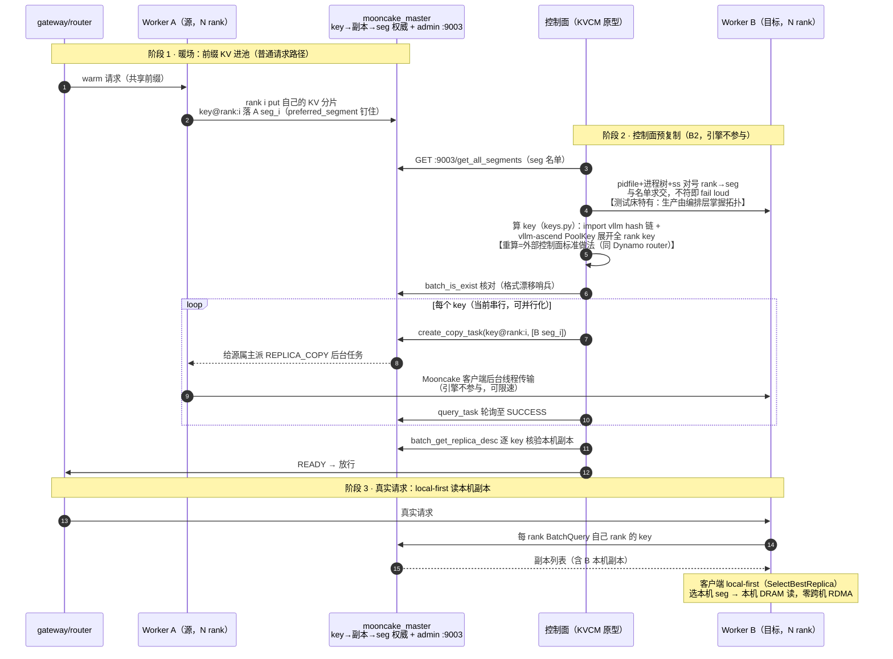
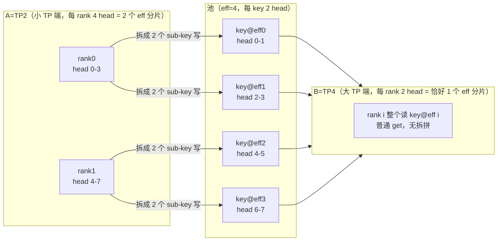

# KVCM（KV Centric Manager）

在 **vllm-ascend** 上做 Mooncake KV **预复制（pre-copy）**：真实请求打到目标实例之前，用 Mooncake `create_copy_task` 把已有前缀 KV 复制到该实例的本机 DRAM segment，让读路径 local-first，避免跨机拉 KV。引擎不参与复制；不引入额外控制面框架。

本目录自包含，只依赖：

- 镜像 / 环境：`vllm-ascend`（建议 `v0.26.0rc1`）
- 池：`mooncake_master` + `AscendStoreConnector(backend=mooncake)`
- 控制面：本目录 Python（`create_copy_task` / `query_task` / `batch_get_replica_desc`）

官方 Store 基线：[KV Pool（Ascend Store）](https://docs.vllm.ai/projects/ascend/en/v0.26.0rc1/user_guide/feature_guide/kv_pool.html)

## 验证状态

环境：`quay.io/ascend/vllm-ascend:v0.26.0rc1`；`preferred_segment: true`；A2 RoCE（不开必然失败，`HcclBatchPut=4`）；主机 `7.242.105.245` / `7.242.105.217`。

| 场景 | 结果 |
|------|------|
| 同构同机 TP=2（rank↔seg 新路径，2026-10-09） | **通过**：12 keys 对号入 B 两 seg；hit 768/801 ≈ **95.9%** |
| 同构跨机 TP=1/2、TP=4 27B Mamba（旧 key×N 广播路径，2026-10-08） | 通过：~95%+（Mamba ≈92.1% 满块，`--block-size 1536`）；新路径未单独重跑 |
| 异构同机 双向 TP2↔TP4（2026-10-09，需容器补丁） | **通过**：24/24 key 对号，95.9%，零 invalid，A/B 输出逐字一致 |
| 异构跨机 245(TP2)→217(TP4)（2026-10-09，需容器补丁） | **通过** + **杀源实例法确证读本机副本**（仅剩 217 副本时 B 首中 768 token 全部外部 get 成功） |
| 异构跨机正向 245(TP2)→217(TP4) 回归（2026-10-12，bc6b5be 单入口 + #15835 补丁） | **通过**：32 keys READY、8/8 token 逐字一致、零 invalid、external hit 88.2%（滚动累计口径，非单请求） |
| 异构跨机反向 217(TP4)→245(TP2) **同步 load**（2026-10-12，bc6b5be + #15835 补丁） | **通过**：36/36 key 对号、每 rank `get keys=18`（9 块×2 sub-key 拼回）、`load_async=False` 分发生效、8/8 token 逐字一致、74.6→79.7% hit、零 invalid |

完整实验史（总表 14 条 + 异构实录 + 撤回记录）见 [EXPERIMENTS.md](EXPERIMENTS.md)；复现步骤与「读本机副本」判定方法见 [REPRODUCE.md](REPRODUCE.md)；未做项与边界见「边界与已知限制」；遗留问题与下一步计划见 [backlog.md](backlog.md)。

## 快速开始

### 前置：A2 环境变量（硬依赖）

与官方 `kv_pool.md` A2 分支一致，`cluster/start_worker.sh` 在 `ENABLE_ASCEND_A2=1`（默认）且 `protocol=ascend` 时自动 `source cluster/env_ascend_a2.sh`：

| 变量 | 作用 |
|------|------|
| `HCCL_INTRA_ROCE_ENABLE=1` | 卡间 RoCE 单边通信（缺则 `HcclBatchPut=4`） |
| `HCCL_IF_IP` | 主机业务 IP（与 segment 名中的 IP 一致） |
| `HCCL_SOCKET_IFNAME` / `GLOO_SOCKET_IFNAME` / `TP_SOCKET_IFNAME` | 业务网卡名 |
| `PYTHONHASHSEED=0` | **控制面对齐硬依赖**（非 legacy）：rc1 上游 `kv_cache_utils.init_none_hash` 在 seed 未设时用 `os.urandom(32)` 作 `NONE_HASH` 折入每个 block hash（sha256 不在 cbor 警告名单，静默漂移）——引擎带 seed 而控制面不带时，keys.py 每次算出不同 key（exist check 0/N 假失败）。`keys.py::_hash_prompt` 已 fail loud |
| `HCCL_NPU_SOCKET_PORT_RANGE` | 同机多 worker 分端口段（脚本按 ROLE 默认 26000/26100） |

非 A2（如 A3 HCCS）设 `ENABLE_ASCEND_A2=0` 并按官方文档导出对应变量。

### A. 无 NPU：看计划 / 跑 store 半程

```bash
cd kvcm

DRY_RUN=1 bash run_e2e.sh

# 通用/CPU Mooncake：
PROTOCOL=tcp bash tools/run_store_demo.sh

# vllm-ascend 镜像内 store 半程（三张空闲卡）：
PROTOCOL=ascend SOURCE_DEVICE=4 TARGET_DEVICE=5 COORD_DEVICE=6 \
  bash tools/run_store_demo.sh
```

### B. 有 NPU：端到端（推荐一键，TP=1）

在 **vllm-ascend** 容器内：

```bash
cd kvcm

# 显式指定主机 IP + 业务网卡（官方 A2 要求；也可让 env_ascend_a2.sh 猜测）
export LOCAL_IP=7.242.105.245
export NIC_NAME=enp67s0f5

MODEL=/data/models/Qwen3-VL-8B-w8a8c16 \
  MODEL_NAME=Qwen3-VL-8B-w8a8c16 \
  DEVICES_A=0 DEVICES_B=1 TP=1 MAX_MODEL_LEN=4096 \
  bash run_e2e.sh
```

成功标志：

- 控制面打印 `[precopy] READY`
- `worker_B.log` 出现 `External prefix cache hit rate`（暖前缀足够长时可达 ~90%+）

停集群：

```bash
bash cluster/stop_cluster.sh           # 只停 A/B
STOP_MASTER=1 bash cluster/stop_cluster.sh
```

### C. 分步（调试用）

```bash
source cluster/env_ascend_a2.sh   # 需 LOCAL_IP / NIC_NAME

bash cluster/start_master.sh

ROLE=A PORT=8001 LOOKUP_ID=0 ASCEND_RT_VISIBLE_DEVICES=0 TP=1 \
  MODEL=/data/models/Qwen3-VL-8B-w8a8c16 MAX_MODEL_LEN=4096 \
  bash cluster/start_worker.sh

ROLE=B PORT=8002 LOOKUP_ID=1 ASCEND_RT_VISIBLE_DEVICES=1 TP=1 \
  MODEL=/data/models/Qwen3-VL-8B-w8a8c16 MAX_MODEL_LEN=4096 \
  bash cluster/start_worker.sh

# warm（前缀需够长以产生多个 full block；默认 *80 ≈ 801 tokens）
python3 - <<'PY' | curl -s http://127.0.0.1:8001/v1/completions \
  -H 'Content-Type: application/json' -d @-
import json
prefix = "kvcm shared prefix for store warmup. " * 80
print(json.dumps({"model":"qwen","prompt":prefix,"max_tokens":1,"temperature":0}))
PY

# 单入口：warm prompt → 进程内 resolve seg → 算 key → batch_is_exist 核对 → copy → READY
python3 precopy/precopy.py \
  --master 127.0.0.1:50088 \
  --protocol ascend \
  --role B --tp-size "${TP:-1}" \
  --model /data/models/Qwen3-VL-8B-w8a8c16 \
  --model-name Qwen3-VL-8B-w8a8c16 \
  --prefix "kvcm shared prefix for store warmup. " \
  --prefix-repeat 80 \
  --dump-keys prefix_keys.txt \
  --dry-show-before
# 成功：READY（rank i → B segs[i]）；key 全程内存，--dump-keys 只是调试留档
# 已知 seg 时显式 --targets seg0,seg1,... 跳过解析（生产编排已知拓扑）
```

### D. 跨机（摘要）

master 在源机 `0.0.0.0:50088`；B 机 worker 配 `MC_MASTER=A_IP:50088`、`LOCAL_IP=B_IP`、`HCCL_IF_IP=B_IP`。Mamba 模型 `--block-size 1536`。

```bash
# 机 A：master + worker-A；机 B：worker-B
python3 precopy/precopy.py --master A_IP:50088 --protocol ascend \
  --role B --tp-size 4 \
  --ssh 'ssh root@B_IP' --pidfile /root/kvcm/logs/worker_B.pid \
  --model ... --model-name ... --block-size 1536 \
  --prefix-repeat 80 --dry-show-before
# 再打 B:8002；看 external_prefix_cache_*
```

## 怎么运作

B2：请求前把前缀 KV 放到目标实例本机 DRAM。先把三个对象讲清楚（以 VL-8B、TP=2、801 token 前缀为例），再说每样做到了什么。

### 三个对象

- **key —— KV 在池里的存取单位**
  - 粒度：KV 按 block 切开（本模型 128 token/块），**每个满块 × 每个 rank 的切片 = 池里一个独立对象 = 一把 key**。
  - 例：801 token 前缀 × TP=2 → 6 满块 × 2 rank = **12 把 key**；余 33 token 不满一块不进池 → 命中 768/801 ≈ 95.9%，尾巴由引擎重算补齐。
  - 预取本质：把这 12 把 key 对应的对象逐个复制到目标侧。
- **seg —— KV 的物理落点**
  - 每个 rank 起机时在本机 DRAM 划一块区域注册进池，即一个 segment（seg），名即地址 `IP:rpc_port`；**一个 rank 一个 seg**。
  - master 记录「每把 key 的副本落在哪些 seg」，get 按此视图选副本。
  - local-first：key 在**本 rank 自己的 seg** 上有副本 → 读本机 DRAM，不走网络。
- **head_or_tp_rank —— key 尾部的切片编号**
  - TP 下每个 rank 只持有一部分 KV head（8 ÷ TP=2 → 4 head/rank）；同一 block 在不同 rank 的切片内容不同，key 尾带编号区分（`…@head_or_tp_rank:0@…` / `:1@…`），通常 = `tp_rank`。
  - 例外：KV head 数 < TP（如 MLA 仅 1 KV head，各 rank 内容相同）→ `put_step` 折叠，全 rank 共用 `:0@`；枚举范围是 `0 .. N/put_step-1`，不一定是 `0..N-1`。

| 项 | 现状 |
|----|------|
| **Key 集合** | `precopy.py` prompt 模式内嵌 `collect_keys()` 展开 `head_or_tp_rank:0..N/put_step-1` × 满块（`precopy/keys.py`；key 全程内存） |
| **多 seg** | `precopy.py --targets seg0,seg1,...`：**rank i 的 key 只 copy 到 `targets[i]`**；反向异构（eff>N）自动展开为 `targets[i // num_sub_keys]` |
| **调度** | 仍 **按 key 串行** `create_copy_and_wait`；映射已对号入座 |
| **解析 seg** | `precopy.py` 缺省即内嵌 `resolve.resolve_segments()`（`precopy/resolve.py`）：master admin API 名单 ∩ pidfile 进程树（`/proc`，ps 兜底）`ss` 端口（缺 `ss` 回退 `/proc`）；rank 取自 `VLLM::Worker_TP<N>` 进程名，对不上即 fail loud，**不读日志**；TP=1 可降级 admin 单 seg 匹配；显式 `--targets` 可跳过 |
| **未做** | 多 key/多 seg **并行**；跨机一份 + 同机扩散；异构 TP 见下节（已验证，需容器补丁） |

注意 `4×K` 把 key ≠ 4 倍数据：每把 key 只是**某个 rank 的切片**，合起来才是一份完整 KV（总字节 ≈ 一份逻辑 KV）——不是每把 key 都在 4 个 seg 上各留全量副本。

### 拓扑与时序

```text
mooncake_master
     |
+----+----+
|         |
worker-A  worker-B     各跑 vllm OpenAI server + AscendStoreConnector
(源 segment) (目标 segment)
     |
precopy.py / run_e2e.sh    独立进程：create_copy_task → READY
```

时序：

1. 在 worker-A 上暖前缀（KV 写入池，落在 A 的 segment）
2. 控制面把 key 复制到 B 的 `local_seg`
3. 轮询任务完成 + `batch_get_replica_desc` 确认 B 上有内存副本 → `READY`
4. **之后**再把真实请求打到 worker-B（get session 建立时锁定本机副本）

复制晚于 get session 则本次请求仍可能读远端；下一个请求会重新选副本。

全流程（同构 TP=N；异构 key 命名空间换成 eff rank；反向（B 为小 TP）时 precopy 把 B 的 seg 列表按 `i // num_sub_keys` 自动展开）：



注：图中「READY → 放行」目前由 `run_e2e.sh` / 手工顺序保证，接 gateway/router 的编排集成见 [backlog.md](backlog.md) D4；「哪个 key 在哪个 seg」无需通知任何人——master 是放置权威，get 时 `BatchQuery` 现查；副本无 pin，READY 后受池驱逐策略管理。

### 数据来源与日志边界

**设计约束：任何脚本不得解析任何日志来做控制决策。** 控制流每个输入都有 API / OS 级来源：

| 控制面需要 | 来源 | 性质 |
|-----------|------|------|
| B 的 seg 名单 | `GET :9003/get_all_segments`（master admin，纯文本逐行） | master API（:9003 为 mooncake_master 内置默认，`start_master.sh` 无需 flag，见脚本注释） |
| rank↔seg 对号 | `logs/worker_<ROLE>.pid` → 进程树（`/proc/*/stat`，ps 兜底）→ `ss -ltnp` 端口（缺 `ss` 回退 `/proc/net/tcp`）∩ 名单；rank 取 `VLLM::Worker_TP<N>` 进程名；TP=1 探测基建缺失时降级为 admin 单 seg 匹配（loud WARN）；匹配链与 fail loud 边界见下「rank↔seg 匹配链」 | OS 级（跨机经 `--ssh`） |
| key 名单核对 | `batch_is_exist` / `batch_get_replica_desc` | 客户端 API |
| READY 判定 | `query_task` + `batch_get_replica_desc` | 客户端 API |
| worker 就绪 | 轮询 HTTP `/v1/models` | HTTP API |

日志只剩**人工取证**角色，不参与任何控制流：分 rank `MooncakeBackend.get enter keys=`（0.3.11 无等效 API，vLLM `/metrics` 只有聚合 external hit）、源侧 `replica_copy_success` 计数——这些是版本限制下的取证手段，REPRODUCE §3 的三层判据靠人读，脚本不读。

### rank↔seg 匹配链（resolve.py）

目标：`targets[i] = rank i 的 seg`。四跳，全部 OS/API 级来源，不读日志：

1. **pidfile → 进程树**：`start_worker.sh` 写 `logs/worker_<ROLE>.pid`（api_server pid）→ 按 `/proc/*/stat` 的 ppid 链展开整棵进程树（`ps` 兜底）。
2. **进程 → 监听端口**：`ss -ltnp`；容器无 `ss` 回退 `/proc/net/tcp{,6}`（LISTEN 行得 inode→port）× `/proc/<pid>/fd`（`socket:[inode]` 反查属主进程）。
3. **进程 → rank**：读 `/proc/<pid>/cmdline` 的 proctitle `VLLM::Worker_TP<N>`，N 即 rank。rank 是 vLLM 拉起 worker 时赋的**逻辑编号，与物理卡号无关**——实例只用 4-7 卡时进程名仍是 `Worker_TP0..3`，照常匹配；用哪几张卡由启动参数 `ASCEND_RT_VISIBLE_DEVICES` 决定，不进匹配链（`npu-smi 卡→pid` 仅为人工核对手段）。
4. **端口 ∩ master 名单 → seg**：进程监听端口与 admin `get_all_segments` 名单（seg 名 = `IP:rpc_port`）求交，即得 rank→seg。

fail loud 边界（宁错杀不静默错配——拷错 seg 就失去 local-first 的意义）：

- 一个端口命中多个 seg（同机多实例）→ 必须给 `--target-ip`；
- 同一 rank 被两个 seg 认领、TP>1 出现无 rank 信息的 seg → 报错（旧 worker 残留，或 vLLM 改了 proctitle 命名）；
- rank 0..N-1 缺一 → 报错；
- TP=1 特例：唯一候选 seg 即 rank 0（构造上无歧义）；探测基建全挂时降级为 admin 名单单 seg 匹配（loud WARN），但 pidfile stale（worker 已死）**不降级**——防止把 KV 拷进 TTL 到期即注销的 seg。

跨机：把 resolve.py 源码经 ssh pipe 到目标机 `python3 - --local-probe` 执行（不假设远端路径），探测错误码经 ssh 透传。

**key 格式与 hash 一律 import 上游权威实现，不自己搬**：block hash 链 import vllm `kv_cache_utils`，PoolKey 字符串格式 import vllm-ascend `PoolKey`/`KeyMetadata`（都在 `precopy/keys.py`；rc1=`config_data.py` / main=`metadata.py` 自适应，按字段名构造——rc1 有 `pcp_rank`、main 已删，位置参数构造会漂移）。上游改格式时 import 自动跟随；两道哨兵兜底：`batch_is_exist` 存在性核对（precopy prompt 模式内置，缺 key 即 exit 2）与 `tools/test_keys.py::test_upstream_parity`（容器内镜像 vs 上游逐字节比对）。`precopy/keys.py` 内置的 rc1 纯 Python 镜像只作离线 fallback（打印 WARN）。

### 异构 TP（A/B 不同 tp_size）

问题：A=TP2、B=TP4 能否像「原生 Mooncake/connector」一样共享同一套 shard？结论：**能——AscendStore 原生支持；单机双向（TP2→TP4 / TP4→TP2）与跨机（245→217）均已实测通过**（external hit 95.9%、零 invalid、A/B 输出逐字一致；跨机读本机副本经杀源实例法确证），**但 v0.26.0rc1 必须打补丁**（见下）。实测实录见 [EXPERIMENTS.md](EXPERIMENTS.md)「实验实录」节（总表 #5/#6/#8/#12 + 10-12 回归 #13/#14）。

| 层 | 结论 |
|----|------|
| **Mooncake Store** | 不管 TP；只认 `key → segment 副本`。 |
| **AscendStore**（`v0.26.0rc1`） | **原生支持**异构：extra_config `prefill_tp_size` / `decode_tp_size` → `config_data.py::infer_tp_mismatch_info`。语义：`effective_tp = max(local, peer)`；条件：TP 不同、非 MLA、非 hybrid、`num_kv_heads % effective_tp == 0`；`num_sub_keys = local_heads_per_rank // effective_heads_per_rank`；key 的 `head_or_tp_rank` 改写为 `effective_rank = tp_rank * num_sub_keys + sub_idx`（`pool_worker.py::_build_tp_mismatch_keys_and_addrs`），KV 按 head 切片 strided 读写。限制：不支持 layerwise / sparse / hybrid(Mamba/DSV4)。 |
| **上游 vLLM `MooncakeStoreConnector`** | 有异构 Store-TP / LCM（[PR #53129](https://github.com/vllm-project/vllm/pull/53129)）。 |
| **SGLang HiCache** | `tp_lcm_size` + head split。 |

#### sub-key 读写机制（小 TP 拆拼、大 TP 退化）

池的 key 永远按 `effective_tp = max(双方 TP)` 编号，每个 eff key 装 `num_kv_heads / effective_tp` 个 head 的切片。规则一句话：**谁的 TP < effective_tp，谁的一个 rank 就对应多个 eff key，读写必须拆/拼；谁的 TP = effective_tp，一个 rank 恰好一个 key，退化为普通路径**。eff 取 max 的原因：命名空间要让双方都能寻址，每个 eff key 成为双方所需粒度的最小公单位。

以 GQA 8 KV head、A=TP2 → B=TP4（eff=4）为例：



- **正向（TP2→TP4）**：A 是小 TP 端 → sub-key put（strided head 切片，`_build_tp_mismatch_keys_and_addrs`，`pool_worker.py`）；B 是大 TP 端 → 普通 get。
- **反向（TP4→TP2）**：A 是大 TP 端 → plain put；B 是小 TP 端 → sub-key get（`_load_kv_tp_mismatch` 读多个 eff key、按 head 切片拼回本地）。
- 数学关系：`num_sub_keys = local_heads_per_rank ÷ effective_heads_per_rank`（`config_data.py::infer_tp_mismatch_info`，main 已改名 `metadata.py`）；eff key 命名 `effective_rank = tp_rank × num_sub_keys + sub_idx`。

#### env 配置

引擎从 `decode_tp_size` 字段读对端 TP（`config_data.py:48`，只在 worker init 算一次；`prefill_tp_size` 是 consumer 角色字段，本测试床用不到、脚本不生成）；算出的 `(enabled, eff, num_sub_keys)` 同时固定用于该实例的 put 与 get 两侧——**mismatch 信息与实验方向无关**，方向只决定谁 put 谁 get。因此：

- **规则：每台实例 `PEER_TP_SIZE = max(本机 TP, 对端 TP)`**——`run_e2e.sh` 默认即 `max(TP_A,TP_B)`，`start_worker.sh` 把它写进引擎字段 `decode_tp_size`（PD 时代命名，即「对端 TP」）。同构填自身 TP（disabled=正确）。两方向同一组值，**不要按方向翻转**（翻转成 peer=自身 → mismatch 静默禁用，实例见 [EXPERIMENTS.md](EXPERIMENTS.md) #14）。
- **错误配置的运行期指纹**：小 TP 端禁用后走 plain get，按本地 head 尺寸读 eff key → 尺寸不符 → `mooncake -800`，日志形状 `Failed to get <块数> keys`（每块 1 key；正确 mismatch 应为 `块数 × num_sub_keys`）。填了对 `eff=max(本机,对端)` 不整除的值同样静默禁用——`start_worker.sh` 带整除校验 fail loud。
- 大 TP 端 disabled 即正确：其 plain key（`@tp_rank`、全本地切片）名字与字节恒等于 eff key。

#### 上游 bug（v0.26.0rc1）：tp_mismatch put/get 是死代码

`pool_worker.py::_start_kv_transfer_threads` 构造 `KVCacheStoreSendingThread` / `KVCacheStoreRecvingThread` 时**漏传 `worker=self`**，而 `kv_transfer.py` 的 tp_mismatch put/get 分支都 gate 在 `self.worker is not None`（`:681` / `:934`）。后果：put 走普通路径，key 用**本地 rank 名**、值是**全本地 head 切片**——消费方（更大 TP）按 eff-rank 名找 key，部分「同名碰撞」会读到错误字节，其余直接 miss。

**上游已修**：[vllm-ascend #15835](https://github.com/vllm-project/vllm-ascend/pull/15835)（fix #15842，2026-09-09 合入 main，merge commit `9f8773ea`）。除两处线程构造补 `worker=self if self.tp_mismatch else None`，还恢复了 `start_load_kv` 同步 load 的 mismatch 分发。**rc1 / rc2 均不含，仅 main 有**。

补丁：`patch_tp_mismatch_worker.patch` = **#15835 完整版的 rc1 backport**（标准 unified diff，三处 hunk 锚定 rc1 唯一上下文；同 TP 传 None、不碰普通路径）。容器内应用：`cd /vllm-workspace/vllm-ascend && git apply --check patch_tp_mismatch_worker.patch && git apply -v patch_tp_mismatch_worker.patch`（或 `patch -p1`）；`git apply -R --check` 探测是否已打。打上后小 TP 消费者同步 load 亦可走 `_load_kv_tp_mismatch`；**`LOAD_ASYNC=1` 为推荐项**（异步 overlap 更优；同步 mismatch 路径已验证，见 [EXPERIMENTS.md](EXPERIMENTS.md) #14）。

参考：`pool_worker.py`（`put_step`/`head_or_tp_rank`/`_build_tp_mismatch_keys_and_addrs`）；`docs/research/sglang/storage-backends.md`。

## 目录结构

控制面 = `precopy/` 一个 Python 包（keys/resolve/common 三个能力模块）+ `precopy.py` 编排；`cluster/` 为集群生命周期脚本；`tools/` 为调试/测试。历史章节裸文件名映射见 [EXPERIMENTS.md](EXPERIMENTS.md)「勘误与演进」。

```text
kvcm/
├── run_e2e.sh            # 一键入口：双 worker 编排 + 自动 warm/precopy/hit B
├── precopy/              # 产品控制面（Python 包，三个能力 + 编排）
│   ├── precopy.py        #   单入口：warm prompt → resolve segs → 算 key → 核对 → copy → READY
│   ├── keys.py           #   能力1·key 计算：prompt→hash 链→PoolKey 枚举（import 上游权威；CLI 可单跑）
│   ├── resolve.py        #   能力2·seg 解析：admin API + pidfile/ss/ssh 对号（stdlib-only；CLI 可单跑）
│   └── common.py         #   能力3·store 封装：setup_store / copy / replica 查询
├── cluster/              # 集群生命周期（shell）
│   ├── start_master.sh   #   拉起 mooncake_master
│   ├── start_worker.sh   #   拉起单实例 vllm-ascend + AscendStoreConnector
│   ├── stop_cluster.sh   #   停 worker（可选停 master）
│   └── env_ascend_a2.sh  #   A2 RoCE 环境（HCCL_INTRA_ROCE_ENABLE 等），供 source
├── tools/                # 调试 / 演示 / 测试
│   ├── store_demo.py     #   Store 半程（无 vLLM）
│   ├── run_store_demo.sh #   跑 store 半程
│   ├── test_keys.py      #   keys.py 单测 + 容器内 upstream 一致性哨兵
│   └── test_resolve.py   #   resolve.py 单测（纯逻辑 + 真实 socket/pidfile/HTTP 集成）
├── conf/                 # mooncake 配置（样例 + 生成的 mooncake.<ROLE>.json）
├── logs/                 # pidfile / 日志（gitignore）
├── patch_tp_mismatch_worker.patch  # 异构 TP 必打（#15835 rc1 backport）
├── README.md / REPRODUCE.md / EXPERIMENTS.md
├── kv-prefetch.md           # 预取方案设计（A 壳请求 / B2 副本复制；B2 已实测）
├── D1-router-scheduling.md  # 生产化设计 D1：Router 集成与请求调度
└── backlog.md               # 遗留问题与下一步计划（D1-D7 / P1-P8 / E1-E16 登记处）
```

| 文档 | 作用 |
|------|------|
| `README.md` | 本文：端到端说明 |
| `REPRODUCE.md` | 客户复现参考：结论 + 必配项 + 「读本机副本」判定方法 |
| `EXPERIMENTS.md` | 实验总表 14 条 + 异构实录 + 踩坑记录（含撤回历史） |
| `kv-prefetch.md` | 预取方案设计（A 壳请求 / B2 副本复制；B2 已实测） |
| `D1-router-scheduling.md` | 生产化设计 D1：Router 集成与请求调度 |
| `backlog.md` | 遗留问题与下一步计划（设计决策 D1-D7 / 潜在问题 P1-P8 / 工程项 E1-E16） |

## 操作参考

### Worker 配置要点

`start_worker.sh` 只挂 **AscendStoreConnector**：

```json
{
  "kv_connector": "AscendStoreConnector",
  "kv_role": "kv_both",
  "kv_connector_extra_config": {
    "backend": "mooncake",
    "lookup_rpc_port": "<LOOKUP_ID>",
    "use_layerwise": false
  }
}
```

并设置 `MOONCAKE_CONFIG_PATH` → `conf/mooncake.<ROLE>.json`（NPU 上 `protocol=ascend`，`device_name=""`）。

**同机多 worker 必须 `preferred_segment: true`**：否则仅有 `prefer_alloc_in_same_node` 时，写路径可能把 KV 分到同机**另一个** worker 的 segment（B2 预复制场景退化成「KV 本来就在目标机」）。`start_worker.sh` 默认已开。

`lookup_rpc_port` 在 AscendStore 里是 **lookup id 后缀**（拼本地 IPC 路径），不是 TCP 端口；A/B 用不同 id（0/1）。

### Key 与 segment（操作指针）

概念与机制见「怎么运作 · 三个对象 / 数据来源与日志边界」，这里只列命令：

- **key 枚举**：`precopy/keys.py --model ... --prefix ...`（prompt 模式）/ `--chunk-hashes`（离线）/ `--keys-file <留档> --check-master`（事后逐 key 副本取证）。
- **seg 解析**：`precopy/resolve.py --role B --tp N` 可单跑调试；产品路径由 `precopy.py` 内嵌调用。跨机加 `--ssh 'ssh root@B_IP' --pidfile <B 机路径>`（resolve.py 源码 pipe 到 B 机 `python3 -` 执行，不依赖远端路径）。
- **hash 对齐**：`--hash-algo`（默认 sha256）与引擎 `prefix_caching_hash_algo` 一致即可。

### 验收

| 步骤 | 判据 |
|------|------|
| `DRY_RUN=1 bash run_e2e.sh` | 打印 master / A / B / precopy 步骤 |
| `run_e2e.sh`（TP=1 + A2 env） | `[precopy] READY`；B 侧 External prefix hit |
| `precopy.py --targets` | 各 key AFTER 仅含其 mapped seg |
| `python3 precopy/resolve.py --role B --tp N` | 输出 rank↔seg 映射（admin API + pidfile/ss，无日志）；任一源不符即 fail loud |
| api_server `/proc/<pid>/environ` | 含 `HCCL_INTRA_ROCE_ENABLE=1` |
| `python3 tools/test_keys.py && python3 tools/test_resolve.py` | `PASS` |

## 操作注意事项

复现/操作中**仍现行**的陷阱集中在此（已失效/已修复的历史坑见 [EXPERIMENTS.md](EXPERIMENTS.md)「踩坑记录」）：

- **启动与清理**
  - 残留实例会「假 READY」：vLLM 进程 `setproctitle` 后名为 `VLLM::EngineCore/Worker_TP/APIServer`，`ps | grep python` 搜不到；旧实例占着端口与显存时，新实例的 `/v1/models` 可能由旧实例应答。
  - 清理：`pgrep -f "VLLM::[W]"`（括号防 pgrep 匹配自身命令行）+ 显式 kill，再 `npu-smi info -t usages -i <id>` 确认 HBM 释放（<10%）。**kill 须按 `npu-smi`/`ss` 对号出的实际 pid**，不能按 api_server pid 段猜——EngineCore/Worker 的 pid 可能与 api_server 相差很远；只杀 api_server 会留下孤儿 EngineCore 占卡，新 worker 起不来。
  - **控制面进程也要 `PYTHONHASHSEED=0`**：keys.py/precopy 计算 hash 链必须与引擎同 seed（上游 `init_none_hash` 未设 seed 时用 `os.urandom` 折入每块 hash，且 sha256 无警告）——`keys.py::_hash_prompt` 缺 seed 即 fail loud；手工 `python3 -`/docker exec 跑探测脚本时记得带。
- **跨机操作**
  - 两机**非共享存储**：各自 clone 本目录并同步（补丁、脚本、配置保持一致）。
  - 高频 SSH 连接触发对端限速（认证后断连/KEX 卡死）：控制操作合并成批执行，或改控制台人工执行；expect 包装要「输出落文件 + timeout 分支 close」，否则孤儿 ssh 握住管道会把外层 timeout 也拖挂。
  - **容器无 `ss`/`ps`**：resolve 进程树走 `/proc/*/stat`（`ps` 兜底）、端口缺 `ss` 回退 `/proc/net/tcp × /proc/*/fd`（stdlib，需能读其他进程 fd——root 或同 uid；hidepid 则 fail loud 并在报错里列出替代路径）；**TP=1 且探测基建全挂时自动降级**为 admin 名单单 seg 匹配（复用 master :9003，loud WARN、无交叉核对；pidfile stale=worker 已死**不降级**，防拷进将注销 seg）。TP>1 仍走不通时：master admin API 拿权威名单（`GET :9003/get_all_segments`，TTL 过期自动注销；`/get_all_keys` 可取证全量 key）+ 显式 `--targets` 跳过自动解析；手工 rank↔seg 对号用 `ss -ltnp`（宿主机）端口→pid + `npu-smi` 卡→pid（卡号=rank 号）。
- **判定**：指标会骗人（假命中）、必须全新 prompt 首中、必须等源 client TTL、勿用 netdev 计数器、分 rank 证据需 DEBUG——判定方法与其陷阱是一个整体，见 [REPRODUCE.md](REPRODUCE.md) §3。

## 边界与已知限制

- **验证覆盖面**
  - 只验证 **非 layerwise** + **本机 DRAM** 目标；layerwise / 落盘 / 编排集成见 [backlog.md](backlog.md)（D6 / D3 / D4）。
  - 新路径（rank↔seg 对号）只重跑过同构同机 TP=2，同构跨机与 TP=4 仍是 10/08 旧 key×N 路径结果（见「验证状态」表注）。
  - 「验证状态」表 10/08-09 各条为重构前控制面结果；现行控制面（bc6b5be 单入口）已验证异构跨机双向（#13/#14，含同步 load，手工分步）；`run_e2e.sh` 一键编排（同构/异构）未真机重跑。
  - 全部实测为 GQA（`put_step=1`）；`put_step>1`（MLA 塌缩，key 全在 rank 0）时 plan 全落 `targets[0]`——功能正确但其余 rank 读远端副本，该映射未验证。
- **复制与副本**
  - copy 按 key **串行**；未做并行 / 本机扩散 / 带宽限速（与在线读共享带宽）。
  - 副本 **无 pin**：READY 后可能被池驱逐；源属主客户端（worker-A）必须在线，掉线则 copy 失败。
- **控制面依赖**
  - `protocol` 须与 `mooncake.json` 一致（store 半程可 `tcp`，NPU 集群用 `ascend`）。
  - `resolve.py`：master admin `:9003` 在线（mooncake_master 内置默认，见 `start_master.sh` 注释）；`start_worker.sh` 写的 pidfile（跨机经 `--ssh` 读 B 机）；TP>1 时 rank 号依赖进程名 `VLLM::Worker_TP<N>`——vLLM 改命名会 **fail loud**（不静默错配），届时按 `pgrep -af 'VLLM::'` 实际输出更新模块内模式。
- **异构 TP**：0.26 rc 镜像（rc1/rc2）必打 `patch_tp_mismatch_worker.patch`；tp_mismatch 不支持 MLA / layerwise / sparse / hybrid（机制与补丁见「怎么运作 · 异构 TP」）。

## 开放问题（待讨论）

底层 B2 已实测；开放问题统一登记在 [backlog.md](backlog.md)：设计决策 D1-D7（D1 讨论中，事实基线已核实：[D1-router-scheduling.md](D1-router-scheduling.md)）、潜在问题 P1-P8、工程项 E1-E16，含状态与依赖关系。


