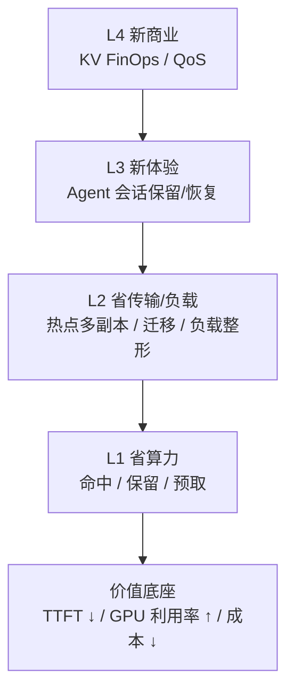
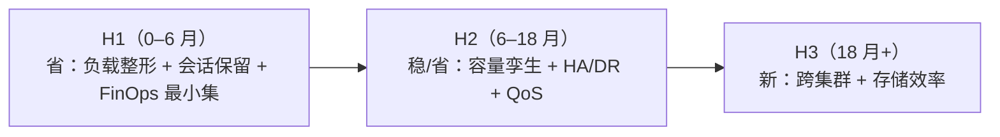

# D10: KV Fabric 产品愿景

- 状态: 产品愿景，不承诺排期；用于讨论“KV 作为资源”能做到什么。
- 版本基线: Mooncake v0.3.13.post1；vLLM-Ascend 0.26 系
- 上游: [D8](D8-joint-scheduling.md)（管理面）、[D9](D9-kv-services.md)（控制面）
- 一句话: 把 KV 变成**系统可放置、可复制、可迁移（KV 数据）、可计价**的资源；应用仍然只发请求。

---

## 0. 产品定位

> **KV Fabric**：系统决定 KV 放在哪、复制几份、保留多久、何时迁移/降层；应用不指定实例，也不持有 KV 句柄。

### 0.1 什么是 Fabric

Fabric 不是某个协议，而是一层把分散资源统一访问与调度的抽象：

- 应用不用关心资源在哪、怎么连、有几份；
- Fabric 负责放置、复制、迁移、隔离、QoS、可观测；
- 资源可以横向扩、异构混部，但对上层表现为一个池。

| Fabric | 织在一起的东西 | 典型场景 |
|---|---|---|
| **Network Fabric** | 交换机/网卡/链路 | leaf-spine、IB/RoCE |
| **Storage Fabric** | 主机与存储阵列/卷 | SAN、NVMe-oF、多路径 |
| **KV Fabric** | 多实例/多介质/多集群的 KV | 会话加速、热点多副本、跨区、KV FinOps |

判断标准：单机缓存优化叫 cache；**分布、可池化、需要移动/复制/隔离/计价**，才叫 Fabric。

### 0.2 KV Fabric 是什么，不是什么

**是**：内部资源层——全局前缀视图 + 放置/副本 + 生命周期 + 账本。

**不是**：

- 不是一个组件；
- 不是第三个平面；
- 不是应用级 KV 数据库；
- 不是 `kv://` 对象存储；
- 不是应用订阅/查询 KV 的系统。

它是「管理面 + 控制面」合起来的终局形态：管理面决策，控制面执行；没有自己的代码。

### 0.3 应用契约：应用管上下文，系统管 KV

应用只发文字/消息，**上下文由应用自己管理**：

```text
应用：messages / text + 可选 hook
后端：tokenizer + chat template → token IDs → block hash → APC/KVT
```

hook 不是 memory，也不是请求；它只告诉 SC“接下来可能发生什么”：

```text
tool 快结束   → 下一轮请求可能复用前缀，提前预取
pause 30s     → 可以 retain
resume        → 恢复时优先本机读
session close → 可以释放
```

KV 是**会话级缓存**，不是 Agent 的状态本身。状态在应用/服务端；KV 只是加速。

**namespace 必须带**：

```text
model_id + revision + tokenizer/template version
```

同样的文字不一定产生同样的 token；tokenizer/template 漂移会让前缀不命中。

---

## 1. 为什么是现在

- **Agent workload 把 KV 生命周期拉长**：多轮复用高、工具调用停顿长；长上下文模型（256K–1M）下 resume 一次可能要重算数十万 token，DeepSeek V3.2 这类胖 KV 单请求就是几十 GB。
- **GPU 贵、带宽/内存相对便宜**：用 KV 放置换 GPU 时间，ROI 通常成立；但“无限复制/无限保留”会反噬，所以需要 economics。
- **已有控制面**：kvcm 已能 copy/move/keepalive/pin/demote/promote/retain/remove；D8 已有管理面决策；缺的是产品化/价值闭环，不是再写一个 RPC。
- **开源组件只覆盖零件**：Conductor/Dynamo indexer 做索引，Mooncake 做池/副本，LMCache/Prometheus 做指标；**跨层放置、生命周期、计价治理**没有成品。

---

## 2. 价值金字塔



- **L1** 是“别重算”：命中/保留/预取；
- **L2** 是“别挤在一个点”：热点前缀多副本、迁移、会话分散；
- **L3** 是“以前做不到的体验”：Agent 会话保留/恢复、跨 Agent 共享前缀；
- **L4** 是“能卖钱/能管钱”：KV FinOps、QoS 等级、按会话计费。

---

## 3. 产品方向

| 方向 | 做什么 | 谁买单 | 价值指标 | 时机 |
|---|---|---|---|---|
| **A. KV 负载整形** | 热点前缀 copy 多副本；按负载/会话分流；副本数按收益定 | 平台/推理团队 | p99 TTFT、吞吐、扩容次数 | **现在** |
| **B. Agent 会话保留/恢复** | hook 提前预取/保留；恢复时本机读；应用仍管 messages | Agent 产品/平台 | resume 时延、任务成功率、单任务成本 | **现在–1 年** |
| **C. KV FinOps / QoS** | 按模型/租户/会话记账；预算/配额；QoS 等级 | 云/平台/财务 | 成本可见性、预算达成、毛利 | **现在–1 年** |
| **D. 容量数字孪生** | 用历史 trace 模拟容量/配比/硬件；采购前 what-if | 基础设施/采购 | 少买/少闲置、容量预测误差 | 6–18 月 |
| **E. KV HA / 热备 / DR** | 预复制热前缀到备用实例；故障快速接管；跨 AZ | SRE/平台 | MTTR、可用性、恢复命中率 | 6–18 月 |
| **F. 跨集群 KV Fabric** | 跨集群/地域复制热前缀；follow-the-sun；数据驻留 | 全球化平台 | 跨区 TTFT、合规、DR | 1–3 年 |
| **G. KV 存储效率** | 去重/压缩/量化/分层；共享 system prompt/tools | 平台/基础设施 | 每 GB 有效 KV、HBM 占用 | 1–3 年 |

产品化不改变应用契约：应用仍然只发 text/messages；KV 句柄、`kv://`、应用订阅都不做。

---

## 4. 三阶段与三个下注



### H1：把“省”做成可证明的 ROI

- 热点前缀多副本 + 会话分散；
- Agent 会话保留/恢复（hook 预取 + retain）；
- 账本/ROI：每会话、每前缀、每模型；
- 目标：**TTFT p99 降、GPU 时间省、扩容次数降**，用 A/B 证明。

### H2：把“稳/省”做成平台能力

- 容量数字孪生：采购/配比 what-if；
- KV HA/热备：故障快速接管、跨 AZ；
- QoS：租户/模型等级、预算、抢占；
- 目标：**可用性、容量利用率、成本可预测**。

### H3：把新体验做出来

- 跨集群 KV Fabric：地域跟随、数据驻留、DR；
- KV 存储效率：去重/压缩/分层；
- 目标：**跨区/大规模场景**，而不是再省一点本地成本。

### 如果只选三个

1. **KV 负载整形**：直接打高负载 TTFT/吞吐，最容易证明 ROI；
2. **Agent 会话保留/恢复**：真实 Agent 需求，应用仍管 messages；
3. **KV FinOps / QoS**：让平台能卖、能管、能扩。

合起来就是：**“KV 既能省，又能管，还能扩。”**

---

## 5. 收益模型

省算力、省容量、负载整形的详细公式见 [D8a §8](D8a-scheduling-algorithms.md)。这里只写 D10 特有的三条。

### 5.1 FinOps

FinOps = 把 KV 的字节、带宽、保留时间做成**可见、可归因、可预算、可计价**的单位经济效益；不是账单系统。

变量：

| 变量 | 含义 | 单位 |
|---|---|---|
| `GB_tier` | 某层副本容量 | GB |
| `H` | 保留时长 | 小时 |
| `p_mem` | 内存单价 | 元 / GB·小时 |
| `GB_xfer` | 传输量 | GB |
| `p_bw` | 传输单价 | 元 / GB |
| `GPU_s` | 预热 GPU 秒 | GPU·秒 |
| `p_gpu` | GPU 单价 | 元 / GPU·秒 |

```text
单会话成本 = GB_tier × H × p_mem
           + GB_xfer × p_bw
           + GPU_s × p_gpu
毛利 = 收入 − 单会话成本
```

价值不在算得准，在**能按会话/租户/模型定价、预算、追责**。

### 5.2 可用性

```text
MTTR 降低 = 故障恢复时间（冷启动/重建） − 热备接管时间
```

热备 = 预复制 + 保留 + 路由切换；不是备份文件，是可读 KV。

### 5.3 负载整形 / 会话 resume 的一阶判断

```text
复用收益 = P_use × T_prefill × p_gpu
复用成本 = GB_tier × H × p_mem + GB_xfer × p_bw

值得 ⟺ 复用收益 > 复用成本
```

- `P_use`：未来真的复用的概率；
- `T_prefill`：一次复用省下的重算时间（秒）；
- `p_gpu`：GPU 单价（元 / GPU·秒）。

负载整形和会话 resume 只是 `P_use` 和成本项不同，不需要两套公式。具体数值用实测代，不要用拍脑袋常数。

---

## 6. 竞争定位

链式 block hash、逐块匹配、事件→索引、推测索引补空窗、介质分层打分，都是 SOTA 的标准做法（llm-d `pkg/kvcache/`、Dynamo `lib/kv-router/`、AIBrix `pkg/kvevent/`）。差异不在这些。

| 维度 | SOTA（llm-d / Dynamo / AIBrix） | 我们 |
|---|---|---|
| **索引与权威** | 引擎事件的派生缓存：靠事件逼近真相，丢事件要 gap replay，过期要 TTL/推测补 | 同样是派生缓存，但以池 master 为权威；正常读缓存，miss 按无命中处理，异步对账修索引，不在 L0 热路径查 master |
| **放置的主动权** | 只做路由：谁有 KV 就发给谁 | 控制面能改变放置：copy 多副本、move 迁移、retain |
| **视图范围** | 只到“哪个 pod 有这个块 + 哪层介质” | 到实例 + 介质，另加生命周期/账本；不碰 seg/rank/字节 |

真正的差异：**不是“缓存 vs 直连”，而是“只路由” vs “能改变放置”。**

llm-d 自己的 pain-point 说明：只靠事件索引会留幽灵条目、需要推测索引补“决策→确认”空窗。我们要补的是**放置主动权 + 生命周期/账本**，不是在索引精度上再卷一层。

---

## 7. 风险与非目标

| 风险 | 说明 | 对策 |
|---|---|---|
| 复制成本反噬 | 多副本吃 HBM/带宽，可能降低全局命中 | 收益/预算约束；副本 TTL；全局水位 |
| 引擎/池绑定 | 不同引擎 key/事件不同 | 控制面适配层；KeyComputer 隔离 |
| tokenizer/template 漂移 | 同样文字产生不同 token，前缀不命中 | namespace 带 model/revision/tokenizer/template；固定模板 |
| 数据合规 | KV 含 prompt/PII | 保留策略/审计/加密/地域 |
| 开源组件成熟度 | publisher/retain 等能力版本不一 | 能力声明；降级方案 |
| 组织边界 | 谁拥有 KV 预算/QoS | 平台/租户/FinOps 分工 |

非目标：

- 应用级 KV API：`kv://` / 订阅；
- 应用管理 KV 生命周期；
- decode 并行（TP/SP/EP、sequence parallel）、请求迁移、跨实例 decode 调度——归引擎/D8，不是 KV Fabric；
- 第三个平面。

---

## 8. 参考实现

| 参考 | 锚点 | 借什么 | 差异 |
|---|---|---|---|
| Dynamo | `protocols.rs::WorkerSelectionResult`；Planner | KV-aware 路由；双环扩缩 | 我们改放置，不只路由 |
| llm-d | EPP + P2P KV sharing | 索引/推测/P2P | 我们做主动多副本/会话/计价 |
| AIBrix | `pkg/kvevent/manager.go`；PodAutoscaler | 事件索引；KV 指标扩缩 | 我们跨层放置 |
| Mooncake | `CreateCopyTask`/`CreateMoveTask`/`CreateDrainJob` | 池操作/副本/drain | 我们指定目标/数量/预算 |
| LMCache | `observability.py::LMCStatsMonitor` | 字节/指标 | 我们做归因/FinOps |
| vLLM APC | `block_pool.py::get_computed_blocks`；`hash_block_tokens` | 前缀 hash/命中 | 我们做跨实例放置，不重写引擎 |

**本项无直接参考实现**：应用级 KV 句柄/订阅。我们判断这些不是 Fabric 核心，不做；应用只发请求/hook。
