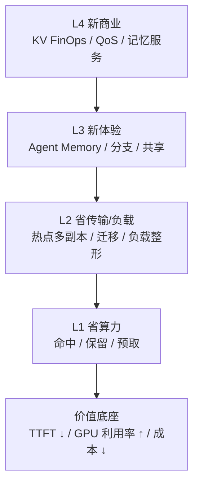
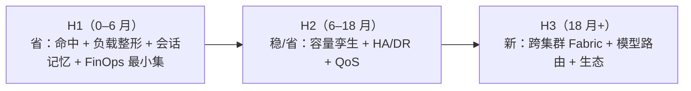

# D10: KV Fabric 路线图（规划草案）

- 状态: **规划/画饼**——不是承诺排期，用于讨论“值不值得做、先做哪条”
- 版本基线: Mooncake v0.3.13.post1；vLLM-Ascend 0.26 系
- 上游: [D8](D8-joint-scheduling.md)（管理面）、[D9](D9-kv-services.md)（控制面）
- 一句话: **把 KV 从“缓存”变成一等云资源**——可放置、可复制、可迁移、可计价、可治理。

---

## 0. 北极星

> **KV Fabric**：应用/Agent 不再关心“KV 在哪个实例”，只声明“我要这段记忆、这个延迟、这个预算”；KV Fabric 负责放置、复制、迁移、计价、治理。

三个转变：

1. **从 cache 到 state**：KV 不只是加速缓存，而是 Agent 的会话状态/工作记忆；
2. **从 routing 到 placement**：不只“谁有 KV 就发给谁”，而是“把 KV 放到该去的地方”；
3. **从 cost 到 economics**：不只省 GPU，而是把 KV 的字节、带宽、时延、保留时间变成可计价、可预算的资源。

---

## 1. 为什么现在值得做

- **Agent workload 把 KV 变成长期状态**：多轮复用高、工具调用停顿长、resume 可能重算 70K–200K token；KV 的生命周期从“请求内”变成“会话级/天级”。
- **GPU 贵、带宽/内存相对便宜**：用 KV 放置换 GPU 时间，ROI 通常成立；但“无限复制/无限保留”会反噬，所以需要 economics。
- **已有控制面**：kvcm 已经能 copy/move/keepalive/pin/demote/promote/retain/remove；D8 已有管理面决策；缺的是**产品化/价值闭环**，不是再写一个 RPC。
- **开源组件只覆盖零件**：Conductor/Dynamo indexer 做索引，Mooncake 做池/副本，LMCache/Prometheus 做指标；**跨层放置、会话记忆、计价治理**没有成品。

---

## 2. 价值金字塔



- **L1** 是“别重算”：命中/保留/预取；
- **L2** 是“别挤在一个点”：热点前缀多副本、迁移、会话分散；
- **L3** 是“以前做不到的体验”：会话分支、跨 Agent 共享记忆、毫秒级 resume；
- **L4** 是“能卖钱/能管钱”：KV FinOps、QoS 等级、按记忆计费。

---

## 3. 值得做的方向

| 方向 | 做什么 | 谁买单 | 价值指标 | 难度 | 时机 |
|---|---|---|---|---|---|
| **A. KV 负载整形** | 热点前缀 copy 多副本；按负载/会话分流；副本数按收益定 | 平台/推理团队 | p99 TTFT、吞吐、扩容次数 | 中 | **现在** |
| **B. Agent Memory OS** | 会话/分支/checkpoint/resume；跨 Agent 共享前缀；记忆 TTL/层级 | Agent 产品/平台 | resume 时延、任务成功率、单任务成本 | 中高 | **现在-1 年** |
| **C. KV FinOps / QoS** | 按模型/租户/会话记账；预算/配额；QoS 等级；抢占式预取 | 云/平台/财务 | 成本可见性、预算达成、毛利 | 中 | **现在-1 年** |
| **D. 容量数字孪生** | 用历史 trace 模拟容量/配比/硬件；采购前 what-if | 基础设施/采购 | 少买/少闲置、容量预测误差 | 中 | 6–18 月 |
| **E. KV HA / 热备 / DR** | 预复制热前缀到备用实例；故障快速接管；跨 AZ | SRE/平台 | MTTR、可用性、恢复命中率 | 中高 | 6–18 月 |
| **F. 跨集群 KV Fabric** | 跨集群/地域复制热前缀；follow-the-sun；数据驻留 | 全球化平台 | 跨区 TTFT、合规、DR | 高 | 1–3 年 |
| **G. KV 感知模型路由** | 同前缀在多个模型/版本间选：质量/成本/缓存命中 | 模型平台 | 单请求成本、质量、灰度效率 | 中高 | 1–2 年 |
| **H. KV 存储效率** | 去重/压缩/量化/分层；共享 system prompt/tools | 平台/基础设施 | 每 GB 有效 KV、HBM 占用 | 高 | 1–3 年 |
| **I. 生态 / SDK / 市场** | Agent 框架 SDK、KV Memory API、预置前缀市场 | 开发者/生态 | 接入数、调用量、留存 | 中 | 1–3 年 |

---

## 4. 三条产品线 / 三阶段



### H1：把“省”做成可证明的 ROI

- 热点前缀多副本 + 会话分散；
- 会话保留/恢复（Agent Memory 最小集）；
- 账本/ROI：每会话、每前缀、每模型；
- 目标：**TTFT p99 降、GPU 时间省、扩容次数降**，用 A/B 证明。

### H2：把“稳/省”做成平台能力

- 容量数字孪生：采购/配比 what-if；
- KV HA/热备：故障快速接管、跨 AZ；
- QoS：租户/模型等级、预算、抢占；
- 目标：**可用性、容量利用率、成本可预测**。

### H3：把“新”做成护城河

- 跨集群 KV Fabric：地域跟随、数据驻留、DR；
- KV 感知模型路由：质量/成本/缓存联合；
- 生态 SDK/市场：Agent 框架接入、共享前缀；
- 目标：**新收入/新场景**，而不只是省成本。

---

## 5. 价值怎么算

### 5.1 省算力

```text
GPU 小时节省 = QPS × Δhit × T_prefill × 3600
金额节省 = GPU 小时节省 × c_gpu
```

例：8K、100 QPS、命中率 +10%、`T_prefill=1.6s` →

```text
100 × 0.1 × 1.6 = 16 GPU·s/s ≈ 16 张卡的 prefill 产能
```

### 5.2 省容量

```text
少买节点数 ≈ 节省的 working set 字节 / 单节点可用字节
```

例：多副本/保留把 working set 从 12TB 降到 9TB，单节点 1TB → 少 3 个节点。

### 5.3 负载整形

```text
收益 = λ_p × (W_single − W_multi) × c_slo
成本 = 副本内存 × T × c_mem + copy 字节 / BW × c_bw
```

只有收益 > 成本才复制；否则扩容/排队。

### 5.4 FinOps / QoS

```text
单会话成本 = Σ(bytes × T × c_mem) + Σ(transfer × c_bw) + prewarm 成本
毛利 = 收入 − 单会话成本
```

价值不在“算得准”，而在**能按会话/租户/模型定价、预算、追责**。

### 5.5 可用性

```text
MTTR 降低 = 故障恢复时间（冷启动/重建） − 热备接管时间
```

热备 = 预复制 + 保留 + 路由切换；不是“备份文件”，是“可读 KV”。

---

## 6. 竞争定位

| 能力 | Dynamo | llm-d | AIBrix | Mooncake | 我们 |
|---|---|---|---|---|---|
| 前缀索引/路由 | ✅ | ✅ | ✅ | 部分 | ✅ |
| 池内 copy/move | ❌ | P2P 补传 | ❌ | ✅ | ✅ |
| 热点多副本（指定目标/副本数） | 部分（动态副本） | 部分（P2P） | ❌ | 自动加副本，目标 master 选 | **✅ 目标/数量/预算** |
| 会话记忆/分支 | ❌ | ❌ | ❌ | ❌ | **✅（目标）** |
| FinOps/QoS | ❌ | ❌ | 部分指标 | ❌ | **✅（目标）** |
| 跨集群 Fabric | ❌ | ❌ | ❌ | DFS/跨区 | **✅（远期）** |
| 跨引擎 | 部分 | 部分 | 部分 | 池无关 | **✅（控制面独立）** |

**护城河**：

- 不靠“命中率”本身，靠**放置决策 + 工作负载数据 + 计价/治理**；
- 跨引擎/跨池的控制面，不被单一引擎绑定；
- Agent hook + 会话状态，拿到“未来需求”，别人只有“过去事件”。

---

## 7. 画饼场景

### 7.1 Agent Memory Cloud

- 每个 Agent 有“记忆句柄”：分支、checkpoint、resume、共享；
- 记忆有 TTL/QoS/预算；跨实例/跨集群可迁移；
- 价值：Agent 任务成功率/时延/成本；按记忆 GB·小时或按任务收费。

### 7.2 KV CDN

- 热前缀（system prompt、tools、RAG 文档）复制到离用户近的集群；
- 用户在哪，KV 在哪；冷前缀回源；
- 价值：跨区 TTFT、带宽成本、数据驻留。

### 7.3 KV FinOps

- 每个模型/租户/会话一张“KV 账单”；
- 预算、告警、配额、抢占、chargeback；
- 价值：从“GPU 账单”细化到“记忆账单”，平台能定价。

### 7.4 容量数字孪生

- 输入历史 trace + 硬件配置 + 模型组合；
- 输出：需要多少 HBM/DRAM/SSD、多少节点、命中率/成本曲线；
- 价值：采购前决策，少买/少闲置。

---

## 8. 风险与边界

| 风险 | 说明 | 对策 |
|---|---|---|
| 复制成本反噬 | 多副本吃 HBM/带宽，可能降低全局命中 | 收益/预算约束；副本 TTL；全局水位 |
| 单会话不可拆 | 复制前缀不能拆 decode | 明确边界；未来做请求迁移 |
| 引擎/池绑定 | 不同引擎 key/事件不同 | 控制面适配层；KeyComputer 隔离 |
| 数据合规 | KV 含 prompt/PII | 保留策略/审计/加密/地域 |
| 开源组件成熟度 | publisher/retain 等能力版本不一 | 能力声明；降级方案 |
| 组织边界 | 谁拥有 KV 预算/QoS | 平台/租户/FinOps 分工 |

---

## 9. 建议下注

如果只选三个：

1. **KV 负载整形**（热点多副本 + 会话分散）——直接打高负载 TTFT/吞吐，最容易证明 ROI；
2. **Agent Memory OS**（会话/分支/共享）——新体验，拉开与“cache-aware router”的差距；
3. **KV FinOps/QoS**（账本/预算/等级）——让平台能卖、能管、能扩。

三个合起来就是：**“KV 既能省，又能卖，还能管”**。

---

## 10. 参考实现

| 参考 | 锚点 | 借什么 | 差异 |
|---|---|---|---|
| Dynamo | `protocols.rs::WorkerSelectionResult`；Planner | KV-aware 路由；双环扩缩 | 我们改放置，不只路由 |
| llm-d | EPP + P2P KV sharing | 索引/推测/P2P | 我们做主动多副本/会话/计价 |
| AIBrix | `pkg/kvevent/manager.go`；PodAutoscaler | 事件索引；KV 指标扩缩 | 我们跨层放置 |
| Mooncake | `CreateCopyTask`/`CreateMoveTask`/`CreateDrainJob`；动态副本 | 池操作/副本 | 我们指定目标/数量/预算 |
| LMCache | `observability.py::LMCStatsMonitor` | 字节/指标 | 我们做归因/FinOps |
| Conductor | `prefix_indexer.cpp::PrefixCacheTable::Query` | 前缀索引 | 我们做对账/放置 |
