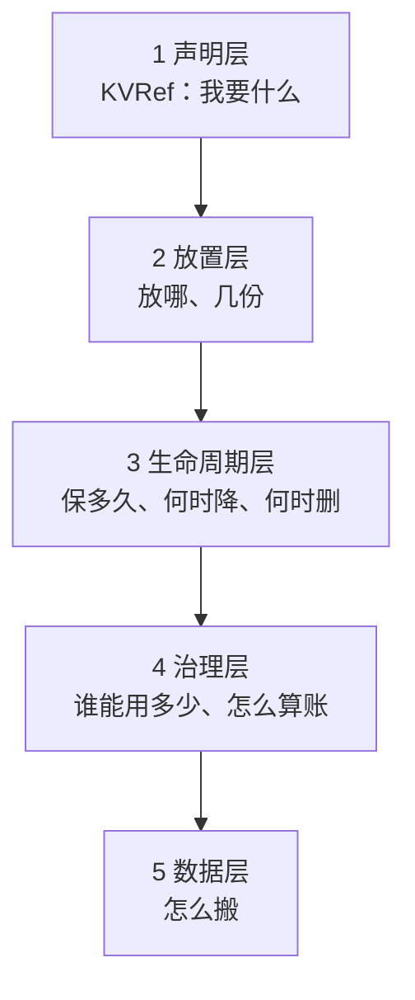
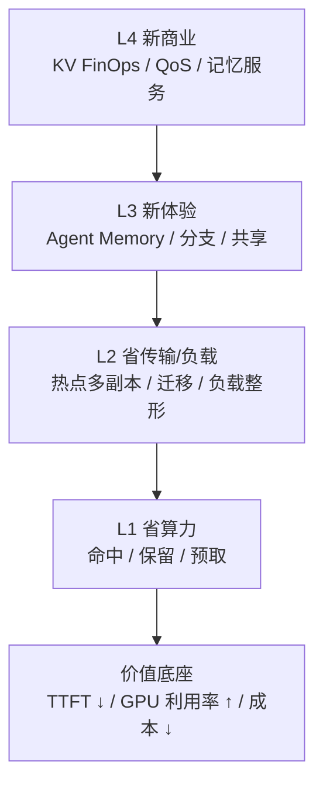
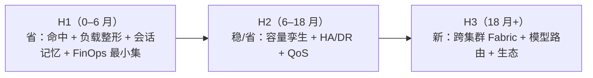

# D10: KV Fabric 路线图（规划草案）

- 状态: 规划草案。不承诺排期，用于讨论方向取舍。
- 版本基线: Mooncake v0.3.13.post1；vLLM-Ascend 0.26 系
- 上游: [D8](D8-joint-scheduling.md)（管理面）、[D9](D9-kv-services.md)（控制面）
- 一句话: 把 KV 从缓存变成一等云资源：可放置、可复制、可迁移、可计价、可治理。

---

## 0. 北极星：什么是 KV Fabric

> **KV Fabric**：应用/Agent 不再关心“KV 在哪个实例”，只声明“我要这段记忆、这个延迟、这个预算”；KV Fabric 负责放置、复制、迁移、计价、治理。

三个转变：

1. **从 cache 到 state**：KV 不只是加速缓存，而是 Agent 的会话状态/工作记忆；
2. **从 routing 到 placement**：不只“谁有 KV 就发给谁”，而是“把 KV 放到该去的地方”；
3. **从 cost 到 economics**：不只省 GPU，而是把 KV 的字节、带宽、时延、保留时间变成可计价、可预算的资源。

### 0.1 什么是 Fabric

Fabric 不是某个协议或产品，而是一层把分散资源统一访问与调度的抽象：

- 应用不用关心资源在哪、怎么连、有几份；
- Fabric 负责连接、寻址、放置、复制、迁移、隔离、QoS、可观测；
- 资源可以横向扩、异构混部、跨域，但对上层表现为一个池。

| Fabric | 把什么织在一起 | 典型场景 |
|---|---|---|
| **Network Fabric** | 交换机/网卡/链路 | leaf-spine、IB/RoCE、any-to-any 低延迟 |
| **Storage Fabric** | 主机与存储阵列/卷 | SAN、NVMe-oF、多路径、QoS |
| **Data Fabric** | 多个数据源/湖/仓 | 数据虚拟化、目录、治理、跨域查询 |
| **Memory Fabric** | 多机内存 | CXL 内存池、disaggregated memory |
| **Service Fabric** | 微服务实例 | service mesh：流量、mTLS、重试、可观测 |
| **GPU Fabric** | 多机 GPU/NPU | NVLink/NVSwitch、NCCL、跨节点集合通信 |
| **KV Fabric** | 多实例/多介质/多集群的 KV | Agent 记忆、热点多副本、跨区复制、KV FinOps |

判断标准：

- 只是单机/单实例的缓存优化 → 叫 cache 就好；
- 资源**分布、可池化、需要移动/复制/隔离/计价** → 才配叫 Fabric；
- Fabric 的价值在“统一控制面 + 数据面 + 策略”，不是多画一层架构图。

本文的 KV Fabric 指：**全局前缀命名 + 放置/副本控制 + 数据面 copy/move + 会话/保留/QoS + 账本/治理**。

### 0.2 KV Fabric 不是什么

**它既不是一个组件，也不是第三个平面。**

它是「管理面 + 控制面」合起来的终局形态：管理面把声明式需求变成放置决策，控制面执行。它没有自己的代码，能力全在管理面（决策）和控制面（执行）里。

### 0.3 一等资源需要什么

看三次同类抽象历史：

| 资源 | 抽象 | 声明层 → 底下的能力 |
|---|---|---|
| **计算** | Kubernetes | 声明 spec → 调度放置 → 生命周期 → 配额 → 运行时接口 |
| **存储** | S3 / EBS | 桶与对象命名 → 分层放置 → 生命周期策略 → 版本与合规 → 数据面 |
| **网络** | service mesh | 服务标识 → 流量路由 → 重试熔断 → 策略与 mTLS → 数据面 |

规律：**先有声明式接口，再在它下面展开放置、生命周期、治理、数据面。**

KV 要做成一等资源，同样需要五层：



| 层 | 内容 | 归属 | 现状 |
|---|---|---|---|
| **1 声明层** | 用户只说要什么，不说放哪 | kvcm 对外接口 | **几乎空白** |
| **2 放置层** | 需求 → 具体放置方案（智力核心） | 管理面 D8 | 全是设计稿 |
| **3 生命周期** | 保留等级、降层时机、回收规则 | 控制面 D2 + D9 | 只有 copy 通 |
| **4 治理** | 配额、隔离、审计、计费 | 控制面 D9 | 全是设计稿 |
| **5 数据层** | copy/move/retain/remove 原语 | kvcm + Mooncake | 唯一基本完整的一层 |

越往上越空。数据层做完只是能搬 KV；声明层和放置层做完，用户才不用关心 KV 在哪。

#### 声明层长什么样

现在 kvcm 收的是命令：`{前缀, 目标实例}`。Fabric 的形态是声明：

```text
KVRef {
  namespace      // agent-123 / 模型版本 / 租户
  prefix         // 内容
  latency_target // 我要多快读到（不是“放到哪”）
  retention      // 保多久 / 什么等级
  budget         // 我愿意为此付多少
  durability     // 丢了我能接受吗
}
```

**差别不在字段多少，在“谁决定”**：命令式里用户决定实例，声明式里系统决定，用户只声明约束。

声明层的三个直接后果：

1. **可组合**：多个 KVRef 可以合并、去重、统一放置；
2. **可迁移**：声明不变，底下可以换实例、换介质、换集群；
3. **可计价**：`budget` 是声明的一部分，账本才有对象可算。

### 0.4 一等资源才做得到的能力

下面五件事没有一件能用 `{prefix, target}` 表达。

| 能力 | 现在 | 缺什么 |
|---|---|---|
| **KV 分支** | ❌ | 块级 CoW；Mooncake 当前只支持整对象 copy |
| **KV checkpoint / 回滚** | 🟡 一半 | 进度状态、显式钉住、多版本共存 |
| **KV 可寻址** | ❌ | 名字引用（现在只能算 hash） |
| **KV 订阅** | ❌ | 上行通知（现在只有下行补发） |
| **KV 市场** | ❌ | 跨租户共享 + 引用计费 |

#### 分支

Agent 同时探索三条路径，每条共享前 90% 前缀，只在分叉点后不同。

- 现在：复制三份完整前缀；
- Fabric：共享前缀 + 各自 delta；
- 价值：内存从 `3 × 90%` 降到 `90% + 3 × 10%`。

#### checkpoint / 回滚

先区分三件事：

| 情形 | KV 在不在 | 缺什么 |
|---|---|---|
| 请求中途失败 | 大概率还在。APC 的 `ref_cnt → 0` 不释放物理块，hash 表条目也保留 | 缺“生成到第 N 个 token、采样状态是什么” |
| 隔很久再续 | 可能已被驱逐 | KV + 进度都缺 |
| 回滚到更早某一步 | 一定缺。APC 只保留最新 | 多个快照点 |

所以 checkpoint 的**一半已经免费**：APC 已保留已算的 KV（[`docs/research/vllm/block-lifecycle.md`](../../docs/research/vllm/block-lifecycle.md)：`ref_cnt → 0 ≠ 释放、≠ 摘 hash`）。

真正缺的是三件事：

1. 进度状态：token 序列生成到哪、sampling 随机状态、KV 版本号；
2. 显式钉住：checkpoint 点的 KV 不能被驱逐；
3. 多版本共存：同一条链保留多个历史点。

第 3 件才需要块级 CoW；前两件是状态管理，不动存储格式。

#### 可寻址

```text
现在：key = hash(链式 block hash)  → 只能“算出来”，不能“引用”
Fabric：kv://agent-123/session-45/step-7  → 像 URL 一样引用一段记忆
```

价值：应用不需要知道 hash 算法、不需要保存 token 序列；跨语言、跨进程都能引用同一段记忆。

#### 订阅

现在是单向下行（kvcm 补发 `BlockStored`），没有“我要订阅”的语义。

Fabric 形态：`subscribe(prefix_pattern, events=[evicted, replicated, ready])`。

价值：应用能在记忆被驱逐前收到通知、在副本就绪时立刻知道，而不是轮询。

#### 市场

把 system prompt、工具定义、RAG 文档的 KV 预置成公共资源：

- 内容寻址天然去重：100 个租户用同一段 system prompt，池里只有一份；
- 按引用计费：谁引用了、引用了多久、省了多少。

**这是唯一能“卖钱”的能力**，也是 Fabric 和“缓存优化”的根本区别。

### 0.5 有没有做成：三件判据

不看有没有一个叫 Fabric 的进程，只看三件事：

| 判据 | 现在 |
|---|---|
| API 是声明式的：用户给 `{前缀, 延迟目标, 预算, 保留期}`，不指定实例 | 命令式：`{prefix, target}` |
| 决策是自动的：放哪、几份、保多久、何时撤，由系统算 | 只有 D8 设计稿，无实现 |
| 执行是完备的：八项操作都能通过 intent 触发 | 只有 copy 一条路走通 |

三件都到位之前，说的都是“KV 缓存 + 一个聪明的控制面”，不是 Fabric。

---

## 1. 为什么是现在

- **Agent workload 把 KV 变成长期状态**：多轮复用高、工具调用停顿长；长上下文模型（256K–1M）下 resume 一次可能要重算数十万 token，DeepSeek V3.2 这类胖 KV 单请求就是几十 GB。KV 的生命周期从请求内变成会话级/天级。
- **GPU 贵、带宽/内存相对便宜**：用 KV 放置换 GPU 时间，ROI 通常成立；但“无限复制/无限保留”会反噬，所以需要 economics。
- **已有控制面**：kvcm 已能 copy/move/keepalive/pin/demote/promote/retain/remove；D8 已有管理面决策；缺的是**产品化/价值闭环**，不是再写一个 RPC。
- **开源组件只覆盖零件**：Conductor/Dynamo indexer 做索引，Mooncake 做池/副本，LMCache/Prometheus 做指标；**跨层放置、会话记忆、计价治理**没有成品。

---

## 2. 价值金字塔



- **L1** 是“别重算”：命中/保留/预取；
- **L2** 是“别挤在一个点”：热点前缀多副本、迁移、会话分散；
- **L3** 是“以前做不到的体验”：会话分支、跨 Agent 共享记忆、低延迟 resume（目标，待实测）；
- **L4** 是“能卖钱/能管钱”：KV FinOps、QoS 等级、按记忆计费。

---

## 3. 候选方向

| 方向 | 做什么 | 谁买单 | 价值指标 | 难度 | 时机 |
|---|---|---|---|---|---|
| **A. KV 负载整形** | 热点前缀 copy 多副本；按负载/会话分流；副本数按收益定 | 平台/推理团队 | p99 TTFT、吞吐、扩容次数 | 中 | **现在** |
| **B. Agent Memory OS** | 会话/分支/checkpoint/resume；跨 Agent 共享前缀；记忆 TTL/层级 | Agent 产品/平台 | resume 时延、任务成功率、单任务成本 | 中高 | **现在–1 年** |
| **C. KV FinOps / QoS** | 按模型/租户/会话记账；预算/配额；QoS 等级；抢占式预取 | 云/平台/财务 | 成本可见性、预算达成、毛利 | 中 | **现在–1 年** |
| **D. 容量数字孪生** | 用历史 trace 模拟容量/配比/硬件；采购前 what-if | 基础设施/采购 | 少买/少闲置、容量预测误差 | 中 | 6–18 月 |
| **E. KV HA / 热备 / DR** | 预复制热前缀到备用实例；故障快速接管；跨 AZ | SRE/平台 | MTTR、可用性、恢复命中率 | 中高 | 6–18 月 |
| **F. 跨集群 KV Fabric** | 跨集群/地域复制热前缀；follow-the-sun；数据驻留 | 全球化平台 | 跨区 TTFT、合规、DR | 高 | 1–3 年 |
| **G. KV 感知模型路由** | 同前缀在多个模型/版本间选：质量/成本/缓存命中 | 模型平台 | 单请求成本、质量、灰度效率 | 中高 | 1–2 年 |
| **H. KV 存储效率** | 去重/压缩/量化/分层；共享 system prompt/tools | 平台/基础设施 | 每 GB 有效 KV、HBM 占用 | 高 | 1–3 年 |
| **I. 生态 / SDK / 市场** | Agent 框架 SDK、KV Memory API、预置前缀市场 | 开发者/生态 | 接入数、调用量、留存 | 中 | 1–3 年 |

### 3.1 四条扩展轴：什么会改变 kvcm 的身份

| 轴 | 扩展 | 代表 | 什么时候值得 |
|---|---|---|---|
| **同层：管更多状态** | 权重 / checkpoint / draft / 会话元数据 | TensorCast 的 artifact 抽象 | 放置策略能共用（冷热判据、迁移原语、记账维度相同） |
| **垂直：沉到数据面** | kvcm 中转 / 自持冷数据 | KVCR 的进程内二级存储 | 源实例下线的概率高，且只短窗口持有 |
| **横向：多池联邦** | Mooncake + MemCache + S3；多集群 | Mooncake DFS、LMCache controller | working set 超过单池容量，跨池传输 < 省下的重算 |
| **时间：被动→主动** | 预测 / 动态保活 / 提前告知“赶不上” | SGLang session、vLLM Retention | 停顿分布异质，固定 TTL 在快/慢工具两边都亏 |

关键判断：

- **轴一**：权重和 KV 的冷热判据不同（权重看模型请求，KV 看前缀复用），不能简单共用放置；checkpoint 和 KV 更像。
- **轴二**：kvcm 从无状态控制面变成有状态数据节点，可用性成本陡增；只在中转窗口内短持有才划算。
- **轴三**：working set 没超单池容量时，跨池纯亏；多池是容量门槛，不是“架构更先进”。
- **轴四**：最便宜的是“提前告知赶不上”——hook 给到达时间、字节/带宽估预取耗时，只缺一个减法。

**天花板**：KV Fabric 是“把 KV 当资源”这一层的终点。再往上管所有可放置、可复制的推理状态（KV + 权重 + checkpoint），跨池跨集群，能预测、能溯源、能计费，那时已经不叫 kvcm，需要重新命名。

**不在四条轴上的两件事**：

- **KV 事务**：复合操作原子性；等批量治理规则出现才需要。
- **KV 内容一致性**：block hash 只对 token 序列做 hash，不含“这份 KV 是怎么算出来的”；属于计算层语义，不是 kvcm 的放置问题。

---

## 4. 三阶段与三个下注



### H1：把“省”做成可证明的 ROI

- 热点前缀多副本 + 会话分散；
- 会话保留/恢复（Agent Memory 最小集）；
- 账本/ROI：每会话、每前缀、每模型；
- 目标：**TTFT p99 降、GPU 时间省、扩容次数降**，用 A/B 证明。

### H2：把“稳/省”做成平台能力

- 容量数字孪生：采购/配比 what-if；
- KV HA/热备：故障快速接管、跨 AZ；
- QoS：租户/模型等级、预算、抢占；
- 目标：**可用性、容量利用率、成本可预测**。

### H3：把新体验做出来

- 跨集群 KV Fabric：地域跟随、数据驻留、DR；
- KV 感知模型路由：质量/成本/缓存联合；
- 生态 SDK/市场：Agent 框架接入、共享前缀；
- 目标：**新收入/新场景**，而不只是省成本。

### 如果只选三个

1. **KV 负载整形**：直接打高负载 TTFT/吞吐，最容易证明 ROI；
2. **Agent Memory OS**：新体验，拉开与 cache-aware router 的差距；
3. **KV FinOps / QoS**：让平台能卖、能管、能扩。

合起来就是：**“KV 既能省，又能卖，还能管。”**

若还要再加，优先两条轴四能力：

- **提前告知“赶不上”**：两个数已有来源，只缺一个减法，直接改善 gateway 决策；
- **动态保活窗口**：Agent 停顿 3 秒到 3 分钟不等，固定 TTL 必然低效。

---

## 5. 收益模型

省算力、省容量、负载整形的详细公式见 [D8a §8](D8a-scheduling-algorithms.md)。这里只写 D10 特有的三条。

### 5.1 FinOps

```text
单会话成本 = Σ(bytes × T × c_mem) + Σ(transfer × c_bw) + prewarm 成本
毛利 = 收入 − 单会话成本
```

价值不在算得准，在**能按会话/租户/模型定价、预算、追责**。

### 5.2 可用性

```text
MTTR 降低 = 故障恢复时间（冷启动/重建） − 热备接管时间
```

热备 = 预复制 + 保留 + 路由切换；不是备份文件，是可读 KV。

### 5.3 负载整形 / 会话 resume 的一阶判断

```text
负载整形值得 ⟺ P_reuse × T_prefill × c_gpu > transfer + 副本驻留成本

resume 值得 ⟺ P_resume × T_prefill × c_gpu > retain + transfer
```

两个式子都只看“省下的重算”是否大于“复制/保留/传输成本”；具体数值用实测代，不要用拍脑袋常数。

---

## 6. 竞争定位

链式 block hash、逐块匹配、事件→索引、推测索引补空窗、介质分层打分，都是 SOTA 的标准做法（llm-d `pkg/kvcache/`、Dynamo `lib/kv-router/`、AIBrix `pkg/kvevent/`）。差异不在这些。

| | SOTA（llm-d / Dynamo / AIBrix） | 我们 |
|---|---|---|
| **索引与权威** | 引擎事件的派生缓存：靠事件逼近真相，丢事件要 gap replay，过期要 TTL/推测补 | 同样是派生缓存，但以池 master 为权威；正常读缓存，miss 按无命中处理，异步对账修索引，不在 L0 热路径查 master |
| **放置的主动权** | 只做路由：谁有 KV 就发给谁 | 控制面能改变放置：copy 多副本、move 迁移、retain |
| **视图范围** | 只到“哪个 pod 有这个块 + 哪层介质” | 到实例 + 介质，另加生命周期/账本；不碰 seg/rank/字节，那些由控制面 `locate` 负责 |

真正的差异：**不是“缓存 vs 直连”，而是“只路由” vs “能改变放置”。**

| 能力 | SOTA | 我们 |
|---|---|---|
| 前缀索引/路由 | ✅ | ✅ |
| 池内 copy/move | 部分（P2P 补传） | ✅ |
| 热点多副本（指定目标/副本数/预算） | 部分（master 选目标） | **指定目标/数量/预算** |
| 会话记忆/分支 | ❌ | 目标 |
| FinOps/QoS | 部分指标 | 目标 |
| 跨集群 | 部分（DFS/跨区） | 远期 |
| 跨引擎 | 部分 | 控制面独立 |

llm-d 自己的 pain-point 已经说明：只靠事件索引会留幽灵条目、需要推测索引补“决策→确认”空窗。我们要补的是**放置主动权 + 生命周期/账本**，不是在索引精度上再卷一层。

---

## 7. 风险与边界

| 风险 | 说明 | 对策 |
|---|---|---|
| 复制成本反噬 | 多副本吃 HBM/带宽，可能降低全局命中 | 收益/预算约束；副本 TTL；全局水位 |
| 单会话不可拆 | 复制前缀不能拆 decode | 明确边界；未来做请求迁移 |
| 引擎/池绑定 | 不同引擎 key/事件不同 | 控制面适配层；KeyComputer 隔离 |
| 数据合规 | KV 含 prompt/PII | 保留策略/审计/加密/地域 |
| 开源组件成熟度 | publisher/retain 等能力版本不一 | 能力声明；降级方案 |
| 组织边界 | 谁拥有 KV 预算/QoS | 平台/租户/FinOps 分工 |

---

## 8. 参考实现

| 参考 | 锚点 | 借什么 | 差异 |
|---|---|---|---|
| Dynamo | `protocols.rs::WorkerSelectionResult`；Planner | KV-aware 路由；双环扩缩 | 我们改放置，不只路由 |
| llm-d | EPP + P2P KV sharing | 索引/推测/P2P | 我们做主动多副本/会话/计价 |
| AIBrix | `pkg/kvevent/manager.go`；PodAutoscaler | 事件索引；KV 指标扩缩 | 我们跨层放置 |
| Mooncake | `CreateCopyTask`/`CreateMoveTask`/`CreateDrainJob` | 池操作/副本/drain | 我们指定目标/数量/预算 |
| LMCache | `observability.py::LMCStatsMonitor` | 字节/指标 | 我们做归因/FinOps |
| TensorCast | `tensorcast/api/_config.py::StorePolicyProfile`；Global Store | 权重/KV/checkpoint 的 artifact 抽象 | 我们按需决策，且管推理拓扑 |
| KVCR | `remote_fw_dram.py::fetch/query/_try_release_pin` | 传输窗口 pin、旁挂保活 | 我们独立进程，不持有 HBM |
| Mooncake DFS | `master_service.cpp::CreateDrainJob` | 池内跨介质分层与 drain | 它是单池，我们要多池协调 |

**关于“KV 内容一致性”**：vLLM 的 `extra_keys` 只把输入侧隔离标识折进 block hash，不校验“KV 是怎么算出来的”；据本仓检索，没有项目在 KV 上带产生方式元信息。这是真空白，但属于计算层语义，不是 kvcm 的放置问题。
