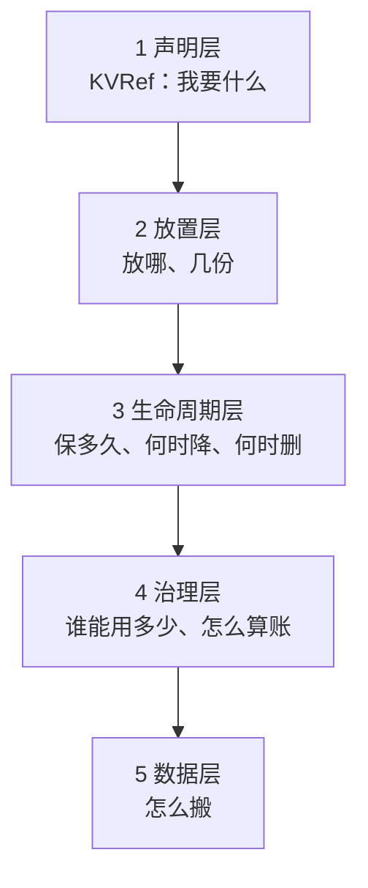
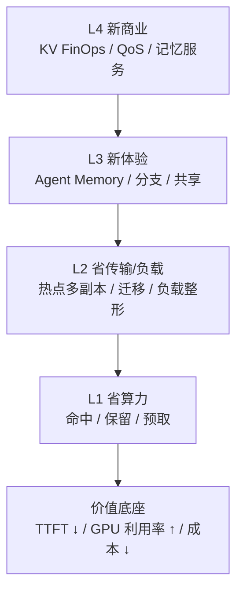
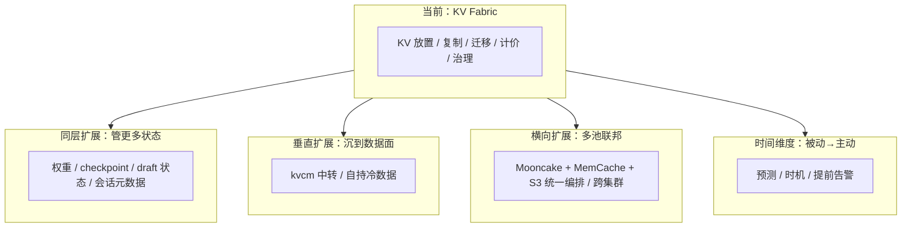
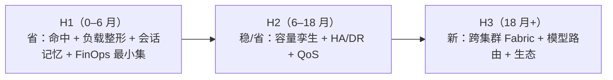

# D10: KV Fabric 路线图（规划草案）

- 状态: 规划草案。不承诺排期，用于讨论方向取舍。
- 版本基线: Mooncake v0.3.13.post1；vLLM-Ascend 0.26 系
- 上游: [D8](D8-joint-scheduling.md)（管理面）、[D9](D9-kv-services.md)（控制面）
- 一句话: 把 KV 从缓存变成一等云资源：可放置、可复制、可迁移、可计价、可治理。

---

## 0. 北极星

> **KV Fabric**：应用/Agent 不再关心“KV 在哪个实例”，只声明“我要这段记忆、这个延迟、这个预算”；KV Fabric 负责放置、复制、迁移、计价、治理。

三个转变：

1. **从 cache 到 state**：KV 不只是加速缓存，而是 Agent 的会话状态/工作记忆；
2. **从 routing 到 placement**：不只“谁有 KV 就发给谁”，而是“把 KV 放到该去的地方”；
3. **从 cost 到 economics**：不只省 GPU，而是把 KV 的字节、带宽、时延、保留时间变成可计价、可预算的资源。

---


### 0.1 什么是 Fabric

Fabric 指一层把分散资源统一访问与调度的抽象，不是某个协议或产品：

- 应用不用关心资源在哪、怎么连、有几份；
- Fabric 负责连接、寻址、放置、复制、迁移、隔离、QoS、可观测；
- 资源可以横向扩、异构混部、跨域，但对上层表现为一个池。

常见用法：

| Fabric | 把什么织在一起 | 典型场景 |
|---|---|---|
| **Network Fabric** | 交换机/网卡/链路 | 数据中心 leaf-spine、InfiniBand/RoCE、any-to-any 低延迟 |
| **Storage Fabric** | 主机与存储阵列/卷 | SAN、NVMe-oF、多路径、zoning、QoS |
| **Data Fabric** | 多个数据源/湖/仓 | 数据虚拟化、目录、治理、跨域查询 |
| **Memory Fabric** | 多机内存 | CXL 内存池化、disaggregated memory |
| **Service Fabric** | 微服务实例 | service mesh：流量、mTLS、重试、可观测 |
| **GPU Fabric** | 多机 GPU/NPU | NVLink/NVSwitch、NCCL、跨节点集合通信 |
| **KV Fabric** | 多实例/多介质/多集群的 KV | Agent 记忆、热点多副本、跨区复制、KV FinOps |

判断“该不该叫 Fabric”：

- 只是单机/单实例的缓存优化 → 叫 cache 就好；
- 资源是**分布、可池化、需要移动/复制/隔离/计价**的 → 才配叫 fabric；
- Fabric 的价值在“统一控制面 + 数据面 + 策略”，不是多画一层架构图。

本文的 KV Fabric 指：全局前缀命名 + 放置/副本控制 + 数据面 copy/move + 会话/保留/QoS + 账本/治理。与 KV cache 的区别是局部加速与可编程资源层。

### 0.2 KV Fabric 不是什么

**KV Fabric 既不是一个组件，也不是第三个平面。**

它是「管理面 + 控制面」合起来的终局形态：管理面把声明式需求变成放置决策，控制面执行。它没有自己的代码，能力全在管理面（决策）和控制面（执行）里。

判断标准见 §0.5。

### 0.3 一等资源需要什么

看三次同类的抽象历史：

| 资源 | 抽象 | 声明层 → 底下的能力 |
|---|---|---|
| **计算** | Kubernetes | 声明 spec → 调度放置 → 生命周期 → 配额 → 运行时接口 |
| **存储** | S3 / EBS | 桶与对象命名 → 分层放置 → 生命周期策略 → 版本与合规 → 数据面 |
| **网络** | service mesh | 服务标识 → 流量路由 → 重试熔断 → 策略与 mTLS → 数据面 |

规律：**每个都先有一层声明式接口，然后在它下面展开四层能力。没有声明层，上层全是命令式的，无法组合。**

KV 要做成一等资源，同样需要五层：



| 层 | 内容 | 归属 | 现状 |
|---|---|---|---|
| **1 声明层** | 用户只说要什么，不说放哪 | kvcm 对外接口 | **几乎空白** |
| **2 放置层** | 需求 → 具体放置方案（智力核心） | 管理面 D8 | 全是设计稿 |
| **3 生命周期** | 保留等级、降层时机、回收规则 | 控制面 D2 + D9 | 只有 copy 通 |
| **4 治理** | 配额、隔离、审计、计费 | 控制面 D9 | 全是设计稿 |
| **5 数据层** | copy/move/retain/remove 原语 | kvcm + Mooncake | 唯一基本完整的一层 |

越往上越空。数据层做完只是能搬 KV；声明层和放置层做完才是用户不用关心 KV 在哪。

#### 声明层长什么样

现在 kvcm 收的是命令：`{前缀, 目标实例}`。Fabric 的形态是声明：

```text
KVRef {
  namespace      // agent-123 / 模型版本 / 租户
  prefix         // 内容
  latency_target // 我要多快读到（不是“放到哪”）
  retention      // 保多久 / 什么等级
  budget         // 我愿意为此付多少
  durability     // 丢了我能接受吗
}
```

**差别不在字段多少，在“谁决定”**：命令式里用户决定实例，声明式里系统决定，用户只声明约束。这才是 Fabric。

声明层的三个直接后果：

1. **可组合**：多个 KVRef 可以合并、去重、统一放置，因为它们在同一个约束空间里比较。
2. **可迁移**：用户的声明不变，底下可以换实例、换介质、换集群。
3. **可计价**：`budget` 是声明的一部分，账本才有对象可算。

### 0.4 一等资源才做得到的能力

下面五件事没有一件能用 `{prefix, target}` 表达，可以用来看 Fabric 值不值得做。

| 能力 | 现在能做到吗 | 缺什么 |
|---|---|---|
| **KV 的分支** | ❌ | 块级 CoW（Mooncake 整对象 copy） |
| **KV 的 checkpoint / 回滚** | 🟡 一半 | 见下 |
| **KV 的可寻址** | ❌ | 名字引用（现在只能算 hash） |
| **KV 的订阅** | ❌ | 上行通知（现在只有下行补发） |
| **KV 的市场** | ❌ | 跨租户共享 + 引用计费 |

#### KV 的分支

Agent 同时探索三条路径，每条共享前 90% 前缀，只在分叉点后不同。

- **现在**：只能复制三份完整前缀。Mooncake 是整对象 copy，不做块级 CoW（D9 §3.7 已登记）。
- **Fabric 形态**：分支 = 共享前缀 + 各自 delta，像 git。
- **价值**：内存从 `3 × 90%` 降到 `90% + 3 × 10%`。

#### KV 的 checkpoint / 回滚

**这一条容易写错，要区分三件事：**

| 情形 | KV 在不在 | 缺什么 |
|---|---|---|
| 请求中途失败 | 大概率还在。APC 的 `ref_cnt → 0` 不释放物理块，hash 表条目也保留，下次同前缀仍能命中 | 缺「生成到第 N 个 token、采样状态是什么」 |
| 隔很久再续 | 可能已被驱逐 | KV + 进度都缺 |
| 回滚到更早的某一步 | 一定缺。APC 只保留最新，不记版本历史 | 多个快照点 |

所以 checkpoint 的**一半已经免费**：APC 已保留已算的 KV（[`docs/research/vllm/block-lifecycle.md`](../../docs/research/vllm/block-lifecycle.md)：`ref_cnt → 0 ≠ 释放、≠ 摘 hash`）。

真正缺的是三件事：

1. 进度状态：token 序列生成到哪、sampling 的随机状态、KV 的版本号。
2. 显式钉住：checkpoint 点的 KV 不能被驱逐（APC 是 LRU，池是 lease，都不是「钉到某个时间点」）。
3. 多版本共存：同一条链上保留多个历史点，回滚时选一个。

第 3 件才需要块级 CoW；前两件是状态管理，不动存储格式。

#### KV 的可寻址

```text
现在：key = hash(链式 block hash)  →  只能「算出来」，不能「引用」
Fabric：kv://agent-123/session-45/step-7  →  像 URL 一样引用一段记忆
```

价值：应用不需要知道 hash 算法、不需要保存 token 序列；跨语言、跨进程都能引用同一段记忆。

#### KV 的订阅

现在是单向下行（kvcm 补发 `BlockStored`），没有「我要订阅」的语义。

Fabric 形态：`subscribe(prefix_pattern, events=[evicted, replicated, ready])`。

价值：应用能在记忆被驱逐前收到通知、在副本就绪时立刻知道，而不是轮询。

#### KV 的市场

把 system prompt、工具定义、RAG 文档的 KV 预置成公共资源：

- 内容寻址天然去重：100 个租户用同一段 system prompt，池里只有一份。
- 按引用计费：谁引用了、引用了多久、省了多少。

**这是唯一能「卖钱」的能力**，也是 Fabric 和「缓存优化」的根本区别。

### 0.5 KV Fabric 有没有做成：三件判据

不看有没有一个叫 Fabric 的进程，只看三件事：

| 判据 | 现在 |
|---|---|
| API 是声明式的：用户给 `{前缀, 延迟目标, 预算, 保留期}`，不指定实例 | 命令式：`{prefix, target}` |
| 决策是自动的：放哪、几份、保多久、何时撤，由系统算 | 只有 D8 的设计稿，无实现 |
| 执行是完备的：八项操作都能通过 intent 触发 | 只有 copy 一条路走通 |

三件都到位之前，说的都是「KV 缓存 + 一个聪明的控制面」，不是 Fabric。

## 1. 时机

- **Agent workload 把 KV 变成长期状态**：多轮复用高、工具调用停顿长；长上下文模型（256K–1M）下 resume 一次可能要重算数十万 token，GLM-5.2 这类胖 KV 单请求就是几十 GB。KV 的生命周期从请求内变成会话级/天级。
- **GPU 贵、带宽/内存相对便宜**：用 KV 放置换 GPU 时间，ROI 通常成立；但“无限复制/无限保留”会反噬，所以需要 economics。
- **已有控制面**：kvcm 已经能 copy/move/keepalive/pin/demote/promote/retain/remove；D8 已有管理面决策；缺的是**产品化/价值闭环**，不是再写一个 RPC。
- **开源组件只覆盖零件**：Conductor/Dynamo indexer 做索引，Mooncake 做池/副本，LMCache/Prometheus 做指标；**跨层放置、会话记忆、计价治理**没有成品。

---

## 2. 价值金字塔



- **L1** 是“别重算”：命中/保留/预取；
- **L2** 是“别挤在一个点”：热点前缀多副本、迁移、会话分散；
- **L3** 是“以前做不到的体验”：会话分支、跨 Agent 共享记忆、低延迟 resume（目标，待实测）；
- **L4** 是“能卖钱/能管钱”：KV FinOps、QoS 等级、按记忆计费。

---

## 3. 候选方向

| 方向 | 做什么 | 谁买单 | 价值指标 | 难度 | 时机 |
|---|---|---|---|---|---|
| **A. KV 负载整形** | 热点前缀 copy 多副本；按负载/会话分流；副本数按收益定 | 平台/推理团队 | p99 TTFT、吞吐、扩容次数 | 中 | **现在** |
| **B. Agent Memory OS** | 会话/分支/checkpoint/resume；跨 Agent 共享前缀；记忆 TTL/层级 | Agent 产品/平台 | resume 时延、任务成功率、单任务成本 | 中高 | **现在-1 年** |
| **C. KV FinOps / QoS** | 按模型/租户/会话记账；预算/配额；QoS 等级；抢占式预取 | 云/平台/财务 | 成本可见性、预算达成、毛利 | 中 | **现在-1 年** |
| **D. 容量数字孪生** | 用历史 trace 模拟容量/配比/硬件；采购前 what-if | 基础设施/采购 | 少买/少闲置、容量预测误差 | 中 | 6–18 月 |
| **E. KV HA / 热备 / DR** | 预复制热前缀到备用实例；故障快速接管；跨 AZ | SRE/平台 | MTTR、可用性、恢复命中率 | 中高 | 6–18 月 |
| **F. 跨集群 KV Fabric** | 跨集群/地域复制热前缀；follow-the-sun；数据驻留 | 全球化平台 | 跨区 TTFT、合规、DR | 高 | 1–3 年 |
| **G. KV 感知模型路由** | 同前缀在多个模型/版本间选：质量/成本/缓存命中 | 模型平台 | 单请求成本、质量、灰度效率 | 中高 | 1–2 年 |
| **H. KV 存储效率** | 去重/压缩/量化/分层；共享 system prompt/tools | 平台/基础设施 | 每 GB 有效 KV、HBM 占用 | 高 | 1–3 年 |
| **I. 生态 / SDK / 市场** | Agent 框架 SDK、KV Memory API、预置前缀市场 | 开发者/生态 | 接入数、调用量、留存 | 中 | 1–3 年 |

---

## 3.1 边界之外：Fabric 之后还有什么

上面的 A–I 都在“把 KV 当资源”这一层。再往上走的每一步都会改变 kvcm 的身份，所以每上一层都要重新问一次“它还是不是 kvcm”。

四条扩展轴，每条都从 kvcm 现有能力（全局视图 + 账本 + 执行能力 + 独立进程）推出来：



### 轴一：同层扩展（管更多种状态）

前提是“KV 是唯一值得管的状态”。推理系统里还有别的状态，结构和 KV 同构（内容寻址、可复制、有冷热、有 TTL）：

| 状态 | 与 KV 的共性 | 与 KV 的差异 | 现状 |
|---|---|---|---|
| **权重** | 可复制、有 revision、有冷热 | 不能部分命中；加载是整体替换 | D8 明确划给外部编排（见 [D8 §非目标](D8-joint-scheduling.md)） |
| **checkpoint** | 可复制、有 TTL、可迁移 | 写入频率低、大小差异大 | D10 B 项已列（会话分支/checkpoint） |
| **draft / spec 状态** | 与 target 配对、生命期不同 | 引擎内部状态，跨实例迁移语义未定 | 无 |
| **会话元数据** | 有生命周期、需隔离 | 不是 KV，是结构化数据 | 无（`sessions` 表只记“会话绑了哪个前缀”） |

账本结构（`tasks / keepalive / replicas / sessions`）本来就不绑定 KV 语义，换一种 artifact 只需换 key 和尺寸。但一旦这么做，就要处理不同状态的语义差异：权重不能部分命中，KV 可以，抽象会变复杂。

**代价**：从“KV 控制面”变成“状态控制面”。参考实现 TensorCast 走的就是这条路（权重、KV、checkpoint 都抽象成分布式 artifact，见 [`../../docs/research/tensorcast/`](../../docs/research/tensorcast/)）。

### 轴二：垂直扩展（沉到数据面）

kvcm 现在是纯控制面，数据由 master 派单给源 client 搬。往前一步有两个形态：

1. **自持冷数据（已登记）**：D8 的开放问题写过“retain 未实现：可登记 move 到活 seg / kvcm 自挂 SSD”（见 [D8 §11](D8-joint-scheduling.md)）。这是最窄的形态，目的只是“源实例下线时 KV 不丢”。
2. **通用中转（A → kvcm → B）**：源实例不再必须是活的，kvcm 可以先收下来再发出去。

已有的“数据经 kvcm”只有读删写路径（`D2:633`：盘副本绑 kvcm，引擎读它要经 kvcm 转发；`D2:667`：读删写做 promote），那不是中转，是借 kvcm 之手做一次搬迁。

**代价**：从“无状态控制面”变成“有状态数据节点”。现在 kvcm 挂了，池还在，重启 `rebuild` 就行；一旦自持数据，kvcm 就成了可用性单点。这条要想清楚才做。

### 轴三：横向扩展（多池联邦）

现在是单 Mooncake master、单集群。第二后端（MemCache）在 [`code-architecture.md`](code-architecture.md) 只是“登记在案”，没有任何池间协调设计。

三个层次：

| 层次 | 内容 | 现状 |
|---|---|---|
| **异构后端** | 同一池内接第二个存储后端（MemCache） | L3 抽象已留位置，未接入 |
| **多池** | Mooncake 管 HBM/DRAM、MemCache 管 SSD、S3 管冷数据，统一编排 | 无 |
| **多集群** | 多个 kvcm 之间发现、协商、处理分区 | 无（D10 F 项是“复制前缀”，不是“联邦控制”） |

**理由**：单集群放不下 working set 时必须跨集群。这层做成后，控制面本身成为可复用的基础设施。

**为什么难**：需要 kvcm 之间互相发现、协商、处理分区。这是分布式系统最难的活，现在一点基础都没有。D10 F 项把“跨集群”放到 1–3 年，但那只是复制热前缀，不是联邦控制。

### 轴四：时间维度（被动 → 主动）

现在 kvcm 是纯执行者：D8 说什么就做什么。但它是唯一拥有全部历史账本的组件：每次 copy、move、keepalive、删除的时间、字节、结果都在 `Ledger` 里。

| 能做的 | 现状 |
|---|---|
| **预测下一个热前缀**（intent 到来前预取） | 部分：D8 的动作表有 `prefetch | hook/预测`，[D8a §4](D8a-scheduling-algorithms.md) 有 Poisson 模型。缺“从历史 trace 学访问模式” |
| **动态保活窗口** | 无：D8 动作表写的保活预算是“lease TTL 的 1/3 左右”，是拍的；Agent 场景下停顿可能是 3 秒也可能是 3 分钟，一个固定窗口必然低效 |
| **提前告知“赶不上”** | 无：D8 算的是 `EV`（预取值不值），不算“这次来不来得及”。预热 READY 约 11 秒（实测 #17），请求 3 秒后到必然赶不上，但现在只能事后 `FAILED` |
| **主动降层** | 已有：D8 动作表、[D8b §7 池压时序](D8b-scheduling-sequences.md) |

“提前告知赶不上”是这四条里最便宜的：两个数都已有来源（hook 给请求到达时间、字节/带宽估预取耗时），只是没人算这个差。收益却直接：gateway 现在按会命中做决策，事后才发现失败。

### 不在四条轴上的两件事

| 能力 | 为什么单独列 |
|---|---|
| **KV 事务（复合操作原子性）** | 现在每个操作独立，没有两阶段/saga/补偿。真正需要是在批量治理规则出现之后。已有零散幂等（intent 幂等键、leader lease + 幂等，见 [D8 §5.4](D8-joint-scheduling.md)），但不是复合操作语义 |
| **KV 内容一致性** | block hash 只对 token 序列做 hash，不含“这份 KV 是怎么算出来的”。同一 revision 下，不同 attention 实现 / 不同 batch 组成产生的数值是否等价，四个设计文档都没有讨论。更像计算层问题，不是 kvcm 的 |

### 天花板在哪

**KV Fabric 不是终点，是“把 KV 当资源”这一层的终点。**

再往上，最有价值的组合是：管所有可放置、可复制的推理状态（KV + 权重 + checkpoint），跨池跨集群，能预测、能溯源、能计费。但那时已经不叫 kvcm，需要重新命名，也需要重新划边界。

---

## 4. 三条产品线 / 三阶段



### H1：把“省”做成可证明的 ROI

- 热点前缀多副本 + 会话分散；
- 会话保留/恢复（Agent Memory 最小集）；
- 账本/ROI：每会话、每前缀、每模型；
- 目标：**TTFT p99 降、GPU 时间省、扩容次数降**，用 A/B 证明。

### H2：把“稳/省”做成平台能力

- 容量数字孪生：采购/配比 what-if；
- KV HA/热备：故障快速接管、跨 AZ；
- QoS：租户/模型等级、预算、抢占；
- 目标：**可用性、容量利用率、成本可预测**。

### H3：把新体验做出来

- 跨集群 KV Fabric：地域跟随、数据驻留、DR；
- KV 感知模型路由：质量/成本/缓存联合；
- 生态 SDK/市场：Agent 框架接入、共享前缀；
- 目标：**新收入/新场景**，而不只是省成本。

---

## 5. 价值怎么算

省算力、省容量、负载整形的公式与量级，见 [D8a §8](D8a-scheduling-algorithms.md)（那边是唯一归宿）。这里只写**D10 特有的两点**：

### 5.1 FinOps 的算式

```text
单会话成本 = Σ(bytes × T × c_mem) + Σ(transfer × c_bw) + prewarm 成本
毛利 = 收入 − 单会话成本
```

价值不在算得准，在**能按会话/租户/模型定价、预算、追责**。

### 5.2 可用性

```text
MTTR 降低 = 故障恢复时间（冷启动/重建） − 热备接管时间
```

热备 = 预复制 + 保留 + 路由切换。不是备份文件，是可读 KV。

### 5.3 扩展轴的量化模型

四条扩展轴各自的收益/成本口径。数值都是模型估算，待真机校准。

#### 轴一时的收益：状态控制面 vs 单一状态

```text
统一控制面的收益 = Σ_i (重复基础设施成本_i) − 一次建设成本
其中 i ∈ {KV, 权重, checkpoint, draft}

判据：只有当两种状态的「放置策略可共用」时，合并才划算
可共用 = 相同的冷热判据 + 相同的迁移原语 + 相同的记账维度
```

权重的冷热判据是哪个模型被请求，KV 是哪个前缀被复用。判据不同，放置策略不能共用。所以轴一里“管权重”收益存疑，“管 checkpoint”收益明确（和 KV 一样按会话/按 TTL 过期）。

#### 轴二的收益：中转站换来的可用性

```text
不中转：源实例下线 → copy 失败 → 重算成本 = T_prefill × c_gpu
中转  ：源实例下线 → 从 kvcm 取 → 传输成本 = bytes / BW × c_bw

净收益 = P_source_down × (T_prefill × c_gpu − bytes/BW × c_bw)
代价   = kvcm 自持数据的可用性成本 + 常驻内存 × c_mem
```

关键参数是 `P_source_down` 和“kvcm 自持部分的容量”。如果 kvcm 只在中转窗口内短暂持有（秒级），可用性代价近似为零；如果长期持有冷数据，kvcm 就变成存储节点，代价陡增。

#### 轴三的容量门槛：什么时候必须多池

```text
单池可容纳 = Σ_seg usable_bytes × (1 − headroom)

需要多池 ⟺ working_set > 单池可容纳

跨池传输成本 = bytes × (1/BW_cross − 1/BW_local)
只有当「跨池省下的重算」> 「跨池多花的传输」时才跨
即：P_reuse × T_prefill × c_gpu > bytes × (1/BW_cross − 1/BW_local) × c_bw
```

`headroom` 是给驱逐/碎片留的余量。这个门槛说明多池有容量条件：working set 没超单池容量时，跨池纯亏。

#### 轴四的时机模型：为什么要动态窗口

保留的净收益公式见 [D8a §5](D8a-scheduling-algorithms.md)（`Net(T)` 与盈亏平衡）。这里只用到它的一个性质：**`μ` 是停顿分布的衰减率**，而 `μ` 因工作负载而异。

**关键点**：`μ` 是停顿分布的衰减率，**Agent 场景下 `μ` 因工具类型而异**。

- 快工具（读文件、查表）：停顿 3–10 秒，`μ` 大，最优 T 很短
- 慢工具（跑测试、调外部 API）：停顿 1–5 分钟，`μ` 小，最优 T 较长
- 人类审批：停顿可能小时级

固定 T = 10 分钟时：

```text
对快工具：Net(10min) 远小于 Net(10s)，多付了 c_h × bytes × (600 − 10)
对慢工具：Net(10min) 可能已经小于 0，本来该保留却被释放
```

**同时存在两类工具时，单一 T 必然在两边都亏。** 动态窗口的价值就在这里：按会话的 `μ` 估计取最优 T。

`μ` 的估计来源：同一工具的历次停顿样本。设样本 `t_1..t_n`，指数分布的最大似然估计是：

```text
μ̂ = 1 / mean(t_i)
```

样本少时用同工具族的先验做贝叶斯平滑：

```text
μ̂ = (n × mean(t_i) + n0 × 1/μ_prior) / (n + n0)   → μ̂ = (n + n0) / (Σt_i + n0/μ_prior)
```

#### 轴四：提前告知“赶不上”的判据

```text
预取耗时估计 = T_submit + bytes / BW_effective + T_verify
其中 T_submit ≈ N_keys / submit_concurrency × T_rpc
     T_verify ≈ N_poll × poll_interval（最坏情况）

来得及 ⟺ T_arrival − T_now > 预取耗时估计

来不及时的决策：
  1. 不预取（省带宽），并告知 gateway「这次不会有本地命中」
  2. 降级为「尽力预取」，预期下次请求受益
  3. 若前缀已在池里（Pool 命中）但不在目标实例：改为「按需跨机读」而不预热
```

`BW_effective` 指当前可用带宽而非理论带宽，所以 E15 的网卡利用率采样在这里有用；没有它只能估。

这条判据的价值是让 gateway 从“乐观假设会命中”变成“准确知道会不会命中”。按 [D8a §4](D8a-scheduling-algorithms.md) 的 `EV` 公式，`P_use` 现在是个盲猜的常数；有了这个判据，`P_use` 可以按“来不来得及”分层。

```text
P_use 分解 = P(来得及) × P(到达后真的用这段前缀 | 来得及)
```

前一项由上面的判据给出，后一项来自 hook 的预测。

---

## 6. 竞争定位

链式 block hash、逐块匹配、事件→索引、推测索引补空窗、介质分层打分，这些是 SOTA 的标准做法，不是差异（llm-d `pkg/kvcache/`、Dynamo `lib/kv-router/`、AIBrix `pkg/kvevent/` 都有）。

差异主要在两个结构性选择上；视图范围是补充，不是“精度更高”：

| | SOTA（llm-d / Dynamo / AIBrix） | 我们 |
|---|---|---|
| **索引与权威** | 引擎事件的**派生缓存**：靠事件逼近真相，丢事件要 gap replay，过期要 TTL/推测补 | 同样是**派生缓存**，但以池 master 为权威：正常读缓存，miss/核验才问 master；不把缓存当第二权威 |
| **放置的主动权** | 只做路由：谁有 KV 就发给谁。索引是打分用的摘要 | 控制面能改变放置：copy 多副本、move 迁移、retain |
| **视图的范围** | 只到「哪个 pod 有这个块 + 哪层介质」 | 到**实例 + 介质**，另加生命周期/账本；**不碰 seg/rank/字节**，那些由控制面 `locate` 负责 |

llm-d 的 `pain-points.md` 自己写明了前两条的后果：

- 「丢 remove 事件留幽灵条目」→ 需要「权威视图随放置/驱逐同步改」；
- 「需要推测索引补决策→确认空窗」→ 需要「放置由池决定、视图由池发」。

它的 `pkg/kvcache` 注释也明说：

> 索引本身只回答「哪个 pod 持有这个块（可能在哪层介质）」，不含字节级位置、不含生命周期。它是给打分用的摘要，不是存储元数据：够选路用，不足以驱动放置、迁移、恢复。

**真正的差异不是“缓存 vs 直连”，而是“只路由” vs “能改变放置”。**

| 能力 | Dynamo | llm-d | AIBrix | Mooncake | 我们 |
|---|---|---|---|---|---|
| 前缀索引/路由 | ✅ | ✅ | ✅ | 部分 | ✅ |
| 池内 copy/move | ❌ | P2P 补传 | ❌ | ✅ | ✅ |
| 热点多副本（指定目标/副本数） | 部分（动态副本，目标 master 选） | 部分（P2P 反应式） | ❌ | 自动加副本，目标 master 选 | **指定目标/数量/预算** |
| 会话记忆/分支 | ❌ | ❌ | ❌ | ❌ | 目标 |
| FinOps/QoS | ❌ | ❌ | 部分指标 | ❌ | 目标 |
| 跨集群 | ❌ | ❌ | ❌ | DFS/跨区 | 远期 |
| 跨引擎 | 部分 | 部分 | 部分 | 池无关 | 控制面独立 |

## 7. 目标场景

### 7.1 Agent Memory Cloud

- 每个 Agent 有“记忆句柄”：分支、checkpoint、resume、共享；
- 记忆有 TTL/QoS/预算；跨实例/跨集群可迁移；
- 价值：Agent 任务成功率/时延/成本；按记忆 GB·小时或按任务收费。

### 7.2 KV CDN

- 热前缀（system prompt、tools、RAG 文档）复制到离用户近的集群；
- 用户在哪，KV 在哪；冷前缀回源；
- 价值：跨区 TTFT、带宽成本、数据驻留。

### 7.3 KV FinOps

- 每个模型/租户/会话一张“KV 账单”；
- 预算、告警、配额、抢占、chargeback；
- 价值：从“GPU 账单”细化到“记忆账单”，平台能定价。

### 7.4 容量数字孪生

- 输入历史 trace + 硬件配置 + 模型组合；
- 输出：需要多少 HBM/DRAM/SSD、多少节点、命中率/成本曲线；
- 价值：采购前决策，少买/少闲置。

---

## 8. 风险与边界

| 风险 | 说明 | 对策 |
|---|---|---|
| 复制成本反噬 | 多副本吃 HBM/带宽，可能降低全局命中 | 收益/预算约束；副本 TTL；全局水位 |
| 单会话不可拆 | 复制前缀不能拆 decode | 明确边界；未来做请求迁移 |
| 引擎/池绑定 | 不同引擎 key/事件不同 | 控制面适配层；KeyComputer 隔离 |
| 数据合规 | KV 含 prompt/PII | 保留策略/审计/加密/地域 |
| 开源组件成熟度 | publisher/retain 等能力版本不一 | 能力声明；降级方案 |
| 组织边界 | 谁拥有 KV 预算/QoS | 平台/租户/FinOps 分工 |

---

## 9. 建议下注

如果只选三个：

1. KV 负载整形（热点多副本 + 会话分散）：直接打高负载 TTFT/吞吐，最容易证明 ROI。
2. Agent Memory OS（会话/分支/共享）：新体验，拉开与 cache-aware router 的差距。
3. KV FinOps/QoS（账本/预算/等级）：让平台能卖、能管、能扩。

三个合起来就是：**“KV 既能省，又能卖，还能管”**。

若还要再加，按性价比排序：

| 优先级 | 方向 | 所属轴 | 理由 |
|---|---|---|---|
| **高** | 提前告知“赶不上” | 轴四 | 两个数已有来源（hook 的时间、字节/带宽），只缺一个减法。直接改善 gateway 决策 |
| **高** | 动态保活窗口 | 轴四 | Agent 场景核心变量。固定 10 分钟对 3 秒和 3 分钟停顿是同一个数，必然低效 |
| **中** | 本地聚合传输 | 轴二 | 依赖 Mooncake 提供批量接口，现在没有 |
| **中** | KV 事务 | 不在轴上 | 等批量治理规则出现才需要 |
| **低** | 多池协调 | 轴三 | 要先接第二后端，且有容量门槛（working set 超单池才划算） |
| **低** | 会话元数据 / draft 状态 | 轴一 | 会改变 kvcm 身份，需先重新界定边界 |

---

## 10. 参考实现

| 参考 | 锚点 | 借什么 | 差异 |
|---|---|---|---|
| Dynamo | `protocols.rs::WorkerSelectionResult`；Planner | KV-aware 路由；双环扩缩 | 我们改放置，不只路由 |
| llm-d | EPP + P2P KV sharing | 索引/推测/P2P | 我们做主动多副本/会话/计价 |
| AIBrix | `pkg/kvevent/manager.go`；PodAutoscaler | 事件索引；KV 指标扩缩 | 我们跨层放置 |
| Mooncake | `CreateCopyTask`/`CreateMoveTask`/`CreateDrainJob`；动态副本 | 池操作/副本 | 我们指定目标/数量/预算 |
| LMCache | `observability.py::LMCStatsMonitor` | 字节/指标 | 我们做归因/FinOps |
| Conductor | `prefix_indexer.cpp::PrefixCacheTable::Query` | 前缀索引 | 我们做对账/放置 |

扩展轴的对照参考：

| 轴 | 参考 | 锚点 | 借什么 | 关键差异 |
|---|---|---|---|---|
| 轴一（多状态） | TensorCast | `tensorcast/api/_config.py::StorePolicyProfile`；Global Store / Store Daemon | 把权重/KV/checkpoint 都抽象成分布式 artifact，控制面/数据面分离，policy 预设（cache/durable/ha/cold/warm/pinned） | 它的策略是**声明式放置契约**，我们是**按需决策**；它不管推理拓扑（rank/seg），我们必须懂 |
| 轴二（数据面） | KVCR | `src/kvcr/remote_fw_dram.py::fetch/query/_try_release_pin`；Guard 组件 | 传输窗口 pin、旁挂保活、跨节点 P2P | 它是**引擎进程内**的二级存储 + router hint，我们是**独立进程**且不持有 HBM |
| 轴二（数据面） | CXL / Memory Fabric | [NVIDIA CMX](../../docs/research/nvidia-cmx.md)（共享 flash 数据路径） | 内存级池化 + 远端可读的语义 | CMX 是**硬件层**的内存池，我们是**软件层**的放置控制；两者可叠加 |
| 轴三（多池） | Mooncake DFS | `master_service.cpp::CreateDrainJob`；DFS 副本分配 | 池内已有跨介质（DRAM/SSD/DFS）的分层与 drain | 它是**单池内的介质分层**，不是多池联邦；我们要做的是多 master 协调 |
| 轴三（多池） | LMCache controller | `lmcache/v1/cache_controller`（lookup/pin/move/clear） | 控制面命令集 | 它无全局强一致元数据；我们依赖 master 权威 |
| 轴四（预测/时机） | SGLang session | `mem_cache/unified_cache/session_ref_tracker.py::UnifiedSessionRefTracker` | session 软保护 + frontier 引用计数 | 它用**引用计数**保活（被动），我们要做**按停顿预测**保活（主动） |
| 轴四（预测/时机） | vLLM Retention | `v1/kv_hints/protocol.py::KvHintsEnvelope`；Retention API | pin/retain/prefetch/demote/release 动词表 + hint 信封 | 它是**单实例**的 retention；我们是**跨实例**放置 |
| 轴四（spec 状态） | SGLang spec decode | `sglang/model-runner.md`：EAGLE / DFLASH / DSPARK / FROZEN_KV_MTP；`PoolName.DRAFT` | drafter 的 KV 池独立命名、跨步状态（`DFlashDraftInputV2`） | 它们的 draft KV 是**实例内**的；跨实例复用的语义尚无实现 |
| 不在轴上（一致性） | vLLM block hash | `kv_cache_utils.py::hash_block_tokens`；`extra_keys` 参数 | hash 折入 `cache_salt` / LoRA / 多模态标识 | 折入的是**输入侧标识**，不是“KV 怎么算出来的”；数值等价性仍是空白 |

**关于“KV 内容一致性”这一条：本项无直接参考实现。**

vLLM 的 `extra_keys` 只把输入侧的隔离标识（salt / LoRA / MM hash）折进 block hash，用来**隔离**不同上下文的缓存，不用于校验数值等价。据本仓检索，没有项目在 KV 上带“产生方式”的元信息做校验。这是一个真空白，但它属于计算层的语义问题（attention 实现、batch 组成是否影响数值），不是 kvcm 的放置问题，所以列在「不在四条轴上」，不作为路线图项。
