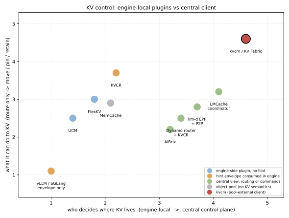
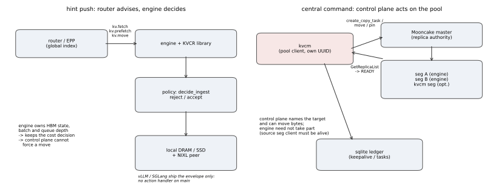
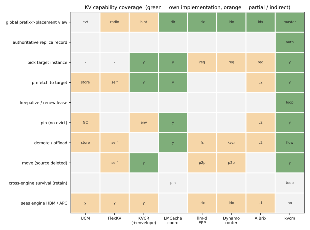

# D11: kvcm / KV Fabric 与开源方案对比

- 状态: 设计对照（结论型文档，不含排期）
- 版本基线: kvcm @ `4d9dd33`（2026-11-13，D8/D9/D10 已入 main）
- 对照组: vLLM / SGLang / UCM / FlexKV / KVCR / MemCache / LMCache / llm-d / Dynamo / AIBrix
- 读法: §1 一句话结论；§2 控制流分歧；§3 能力矩阵；§4 逐家事实；§5 我方真实优势与真实短板；§6 待确认

---

## 1. 结论



**「开源方案都是 connector + 引擎自己决策」这个判断大体成立，但不是全部，也不是同一层次的一件事。**

拆成三个可核对的问题：

| 问题 | 开源侧事实 | kvcm / KV Fabric |
|---|---|---|
| 谁决定「这块 KV 去哪」 | 三类：引擎内插件自己决定（UCM / FlexKV）；中心给 hint、引擎复核后决定（KVCR、vLLM/SGLang 信封、llm-d P2P）；中心只决定「请求去哪」、KV 随请求走（llm-d EPP / Dynamo router / AIBrix） | 控制面决定，直接对池下命令，引擎不必参与 |
| 决策依据的全局视野 | 全局前缀视图在 router/网关侧（最终一致、事件派生）；KV 字节归属的权威在引擎或对象池 | 全局前缀视图 + **副本权威在池 master**，kvcm 是池的合法 client，能读到权威记录 |
| 能不能强制搬 | 只有「目的地发起 + 源侧配合」；hint 可被拒绝；vLLM/SGLang main 上连 action handler 都还没有 | 能指定目标、能发起 copy/move，源 seg client 在线即可，不要求引擎配合 |

由此，本文的定位判断是：

> kvcm 的差异不在「多几个 API」，而在**决策权与执行权归谁**：开源侧把 KV 的最终处置权留在引擎进程里，kvcm 把它挪到池的 client 侧。这带来兼容性（不改引擎）与操作面（八项操作、可指定目标），代价是**看不见引擎 HBM/APC**——这是它真实的短板，不是修辞。

---

## 2. 控制流：两种形状



### 2.1 hint 推：路由建议，引擎决定

链路（以 KVCR 为最完整实现）：

```text
router/EPP（全局索引）
  → 随请求下发 kv_hint 信封（kv.fetch / kv.prefetch / kv.move + block_hashes）
  → 引擎内 KVCR 库 submit_hint，只登记 request 作用域的来源信息
  → 引擎按自身负载、队列、HBM 余量决定拉不拉（policy.decide_ingest 可 DROP）
  → 真要拉时由**目的地**发起，源侧 claim/pin 配合，NIXL 点对点搬
```

三个硬事实（都在代码里，不在设计文档里）：

1. **vLLM 只有信封，没有执行方。** `vllm/v1/kv_hints/protocol.py` 只定义 `KvHintsEnvelope` / `KvHintAction`（`protocol_version` / `message_id` / `actions[action_id, action_type, action_version, payload]`）。全仓 `v1/` 下 `action_type` 只出现在这个 protocol 文件里——引擎没有注册任何 action handler。唯一消费者是 KVCR 二级层：`vllm/v1/kv_offload/tiering/kvcr/manager.py::on_new_request` 把信封 `submit_hint` 给 KVCR 库。
2. **SGLang 同样只有信封。** `python/sglang/srt/managers/kv_hints.py` 定义同构信封 + `decode_kv_hints_envelope` 形状校验；`schedule_batch.py` 把 `kv_hints` 挂到 `ScheduleBatch`，但全仓 `srt/` 下没有按 `action_type` 分派的执行代码。
3. **hint 可被拒绝，且默认不支持「不保留」。** `src/kvcr/hints/parser.py` 明确 `no_retain is not currently supported`；源侧 `_IndependentHintHandler.submit` 先判 `source_has_no_managed_dram` / `key_adapter_unavailable` / `self_destination` 再拒绝；目的地侧 `requested()` 再判 `destination_has_no_managed_dram` / `self_source` / `incompatible_layout`。两端都能拒，且都只回 `HintStatus.REJECTED` / `FAILED`，不重试、不换目标。

也就是说：**开源侧给的是「建议通道」，不是「命令通道」**。这不是实现不完备，是设计选择——引擎知道自己的 batch 组成、队列深度、HBM 余量，这些信息控制面拿不到，所以把成本判断留在引擎。KVCR 文档自己的说法就是「拉取与重算的取舍下放给 worker；集中式成本决策难以做好」。

### 2.2 中心命令：控制面直接对池动手

kvcm 走的是池自己的 API，不经过引擎：

```text
kvcm（Mooncake 的 client，自己的 UUID）
  → CreateCopyTask / MoveStart+MoveEnd / Upsert(空写 pin) / Remove
  → master 协调，派任务给源/目标 seg 所在 client 执行
  → kvcm 用 QueryTask + GET /batch_query_keys / GetReplicaList 核验
  → 得到 READY 上报 Router
```

关键差别有三条：

1. **方向不同。** hint 是「目的地去要」，kvcm 是「控制面把副本放到目标段」。前者要求目的地在线且愿意，后者只要源 seg 的 client 在线（`D2` §F7：`CreateCopyTask` 由 master 指派源端执行）。
2. **不要求引擎改代码。** 引擎侧只需跑官方的 `AscendStoreConnector(backend=mooncake)` 把 KV 写进池；之后所有 KV 动作在池上做。hint 路线要么等上游合 action handler，要么自己维护引擎补丁。
3. **能指定目标。** `CreateCopyTask(key, [B.seg])` 明确点名 B 的段；Mooncake 的动态副本（`SubmitReplicaActionProposal`）做不到指定实例，kvcm 能做。

### 2.3 第三条路：中心只决定请求去哪

llm-d EPP、Dynamo router、AIBrix 属于这一类：中心持有索引、决定请求落到哪个实例，KV 随请求流动（P2P 或池）。它们和 kvcm 不是替代关系——**kvcm 缺的正是这一层（D8 的 SC 还没写）**，它们缺的是 kvcm 那层「能对池下命令、能保活、能搬」。

---

## 3. 能力矩阵



绿色 = 自己实现，橙色 = 部分/间接，空白 = 无。逐格依据：

| 能力 | UCM | FlexKV | KVCR | LMCache coord | llm-d EPP | Dynamo router | AIBrix | kvcm |
|---|---|---|---|---|---|---|---|---|
| 全局前缀→位置视图 | 引擎事件+store lookup（O） | 本机 radix，集群靠快照（O） | router 下发 hint（O） | fleet 目录，最终一致（G） | 逐块索引+推测条目（G） | 事件派生索引（G） | 网关索引（G） | master 副本记录（G） |
| 副本权威记录 | — | — | — | hint 级（O） | — | — | — | 池 master（G） |
| 指定目标实例 | — | — | 是（G） | 是（G） | 只能选请求落点（O） | 同左（O） | 同左（O） | 是（G） |
| 预取到指定目标 | store.prefetch（O） | 本机（O） | 是（G） | `/cache/prefetches`（G） | — | — | L2（O） | copy（G） |
| keepalive/续租 | — | — | — | —（只有 pin，无 lease 续租） | — | — | — | KeepaliveLoop（G） |
| pin（免驱逐） | store GC 提示（O） | — | 信封 `env`（O） | `/cache/pins`（G） | — | — | L2（O） | 空写 SOFT（G，有条件） |
| 降层/offload | store 后端（O） | 本机（O） | — | 是（G） | FS 后端（O） | KVCR（O） | L2（O） | demote 组合（G） |
| move（删源） | — | 本机（O） | 是（G） | 无独立 RPC | P2P（O） | P2P（O） | — | move（G） |
| 跨引擎存活（retain） | — | — | — | 用 pin 近似（O） | — | — | — | 设计有、未接（—） |
| 能看见引擎 HBM/APC | 是（O） | 是（O） | 是（O） | — | 索引推断（O） | 索引推断（O） | L1（O） | **否** |

读图两点：

- **kvcm 唯一的「否」在最后一行**，而这恰好是开源侧的共同强项——因为它们在引擎进程内。
- **retain 一行 kvcm 也是空**（设计未接），别把 D2 §4 的方案读成已具备。

---

## 4. 逐家事实（附出处）

### 4.1 vLLM / SGLang：信封先行，执行缺位

| 事实 | 出处 |
|---|---|
| 信封结构 `KvHintsEnvelope{protocol_version, message_id, actions}`、`KvHintAction{action_id, action_type, action_version, payload}` | `vllm/v1/kv_hints/protocol.py`；`python/sglang/srt/managers/kv_hints.py` |
| vLLM 信封贯穿请求链（`Request` → `EngineCoreRequest` → `LLMEngine` / `AsyncLLM.generate`） | `vllm/v1/request.py:208`、`vllm/v1/engine/llm_engine.py:241`、`async_llm.py:429` |
| vLLM 唯一消费者是 KVCR 二级层 | `vllm/v1/kv_offload/tiering/kvcr/manager.py::on_new_request`（`submit_hint`） |
| SGLang 信封挂到调度批次，无 action 分派 | `python/sglang/srt/managers/schedule_batch.py:814`；`srt/` 内无 `action_type ==` 分派 |
| session 坐标已落地、Retention 未落地 | `docs/research/vllm/kv-session-roadmap.md` §2.5–§2.7 |

**判读**：这两家把「接口形状」先标准化了，把「谁执行」留给编排层。对 kvcm 的影响是正面的——kvcm 不需要等它们，也不需要改它们。

### 4.2 KVCR：最完整的 hint 路线，决策仍在引擎

| 事实 | 出处 |
|---|---|
| 三种 hint：`kv.fetch`（存来源建议）、`kv.prefetch`、`kv.move` | `src/kvcr/hints/hint_types.py` |
| hint 类型表 + 拒绝原因 | `src/kvcr/hints/dispatcher.py::_HINT_TYPES`；`parser.py::reject_hint` |
| `no_retain` 不支持；无来源端点的 hint 不支持 | `src/kvcr/hints/parser.py` |
| 源侧先判「有没有托管 DRAM」「是不是自己」，不合格就拒 | `src/kvcr/hints/hint_handler.py::_IndependentHintHandler.submit` |
| 入池/驱逐决策可被 policy 否决（`decide_ingest` / `decide_eviction`） | `src/kvcr/policy.py::KVCachePolicy` |
| 入池时的 COPY_TO / MOVE_TO 放置**尚未接线** | `src/kvcr/runtime/policy_runtime.py`（`TODO(kvcr-g3): Wire ingest-time COPY_TO and MOVE_TO placement`） |
| 库存上报走 `InventoryEvent`，复用 router 的全局视图 | `src/kvcr/runtime/core.py::_publish_inventory`、`types.py::InventoryEvent` |

**判读**：KVCR 是「hint 路线」的完备形态，但它的主动放置还是 TODO。它证明了「router 持全局视图 + hint 到引擎」工程上可行；也暴露了这条路的边界——**控制面无法强制**。

### 4.3 LMCache：唯一带独立 coordinator 的开源方案

| 事实 | 出处 |
|---|---|
| 独立协调器进程（`mp_coordinator`），有 fleet 级 key 目录 | `lmcache/v1/mp_coordinator/views/key_directory.py` |
| 预取 API：`POST /cache/prefetches`（指定 instance_id + token_ids） | `lmcache/v1/mp_coordinator/http_apis/cache_api.py` |
| pin API：`POST/DELETE /cache/pins`，作用在 coordinator 自己的 L2 驱逐计划 | `lmcache/v1/mp_coordinator/controllers/eviction_http_api.py::request_pin` |
| 目录语义：**最终一致，lookup 只是 hint，要在 owner 侧验证** | `key_directory.py` 文件头 docstring |
| 无独立 move RPC（只有 pin/delete/quota/prefetch） | `eviction_http_api.py` 路由表（`/cache/pins`、`/cache/delete`、`/quota`）；`cache_api.py` 路由表（`/cache/prefetches`） |
| 无 lease 续租概念（pin 是「排除在驱逐计划外」，不是按时间续租） | `grep -rni "lease\|keepalive" lmcache/v1/mp_coordinator/` 无命中 |
| 预取确实能指定实例：`POST /cache/prefetches` 带 `instance_id`，404 表示未注册 | `cache_api.py::request_prefetch` docstring + 实现 |

**判读**：这是与 kvcm 最接近的一家——也是中心化的。差别在**权威性**：它的目录是事件派生的最终一致视图，kvcm 的副本记录来自池 master（`GetReplicaList` / `batch_query_keys`）。另外它管的是自己的二级层，不是「引擎 HBM + 池」这一整套。

### 4.4 UCM：引擎插件，最彻底的「不改控制面」

| 事实 | 出处 |
|---|---|
| 通过 `KVConnectorBase_V1` 接入，多版本 patch 树 | `ucm/integration/vllm/ucm_connector.py::UCMConnector`；`ucm/integration/vllm/patch/` |
| 前缀命中靠 connector 在 `get_num_new_matched_tokens` 里查 store | `ucm_connector.py:2120` |
| store 有 `prefetch`，但注释说它只是 GC 热度提示 | `ucm/integration/vllm/ucm_connector.py:2114` |
| store 抽象只有 lookup/prefetch/load/dump 一族，**无 move / pin / retain** | `ucm/store/ucmstore_v1.py::UcmKVStoreBaseV1`；`grep -rni "def move\|def retain\|def pin" ucm/` 无命中 |
| **全仓无 kv_hints、无 hint 平面、无独立控制面** | `grep -rn "kv_hints\|KvHint" ucm/` 为空 |
| PD 三拓扑（HBM 直传 / DRAM 中介 / 统一池），主推经池 | `docs/research/ucm/architecture.md` §4 |

**判读**：UCM 的哲学是「引擎插件 + 可插拔 store」，它连 hint 通道都不碰。所以它既不是 kvcm 的竞争对手，也不是同一层——它是 kvcm 可以复用的接入样板。

### 4.5 FlexKV：库形态，本机索引

| 事实 | 出处 |
|---|---|
| 引擎旁独立 server 进程，ZMQ 协议请求（`PutRequest` / `GetRequest` / `PrefetchRequest` / `LaunchTaskRequest`） | `flexkv/server/request.py`、`flexkv/server/server.py` |
| 各层各自 radix（CPU/SSD/REMOTE） | `docs/research/flexkv/architecture.md` |
| 无路由、无扩缩、无集群控制面 | `grep -rn "router\|controller" --include=*.py flexkv/` 无命中 |

**判读**：FlexKV 是「卸载库」，决策完全在本机。与 kvcm 不在一个层面：kvcm 管「放到哪台」，FlexKV 管「这台机的 KV 放哪层」。

### 4.6 MemCache：对象池，不是控制面

| 事实 | 出处 |
|---|---|
| 公开 API 只有对象级 put/get/exist/remove（含 batch） | `src/memcache/include/mmc_client.h`（`mmcc_put`/`mmcc_get`/`mmcc_batch_query`/`mmcc_batch_remove`） |
| **无 move / pin / lease / keepalive** | `grep -rni "move\|pin\|lease" src/memcache/include/*.h` 只命中 `remove` |
| MetaService 管内存池空间分配 + LocalService 加入/退出 | `README.md`「核心组件」 |
| 无 router、无 hint、无 KV 语义（不认前缀） | `grep -rni "router\|hint" src/` 只命中「periodic task scheduler」 |

**判读**：MemCache 与 Mooncake master 同层，是 kvcm 的**后端**而不是对手。kvcm 换后端时它就是一个候选。

### 4.7 llm-d / Dynamo / AIBrix：路由层

三家的共同点：中心持索引、决定请求落点、KV 由引擎侧 connector/P2P 执行。

| 事实 | 出处 |
|---|---|
| llm-d EPP 逐块索引 + 推测条目（TTL 2s），插件化 scorer | `docs/research/llm-d/architecture.md` |
| llm-d P2P：索引作位置目录，握手确认，NIXL CPU↔CPU；sidecar 把 `kv_transfer_params` 重建成 `{remote_kv_source: peer}` 让目标引擎自己去取 | `docs/research/serving-stack-comparison.md` §6.4；`pkg/sidecar/proxy/connector_p2p.go::decodeWithP2PSource` |
| Dynamo router 事件派生索引 + KVCR 引擎内二级存储 | 同上 §4 |
| AIBrix 网关索引（本地哈希表 / ZMQ 事件双路线） | 同上 §6.1 |

**判读**：这三家是 kvcm 的**上游**（决定请求去哪）而非替代。kvcm 的 D8 就是要补这一层；补上之后两者是配合关系（D8 §1.4 已写清）。

---

## 5. 我方真实优势与真实短板

### 5.1 优势（可核对）

1. **不要求引擎改造。** 引擎跑官方 connector，KV 进池即可；所有 KV 动作在池上做。对照：hint 路线要等上游合 action handler（vLLM/SGLang main 都还没有），或自己维护引擎补丁（UCM/FlexKV 都是 patch 树）。
2. **能指定目标段。** `CreateCopyTask` 点名目标；Mooncake 动态副本做不到。这是「按会话预测预热」的前提——H8 的 `P_use` 模型要求把 KV 放到「下一轮会用的那台」。
3. **副本权威来自池，不是事件推断。** `GetReplicaList` / `batch_query_keys` 直接问 master；LMCache/llm-d/Dynamo 都是事件派生 + 最终一致，会出 ghost（D8 §3.1）。
4. **操作面完整。** 八项操作（copy/move/keepalive/pin/demote/promote/retain/remove）在一个控制面里，且各有完成信号；开源侧没有一家凑齐（见 §3 矩阵）。

### 5.2 短板（也是可核对）

1. **看不见引擎 HBM/APC。** kvcm 在池侧，只能看到「DRAM 副本就绪（READY）」，看不到引擎 APC 里有什么。所以「HBM 命中」判定必须靠引擎事件或壳请求，不能靠 kvcm（D8 §3.1「关键区分」）。开源侧因为住在引擎里，这项天然有。
2. **数据面依赖源 seg client 在线。** `CreateCopyTask` 派给源 seg 所在 client；源引擎进程死了，内存里那份就搬不出来（D2 §4）。hint 路线同样是目的地发起、同样要源侧在场；KVCR 的主动预取目前还是 TODO（`policy_runtime.py::TODO(kvcr-g3)`），所以两条路在这一点上都没解决，不是 kvcm 独有。
3. **retain 未接。** `backend.retain` 目前 `raise NotImplementedError`（`kvcm/kvcm/backends/mooncake/backend.py:1325`）。跨引擎存活只能靠 move 到活段或 kvcm 自挂盘（D2 §4）。
4. **pin 只承诺一个版本。** soft pin 依赖手写 `_empty_pin.so`，只对 Mooncake v0.3.13.post1 成立，升 wheel 要重编；且无运行时 ABI 闸（`summary.md`）。
5. **要自己对齐 key。** 前缀 → 池 key 的计算必须与引擎逐字节一致（`kvcm/kvcm/engines/vllm/keys.py`），`PYTHONHASHSEED` 没设就静默漂移。这是「不改引擎」的代价。
6. **兼容性还带补丁。** 异构 TP 场景 vllm-ascend v0.26.0rc1 必须打 #15835 backport（`kvcm/demo/README.md`）。所以「兼容」是「不改引擎 + 少量已知补丁」，不是零改动。

---

## 6. 待确认

1. **llm-d P2P 是否已具备「指定目标预取」**——已核到 `pkg/sidecar/proxy/connector_p2p.go::decodeWithP2PSource`：它把 `kv_transfer_params` 重建成 `{remote_kv_source: peer}`，让**目标引擎自己去 peer 取**，不是控制面把副本写到某个实例。同 KVCR 的「目的地发起」。本文按此记「部分（p2p）」，未做逐条 P2P 拓扑覆盖的复核。
2. **AIBrix L2 的 pin 语义**是否等价于 kvcm 的 keepalive（本文按「部分」记，`aibrix_kvcache` 的实现未在本轮逐符号核实）。
3. **Dynamo router 是否已消费 vLLM 的 kv_hints**（`vllm/v1/kv_offload/tiering/kvcr/` 是 KVCR 路径；Dynamo 自身 router 侧的 hint 落地需另核）。
4. **UCM 是否有未公开的控制面**（当前快照无，但项目演进快）。
5. **SGLang `kv.deref`/`kv.demote`/`kv.prefetch` 的 action handler** 是否已在非 main 分支实现（本文按 main 记「无」）。

---

## 7. 代码索引

| 概念 | 文件:符号 |
|---|---|
| kvcm 操作面 | `kvcm/kvcm/ops/base.py::KvOps`（copy/move/keepalive/pin/demote/promote/retain/remove） |
| kvcm 池侧 client | `kvcm/kvcm/backends/mooncake/client.py`（`setup` = 注册 UUID + 心跳，`global_segment_size=0` 纯控制身份） |
| kvcm 空写 pin | `kvcm/kvcm/native/empty_soft_pin.cpp`（`GetReplicaList` / `UpsertStart` / `UpsertEnd`） |
| kvcm key 对齐 | `kvcm/kvcm/engines/vllm/keys.py::_hash_prompt` |
| kvcm 保活循环 | `kvcm/kvcm/loops.py::KeepaliveLoop` |
| kvcm retain（未接） | `kvcm/kvcm/backends/mooncake/backend.py:1325`（`raise NotImplementedError`） |
| vLLM hint 信封 | `vllm/v1/kv_hints/protocol.py::KvHintsEnvelope` / `KvHintAction` |
| vLLM hint 消费 | `vllm/v1/kv_offload/tiering/kvcr/manager.py::KVCRSecondaryTierManager.on_new_request` |
| SGLang hint 信封 | `python/sglang/srt/managers/kv_hints.py::KvHintsEnvelope` |
| KVCR hint 分发 | `src/kvcr/hints/dispatcher.py::_HINT_TYPES` |
| KVCR 策略否决 | `src/kvcr/policy.py::KVCachePolicy.decide_ingest` |
| KVCR 主动放置 TODO | `src/kvcr/runtime/policy_runtime.py`（`TODO(kvcr-g3)`） |
| LMCache 目录 | `lmcache/v1/mp_coordinator/views/key_directory.py` |
| LMCache 预取 API | `lmcache/v1/mp_coordinator/http_apis/cache_api.py::request_prefetch` |
| LMCache pin API | `lmcache/v1/mp_coordinator/controllers/eviction_http_api.py::request_pin` |
| llm-d P2P 目的地发起 | `pkg/sidecar/proxy/connector_p2p.go::decodeWithP2PSource`（重建 `kv_transfer_params = {remote_kv_source: peer}`） |
| UCM connector | `ucm/integration/vllm/ucm_connector.py::UCMConnector` |
| FlexKV 请求面 | `flexkv/server/request.py`（Put/Get/Prefetch/LaunchTask） |
| MemCache 对象 API | `src/memcache/include/mmc_client.h` |
