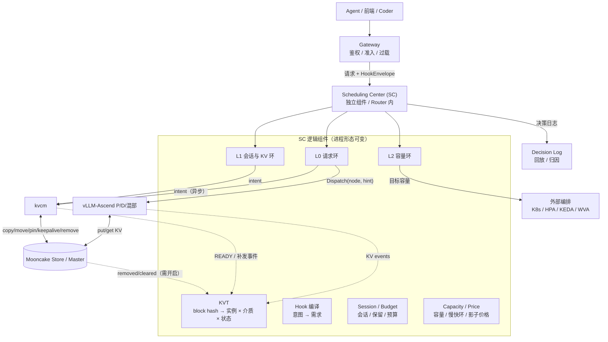
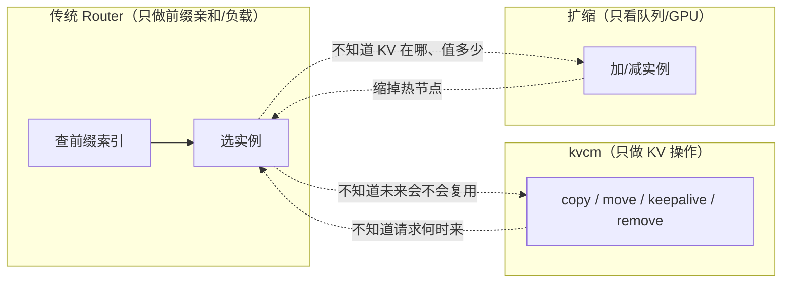
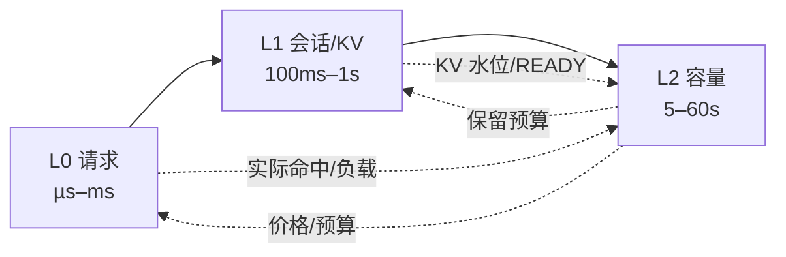
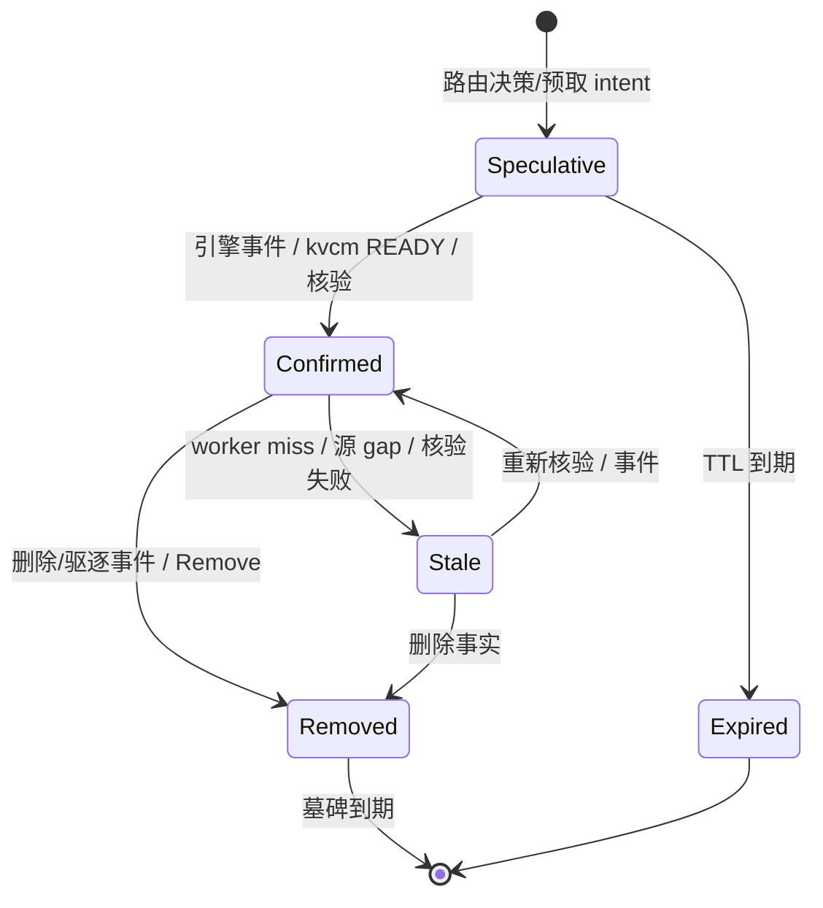
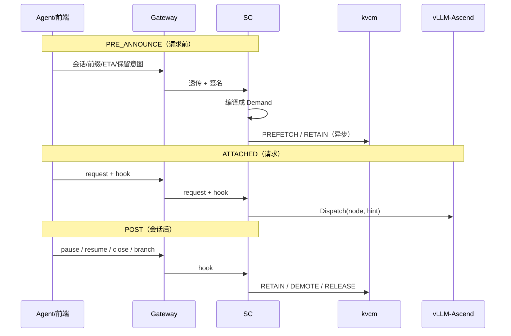
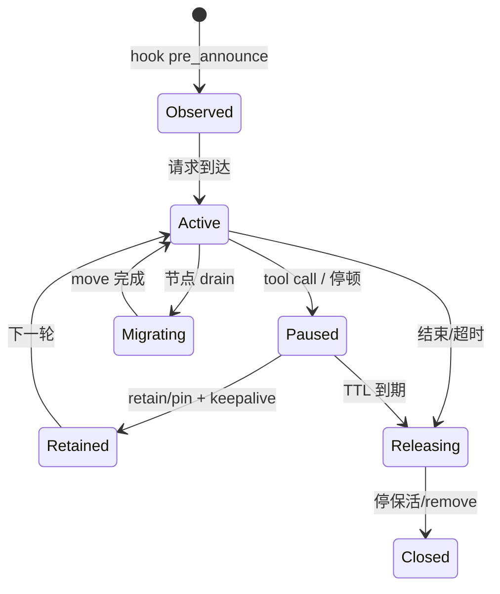
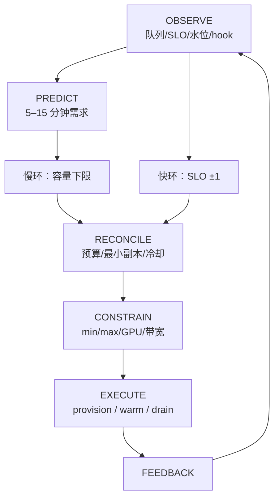

# D8: 管理面：统一调度中心——目标形态与性能模型

- 状态: **设计草案**（目标形态与收益模型；数值为模型估算，待真机校准）
- 版本基线: **Mooncake v0.3.13.post1**（master / client 同版本）；vLLM-Ascend 0.26 系（kvcm D1 的事实基线）
- 归属: **kvcm 的管理面（Management Plane）**——与**控制面**（KV 执行/核验/记账/发布）同属 kvcm 体系，职责不同。像 K8s 的 kube-controller-manager 与 kube-scheduler：两个进程，一套控制面体系。SC 是管理面的逻辑角色，**部署形态可选**（独立进程 / 嵌入 Router / 与控制面同进程），不影响归属
- 控制面/管理面: [D1](D1-router-scheduling.md) / [D2](D2-kv-operations.md) / [D9](D9-kv-services.md) 是**控制面**（KV 操作与服务）；本文是**管理面**（请求 × KV × 扩缩的调度）
- 时序: [D8b-scheduling-sequences.md](D8b-scheduling-sequences.md)（L0/L1/L2 的全部时序图与场景）
- 算法: [D8a-scheduling-algorithms.md](D8a-scheduling-algorithms.md)（公式、图、收益模型）
- 适用部署: **vLLM-Ascend + Mooncake Store + kvcm** 独立部署；SC 是 kvcm 管理面的请求/容量决策角色（实现语言不限）
- 关系声明: **kvcm 是独立项目，本文不依赖 lake 运行时**。lake 仓库只提供参考文档与原型经验；文中引用 lake 的地方都是“可借鉴”，不是依赖
- 非目标:
  - 不重新定义 kvcm 八项操作的语义（归 D2）；本文只定义“何时、对谁、花多少预算”发 intent
  - 不实现节点级 scheduler（continuous batching / block 分配归 vLLM Scheduler）
  - 不实现真实 provision（起 pod / 拉镜像 / 加载权重归外部编排）
  - 不做多租户计费/鉴权（归 gateway / 外部控制面）
  - 首版不做跨机房，只做单集群
  - 不写代码结构/接口 IDL；本文只保留目标形态、控制原理、收益模型

---

## 0. 结论

1. **终局是给 kvcm 补管理面（调度中心 SC）**，不是再加一个控制面进程。SC 可以是独立组件，也可以嵌入 Router。逻辑上是一个共享状态加三条时间尺度不同的决策环，把请求去哪、KV 怎么动、集群扩不扩放进同一套目标与预算。
2. **索引是事件派生的决策视图，不是第二权威**：引擎 KV events、kvcm READY、Mooncake publisher、SC 推测条目、worker miss 反馈，合成一棵 KVT；Mooncake master 仍是副本权威。
3. **最大的性能杠杆是“命中/保留”，不是 HBM 命中后的本地拷贝优化**：命中省掉的是秒级 prefill；本地放置省掉的是十毫秒级跨机传输；HBM 命中再省掉毫秒级本地拷贝。三者的量级差一个数量级以上，调度优先级必须按这个顺序设计。
4. **两个平面的分工**（同属 kvcm 体系）：**控制面**做“KV 执行 + 核验 + 记账 + 发布”，不做选路、不做扩缩、不持有前缀索引；**管理面**（本文）做选路、会话保留、KV 放置、扩缩。控制面为管理面提供执行接口；KV 对账、用量账本、容量建议、下线搬迁、保留规则等运营能力见 D9。
5. **设计必须按当前能力写，不能按 main 写**：soft pin 事后加有条件、hard pin 不能事后加、copy/move 无取消、retain 未实现、池 publisher 默认关。具体边界见 §9。

---

## 1. 目标形态

### 1.0 进程形态：管理面不等于控制面，也不一定是 Router

SC 是逻辑角色，进程形态三选一（也可以组合：请求环嵌 Router、容量环独立）：

| 形态 | 请求路径 | 状态归属 | 适用 |
|---|---|---|---|
| **嵌入 Router** | 无额外一跳 | Router 进程内 | 强延迟敏感、Router 已是唯一入口 |
| **独立组件** | 多一跳（可异步/缓存/批量） | SC 自己持有 KVT/会话缓存 | 多消费者、独立 HA/扩缩、请求环与容量环解耦 |
| **编排/控制面内置** | 不接在线请求（批量/离线） | 控制面持有 | 离线调度、容量规划、非交互场景 |

三种形态的**决策逻辑相同**；差别在“谁持有 KVT/会话状态、请求路径是否多一跳、HA/扩缩单元是谁”。本文用 SC 这个逻辑角色，不绑定进程；如果放 Router 里，它也只是管理面的部署形态，控制面仍在 kvcm。

### 1.1 一张图



四个角色：

| 角色 | 终局职责 | 不做什么 |
|---|---|---|
| **Scheduling Center (SC)<br/>kvcm 管理面** | KVT、hook 编译、L0/L1/L2、intent、决策日志 | 不直连 master、不读写 KV、不开机器；控制面仍在 kvcm |
| **kvcm 控制面** | KV 执行、READY 核验、补发事件、会话/保活/台账、KV 对账 | 不选路、不扩缩、不持有前缀索引；调度归管理面 |
| **vLLM-Ascend** | 执行、产生 KV events、本地 APC | 不做跨实例调度 |
| **Mooncake** | KV 数据/副本/lease/驱逐/offload | 不解释 token/hash |

### 1.2 终局的五个特征

1. **需求前置**：hook 在请求前给出会话、前缀、ETA、保留意图；SC 提前预取/保留/扩容，而不是等请求到了再反应。
2. **视图统一**：请求、KV 位置、会话、容量、价格在同一决策状态里；不是“路由看一套、KV 看一套、扩缩看一套”。
3. **决策分层**：L0 <5ms、L1 100ms–1s、L2 5–60s；三条环通过价格/预算耦合，不互相阻塞。
4. **KV 生命周期服务化**：会话保留、预热、KV 对账、用量账本、迁移是长期运行的服务，不是一次性脚本。
5. **弹性闭环**：扩缩不只看队列，还看 KV 价值、warm gate、会话风险；缩容不丢热 KV。
6. **负载整形**：热点前缀可以复制到多个实例、按负载/会话分流；副本数由收益/预算决定，不是“有缓存就只往一处发”。

### 1.3 终局能力清单

| 面 | 终局能力 | 关键输入 | 关键输出 |
|---|---|---|---|
| 请求 | 两模式选路（PD 分离/混部）+ HBM 命中利用；节点/队列 | KVT、负载、SLO、价格 | target + hint |
| KV | 预取、保留、热点多副本、迁移、释放、降层 | hook、会话、KVT、负载、预算 | intent（异步） |
| 扩缩 | 计算池 + KV 池；扩容 warm gate；缩容 KV-aware victim | 需求预测、SLO、水位、KV 价值 | 目标容量/期望状态 |
| 观测 | 命中归因、预热 ROI、决策回放 | KVT、intent、READY、请求结果 | 指标/账本/策略版本 |

### 1.4 现状与终局的差距

终局形态可以现在设计，但**落地要按当前能力写**。差距分三类：

| 差距 | 具体是什么 | 影响 |
|---|---|---|
| **intent 只覆盖预热** | gRPC 通道只有 `SubmitIntent`（前缀 × 目标实例），没有 move/remove/pin 的意图类型 | L1 的预取/保留能接；其他操作要等协议扩展 |
| **删除面没有原生事件** | 池 publisher 默认关、copy 路径零发布 | 删除只能靠 TTL/miss/抽样核验；KV 对账是 P0 |
| **跨引擎存活不完整** | retain 未实现 | 会话跨实例存亡只能靠 move 到活 seg 或自挂 SSD |
| **实例拓扑靠启动参数** | E13 未接 | 端点/seg 映射要手工配；多实例场景不可用 |
| **没有带宽感知** | E15 未做 | 预取/迁移与在线流量抢带宽，只能靠固定预算 |

能力事实见 [D2](D2-kv-operations.md)，实现状态见 [summary.md](../summary.md)。

> 原则：**不能把 main/0.3.14 的能力当成已具备**。写设计时按 v0.3.13.post1 的实际边界写。

### 1.5 明确不做

- 不做“全局在线优化器”：请求路径算不动，也会把扩缩抖动带进 TTFT。
- 不让 SC 直读 Mooncake master：SC 会变成池感知组件，且每请求多一跳；kvcm D1 §2 已排除。
- 不让 kvcm 持有前缀索引：索引是在线服务，kvcm 是后台控制面（D1 §4）。
- 不做固定降级链：失败按最新状态重跑。
- 不做“无限 pin/无限预取”：没有预算的保留等于没有策略。

---

## 2. 为什么必须联合

### 2.1 三个决策互相抵消



典型互相抵消：

- 传统 Router 把请求发到 A，kvcm 把 KV 预取到 B——预取白做；
- 扩缩把持有热前缀的节点缩掉——命中率下降，再扩回来；
- hook 说“30 秒后还要用”，但没人把它变成预取/保留/不缩容；
- kvcm READY 只写日志，没回写索引——下一次还是不知道 B 有了。

### 2.2 时间尺度差三个数量级



把三者塞进一个在线优化器会有三个问题：

- 算不动：候选节点 × 前缀块 × KV 动作 × 扩缩组合；
- 抖动传导：扩缩慢决策让请求路径抖动；
- 不可解释：出错无法判断是索引错、打分错还是扩缩错。

### 2.3 用“价格”做耦合

L2 根据全局需求算容量/带宽/预取的**影子价格**；L0/L1 在价格下做局部最优。价格是三条环之间唯一的耦合信号：

```text
λ_gpu      每 GPU 秒的边际成本
λ_hbm      每 GB HBM/DRAM 占用的边际成本
λ_bw       每 GB 传输的边际成本
λ_prewarm  预取预算的边际成本
λ_slo      SLO 违约的边际成本
```

这样既“联合”，又保持每层可解释、可回滚、可单独限流。

---

## 3. 统一决策状态

### 3.1 KVT：KV 索引树

SOTA 的索引（llm-d `pkg/kvcache`、Dynamo `lib/kv-router`、AIBrix `pkg/kvevent`）做法一致：订阅引擎事件，维护「块 → pod + 介质」的映射，用来打分选路。**链式 block hash、逐块匹配、推测条目补空窗、介质分权重——这些是标准做法**，算法细节见 [D8a §2](D8a-scheduling-algorithms.md)，本文不重复。

我们的差异在两条：

1. **不做派生副本**。SOTA 的索引是引擎事件的重放结果，丢事件要 gap replay、过期要 TTL 补；丢了就与真相不一致。我们的位置信息以**池权威**（Mooncake master）为准，需要时问一次，不做长期副本。
2. **精度到字节位置**。SOTA 只到「哪个 pod 有这块、哪层介质」，不含哪个 seg、哪个 rank、生命周期——够选路，不够驱动放置。我们的视图要驱动 copy/move 的目标选择，所以必须知道目标段。

KVT 是这个视图的缓存层，允许陈旧：

- 权威：Mooncake master 记副本；引擎记 HBM/APC；kvcm 记操作与核验
- 陈旧只损性能，不损正确性（读路径远端读/重算兜底）

#### 介质分层

| 层 | 含义 | 事件来源 | 对调度的意义 |
|---|---|---|---|
| **HBM** | 实例 APC/显存里的块 | 引擎 `BlockStored(medium=GPU)` | 真本地命中；HBM 命中的唯一依据 |
| **本机 DRAM** | 本机 Mooncake seg | 引擎 `BlockStored(medium=CPU)` / kvcm READY | 本地读，省跨机传输；仍要拷进 HBM |
| **远端 DRAM/SSD/DFS** | 池内其他节点/介质 | 池事件、kvcm 核验 | Pool 命中，省重算但要传输 |

**关键区分**：kvcm 预取到目标 seg，得到的是「本机 DRAM」，不是 HBM。它让请求走本地读，避免跨机 RDMA；但第一次使用仍要把 KV 从 DRAM 拷进 HBM。**要认定 HBM 命中，需要 HBM 证据**（引擎 GPU 事件，或方案 A 壳请求把 KV 带进 HBM）。这个区分决定了性能收益的量级（见 §7）。

#### 状态与置信度



`Speculative` 只做亲和排序，`Confirmed` 才可作为可路由依据。删除/失效带墓碑，防延迟到达的 `Stored` 复活。合并规则（多源序号、墓碑、信任级）见 [D8a §2.3](D8a-scheduling-algorithms.md)。

### 3.2 Session / Demand

会话状态回答四个问题：

- 这个会话上一轮在哪个实例、前缀到哪；
- 下一轮大概什么时候来、还会不会来；
- 前缀值不值得保留、保留多久；
- 已经花了多少预取/保留预算。

**权威在 kvcm ledger 的 sessions 表**（kvcm D2 的“不可丢”状态），SC 持缓存；SC 重启后回读，不丢会话。

### 3.3 Capacity / Price

容量视图包括：

- 实例：角色、队列、in-flight、prefill/decode 速率、HBM/DRAM 余量、NIC 利用率；
- 池：DRAM/SSD/DFS 水位、驱逐率、promote 速率、shard 环；
- 预算：GPU/节点上限、后台带宽上限、pin 字节上限。

价格是这些约束的“影子”：

```text
λ_{t+1} = clip(λ_t + η × (u_t − u*), 0, λ_max)     （对偶上升）
λ = λ_base × (u / u*)^k                             （工程比例式）
```

`u` 是利用率/水位，`u*` 是目标。L0/L1 只读价格；L2 单点更新。

### 3.4 网卡是决策输入，不只是背景指标

前面 §3.3 把 NIC 利用率列为容量视图的一项，但只当观测指标。它应该进决策，理由来自 KV 加载的物理事实。

#### 两类带宽，要分开算

参考 DualPath（arXiv:2602.21548v2）：节点上有两类物理隔离的网络。

| | 用途 | 带宽量级 | 流量形态 |
|---|---|---|---|
| **compute network**（东西向） | GPU 间集合通信、KV 跨实例传输 | 大（如 8×400Gbps） | 间歇性突发（集合操作亚毫秒级 burst），有大量空隙 |
| **storage network**（南北向） | 访问存储、checkpoint、落盘 KV | 小（如每节点 400Gbps） | 持续，容易被打满 |

**关键观察**：两类带宽的瓶颈位置不同。agentic 多轮高命中率时，prefill 侧 storage NIC 被打满，而 compute NIC 有间隙、decode 侧的 storage NIC 闲置。DualPath 的贡献就是把 KV 从「prefill 自己的 storage NIC 加载」改成「借 decode 闲置的 storage NIC 加载，再走 compute NIC 回传 prefill」。

对我们的意义：**调度不能只看「带宽还剩多少」一个数，要看是哪类网络的带宽**。

#### 三处用法

| 用在哪 | 现在 | 应该 |
|---|---|---|
| **L0 选路打分** | `w_bw × (B/BW_eff) × c_bw`，`BW_eff` 只能估 | 读实测，且区分这次要走哪类网络 |
| **L1 预取时机** | 按 `EV/bytes` 排序，不知道现在传不传得动 | 目标网络忙时推迟，避免和在线流量抢 |
| **L2 扩容判断** | 只看池水位 | 带宽满但池空 → 该加网络或改放置，不是加节点 |

第三行是最容易做错的：**带宽满和容量满的处置完全不同**。

#### 和「能否掩盖」的关系

§1.1（D8a）要算 `residual_crit = T_transfer × v_prefill`，判断这次跨机访问会不会拖垮 batch。`T_transfer` 里的带宽必须是**当前可用带宽**：

```text
BW_eff = 链路理论带宽 × (1 − 当前利用率)
```

估的带宽会让判据失效：估高了以为能掩盖，实际不能。这也说明网卡采样的价值不在「监控」，在**让调度判断准**。

#### 代价与边界

- 采样频率与精度要权衡：太粗看不出突发，太细本身成为开销
- compute network 的「空隙」难以精确测量（亚毫秒级 burst），只能估趋势
- 跨机迁移的带宽预算和在线流量共享，必须设上限（后台 <10%）

---

## 4. Hook：把意图变成需求

### 4.1 三个时序



### 4.2 信封（概念字段）

| 字段 | 作用 | 约束 |
|---|---|---|
| `version` / `hook_id` | 兼容/幂等 | 未知版本降级为 observe |
| `session_id` / `workflow_id` / `step` / `branch` | 会话/分支定位 | 与路由键对齐 |
| `prefix`（token_ids 或 hash 链） | 要预取/保留的前缀 | 优先 hash；必须与引擎口径一致 |
| `timing` / `eta_ms` / `expected_turns` / `reuse_prob` | 请求前/中/后；预计到达 | ETA 决定提前量 |
| `retention` / `ttl_ms` / `prefetch` | 保留等级与生命周期 | TTL/pin 上限可裁剪 |
| `affinity`（node/zone/strict） | 会话亲和 | strict 也不能违反容量/SLO |
| `deadline` / `priority` | SLO/优先级 | 优先级只影响排队，不做准入 |
| `budget` | 预取/保留/字节上限 | 超预算裁剪或拒绝 |
| `signature` | 网关签名 | 匿名来源只能 observe |

### 4.3 语义

- **hint ≠ command**：SC/kvcm 可裁剪、推迟、拒绝；请求正确性不依赖 hook。
- **fail-open**：解析失败/版本不认识/预算超限 → 丢弃 + metric，不影响请求。
- **预算与审计**：每 session/租户有 pin/预取/带宽上限；hook 可审计。
- **key 口径**：vLLM-Ascend 是链式 block hash（`parent_hash`、block_size、模型类型、初始种子参与），TP 下同一逻辑块多把 key。SC 必须用与引擎逐字节一致的 hash 算法；hook 优先带 hash/token_ids，不要用估算 token 数。
- **不等待**：pre_announce 只影响未来；attached 请求走当前最优路径，不等 READY。

---

## 5. 三条决策环

### 5.1 L0 请求环（<5ms）

分支流程（HBM 命中 / PD / 混部）见 [D8b §2](D8b-scheduling-sequences.md)；打分、TTFT 估算、传 vs 算阈值（`BW*`）的公式见 [D8a §3](D8a-scheduling-algorithms.md)。

约束：

- HBM 命中判定仅当连续 HBM confirmed 命中 ≥ 阈值（通常整段，末 token 可能重算）；
- PD 仅当角色/拓扑允许、残差 prefill 足够大；
- 不拒绝请求；优先级只影响排队；
- 选择后写 Speculative，异步 intent 不阻塞。

**重要**：kvcm READY 是“本机 DRAM 副本就绪”，不是“HBM 命中”。L0 不能因为 kvcm READY 就认定 HBM 命中；HBM 命中要有 HBM 事件或方案 A 壳请求的证据。

### 5.2 L1 会话与 KV 环（100ms–1s）

> **会话 KV / 预热是本节的管理面动作**：D8 决定保不保、预取到哪；控制面 D9 只提供 copy/keepalive/pin/verify 等执行接口，不再把这些当成“调度之外的第二套能力”。



动作：

| 动作 | 触发 | 机制 | 预算 |
|---|---|---|---|
| keepalive | 会话活跃/保留 | 周期续租（有界） | lease TTL 的 1/3 左右 |
| prefetch | hook/预测 | copy 到目标 seg | 后台带宽 <10%；按 EV/bytes |
| retain | 停顿/长会话 | soft pin（条件可用）或 lease 延长 | TTL/字节上限 |
| promote | 只剩盘副本且预期复用 | 池 promotion 或读删写 | 触发式，非确定 |
| demote | 冷/水位高 | 停保活 + 等驱逐/落盘 | 写回模式时机不可控 |
| release | 会话结束 | 停 keepalive；确认没人用才 Remove | 默认软释放 |
| move | drain/迁移 | 指定源→目标 | 源在线；无取消 |

预取的价值（`P_use`、`EV`）、保留的盈亏平衡（`Net(T)`）与预算约束，见 [D8a §4–§5](D8a-scheduling-algorithms.md)。

### 5.3 L2 容量环（5–60s）



容量公式（`ρ`、`c_min`、Little 定律）见 [D8a §6.1](D8a-scheduling-algorithms.md)。

扩缩维度：计算池（P/D/混部）、KV 池（shard/节点）、模型 revision。按瓶颈选择：

| 信号 | 优先 |
|---|---|
| P 队列长 / TTFT 高 / prefill 满 | P 池 |
| D ITL 高 / decode 满 | D 池 |
| 池 DRAM 水位高 / 驱逐高 | KV 池 |
| 带宽满 / 传输排队 | 更多本地副本或网络 |
| 本地命中低但池命中高 | 先预取，不扩 |

扩容 warm gate（`coverage`、`route_weight`）见 [D8a §6.3](D8a-scheduling-algorithms.md)。新实例先 `warming`，不接或低权重接流量；warm 可与权重加载重叠。`T_ready = provision + gate + warm` 必须满足 <10s 目标。

缩容 victim（`loss(v)` / `gain(v)`）见 [D8a §6.4](D8a-scheduling-algorithms.md)。不要 LIFO；有活跃会话/唯一热 KV 的节点优先保留；drain 卡住不硬删。

### 5.4 三条环的协调

- **冷却**：冷却时间 ≥ 供给+预热+排水之和，防扩缩振荡（D8a §6.2 有公式）。
- **滞回**：扩容阈值 > 缩容阈值；连续 N 周期才动作。
- **优先级**：L0 永远不被 L1/L2 阻塞；L1 intent 异步；L2 只发目标容量。
- **价格**：L2 单点更新；L0/L1 只读；多 SC 实例时 L2 走 leader。

---

## 6. 联合闭环场景

五个关键场景的完整时序图在 [D8b-scheduling-sequences.md](D8b-scheduling-sequences.md)：

| 场景 | 说明 |
|---|---|
| 6.1 Agent 多轮 | 预取 → 本地读 → 可选 HBM → 保留 → 恢复 |
| 6.2 扩容 | warm gate：新实例预热达标才加权接流 |
| 6.3 缩容 | KV-aware victim：不缩热节点/活跃会话 |
| 6.4 池压 | 降层/扩池：先 demote 冷的，持续不够才扩 |
| 6.5 Ghost | miss 反馈：最便宜的反熵，降级该条不动全局 |

三条要点（图里都有，这里只提最容易记错的）：

1. **kvcm READY 是"本机 DRAM 就绪"，不是"HBM 命中"**。第一次请求仍要把 KV 从 DRAM 读进 HBM；它省的是跨机 RDMA。
2. **预取赶不上不影响正确性**。请求照常走远端读，下次受益。
3. **缩容不硬删**。drain 卡住保留 draining 下周期重试；有活跃会话或有唯一热 KV 的节点优先保留。

---

## 7. 收益从哪来

这一节只回答一个问题：**为什么调度优先级是"命中 > 本地放置 > HBM 命中"**。公式、量化示例、收益指标、算法清单都在 [D8a](D8a-scheduling-algorithms.md)。

### 7.1 四个量级的对比

按 GLM-5.2 口径（93 KB/token）：

| 层级 | 代价 | 128K prompt | 1M prompt |
|---|---|---:|---:|
| 无命中（重算） | `T_prefill` | 21.7 s | 169.5 s |
| 远端池命中 | `T_transfer` | 454 ms | 3548 ms |
| 本机 DRAM 命中 | `T_local` | 114 ms | 887 ms |
| HBM 命中 | ≈0 | — | — |

**秒级 → 百毫秒级 → 十毫秒级**，差两个数量级。所以命中/保留是最大杠杆，本地放置次之。

### 7.2 三条容易记错的结论

1. **预取的真正价值在「防 miss」，不是「搬家」**。只把远端命中变本机命中，省的是 `T_transfer − T_local`；防止一次驱逐/重算，省的是 `T_prefill`。所以预取要和保留一起做。

2. **但命中率高到一定程度，「搬家」就变成主项**。传输能否被计算掩盖，只取决于命中率（§8.1 推导）：

   ```text
   掩盖条件：(1 − hit) > v_prefill × bytes_per_token / BW
   ```

   代入 GLM-5.2：跨机要 hit < 97.9%，本机 DRAM 要 hit < 99.46%。**超过这个线，跨机传输是纯加项**，且会拖慢整个 batch。

3. **保留要用盈亏平衡定 TTL，不能无限 pin**。保留收益随恢复概率指数衰减，占用成本线性增长，一定有一个最优 TTL。用错 TTL 两边都亏：短了白丢，长了占着内存不还。

长上下文的 KV 有多大、各命中率下的具体代价，见 [D8a §8.1](D8a-scheduling-algorithms.md)。

### 7.3 什么时候不赚

| 场景 | 为什么不赚 | 策略 |
|---|---|---|
| prompt 很短 | prefill 小，传输/队列占比高 | 少预取，优先队列 |
| 复用率低 | 保留/预取浪费内存带宽 | 短 TTL；按 EV/bytes 准入 |
| 带宽已满 | 预取与请求争带宽 | 后台预算 <10%；避让/限速 |
| HBM 压力大 | pin 太多挤掉其他前缀 | pin 预算；soft 优先 |
| hook 不准 | 预取到错实例/前缀 | 置信度、ETA 过期、只 observe |
| 扩容急 | warm gate 延迟接流量 | 老节点先接；warm 后台 |

收益指标、吞吐/成本换算、算法与技术清单见 [D8a §8](D8a-scheduling-algorithms.md)。

---

## 8. 一致性与失效

- KVT 陈旧只损性能；读路径兜底（远端读/重算）。
- 删除面：0.3.13.post1 的 publisher 需构建+运行开启；默认无删除事件，用 TTL + miss + 抽样核验。
- 源 gap：replay → snapshot → stale；stale 不当作 HBM 命中。
- kvcm 挂：intent 失败/排队，路由不受影响；ledger 持久化，恢复后继续。
- 编排挂：不扩缩，告警；已发决策幂等重试。
- 多 SC 实例：KVT 各一份；会话粘性；L2 leader；intent 幂等。
- 失败不写固定降级链；按最新状态重跑。

---

## 9. 能力前提

D8 的每一条设计都依赖具体能力。**这些能力的事实写在各处，不在本文重复**：

| 要知道什么 | 去哪看 |
|---|---|
| Mooncake 每个操作有没有 RPC、什么前提、版本差异 | [D2](D2-kv-operations.md)（soft pin 的 Case B 边界在 §2，retain 在 §4，demote/promote 在 §3） |
| 事件、放置权威、lease、复制的池层事实 | [D1](D1-router-scheduling.md)（F1 放置权威 / F7 事件 schema / F9–F10 盲区 / F14 池 publisher） |
| kvcm 自己哪些实现了、哪些还没 | [summary.md](../summary.md)（E 编号的工程项状态） |

几条最容易记错、直接影响 D8 边界的前提：

1. **soft pin 事后加是有条件的**（Case B：同尺寸、单 slice、key 存在、无盘副本）。不满足就退回 keepalive + lease。硬钉不能事后加。
2. **retain 没有实现**。跨引擎存活目前只能靠 move 到活着的 seg，或 kvcm 自挂 SSD。
3. **copy/move 不能取消**。预取改道只能 abandon + 事后清理副本。
4. **池 publisher 默认关闭**（构建 OFF、运行 false），且 copy 路径零发布。删除面要么显式开启，要么靠 TTL/miss/抽样核验。
5. **vLLM-Ascend 的 key 是链式 block hash，TP 下同一逻辑块多把 key**。SC 必须用与引擎逐字节一致的算法，不能用估算 token 数。

---

## 10. 实施节奏（目标形态分阶段）

| 阶段 | 目标 | 验收 |
|---|---|---|
| **P0 观测与索引** | 引擎事件 + kvcm READY + miss 反馈接入 KVT；hook 只 observe；L0 用 KVT 选路；决策日志 | KVT 合并/墓碑/置信度；L0 <5ms；不改变现有行为 |
| **P1 命中与保留** | 会话表；keepalive/soft pin（条件可用）；预取预算；KV 对账抽样；用量账本归因 | 命中率、resume TTFT、预取 ROI、ghost 率 |
| **P2 容量与弹性** | L2 双环；warm gate；KV-aware victim；池扩缩；价格 | 扩容 Ready <10s 且 warm 达标；缩容零丢失；无振荡 |
| **P3 服务化** | 会话 KV、预热服务、容量顾问、Drain、治理、回放 | 服务 SLA；ROI；容量预测误差；回放一致 |

原则：**先把“命中/保留”做对，再优化“本地放置”，最后才做 HBM 命中微优化**。这与 §7 的收益量级一致。

---

## 11. 开放问题

1. **publisher 是否开启**：0.3.13.post1 默认 OFF；生产构建/运行是否开？不开则删除面靠 TTL/miss/核验。
2. **实例注册与端点**：E13 未接；生产怎么分配/回收端点？kind 为空时是否接受“不补发”？
3. **soft pin 前置**：生产能否保证 Case B（单 slice、无盘副本、key 存在）？不能则退回 keepalive。
4. **retain**：move 到活 seg / kvcm 自挂 SSD 是否足够？是否等 0.3.14/main 的 retained client/DFS？
5. **E15 带宽限速**：预取/迁移与在线流量怎么隔离？是否需要网卡采样？
6. **多 SC 实例 leader**：etcd 还是复用现有控制面？leader 故障时扩缩暂停容忍多久？
7. **权重/阈值**：`w_*`/`λ_*`、warm gate、TTL 需真机校准。
8. **layerwise**：vLLM-Ascend layerwise 读路径改变传输成本；D6 未定，L0 成本模型要留接口。
9. **hook 标准**：agent 框架怎么发？header/body/独立端点？谁签名？
10. **安全**：hook 伪造、pin 滥用、跨模型误删的防护边界。

---

## 12. 参考实现

> 说明：三环 + 影子价格的整体组合没有一一对应的参考实现；下面按部件列锚点。**kvcm 独立于 lake**，lake 仅作参考文档。

| 参考 | 锚点 | 借了什么 | 关键差异 |
|---|---|---|---|
| **kvcm D1/D2** | `kvcm/design/D1-router-scheduling.md` §2/§4；`kvcm/design/D2-kv-operations.md` §1/§4 | intent ≠ command、READY、补发事件、单向边界、八操作/状态四类 | 本文补 hook/KVT/L2；不改变 kvcm actuator 定位 |
| **Dynamo** | `lib/kv-router/src/protocols.rs::WorkerSelectionResult`；`components/src/dynamo/planner/core/load_scaling.py::LoadScalingMixin`；`lib/kv-router/src/services/indexer/listener.rs::handle_gap` | overlap 作为一等输入；慢/快双环；gap + replay | Dynamo 索引是事件派生副本；本文用多源 + 墓碑 + 置信度 |
| **llm-d** | `pkg/kvcache/prefix_match.go::SpeculativeTier`；`.../preciseprefixcache/prerequest.go::defaultSpeculativeTTL`；`pkg/epp/scheduling/scheduler.go::Scheduler.Schedule` | 推测索引补窗口；scorer 插件化 | 推测只做亲和，不当作 HBM 命中；不依赖“逼近引擎真相” |
| **AIBrix** | `pkg/kvevent/manager.go::Manager`；`pkg/controller/podautoscaler/context/context.go`（`gpu_cache_usage_perc`） | ZMQ 事件→前缀索引；KV 使用率/排队长度扩缩 | AIBrix 各副本各自收敛；本文 KVT 单实例内合并 + L2 leader |
| **SGLang** | `sgl-model-gateway/src/policies/cache_aware.rs::CacheAwarePolicy`；`policies/tree.rs::Tree`；`srt/managers/kv_hints.py::KvHintsEnvelope`；`unified_cache/session_ref_tracker.py::UnifiedSessionRefTracker` | 近似树 + 最短队列；带版本 hint；session 软保护 | 目标部署用 vLLM-Ascend；session 保留落 kvcm，不落引擎 |
| **vLLM** | `vllm/v1/kv_hints/protocol.py::KvHintsEnvelope`；`vllm/v1/core/sched/scheduler.py::Scheduler` | hint 动词表；节点级 scheduler 分层 | hint 在本文被编译成 Demand；仍 hint ≠ command |
| **Mooncake** | `master_service.cpp::CopyStart`、`BatchEvict`、`CreateDrainJob`、`GetReplicaListForAdmin`；`KvEventPublisher` | copy 幂等、lease/驱逐、drain、零副作用核验、池事件 | SC 不碰 PoolKey/seg；全部经 kvcm intent |
| **KVCR** | `src/kvcr/remote_fw_dram.py::fetch` / `query` / `_try_release_pin` | 目的地发起 fetch、传输窗口 pin | kvcm 集中式 + master 权威；不需要 fencing |
| **TensorCast** | `tensorcast/api/_config.py::StorePolicyProfile` | 声明式 policy 预设 | 仅借用 retention class 命名，不照搬存储后端 |
| **DualPath**（arXiv:2602.21548v2） | 双网络隔离（compute NIC / storage NIC）；storage-to-decode + CNIC 回传 prefill；global scheduler 均衡 | 「高命中率下 KV 加载 I/O 成为瓶颈」的问题定义；两类带宽分开算 | DualPath 从引擎视角「借用」对端闲置带宽；我们的带宽归池统一分配。分析见 [`docs/research/dualpath.md`](../../docs/research/dualpath.md) |

关键差异：

- 参考实现的索引多是大规模事件派生、最终一致；本文承认这一点，用 **墓碑 + 置信度 + miss 反馈 + 抽样核验** 把“不精确”控制在性能层。
- 参考实现的扩缩多在独立组件；本文把决策放进 SC 的共享状态，但**执行仍分离**（kvcm 执行 KV，编排执行 provision）。
- 参考实现的 hint/session 多在引擎内；本文把 session/retention 放到 kvcm，worker 保持无状态。
- vLLM-Ascend 的 TP/DP per-rank key、Mooncake 的 key 不透明性，决定了“索引必须按逻辑块去重、SC 不能碰 PoolKey”——这是与通用 vLLM router 最大的工程差异。

---
