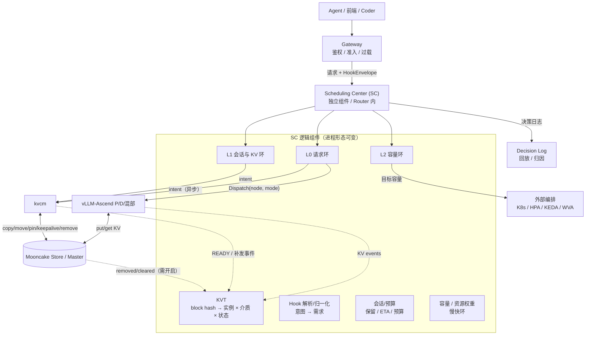
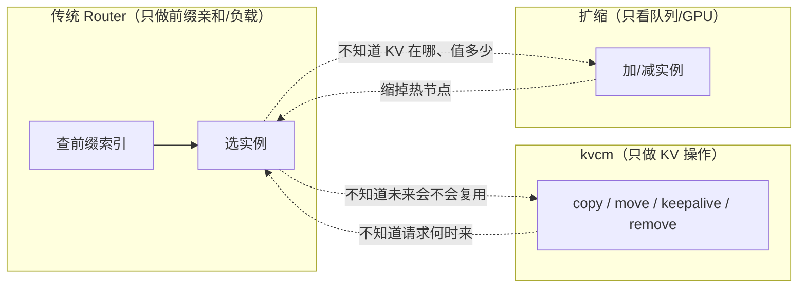
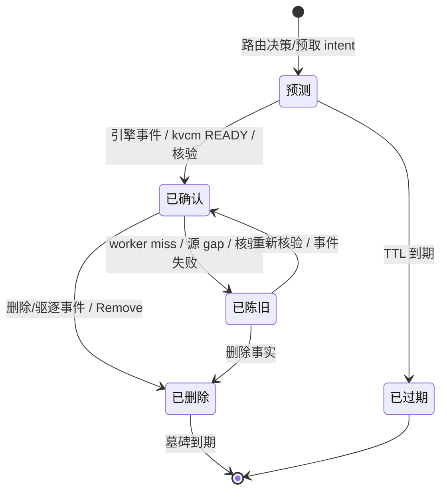
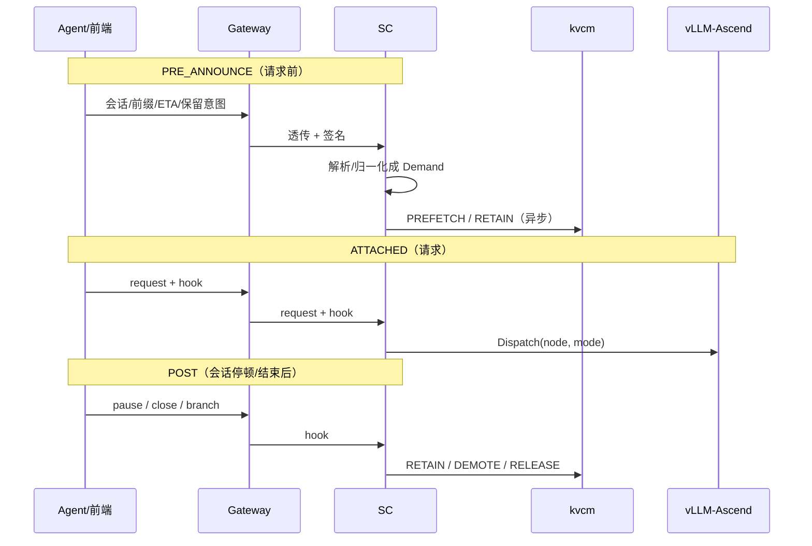
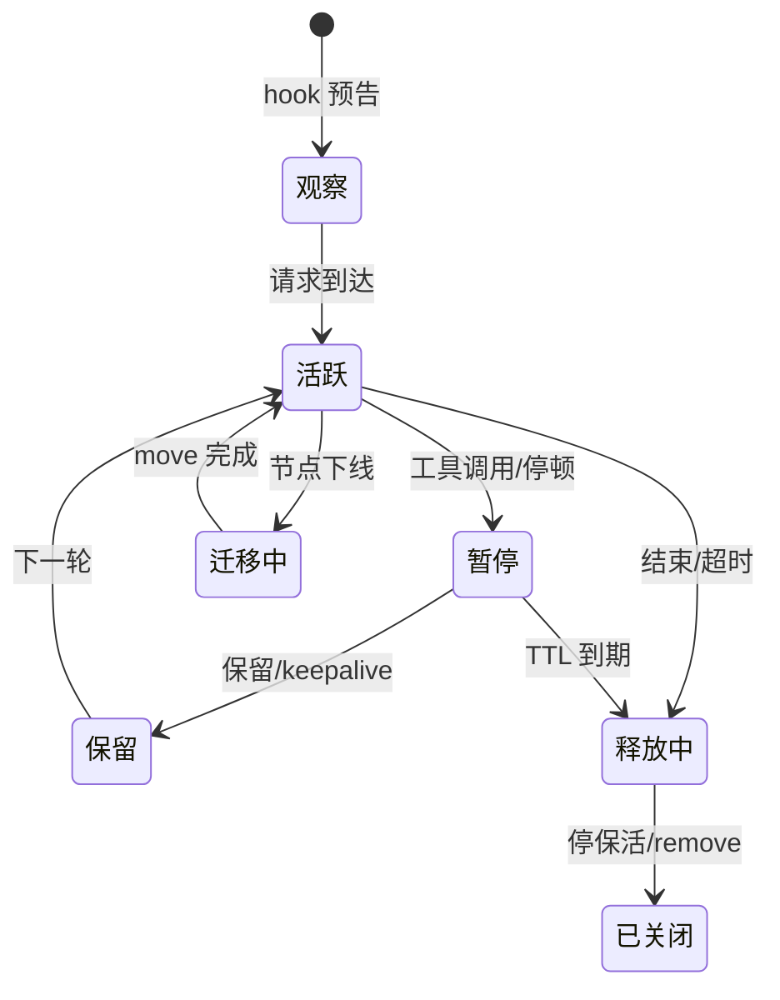
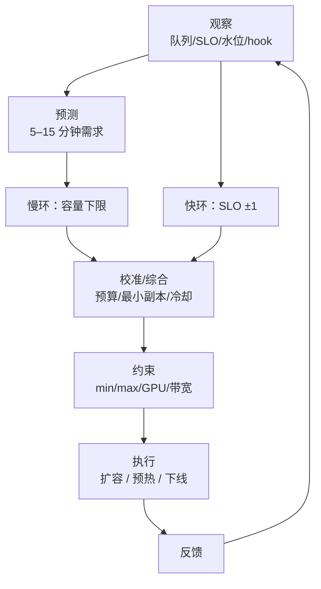

# D8: 管理面：统一调度中心——目标形态与性能模型

- 状态: **设计草案**（目标形态与收益模型；数值为模型估算，待真机校准）
- 版本基线: **Mooncake v0.3.13.post1**（master / client 同版本）；vLLM-Ascend 0.26 系（kvcm D1 的事实基线）
- 归属: **kvcm 的管理面（Management Plane）**——与**控制面**（KV 执行/核验/记账/发布）同属 kvcm 体系，职责不同。像 K8s 的 kube-controller-manager 与 kube-scheduler：两个进程，一套控制面体系。SC 是管理面的逻辑角色，**调度形态可选**（独立进程 / 嵌入 Router），不影响归属；与控制面同进程只适合离线容量规划，不接在线请求
- 控制面/管理面: [D1](D1-router-scheduling.md) / [D2](D2-kv-operations.md) / [D9](D9-kv-services.md) 是**控制面**（KV 操作与服务）；本文是**管理面**（请求 × KV × 扩缩的调度）
- 时序: [D8b-scheduling-sequences.md](D8b-scheduling-sequences.md)（L0/L1/L2 的全部时序图与场景）
- 算法: [D8a-scheduling-algorithms.md](D8a-scheduling-algorithms.md)（公式、图、收益模型）
- 适用部署: **vLLM-Ascend + Mooncake Store + kvcm** 独立部署；SC 是 kvcm 管理面的请求/容量决策角色（实现语言不限）
- 关系声明: **kvcm 是独立项目，本文不依赖 lake 运行时**。lake 仓库只提供参考文档与原型经验；文中引用 lake 的地方都是“可借鉴”，不是依赖
- 非目标:
  - 不重新定义 kvcm 八项操作的语义（归 D2）；本文只定义“何时、对谁、花多少预算”发 intent
  - 不实现节点级 scheduler（continuous batching / block 分配归 vLLM Scheduler）
  - 不实现真实 provision（起 pod / 拉镜像 / 加载权重归外部编排）
  - 不做多租户计费/鉴权（归 gateway / 外部控制面）
  - 首版不做跨机房，只做单集群
  - 不写代码结构/接口 IDL；本文只保留目标形态、控制原理、收益模型

---

## 0. 结论

1. **终局是给 kvcm 补管理面（调度中心 SC）**，不是再加一个控制面进程。SC 可以是独立组件，也可以嵌入 Router。逻辑上是一个共享状态加三条时间尺度不同的决策环，把请求去哪、KV 怎么动、集群扩不扩放进同一套目标与预算。
2. **索引是事件派生的决策视图，不是第二权威**：引擎 KV events、kvcm READY、Mooncake publisher、SC 预测条目、worker miss 反馈，合成一棵 KVT；Mooncake master 仍是副本权威。
3. **最大的性能杠杆是“命中/保留”，不是 HBM 命中后的本地拷贝优化**：命中省掉的是秒级 prefill；本地放置省掉的是跨机传输（DeepSeek V3.2，83.9KiB/token）：512K 在单机 UB_CTP 47GB/s 下约 0.96s、POD 93GB/s 下约 0.48s；跨机按 A3 ROCE 23.8GB/s 参考约 1.89s（950 跨机待测）。1M 约 1.92s / 0.97s，跨机参考约 3.78s。HBM 命中再省掉本地 DRAM→HBM 拷贝（同量级）。具体数值按拓扑实测，不能写死“十毫秒级”。
4. **两个平面的分工**（同属 kvcm 体系）：**控制面**做“KV 执行 + 核验 + 记账 + 发布”，不做选路、不做扩缩、不持有前缀索引；**管理面**（本文）做选路、会话保留、KV 放置、扩缩。控制面为管理面提供执行接口；KV 对账、用量账本、容量建议、下线搬迁、保留规则等运营能力见 D9。
5. **设计要区分“当前现状”和“目标形态”**：soft pin 事后加有条件、hard pin 不能事后加、copy/move 无取消、retain 未实现；池 publisher **当前默认关，但生产设计按开启规划，关闭只是降级路径**。具体边界见 §9。

### 0.1 两个核心差异

这套设计不是“再加一个 KV-aware router”，差异只有两条：

1. **hook 驱动的主动 KV 生命周期**：Agent 在请求前给会话/前缀/ETA/停顿/budget，SC 提前预取、保留、扩缩；不是等请求到了再反应。入口在 §4，时序在 [D8b](D8b-scheduling-sequences.md)。
2. **请求 + KV + 容量的联合控制**：L0 选路、L1 KV 动作、L2 扩缩共享 KVT、预算和账本；不是三个独立组件各算各的。三环见 §5，收益见 [D8a](D8a-scheduling-algorithms.md)。

支撑这两条的是**池 master 权威 + KVT 派生视图**；其余能力（对账、账本、容量建议、迁移）是支撑，不是差异本身。

---

## 1. 目标形态

### 1.0 进程形态：管理面不等于控制面，也不一定是 Router

SC 是逻辑角色，调度形态二选一（也可以组合：请求环嵌 Router、容量环独立）：

| 形态 | 请求路径 | 状态归属 | 适用 |
|---|---|---|---|
| **嵌入 Router** | 无额外一跳 | Router 进程内 | 强延迟敏感、Router 已是唯一入口 |
| **独立组件** | 多一跳（可异步/缓存/批量） | SC 自己持有 KVT/会话缓存 | 多消费者、独立 HA/扩缩、请求环与容量环解耦 |

这两种是调度形态：**管理面必须看得到在线请求**，否则无法提升 APC/HBM 命中率。离线/控制面内置只能做容量规划，不能做请求调度。两种形态的决策逻辑相同，差别在“谁持有 KVT/会话状态、请求路径是否多一跳、HA/扩缩单元是谁”。

### 1.1 一张图



四个角色：

| 角色 | 终局职责 | 不做什么 |
|---|---|---|
| **Scheduling Center (SC)<br/>kvcm 管理面** | KVT、hook 解析/归一化、L0/L1/L2、intent、决策日志 | 不直连 master、不读写 KV、不开机器；控制面仍在 kvcm |
| **kvcm 控制面** | KV 执行、READY 核验、补发事件、会话/保活/台账、KV 对账 | 不选路、不扩缩、不持有前缀索引；调度归管理面 |
| **vLLM-Ascend** | 执行、产生 KV events、本地 APC | 不做跨实例调度 |
| **Mooncake** | KV 数据/副本/lease/驱逐/offload | 不解释 token/hash |

### 1.2 终局的六个特征

1. **需求前置**：hook 在请求前给出会话、前缀、ETA、保留意图；SC 提前预取/保留/扩容，而不是等请求到了再反应。
2. **视图统一**：请求、KV 位置、会话、容量、资源权重在同一决策状态里；不是“路由看一套、KV 看一套、扩缩看一套”。
3. **决策分层**：L0 <5ms、L1 100ms–1s、L2 5–60s；三条环通过资源权重/预算耦合，不互相阻塞。
4. **KV 生命周期服务化**：会话保留、预热、KV 对账、用量账本、迁移是长期运行的服务，不是一次性脚本。
5. **弹性闭环**：扩缩不只看队列，还看 KV 价值、预热门控、会话风险；缩容不丢热 KV。
6. **负载整形**：热点前缀可以复制到多个实例、按负载/会话分流；副本数由收益/预算决定，不是“有缓存就只往一处发”。

### 1.3 终局能力清单

| 面 | 终局能力 | 关键输入 | 关键输出 |
|---|---|---|---|
| 请求 | 两模式选路（PD 分离/混部）+ HBM 命中利用；节点/队列 | KVT、负载、SLO、资源权重 | target + mode |
| KV | 预取、保留、热点多副本、迁移、释放、降层 | hook、会话、KVT、负载、预算 | intent（异步） |
| 扩缩 | 计算池 + KV 池；扩容预热门控；缩容按 KV 价值选节点 | 需求预测、SLO、水位、KV 价值 | 目标容量/期望状态 |
| 观测 | 命中归因、预热 ROI、决策回放 | KVT、intent、READY、请求结果 | 指标/账本/策略版本 |

### 1.4 现状与终局的差距

终局形态可以现在设计，但**落地要按当前能力写**。差距分三类：

| 差距 | 具体是什么 | 影响 |
|---|---|---|
| **intent 只覆盖预热** | gRPC 通道只有 `SubmitIntent`（前缀 × 目标实例），没有 move/remove/pin 的意图类型 | L1 的预取/保留能接；其他操作要等协议扩展 |
| **删除面没有原生事件** | 池 publisher 当前默认关（生产按开启规划）、copy 路径零发布 | 开启前删除只能靠 TTL/miss/抽样核验；KV 对账是过渡期 P0 |
| **跨引擎存活不完整** | retain 未实现 | 会话跨实例存亡只能靠 move 到活 seg 或自挂 SSD |
| **实例拓扑靠启动参数** | E13 未接 | 端点/实例映射要手工配；seg/rank 由控制面补，多实例场景仍不可用 |
| **没有带宽感知** | E15 未做 | 预取/迁移与在线流量抢带宽，只能靠固定预算 |

能力事实见 [D2](D2-kv-operations.md)，实现状态见 [summary.md](../summary.md)。

> 原则：**不能把 main/0.3.14 的能力当成已具备**。写设计时按 v0.3.13.post1 的实际边界写。

### 1.5 明确不做

- 不在请求 5ms 路径上做全局优化：慢变量（扩缩）放 L2，避免把扩缩抖动带进 TTFT。
- 不让 SC 直读 Mooncake master：SC 会变成池感知组件，且每请求多一跳；kvcm D1 §2 已排除。
- 不让 kvcm 持有前缀索引：索引是在线服务，kvcm 是后台控制面（D1 §4）。
- 不写死降级顺序：失败时用最新状态重跑同一个决策函数（F4），而不是按预设链逐级降级。
- 不做“无限 pin/无限预取”：没有预算的保留等于没有策略。

---

## 2. 为什么必须联合

### 2.1 三个决策互相抵消



典型互相抵消：

- 传统 Router 把请求发到 A，kvcm 把 KV 预取到 B——预取白做；
- 扩缩把持有热前缀的节点缩掉——命中率下降，再扩回来；
- hook 说“30 秒后还要用”，但没人把它变成预取/保留/不缩容；
- kvcm READY 只写日志，没回写索引——下一次还是不知道 B 有了。

### 2.2 时间尺度差三个数量级


不把三者塞进一个在线求解器，是工程取舍，不是“算不出来”：

- **请求路径 5ms 预算**：不能为全局求解付延迟；
- **扩缩是 5–60s 慢变量**：塞进请求路径会把慢决策的抖动带进 TTFT；
- **分开后可记录**：每个环的输入、候选、选择都进决策日志，能复盘、能回放。

### 2.3 用“资源权重”做耦合

L2 给资源算**边际权重**：

- HBM/DRAM 越紧，保留 KV 的权重越高；
- 网络越忙、跨机越远，传输的权重越高；
- GPU 越紧，扩容/预取的权重越高。

L0/L1 只读权重做局部取舍。权重怎么更新、公式与符号表在 [D8a §6.6](D8a-scheduling-algorithms.md)，D8 不重复。

---

## 3. 统一决策状态

### 3.1 KVT：KV 索引树

SOTA 的索引（llm-d `pkg/kvcache`、Dynamo `lib/kv-router`、AIBrix `pkg/kvevent`）做法一致：订阅引擎事件，维护「块 → 实例 + 介质」的映射，用来打分选路。链式 block hash、逐块匹配、推测条目补空窗、介质分权重都是标准做法，算法细节见 [D8a §2](D8a-scheduling-algorithms.md)。

**我们不造第二套权威索引**，而是把 KVT 当**派生缓存**：

- **权威**：Mooncake master 记副本，引擎记 HBM/APC，kvcm 记操作与核验；
- **正常请求只读 KVT**，不查 master；只有 KVT miss、置信度低、对账/核验时才异步问 master 或 kvcm，结果回写 KVT；
- **精度到实例 + 介质**（HBM / 本机 DRAM / 远端池），**不碰 seg、rank、字节地址**——这些由 kvcm 控制面的 `locate` 负责；
- 允许陈旧；陈旧只损性能，不损正确性（远端读/重算兜底）。

#### 介质分层

| 层 | 含义 | 事件来源 | 对调度的意义 |
|---|---|---|---|
| **HBM** | 实例 APC/显存里的块 | 引擎 `BlockStored(medium=GPU)` | 真本地命中；HBM 命中的依据 |
| **本机 DRAM** | 本机池 DRAM 副本 | 引擎 `BlockStored(medium=CPU)` / kvcm READY | 本地读，省跨机传输；仍要拷进 HBM |
| **远端 DRAM/DFS** | 池内其他节点/介质 | 池事件、kvcm 核验 | Pool 命中，省重算但要传输 |
| **SSD/盘副本** | 池内本地/远程盘副本 | 池事件、kvcm 核验 | LOCAL_DISK 直读经 host staging；DISK/DFS 走各自 offload/transfer，不等于 GDS 直连；热前缀 promote 到本机 DRAM |

**关键区分**：kvcm 预取到目标实例，得到的是「本机 DRAM」，不是 HBM。第一次使用仍要把 KV 从 DRAM 拷进 HBM。**要认定 HBM 命中，需要 HBM 证据**（引擎 GPU 事件，或方案 A 壳请求把 KV 带进 HBM）。

SSD 不是 HBM 直连：LOCAL_DISK 直接读要经 host staging，且不建 Mooncake DRAM 池副本；反复读的热前缀应 promote 到本机 DRAM。`copy/move` 只接 DRAM seg，SSD 走 `offload`/`demote`/`promote`。Mooncake TE 的 `NVMeoFTransport` 有 NVIDIA cuFile/GDS，但不在 Store LOCAL_DISK/vLLM connector 路径；A5 无 GDS。细节见 [D8a §6.7](D8a-scheduling-algorithms.md)。

#### 状态与置信度



- **预测**：请求刚路由、引擎事件还没到，先记一条“可能有”；只用于同批请求的亲和排序，避免一批请求被全部打散。 参考 llm-d EPP 的 speculative indexing（`PreRequest`/`defaultSpeculativeTTL`/`SpeculativeTier`）；默认 TTL 2s、默认关闭，我们按事件延迟校准。
- **已确认**：引擎事件/READY/核验证明“真的有”；只有已确认条目才能算命中、才能支撑 HBM 判定。
- 删除/失效带墓碑，防延迟到达的 `Stored` 复活；合并规则见 [D8a §2.3](D8a-scheduling-algorithms.md)。

### 3.2 会话需求（SC 自己维护）

- **调度状态在 SC**：上一轮实例/前缀、下一轮 ETA、复用概率、保留策略、预算；ETA 来自 hook，不是 kvcm 推出来的。
- **kvcm ledger 只记执行状态**：session 绑定了哪些前缀、keepalive 注册、重启恢复；它不负责“下一轮什么时候来”，也不是调度权威。
- SC 重启后可从 hook/ledger 恢复执行绑定；但 ETA/需求必须重新由 hook 提供。

### 3.3 容量与资源权重

容量视图包括：

- 实例：角色、队列、**在途请求数**（已分配但未完成，含排队+执行中）、prefill/decode 速率、HBM/DRAM 余量；NIC 利用率按下面的三类网络分开记；
- 池：DRAM/SSD/DFS 水位、驱逐率、promote 速率；**节点/分片映射由 Mooncake master 管**；Mooncake 的 `ShardForKey` 是本地存储的 hash 分片（减少锁竞争），不是选节点的一致性哈希环。SC 只看容量事实，不拿 shard/hash 做选路；
- 预算：GPU/节点上限、后台带宽上限、pin 字节上限。

L2 给这些约束算**资源权重**（不是钱）：

- HBM/DRAM 越紧，保留 KV 的权重越高；
- 网络越忙、跨机越远，传输的权重越高；
- GPU 越紧，扩容/预取的权重越高。

L0/L1 只读权重做局部取舍；权重怎么更新、公式和符号表在 [D8a §6.6](D8a-scheduling-algorithms.md)，D8 不重复公式。

### 3.4 网络平面：三类带宽要分开算

KV 传输不能只看“还剩多少带宽”，要先看走哪张网。按 950 的部署：

| 平面 | 典型链路 | 用途 | KV 传输 |
|---|---|---|---|
| **H2D** | 专用 UB，800Gbps 链路口径；单机 UB_CTP 实测≈47GB/s、POD≈93GB/s（两种场景，不并列成区间）；112×4 Line=448Gbps 双链路、2×UB-C | 本机 DRAM ↔ HBM | **首选**，不碰算子网络 |
| **存储面** | RoCE / 独立 NIC | 池 DRAM/SSD 访问、跨机 KV | 次选，后台/限速 |
| **计算面** | HCCS/UB | AllReduce/AllToAll/PD 集合通信 | **尽量不用于 KV 搬运** |

关键事实：

- 超节点计算网络本来就承载算子；KV 跨机传输走这里会和集合通信抢带宽、拖尾延迟；
- 本机 DRAM→HBM 走 H2D 专用链路，不跟算子抢；所以**本机不只是“带宽略好”，是“网络平面隔离 + 尾延迟确定”**；
- 预热 A→B 的本机 DRAM 也要走网络：优先存储面/低峰，避免在计算面高峰搬；
- `BW_eff` 不能只算 `理论带宽 × (1−利用率)`，还要给“和算子竞争”的惩罚；跨机尤其如此。
- **950 跨机 H2D 还没有实测**；A3 910C 可作参考：ROCE `rH2D` 约 20–24GB/s；FabricMem `rH2D` 约 78–107GB/s。A3 的 Mooncake **推荐 FabricMem**（`ASCEND_ENABLE_USE_FABRIC_MEM=1`；CANN 9.0+/HDK 26.0+），不开启时走 ROCE。**A5 不支持 FabricMem**；A5 Mooncake 推荐 UBOE 或 UB，跨机带宽暂无数据。

三处用法：

| 用在哪 | 做法 |
|---|---|
| **L0 选路** | 先按命中/介质分；再看这次传输走哪张网、当前是否繁忙；不要把三类网络合成一个 `BW` |
| **L1 预取** | 目标网络忙时推迟；优先 H2D/存储面；按“每字节期望收益”排序 |
| **L2 扩容** | 带宽满但池空 → 加网络/改放置；容量满 → 加节点；两者处置不同 |

这和三平面模型一致：DualPath 区分 compute/storage 两类网络；950 上再分出 H2D 专用面。具体带宽公式、`BW_eff` 的竞争项、可掩盖 token 数的计算，见 [D8a §3 / §6.6](D8a-scheduling-algorithms.md)。

---

## 4. Hook：把意图变成需求

### 4.1 三个时序



### 4.2 信封（概念字段）

| 字段 | 作用 | 约束 |
|---|---|---|
| `version` / `hook_id` | 兼容/幂等 | 未知版本只观察、不生效 |
| `event` | PRE_ANNOUNCE / ATTACHED / PAUSE / CLOSE / BRANCH / TOOL_HINT（可选） | 未知事件只 observe；TOOL_HINT 仅在 hook 生产方有可靠 ETA 时用 |
| `session_id` / `workflow_id` / `step` / `branch` | 会话/分支定位 | 与路由键对齐 |
| `prefix`（token_ids 或 hash 链） | 要预取/保留的前缀 | 优先 hash；必须与引擎口径一致 |
| `timing` / `eta_ms` / `expected_turns` / `reuse_prob` | 请求前/中/后；预计到达 | ETA 决定提前量 |
| `tool_class` / `tool_eta_ms` | 工具类型/预计时长（仅 TOOL_HINT） | 没有可靠 ETA 就不触发特殊动作 |
| `retention` / `ttl_ms` / `prefetch` | 保留等级与生命周期 | TTL/pin 上限可裁剪 |
| `affinity`（node/zone/strict） | 会话亲和 | strict 也不能违反容量/SLO |
| `deadline` / `priority` | SLO/优先级 | 优先级只影响排队，不做准入 |
| `budget` | 预取/保留/字节上限 | 超预算裁剪或拒绝 |
| `signature` | 网关签名 | 匿名来源只能 observe |

### 4.3 语义

- **hook ≠ command**：SC/kvcm 可裁剪、推迟、拒绝；请求正确性不依赖 hook。
- **fail-open**：解析失败/版本不认识/预算超限 → 丢弃 + metric，不影响请求。
- **预算与审计**：每 session/租户有 pin/预取/带宽上限；hook 可审计。
- **key 口径**：vLLM-Ascend 是链式 block hash（`parent_hash`、block_size、模型类型、初始种子参与），TP 下同一逻辑块多把 key。SC 必须用与引擎逐字节一致的 hash 算法；hook 优先带 hash/token_ids，不要用估算 token 数。
- **不等待**：pre_announce 只影响未来；attached 请求走当前最优路径，不等 READY。
- **不做 engine suspend，也不做 request suspend**：模型输出 tool_calls 后，本轮响应结束/abort，请求释放；工具运行期间没有 LLM 请求；工具运行结束后 Agent 发下一轮新请求。KV 用 `retain/offload/demote/evict` 处理。
- **PAUSE 只用于会话退出/长时间不用**，不按每次工具调用 pause。
- **只有可靠 ETA 才算长工具**：hook 的生产方（agent/gateway）可以解析已知命令（如 `sleep N`）并填 `TOOL_HINT.eta_ms`；SC 只消费 ETA，不解析 shell。没有 ETA 就按普通请求处理。
- **默认 TTL**：有 hook `eta_ms` 时用 `eta + slack`；没有就用固定 TTL。`Net(T)`/`P_return` 只做离线分析，不进在线控制。

---

## 5. 三条决策环

### 5.1 L0 请求环（<5ms）

分支流程（HBM 命中 / PD / 混部）见 [D8b §2](D8b-scheduling-sequences.md)；打分、TTFT 估算、传 vs 算阈值（`BW*`）的公式见 [D8a §3](D8a-scheduling-algorithms.md)。

约束（逐条说清）：

- **HBM 命中**：只有连续“已确认”的 HBM 块覆盖前缀，才算 HBM 命中；末 token 可能仍要重算。
- **PD 分离**：agent/长上下文场景**默认优先**；只有角色/拓扑不允许、或传输/队列明显超 SLO 时才退回混部。剩余 prefill 只影响“传输能否被掩盖”，不是选不选 PD 的前提。
- **不拒绝请求**：优先级只影响排队顺序，不做准入。
- **选完之后**：写一条“预测”条目（只用于同批亲和），异步发 intent；不阻塞本次请求。

**重要**：kvcm READY 是“本机 DRAM 副本就绪”，不是“HBM 命中”。L0 不能因为 kvcm READY 就认定 HBM 命中；HBM 命中要有 HBM 事件或方案 A 壳请求的证据。

### 5.2 L1 会话与 KV 环（100ms–1s）

> **会话 KV / 预热是本节的管理面动作**：D8 决定保不保、预取到哪；控制面 D9 只提供 copy/keepalive/pin/verify 等执行接口，不再把这些当成“调度之外的第二套能力”。



动作：

| 动作 | 触发 | 机制 | 预算 |
|---|---|---|---|
| keepalive | 会话活跃/保留 | 周期续租（有界） | lease TTL 的 1/3 左右 |
| prefetch | hook/预测 | copy 到目标实例的本机 DRAM | 后台带宽 <10%；按每字节期望收益排序 |
| hbm_prefetch | 请求即将到达，且 HBM 余量足 | 引擎 API / 壳请求把 KV 预热到 HBM | 需要引擎支持；控制面只发 intent，不能直接写 HBM |
| retain | 停顿/长会话 | soft pin（设计；后续 PR）或 lease 延长 | TTL/字节上限 |
| promote | 只剩盘副本且预期复用 | 池 promotion 或读删写 | 触发式，非确定 |
| demote | 冷/水位高 | 停保活 + 等驱逐/落盘 | 写回模式时机不可控 |
| release | 会话结束 | 停 keepalive；确认没人用才 Remove | 默认软释放 |
| move | 节点下线/迁移 | 指定源→目标 | 源在线；无取消 |

预取的价值（`P_use`、`EV`）、保留的盈亏平衡（`Net(T)`）与预算约束，见 [D8a §4–§5](D8a-scheduling-algorithms.md)。

HBM 预取不是 `copy`：它要引擎/connector 提供入口，或走壳请求；控制面只能发意图，不能写 HBM。预取前要看 HBM 余量和是否挤掉更热的 APC。

### 5.3 L2 容量环（5–60s）



容量公式（`ρ`、`c_min`、Little 定律）见 [D8a §6.1](D8a-scheduling-algorithms.md)。

**P/D 两池独立扩缩**：按 P 队列/TTFT 和 D ITL 分别算目标，不能只扩总副本数；P:D 比例随 Agent 负载漂移。角色切换要重新配置，不是无缝的。

**Warm Pool**：保留少量“已加载权重、未接流/未预热 KV”的空载实例。扩容先接 warm pool，再异步预热 KV；只有冷启动损失/SLO 风险大于空闲 GPU 成本时才值得留。

扩缩维度：计算池（P/D/混部）、KV 池（节点/容量）、模型 revision。按瓶颈选择：

| 信号 | 优先 |
|---|---|
| P 队列长 / TTFT 高 / prefill 满 | P 池 |
| D ITL 高 / decode 满 | D 池 |
| 池 DRAM 水位高 / 驱逐高 | KV 池 |
| 带宽满 / 传输排队 | 更多本地副本或网络 |
| 本地命中低但池命中高 | 先预取，不扩 |

扩容**预热门控**（覆盖率、接流权重）见 [D8a §6.3](D8a-scheduling-algorithms.md)。新实例先“预热中”，不接或低权重接流量；预热可与权重加载重叠。`T_ready = 扩容生效 + 预热门控 + 预热`；目标由 SLO/部署决定，本文不设固定秒数。

缩容时**按 KV 价值选节点**（损失/收益比较见 [D8a §6.4](D8a-scheduling-algorithms.md)）。不要按“最后扩容的节点”先缩；有活跃会话/唯一热 KV 的节点优先保留；下线卡住不硬删。

### 5.4 三条环的协调

- **冷却**：冷却时间 ≥ 扩容生效 + 预热 + 下线搬迁，防扩缩振荡（D8a §6.2 有公式）。
- **滞回**：扩容阈值 > 缩容阈值；连续 N 周期才动作。
- **优先级**：L0 永远不被 L1/L2 阻塞；L1 intent 异步；L2 只发目标容量。
- **Warm Path 顺序**：路由正确 > 后台预取 > 低峰再平衡 > 请求迁移。请求迁移由 D8 决策，gateway 执行 abort/token 接续，engine 执行新请求；D8 不直接 abort、不搬 token 流、不改引擎/Mooncake 源码。KV 迁移走 `copy/move/offload/promote`。
- **资源权重**：L2 单点更新；L0/L1 只读；当前按单 SC 假设，多 SC 后续再定。

### 5.5 请求迁移（可选）

前提：`save_decode_cache` 全局开，decode KV 持续进池；这是多轮命中基线，不是迁移专用开关。

流程：

```text
D8 选目标/决定迁移
→ gateway abort 源请求，累积已生成 tokens
→ gateway 把 prompt + generated_tokens 发目标
→ 目标 engine 按 KVT 查池
→ 命中就少算，不命中就重算
```

边界：

- **D8 只做决策**：选点、判收益、发 migration intent；不直接 abort、不接 token 流、不改引擎/Mooncake 源码。
- **gateway 执行**：abort、token 接续、客户端不重复/不丢。
- **engine 执行**：新请求正常调度；KV 从池加载。
- 最后 partial block 可能没保存，允许**尾巴重算**；不追求零开销。
- 采样状态（RNG/stop/penalty）由 gateway/engine 负责，不能只靠 tokens。
- 不进 Hot Path；只在低峰/过载纠偏时用。

#### 参考实现（不要混）

| 参考 | 做什么 | 对我们 |
|---|---|---|
| **Llumnix**（OSDI'24） | 请求连 KV 一起在实例间热迁移，运行时纠偏 | 最接近“请求迁移”；调研里尾延迟可改善一个数量级 |
| **TensorCast** | 请求级 KV 迁移/hydrate，把 KV 挪到请求侧 | 高负载下收益大，但动作在引擎/运行时 |
| **Dynamo Migrator** | 故障时把 prompt + 已生成 token 重发到健康 worker | 这是 **replay/恢复**，不是稳态热迁移 |

参考位置：[model-routing/instance-level.md](../../docs/research/model-routing/instance-level.md)、[tensorcast/overview.md](../../docs/research/tensorcast/overview.md)、[dynamo/overview.md](../../docs/research/dynamo/overview.md)。

#### 收益与不赚

收益**不是 TTFT**：请求已经在 decode，首 token 已过去。收益主要是：

- 尾延迟 / ITL；
- 负载纠偏，避免长 decode 占着热点实例；
- drain/故障前预迁移；
- 长 decode 的会话 E2E/TTLT。

净收益：

```text
净收益 ≈ 剩余 decode 时间减少
        + 尾延迟/SLO 改善
        − KV 搬运/暂停/重算成本
        − 失败/重复 token 风险
```

只有同时满足才迁：

```text
源实例过载 或 目标明显更空闲
且 剩余 decode 还很长
且 KV 已在池里/可命中
且 净收益 > 0
```

不赚：负载本来就均衡、decode 很短、KV 不命中、客户端不能无缝切换。默认不做，不能当 Hot Path 优化。

---

## 6. 联合闭环场景

五个关键场景的完整时序图在 [D8b-scheduling-sequences.md](D8b-scheduling-sequences.md)：

| 场景 | 说明 |
|---|---|
| 6.1 Agent 多轮 | 预取 → 本地读 → 可选 HBM → 保留 → 恢复 |
| 6.2 扩容 | 预热门控：新实例预热达标才加权接流 |
| 6.3 缩容 | 按 KV 价值选节点：不缩热节点/活跃会话 |
| 6.4 池压 | 降层/扩池：先 demote 冷的，持续不够才扩 |
| 6.5 Ghost | **Ghost（幽灵条目）**：索引说 KV 在、池里其实已被驱逐/删除；请求被送到空节点。用 miss 反馈做最便宜的 KV 对账，只降该条、不动全局 |

三条要点（图里都有，这里只提最容易记错的）：

1. **kvcm READY 是"本机 DRAM 就绪"，不是"HBM 命中"**。第一次请求仍要把 KV 从 DRAM 读进 HBM；它省的是跨机 RDMA。
2. **预取赶不上不影响正确性**。请求照常走远端读，下次受益。
3. **缩容不硬删**。drain 卡住保留 draining 下周期重试；有活跃会话或有唯一热 KV 的节点优先保留。

---

## 7. 收益从哪来

这一节只回答一个问题：**为什么调度优先级是"命中 > 本地放置 > HBM 命中"**。公式、量化示例、收益指标、算法清单都在 [D8a](D8a-scheduling-algorithms.md)。

### 7.1 四个量级的对比

按设备 A（950）**单实例实测拟合**：

```text
TTFT_fit = c + (1 − hit) × (aN + bN²)
```

V3.2：`c=0.0106, a=0.1929, b=0.0016629`；V4-Pro：`c=0.0259, a=0.1856, b=0.0003338`。`N` 为 K-token。

99% 命中：

| 指标 | V3.2 128K | V3.2 1M | V4-Pro 128K | V4-Pro 1M |
|---|---:|---:|---:|---:|
| 单实例 TTFT | 0.530s | 19.42s | 0.318s | 5.43s |
| 本机 +H2D（47GB/s） | 0.764s | 21.25s | 0.345s | 5.64s |
| 跨机 +ROCE（A3 参考） | 0.992s | 23.03s | 0.371s | 5.84s |
| 跨机额外代价 | 0.228s | 1.78s | 0.026s | 0.20s |

数字来源：cmx-sim 设备 A 的 V3.2/V4-Pro 实测拟合；H2D 47GB/s、ROCE 23.8GB/s 是参考；950 跨机未测。拟合是 HBM/APC 基线，所以本机/跨机是在它上面加 `T_h2d` / `T_transfer`。

**结论**：V3.2 对跨机更敏感（1M 额外约 1.78s，约 8%），V4-Pro 小得多（约 0.20s，3.5%）；但不能说“V3.2 就是带宽压力、V4 就不是”——1M 高命中时计算仍占大头，短上下文传输占比高但绝对时间小。

### 7.2 三条容易记错的结论

1. **预取的真正价值在「防 miss」，不是「搬家」**。只把远端命中变本机命中，省的是 `T_transfer − T_h2d`；防止一次驱逐/重算，省的是 `T_prefill`。所以预取要和保留一起做。

2. **没有“一个 97.9% 阈值”**。`v_prefill` 随上下文下降，不能当常数；上面表的拟合 TTFT 已经包含 miss 计算。跨机是否值得，直接看 `T_transfer − T_h2d` 相对 TTFT 的比例：V3.2 1M/99% 约 8%，V4-Pro 约 3.5%；短上下文比例更高，但绝对时间小。

3. **保留要用盈亏平衡定 TTL，不能无限 pin**。保留收益随恢复概率指数衰减，占用成本线性增长，一定有一个最优 TTL。用错 TTL 两边都亏：短了白丢，长了占着内存不还。

长上下文的 KV 有多大、各命中率下的具体代价，见 [D8a §8.1](D8a-scheduling-algorithms.md)。

### 7.3 和 Mooncake 动态副本的分工

Mooncake 有热度驱动的动态副本（按读命中/热度加副本）。它不是“被动”，而是**自动、反应式**：等已经热了才动，目标通常由 master 选。

| | Mooncake 动态副本 | kvcm 主动预热/放置 |
|---|---|---|
| 触发 | 已经热了 | 未来要用（hook/ETA/会话） |
| 目标 | master 选，通常不能指定实例 | 可指定目标实例/域 |
| 时间 | 反应式，滞后 | 请求前，按 deadline |
| 会话 | 不感知暂停/恢复 | keepalive/retain/pin |
| 预算 | 无业务预算 | 按 ROI/字节/带宽限额 |

所以预热仍有价值，但价值点要写清楚：

- **同超节点、稳定热前缀**：动态副本 + local-first 可能已经够，预热的“搬字节”收益很小；
- **冷启动/第一波请求**：热度还没形成，预热有价值；
- **指定目标**：router 要发到 B，就把 KV 放 B；
- **会话保留**：pause/resume 的 KV 不热，动态副本不会为它保；
- **跨超节点/跨域**：避免长链路和算子网络竞争；
- **负载整形/预算**：副本数、目标、撤销由管理面定。

### 7.4 什么时候不赚

先解释每个场景到底在说什么：

| 场景 | 人话 | 为什么不赚 | 策略 |
|---|---|---|---|
| **prompt 很短** | 上下文只有几百到几 K token | prefill 本来只有几十到几百毫秒，传输/排队反而是固定成本 | 不预取；直接算 |
| **复用率低** | 预热后很久没人再用 | 占着 DRAM/带宽，收益抵不过占用 | 短 TTL；按每字节期望收益准入 |
| **网络忙** | 存储面/计算面已经打满 | 预取和在线请求抢带宽，尾延迟更差 | 后台预算 <10%；推迟到低峰 |
| **池 DRAM 水位高** | 池子快满了 | 预取/保留会挤掉别的 KV，可能引发驱逐 | 提高预取门槛；先释放冷副本 |
| **HBM/APC 压力大** | 实例的 HBM 缓存不够用 | 预热到 DRAM 不会直接占 HBM；但如果请求都要读进 HBM，HBM 仍是瓶颈 | 不要把“DRAM 预热”当成“HBM 命中”；HBM 压力大时优先保命中率/换实例，而不是无限 pin |
| **hook 不准** | ETA/前缀/目标猜错 | 预热到错实例/错前缀，白花带宽 | 置信度、ETA 过期、只观察 |
| **扩容急** | 新实例还没预热完就要接流量 | 预热门控会延迟接流 | 老节点先接；预热后台；必要时降低门槛 |

**别把 pin 和 HBM 混在一起**：`pin/keepalive` 保的是池里的副本/lease，不是 HBM 里的 APC 块；HBM 压力大不等于“pin 太多”。要解决 HBM 压力，靠 HBM 命中/实例选择/扩容，不是靠少 pin。

收益指标、吞吐/成本换算、算法与技术清单见 [D8a §8](D8a-scheduling-algorithms.md)。

### 7.5 性能视角：四层 + 五件事

四层：

| 层 | 看什么 | 对应动作 |
|---|---|---|
| **需求层** | hook、会话、工具等待、ETA | 预取/保留/挂起/扩容 |
| **命中层** | APC 有效命中、residual、介质 | 选路、pin、promote |
| **执行层** | HBM/DRAM/SSD、三张网络、计算重叠 | 放置、限速、错峰 |
| **容量层** | P/D 比例、warm pool、pin 预算 | 扩缩、缩容、预算 |

五件事：

1. **不要只看 APC 命中率**，看有效命中 token / residual / 介质；
2. **冷热要分读写**：读热写冷放 SSD，读热写热留 DRAM；
3. **网络均衡要看算子空泡**：KV 传输和集合通信（尤其 MoE dispatch/combine）同网时，KV 抢带宽会让通信算子变慢，batch 等这一步；
4. **预取分 HBM / DRAM / SSD 三层**，不是所有 KV 都值得搬；
5. **pin 是容量换传输**：pin 多了会挤掉别的 KV，要看全局命中。

算子空泡的定义：

```text
operator_bubble_ratio = Σ max(0, layer_ready_time − compute_ready_time) / step_time
```

不是工具等待，也不是队列等待；是 KV 传输拖慢通信算子，batch 等这一步。

---

## 8. 一致性与失效

- KVT 陈旧只损性能；读路径兜底（远端读/重算）。
- 删除面：publisher 当前默认关；生产按开启规划。开启前没有原生删除事件，用 TTL + miss + 抽样核验兜底。
- **源 gap**：事件流的序号断档（漏了事件）。恢复顺序：先 replay 缺失事件；补不齐就加载快照；仍不确定就把条目标成**陈旧**。**陈旧**表示“这条不可信”，不能当作 HBM 命中依据；请求仍可走远端读/重算兜底。
- kvcm 挂：intent 失败/排队，路由不受影响；ledger 持久化，恢复后继续。
- 编排挂：不扩缩，告警；已发决策幂等重试。
- 单 SC 假设：KVT 单实例；多 SC 的 KVT 分片/leader 后续再定。
- 失败不写固定降级链；按最新状态重跑。

---

## 9. 能力前提

D8 的每一条设计都依赖具体能力。**这些能力的事实写在各处，不在本文重复**：

| 要知道什么 | 去哪看 |
|---|---|
| Mooncake 每个操作有没有 RPC、什么前提、版本差异 | [D2](D2-kv-operations.md)（soft pin 的 Case B 边界在 §2，retain 在 §4，demote/promote 在 §3） |
| 事件、放置权威、lease、复制的池层事实 | [D1](D1-router-scheduling.md)（F1 放置权威 / F7 事件 schema / F9–F10 盲区 / F14 池 publisher） |
| kvcm 自己哪些实现了、哪些还没 | [summary.md](../summary.md)（E 编号的工程项状态） |

几条最容易记错、直接影响 D8 边界的前提：

1. **soft pin 事后加是有条件的**（Case B：同尺寸、单 slice、key 存在、无盘副本）。不满足就退回 keepalive + lease。硬钉不能事后加。
2. **retain 没有实现**。跨引擎存活目前只能靠 move 到活着的 seg，或 kvcm 自挂 SSD。
3. **copy/move 不能取消**。预取改道只能 abandon + 事后清理副本。
4. **池 publisher 当前默认关闭**（构建 OFF、运行 false），且 copy 路径零发布；生产设计按开启规划。开启前删除面靠 TTL/miss/抽样核验兜底。
5. **vLLM-Ascend 的 key 是链式 block hash，TP 下同一逻辑块多把 key**。SC 必须用与引擎逐字节一致的算法，不能用估算 token 数。

---

## 10. 实施节奏（目标形态分阶段）

| 阶段 | 目标 | 验收 |
|---|---|---|
| **P0 观测与索引** | 引擎事件 + kvcm READY + miss 反馈接入 KVT；hook 只 observe；L0 用 KVT 选路；决策日志 | KVT 合并/墓碑/置信度；L0 <5ms；不改变现有行为 |
| **P1 命中与保留** | 会话表；keepalive/soft pin（设计；后续 PR）；预取预算；KV 对账抽样；用量账本归因 | 命中率、next_turn TTFT、预取 ROI、ghost 率 |
| **P2 容量与弹性** | L2 双环；预热门控；按 KV 价值选缩容节点；池扩缩；资源权重 | 扩容 Ready 达到部署目标且预热达标；缩容零丢失；无振荡 |
| **P3 服务化** | 会话 KV、预热服务、容量顾问、Drain、治理、回放 | 服务 SLA；ROI；容量预测误差；回放一致 |

原则：**先把“命中/保留”做对，再优化“本地放置”，最后才做 HBM 命中微优化**。这与 §7 的收益量级一致。

---

## 11. 开放问题

1. **publisher 开启方式**：0.3.13.post1 默认 OFF；生产按开启规划，需确认构建/运行开关与发布成本；未开则删除面靠 TTL/miss/核验。
2. **实例注册与端点**：E13 未接；生产怎么分配/回收端点？kind 为空时是否接受“不补发”？
3. **soft pin 前置**：生产能否保证 Case B（单 slice、无盘副本、key 存在）？不能则退回 keepalive。
4. **retain**：move 到活 seg / kvcm 自挂 SSD 是否足够？是否等 0.3.14/main 的 retained client/DFS？
5. **E15 带宽限速**：预取/迁移与在线流量怎么隔离？是否需要网卡采样？
6. **多 SC 后续**：当前按单 SC 假设，不设 leader；多 SC 的 KVT 分片/leader 选型后续再定。
7. **权重/阈值**：各类资源权重、预热门槛、TTL 需真机校准。
8. **layerwise**：vLLM-Ascend layerwise 读路径改变传输成本；D6 未定，L0 成本模型要留接口。
9. **hook 标准**：agent 框架怎么发？header/body/独立端点？谁签名？
10. **安全**：hook 伪造、pin 滥用、跨模型误删的防护边界。

---

## 12. 参考实现

> 说明：三环 + 资源权重的整体组合没有一一对应的参考实现；下面按部件列锚点。**kvcm 独立于 lake**，lake 仅作参考文档。

| 参考 | 锚点 | 借了什么 | 关键差异 |
|---|---|---|---|
| **kvcm D1/D2** | `kvcm/design/D1-router-scheduling.md` §2/§4；`kvcm/design/D2-kv-operations.md` §1/§4 | intent ≠ command、READY、补发事件、单向边界、八操作/状态四类 | 本文补 hook/KVT/L2；不改变 kvcm actuator 定位 |
| **Dynamo** | `lib/kv-router/src/protocols.rs::WorkerSelectionResult`；`components/src/dynamo/planner/core/load_scaling.py::LoadScalingMixin`；`lib/kv-router/src/services/indexer/listener.rs::handle_gap` | overlap 作为一等输入；慢/快双环；gap + replay | Dynamo 索引是事件派生缓存；本文用多源 + 墓碑 + 置信度 |
| **llm-d** | `pkg/kvcache/prefix_match.go::SpeculativeTier`；`.../preciseprefixcache/prerequest.go::defaultSpeculativeTTL`；`pkg/epp/scheduling/scheduler.go::Scheduler.Schedule` | 推测索引补窗口；scorer 插件化 | 推测只做亲和，不当作 HBM 命中；不依赖“逼近引擎真相” |
| **AIBrix** | `pkg/kvevent/manager.go::Manager`；`pkg/controller/podautoscaler/context/context.go`（`gpu_cache_usage_perc`） | ZMQ 事件→前缀索引；KV 使用率/排队长度扩缩 | AIBrix 各副本各自收敛；本文 KVT 单实例内合并（单 SC） |
| **SGLang** | `sgl-model-gateway/src/policies/cache_aware.rs::CacheAwarePolicy`；`policies/tree.rs::Tree`；`srt/managers/kv_hints.py::KvHintsEnvelope`；`unified_cache/session_ref_tracker.py::UnifiedSessionRefTracker` | 近似树 + 最短队列；带版本 hint；session 软保护 | 目标部署用 vLLM-Ascend；session 保留落 kvcm，不落引擎 |
| **vLLM** | `vllm/v1/kv_hints/protocol.py::KvHintsEnvelope`；`vllm/v1/core/sched/scheduler.py::Scheduler` | hint 动词表；节点级 scheduler 分层 | HookEnvelope 在本文被解析/归一化成 Demand；仍 hook ≠ command |
| **Mooncake** | `master_service.cpp::CopyStart`、`BatchEvict`、`CreateDrainJob`、`GetReplicaListForAdmin`；`KvEventPublisher` | copy 幂等、lease/驱逐、drain、零副作用核验、池事件 | SC 不碰 PoolKey/seg；全部经 kvcm intent |
| **KVCR** | `src/kvcr/remote_fw_dram.py::fetch` / `query` / `_try_release_pin` | 目的地发起 fetch、传输窗口 pin | kvcm 集中式 + master 权威；不需要 fencing |
| **TensorCast** | `tensorcast/api/_config.py::StorePolicyProfile` | 声明式 policy 预设 | 仅借用 retention class 命名，不照搬存储后端 |
| **DualPath**（arXiv:2602.21548v2） | 双网络隔离（compute NIC / storage NIC）；storage-to-decode + CNIC 回传 prefill；global scheduler 均衡 | 「高命中率下 KV 加载 I/O 成为瓶颈」的问题定义；两类带宽分开算 | DualPath 从引擎视角「借用」对端闲置带宽；我们的带宽归池统一分配。分析见 [`docs/research/dualpath.md`](../../docs/research/dualpath.md) |

关键差异：

- 参考实现的索引多是大规模事件派生、最终一致；本文承认这一点，用 **墓碑 + 置信度 + miss 反馈 + 抽样核验** 把“不精确”控制在性能层。
- 参考实现的扩缩多在独立组件；本文把决策放进 SC 的共享状态，但**执行仍分离**（kvcm 执行 KV，编排执行 provision）。
- 参考实现的 hint/session 多在引擎内；本文把 session/retention 放到 kvcm，worker 保持无状态。
- vLLM-Ascend 的 TP/DP per-rank key、Mooncake 的 key 不透明性，决定了“索引必须按逻辑块去重、SC 不能碰 PoolKey”——这是与通用 vLLM router 最大的工程差异。

---
