# D8: 统一调度中心——请求 × KV × 扩缩容

- 状态: **设计草案**（原理与接口已定，权重/阈值待真机校准）
- 上游: [summary.md](../summary.md) D8；[D1-router-scheduling.md](D1-router-scheduling.md)、[D2-kv-operations.md](D2-kv-operations.md) 的决策层扩展
- 适用部署: **vLLM-Ascend + Mooncake Store + kvcm** 独立部署；Router 是请求控制面（实现语言不限）
- 关系声明: **kvcm 是独立项目，本文不依赖 lake 运行时**。lake 仓库只提供参考文档与原型经验；文中引用 lake 的地方都是“可借鉴”，不是依赖
- 非目标:
  - 不重新定义 kvcm 八项操作的语义（归 D2）；本文只定义“何时、对谁、花多少预算”发 intent
  - 不实现节点级 scheduler（continuous batching / block 分配归 vLLM Scheduler）
  - 不实现真实 provision（起 pod / 拉镜像 / 加载权重归外部编排）
  - 不做多租户计费/鉴权（归 gateway / 外部控制面）
  - 首版不做跨机房，只做单集群

---

## 0. 一句话

在 Router 里放一个 **SchedulingCore**：用一棵多源 KV 索引树（KVT）做统一事实视图，用 hook 信封把“未来需求”提前变成可计算的需求预测，用 **L0 请求环 / L1 会话与 KV 环 / L2 容量环** 三条时间尺度不同的决策环，把“请求去哪、KV 怎么动、集群扩不扩”放进同一套目标和预算里。

---

## 1. 为什么现在需要调度中心

### 1.1 三个决策目前是分开的

在没有调度中心时，vLLM-Ascend + Mooncake + kvcm 的实际形态是：

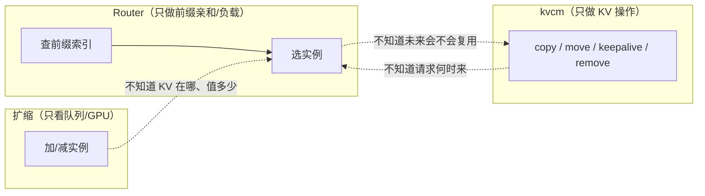

三个问题各自都“能用”，但组合起来会互相抵消：

- Router 把请求发到 A，kvcm 却把 KV 预取到 B——预取白做；
- 扩缩把持有热前缀的节点缩掉——命中率下降，再扩回来；
- hook 说“30 秒后还要用这个前缀”，但没人把它变成预取/保留/不缩容的动作；
- kvcm 的 READY 只用于“日志”，没有回写索引，下一次选路仍然不知道 B 有了。

### 1.2 三个决策的耦合点

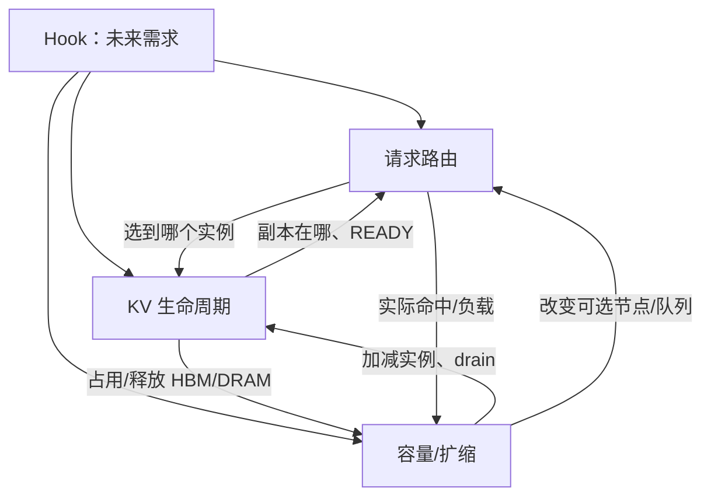

三个耦合点：

1. **路由 ↔ KV**：路由决定“哪个实例值得预取/保留”，KV 的 READY 决定“这个实例现在能不能 D-direct”。
2. **KV ↔ 扩缩**：KV 的驻留量/水位决定“要不要扩”，扩缩的 drain 决定“KV 往哪搬”。
3. **扩缩 ↔ 路由**：新节点没预热就接流量 = 冷 miss；缩容选错 victim = 热 KV 丢失。

### 1.3 为什么不能做一个“全局在线优化器”

请求路径预算 5ms（D1 与 lake 参考 SLO 都要求 D-direct 模式选择 <5ms），扩缩周期是秒到分钟。把三者塞进一个在线优化器，会有三个问题：

- 算不动：候选节点 × 前缀块 × KV 动作 × 扩缩组合，状态空间爆炸；
- 抖动传导：扩缩的慢决策会让请求路径抖动；
- 不可解释：出错时无法判断是索引错、打分错还是扩缩错。

所以采用 **时间尺度分离 + 影子价格**：L2 算“容量/带宽/预取”的边际价格，L0/L1 在价格下做局部最优。价格是三条环之间唯一的耦合信号。

---

## 2. 设计原则

| 原则 | 含义 | 反面 |
|---|---|---|
| **H1. hint ≠ command** | hook 只是意图；Router/kvcm 可裁剪、推迟、拒绝 | 把 hook 当硬约束，用户一改就雪崩 |
| **H2. KV 动作只走 intent** | Router 不碰 PoolKey/seg/rank；kvcm 决定做不做、何时做 | Router 直连 master，变成池感知组件（D1 §2 已排除） |
| **H3. 请求不等 READY** | 预取是后台投资；本次请求按当前最优可用路径走 | 排队等复制完成，TTFT 不可控 |
| **H4. 不设 mode-to-mode fallback** | 失败/超时 → 按最新状态重跑决策 | “D-direct 失败就降级 PD”的固定阶梯 |
| **H5. 索引是派生视图** | 陈旧只损性能，不损正确性；读路径兜底 | 把 KVT 当权威，靠它删数据 |
| **H6. 预算先行** | 预取/保留/扩缩都有字节、TTL、并发、成本上限 | 无限 pin / 无限预取，最后等于没有策略 |
| **H7. 决策可回放** | 每次决策记录输入、候选、价格、选择、版本 | 只记录结果，事故无法复盘 |
| **H8. 决策与执行分离** | Router 决策；kvcm 执行 KV；外部编排执行 provision | 一个进程既决策又开机器，边界糊掉 |

---

## 3. 部署形态与角色

### 3.1 目标部署

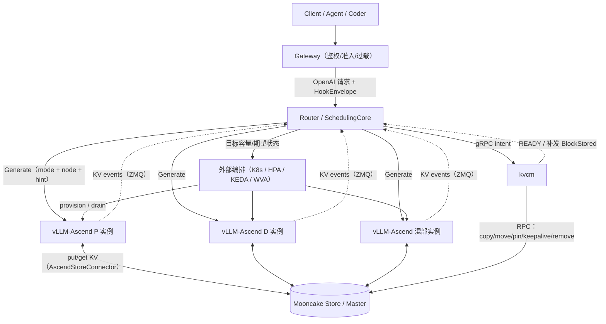

### 3.2 角色边界

| 角色 | 负责 | 不负责 |
|---|---|---|
| **Gateway** | 鉴权、限流、过载准入、hook 透传/签名 | 选路、KV 决策、扩缩决策 |
| **Router** | KVT、hook 编译、L0/L1/L2 决策、intent 下发、决策日志 | 直接读写 KV、直接操作 master、真实 provision |
| **kvcm** | KV 操作执行、READY 核验、补发事件、台账/会话/保活、反熵 | 请求选路、扩缩决策、持有前缀索引 |
| **vLLM-Ascend** | 执行、产生 KV events、本地 APC | 不承担跨实例调度 |
| **Mooncake** | KV 数据/副本/lease/驱逐/offload | 不解释 token/hash（key 是不透明字符串） |
| **外部编排** | 起停实例、资源配额 | 不做逐请求路由 |

### 3.3 版本基线

设计必须同时支持 0.3.11.post1 与 mooncake main（D2 F13）：

| 能力 | 0.3.11.post1 | main | 对 D8 的影响 |
|---|---|---|---|
| 引擎 KV events（`BlockStored`/`BlockRemoved`，medium） | 有 | 有 | KVT 的 HBM 事实来源 |
| 池 publisher（removed/cleared） | **无** | 有 | 删除面降级：TTL + miss 反馈 + 抽样核验 |
| `GetReplicaListForAdmin`（零副作用） | 无 | 有 | 反熵优先用 main；0.3.11 用普通查询但注意 lease 副作用 |
| `ProbeKey` | 无 | 有 | 轻量核验；0.3.11 用 `ExistKey`（会续租） |
| 空写 upsert（soft pin） | 绑定缺通道 | 绑定缺通道 | MVP 先用 lease 延长 + keepalive，不依赖空写 |
| copy/move 任务取消 | 无 | 无 | intent 带 deadline；超时 abandon，不假设能止损 |
| per-key 立即降层 | 无 | 无 | demote 走“停保活 + 等驱逐”软路径，或 kvcm 自挂段 |

> 结论：**先把“事件 + READY + miss 反馈”这条链做实**；删除面和 pin 的缺口用降级策略兜住，不要让调度中心依赖不存在的 RPC。

---

## 4. 总体架构

### 4.1 组件图

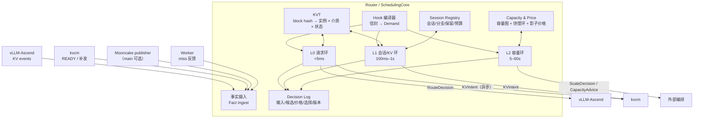

### 4.2 四条数据流

| 流 | 方向 | 内容 | 频率 |
|---|---|---|---|
| **事实流** | 引擎/kvcm/池 → KVT | `BlockStored/Removed/Ready/Miss` | 高频、异步 |
| **需求流** | Gateway/Agent → Router | HookEnvelope | 每请求/每 turn |
| **决策流** | Router → worker/kvcm/编排 | Route / Intent / Scale | 每请求 / 周期 |
| **反馈流** | worker/kvcm/编排 → Router | READY/FAILED/miss/容量 | 异步 |

### 4.3 逻辑分层仍然是“索引 / 查询”两层

D1 §1 的分层不能因为“同进程”就丢掉：

- **摄入层**：后台 goroutine/线程消费事件、合并事实、维护 KVT；
- **查询层**：L0 只做只读快照/原子读，不在请求路径里边收事件边算；
- **写入层**：L1/L2 只写 intent/decision，不直接改 KVT 的权威事实（READY 事实由摄入层统一 apply）。

---

## 5. 状态层

### 5.1 KVT：KV 索引树

#### 5.1.1 事实模型

所有源统一成 `KVFact`：

```text
KVFact {
  source:     ENGINE | KVCM | POOL | ROUTE | MISS | MASTER_VERIFY
  seq:        uint64        // 每源独立
  at:         timestamp
  kind:       STORED | REMOVED | CLEARED | READY | LOST | LEASE | PIN
  ns:         (model_id, revision, pool_kind)
  hashes:     [32]byte[]    // 链式 block hash
  parent:     [32]byte
  node:       instance_id   // 事件归属实例
  tier:       HBM | DRAM | NVMe | DFS
  scope:      NODE | POOL_TIERS | ALL
  ttl:        duration
  confidence: uint8
}
```

字段要点：

- `hashes` 是 vLLM-Ascend 的链式 block hash（DP/TP 的 per-rank key 在摄入层按逻辑块去重，D1 F2/F8）；
- `node` 是事件归属实例：引擎事件按端点归属，kvcm 补发按目标实例端点归属（D1 §2「身份 = 端点」）；
- `tier` 区分 HBM（gpu 事件）与池 DRAM（cpu 事件/kvcm READY）；
- `scope` 决定删除的作用域：引擎 `BlockRemoved` 只清该节点 HBM；池 `removed` 清池层（DRAM/NVMe/DFS），不清某实例 HBM；`AllBlocksCleared` 按 scope 清。

#### 5.1.2 索引结构

```text
KVT
├── namespace: (model_id, revision, pool_kind)
│   └── block: hash → Node
│       ├── parent / children        // 逻辑 radix 链
│       ├── locs: instance → Loc     // 每个实例一条
│       │   ├── tier: HBM/DRAM/NVMe/DFS
│       │   ├── state: Speculative/Confirmed/Stale
│       │   ├── source / seq / as_of / expire
│       │   └── confidence
│       ├── demand: 热度/ETA/复用概率
│       └── retain: NONE/SESSION/PIN + 到期
```

为什么“逻辑树、物理 map”：

- 请求自带 hash 链，逐块查 map 就能得到连续命中长度，不需要每次从根遍历；
- 树只在需要“某前缀族/分支/聚合”时用 parent/children 指针；
- 索引规模由 block 数决定，不由字节数决定；一个逻辑块只存一条，rank 维度在摄入层消除。

#### 5.1.3 位置状态机

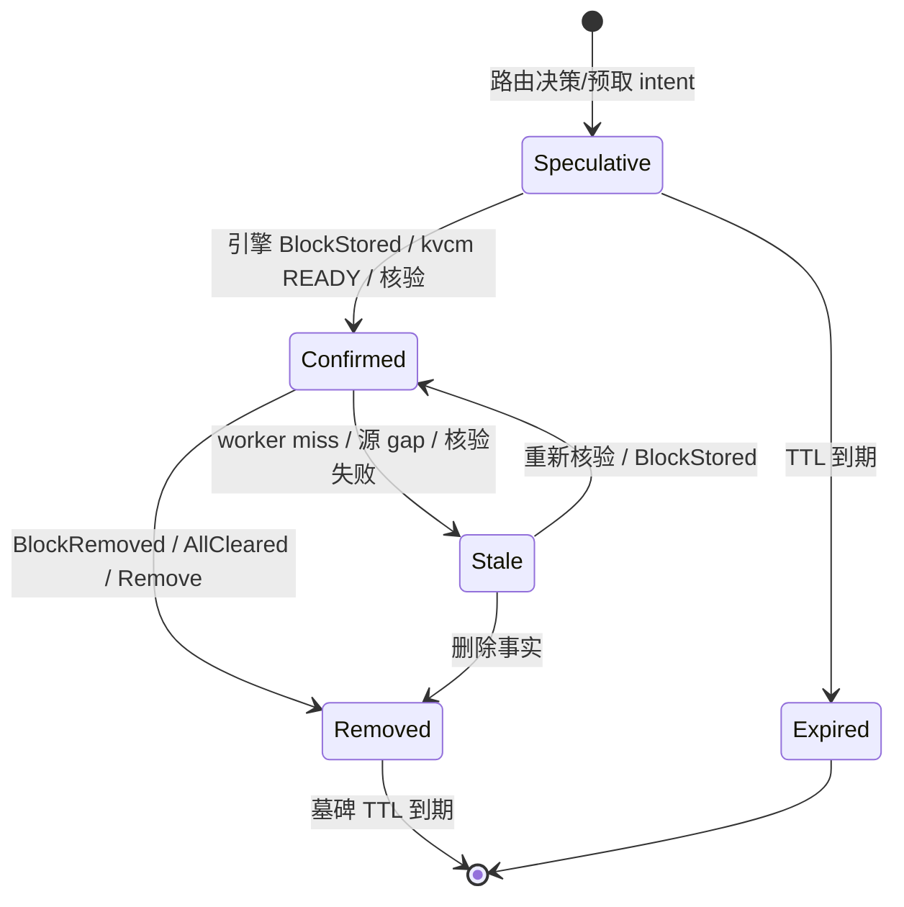

规则：

- **D-direct 只认 `Confirmed` + `HBM`**；`Speculative` 只用于亲和排序。
- **本机 DRAM 不是 D-direct**：它是 local fetch，省跨机传输但不省本地拷贝；打分按 tier 权重处理。
- **负事实优先**：`Removed/LOST/MISS` 带墓碑 TTL，防止延迟到达的 `Stored` 把条目“复活”。
- **墓碑不是删除数据**：KVT 只影响选路；真正删除由 kvcm/D2 的 release 流程决定。

#### 5.1.4 多源合并

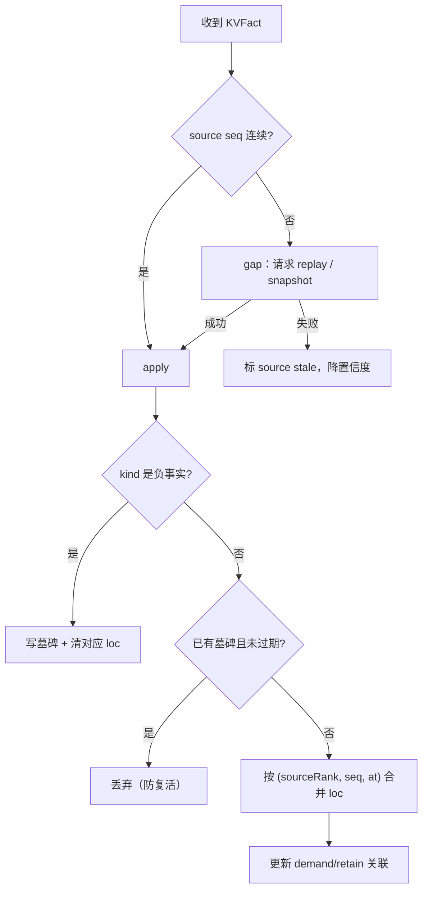

源信任级建议：

```text
MASTER_VERIFY (kvcm 反熵核验)  = 4
KVCM_READY                     = 3
ENGINE_EVENT                   = 2
POOL_PUBLISHER                 = 2
ROUTE_SPEC                     = 1
MISS_FEEDBACK                  = 4（负事实）
```

同一 block 同一实例同一 tier 只保留一条 loc；不同 tier 可以并存（HBM + 本地 DRAM + 远端池）。跨源冲突时，高信任级优先；同信任级按 seq/at；负事实优先。

#### 5.1.5 前缀匹配与命中定义

`Match(ns, hashes, node)` 返回：

```text
Hit {
  contiguous_blocks:    连续满块命中数（任意介质）
  contiguous_hbm:       连续 HBM confirmed 块数
  contiguous_local_dram:连续本机 DRAM 块数
  pool_hit_blocks:      池内（任意节点）连续块数
  tiers:                每块的分层
  confidence:           min(路径上各块置信度)
  as_of:                min(as_of)
}
```

- **命中长度** = `contiguous_blocks × block_size`；不满一块的尾巴由引擎重算（D1 §3）。
- **D-direct 资格** = `contiguous_hbm ≥ prompt_blocks - 1`（末 token 通常要重算，vLLM 的 `get_num_new_matched_tokens` 会少记 1 个 token）；至少要求“前缀连续”，中段有空洞不算。
- **Pool 命中 ≠ 本地命中**：Pool 命中省重算但要传输；本地命中（HBM）才省传输。

#### 5.1.6 gap、ghost 与置信度

- **gap**：每源独立 seq；跳号先 replay；replay 不可用则请求 snapshot；再不行标 stale。没有 snapshot 的源（如池 publisher 0.3.11）直接不订阅，用降级策略。
- **ghost**：事件派生索引的固有风险。后果是“路由到一个其实没有副本的实例”→ 跨机读/重算，只损性能（D1 F3/F10）。
- **置信度衰减**：

```text
conf(t) = conf0 × exp(-(t - t0) / τ)
```

`τ` 按源类型取（引擎事件较长，推测条目很短）。`conf < 0.9` 不允许 D-direct；`conf < 0.5` 只作亲和排序。

- **ghost 概率**（用于打分/验证据优先级）：

```text
P_ghost ≈ 1 - exp(-λ_delete × age)
```

`λ_delete` 由历史删除率估计；`P_ghost × C_miss` 进入 L0 的 risk 项。热条目优先抽样核验，而不是全量 diff（D1 §2 已否决轮询比对）。

#### 5.1.7 规模与内存

粗略：

```text
M ≈ N_blocks × (32B hash + L × 24B loc + ~60B overhead)
```

`L` = 该块的平均位置数（通常 1–3）。举例：100 万块 × 2 loc ≈ 140MB；1 亿块 ≈ 14GB。控制手段：

- 一个逻辑块一条，不按 rank/key 展开；
- 冷块只留 hash + 一个 loc，demand 聚合到前缀级；
- 可选“实例级条目”（只记块在哪个实例，不记精确地址），地址由实例 agent 管；
- 超过阈值时 Router 只留热集，冷前缀查 kvcm/Conductor（D1 §1 的 remote indexer 形态）。

### 5.2 Session / Demand

```text
Session {
  session_id, workflow_id, branch_id
  model_id, revision
  last_node
  prefix_frontier: hash[]        // 已知的前缀链
  last_seen, eta_ms
  retention: NONE | SESSION | PIN
  ttl_ms, budget_used
  pending_intents: intent_id[]
  hook_confidence
}
```

- 会话状态以 **kvcm ledger 的 sessions 表为权威**（D2 L5“不可丢”），Router 持本地缓存；Router 重启后从 kvcm 回读。
- `prefix_frontier` 是“已知的上一轮前缀”，不是“下一轮完整 prompt”；下一轮新增部分由 hook/请求补。
- `eta_ms` 是预测值，不是承诺；过期后按普通请求处理。

### 5.3 Capacity / Price

```text
NodeCapacity {
  node_id, role (P/D/HYBRID)
  ready | warming | draining
  queue_len, in_flight, tokens_per_s
  hbm_free, dram_free, prefill_rate, decode_rate
  nic_util, bw_to_peers
}

PoolCapacity {
  dram_used/total, ssd_used/total, dfs_used/total
  eviction_rate, promote_rate
  shard_ring_generation
}

PriceVector {
  λ_gpu, λ_hbm, λ_dram, λ_bw, λ_prewarm, λ_slo
}
```

价格不是“钱”，是**边际成本信号**：L0/L1 用它把全局约束（容量、带宽、预算）局部化。更新方式见 §7.4。

### 5.4 Decision Log

每次 L0/L1/L2 决策记录：

```text
DecisionRecord {
  id, at, policy_version
  input_digest          // 请求/hook/KVT 版本/价格版本
  candidates[]          // 每个候选的分数与关键项
  chosen
  intents[]             // 发了哪些 KV intent
  scale                 // 是否触发扩缩
  budget_after
  reason                // 人可读的原因
}
```

用途：回放、A/B、事故复盘、策略调参。没有它，联合调度无法定位“为什么选了这条”。

---

## 6. Hook 协议：把意图变成需求

### 6.1 信封

```text
HookEnvelope {
  version: 1
  hook_id: string              // 幂等键
  session_id, workflow_id, step, branch_id
  model_id, revision
  prefix: {
    token_ids?: uint32[]
    block_hashes?: bytes32[]
    prefix_len?: uint32
    append_estimate?: uint32   // 预计还会追加多少 token
  }
  timing: PRE_ANNOUNCE | ATTACHED | POST
  eta_ms?: uint64              // 预计请求到达时间
  expected_turns?: uint32
  reuse_prob?: float           // 0..1
  retention?: NONE | SESSION | PIN
  ttl_ms?: uint64
  prefetch?: AUTO | ALLOW | DENY
  demote_after_ms?: uint64
  affinity?: { node?, zone?, strict? }
  deadline_ms?: uint64
  priority?: 0..7
  budget?: { max_transfer_bytes?, max_prewarm_ms?, max_pin_bytes? }
  signature?: string           // gateway 签名
}
```

### 6.2 三个时序

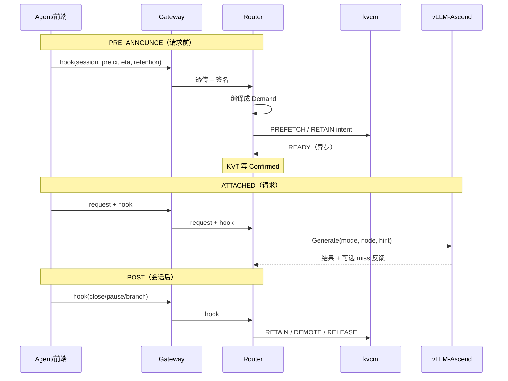

### 6.3 编译成 Demand

`HookEnvelope → Demand`：

```text
Demand {
  session_id, prefix_hashes
  target_nodes: []          // 亲和/预计节点
  eta_ms, window_ms
  reuse_prob
  value_class: LOW | NORMAL | HIGH
  retention, ttl_ms
  prefetch_policy
  budget
}
```

编译规则：

- `PRE_ANNOUNCE`：不产生请求，只产生 L1/L2 的输入；
- `ATTACHED`：主要影响 L0 的亲和/保留；
- `POST`：主要影响 L1 的 retain/demote/release；
- 没有 `prefix` 的 hook 只能做会话级提示（会话粘性、TTL），不能做前缀预取。

### 6.4 预算与信任

- **来源信任**：只有 Gateway 签名/内部 agent 的 hook 才能触发 PIN/扩缩预测；匿名用户只能 observe。
- **预算**：每 session/租户有 `max_transfer_bytes`、`max_pin_bytes`、`max_ttl`；超出裁剪或拒绝该 hook。
- **防滥用**：pin/预取是共享资源，必须有 rate limit 和配额；否则一个用户可以把池 pin 满。
- **失败**：解析失败/版本不认识/预算超限 → 丢弃 + metric，不影响请求（fail-open）。

### 6.5 key 口径

Router 必须能算出与 vLLM-Ascend **逐字节一致**的 block hash 链：

- vLLM 是链式 `hash_block_tokens`（`parent_hash`、`block_size`、模型类型、初始种子参与）；
- vLLM-Ascend 的 PoolKey 还带 `head_or_tp_rank`（`model@hash@head_or_tp_rank`），TP 下同一逻辑块多把 key；
- kvcm 的 `KeyComputer` 已按引擎规则复算（D1 §2 方案 a）；
- Router 侧建议实现一个 `KeyComputer` 适配器（Go/Rust/Python 均可），用 kvcm/keys.py 的测试向量做跨语言一致性校验；不要自己发明 hash；
- Hook 优先带 `block_hashes` 或 `token_ids`；只带文本时，Router 需要 tokenizer 或调用 Gateway 的 tokenize 服务。**不要用估算 token 数**——hash 对不上等于全 miss。

---

## 7. 三条决策环

### 7.1 时间尺度

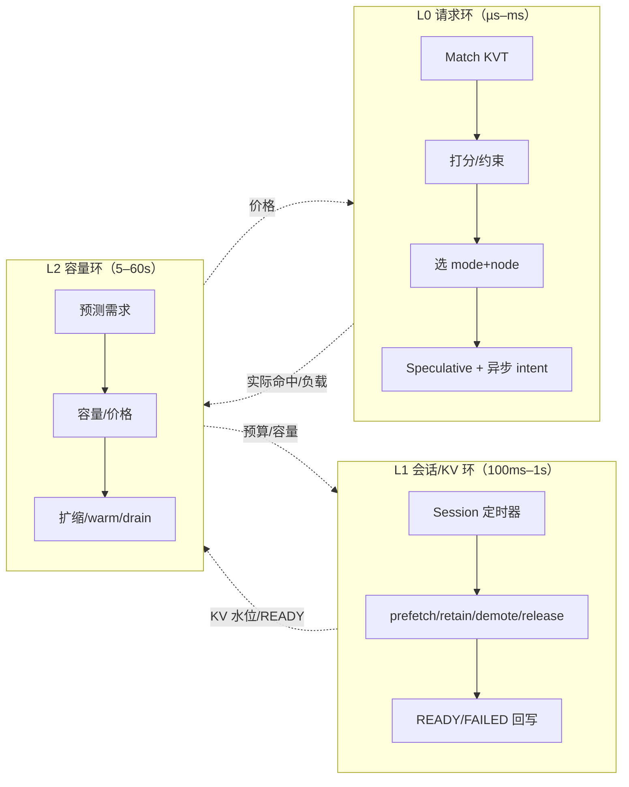

### 7.2 L0 请求环

#### 7.2.1 流程

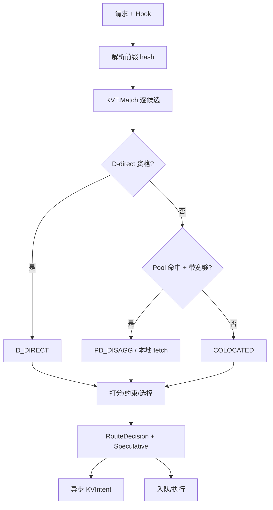

#### 7.2.2 打分

对候选 `(node n, mode m)`：

```text
U(r,n,m) =
    w_hit   × H(r,n) × c_prefill
  + w_pool  × P(r,n) × c_prefill × κ_tier
  − w_bw    × (B(r,n) / BW_eff(n)) × c_bw
  − w_q     × Q(n) × c_queue
  − w_slo   × max(0, TTFT(r,n,m) − D_r) × c_slo
  + w_future× F(r,n)
  − w_risk  × R(r,n)
```

其中：

- `H` = 连续 HBM 命中 token 数；`P` = 连续 Pool 命中 token 数；`κ_tier` 是 DRAM/NVMe/DFS 的折扣；
- `B` = 需要传输的字节；`BW_eff` = 有效带宽（EWMA/池视图）；
- `Q` = 队列等待估计；`D_r` = TTFT 目标；`F` = hook 的未来价值；`R` = 陈旧/ghost 风险；
- 权重 `w_*` 由 L2 的价格/策略给出，不在热路径学习。

TTFT 估算：

```text
TTFT(r,n,m) = Q(n)
            + residual(r,n) / v_prefill(n)
            + B(r,n) / BW_eff(n)
            + T_handoff(m)
```

D-direct 时 `B≈0`、`residual = prompt − H`（通常还剩 1 个 token）；PD 时再加 P 队列与 handoff。

#### 7.2.3 传 vs 算

```text
C_transfer  = B / BW × c_bw
C_recompute = residual × c_prefill
BW*         = B × c_bw / (residual × c_prefill)
```

- `BW < BW*` → 重算/混部更划算；
- `BW ≥ BW*` → 传输/PD 更划算；
- 全前缀命中（`residual=0`）时传输几乎总是赢，但仍要比较 `B/BW` 与 decode 启动开销。

#### 7.2.4 约束

- D-direct：`contiguous_hbm ≥ prompt_blocks − 1` 且 `confidence ≥ 0.9`；
- PD：角色允许、P/D 队列可接受、handoff 时间在预算内；
- 不拒绝请求；优先级只影响排队顺序；
- 选择后写 `Speculative`（短 TTL），`in-flight++`；异步 intent 不阻塞。

### 7.3 L1 会话与 KV 环

#### 7.3.1 生命周期

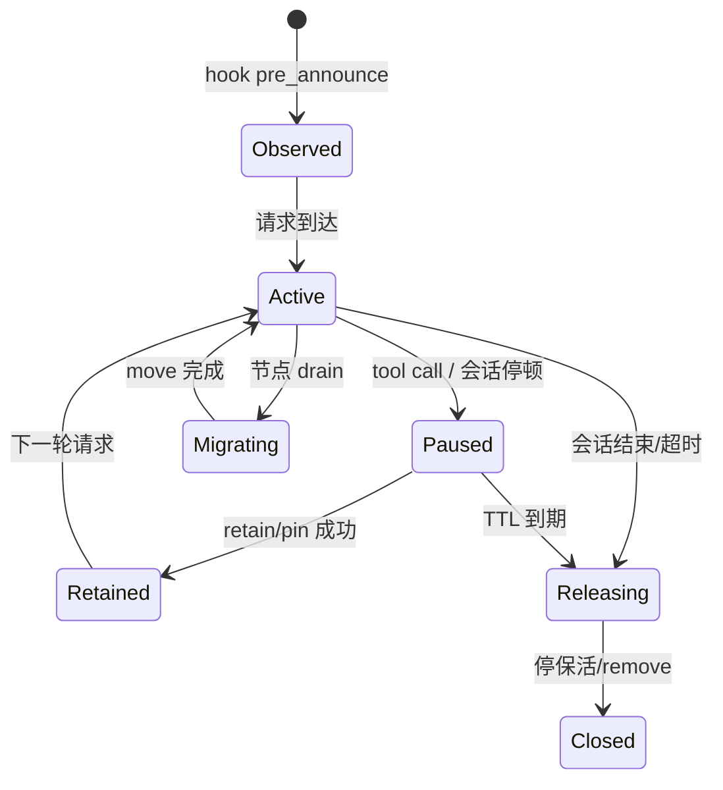

#### 7.3.2 定时器

| 定时器 | 周期 | 动作 |
|---|---|---|
| keepalive | lease TTL / 3 | `ExistKey/BatchExistKey` 续租（有界） |
| retention 到期 | TTL | 降级/停保活 |
| prefetch deadline | intent 截止 | abandon；按最新 KVT 重算 |
| verification | 抽样/热条目 | 核验副本，发 `LOST/REMOVED` |
| session idle | idle 阈值 | 软释放/降层 |

#### 7.3.3 保留等级

| 等级 | 语义 | 机制 | 用途 |
|---|---|---|---|
| `NONE` | 默认 | 池 LRU/TTL | 普通请求 |
| `SESSION` | 软保留 | keepalive/lease 延长；soft pin（若可用） | 工具调用停顿、多轮 |
| `PIN` | 硬保留 | hard pin 或 lease 延长 + 持续续租 | 高价值会话/关键前缀 |
| `DURABLE` | 持久 | demote 到 SSD / DFS retain | 长停顿、节点下线 |

MVP 建议：

- 先用 **lease 延长 + keepalive** 做 `SESSION`，避开 D2 §2 空写/client_id 的未决问题；
- `PIN` 先用“lease 延长 + 高频续租”，并设 TTL/字节上限；需要“kvcm 失联也安全”时再评估 hard pin（读删写/空写）；
- `DURABLE` 只在 kvcm 挂段挂盘或 DFS 可用时启用（D2 §3/§4）。

#### 7.3.4 预取价值

未来请求按 Poisson 到达，窗口 `T` 内至少一次的概率：

```text
Λ = ∫_t^{t+T} λ(s) ds
P_use = 1 − exp(−Λ)
```

期望收益：

```text
S = p_hit × (C_transfer_saved + C_recompute_saved)
C_copy = B / BW × c_bw + bytes × c_hbm × T
EV = P_use × S − C_copy − C_occupancy
```

已知会话下一轮在 `t+Δ`：

```text
EV = p_resume × S − C_copy − c_hbm × bytes × TTL
```

触发条件：`EV > θ` 且 `EV/bytes` 排名靠前（预算内按价值密度贪心）。没有未来需求信号的预取，只在“顺手补”场景（本次请求跨机读后异步补）使用。

#### 7.3.5 保留 TTL 的盈亏平衡

保留不是越久越好。设恢复概率指数衰减 `p(T)=p0·e^{−μT}`，保留成本 `c_h·bytes·T`，则保留到 `T` 的净收益：

```text
Net(T) = p0·e^{−μT}·S − c_h·bytes·T − C_evict_risk
```

- `Net(T) > 0` 才保留；`T` 上限由预算/`T_max` 卡住；
- 最优 TTL 是“边际收益 = 边际成本”的点：

```text
μ·p0·e^{−μT}·S = c_h·bytes
```

解出 `T*` 后与 `T_max` 取小；解不出就退化为固定窗口。这个公式的意义：**TTL 应由恢复概率和占用成本共同决定，不是拍脑袋的“保留 30 分钟”**。

#### 7.3.6 预算

```text
Σ_{prefetch i} bytes_i / deadline_i ≤ B_budget
Σ_{pinned j} bytes_j ≤ B_pin
TTL_i ≤ T_max
```

`B_budget` = 后台带宽预算（建议 <10% 链路）；按 `EV/bytes` 或最早 deadline 做准入。

### 7.4 L2 容量环

#### 7.4.1 双环

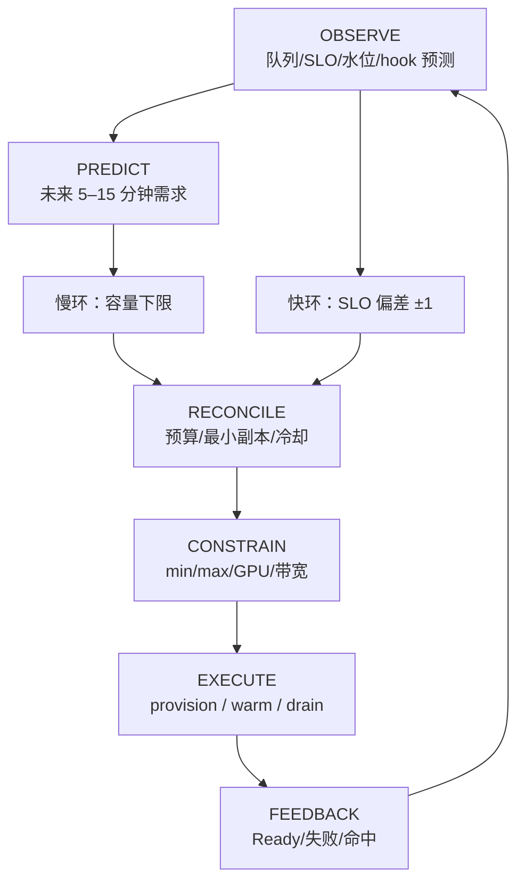

- 慢环：预测需求 / 单副本容量 = 下限；
- 快环：当前 SLO 偏差在 [下限, 上限] 内 ±1；
- 冷却 `T_cool ≥ T_provision + T_warm + T_drain`，避免扩缩振荡。

#### 7.4.2 容量公式

对每个池（P/D/混部/KV）：

```text
ρ = λ / (c × μ)
c_min = ceil(λ / (μ × ρ_target))
L = λ × W                    （Little 定律）
```

- `λ` = 到达率（请求/s 或 token/s）；`μ` = 单副本服务率；`ρ_target` 建议 0.7–0.8；
- 队列长度阈值可由 `L* = λ × W_target` 推；
- 快环：

```text
if p99(TTFT) > D for N 个周期: c += 1
if p99(TTFT) < 0.7D and ρ < 0.5 for M 个周期: c -= 1
```

#### 7.4.3 扩哪个池

按瓶颈选择：

| 信号 | 优先扩 |
|---|---|
| P 队列长、TTFT 高、prefill 利用率高 | P 池 |
| D ITL 高、decode 利用率高 | D 池 |
| 池 DRAM 水位高、驱逐率高 | KV 池 / 加 DRAM 节点 |
| 带宽利用率高、传输排队 | 网络/更多 KV 副本 |
| 本地命中率低、预取 ROI 高 | 先预取，不扩 |

**预取 vs 扩容**：如果需求是短时突发、前缀已在池，预取更便宜；如果需求持续、单节点容量饱和，扩容。比较边际成本：

```text
C_prefetch = bytes / BW × c_bw + c_hbm × bytes × T
C_scale    = c_capacity × T_scale + C_warm
```

只有 `C_prefetch < C_scale` 且能在 deadline 前完成，才选预取。

#### 7.4.4 扩容：warm gate

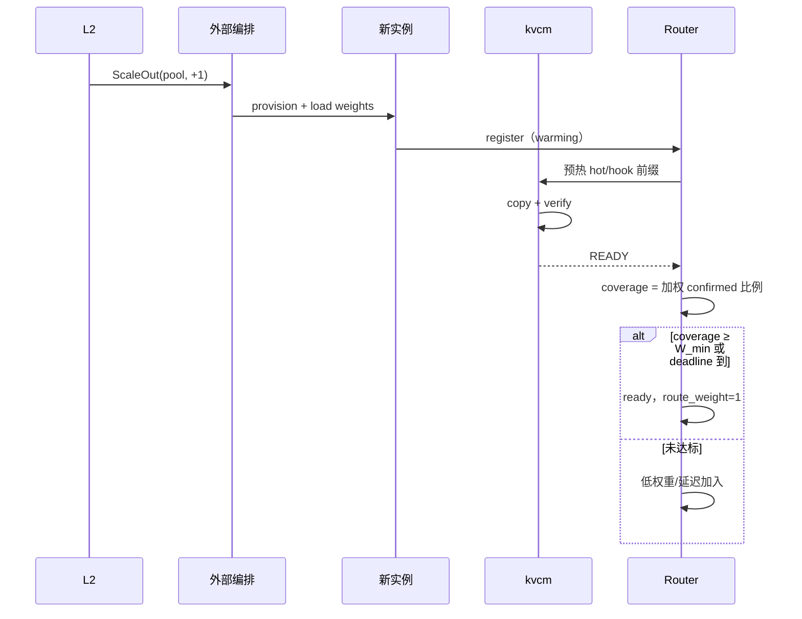

```text
coverage = Σ w_b × 1[b confirmed] / Σ w_b
ready if coverage ≥ W_min or t ≥ T_deadline
route_weight = min(1, coverage / W_min)
```

- `w_b` 由 hook 价值/热度决定；
- 新节点在 `warming` 期间不接（或低权重接）流量；
- `T_ready = T_provision + T_gate + T_warm` 必须满足 <10s 目标；warm 可以与权重加载重叠。

#### 7.4.5 缩容：victim 选择

不要 LIFO。对每个候选：

```text
loss(v) = Σ_{b∈uniqueHot(v)} h_b × (1 − replica_elsewhere(b)) × c_refill(b)
        + Σ_{s∈sessions(v)} p_s × c_recompute(s)
        + migration_cost(v)

gain(v) = idle_capacity(v) × c_capacity
```

选择 `gain(v) − loss(v)` 最大且满足 min replicas/负载约束的节点。

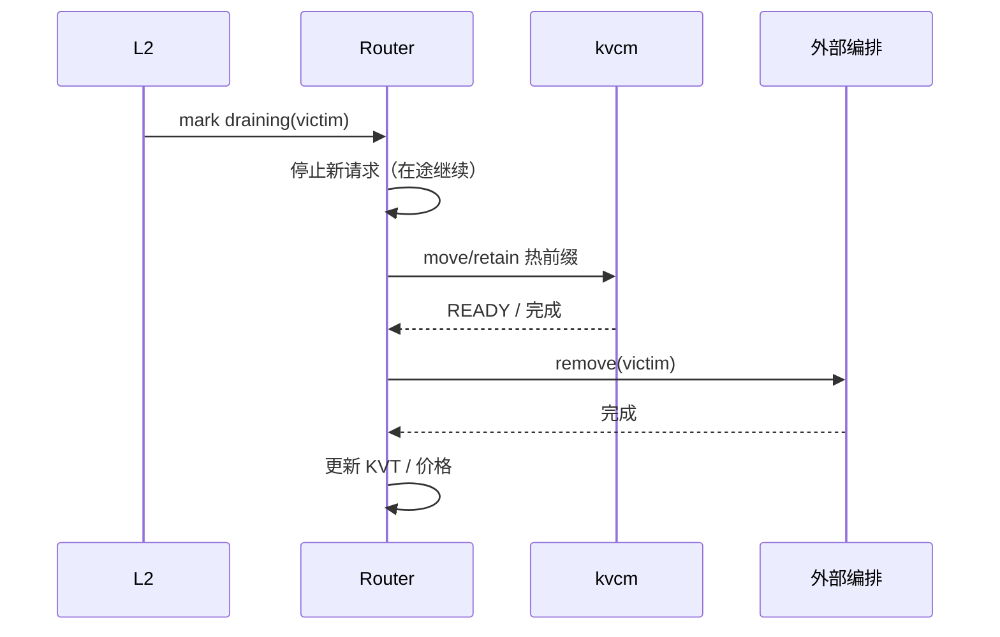

- 有活跃会话的节点优先保留；
- drain 卡住就保留 draining，不硬删；
- 迁移失败按 F4/最新状态重算，不写 fallback 链。

#### 7.4.6 价格更新

用对偶上升/比例控制：

```text
λ_{t+1} = clip(λ_t + η × (u_t − u*), 0, λ_max)
```

或工程上更稳的比例式：

```text
λ = λ_base × (u / u*)^k
```

- `u` = 利用率/水位；`u*` = 目标；`k` 控制灵敏度；
- `λ_bw`、`λ_hbm`、`λ_prewarm`、`λ_gpu` 分别更新；
- L0/L1 只读价格，不反向改价格；L2 单点更新，避免多 Router 打架。

---

## 8. 联合闭环

### 8.1 Agent 多轮：预取 → D-direct → 保留 → 恢复

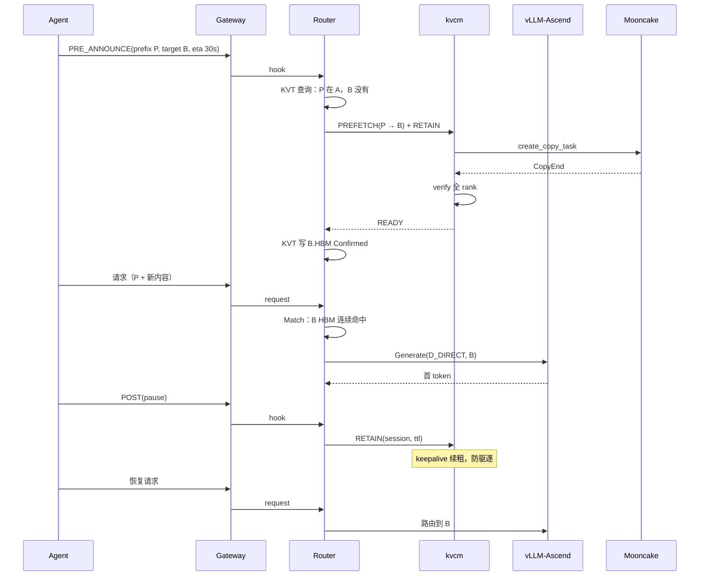

关键点：

- 预取在请求前发生，但请求**不等** READY；
- 如果预取没赶上，L0 仍选 A/远端读，下一次再受益；
- 保留有 TTL/预算，不是永久 pin。

### 8.2 扩缩与预取的联合

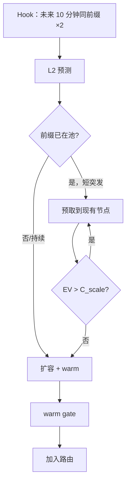

### 8.3 缩容与会话

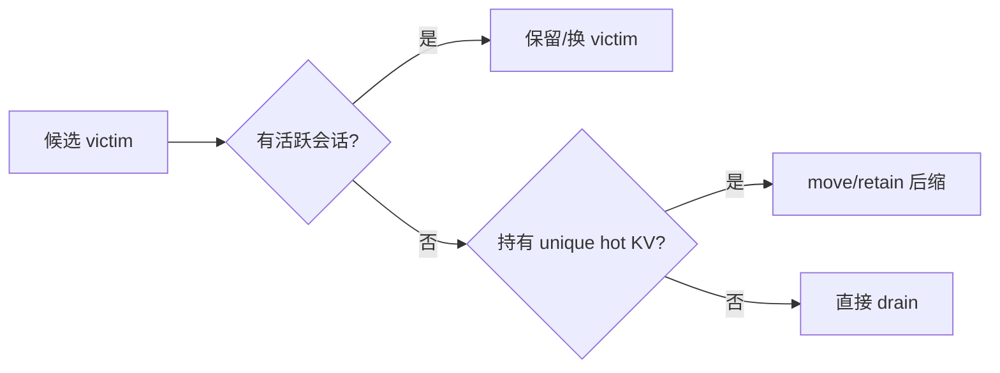

### 8.4 池压与降级

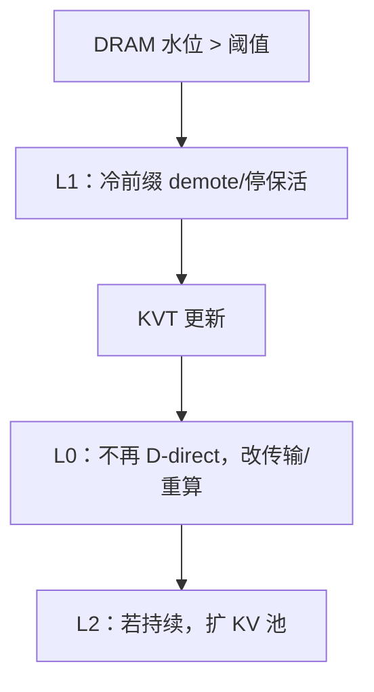

---

## 9. 一致性与多实例

### 9.1 KVT 的定位

- **不是权威**：Mooncake master 是副本权威；引擎是 HBM 事实源；kvcm 是操作/核验权威。
- **是决策视图**：允许陈旧，允许 ghost；读路径兜底。
- **可重建**：从事件 replay / snapshot / 抽样核验重建；重建期间降级（不做 D-direct）。

### 9.2 多 Router

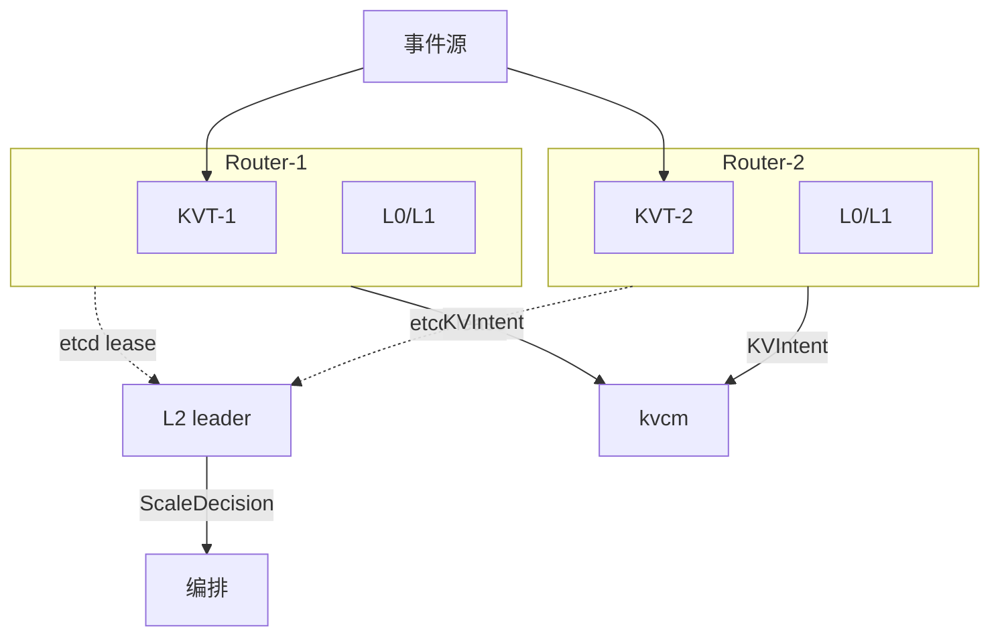

- 每个 Router 从同一事件源建 KVT，确定性合并；
- 会话按 `session_id` HRW 粘到某 Router（或任意 Router + kvcm ledger 回读）；
- **L2 只有 leader 发扩缩**；所有 Router 可发 KV intent，kvcm 侧按 `(prefix,target,op)` 幂等去重；
- 决策带 epoch；leader 切换后新 leader 从最新 KVT/价格继续，不重放旧决策。

### 9.3 与 kvcm 的一致性

- Router 发 intent 后不假设成功；以 kvcm READY 为准；
- kvcm READY 是“全 rank 齐备、可路由”的语义（D1 §2）；
- kvcm 失败/超时 → Router 清 pending，按最新 KVT 重算；
- kvcm 的 ledger 是会话/保活权威；Router 重启后回读，不丢会话。

---

## 10. 失败处理

| 失败 | 处理 |
|---|---|
| hook 解析失败/超预算 | 丢弃该 hook，请求照常；记 metric |
| KVT gap | replay → snapshot → 标 stale；stale 不做 D-direct |
| ghost/miss | worker 回写 `MISS`，KVT 降级；下次换节点；只损性能 |
| kvcm 不可达 | intent 失败/排队；路由不受影响；恢复后重发（幂等） |
| copy 失败/超时 | 不重试到死；按最新 KVT 重算；必要时 abandon + 清理 |
| 源实例下线 | copy 失败；换源/放弃；不写 fallback 链 |
| CP/编排不可达 | 不扩缩/不迁移；路由继续；告警 |
| 扩缩失败 | 回滚期望状态；保持 draining；下周期重试 |
| 多 Router 冲突 | leader/epoch；intent 幂等；不并发改同一目标 |

原则：**任何失败都不阻塞已准入请求**；KV 侧失败最多让本次请求多一次远端读/重算。

---

## 11. SLO 与预算

> 下表是参考目标，具体数值按业务/真机校准；约束关系（预算/门限/不阻塞）是硬的。

| 指标 | 目标 | 对设计的约束 |
|---|---|---|
| D-direct 模式选择 | <5ms | L0 只读 KVT/价格，不做 RPC；摄入异步 |
| TTFT P99 | 按业务 SLO | L0 打分含队列/传输；L2 快环 |
| 扩容 → Ready | <10s | provision ≤5s + gate ≤2.5s + 余量；warm 后台 |
| 缩容 → KV 写回/迁移 | <5s | drain 预算；卡住不硬删 |
| 后台带宽 | <10% | 预取/迁移共享预算；按 EV/bytes 准入 |
| 本地命中率 | 按业务目标（参考 lake P7.6 的 >40%） | 亲和 + 预取 + 保留；L2 不缩热节点 |
| 请求成功率（非过载） | 99.9% | 读路径兜底；不因 KVT 错拒请求 |

预算分层：

```text
B_total = B_request + B_prefetch + B_migration + B_gc
B_prefetch + B_migration + B_gc ≤ 10% × B_total
```

---

## 12. 指标

| 类别 | 指标 |
|---|---|
| KVT | 条目数、内存、gap 次数、ghost 率、核验命中率、事件延迟 p99 |
| Hook | 覆盖率、有效率、预取命中率、预算拒绝率、ETA 误差 |
| L0 | 决策延迟 p99、D-direct 比例、本地命中率、TTFT、mode 分布 |
| L1 | READY 延迟、预取 ROI、保留命中率、pin 字节、过期/浪费 |
| L2 | 扩容 Ready 时延、warm coverage、缩容失败率、振荡次数、预测误差 |
| 全局 | 每请求成本、每 token 成本、传输字节、驱逐率、SLO 违约率 |

---

## 13. 路线图

| 阶段 | 内容 | 验收 |
|---|---|---|
| **M0 契约 + 观测** | `HookEnvelope` / `KVFact` / `KVIntent` 扩展 / `DecisionRecord`；KVT 先接引擎事件；hook 只 observe | 契约测试；KVT 合并/墓碑；L0 延迟 <5ms；不改变行为 |
| **M1 请求 + KV 环** | kvcm READY 回写；speculative；miss 反馈；hook 驱动预取；session retain；预算 | 预取命中率、TTFT、浪费率；A/B hook on/off |
| **M2 容量环** | L2 leader；双环；warm gate；KV-aware victim；价格；KV 池扩缩 | 扩容 Ready <10s 且 coverage 达标；缩容零丢失；无振荡 |
| **M3 服务化** | 反熵、账本归因、容量顾问、回放；分支/跨集群后置 | ghost 率、ROI、预测误差、回放一致 |

M0 的代码落点（建议，不绑定语言）：

```text
router/
├── kvt/          # 事实摄入、索引、匹配、状态机
├── hook/         # 信封解析、校验、Demand 编译
├── sched/        # L0/L1/L2 环
├── intent/       # kvcm gRPC client
├── capacity/     # 容量图、价格
└── decisionlog/  # 记录/回放
```

kvcm 侧：

```text
kvcm/
├── api/intents.py      # op/deadline/ttl/budget 扩展
├── flows/session.py    # 会话保留/恢复
├── ops/verify.py       # 反熵/核验
└── ledger.py           # 归因字段
```

---

## 14. 开放问题

1. **Mooncake publisher 升级节奏**：0.3.11 无删除事件，先靠 TTL/miss/抽样核验；升级到 main 后是否直接启用 publisher，还是 kvcm 翻译？
2. **hook 标准**：agent 框架各自发 hook，是否需要一个 SDK/中间件？pre_announce 端点是否走 Gateway 还是独立服务？
3. **hash 口径**：vLLM-Ascend 版本升级/模型类型变化会改 block hash；Router 的 KeyComputer 如何跟版本绑定、如何做漂移哨兵？
4. **pin 可达性**：soft pin 的空写通道、hard pin 的 client_id 问题未决；MVP 用 lease 延长是否满足业务？
5. **任务取消**：copy/move 无取消 RPC；预取改道只能 abandon + 事后清理，是否需要池侧扩展？
6. **多 Router leader**：etcd 还是复用现有控制面？leader 故障时扩缩暂停的容忍时间？
7. **成本权重**：`w_*`/`λ_*` 需要真机校准；是否需要在线学习/离线仿真？
8. **layerwise**：vLLM-Ascend 的 layerwise 读路径会改变传输成本；D6 选型未定，L0 成本模型要留接口。
9. **跨集群/DFS**：retain 到 DFS/对象存储的延迟和成本，是否纳入 L1/L2？
10. **安全**：hook 伪造/滥用 pin 的防护；签名、配额、审计的边界。

---

## 15. 参考实现

> 说明：三环 + 影子价格的整体组合没有一一对应的参考实现；下面按部件列锚点。**kvcm 独立于 lake**，lake 仅作参考文档。

| 参考 | 锚点 | 借了什么 | 关键差异 |
|---|---|---|---|
| **kvcm D1/D2** | `D1-router-scheduling.md` §2/§4；`D2-kv-operations.md` §1/§4 | intent ≠ command、READY、补发事件、单向边界、八操作/状态四类 | 本文补 hook/KVT/L2；不改变 kvcm actuator 定位 |
| **lake Router** | `go/router/affinity.go::pickNodeForRequest`；`go/router/autoscale.go::Autoscaler.Evaluate`；`go/router/mirror.go::Apply` | 亲和两段式、in-flight 护栏、镜像 apply | lake 有 CP 权威；目标部署没有 CP，KVT 以事件为主 |
| **Dynamo** | `lib/kv-router/src/protocols.rs::WorkerSelectionResult`；`components/src/dynamo/planner/core/load_scaling.py::LoadScalingMixin`；`lib/kv-router/src/services/indexer/listener.rs::handle_gap` | overlap 作为一等输入；慢/快双环；gap + replay | Dynamo 索引是事件派生副本；本文用多源 + 墓碑 + 置信度 |
| **llm-d** | `pkg/kvcache/prefix_match.go::SpeculativeTier`；`.../preciseprefixcache/prerequest.go::defaultSpeculativeTTL`；`pkg/epp/scheduling/scheduler.go::Scheduler.Schedule` | 推测索引补窗口；scorer 插件化 | 推测只做亲和，不做 D-direct；不依赖“逼近引擎真相” |
| **AIBrix** | `pkg/kvevent/manager.go::Manager`；`pkg/controller/podautoscaler/context/context.go`（`gpu_cache_usage_perc`） | ZMQ 事件→前缀索引；KV 使用率/排队长度扩缩 | AIBrix 各副本各自收敛；本文 KVT 单实例内合并 + L2 leader |
| **SGLang** | `sgl-model-gateway/src/policies/cache_aware.rs::CacheAwarePolicy`；`policies/tree.rs::Tree`；`srt/managers/kv_hints.py::KvHintsEnvelope`；`unified_cache/session_ref_tracker.py::UnifiedSessionRefTracker` | 近似树 + 最短队列；带版本 hint；session 软保护 | 目标部署用 vLLM-Ascend；session 保留落 kvcm，不落引擎 |
| **vLLM** | `vllm/v1/kv_hints/protocol.py::KvHintsEnvelope`；`vllm/v1/core/sched/scheduler.py::Scheduler` | hint 动词表；节点级 scheduler 分层 | hint 在本文被编译成 Demand；仍 hint ≠ command |
| **Mooncake** | `master_service.cpp::CopyStart`、`BatchEvict`、`CreateDrainJob`、`GetReplicaListForAdmin`；`KvEventPublisher`（D1 F14） | copy 幂等、lease/驱逐、drain、零副作用核验、池事件 | Router 不碰 PoolKey/seg；全部经 kvcm intent |
| **KVCR** | `src/kvcr/remote_fw_dram.py::fetch` / `query` / `_try_release_pin` | 目的地发起 fetch、传输窗口 pin | kvcm 集中式 + master 权威；不需要 fencing |
| **TensorCast** | `tensorcast/api/_config.py::StorePolicyProfile` | 声明式 policy 预设 | 仅借用 retention class 命名，不照搬存储后端 |

关键差异：

- 参考实现的索引多是大规模事件派生、最终一致；本文承认这一点，用 **墓碑 + 置信度 + miss 反馈 + 抽样核验** 把“不精确”控制在性能层。
- 参考实现的扩缩多在独立组件；本文把决策放进 Router 的共享状态，但**执行仍分离**（kvcm 执行 KV，编排执行 provision）。
- 参考实现的 hint/session 多在引擎内；本文把 session/retention 放到 kvcm，worker 保持无状态。
- vLLM-Ascend 的 TP/DP per-rank key、Mooncake 的 key 不透明性，决定了“索引必须按逻辑块去重、Router 不能碰 PoolKey”——这是与通用 vLLM router 最大的工程差异。

---

## 附录 A：公式速查

```text
# 请求收益
U = w_hit·H·c_prefill + w_pool·P·c_prefill·κ
  − w_bw·(B/BW)·c_bw − w_q·Q·c_queue
  − w_slo·max(0,TTFT−D)·c_slo + w_future·F − w_risk·R

# TTFT
TTFT = Q + residual/v_prefill + B/BW + T_handoff

# 传 vs 算
BW* = B·c_bw / (residual·c_prefill)

# 预取 EV（Poisson）
Λ = ∫λ; P_use = 1−e^{−Λ}
EV = P_use·S − C_copy − C_occupancy

# 保留 TTL
Net(T) = p0·e^{−μT}·S − c_h·bytes·T − C_risk
break-even: μ·p0·e^{−μT}·S = c_h·bytes

# 容量
ρ = λ/(c·μ); c_min = ceil(λ/(μ·ρ_target)); L = λ·W

# warm gate
coverage = Σw_b·1[b confirmed]/Σw_b
ready if coverage ≥ W_min or t ≥ deadline

# victim
loss(v) = uniqueHotRefill + sessionRisk + migrationCost
gain(v) = idleCapacity·c_capacity
choose max(gain−loss)

# 价格
λ_{t+1} = clip(λ_t + η(u−u*), 0, λ_max)

# 置信度/ghost
conf(t) = conf0·e^{−(t−t0)/τ}
P_ghost ≈ 1−e^{−λ_delete·age}
```

## 附录 B：接口草案

### B.1 HookEnvelope（proto 示意）

```proto
message HookEnvelope {
  uint32 version = 1;
  string hook_id = 2;
  string session_id = 3;
  string workflow_id = 4;
  uint32 step = 5;
  string branch_id = 6;
  string model_id = 7;
  string revision = 8;

  PrefixRef prefix = 9;       // token_ids 或 block_hashes
  Timing timing = 10;         // PRE_ANNOUNCE / ATTACHED / POST
  uint64 eta_ms = 11;
  uint32 expected_turns = 12;
  double reuse_prob = 13;

  Retention retention = 14;   // NONE / SESSION / PIN
  uint64 ttl_ms = 15;
  Prefetch prefetch = 16;     // AUTO / ALLOW / DENY
  uint64 demote_after_ms = 17;

  Affinity affinity = 18;
  uint64 deadline_ms = 19;
  uint32 priority = 20;
  Budget budget = 21;
  string signature = 22;
}
```

### B.2 KVFact（proto 示意）

```proto
message KVFact {
  Source source = 1;
  uint64 seq = 2;
  int64 at_unix_ms = 3;
  Kind kind = 4;
  Namespace ns = 5;
  repeated bytes hashes = 6;
  bytes parent = 7;
  string node = 8;
  Tier tier = 9;
  Scope scope = 10;
  uint64 ttl_ms = 11;
  uint32 confidence = 12;
}
```

### B.3 KVIntent（在现有 `kvcm/proto/kvcm_intent.proto` 上扩展）

```proto
enum Op {
  PREFETCH = 0;
  RETAIN = 1;
  PIN = 2;
  KEEPALIVE = 3;
  DEMOTE = 4;
  PROMOTE = 5;
  RELEASE = 6;
  MOVE = 7;
}

message SubmitIntentRequest {
  string intent_id = 1;      // 调用方幂等键
  Prefix prefix = 2;
  string target = 3;
  Op op = 4;
  uint64 deadline_ms = 5;
  uint64 ttl_ms = 6;
  uint64 max_transfer_bytes = 7;
  uint32 priority = 8;
  string session_id = 9;
  string reason = 10;
  string source = 11;        // MOVE 用
}
```

> kvcm 按 capability 声明决定是否受理；`intent ≠ command`，可推迟/拒绝；READY/FAILED 由 `GetTask` 或事件回执。

## 附录 C：术语

| 术语 | 含义 |
|---|---|
| KVT | KV Index Tree，Router 侧的多源物化索引 |
| Fact | 一条索引事实（stored/removed/ready/miss…） |
| Loc | 某 block 在某实例某 tier 的位置记录 |
| Demand | hook 编译后的需求预测 |
| L0/L1/L2 | 请求环 / 会话与 KV 环 / 容量环 |
| warm gate | 新实例预热达标后才接流量的门 |
| victim | 缩容候选节点 |
| shadow price | 容量/带宽/预取的边际成本信号 |
