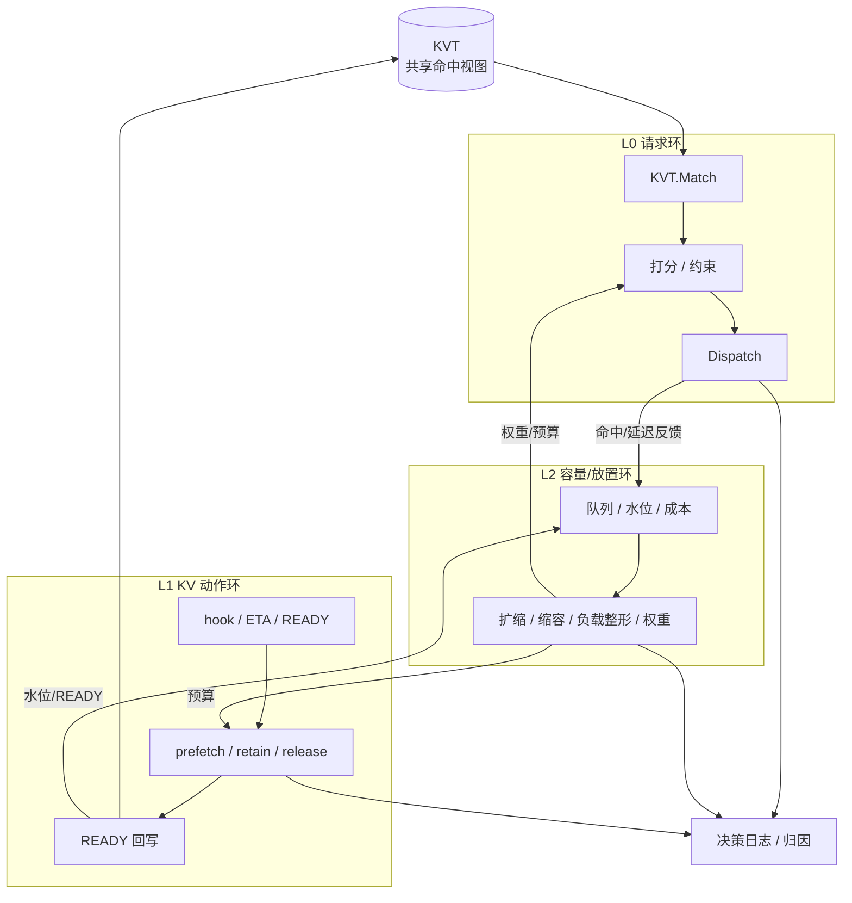
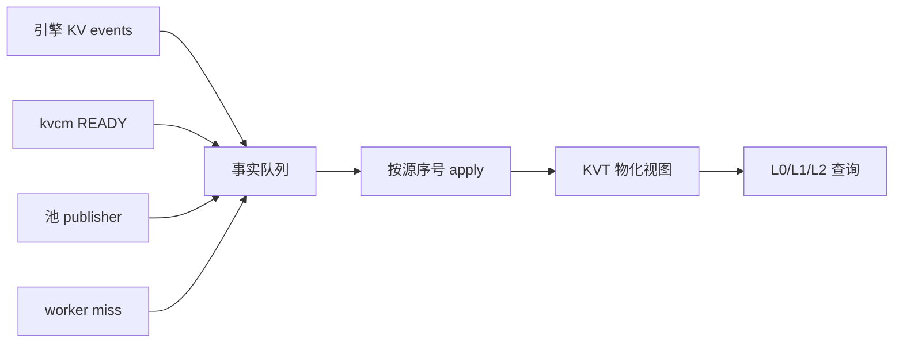
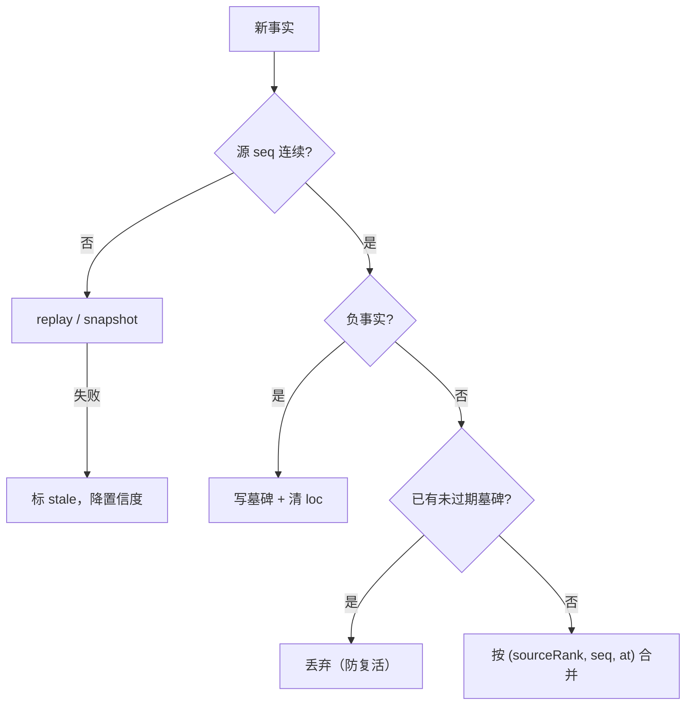
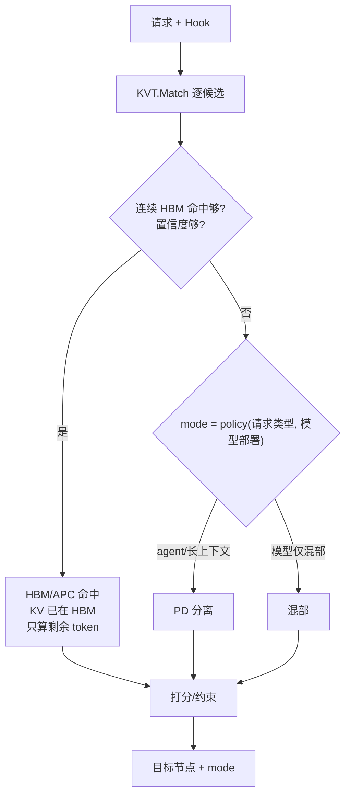
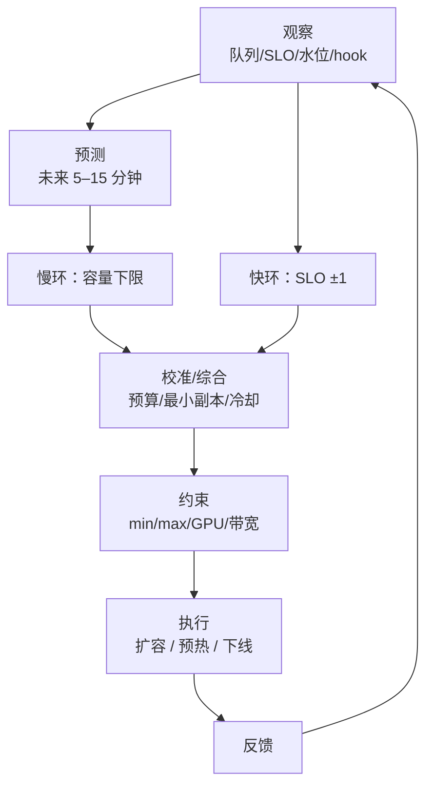
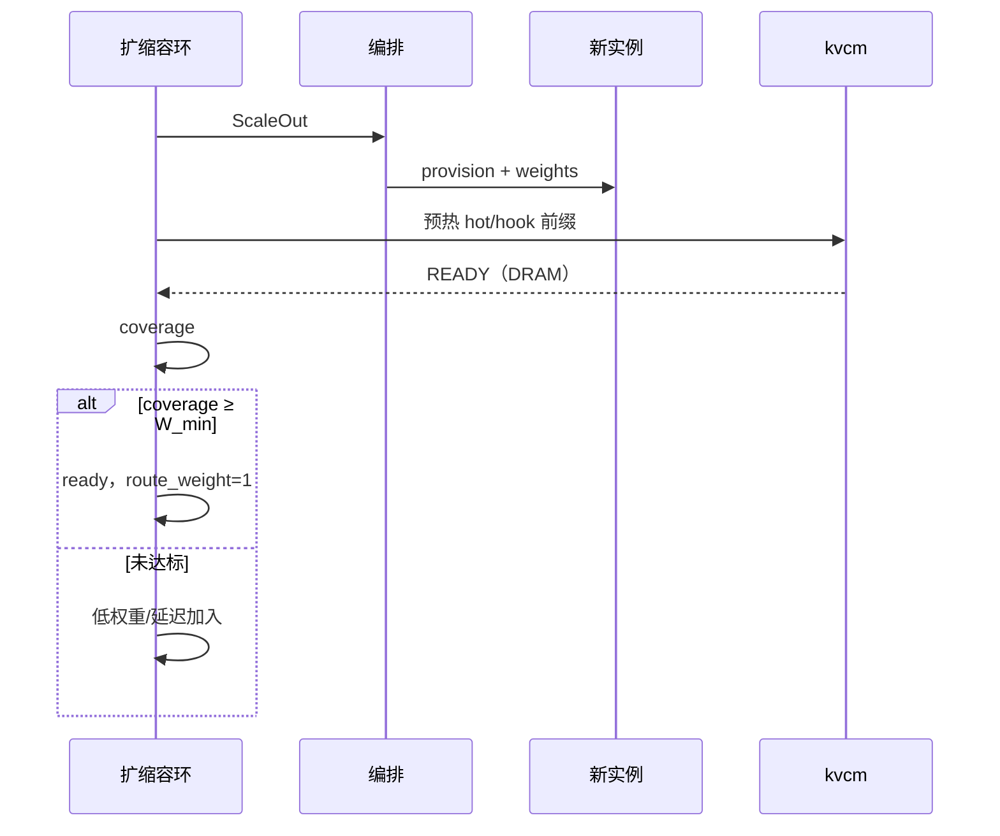
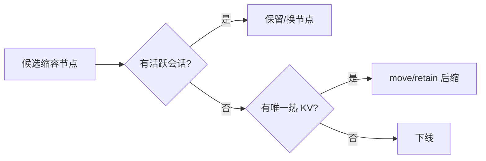
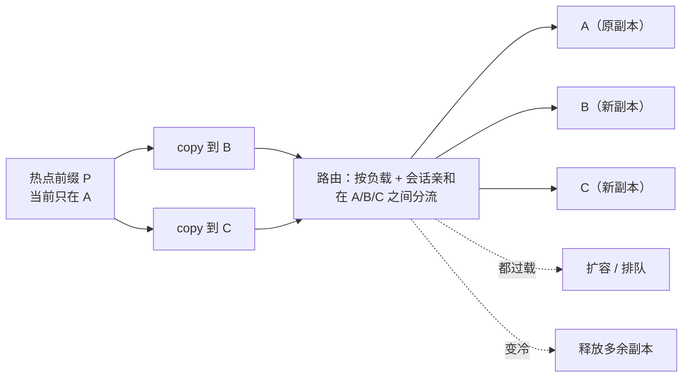

# D8a: 调度算法与收益模型

- 状态: **设计草案**（算法与公式；数值为模型估算，待真机校准）
- 版本基线: **Mooncake v0.3.13.post1**（master / client 同版本）
- 上游: [D8](D8-joint-scheduling.md)（管理面形态与边界——本文的每个算法对应它某一节的决策）；[D2](D2-kv-operations.md)（控制面操作语义）
- 时序: [D8b](D8b-scheduling-sequences.md)（算法跑起来长什么样）
- 下游: 规划引用 [D10](D10-kv-fabric-roadmap.md)；运营侧对应 [D9](D9-kv-services.md)
- 定位: D8 的**算法全集**——所有公式、推导、参数与收益账都在这里；D8 正文只保留定性结论
- 非目标: 不写代码结构；不重复 D8 的架构/边界，只讲算法本身和收益怎么来
- 核心差异: **hook 是输入，D8a 算的是拿到 hook/ETA/READY 后这个动作值不值得做**；hook 语义在 [D8 §4](D8-joint-scheduling.md)，本文不重复。
- 阅读顺序: §0 地图/复用 → §1 记号/TTFT → §2 KVT → §3 打分 → §4 预取 → §5 保留 → §6 扩缩/SSD → §7 HA → §8 收益/指标 → §9 参数 → §10 参考。

---

## 0. 算法地图与复用边界



三个环不是三个串行阶段：

- **L0 请求环**：请求选哪个实例；
- **L1 KV 动作环**：预取/保留/释放，也就是 SC 发给 kvcm 的 intent；
- **L2 容量/放置环**：扩缩、缩容、热点多副本、资源权重。

**KVT 不是第三个环**，它是三环共享的索引/视图；日志/归因是旁路，也不是环。

### 0.1 哪些可以复用开源，哪些要自己写

| 能力 | 现成实现 | 我们改什么 |
|---|---|---|
| 链式 block hash / 前缀匹配 | vLLM `hash_block_tokens`；SGLang/AIBrix/llm-d 都有 | 保持 hash/block size 口径；接池事件 |
| 事件索引 / gap replay | llm-d EPP、Dynamo kv-router、AIBrix kvevent、Conductor | 加池 master/READY 事实 |
| 推测索引 | llm-d `SpeculativeTier` / `PreRequest` | TTL 按实际事件延迟校准 |
| 多源合并 / source rank / 墓碑 | 部分有 gap replay，没有现成实现 | 自己写胶水，不是发明新索引 |
| 请求打分 | AIBrix 可组合 scorer；Dynamo cost 函数 | 加池侧放置/实例选择 |
| 扩缩 | Dynamo Planner、llm-d WVA、AIBrix PodAutoscaler | 池容量/副本事实 |
| copy/move/retain | Mooncake 原语 | 放置决策自己写 |
| 预取/保留收益 | 没有现成实现 | 自己算 EV/TTL |
| 幂等 / HA | 部分原语 | 自己补决策日志/恢复 |

参考：[实例级路由调研](../../docs/research/model-routing/instance-level.md)、[模型级路由调研](../../docs/research/model-routing.md)。

## 1. 记号与收益定义

| 记号 | 含义 |
|---|---|
| `P` | prompt token 数 |
| `H` | 连续 HBM 命中的 token 数 |
| `B` | block token 数（128） |
| `S_bytes` | 前缀字节数 = `P × bytes_per_token` |
| `X_bytes` | 本次实际要传的 KV 字节数（可小于 `S_bytes`） |
| `S_saved` | 预期节省的时间（命中/防 miss） |
| `v_prefill` | **整实例**有效 prefill 吞吐（token/s），不是每 GPU；随上下文长度与命中率非线性下降 |
| `BW` / `BW_eff` | 本次/到节点 n 的实际有效带宽；按平面取 `BW_h2d` / `BW_storage` / `BW_compute` |
| `BW_h2d` / `BW_storage` / `BW_compute` | 三类网络的有效带宽：本机 H2D、存储面、计算面 |
| `T_prefill` | 重算时间 = `P / v_prefill` |
| `residual` | 未命中、需要重算的 token 数 = `P − H` |
| `T_compute` | 重算时间 = `residual / v_prefill` |
| `T_kv` | 拿到前缀 KV 的代价（可掩盖时取 max，不可掩盖时相加） |
| `BW_copy` | copy/预取的有效带宽 |
| `T_transfer` | 跨机传输 = `S_bytes / BW_storage` 或 `BW_compute`；950 跨机待测，A3 ROCE 参考约 23.8GB/s |
| `T_h2d` | 本机 DRAM→HBM 拷贝 = `S_bytes / BW_h2d`；950 单机 UB_CTP≈46.9GB/s、POD≈93.4GB/s（两种场景）；800Gbps 是链路口径 |
| `T_disk` | SSD 原始读时间 = `S_bytes / BW_ssd` |
| `T_dram_write` | DRAM 写时间 = `S_bytes / BW_dram_write` |
| `B_stage_usable` | staging buffer 可用字节（默认约 1.25GiB，按比例可用） |
| `T_ssd_direct` | SSD 直接 offload 读：盘读 + staging + H2D，不建 DRAM 池副本 |
| `T_ssd_promote` | promote 建立 DRAM 副本：盘读 + staging + DRAM 写 + verify；不含 H2D |
| `T_stage` | host staging buffer 的搬运时间；默认 buffer ≈1.25GiB，大 KV 要分批 |
| `T_handoff` | PD/实例交接、首 token 固定开销（秒） |
| `Q` | 队列等待 |
| `D` | TTFT 目标 |
| `L` | 模型层数（含 MTP 层） |
| `c_gpu` | GPU 单位时间成本（元/GPU·s） |
| `c_bw` | 传输单位时间成本（元/s） |
| `c_mem` | 驻留单位字节时间成本（元/byte·s） |
| `c_slo` | SLO 违约单位时间成本（元/s） |

`v_prefill` 不能当常数：attention 是 O(P²)，长上下文下每 token 的 prefill 成本上升；命中率高时 residual 虽小，仍要 attend 全部缓存 KV，同样不是常数。校准必须按实际上下文长度分档。

总代价拆成三段：

```text
T_total ≈ Q + T_kv + T_h2d
```

其中 `T_kv` 是「拿到前缀 KV」的代价，**不能简单写成 `T_prefill + T_transfer`**：

```text
can_overlap 时：T_kv = max(T_compute(residual), T_transfer)
不能掩盖时   ：T_kv = T_compute(residual) + T_transfer
```

## 1.1 两种 KV 加载方式：layerwise vs 批量加载

先明确：**layerwise 不是唯一模式**。vLLM connector 提供逐层加载接口，但部署可以不逐层加载。

| 方式 | 行为 | 优点 | 代价 | 适用 |
|---|---|---|---|---|
| **layerwise 流式** | 第 N 层算，第 N+1 层传 | 单请求 TTFT 短，第一层到位就能开始 | batch 内长短 KV 互相阻塞；算力利用率低；对 P99 友好、对吞吐不友好 | 小 batch、延迟优先 |
| **批量加载** | 先把 KV 搬到 DRAM/HBM，再调度 | 可以按 prefill 长度分组、组 batch；算力利用率高 | 单请求等待更长 | 高吞吐、按长度分 P 池 |

layerwise 的本质是**牺牲算力利用率换更低的 TTFT/P99**：同一个 batch 里，长 KV 请求没到位，短 KV 请求也得等这一层，GPU 空转。

layerwise 改变的是“加载和计算怎么重叠”，**不改变 residual 的大小**；residual 由命中长度决定。

现代推理里“计算比传输快”不是固定结论：低命中/长 residual 时计算占大头，传输可以掩盖；高命中/短 residual 时计算被压掉，传输反而主导。是否掩盖必须按上下文、命中率、带宽算。

在 layerwise 模式下，看的是每层：

```text
每层传输 = X_bytes / (L × BW)
每层计算 = T_compute(residual) / L

T_kv ≈ max(T_compute(residual), T_transfer)   # 有足够计算可掩盖
T_kv ≈ T_compute(residual) + T_transfer       # 掩盖不了
```

在批量加载模式下：

```text
T_kv ≈ T_transfer + queue
```

批量加载不依赖“本请求的计算”去掩盖传输；它靠**其他请求**填 GPU，或按 prefill 长度分组减少长短阻塞。按长度分 P 池（你提到的 DeepInfer 一类做法）就是这条路，KV Fabric 只负责把 KV 放到目标、预热/保留，不决定引擎怎么分组。

所以：

- 不要默认所有场景都 layerwise；
- 延迟优先可以 layerwise，吞吐优先先批量加载/分组；
- 掩盖判据只在 layerwise 下有意义，不能拿它当通用结论。

## 1.2 命中层级的取项

按命中层级选 `T_kv`：

- **miss（无命中）**：`T_kv = T_prefill`
- **远端池命中**：residual 通常小；在 layerwise 下，每层计算时间短，但每层传输量不变，通常没有足够计算去盖住传输，`T_kv ≈ T_transfer`；批量加载则本来就等传输
- **本机 DRAM 命中**：`T_kv = T_h2d`（仍有，但没有跨机那一段）
- **SSD 直接读**：`T_kv ≈ T_ssd_direct`；不建 Mooncake DRAM 池副本，但仍有 host staging buffer
- **SSD promote**：第一次 `T_kv ≈ T_ssd_promote + T_h2d`；之后走本机 DRAM `T_h2d`
- **HBM 预取（预热动作）**：引擎 API/壳请求把 KV 预热到 HBM；预取成本 ≈ `T_h2d` + 引擎队列，控制面不能直接写 HBM；预取完成后且未被驱逐，请求命中 HBM，`T_kv ≈ 0`；被驱逐则按 miss/DRAM 路径走
- **HBM/APC 命中**：`T_kv ≈ 0`；引擎仍会走自己的 connector/APC 查询，只是外部 KV 加载量为 0，不是“跳过 connector”

---

## 2. KVT：把事件变成命中视图

KVT 不是从零写：事件索引、hash/前缀匹配先复用 llm-d/Dynamo/AIBrix/Conductor；下面只讲多源合并、池侧事实和推测索引的增量。

### 2.1 事件溯源 + 物化视图



**算法**：事件索引/gap replay 可复用 llm-d/Dynamo/AIBrix/Conductor；我们补池事件、master 核验和 READY 事实。

1. 每个源独立维护 `seq`；
2. 事件到达按 `(source, seq)` 应用；跳号先 replay，再 snapshot，最后标 stale；
3. 负事实（删除/失效）写墓碑，墓碑 TTL 内禁止 `Stored` 复活；
4. 同一 block 同一实例同一介质只保留一条位置，不同介质可并存。

**复杂度**：事件 apply `O(1)`/块（哈希查表）；请求 match `O(P/B)`（逐块查表）；内存约 `N_blocks × (32B + L×24B + overhead)`。

**收益**：选路零 RPC；命中长度精确；多源不打架。

### 2.2 链式 block hash / 前缀匹配

这是经典做法，不在本文重讲：vLLM 的 key 是 `h_i = H(h_{i-1}, tokens_i)`，KVT 从第一块开始做连续匹配；vLLM/SGLang/AIBrix/llm-d 都有现成实现。

我们只保留两个约束：

```text
hit_tokens = contiguous_blocks × B
```

- hash 口径、block size 必须和引擎一致；
- 同一逻辑块的多 TP/DP rank 要按实例去重，不能把 rank 当独立实例。

### 2.3 多源合并：source rank + seq + 墓碑

这部分**没有现成实现**：gap replay 可以复用，`source rank + 墓碑 + 置信度` 是我们要写的胶水，不是发明新索引。



源信任级：

```text
MASTER_VERIFY = 4
KVCM_READY    = 3
ENGINE_EVENT  = 2
POOL_EVENT    = 2
ROUTE_SPEC    = 1
未命中反馈 = 4（负事实）
```

**收益**：池删除能覆盖引擎旧事件；延迟到达的 `Stored` 不会复活已删条目。

### 2.4 推测索引 + 置信度

**Ghost（幽灵条目）** = 索引说“这块 KV 在”，池里其实已经被驱逐/删除；请求被送到空节点，只能远端读/重算。

> 预测条目的思路参考 llm-d EPP：`preciseprefixcache/prerequest.go::PreRequest` / `defaultSpeculativeTTL`（默认 2s）/ `prefix_match.go::SpeculativeTier`；它解决“路由已决策、引擎事件未到”的空窗，默认关闭。我们只借这个机制，TTL 按实际事件延迟校准。

请求刚路由、引擎事件还没到 → 写短 TTL 的“预测”条目：

```text
TTL_spec = 事件延迟 + 余量     // 默认 2s，按实测校准
```

用途：

- 推测条目只用于**亲和排序**，不作为 HBM 命中证据；
- 置信度低于 0.9 不允许 HBM 命中判定；
- 过期、删除事件、miss 反馈都会降置信度；热条目优先对账。

**收益**：降低批内竞态导致的假 miss；ghost 只损性能，不损正确性。

---

## 3. 请求打分：选哪个实例

### 3.1 打分：命中 / 传输 / 队列 / SLO

这是启发式加权，不是精确效用优化；权重由 L2 根据资源紧张程度调。先定义符号，再写分数：

| 符号 | 含义 |
|---|---|
| `H/P` | 连续 HBM / 池命中 token |
| `X_bytes` | 本次实际要传的字节 |
| `Q` | 队列等待 |
| `F/R` | hook 未来价值 / 陈旧或 ghost 风险 |
| `T_transfer` | 本次传输耗时 = `X_bytes / BW_eff` |
| `w_hit/w_pool/w_transfer/w_q/w_slo/w_future/w_risk` | 各项权重，由 L2 的资源权重给出 |
| `c_prefill` / `c_bw` / `c_queue` / `c_slo` | 单位成本：重算（元/token）、传输（元/s）、排队（元/s）、SLO 违约（元/s） |
| `κ_tier` | DRAM/NVMe/DFS 的折扣 |

```text
U(r,n) =
    w_hit     × H(r,n) × c_prefill
  + w_pool    × P(r,n) × c_prefill × κ_tier
  − w_transfer× T_transfer(r,n) × c_bw
  − w_q       × Q(n) × c_queue
  − w_slo     × max(0, TTFT(r,n) − D) × c_slo
  + w_future  × F(r,n)
  − w_risk    × R(r,n)
```

这套打分不是新算法：AIBrix 的可组合 scorer、Dynamo 的 cost 函数都是同构做法；我们额外加的是池侧放置项和实例选择。

`BW_eff` 按三类网络分开取：

- 本机 DRAM→HBM：`BW_h2d`（950 单机 UB_CTP≈47GB/s；POD≈93GB/s，分开取值）；
- 从池/远端读 KV：`BW_storage`；
- 实例间 KV 传：`BW_compute`（和集合通信共享，要加竞争惩罚）。

**不能用估算的带宽**：layerwise 的掩盖判据依赖 `T_transfer` 的准确性，估高了会把「不能掩盖」误判成「能掩盖」，选出一个实际更慢的节点。

### 3.2 TTFT 估算

批量加载/串行：

```text
TTFT(r,n) = Q(n)
          + residual(r,n) / v_prefill(n)
          + X_bytes(r,n) / BW_eff(n)
          + T_handoff
```

layerwise：

```text
可掩盖：TTFT = Q + max(residual/v, X_bytes/BW_eff) + T_handoff
掩不住：TTFT = Q + residual/v + X_bytes/BW_eff + T_handoff
判据：residual < X_bytes/BW_eff × v_prefill
```

`residual = P − H`；HBM 命中时 `X_bytes≈0`，通常只剩末 token 残差。

选路时要先知道部署模式：批量加载按加法，layerwise 才判断能否取 max。同一个请求，走节点 A 可能能掩盖（A 带宽高），走节点 B 不能。

如果 KV 和集合通信共用一张网，还要加 `network_headroom`：目标平面的剩余可用带宽 + 排队余量，不是总带宽；余量低时，即使平均带宽够，也会让算子等。

### 3.3 决策流程



**收益**：把“命中、传输、队列、SLO、未来复用”放进同一个可解释分数；不追求全局最优，只要求在决策预算内足够好。

> PD 的默认选择：agent/长上下文优先 PD；模型只有混部部署时才混部。`BW*` 只用于“传 vs 算/能否掩盖”，不是 PD 的开关。

---

## 4. 预取：值不值得搬

### 4.1 期望价值

`EV` = 期望收益；`P_use` = 未来窗口内至少用一次的概率；`S_saved` = 用上时省下的时间。
`p_miss_avoided` = 预取避免一次驱逐/重算的概率；`p_remote_to_local` = 远端命中转本机命中的概率。

未来请求按 Poisson 到达，窗口 `T` 内至少一次：

```text
Λ = ∫_0^T λ(s) ds
P_use = 1 − exp(−Λ)
S_saved = p_miss_avoided × T_prefill
        + p_remote_to_local × (T_transfer − T_h2d)
EV = P_use × S_saved − C_copy − C_occupancy
C_copy = S_bytes / BW_copy × c_bw
C_occupancy = S_bytes × T × c_mem
```

一个重要的读数：

- 如果预取只是把“远端命中”变“本机 DRAM”，收益是 `T_transfer − T_h2d`，按实测：512K 约 0.96s（单机 47GB/s）/ 0.48s（POD 93GB/s）；1M 约 1.92s / 0.97s；跨机另算；
- 如果它防止了一次驱逐/重算，收益是 `T_prefill`（秒级）。
- **所以预取要和保留一起做**。

### 4.2 预算分配

不做背包/组合优化。按 `EV_i / bytes_i` 从高到低选，超过字节预算或带宽预算就停。

理由很实际：预取的 `EV` 本身是估计，误差远大于“背包最优解”能带来的收益；在线系统要的是可解释、可增量更新，不是解一个整数规划。

传输要分级：`demand load > prefetch > migration`。

- `demand load`：请求已经在等 KV，最高优先；
- `prefetch`：后台预取，可暂停；
- `migration`：搬迁，最低优先，低峰执行。

prefetch/migration 遇到集合通信高峰应让路或暂停，不能把算子网络打满。

### 4.3 EV 曲线


> 参数：128K 上下文（V3.2，`S_bytes≈11.0GB`）、`S_saved≈4.67s`（128K，90%→99% 的拟合 TTFT 差）、`λ=1/300`、`C_copy≈462ms`（A3 ROCE 23.8GB/s 参考一次搬运）。曲线先升后降：太早预取白占内存，太晚赶不上请求。

**注意 `C_copy` 与 `S_saved` 的量级**：128K 时一次跨机搬运约 462 ms，而 90%→99% 的 TTFT 差约 4.67s——比值约 10:1。到 1M 时 `S_saved` 含 `N²` 项、增长更快，`C_copy` 只随 `N` 线性，比值约 48:1，不是固定值。

**收益**：预取 ROI 可算；带宽按价值密度分配，不被低价值预热打爆。

---

## 5. 保留：保多久

### 5.1 Net(T) 与盈亏平衡

```text
Net(T) = p_resume(T) × T_prefill − c_h × S_bytes × T − C_risk
p_resume(T) ≈ P_return(T | tool_class, elapsed)   // 有工具历史就用这个
p_resume(T) = p0 × exp(−μT)                       // 无历史时的默认
```

- `P_return(...)`：工具在 T 内返回的概率，来自 hook 的 `tool_class/eta` + 历史分布；
- `p0`：无工具历史时的基础恢复概率；`μ`：默认衰减率；
- `c_h`：每字节每秒的占用成本；
- `C_risk`：迁移/违约/数据风险成本；
- 解出的 `T*` 与 `T_max` 取小；解不出就退化为固定窗口。


> 参数：128K 上下文、`S_saved≈4.67s`、`p0=1`、`μ=1/600`、占用成本按 11.0 GB × 0.5 ms/(GB·s) 计。曲线的零点就是最优 TTL 上界。

### 5.2 等级选择

| 等级 | 判据 | 机制 |
|---|---|---|
| `NONE` | `Net(T) < 0` | 池 LRU/TTL |
| `SESSION` | `Net(T) > 0` 且预算允许 | keepalive/soft pin |
| `PIN` | 高价值且 `T` 有上限 | hard pin 或 lease 延长 + 持续续租 |
| `DURABLE` | 停顿长/节点将下线 | demote 到 SSD / DFS retain |

**收益**：把“保留多久”从拍脑袋变成“恢复概率 vs 占用成本”的盈亏平衡；避免无限 pin 把池子占满。

---

## 6. 扩缩：加几个、缩哪个

### 6.1 容量下限

先算一个“最低副本数”，避免容量明显不够：

- `λ`：到达率（req/s）；
- `μ`：单副本在目标 SLO 下的服务能力（req/s）；
- `ρ_target`：目标利用率，比如 0.8，留 20% 余量给突发/长尾；
- 每个副本能稳定处理 `μ × ρ_target`。

```text
c_min ≈ ceil(λ / (μ × ρ_target))
```

例子：`λ=100 req/s`、`μ=30 req/s/副本`、`ρ_target=0.8`：

```text
100 / (30 × 0.8) = 4.17 → ceil = 5
```

4 个副本时利用率 83%，超过 80% 的目标；5 个副本时约 67%。

`μ` 必须在同模型、同上下文、同负载下压测得到，不能拿理论峰值；`c_min` 只是初值，实际还要看突发、预热、PD 两段各自的容量。PD 分开算 P 池和 D 池，不能混；P:D 比例按 prefill/decode 队列分别调。

warm pool 的成本是空闲 GPU 时间：只有冷启动损失/SLO 风险大于它，才保留空载实例。

### 6.2 双环控制

扩缩控制可复用 Dynamo Planner、llm-d WVA、AIBrix PodAutoscaler；我们补的是池容量/副本事实和 KV 价值。

“KV 价值”不是新指标：一段 KV 未来被复用的概率 × 省下的重算/传输时间，减去保留/复制成本；如果落到 SSD，还要减写入/寿命成本。它用于决定扩不扩、留几份、TTL 多长；具体计算见 §4/§5。



```text
if p99(TTFT) > D for N 个周期: c += 1
if p99(TTFT) < 0.7D and ρ < 0.5 for M 个周期: c -= 1
T_cool ≥ T_provision + T_warm + T_drain
```

**收益**：慢环防预测错误，快环保突发；冷却防振荡。

### 6.3 预热门控

新实例先预热；**覆盖率** = 已确认 KV 的权重 / 目标前缀总权重；`w_b` 是块权重（按 token 数/层数/是否关键前缀），`W_min` 是接流门槛，`T_deadline` 是最晚接流时间，`route_weight` 是给新实例的接流权重。

```text
coverage = Σ w_b × 1[b 已确认] / Σ w_b
ready if coverage ≥ W_min or t ≥ T_deadline
route_weight = min(1, coverage / W_min)
```



**收益**：新节点不是“起来就接流量”，避免冷 miss 和 TTFT 抖动。

### 6.4 按 KV 价值选缩容节点

`loss` = 缩掉它损失的 KV/SLO/迁移成本；`gain` = 释放出的容量价值；选 `gain − loss` 最大的节点。

其中 `uniqueHotKV` = 只有该节点持有的热 KV；`refill` = 重建这些 KV 的代价；`sessionRisk` = 活跃/待恢复会话的风险；`migrationCost` = 搬走要花的字节/时间；`idleCapacity` = 可释放的空闲容量；`c_capacity` = 单位容量价值。

```text
loss(v) = uniqueHotKV(v) × refill
        + sessionRisk(v)
        + migrationCost(v)
gain(v) = idleCapacity(v) × c_capacity
choose max(gain − loss)
```



**收益**：不用 LIFO，避免缩掉持有热前缀/活跃会话的节点。

### 6.5 热点前缀多副本与迁移（负载整形）

传统 KV-aware router 只有两条路：

1. 把请求发给**持有前缀的实例**——命中高，但热点前缀会把单实例打爆；
2. 把请求发给**空闲实例**——负载低，但要跨机读/重算。

第三条路：**改 KV 的放置**——把热点前缀复制到多个实例，或把前缀迁到更合适的位置，让“命中”和“负载”同时成立。这是 D8 相对“只读缓存索引”的核心增量。



#### 算法

**第一步：检测热点，算目标副本数。**

1. 按前缀聚合 `λ_p`（EWMA 请求率）、队列、p99 TTFT、当前副本集合 `R_p`，并看源实例水位。
2. 目标副本数：

```text
r_target = ceil(λ_p / (μ_p × ρ_target))
```

`μ_p` 是该前缀在单实例上的服务能力（req/s），`ρ_target` 是目标利用率。`r_target` 只是下界，实际还要看容量、内存、网络。

**第二步：按情况选动作。** 这些动作不是固定顺序，按触发条件走：

| 动作 | 触发 | 做法 |
|---|---|---|
| **加副本 / 选目标** | 副本数 < r_target，且收益 > 成本 | 选低水位、不同故障域、seg 容量够的实例；`copy` 到目标，路由分流 |
| **防驱逐** | 源实例水位高，且这段前缀热 | 在源被 LRU 驱逐前，`copy` 到低水位实例；新请求路由到新副本。源仍可能驱逐，不承诺“永久保住” |
| **减副本** | 副本数 > r_target，且没有会话引用/保留 TTL | 释放多余副本；至少留一份 |
| **迁移** | 节点 drain、故障、拓扑变化 | 用 `move`；负载分散优先 `copy`，源保留 |
| **回写** | copy/move READY | 更新 KVT；路由在副本集合内按“队列 + 传输 + 会话亲和”选点 |

加副本/防驱逐的收益判断：

```text
Benefit = λ_p × (W_single − W_multi) × c_slo
Cost    = (|R_p| − 1) × S_bytes × c_mem × T
        + copy_bytes / BW × c_bw
```

`W_single` / `W_multi` 是单副本 / 多副本下的排队+传输时延，`T` 是观察窗口。`Benefit > Cost` 才复制；否则排队、扩容，或路由到其他副本。

#### copy / move / retain 的分工

| 操作 | 语义 | 适用 |
|---|---|---|
| `copy` | 副本 +1，源保留 | 热点前缀分流、扩容预热 |
| `move` | 副本搬家，源删除 | 节点 drain、故障迁移、副本归拢 |
| `retain` | 保副本跨引擎存亡 | 会话停顿、长生命周期 |

**注意**：`copy` 是“多一份”，不是“把负载从 A 挪走”——A 还在，只是请求可以分流到 B/C；要真正减 A 的压力，路由必须把新请求分到副本集合，而不是继续粘 A。

#### 会话的边界

- **多个独立会话共享同一前缀**（system prompt、tools、RAG 文档）：副本集合可以真正分散请求。
- **同一个会话的 decode**：KV copy 不负责拆分或迁移；正常执行时一条序列在一个实例上跑，是否/如何并行（TP/SP/EP）以及请求迁移归引擎/D8。
- 所以“分散会话”要区分：**分散共享前缀的多个会话**（KV 复制能做）vs **单条 decode 的执行并行/迁移**（归引擎，不是 KV 复制）。

#### 与已有技术的关系

| 能力 | 已有实现 | 局限 | 我们的增量 |
|---|---|---|---|
| 单副本命中路由 | Dynamo/llm-d/AIBrix/SGLang 的 KV-aware router | 只看“谁有”，不改变放置 | 把放置作为执行器 |
| 自动加副本 | Mooncake main `SubmitReplicaActionProposal`（热度驱动） | 目标由 master 选，不能指定实例；不感知 hook/会话/扩缩 | 指定目标、副本数、预算、与路由/扩缩联动 |
| P2P 复制 | llm-d P2P KV sharing（locality 破裂时补传） | 反应式、单次、非多副本热点 | 主动多副本 + 会话/负载规划 |
| 迁移 | Mooncake `CreateCopyTask`/`CreateMoveTask`/`CreateDrainJob` | 有原语，无跨层决策 | D8 决定“搬哪个、搬到哪、搬几份” |

**结论**：KV 命中是已有技术。我们的增量是把 KV 的放置变成负载均衡的执行器：知道热点在哪、该复制几份、放哪、什么时候撤，并和路由/扩缩/会话一起决策。

### 6.6 资源权重

有的材料把这种权重叫“影子价格”；这里就是**资源紧张程度映射成的权重**，不是钱。

```text
w = clamp(w0 × (util / util_target)^k, w_min, w_max)
```

- `util`：当前利用率/水位；`util_target`：目标水位；
- `w0`：基准权重；`k`：敏感度；`w_min/w_max`：上下限；
- `clamp(x, lo, hi)`：把 x 夹在 `[lo, hi]` 之间，防止权重无限大/无限小。

L2 更新权重；L0/L1 只读：

| 权重 | 高时怎么变 |
|---|---|
| `w_hbm` | 少保留、短 TTL、优先 HBM 命中 |
| `w_transfer` | 少跨机传输、多本地/重算 |
| `w_prewarm` | 只预取高期望收益 |
| `w_slo` | 更激进扩容/预取 |

**收益**：三条环不用做全局在线优化，也能朝同一方向走；权重可解释、可回滚。

---

### 6.7 SSD 层：promote 与直读怎么选

先核实现状：Mooncake/vLLM 的 **LOCAL_DISK / 本地盘**读不是 SSD 直接进引擎 HBM。vLLM connector 有 `disk_offload_buffer_budget_bytes` / staging buffer，Mooncake `LOCAL_DISK` 走 offload RPC（`real_client.cpp` 注释也写明 LOCAL_DISK 必须走 offload RPC）。DISK/DFS 路径另算，不能套这段。所以：

```text
LOCAL_DISK 读 ≈ 盘读 + host staging + 再进引擎
```

这意味着 **promote（SSD→DRAM）很重要**，但它和“直接读”是两条不同路径：

| | **直接 offload 读** | **promote 到 DRAM** |
|---|---|---|
| 是否建 Mooncake DRAM 池副本 | **不建** | **建** |
| host staging | 每次都要 | 一次 |
| 后续请求 | 再读 SSD + staging | 本机 DRAM，走 `T_h2d` |
| 适合 | 一次性 / 冷 / 低复用 | 热前缀 / 高复用 |
| 成本 | `T_ssd_direct = T_disk + T_stage + T_h2d` | `T_ssd_promote = T_disk + T_stage + T_dram_write + verify`；首次请求再加 `T_h2d` |

所以：

- **直接读**：不占 DRAM 池，但每次付 SSD + staging；
- **promote**：占 DRAM 池，第一次付 SSD + staging + DRAM 写，之后省 SSD/staging；
- 预期复用次数够多才 promote，否则直接读更便宜。

场景表：

| 场景 | 选择 | 原因 |
|---|---|---|
| 同一热前缀反复读 | `promote` 到 DRAM | 一次搬运，后续省 SSD 读 + staging + H2D |
| 一次性/冷前缀 | 直接 SSD offload 读 | 不占 DRAM 池，不写盘 |
| 活跃写会话 | 留 DRAM | 避免反复 demote/promote，省 SSD 寿命 |
| 源实例水位高 | `copy` 到低水位 DRAM，必要时 `demote` | 防驱逐；`copy/move` 不能直接把 SSD 当目标 |

staging 默认约 1.25GiB；`S_bytes` 超过它时按 `ceil(S_bytes / B_stage_usable)` 分批，不能假设一次搬完。当前路径没有 GPUDirect Storage，staging 是实打实的一跳。

两个边界：

- `copy/move` 只在 DRAM seg 之间，SSD 不是 seg；SSD 走 `offload`/`demote`/`promote`；
- `demote`/offload 会写 SSD，要算 write budget / DWPD，不能为了降层反复搬。

外部参考（厂商数据，需在 A5/本机复测）：[SSD 作为 KV 性能层](https://mp.weixin.qq.com/s/C5A1jNdku5YsqBia_1LbNA)。

## 7. 一致性与 HA 算法

| 问题 | 算法 | 收益 |
|---|---|---|
| 多 SC 同时扩缩 | 当前单 SC 不涉及；多 SC 后续用 lease 选主 | 不打架（后续） |
| 重复 intent | 幂等键 `(prefix,target,op)`；kvcm 去重 | 不重复搬 |
| 事件丢失 | 每源 seq + gap replay/snapshot | 索引可恢复 |
| 决策不可复盘 | 决策日志记录输入/候选/权重/选择/版本 | 可回放/可 A/B |
| 多 SC leader 故障 | 当前单 SC 不涉及；多 SC 后续处理 | 后续 |

---

## 8. 整体收益：从算法到账

### 8.1 实测拟合：单实例 TTFT

设备 A（950）的实测数据是**单实例**，拟合公式：

```text
TTFT_fit = c + (1 − hit) × (a·N + b·N²)
```

`N` 为 K-token；每个模型独立拟合：

| 模型 | c | a | b | R² | relative RMSE |
|---|---:|---:|---:|---:|---:|
| V3.2 | 0.0106 | 0.1929 | 0.0016629 | 0.99999 | 4.38% |
| V4-Pro | 0.0259 | 0.1856 | 0.0003338 | 0.99997 | 7.05% |

这个式子只描述**单实例、APC 命中**的 TTFT，不含跨机传输。4K/99% 时 V3.2 拟合值只有 18.6ms，小于 4K KV 的本机 H2D（约 58ms），说明它更接近 **HBM/APC 命中基线**，不能把 H2D 再算进去。

#### 拟合结果（秒）

| 命中率 | V3.2 128K | V3.2 512K | V3.2 1M | V4-Pro 128K | V4-Pro 512K | V4-Pro 1M |
|---|---:|---:|---:|---:|---:|---:|
| 56% | 22.86 | 235.27 | 854.14 | 12.88 | 80.33 | 237.63 |
| 90% | 5.20 | 53.48 | 194.13 | 2.95 | 18.28 | 54.03 |
| 99% | 0.530 | 5.36 | 19.42 | 0.318 | 1.85 | 5.43 |

#### 跨机/本机怎么加

拟合是 HBM 命中基线，所以：

```text
TTFT_local ≈ TTFT_fit + T_h2d
TTFT_cross ≈ TTFT_fit + T_transfer
跨机相对本机的额外代价 = T_transfer − T_h2d
```

99% 命中、A3 ROCE 23.8GB/s、H2D 47GB/s：

| 模型/上下文 | 拟合 | 本机 +H2D | 跨机 +ROCE | 额外代价 |
|---|---:|---:|---:|---:|
| V3.2 128K | 0.530s | 0.764s | 0.992s | 0.228s |
| V3.2 512K | 5.36s | 6.29s | 7.21s | 0.91s |
| V3.2 1M | 19.42s | 21.25s | 23.03s | 1.78s |
| V4-Pro 128K | 0.318s | 0.345s | 0.371s | 0.026s |
| V4-Pro 512K | 1.85s | 1.96s | 2.06s | 0.10s |
| V4-Pro 1M | 5.43s | 5.64s | 5.84s | 0.20s |

#### 结论

1. **V3.2 对跨机更敏感**：1M/99% 额外约 1.78s（约 8% 的跨机 TTFT），512K 约 0.91s（约 13%）。
2. **V4-Pro 的额外代价小得多**：1M 约 0.20s（约 3.5%），512K 约 0.10s（约 5%）。
3. **不能说“V3.2 就是带宽压力、V4 就不是”**：1M 高命中时计算仍占大头；短上下文时传输占比高，但绝对时间小。是否存在带宽压力，必须按上下文和命中率算。
4. **不再用单阈值**：没有常数 `v_prefill` 就没有 97.9%/98.9% 这种单阈值；用上面的拟合 + 额外代价表。

### 8.2 吞吐/成本

```text
节省的 GPU 时间/秒 = QPS × Δhit_rate × T_prefill
等效 GPU 数 ≈ 节省的 GPU 时间/秒
C_total = GPU 时间×c_gpu + (X_bytes/BW)×c_bw + 驻留字节×T×c_mem + 浪费
ROI = saved / cost
```

例子（命中率 +10%）：

- 128K、2 QPS：90%→99%，TTFT `5.20s → 0.530s`，省 `4.67 s/请求`，合计 **9.35 s/s**；
- 1M、0.5 QPS：`194.13s → 19.42s`，省 `174.7 s/请求`，合计 **87.4 s/s**。

长上下文的单请求收益大，但 QPS 天然低；短上下文 QPS 高但单请求收益小。两者相乘后的量级接近。

### 8.3 收益的边界

- 短 prompt：prefill 小，传输/队列占比高，预取未必值；
- 低复用：保留/预取浪费内存，TTL 要短；
- 带宽满：预取与请求争带宽，必须限速；
- HBM 压力：pin 太多会挤掉其他前缀，全局命中率可能下降；
- hook 不准：预取到错前缀/错实例，ROI 为负；
- 参数未校准：权重/阈值只是起点，必须真机校准。

---

### 8.4 观测指标

> 以下是观测口径；除明确标“实测”的，数值/阈值待 A5 实测。

| 指标 | 回答 | 方向/来源 |
|---|---|---|
| `hit_rate`（pool/local/HBM 分层） | 命中率是否提升 | 升；KVT 选路/保留/预取 |
| `prefill_saved_tokens` | 省了多少重算 | 升；命中/保留 |
| `transfer_saved_bytes` | 省了多少跨机传输 | 升；本地放置 |
| `prefetch_hit_rate` / `waste_bytes` | 预取是否值 | 升/降；预取 |
| `retention_hit_rate` / `wasted_retention` | 保留是否值 | 升/降；保留 |
| `TTFT_p99` / `ITL_p99` | 用户感知 | 降；整体 |
| `session_e2e_p99` / `resume_ttft` | 会话级体验 | 降；hook/保留 |
| `effective_hit_tokens` / `residual` | 命中是否真的省算 | 升/降；KVT/放置 |
| `operator_bubble_ratio` / `kv_stall_ratio` | 算子空泡/等 KV（定义见 D8 §7.5） | 降；预取/限速/错峰 |
| `network_headroom`（H2D/存储/计算） | 是否和集合通信抢网 | 升；选点/限速 |
| `tool_wait_ratio` / `session_success` | 工具等待与任务结果 | 降/升；SUSPEND/调度 |
| `gpu_seconds_saved` / `cost_per_1k_tokens` | 成本 | 降；账本 |
| `scale_ready_latency` / `warm_coverage` | 弹性 | 快/升；L2 |
| `ghost_ratio` / `verify_miss_rate` | 索引可信度 | 降；对账 |

### 8.5 算法清单

每个算法对应一个具体失效模式：

| 算法 | 解决什么 | 怎么用 | 主要收益 | 边界/风险 |
|---|---|---|---|---|
| **事件溯源 + 物化视图** | 全局 KV 位置不可每请求查 master | 引擎事件/kvcm READY/池事件 → KVT；查询走内存 | 选路零 RPC、低延迟 | 最终一致，需要墓碑/对账 |
| **链式 block hash + 前缀链匹配** | 前缀复用要精确到块 | 按引擎 hash 链逐块查 KVT，取连续命中 | 命中长度准确；支持 TP/DP 去重 | hash 口径必须与引擎逐字节一致 |
| **推测索引 + TTL** | 请求已路由、引擎事件还没到 | 路由后写短 TTL 推测条目，只做亲和 | 降低批内竞态导致的假 miss | 不能作为 HBM 命中证据 |
| **多源合并：source rank + seq + 墓碑** | 引擎/池/kvcm 事件互相覆盖 | 每源独立序号；负事实优先；墓碑防复活 | 多源不打架；删除可收敛 | 源 gap 时要 replay/snapshot |
| **gap 检测 + replay** | 事件丢失/乱序 | 跳号重放；不可用则 snapshot；再不行标 stale | 索引可恢复 | replay buffer 有界 |
| **效用打分/成本模型** | 多目标（命中/传输/队列/SLO） | 分层权重 + TTFT 估算 + SLO 惩罚 | 选路可解释、可调 | 权重需真机校准 |
| **传 vs 算阈值 `BW*`** | 远端命中是否值得传 | `BW* = X_bytes·c_bw/(residual·c_prefill)` | 避免“为了省重算反而更慢” | 带宽要有效测量 |
| **预取收益 + 预算分配** | 预取可能白做 | 按 `P_use` 估收益；按每字节收益贪心，不超预算 | 预取 ROI 可控；带宽不被打爆 | ETA/复用率是估计 |
| **保留 TTL 盈亏平衡** | 保留太久浪费内存 | `p_resume(T)·S` vs 占用成本；指数衰减求 break-even | 会话保留可量化 | 恢复概率难估 |
| **SSD 直接读 vs promote** | SSD 不能直连 HBM | 冷的直接 offload 读；热的 promote 到 DRAM；算 staging/write budget | 省 DRAM、稳 TTFT | SSD 延迟/寿命要实测 |
| **Little 定律 + 利用率目标** | 扩缩只看队列会滞后 | `L=λW`、`ρ=λ/(cμ)`、`c_min` | 容量有公式、可解释 | 突发/长尾需快环 |
| **双环控制 + 滞回/冷却** | 扩缩振荡 | 慢环定下限、快环 ±1；cooldown > ready+warm+drain | 少抖动、少反复扩缩 | 参数需调 |
| **预热门控覆盖率** | 新节点没 KV 就接流量 | 加权“已确认”比例；未达标低权重 | 减少冷 miss | 会延迟新节点接流 |
| **按 KV 价值选缩容节点** | LIFO 缩掉热节点 | `loss/gain` 比较唯一热 KV、会话风险、迁移成本 | 缩容不砸命中率 | 需要 KVT/会话视图 |
| **资源权重/分解** | 三环各自为政 | L2 出权重，L0/L1 局部最优 | 联合但不做全局在线优化 | 权重更新需稳定 |
| **幂等 + 决策日志/回放** | 重复 intent、事故难复盘、参数不敢调 | 幂等键；记录输入/候选/权重/选择/版本 | 不重复搬、可复盘、可 A/B | 需要 schema/日志成本 |

## 9. 参数与校准

| 参数 | 初值 | 校准方式 |
|---|---|---|
| `w_hit/w_transfer/w_q/w_slo` | 量纲归一后 1.0 | 离线回放 + 真机 A/B |
| `BW*` | 由公式算 | 网卡/链路实测 |
| `P_use` / `λ` | 历史 ETA/复用率 | trace 拟合 |
| `TTFT_fit` 的 c/a/b | 设备 A 拟合值 | 用 `tools/cmx-sim/measured.js` 的 `buildFit`；换模型/设备重拟 |
| `TTL` | 由 `Net(T)` 算 | 会话恢复分布 |
| `ρ_target` | 0.7–0.8 | 真机压测 |
| `W_min` | 0.6–0.8 | 冷启动/命中权衡 |
| `T_cool` | `provision+warm+drain` | 扩缩实测 |
| `λ_*` | 比例控制 | 利用率/水位 |

---


### 9.1 H2D 带宽：A5 实测 + A3 参考

来自 HIXL 性能表与 vLLM-Ascend Mooncake 文档；**Atlas 350 = Ascend 950PR**。

**A5 跨机 H2D 暂无官方带宽数值，待实测**；A3 910C 只作量级参考，不能当 A5 结论。

#### A5（950PR/950DT）本机 H2D

HIXL 单机 `rH2D`（同机 target/initiator，HIXL 路径）：

| 路径 | 机内 H2D | 跨机 H2D |
|---|---:|---:|
| UB_CTP Server | ≈46.9 GB/s | **暂无数据，待实测** |
| UB_CTP POD | ≈93.4 GB/s | **暂无数据，待实测** |
| UB_RTP | ≈38.2 GB/s | **暂无数据，待实测** |
| UBOE | ≈35.9 GB/s | **暂无数据，待实测** |
| UB alltoall 64MB | ≈132 GB/s（UB 岛）/ ≈86 GB/s（SYS 跨岛） | 计算面参考，不用于 KV |

> `800Gbps` 是链路口径（≈100GB/s），不是有效 H2D；A5 本机实测约 47/93GB/s。HIXL 报告称 A5 默认 KV 传输为 UB（同实例 UB CTP）；原生本机 H2D 建议用 `ascend-dmi --bw -t h2d` 复测。

#### A5 Mooncake：UBOE 或 UB，不用 FabricMem

A5 **不支持 FabricMem**，不要设 `ASCEND_ENABLE_USE_FABRIC_MEM`。vLLM-Ascend 文档给 A5 两组配置，按实际网络二选一：

| 协议 | 环境变量 | 定位 |
|---|---|---|
| **UBOE** | `ASCEND_GLOBAL_RESOURCE_CONFIG='{"comm_resource_config.protocol_desc":["uboe:device"]}'` | 跨超节点，UB over Ethernet |
| **UB** | `ASCEND_LOCAL_COMM_RES='{"version":"1.3"}'` | 超节点内，原生 UB Link |

**UB vs UBOE**：

- **UB**：昇腾原生 UB Link，CNA 地址，scale-up，超节点内部；
- **UBOE**：UB 协议跑在标准以太网/IP 上，scale-out，跨超节点；
- 选择优先级（HIXL）：跨超节点 `UBOE > UBG > RoCE`；超节点内 `UB > HCCS > UBoE > UBG > RoCE`。

#### A3 910C 参考（机内 / 跨机）

| 路径 | 机内 H2D | 跨机 H2D |
|---|---:|---:|
| FabricMem `rH2D`（AICPU 展开） | ≈86–92 GB/s | ≈78–89 GB/s |
| FabricMem `rH2D`（Host 展开，4 流） | ≈101–107 GB/s | ≈103–107 GB/s |
| FabricMem `D2rH`（Host 展开，4 流） | ≈54 GB/s | ≈62–66 GB/s |
| ROCE `rH2D`（hixl_cs） | ≈23.8 GB/s | ≈23.7–23.9 GB/s（公开资料也有 ~20 的口径） |
| HCCS `H2D` | 不支持 | 不支持 |

A3 的 Mooncake **推荐 FabricMem**（`ASCEND_ENABLE_USE_FABRIC_MEM=1`；CANN 9.0+/HDK 26.0+）；不开启时走 ROCE。FabricMem 的 `rH2D` 跨机约 78–107GB/s，ROCE 约 20–24GB/s。**A5 跨机要按 UBOE/UB 另测，不能套 A3。**

参考链接：

- HIXL 性能表：https://gitcode.com/cann/hixl/blob/master/benchmarks/performance.md
- MindCluster ToolBox 带宽测试：https://www.hiascend.com/document/detail/zh/mindcluster/latest/toolbox/toolboxug/toolboxug_0015.html
- Ascend 950DT 实测：https://gitcode.com/cann/cannbot-knowledge/blob/master/knowledge/common/platforms/concepts/ascend950dt_measured_observations.md
- MindIE 拓扑/带宽诊断：https://gitcode.com/Ascend/MindIE-SD/blob/5cda9fbf4aa60c5b893c4ce3b926f8344c1dc838/.agents/skills/parallelism-strategy/references/ascend-topology-bandwidth-diag.md
- vLLM-Ascend KV cache pool：https://docs.vllm.ai/projects/ascend/zh-cn/v0.30.0/user_guide/feature_guide/kv_cache_pool_ascend_store.html
- cmx-sim（模型布局/设备 A 实测）：https://github.com/5x8-40/lake/tree/main/tools/cmx-sim

## 10. 参考实现

| 参考 | 锚点 | 借了什么 | 差异 |
|---|---|---|---|
| Dynamo | `lib/kv-router/src/protocols.rs::WorkerSelectionResult`；`planner/core/load_scaling.py::LoadScalingMixin` | overlap 打分；双环 | 我们多源 KVT + 池侧事实 |
| llm-d | `pkg/kvcache/prefix_match.go::SpeculativeTier`；`preciseprefixcache/prerequest.go::defaultSpeculativeTTL` | 推测索引/TTL | 推测只做亲和 |
| AIBrix | `pkg/kvevent/manager.go::Manager`；`podautoscaler/context/context.go` | 事件索引；KV 指标扩缩 | 决策在 D8，不在网关副本 |
| Mooncake | `master_service.cpp::CopyStart`、`BatchEvict`、`CreateDrainJob`、`GetReplicaListForAdmin` | 池操作/核验 | D8 不直连 |
| LMCache | `lmcache/observability.py::LMCStatsMonitor` | 字节/请求指标 | 账本归因由 D9 补 |
| Conductor | `prefixindex/prefix_indexer.cpp::PrefixCacheTable::Query/Register` | 前缀索引 | 对账循环由 D9 补 |

---

## 附录：公式速查

```text
# 命中
hit_tokens = contiguous_blocks × B

# TTFT（区分能否掩盖）
can_overlap: TTFT = Q + max(residual/v, X_bytes/BW) + T_handoff
otherwise:   TTFT = Q + residual/v + X_bytes/BW + T_handoff
判据: residual < X_bytes/BW × v_prefill

# 传 vs 算
BW* = X_bytes×c_bw / (residual×c_prefill)

# 预取
P_use = 1 − exp(−∫λ)
EV = P_use×S_saved − C_copy − C_occupancy

# SSD
T_ssd_direct = T_disk + T_stage + T_h2d
T_ssd_promote = T_disk + T_stage + T_dram_write + verify
首次请求 = T_ssd_promote + T_h2d

# 保留
p_resume(T) ≈ P_return(T | tool_class, elapsed)
fallback: p0×exp(−μT)
Net(T) = p_resume(T)×T_prefill − c_h×S_bytes×T − C_risk

# 容量
ρ = λ/(c×μ); c_min = ceil(λ/(μ×ρ_target)); L = λ×W

# 预热门控
coverage = Σw_b×1[b 已确认]/Σw_b

# 按 KV 价值选缩容节点
loss(v) = uniqueHotKV(v) × refill
        + sessionRisk(v)
        + migrationCost(v)
gain = idleCapacity×c_capacity

# 资源权重
w = clamp(w0 × (util/util_target)^k, w_min, w_max)

# 收益
saved_gpu_s = QPS × Δhit × T_prefill
ROI = saved / cost
```
