# D8a: 调度算法与收益模型

- 状态: **设计草案**（算法与公式；数值为模型估算，待真机校准）
- 版本基线: **Mooncake v0.3.13.post1**（master / client 同版本）
- 上游: [D8](D8-joint-scheduling.md)（管理面形态与边界——本文的每个算法对应它某一节的决策）；[D2](D2-kv-operations.md)（控制面操作语义）
- 时序: [D8b](D8b-scheduling-sequences.md)（算法跑起来长什么样）
- 下游: 规划引用 [D10](D10-kv-fabric-roadmap.md)；运营侧对应 [D9](D9-kv-services.md)
- 定位: D8 的**算法全集**——所有公式、推导、参数与收益账都在这里；D8 正文只保留定性结论
- 非目标: 不写代码结构；不重复 D8 的架构/边界，只讲算法本身和收益怎么来

---

## 0. 算法地图

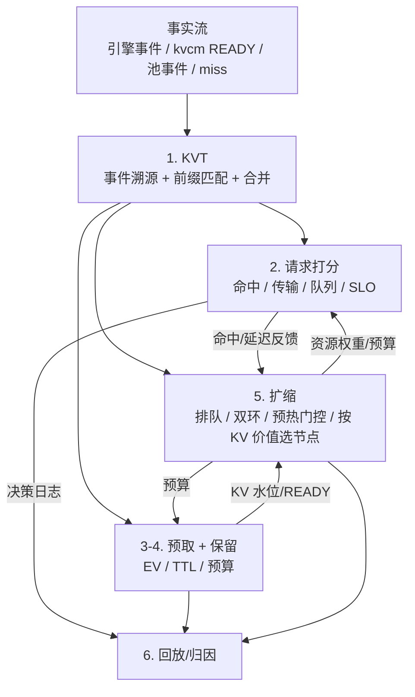

三类算法，分别回答：

1. **看什么**：KVT 怎么把多源事件变成可查询的命中视图；
2. **怎么选**：请求、预取、保留、扩缩各自怎么算；
3. **怎么证明赚**：每个决策对应哪个指标、多少量级。

---

## 1. 记号与收益定义

| 记号 | 含义 |
|---|---|
| `P` | prompt token 数 |
| `B` | block token 数（128） |
| `S_bytes` | 前缀字节数 = `P × bytes_per_token` |
| `S_saved` | 预期节省的时间（命中/防 miss） |
| `v_prefill` | **整实例**有效 prefill 吞吐（token/s），不是每 GPU；随上下文长度与命中率非线性下降 |
| `BW` / `BW_eff` | 本次/到节点 n 的实际有效带宽；按平面取 `BW_h2d` / `BW_storage` / `BW_compute` |
| `BW_h2d` / `BW_storage` / `BW_compute` | 三类网络的有效带宽：本机 H2D、存储面、计算面 |
| `T_prefill` | 重算时间 = `P / v_prefill` |
| `T_transfer` | 跨机传输 = `S_bytes / BW_storage` 或 `BW_compute`；950 ROCE 实测约 23.8GB/s |
| `T_h2d` | 本机 DRAM→HBM 拷贝 = `S_bytes / BW_h2d`；950 单机 UB_CTP≈46.9GB/s、POD≈93.4GB/s（两种场景）；800Gbps 是链路口径 |
| `Q` | 队列等待 |
| `D` | TTFT 目标 |
| `L` | 模型层数（含 MTP 层） |

`v_prefill` 不能当常数：attention 是 O(P²)，长上下文下每 token 的 prefill 成本上升；命中率高时 residual 虽小，仍要 attend 全部缓存 KV，同样不是常数。校准必须按实际上下文长度分档。

收益拆成四段：

```text
T_total ≈ Q + T_kv + T_h2d
```

其中 `T_kv` 是「拿到前缀 KV」的代价，**不能简单写成 `T_prefill + T_transfer`**：

```text
can_overlap 时：T_kv = max(T_compute(residual), T_transfer)
不能掩盖时   ：T_kv = T_compute(residual) + T_transfer
```

## 1.1 传输能否被计算掩盖

vLLM 的 KV connector 是逐层的（`KVConnectorBase_V1::start_load_kv` 启动异步加载，`wait_for_layer_load` 在每层 attention 内阻塞等该层到位）。所以重叠的形态是「第 N 层算的时候，第 N+1 层在传」。

**掩盖的前提是有计算可跑。** 逐层流水成立的条件是「每层传输时间 < 每层计算时间」：

```text
每层传输 = S_bytes / L / BW
每层计算 ≈ T_compute(residual) / L
成立条件：S_bytes / BW < T_compute(residual)
```

这个条件在长上下文下会随命中率翻转：

| 场景 | residual | `T_compute` | 能否掩盖 |
|---|---|---|---|
| **1M 全 miss** | 1M | 分钟级（attention O(P²)） | 能，传输可忽略 |
| **1M 命中 99.9%** | 1K | 几百 ms | **不能**，传输主导 |

**关键：命中率高不等于快。** 它把计算压掉了，却把传输量留在满额。这是 DualPath（arXiv:2602.21548v2）的出发点：agentic 多轮命中率 ≥95%，瓶颈从计算转成 KV 加载 I/O。

临界点：

```text
可掩盖token数 = T_transfer × v_prefill
若 residual < 可掩盖token数：传输主导，且无法掩盖
```

### 逐层失败后的两种选择

逐层拉取在功能上永远可行，代价是 GPU 空转。发现掩不住时有两条路：

| 选择 | TTFT | 吞吐 | 何时选 |
|---|---|---|---|
| **仍然逐层拉** | 更短（第一层到位即开始） | **差**：某层没跟上，整个 batch 这一步空转 | 单请求、batch 小、延迟优先 |
| **先搬到本机 DRAM 再调度** | 更长（等搬完） | 好：搬运期间 GPU 去服务别的请求 | 高并发、吞吐优先 |

第二条不需要搬到 HBM。本机 DRAM→HBM 走 950 专用 UB：单机 UB_CTP 实测≈47GB/s、POD≈93GB/s（两种场景）；通常比跨机 ROCE（≈23.8GB/s）快，具体倍数按部署实测。

### 胖 KV 的例外

GLM-5.2（93 KB/token）这类模型的 KV 特别大，即使搬到本机 DRAM 也可能藏不住：

- 1M 上下文 ≈ 95.2 GB，本机 DRAM→HBM（47 GB/s）≈ 2.03 s（POD 93GB/s 约 1.02 s）
- 此时只有**HBM 驻留**（命中即零拷贝）才够

这解释了为什么长上下文 + 胖 KV 场景下，HBM 命中率是硬指标。

### 对 batch 的影响

跨机访问不只影响这一个请求。continuous batching 的 forward 按层推进，某层没就绪就整体等：

```text
T_batch_step = max over requests(自身 T_kv)
```

最慢的那个决定整步。所以损失不是「省 X ms 传输」，而是「避免拖慢整个 batch 一步」，batch 越大、命中率越高，收益越大。

---

## 1.2 命中层级的取项

按命中层级选 `T_kv`：

- **miss（无命中）**：`T_kv = T_prefill`
- **远端池命中**：残差很小，通常落在「不能掩盖」区间，`T_kv ≈ T_transfer`
- **本机 DRAM 命中**：`T_kv = T_h2d`（仍有，但没有跨机那一段）
- **HBM 命中**：`T_kv ≈ 0`

---

## 2. KVT：把事件变成命中视图

### 2.1 事件溯源 + 物化视图

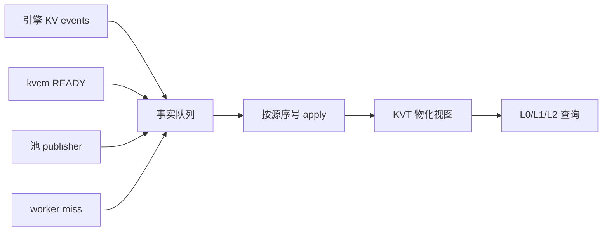

**算法**：

1. 每个源独立维护 `seq`；
2. 事件到达按 `(source, seq)` 应用；跳号先 replay，再 snapshot，最后标 stale；
3. 负事实（删除/失效）写墓碑，墓碑 TTL 内禁止 `Stored` 复活；
4. 同一 block 同一实例同一介质只保留一条位置，不同介质可并存。

**复杂度**：事件 apply `O(1)`/块（哈希查表）；请求 match `O(P/B)`（逐块查表）；内存约 `N_blocks × (32B + L×24B + overhead)`。

**收益**：选路零 RPC；命中长度精确；多源不打架。

### 2.2 链式 block hash + 前缀匹配

vLLM 的 key 是链式 hash：`h_i = H(h_{i-1}, tokens_i)`。请求自带一条 hash 链，KVT 逐块查：

```text
match(P) = 从第一块开始，连续命中同一实例的块数
```

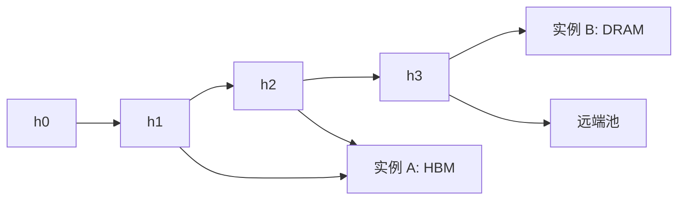

命中定义：

```text
hit_tokens = contiguous_blocks × B
local_hbm  = 连续 HBM 已确认块数 × B
local_dram = 连续本机 DRAM 块数 × B
pool_hit   = 连续池内块数 × B
```

**收益**：只把“连续命中”算作可复用前缀，避免中段空洞导致的错误 HBM 命中判断。

### 2.3 多源合并：source rank + seq + 墓碑

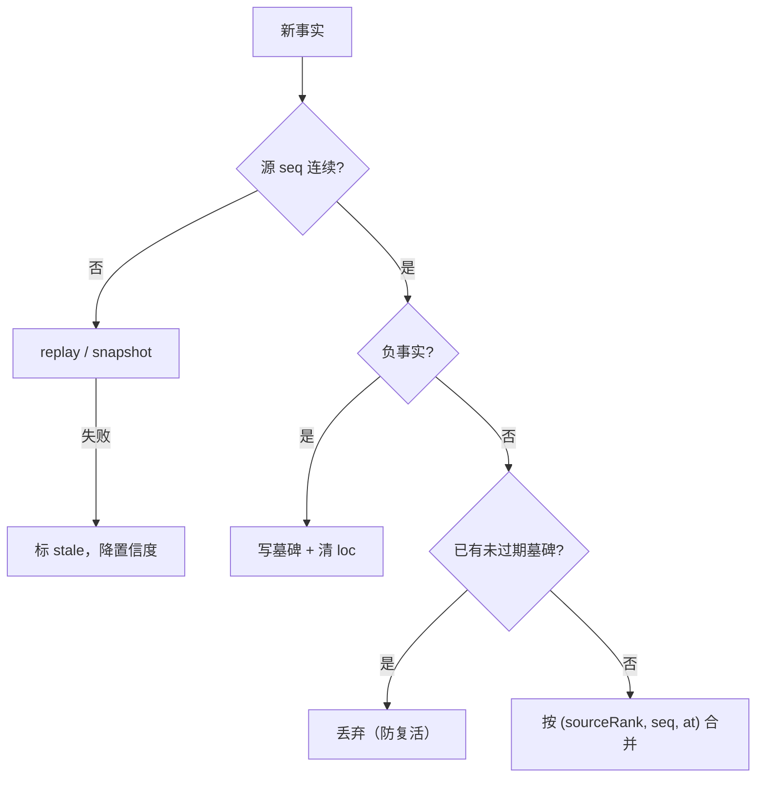

源信任级：

```text
MASTER_VERIFY = 4
KVCM_READY    = 3
ENGINE_EVENT  = 2
POOL_EVENT    = 2
ROUTE_SPEC    = 1
未命中反馈 = 4（负事实）
```

**收益**：池删除能覆盖引擎旧事件；延迟到达的 `Stored` 不会复活已删条目。

### 2.4 推测索引 + 置信度

**Ghost（幽灵条目）** = 索引说“这块 KV 在”，池里其实已经被驱逐/删除；请求被送到空节点，只能远端读/重算。

请求刚路由、引擎事件还没到 → 写短 TTL 的“预测”条目：

```text
TTL_spec = E[event_delay] + 3σ[event_delay]    // 默认 2s，经验值
conf(t) = conf0 × exp(−(t − t0)/τ)
P_ghost ≈ 1 − exp(−λ_delete × age)
```

用途：

- 推测条目只用于**亲和排序**，不作为 HBM 命中证据；
- `conf < 0.9` 不允许 HBM 命中判定；
- `P_ghost × C_miss` 进入 L0 的 risk 项，优先对账热条目。

**收益**：降低批内竞态导致的假 miss；ghost 只损性能，不损正确性。

---

## 3. 请求打分：选哪个实例

### 3.1 效用函数

先定义符号，再写公式：

| 符号 | 含义 |
|---|---|
| `H/P` | 连续 HBM / 池命中 token |
| `B` | 要传的字节 |
| `Q` | 队列等待 |
| `F/R` | hook 未来价值 / 陈旧或 ghost 风险 |
| `T_transfer` | 本次传输耗时 = `B / BW_eff` |
| `w_hit/w_pool/w_transfer/w_q/w_slo/w_future/w_risk` | 各项权重，由 L2 的资源权重给出 |
| `c_prefill/c_bw/c_queue/c_slo` | 单位成本（秒、字节、排队、SLO 违约） |
| `κ_tier` | DRAM/NVMe/DFS 的折扣 |

```text
U(r,n) =
    w_hit     × H(r,n) × c_prefill
  + w_pool    × P(r,n) × c_prefill × κ_tier
  − w_transfer× T_transfer(r,n) × c_bw
  − w_q       × Q(n) × c_queue
  − w_slo     × max(0, TTFT(r,n) − D) × c_slo
  + w_future  × F(r,n)
  − w_risk    × R(r,n)
```

`BW_eff` 按三类网络分开取：

- 本机 DRAM→HBM：`BW_h2d`（950 单机 UB_CTP≈47GB/s；POD≈93GB/s，分开取值）；
- 从池/远端读 KV：`BW_storage`；
- 实例间 KV 传：`BW_compute`（和集合通信共享，要加竞争惩罚）。

**不能用估算的带宽**：§1.1 的掩盖判据依赖 `T_transfer` 的准确性，估高了会把「不能掩盖」误判成「能掩盖」，选出一个实际更慢的节点。

### 3.2 TTFT 估算

```text
TTFT(r,n) = Q(n)
          + residual(r,n) / v_prefill(n)
          + B(r,n) / BW_eff(n)
          + T_handoff
```

`residual = P − H`；HBM 命中时 `B≈0`，通常只剩末 token 残差。

**这个式子假设传输能被计算掩盖**（两项相加，不是取 max）。按 §1.1，残差很小时不成立：

```text
可以掩盖：TTFT = Q + max(residual/v, B/BW_eff) + T_handoff
不能掩盖：TTFT = Q + residual/v + B/BW_eff + T_handoff   ← 上式
判据：residual < B/BW_eff × v_prefill
```

选路时应按节点分别判断：同一个请求，走节点 A 可能能掩盖（A 带宽高），走节点 B 不能。

### 3.3 决策流程

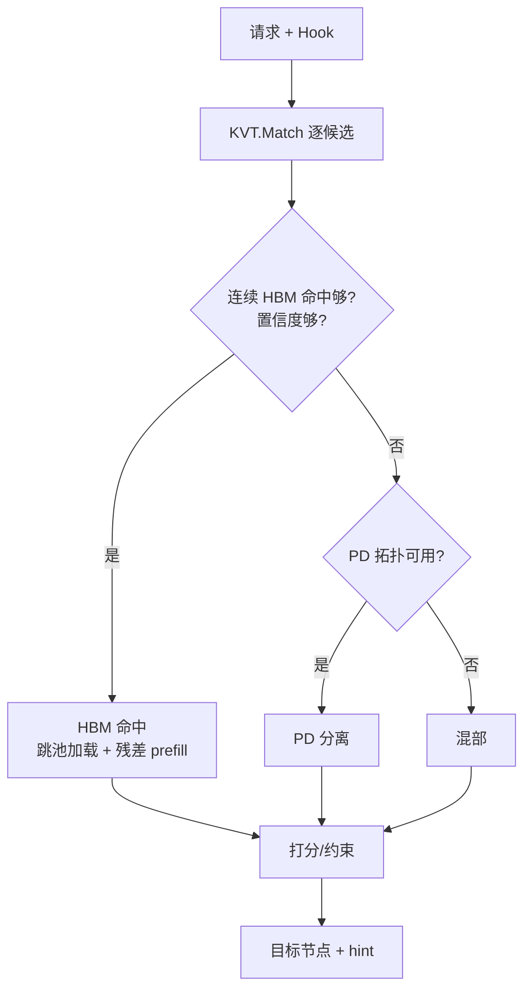

**收益**：把“命中、传输、队列、SLO、未来复用”放进同一个可解释分数；不追求全局最优，追求 5ms 内足够好。

> PD 的默认选择：agent/长上下文优先 PD；`BW*` 只用于“传 vs 算/能否掩盖”，不是 PD 的开关。拓扑不可用才退回混部。

---

## 4. 预取：值不值得搬

### 4.1 期望价值

`EV` = 期望收益；`P_use` = 未来窗口内至少用一次的概率；`S_saved` = 用上时省下的时间。

未来请求按 Poisson 到达，窗口 `T` 内至少一次：

```text
Λ = ∫_0^T λ(s) ds
P_use = 1 − exp(−Λ)
S_saved = p_miss_avoided × T_prefill
        + p_remote_to_local × (T_transfer − T_h2d)
EV = P_use × S_saved − C_copy − C_occupancy
C_copy = S_bytes / BW_copy × c_bw
C_occupancy = S_bytes × T × c_mem
```

一个重要的读数：

- 如果预取只是把“远端命中”变“本机 DRAM”，收益是 `T_transfer − T_h2d`，按实测：8K 约 16ms（单机 47GB/s）/ 8ms（POD 93GB/s），70K 约 142ms / 72ms；跨机另算；
- 如果它防止了一次驱逐/重算，收益是 `T_prefill`（秒级）。
- **所以预取要和保留一起做**。

### 4.2 预算背包

```text
max Σ x_i × EV_i
s.t. Σ x_i × bytes_i ≤ B_budget
     Σ x_i × bytes_i / deadline_i ≤ BW_budget
     x_i ∈ {0,1}
```

贪心排序：`EV_i / bytes_i`（每字节期望收益）从高到低；同价值按 deadline 早优先。

### 4.3 EV 曲线

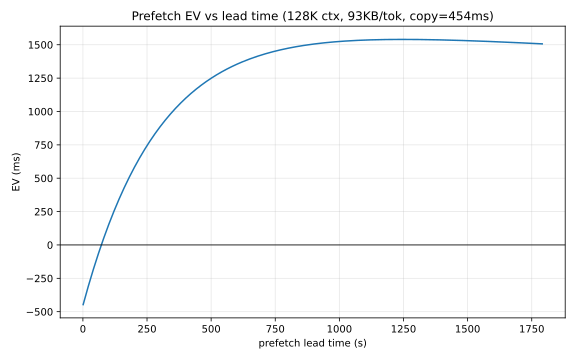

> 参数：128K 上下文（GLM-5.2，`S_bytes=12.2GB`）、`S_saved≈2200ms`（命中率 +10% 省下的 prefill）、`λ=1/300`、`C_copy≈512ms`（ROCE 23.8GB/s 一次搬运）。曲线先升后降：太早预取白占内存，太晚赶不上请求。

**注意 `C_copy` 与 `S_saved` 的量级**：128K 时一次跨机搬运约 512 ms，而防住一次重算省 2200 ms——比值约 4.3:1。到 1M 时两者都放大，但比值不变（都随 `P` 线性）。

**收益**：预取 ROI 可算；带宽按价值密度分配，不被低价值预热打爆。

---

## 5. 保留：保多久

### 5.1 Net(T) 与盈亏平衡

```text
Net(T) = p_resume(T) × T_prefill − c_h × bytes × T − C_risk
p_resume(T) = p0 × exp(−μT)
break-even: μ × p0 × exp(−μT) × T_prefill = c_h × bytes
```

- `p0`：会话恢复概率；`μ`：恢复概率衰减率；
- `c_h`：每字节每秒的占用成本；
- 解出的 `T*` 与 `T_max` 取小；解不出就退化为固定窗口。

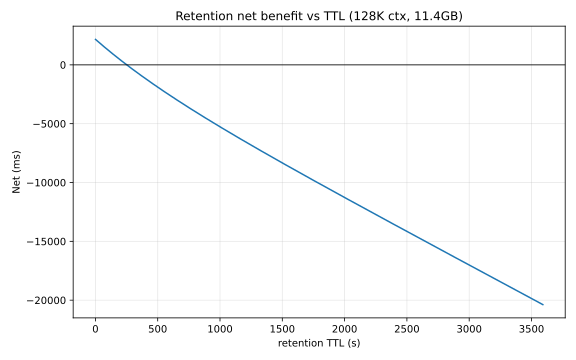

> 参数：128K 上下文、`S_saved≈2200ms`、`p0=1`、`μ=1/600`、占用成本按 12.2 GB × 0.5 ms/(GB·s) 计。曲线的零点就是最优 TTL 上界。

### 5.2 等级选择

| 等级 | 判据 | 机制 |
|---|---|---|
| `NONE` | `Net(T) < 0` | 池 LRU/TTL |
| `SESSION` | `Net(T) > 0` 且预算允许 | keepalive/soft pin |
| `PIN` | 高价值且 `T` 有上限 | hard pin 或 lease 延长 + 持续续租 |
| `DURABLE` | 停顿长/节点将下线 | demote 到 SSD / DFS retain |

**收益**：把“保留多久”从拍脑袋变成“恢复概率 vs 占用成本”的盈亏平衡；避免无限 pin 把池子占满。

---

## 6. 扩缩：加几个、缩哪个

### 6.1 排队与容量

```text
ρ = λ / (c × μ)
c_min = ceil(λ / (μ × ρ_target))
L = λ × W                （Little 定律）
```

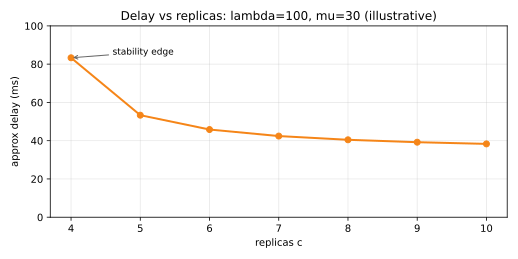

> 参数：`λ=100 req/s`、`μ=30 req/s/副本`、目标 `ρ_target=0.8`。`c_min≈5`；低于 5 会进入不稳定区，延迟迅速上升。

### 6.2 双环控制

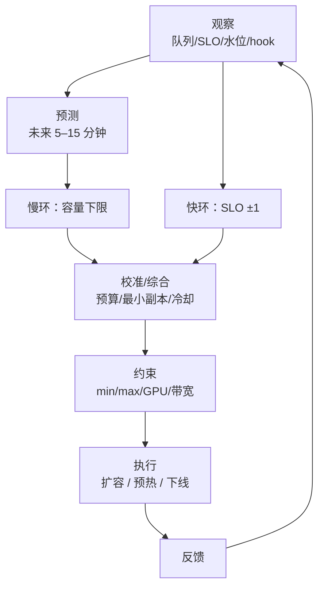

```text
if p99(TTFT) > D for N 个周期: c += 1
if p99(TTFT) < 0.7D and ρ < 0.5 for M 个周期: c -= 1
T_cool ≥ T_provision + T_warm + T_drain
```

**收益**：慢环防预测错误，快环保突发；冷却防振荡。

### 6.3 预热门控

新实例先预热；**覆盖率** = 已确认 KV 的权重 / 目标前缀总权重；`w_b` 是块权重（按 token 数/层数/是否关键前缀），`W_min` 是接流门槛，`T_deadline` 是最晚接流时间，`route_weight` 是给新实例的接流权重。

```text
coverage = Σ w_b × 1[b 已确认] / Σ w_b
ready if coverage ≥ W_min or t ≥ T_deadline
route_weight = min(1, coverage / W_min)
```

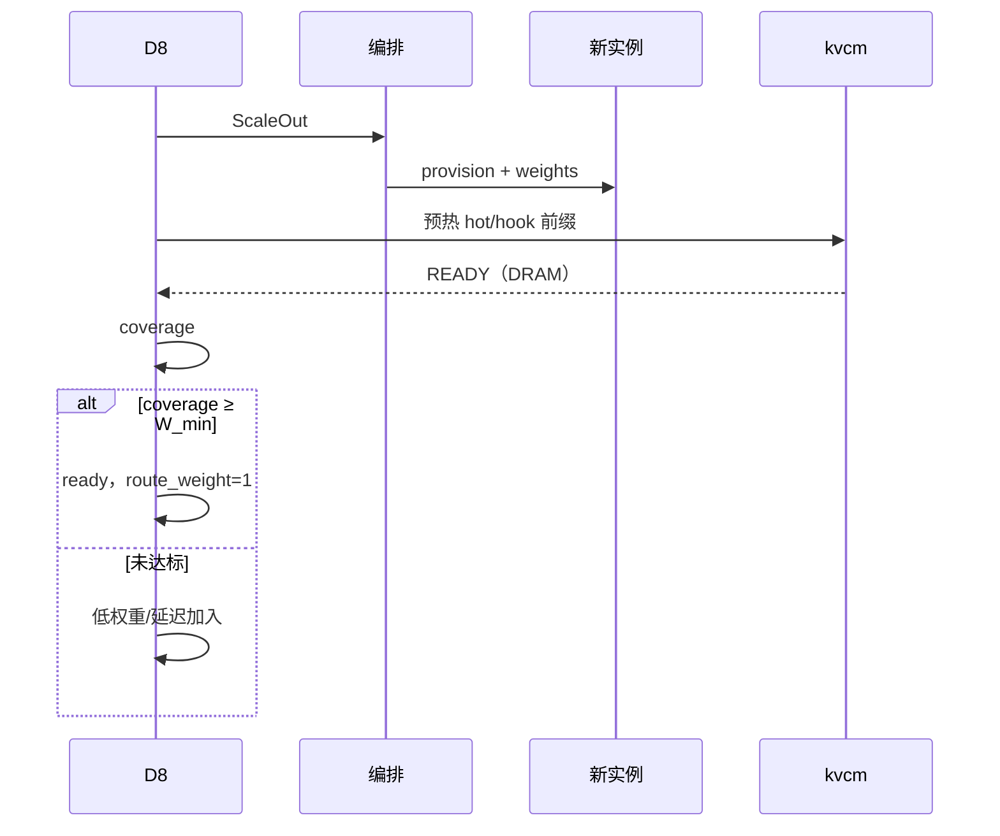

**收益**：新节点不是“起来就接流量”，避免冷 miss 和 TTFT 抖动。

### 6.4 按 KV 价值选缩容节点

`loss` = 缩掉它损失的 KV/SLO/迁移成本；`gain` = 释放出的容量价值；选 `gain − loss` 最大的节点。

其中 `uniqueHotKV` = 只有该节点持有的热 KV；`refill` = 重建这些 KV 的代价；`sessionRisk` = 活跃/待恢复会话的风险；`migrationCost` = 搬走要花的字节/时间；`idleCapacity` = 可释放的空闲容量；`c_capacity` = 单位容量价值。

```text
loss(v) = uniqueHotKV(v) × refill
        + sessionRisk(v)
        + migrationCost(v)
gain(v) = idleCapacity(v) × c_capacity
choose max(gain − loss)
```

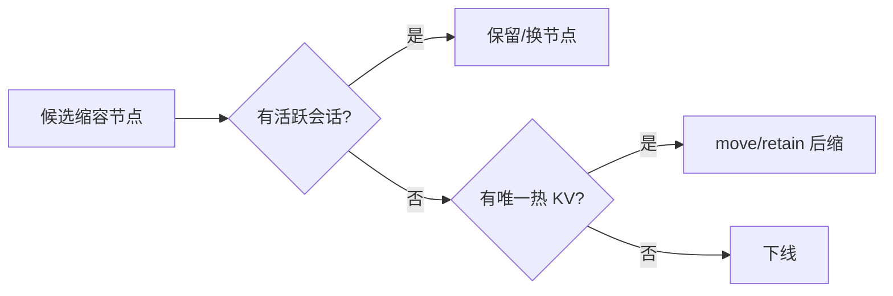

**收益**：不用 LIFO，避免缩掉持有热前缀/活跃会话的节点。

### 6.5 热点前缀多副本与迁移（负载整形）

传统 KV-aware router 只有两条路：

1. 把请求发给**持有前缀的实例**——命中高，但热点前缀会把单实例打爆；
2. 把请求发给**空闲实例**——负载低，但要跨机读/重算。

第三条路：**改 KV 的放置**——把热点前缀复制到多个实例，或把前缀迁到更合适的位置，让“命中”和“负载”同时成立。这是 D8 相对“只读缓存索引”的核心增量。

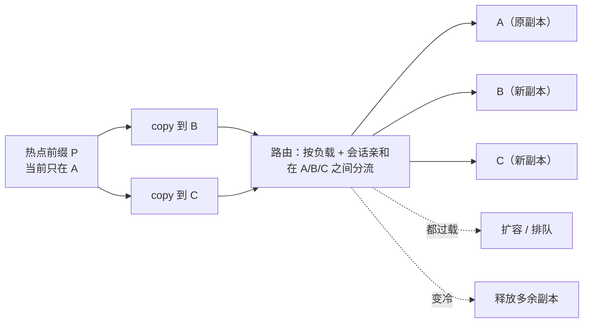

#### 算法

1. **检测热点**：按前缀聚合 `λ_p`（EWMA 请求率）、队列、p99 TTFT、当前副本集合 `R_p`。
2. **算目标副本数**：

```text
r_target = ceil(λ_p / (μ_p × ρ_target))
```

`μ_p` 是该前缀在单实例上的服务能力（req/s），`ρ_target` 是目标利用率。`r_target` 只是下界，实际还要看容量、内存、网络。

3. **加副本**：若 `|R_p| < r_target`，且

```text
Benefit = λ_p × (W_single − W_multi) × c_slo
Cost    = (|R_p| − 1) × S_bytes × c_mem × T
        + copy_bytes / BW × c_bw
```

`Benefit > Cost` 才复制；否则宁可排队/扩容，或路由到其他副本。
4. **选目标**：按 `headroom − queue − transfer_cost + topology_bonus` 选实例；避免同一故障域；目标 seg 容量不足不提交（PR72）。
5. **减副本**：`|R_p| > r_target` 且没有会话引用/保留 TTL，释放多余副本；保留至少一份。
6. **迁移**：节点 drain、故障、拓扑变化时用 `move`；负载分散优先用 `copy`（源保留，多副本分流）。
7. **回写**：copy/move READY 后更新 KVT；路由在副本集合内按“队列 + 传输 + 会话亲和”选点。

#### copy / move / retain 的分工

| 操作 | 语义 | 适用 |
|---|---|---|
| `copy` | 副本 +1，源保留 | 热点前缀分流、扩容预热 |
| `move` | 副本搬家，源删除 | 节点 drain、故障迁移、副本归拢 |
| `retain` | 保副本跨引擎存亡 | 会话停顿、长生命周期 |

**注意**：`copy` 是“多一份”，不是“把负载从 A 挪走”——A 还在，只是请求可以分流到 B/C；要真正减 A 的压力，路由必须把新请求分到副本集合，而不是继续粘 A。

#### 会话的边界

- **多个独立会话共享同一前缀**（system prompt、tools、RAG 文档）：副本集合可以真正分散请求。
- **同一个会话的 decode**：一条序列只能在一个实例上跑；复制前缀不会把 decode 拆开。要分散单会话负载，需要请求迁移/会话迁移（未来特性），不是 KV 复制能解决的。
- 所以“分散会话”要区分：**分散共享前缀的多个会话**（可以）vs **拆分单个会话的解码**（不行，至少现在不行）。

#### 与已有技术的关系

| 能力 | 已有实现 | 局限 | 我们的增量 |
|---|---|---|---|
| 单副本命中路由 | Dynamo/llm-d/AIBrix/SGLang 的 KV-aware router | 只看“谁有”，不改变放置 | 把放置作为执行器 |
| 自动加副本 | Mooncake main `SubmitReplicaActionProposal`（热度驱动） | 目标由 master 选，不能指定实例；不感知 hook/会话/扩缩 | 指定目标、副本数、预算、与路由/扩缩联动 |
| P2P 复制 | llm-d P2P KV sharing（locality 破裂时补传） | 反应式、单次、非多副本热点 | 主动多副本 + 会话/负载规划 |
| 迁移 | Mooncake `CreateCopyTask`/`CreateMoveTask`/`CreateDrainJob` | 有原语，无跨层决策 | D8 决定“搬哪个、搬到哪、搬几份” |

**结论**：KV 命中是已有技术。我们的增量是把 KV 的放置变成负载均衡的执行器：知道热点在哪、该复制几份、放哪、什么时候撤，并和路由/扩缩/会话一起决策。

### 6.6 资源权重

有的材料把这种权重叫“影子价格”；这里就是**资源紧张程度映射成的权重**，不是钱。

```text
w = clamp(w0 × (util / util_target)^k, w_min, w_max)
```

- `util`：当前利用率/水位；`util_target`：目标水位；
- `w0`：基准权重；`k`：敏感度；`w_min/w_max`：上下限；
- `clamp(x, lo, hi)`：把 x 夹在 `[lo, hi]` 之间，防止权重无限大/无限小。

L2 更新权重；L0/L1 只读：

| 权重 | 高时怎么变 |
|---|---|
| `w_hbm` | 少保留、短 TTL、优先 HBM 命中 |
| `w_transfer` | 少跨机传输、多本地/重算 |
| `w_prewarm` | 只预取高期望收益 |
| `w_slo` | 更激进扩容/预取 |

**收益**：三条环不用做全局在线优化，也能朝同一方向走；权重可解释、可回滚。

---

## 7. 一致性与 HA 算法

| 问题 | 算法 | 收益 |
|---|---|---|
| 多实例同时扩缩 | etcd lease 选 leader；只有 leader 出 ScaleDecision | 不打架 |
| 重复 intent | 幂等键 `(prefix,target,op)`；kvcm 去重 | 不重复搬 |
| 事件丢失 | 每源 seq + gap replay/snapshot | 索引可恢复 |
| 决策不可复盘 | 决策日志记录输入/候选/权重/选择/版本 | 可回放/可 A/B |
| leader 故障 | lease 过期重选；新 leader 从最新 KVT/权重继续 | 短暂停、不丢状态 |

---

## 8. 整体收益：从算法到账

### 8.1 延迟量级

> 下表按 950 实测口径：ROCE 跨机约 23.8GB/s；本机 H2D 单机 UB_CTP 约 47GB/s、POD 约 93GB/s（两种场景，不并列成区间）。`93KiB/token` 来自 llm-d 架构文档的 GLM-5.2 估算；按模型配置的推导式是 `2 × 层数 × KV heads × head_dim × 精度字节`，本仓库没有逐项核对，换模型要重算。800Gbps 是链路口径，不等于有效 H2D；换拓扑必须重测。950 H2D 口径见 [hixl performance](https://gitcode.com/cann/hixl/blob/master/benchmarks/performance.md)、[MindCluster 工具](https://www.hiascend.com/document/detail/zh/mindcluster/latest/toolbox/toolboxug/toolboxug_0015.html)、[Ascend 950DT 测量](https://gitcode.com/cann/cannbot-knowledge/blob/master/knowledge/common/platforms/concepts/ascend950dt_measured_observations.md)、[MindIE 拓扑带宽诊断](https://gitcode.com/Ascend/MindIE-SD/blob/5cda9fbf4aa60c5b893c4ce3b926f8344c1dc838/.agents/skills/parallelism-strategy/references/ascend-topology-bandwidth-diag.md)。

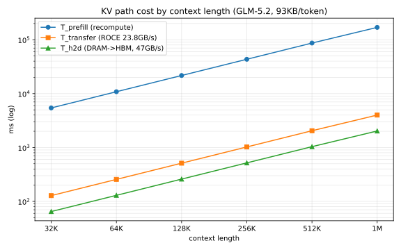

> 参数：GLM-5.2 口径 `bytes_per_token=93KiB`、`L=79`（含 1 层 MTP）、`v_prefill=5900 token/s`（整实例，**输入假设，不是实测**）、跨机 `BW_storage=23.8GB/s`（950 ROCE 实测）、本机 `BW_h2d=47GB/s`（UB_CTP Server；POD 约 93GB/s）。

#### KV 大小与传输时间

`S_bytes` 按十进制 GB 计（93KiB/token × P / 1e9）；1M 约 95.2GB，不是 88.7GB。

| context | `S_bytes` | 跨机 ROCE 23.8GB/s | 本机 H2D 47GB/s | 每层跨机（79 层） |
|---|---:|---:|---:|---:|
| 32K | 3.05 GB | 128 ms | 65 ms | 1.6 ms |
| 64K | 6.10 GB | 256 ms | 130 ms | 3.2 ms |
| 128K | 12.19 GB | 512 ms | 259 ms | 6.5 ms |
| 256K | 24.38 GB | 1024 ms | 519 ms | 13.0 ms |
| 512K | 48.76 GB | 2049 ms | 1037 ms | 25.9 ms |
| 1M | 95.23 GB | 4001 ms | 2026 ms | 50.6 ms |

#### 能不能掩盖，只看命中率

按 §1.1 的判据（`T_compute(residual) > T_transfer` 才能掩盖）：

| 命中率 | 跨机 | 本机 DRAM |
|---|---|---|
| 90% | 能 | 能 |
| 95% | 能 | 能 |
| **99%** | **不能**（所有长度） | **不能**（按 47GB/s）；POD 93GB/s 时能 |
| **99.9%** | **不能** | **不能**（所有长度） |

**分界线与上下文长度无关，只与命中率有关。** 原因是 `T_compute` 和 `T_transfer` 都随 `P` 线性增长，比值只由 `(1−hit) × v_prefill` 与 `BW` 决定：

```text
掩盖条件改写： (1 − hit) × P / v_prefill > P × bytes_per_token / BW
                约去 P：  (1 − hit) > v_prefill × bytes_per_token / BW
```

代入 GLM-5.2：`5900 × 93KB / 23.8GB/s ≈ 0.023`，即 **hit < 97.7% 才能跨机掩盖**。本机 H2D 47GB/s 的阈值是 `5900 × 93KB / 47GB/s ≈ 0.0117`，即 **hit < 98.8%**；POD 93GB/s 时约 **99.4%**。

#### 高命中率下的实际代价

命中 99% 时（agentic 典型区间的上沿）：

| context | residual | 跨机 `T_kv` | 本机 `T_kv` | 差值 |
|---|---:|---:|---:|---:|
| 32K | 320 | 182 ms | 119 ms | 63 ms |
| 128K | 1,280 | 729 ms | 476 ms | 253 ms |
| 512K | 5,120 | 2917 ms | 1905 ms | 1012 ms |
| 1M | 10,000 | 5696 ms | 3721 ms | 1975 ms |

差值就等于 `T_transfer`：**一旦不能掩盖，跨机那一段是纯加项。**

再叠上 batch 效应（§1.1）：跨机的那 2.0 s（512K）不是只拖慢这一个请求，是拖慢整个 batch 这一步。

#### 结论

1. **预取的价值在命中率接近 99%（≥98.8%）时才是主项。** 中低命中率下，计算足以掩盖传输，本地放置收益接近零。
2. **高命中率场景下，本机 DRAM 就够**，不必追 HBM——除命中率 ≥98.8%（POD 93GB/s 约 99.4%）的情形。
3. **胖 KV（GLM-5.2 这类）把分界定在 97.7%（跨机 ROCE 23.8GB/s）与 98.8%（本机 H2D 47GB/s）**；POD H2D 93GB/s 时本机约 99.4%。比 MLA 类薄 KV 低得多，因为每 token 字节数大。

### 8.2 吞吐/成本

```text
节省的 GPU 时间/秒 = QPS × Δhit_rate × T_prefill
等效 GPU 数 ≈ 节省的 GPU 时间/秒
C_total = GPU 时间×c_gpu + 传输字节×c_bw + 驻留字节×T×c_mem + 浪费
ROI = saved / cost
```

例子（命中率 +10%）：

- 128K、2 QPS：每请求省 `0.1 × 128000 / 5900 ≈ 2.2 s`，合计 **4.3 GPU·s/s**；
- 1M、0.5 QPS：每请求省 `0.1 × 1M / 5900 ≈ 16.9 s`，合计 **8.5 GPU·s/s**。

长上下文的单请求收益大，但 QPS 天然低；短上下文 QPS 高但单请求收益小。两者相乘后的量级接近。

### 8.3 算法 → 指标 → 收益

> 这一节只回答「用哪个指标衡量」。**每个算法解决什么失效模式、边界在哪，见 §8.6。**

| 算法 | 主要指标 | 收益怎么来 |
|---|---|---|
| KVT/前缀匹配 | 命中率、选路延迟 | 零 RPC 查命中；避免中段空洞误判 |
| 多源合并/墓碑 | ghost 率、误路由 | 删除能覆盖旧事件；不复活 |
| 推测索引/置信度 | 批内假 miss、TTFT | 补事件传播窗口；只做亲和 |
| 请求打分 | TTFT、SLO 违约 | 命中/传输/队列/未来价值一起算 |
| 传 vs 算阈值 | 传输字节、TTFT | 慢网络时重算，快网络时传 |
| 预取 EV/背包 | 预取 ROI、浪费 | 只搬高价值；带宽不被打爆 |
| 保留 TTL | resume 命中、内存占用 | 盈亏平衡，不无限 pin |
| 排队/双环 | Ready 时延、振荡次数 | 慢环定下限、快环救突发 |
| 预热门控 | 冷 miss、TTFT 抖动 | 新节点预热达标才接流 |
| 缩容节点损失/收益 | 缩容后命中率 | 不缩热节点/活跃会话 |
| 资源权重 | 成本、全局协调 | 三环用同一组权重信号 |
| leader/幂等/日志 | 冲突、恢复时间、可复盘 | 不打架、可重试、可回放 |

### 8.4 收益的边界

- 短 prompt：prefill 小，传输/队列占比高，预取未必值；
- 低复用：保留/预取浪费内存，TTL 要短；
- 带宽满：预取与请求争带宽，必须限速；
- HBM 压力：pin 太多会挤掉其他前缀，全局命中率可能下降；
- hook 不准：预取到错前缀/错实例，ROI 为负；
- 参数未校准：权重/阈值只是起点，必须真机校准。

---

### 8.5 要观测的收益指标

| 指标 | 回答 |
|---|---|
| `hit_rate`（pool/local/HBM 分层） | 命中率是否提升 |
| `prefill_saved_tokens` | 省了多少重算 |
| `transfer_saved_bytes` | 省了多少跨机传输 |
| `prefetch_hit_rate` / `waste_bytes` | 预取是否值 |
| `retention_hit_rate` / `wasted_retention` | 保留是否值 |
| `TTFT_p99` / `ITL_p99` | 用户感知 |
| `gpu_seconds_saved` / `cost_per_1k_tokens` | 成本 |
| `scale_ready_latency` / `warm_coverage` | 弹性 |
| `ghost_ratio` / `verify_miss_rate` | 索引可信度 |

---

### 8.6 算法与技术清单

每个算法都对应一个具体失效模式，不是“技术堆砌”：

| 技术/算法 | 解决什么 | 怎么用 | 主要收益 | 边界/风险 |
|---|---|---|---|---|
| **事件溯源 + 物化视图** | 全局 KV 位置不可每请求查 master | 引擎事件/kvcm READY/池事件 → KVT；查询走内存 | 选路零 RPC、低延迟 | 最终一致，需要墓碑/对账 |
| **链式 block hash + 前缀链匹配** | 前缀复用要精确到块 | 按引擎 hash 链逐块查 KVT，取连续命中 | 命中长度准确；支持 TP/DP 去重 | hash 口径必须与引擎逐字节一致 |
| **推测索引 + TTL** | 请求已路由、引擎事件还没到 | 路由后写短 TTL 推测条目，只做亲和 | 降低批内竞态导致的假 miss | 不能作为 HBM 命中证据 |
| **多源合并：source rank + seq + 墓碑** | 引擎/池/kvcm 事件互相覆盖 | 每源独立序号；负事实优先；墓碑防复活 | 多源不打架；删除可收敛 | 源 gap 时要 replay/snapshot |
| **gap 检测 + replay** | 事件丢失/乱序 | 跳号重放；不可用则 snapshot；再不行标 stale | 索引可恢复 | replay buffer 有界 |
| **效用打分/成本模型** | 多目标（命中/传输/队列/SLO） | 分层权重 + TTFT 估算 + SLO 惩罚 | 选路可解释、可调 | 权重需真机校准 |
| **传 vs 算阈值 `BW*`** | 远端命中是否值得传 | `BW* = B·c_bw/(residual·c_prefill)` | 避免“为了省重算反而更慢” | 带宽要有效测量 |
| **预取期望收益 + 预算背包** | 预取可能白做 | Poisson 到达估 `P_use`；按每字节期望收益贪心 | 预取 ROI 可控；带宽不被打爆 | ETA/复用率是估计 |
| **保留 TTL 盈亏平衡** | 保留太久浪费内存 | `p_resume(T)·S` vs 占用成本；指数衰减求 break-even | 会话保留可量化 | 恢复概率难估 |
| **Little 定律 + 利用率目标** | 扩缩只看队列会滞后 | `L=λW`、`ρ=λ/(cμ)`、`c_min` | 容量有公式、可解释 | 突发/长尾需快环 |
| **双环控制 + 滞回/冷却** | 扩缩振荡 | 慢环定下限、快环 ±1；cooldown > ready+warm+drain | 少抖动、少反复扩缩 | 参数需调 |
| **预热门控覆盖率** | 新节点没 KV 就接流量 | 加权“已确认”比例；未达标低权重 | 减少冷 miss | 会延迟新节点接流 |
| **按 KV 价值选缩容节点** | LIFO 缩掉热节点 | `loss/gain` 比较唯一热 KV、会话风险、迁移成本 | 缩容不砸命中率 | 需要 KVT/会话视图 |
| **资源权重/分解** | 三环各自为政 | L2 出权重，L0/L1 局部最优 | 联合但不做全局在线优化 | 权重更新需稳定 |
| **leader lease + 幂等** | 多 SC 实例同时扩缩 | etcd lease 选主；intent 幂等键 | 不打架、可重试 | leader 故障有短暂停 |
| **决策日志/回放** | 事故无法复盘、参数不敢调 | 记录输入/候选/权重/选择/版本 | 可解释、可 A/B、可回放 | 日志成本 |

**技术栈（与算法分开看）**：

| 层 | 技术 | 用途 |
|---|---|---|
| 事件 | ZMQ（引擎 KV events / Mooncake publisher） | 高频、best-effort 的位置/删除事件 |
| 决策接口 | gRPC | SC ↔ kvcm intent、READY/失败回执 |
| 池操作 | Mooncake master RPC / HTTP admin | copy/move/lease/核验 |
| 状态 | sqlite（kvcm ledger）/ 进程内 KVT | 会话/任务/副本；索引 |
| 编排 | K8s HPA/KEDA/WVA 或自研 connector | 真实 provision |
| 观测 | Prometheus/结构化日志/决策日志 | 命中、ROI、延迟、回放 |

### 8.7 收益汇总

| 指标 | 主要来源 | 预期方向 | 说明 |
|---|---|---|---|
| **TTFT** | 命中/保留、预取、HBM 命中 | 降 | 命中省秒级 prefill；本地放置省跨机传输（按实测） |
| **命中率** | KVT 选路、保留、预取、预热门控 | 升 | 分层统计：HBM / 本机 DRAM / 远端池 |
| **吞吐/GPU 效率** | 少重算、扩缩、batch 填满 | 升 | 命中率 +10% 可能等价于多张卡的 prefill 产能 |
| **成本** | 少 GPU 时间、带宽预算、pin 预算 | 降 | 用带宽/内存换 GPU 时间通常合算 |
| **弹性** | 双环、预热门控、按 KV 价值选缩容节点 | 快/稳 | 扩容 Ready 更快、缩容不丢热 KV |
| **风险** | KV 对账、leader、幂等、决策日志 | 降 | ghost 少、扩缩不打架、可复盘 |
| **可运维性** | 账本、ROI、回放 | 升 | 从“拍脑袋”到“可测量/可调参” |

> 收益来自「索引可信 + 决策有预算 + 执行有反馈」这条链。单独拿出一个算法，收益通常有限；链断了，调参也救不回来。

---

## 9. 参数与校准

| 参数 | 初值 | 校准方式 |
|---|---|---|
| `w_hit/w_transfer/w_q/w_slo` | 量纲归一后 1.0 | 离线回放 + 真机 A/B |
| `BW*` | 由公式算 | 网卡/链路实测 |
| `P_use` / `λ` | 历史 ETA/复用率 | trace 拟合 |
| `v_prefill` | 5900 token/s（整实例，**输入假设**） | 真机 prefill 压测：`tokens / prefill_step_time`，按上下文长度分档 |
| `TTL` | 由 `Net(T)` 算 | 会话恢复分布 |
| `ρ_target` | 0.7–0.8 | 真机压测 |
| `W_min` | 0.6–0.8 | 冷启动/命中权衡 |
| `T_cool` | `provision+warm+drain` | 扩缩实测 |
| `λ_*` | 比例控制 | 利用率/水位 |

---


### 9.1 950 实测带宽（先看这张表）

来自 HIXL 性能表与 MindIE 拓扑诊断；**只取 950PR/950DT（A5）数据，不取 A2 910B / A3 910C**。同拓扑、同卡组；换机型/驱动要重测：

| 路径 | 实测有效带宽 | 用途 |
|---|---:|---|
| H2D UB_CTP（Server） | ≈46.9 GB/s | 本机 DRAM→HBM，保守值 |
| H2D UB_CTP（POD） | ≈93.4 GB/s | 本机 DRAM→HBM，POD 口径 |
| H2D UB_RTP | ≈38.2 GB/s | 本机 DRAM→HBM，另一协议 |
| H2D UBOE | ≈35.9 GB/s | 本机 DRAM→HBM，另一协议 |
| ROCE（跨机） | ≈23.8 GB/s | 池/跨机 KV |
| UB alltoall 64MB | ≈132 GB/s（UB 岛）/ ≈86 GB/s（SYS 跨岛） | 计算面参考，不用于 KV |

**关键**：`800Gbps` 是链路口径（≈100GB/s），不是有效 H2D；950 上 UB_CTP Server 实测约 47GB/s、POD 约 93GB/s。D8a 的公式与 D8 的表都按实测值算；不要把 100GB/s 当默认。

## 10. 参考实现

| 参考 | 锚点 | 借了什么 | 差异 |
|---|---|---|---|
| Dynamo | `lib/kv-router/src/protocols.rs::WorkerSelectionResult`；`planner/core/load_scaling.py::LoadScalingMixin` | overlap 打分；双环 | 我们多源 KVT + 池侧事实 |
| llm-d | `pkg/kvcache/prefix_match.go::SpeculativeTier`；`preciseprefixcache/prerequest.go::defaultSpeculativeTTL` | 推测索引/TTL | 推测只做亲和 |
| AIBrix | `pkg/kvevent/manager.go::Manager`；`podautoscaler/context/context.go` | 事件索引；KV 指标扩缩 | 决策在 D8，不在网关副本 |
| Mooncake | `master_service.cpp::CopyStart`、`BatchEvict`、`CreateDrainJob`、`GetReplicaListForAdmin` | 池操作/核验 | D8 不直连 |
| LMCache | `lmcache/observability.py::LMCStatsMonitor` | 字节/请求指标 | 账本归因由 D9 补 |
| Conductor | `prefixindex/prefix_indexer.cpp::PrefixCacheTable::Query/Register` | 前缀索引 | 对账循环由 D9 补 |

---

## 附录：公式速查

```text
# 命中
hit_tokens = contiguous_blocks × B

# TTFT（区分能否掩盖）
can_overlap: TTFT = Q + max(residual/v, B/BW) + T_handoff
otherwise:   TTFT = Q + residual/v + B/BW + T_handoff
判据: residual < B/BW × v_prefill

# 传 vs 算
BW* = B×c_bw / (residual×c_prefill)

# 预取
P_use = 1 − exp(−∫λ)
EV = P_use×S_saved − C_copy − C_occupancy

# 保留
Net(T) = p0×exp(−μT)×T_prefill − c_h×bytes×T − C_risk
break-even: μ×p0×exp(−μT)×T_prefill = c_h×bytes

# 容量
ρ = λ/(c×μ); c_min = ceil(λ/(μ×ρ_target)); L = λ×W

# 预热门控
coverage = Σw_b×1[b 已确认]/Σw_b

# 按 KV 价值选缩容节点
loss = uniqueHotRefill + sessionRisk + migrationCost
gain = idleCapacity×c_capacity

# 资源权重
w = clamp(w0 × (util/util_target)^k, w_min, w_max)

# 收益
saved_gpu_s = QPS × Δhit × T_prefill
ROI = saved / cost
```
