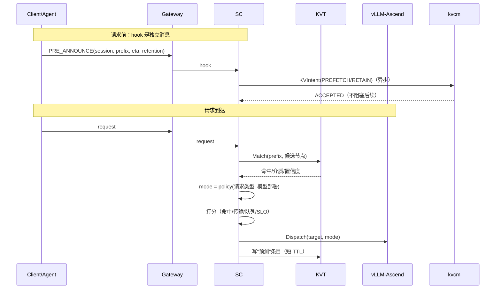
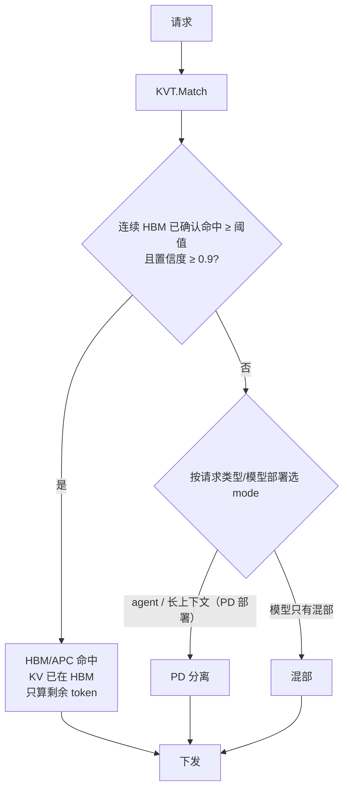
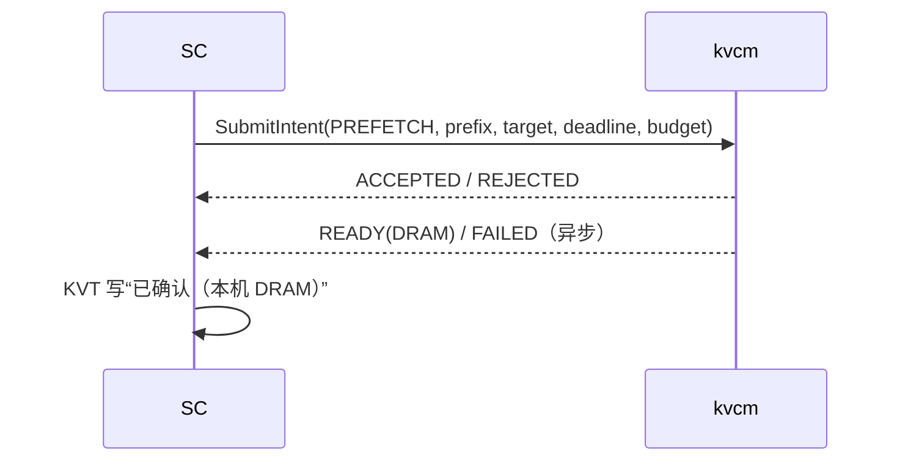
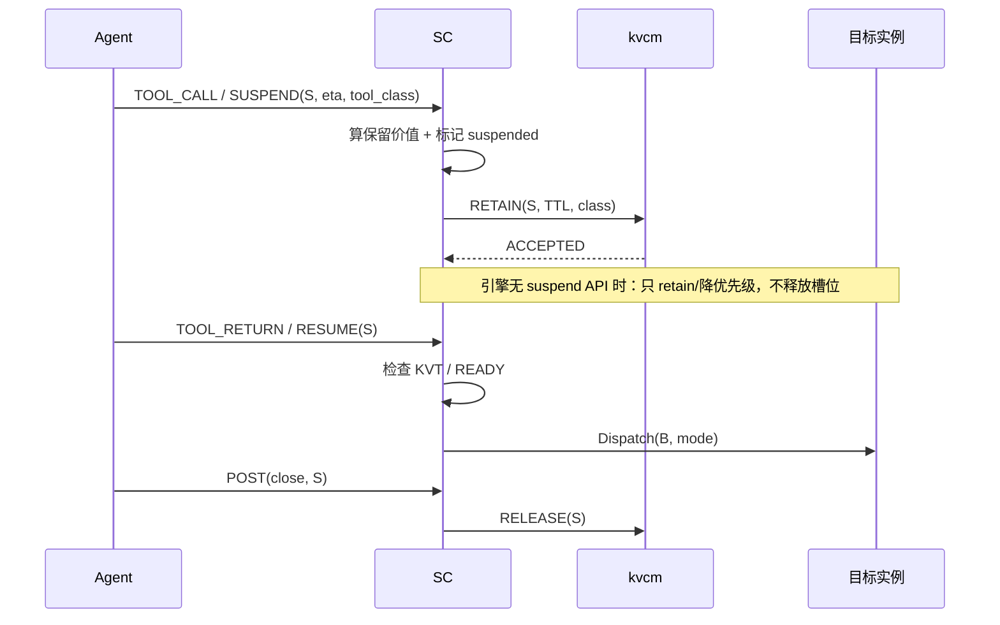
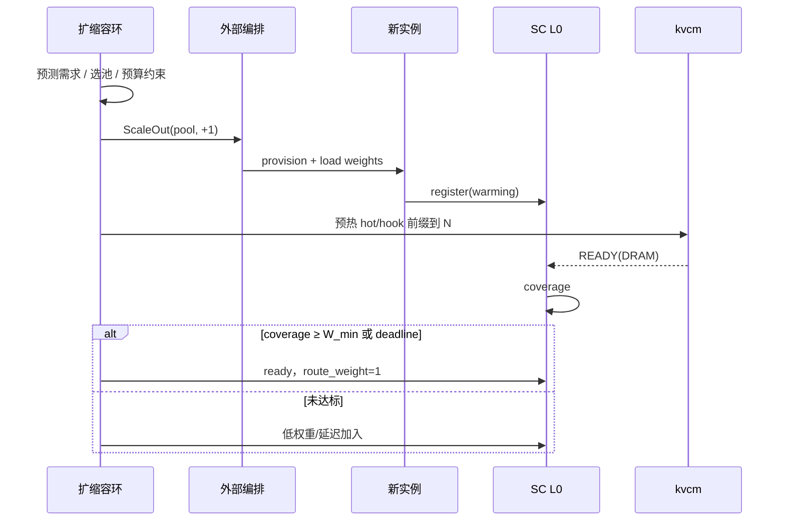
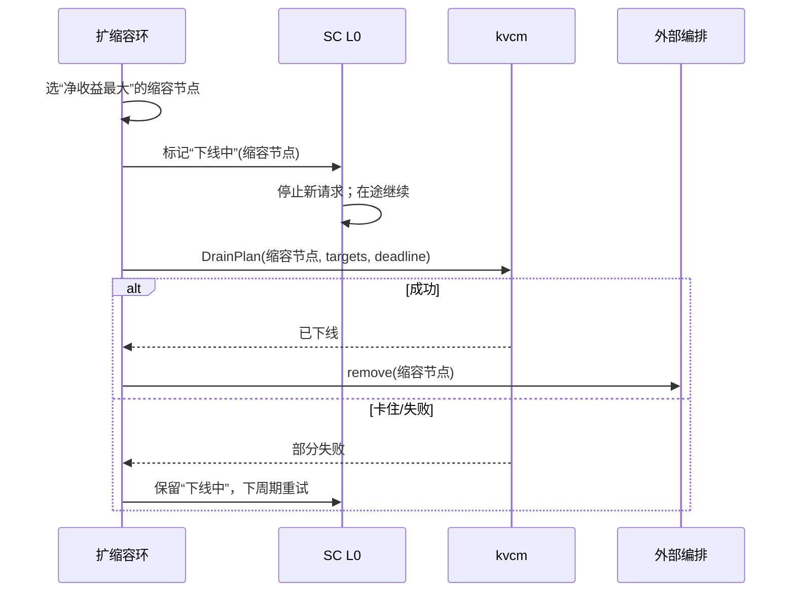
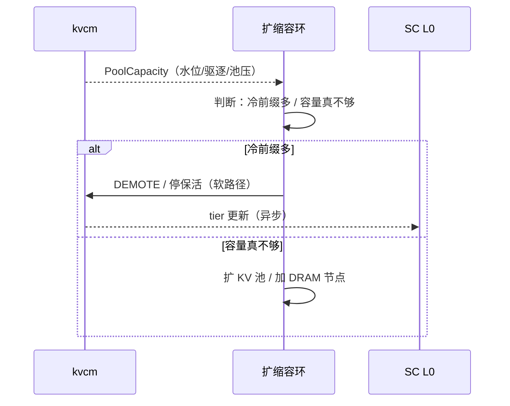
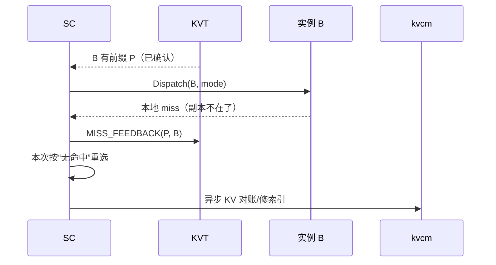
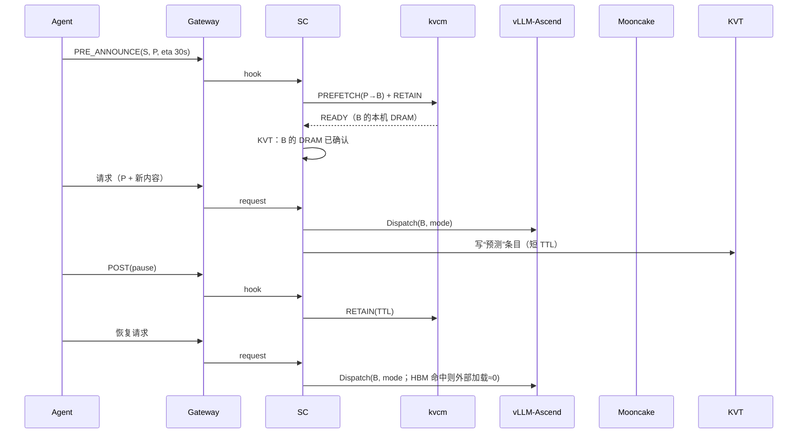

# D8b: 调度时序（L0 / L1 / L2）

- 定位: [D8](D8-joint-scheduling.md) 的**管理面时序**——只画 SC 与请求、kvcm、编排之间的交互；控制面内部（copy/verify/keepalive）见 [D9](D9-kv-services.md) / [D2](D2-kv-operations.md)。
- 状态: 设计草案；版本基线 v0.3.13.post1
- 归属: **kvcm 管理面（调度中心 SC）**；SC 可以是独立组件，也可以嵌入 Router。图中 `R` 表示 SC。
- 读法: `->>` 调用/数据流；`-->>` 响应/异步回执；`--x` 失败/断线；`rect` 底色区分并列场景

## 0. 先定义几个词

| 词 | 含义 |
|---|---|
| **HookEnvelope** | Agent/前端 → SC 的**独立消息**，不是请求；可在请求前、请求中、请求后到达 |
| **KVIntent** | SC → kvcm 的**异步动作消息**（prefetch/retain/release 等），不是请求 |
| **decision** | SC 的内部决策记录 `{target, mode, prefix, session, deadline}`；只进日志/指标，不传给引擎 |
| **预测条目** | SC 在 Dispatch 后写入 KVT 的短 TTL 条目：“B 可能有 P”；只做同批亲和，不当作命中 |
| **READY** | kvcm 的“本机 DRAM 副本就绪”，不是 HBM 命中 |

> **D8b 不画首 token / 流式返回**。调度时序到 `Dispatch`/`accepted` 结束；请求完成/失败只作为异步统计回执。

---

## 1. L0 请求环：hook 与请求分开

要点：

- **hook 不是请求**：它可以在请求前触发预取/保留；请求到达后也可以补发 KVIntent，但不是唯一来源。
- **SC 的 decision 只记录，不传给引擎**：target/mode 在 Dispatch 时生效；prefix/session/deadline 留在 SC 的决策日志/指标里。
- **预测条目**只用于同批请求的亲和，避免一批请求被全部打散；它不是 agent intent，也不参与 HBM 命中判定。

> 参考：llm-d EPP 的 speculative indexing（`preciseprefixcache/prerequest.go::PreRequest`、`defaultSpeculativeTTL`、`prefix_match.go::SpeculativeTier`）：路由后先写短 TTL 预测条目，覆盖“已决策、引擎事件还没到”的空窗；默认 TTL 2s，`speculativeIndexing` 默认关。我们沿用这个思路，但 TTL 要按事件延迟校准，不照搬 2s。见 [llm-d 架构](../../docs/research/llm-d/architecture.md)。
- KVT 查询是纯内存；miss 当作“无命中”处理，异步对账只修索引，不在 L0 热路径查 master。

---

## 2. L0：HBM 命中 / PD / 混部

注意：

- **HBM/APC 命中 = 前缀已在 HBM：引擎仍走 connector/APC 查询，但外部 KV 加载量为 0，只计算剩余 token。**
- PD 不是“拓扑可用”的运行时开关，而是 **`policy(请求类型, 模型部署)`**：agent/长上下文默认 PD；模型只有混部部署时才混部。
- `BW*` 只用于“传 vs 算/能否掩盖”，不是 PD 开关。
- kvcm READY 只说明本机 DRAM 有副本，不能直接让 L0 认定 HBM 命中。

---

## 3. L1：预取接口

要点：

- D8b 只画 SC↔kvcm 接口；`create_copy_task`、copy、verify 等控制面内部步骤见 D9/D2。
- READY 是 **DRAM tier**，不是 HBM；第一次请求仍从 DRAM 读进 HBM。
- 要 HBM 副本，走方案 A 壳请求或引擎自己的加载/APC。

---

## 4. L1：工具等待 → 保留 → 恢复

要点：

- **`PAUSE` ≠ `SUSPEND`**：PAUSE 是会话级 KV 保留；SUSPEND 是工具等待的请求级动作。
- 当前 vLLM-Ascend 没有现成的 request suspend/resume API；首版只做 `RETAIN + 降优先级`。引擎支持后，SUSPEND 才能释放 GPU 槽位/并发。
- 工具返回前 `RESUME`：先看 KVT/READY，再重新入队；KV 不在就按普通请求重算/加载。
- 默认软释放（停 keepalive），不是立即 Remove；保留有 TTL/字节上限。

## 5. L2：扩容 + 预热门控

要点：

- 预热门控的覆盖率按“本机 DRAM 已确认”算；HBM 覆盖是加分项，不是 Ready 的必要条件。
- 新节点 warming 期间不接/低权重接流量。
- `T_ready` 的目标由 SLO/部署决定；本文不设固定秒数。

---

## 6. L2：缩容 + 下线

要点：

- `gain(v)` 是释放出的容量价值；`loss(v)` 是唯一热 KV、会话风险、迁移成本；**选 `gain − loss` 最大的节点**。
- 不是 LIFO；有活跃会话/唯一热 KV 的节点优先保留。
- 下线卡住不硬删；迁移失败按最新状态重算。

---

## 7. L2：池压 → 降层/扩池

池压时先分冷热：冷前缀 `DEMOTE`；热前缀优先 `PROMOTE` 到 DRAM 或 `copy` 到低水位实例，不能一律降层。

---

## 8. 失败：ghost / miss 反馈

要点：

- **Ghost（幽灵条目）**：索引有、池里没了；请求被送到空节点。只损性能，不损正确性。
- miss 不在 L0 热路径查 master；本次按无命中处理，异步对账只修索引。
- 没有预设降级链；用最新状态重跑同一个决策函数。

---

## 9. 联合场景：Agent 多轮

---

## 10. 读图要点

- **hook 是独立消息**，不是请求；它可以在请求前触发 KVIntent。
- **SC 的 decision 只记录**，不是 hook、不是 KVIntent；“预测条目”也不是 hook。
- **调度时序不画首 token / 流式返回**；调度到 Dispatch 结束。
- **READY 是 DRAM 回写事件**，不是 HBM 命中；HBM 命中需要 HBM 证据。
- **PD 由请求类型/模型部署决定**，不是“拓扑可用”开关。
- **miss 按无命中处理**，异步对账只修索引；没有固定降级链。
- 多 SC 实例暂不考虑；单 SC 假设下 L2 不需要 leader 选举。
