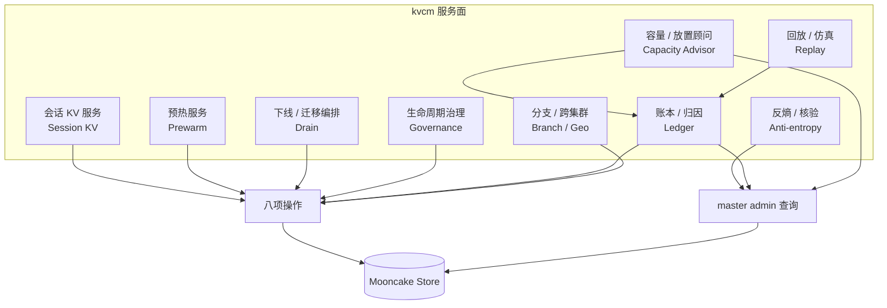
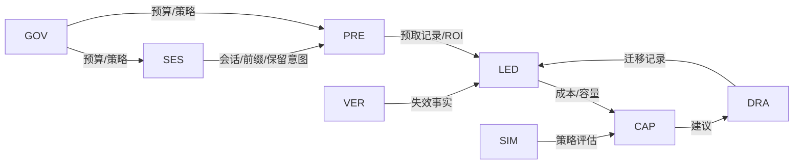
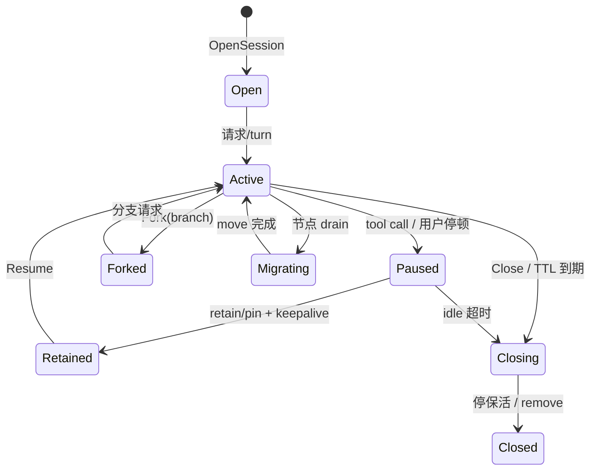
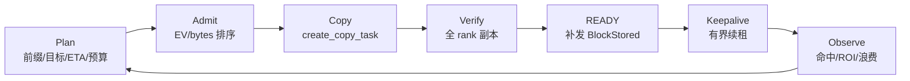
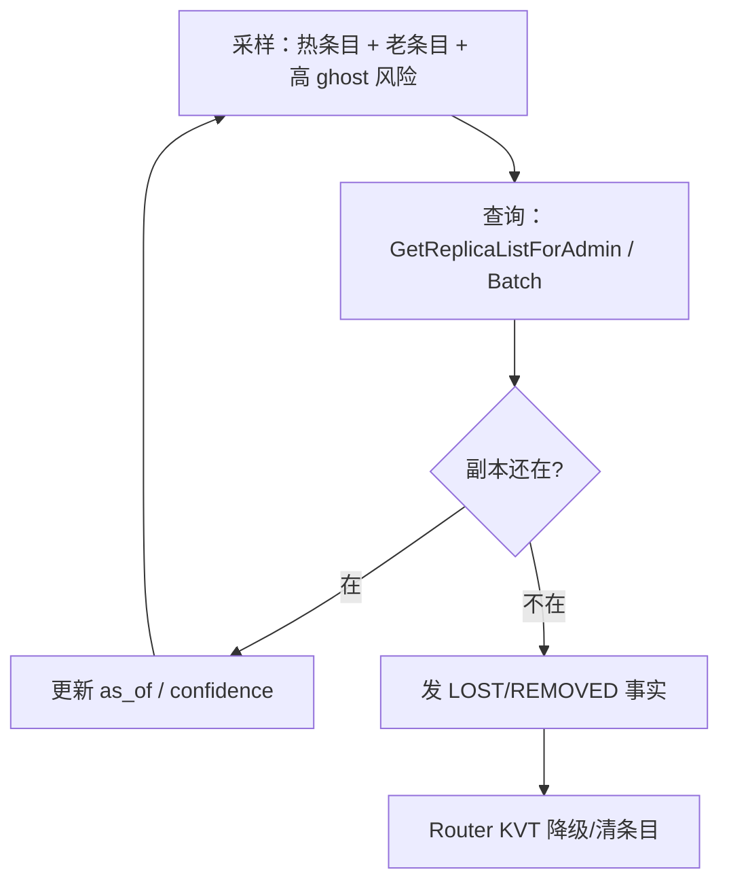
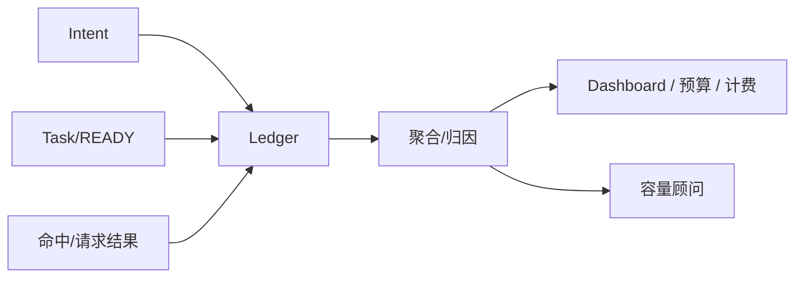
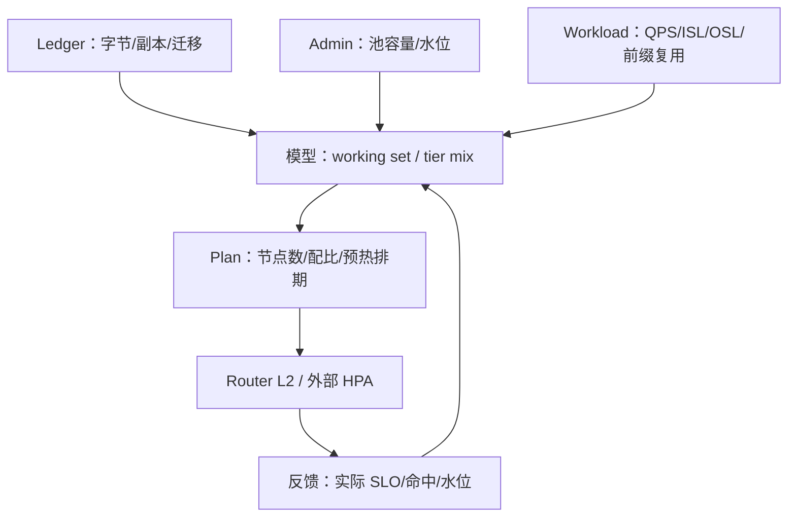
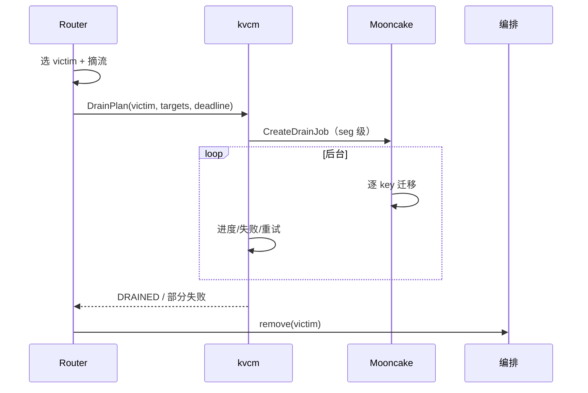
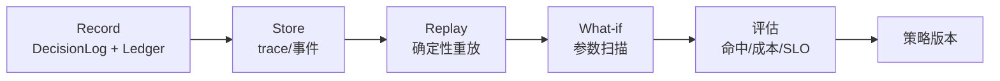
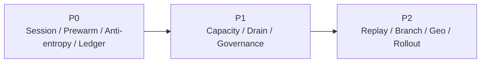

# D9: 基于 kvcm 能力的服务地图

- 状态: **设计草案**（服务边界与优先级已定，接口待评审）
- 上游: [summary.md](../summary.md) D9；[D2-kv-operations.md](D2-kv-operations.md) 的操作集、[D8-joint-scheduling.md](D8-joint-scheduling.md) 的调度中心
- 适用部署: **vLLM-Ascend + Mooncake Store + kvcm** 独立部署
- 关系声明: **kvcm 是独立项目，本文不依赖 lake 运行时**；lake 文档仅作参考
- 一句话: 调度中心回答“请求/KV/扩缩怎么一起决策”；本文回答“除了调度中心，kvcm 还能对外提供哪些服务”。

---

## 0. 先划边界

kvcm 不做三件事：

1. **不持有前缀索引**：前缀索引归 Router 侧（D1 §1/§4）；kvcm 只补发放置事件、做核验。
2. **不决定请求去哪**：选路归 Router；kvcm 不参与 L0。
3. **不决定扩不扩**：扩缩决策归 Router L2 / 外部编排；kvcm 提供池容量事实和建议。

kvcm 做四件事：

- **执行**：八项 KV 操作（copy/move/keepalive/pin/demote/promote/retain/remove）；
- **核验**：READY、副本状态、反熵；
- **记账**：任务、会话、保活、副本台账；
- **发布**：放置事件、删除/失效事件（翻译或补发）。

在这个边界内，能长出的服务不是“再写几个 RPC”，而是把 kvcm 从“预取执行器”升级成 **KV 数据面的控制服务**。

---

## 1. 服务地图



服务之间的关系：



---

## 2. 会话 KV 服务（Session KV）

### 2.1 问题

Agent 场景的三个事实（[agent-kv-cache.md](../../docs/research/vllm_vs_sglang/agent-kv-cache.md)）：

- 典型 turn 超过 **90%** token 是上一轮前缀的逐字复用；
- **40–60%** 会话墙钟时间处于工具调用暂停，KV 无引用，容易被 LRU 驱逐；
- resume 时全量重算可能增长到 **70K–200K** token。

vLLM-Ascend + Mooncake 下，KV 已经在池里，但“会话回来时它还在不在、在哪个实例、要不要重新拉”没有统一服务。kvcm 的 `sessions` 表、keepalive、retain、copy/move 正好能补这一层。

### 2.2 生命周期



### 2.3 接口

```text
OpenSession(session_id, model_id, revision, retention, ttl) -> SessionHandle
AttachPrefix(session_id, prefix, node) -> ok
Heartbeat(session_id) -> ok
Pause(session_id, expected_resume_ms) -> RetentionPlan
Resume(session_id, prefix) -> ResumePlan {node, hit, ready}
Fork(session_id, branch_id, prefix) -> BranchHandle
Close(session_id) -> ok
```

`RetentionPlan`：

```text
RetentionPlan {
  retention: NONE | SESSION | PIN
  ttl_ms
  target_nodes: []
  actions: [KEEPALIVE, PREFETCH, PROMOTE, MOVE]
  budget_used
}
```

### 2.4 原理

**保留价值**：

```text
S = 重算成本 + 重新传输成本
Net(T) = p_resume(T) × S − c_h × bytes × T − C_risk
```

`p_resume(T)` 由会话历史/ETA 估计；`c_h` 是 HBM/DRAM 占用成本。TTL 不是越长越好，见 D8 §7.3.5。

**保留等级**：

| 等级 | 机制 | 适用 |
|---|---|---|
| `SESSION` | keepalive/lease 延长（MVP） | 工具调用停顿、短会话 |
| `PIN` | hard pin / 持续续租 + TTL 上限 | 高价值长会话 |
| `DURABLE` | demote 到 SSD / DFS retain | 长停顿、节点下线 |

MVP 先用 `SESSION`：避开 D2 §2 的空写/client_id 未决问题；`PIN` 作为可选项，必须有字节/TTL 上限。

**Fork**：

- 共享前缀的 block 已经在池里，分支只需要保留共享前缀 + 追加新块；
- Mooncake 的 copy 是整对象复制，fork 不做“写时复制”，而是“保留共享前缀 + 新分支写入新 key”；
- 分支关闭时只释放分支独有的块，共享前缀按引用/保留策略处理。

### 2.5 指标

| 指标 | 含义 |
|---|---|
| resume hit rate | 恢复时前缀仍在本机的比例 |
| resume TTFT | 恢复首 token 延迟 |
| retained bytes | 当前保留的字节 |
| wasted retention | 到期未使用的保留字节 |
| pin budget usage | pin 配额使用率 |

### 2.6 依赖与缺口

- 依赖：`sessions` 表、keepalive、copy/move、retain、demote/promote。
- 缺口：pin 事后加（D2 §2）、copy 取消（D2 P9）、fork 的块级共享（Mooncake 整对象复制）。
- 结论：**P0，先做 `SESSION` 级**；`PIN`/`DURABLE` 随 D2 能力落地。

---

## 3. 预热服务（Prewarm）

### 3.1 问题

预取目前是“一个脚本/一次调用”，生产需要：

- 计划：预热哪些前缀、到哪些实例、什么时间、多少预算；
- 执行：copy + verify + READY；
- 观察：命中没有、ROI 多少、浪费多少；
- 取消/改道：请求改道时不要白搬（受限于无 cancel，只能 abandon）。

### 3.2 流水线



### 3.3 计划与预算

预取计划是一组条目：

```text
PrewarmItem {
  prefix, target_nodes[], deadline_ms, ttl_ms,
  expected_reuse, priority, max_bytes
}
```

预算约束：

```text
Σ_i x_i × bytes_i ≤ B_budget
Σ_i x_i × bytes_i / deadline_i ≤ BW_budget
x_i ∈ {0,1}
```

按价值密度贪心：

```text
EV_i = P_use_i × S_i − C_copy_i − C_occupancy_i
rank by EV_i / bytes_i
```

### 3.4 ROI

```text
ROI = (命中带来的重算/传输节省) / (copy 成本 + 占用成本 + 浪费)
```

如果预取后请求去了别的实例，收益为 0，成本仍发生；所以必须有“目标实例”约束和 READY 回写，否则预取是盲投。

### 3.5 接口

```text
SubmitPrewarmPlan(plan) -> plan_id
GetPrewarmPlan(plan_id) -> status/items
AbandonPrewarm(plan_id) -> ok        // 弱取消，不保证停止传输
GetPrewarmStats(window) -> metrics
```

### 3.6 指标

| 指标 | 含义 |
|---|---|
| prefetch hit rate | 预取后被实际使用的比例 |
| READY latency | 提交到 READY |
| wasted bytes | 预取但未使用 |
| ROI | 节省/成本 |
| copy failure rate | 失败率（源下线/目标满/竞态） |

### 3.7 依赖与缺口

- 依赖：copy、verify、keepalive、事件补发、ledger。
- 缺口：无 cancel（P9）；源由 master 随机选（不能指定源）；目标 seg 由调用方给，需要实例拓扑注册。
- 结论：**P0**，copy 已端到端验证；先做“计划 + ROI + READY 回写”，不要一开始做复杂调度。

---

## 4. 反熵 / 核验（Anti-entropy）

### 4.1 问题

引擎事件通道看不到池副本的删除（D1 F10）：

- 池驱逐/TTL/客户端下线清副本，Router 的 KVT 不知道；
- KVT 条目只增不减，会把请求导向“其实没有副本”的实例；
- 后果只是变慢（跨机读/重算），但会污染命中率和调度决策。

Mooncake main 有 publisher（removed/cleared），0.3.11 没有。反熵是升级前/升级后的通用兜底。

### 4.2 循环



### 4.3 采样公式

全量 diff 太贵，按风险采样：

```text
score(b) = hotness(b) × age(b) × P_ghost(b)
P_ghost(b) ≈ 1 − exp(−λ_delete × age(b))
```

每轮取 top-K，K 由查询预算决定：

```text
K ≤ QPS_budget × interval
```

### 4.4 版本差异

| 版本 | 查询 | 注意 |
|---|---|---|
| main | `GetReplicaListForAdmin` / `BatchGetReplicaListForAdmin` | 零副作用，适合核验 |
| 0.3.11 | `GetReplicaList` / `BatchQuery` | 会授 lease、可能触发 promote；核验会“污染”热度 |

0.3.11 下的折中：

- 只对热条目做低频核验；
- 接受 lease 副作用（本来也可能需要保活）；
- 不用它做全量统计。

### 4.5 输出

```text
VerifyFact {
  key/prefix, expected_nodes[], actual_replicas[],
  verdict: OK | LOST | MOVED | UNKNOWN,
  at, source: MASTER_VERIFY
}
```

Router 摄入后：

- `LOST` → 对应 loc 降级/删除；
- `MOVED` → 更新位置；
- `UNKNOWN` → 不动，降置信度。

### 4.6 指标

| 指标 | 含义 |
|---|---|
| ghost detection rate | 发现的失效条目/总核验 |
| false positive | 误判（查询失败当丢失） |
| query QPS | 核验开销 |
| KVT ghost ratio | 估算的失效条目比例 |

### 4.7 结论

**P0**。没有反熵，D8 的事件索引不可信；它是“让 KVT 可运维”的基础服务。

---

## 5. 账本与归因（Ledger & Attribution）

### 5.1 问题

预取/保留/迁移都要花带宽和内存，但生产上常答不出：

- 这次 TTFT 改善是预热带来的，还是引擎 APC 命中？
- 哪个模型/会话/前缀在浪费预算？
- 扩容/缩容的 KV 成本是多少？
- 多租户/多团队怎么分摊？

kvcm 的 ledger 已经有 tasks/keepalive/replicas/sessions 四类状态；再加“成本/命中”维度即可。

### 5.2 数据模型

```text
Event {
  at, model_id, revision, session_id, prefix_key,
  instance, tier, op (COPY/MOVE/PIN/DEMOTE/...),
  bytes, duration, task_id, intent_id,
  outcome (READY/FAILED/ABANDONED),
  hit_after (bool), saved_ms (optional)
}
```

聚合维度：model / revision / session / prefix / instance / tier / op。

### 5.3 归因公式

一次请求的命中来源：

```text
hit = hit_engine_apc + hit_local_pool + hit_remote_pool + hit_prewarm + hit_retain
```

预热贡献：

```text
prewarm_saved = Σ (命中块 × 重算成本) − copy 成本 − 占用成本
```

成本：

```text
cost = bytes_copied/BW × c_bw
     + bytes_retained × TTL × c_hbm
     + migration_bytes/BW × c_bw
     + 失败重试成本
```

ROI：

```text
ROI = saved / cost
```

### 5.4 流



### 5.5 指标

| 指标 | 含义 |
|---|---|
| cost per 1K tokens | 每千 token KV 成本 |
| prewarm ROI | 预热收益/成本 |
| hit attribution | 各来源命中占比 |
| waste ratio | 未使用预取/保留占比 |
| migration cost | 缩容/迁移成本 |

### 5.6 结论

**P0/P1**。先做“预取/保留/迁移”的字节与 ROI，再做跨团队分摊。

---

## 6. 容量 / 放置顾问（Capacity Advisor）

### 6.1 问题

扩缩决策在 Router L2，但 Router 只看请求侧；kvcm 看得到池内副本分布、容量、驱逐、迁移。两边需要交换“容量事实”和“需求预测”。

### 6.2 闭环



### 6.3 容量公式

```text
N_pool = ceil(working_set_bytes / usable_bytes_per_node)
working_set = Σ_prefix (prefix_bytes × retention_prob)
```

计算池：

```text
c_min = ceil(λ / (μ × ρ_target))
```

分层配比：

```text
HBM_need = hot_set_bytes
DRAM_need = warm_set_bytes
SSD_need = cold_set_bytes / compression
```

`hot_set` 由命中率目标决定；不是所有 KV 都值得放 HBM。

### 6.4 输出

```text
CapacityAdvice {
  model_id, revision
  pool_nodes_delta
  tier_mix {hbm, dram, ssd}
  prewarm_schedule
  confidence
  reasons[]
}
```

边界：**只给建议，不直接扩缩**；Router L2/外部编排决定。

### 6.5 结论

**P1**。先做“容量事实 + 建议”，不要抢 Router 的决策权。

---

## 7. 下线 / 迁移编排（Drain）

### 7.1 场景

- 缩容：Router 选 victim 后，KV 要搬走/保留；
- 计划维护：节点下线前清空；
- 模型 rollout：旧 revision 摘流、KV 失效/迁移；
- 故障：源实例不可用，能救的只有已落盘/DFS 副本。

### 7.2 流程



### 7.3 时间预算

```text
T_drain ≈ bytes_to_move / BW_available + tasks / concurrency + verify
```

约束：

- `T_drain ≤ deadline`；不够则分批/延后；
- 源实例必须在线（copy/move 派给源 seg 所在 client）；
- 任务无取消，超时只能 abandon + 事后清理（P9）。

### 7.4 结论

**P1**。`CreateDrainJob` 是现成的 job 级能力（可取消），比逐 key copy 更适合下线。

---

## 8. 生命周期治理（Governance）

### 8.1 内容

| 策略 | 作用 |
|---|---|
| TTL / retention class | 控制保留时长 |
| pin 预算 | 防止 pin 滥用 |
| model/revision 隔离 | 防止旧 KV 误命中（P1） |
| 删除审计 | 谁删了什么、为什么 |
| 配额/借用 | 多模型共享池 |
| 安全删除 | 确认没人用才 Remove；默认软释放 |

### 8.2 原则

- 默认软释放（停 keepalive），不是直接 Remove；
- Remove 前按台账校验 model/revision，防跨模型误删；
- hard pin 必须有 TTL/字节上限；
- 删除操作可审计、可回放。

### 8.3 结论

**P1**。与 Session/Prewarm 同期做“预算 + 审计”最小集。

---

## 9. 回放 / 仿真（Replay & Simulation）

### 9.1 问题

调度参数（权重、TTL、warm gate、victim 分数）不能在生产上试错。需要：

- 记录：hook、事实、决策、intent、READY、命中、延迟；
- 回放：用同一输入重跑策略；
- 反事实：换一套权重/阈值，看命中率/成本/尾部延迟。

### 9.2 架构



### 9.3 指标

| 指标 | 含义 |
|---|---|
| replay determinism | 同输入同输出 |
| policy regret | 新策略 vs 旧策略的差距 |
| capacity forecast error | 预测 vs 实际 |
| cost error | 估算 vs 实际 |

### 9.4 结论

**P2**。先把 DecisionLog/Ledger 做全，再谈仿真。

---

## 10. 分支 / 跨集群 / 模型 rollout

### 10.1 分支

- 共享前缀 + 独立 delta；分支关闭只释放独有块；
- Mooncake 整对象 copy，不能做块级 CoW；分支的“共享”靠同一批 key 的副本/引用，不靠新机制；
- 需要 Router 的 session/branch 标识与 kvcm 的 retain 配合。

### 10.2 跨集群

- DFS/对象存储副本（main）可跨集群读；
- 迁移/复制受跨集群带宽和事件通道限制；
- 首版不做，留接口。

### 10.3 模型 rollout

- 新 revision 独立命名空间（P1）；
- 预热新 revision 的公共前缀；
- 旧 revision 摘流 → 停保活/降层/删除；
- 防止旧 KV 被新 revision 误命中。

**P1/P2**：模型 rollout 与治理一起做；跨集群后置。

---

## 11. 优先级与依赖



| 优先级 | 服务 | 理由 | 依赖 |
|---|---|---|---|
| **P0** | 会话 KV | agent 最大价值；sessions/keepalive 已有 | D2 pin 可选、copy/move |
| **P0** | 预热服务 | copy 已验证；立即 TTFT 收益 | copy/verify/事件 |
| **P0** | 反熵 | 事件索引可信的前提 | admin 查询（main 更佳） |
| **P0/P1** | 账本 | ROI/预算/归因 | ledger 扩展 |
| **P1** | 容量顾问 | 扩缩需要池侧事实 | 账本 + admin |
| **P1** | Drain | 缩容/维护必须 | CreateDrainJob/move |
| **P1** | 治理 | 防 pin 滥用/误删 | 策略/审计 |
| **P2** | 回放/仿真 | 调参需要 | DecisionLog/Ledger |
| **P2** | 分支/跨集群/rollout | 远期 | DFS/跨集群 |

**建议顺序**：

1. 会话 KV（`SESSION` 级）+ 预热服务 + 反熵 + 账本最小集；
2. 容量顾问 + Drain + 治理；
3. 回放/仿真、分支/跨集群/rollout。

---

## 12. 接口草图

```text
service KvcmSession {
  rpc OpenSession(OpenSessionRequest) returns (SessionHandle);
  rpc AttachPrefix(AttachPrefixRequest) returns (Ack);
  rpc Heartbeat(HeartbeatRequest) returns (Ack);
  rpc Pause(PauseRequest) returns (RetentionPlan);
  rpc Resume(ResumeRequest) returns (ResumePlan);
  rpc Fork(ForkRequest) returns (BranchHandle);
  rpc Close(CloseRequest) returns (Ack);
}

service KvcmPrewarm {
  rpc SubmitPlan(PrewarmPlan) returns (PlanId);
  rpc GetPlan(PlanId) returns (PrewarmStatus);
  rpc Abandon(PlanId) returns (Ack);
}

service KvcmAdmin {
  rpc Verify(VerifyRequest) returns (VerifyReport);
  rpc GetStats(StatsRequest) returns (Stats);
  rpc GetCapacityAdvice(CapacityRequest) returns (CapacityAdvice);
}

service KvcmDrain {
  rpc PlanDrain(DrainRequest) returns (DrainPlan);
  rpc QueryDrain(DrainId) returns (DrainStatus);
  rpc CancelDrain(DrainId) returns (Ack);
}
```

所有写操作遵守：

- 幂等键（intent_id / plan_id / session_id）；
- `intent ≠ command`：可推迟/拒绝；
- 预算/配额检查；
- 审计日志。

---

## 13. 公式速查

```text
# 保留
Net(T) = p_resume(T)·S − c_h·bytes·T − C_risk
break-even: μ·p0·e^{−μT}·S = c_h·bytes

# 预取
EV = P_use·S − C_copy − C_occupancy
ROI = saved / cost

# 反熵采样
score(b) = hotness·age·P_ghost
P_ghost ≈ 1−e^{−λ_delete·age}

# 容量
N_pool = ceil(working_set / usable_per_node)
c_min = ceil(λ/(μ·ρ_target))

# Drain
T_drain ≈ bytes/BW + tasks/concurrency + verify

# 归因
hit = engine_apc + local_pool + remote_pool + prewarm + retain
prewarm_saved = Σ hit_blocks·recompute_cost − copy_cost − occupancy_cost
```

---

## 14. 参考实现

> kvcm 独立于 lake；下表是“可借鉴的机制”，不是依赖。

| 参考 | 锚点 | 借了什么 | 关键差异 |
|---|---|---|---|
| **kvcm D2** | `D2-kv-operations.md` §1/§4 | 八项操作、READY、状态四类、retain/release | 本文把操作组合成服务 |
| **SGLang session** | `mem_cache/unified_cache/session_ref_tracker.py::UnifiedSessionRefTracker`；`unified_tree_core.py::_session_lru_predicate` | session 软保护、frontier 引用 | SGLang 在引擎内；kvcm 在池侧，worker 无状态 |
| **vLLM Retention** | `v1/kv_hints/protocol.py::KvHintsEnvelope`；Retention API（#37003） | pin/retain/prefetch/demote/release 动词表 | vLLM 引擎内；kvcm 用池操作实现 |
| **KVCR Guard** | `src/kvcr/remote_fw_dram.py::fetch/query/_try_release_pin`；Guard 组件 | 传输窗口 pin、旁挂保活 | kvcm 集中式 + master 权威，不需要 fencing |
| **TensorCast** | `tensorcast/api/_config.py::StorePolicyProfile` | cache/durable/ha/cold/warm/pinned 策略预设 | 用作 retention class 命名，不照搬存储后端 |
| **Dynamo Planner** | `components/src/dynamo/planner/core/load_scaling.py::LoadScalingMixin`；`throughput_scaling.py` | 慢/快双环、SLA 驱动 | kvcm 只出容量建议，决策归 Router |
| **llm-d WVA** | `llm-d-autoscaling`（项目级） | SLO 感知的目标副本数、变体成本 | 本文只做池侧容量事实，不替代 WVA |
| **AIBrix PodAutoscaler** | `pkg/controller/podautoscaler/context/context.go`（`gpu_cache_usage_perc`） | KV 使用率/排队长度扩缩指标 | 决策在 Router L2，执行在外部 |
| **Mooncake** | `master_service.cpp::CreateDrainJob`、`CopyStart`、`GetReplicaListForAdmin` | drain job、copy 幂等、零副作用核验 | kvcm 封装，Router 不直连 |
| **LMCache controller** | `lmcache/v1/cache_controller`（lookup/pin/move/clear） | 操作集对照 | LMCache 无全局强一致元数据；kvcm 有 master 权威 |

---

## 15. 开放问题

1. **Session 的权威在哪**：kvcm ledger 单实例；多 kvcm/HA 时怎么共享？短期单实例跟随 master（D2 §1）。
2. **pin 的可达性**：soft pin 空写通道、hard pin client_id 问题未决；MVP 用 lease 延长，是否足够？
3. **反熵成本**：0.3.11 的查询有 lease 副作用；main 的 admin 查询零副作用但需要升级。采样率怎么定？
4. **Prewarm 取消**：无 cancel；abandon + 事后清理的窗口内，带宽浪费怎么计？
5. **容量顾问的边界**：建议与决策如何避免“两个大脑”？建议只出事实/区间，不出具体动作。
6. **多模型/多租户**：tenant 只在 main 有；0.3.11 用 key 前缀模拟，治理能力受限。
7. **跨集群**：DFS 副本的读延迟/成本是否值得纳入 L1/L2？
8. **安全**：session/pin API 的鉴权、配额、审计边界。

---

## 16. 结论

- **调度中心（D8）是“大脑”**：请求、KV、扩缩的联合决策。
- **本文的服务（D9）是“手脚 + 感官 + 账本”**：会话、预热、反熵、账本、容量、迁移、治理。
- 最优先的不是“更多 RPC”，而是 **会话 KV + 预热 + 反熵 + 账本** 四件；它们让 D8 的决策有数据、有反馈、有ROI。
- 所有服务守三条边界：不持有前缀索引、不决定请求去哪、不决定扩不扩；KV 执行仍归 D2，扩缩执行仍归外部编排。
