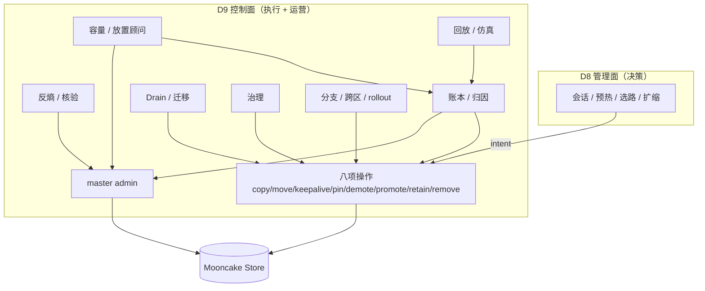
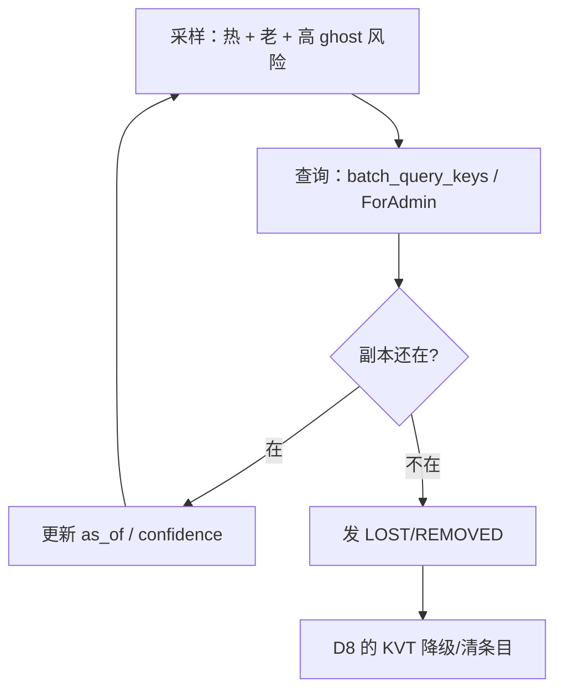
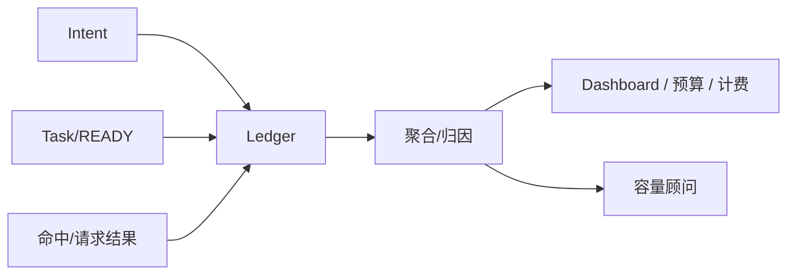
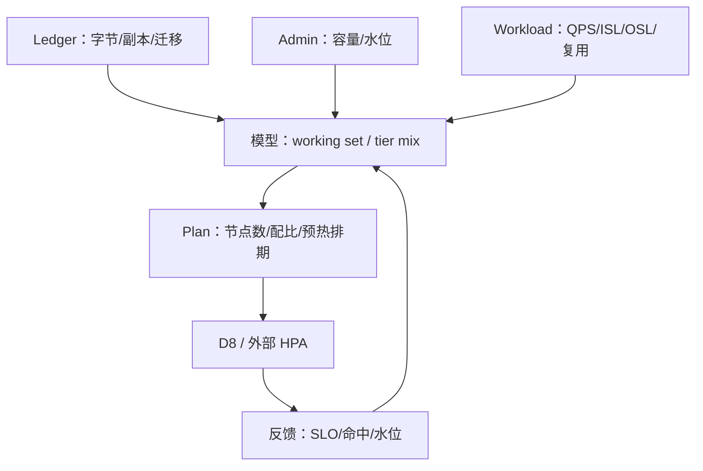
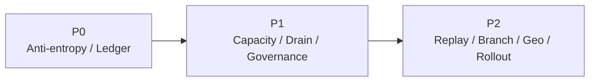

# D9: 控制面：执行与运营能力

- 状态: **设计草案**（能力边界与优先级；收益为模型估算，待真机校准）
- 版本基线: **Mooncake v0.3.13.post1**（master / client 同版本）
- 上游: [summary.md](../summary.md) D9；[D2-kv-operations.md](D2-kv-operations.md) 的操作集；管理面（调度）：[D8](D8-joint-scheduling.md)
- 适用部署: **vLLM-Ascend + Mooncake Store + kvcm** 独立部署
- 关系声明: **kvcm 是独立项目，本文不依赖 lake 运行时**；lake 文档仅作参考
- 一句话: **D8 管“决定做什么”，D9 管“怎么执行、怎么核验、怎么记账、怎么运营”**。会话/预热/选路/扩缩是 D8 的管理面动作，本文不重复；本文只列控制面自己的独立能力。

---

## 0. 结论

1. kvcm 控制面做四件事：**执行、核验、记账、发布**；不做选路、不做扩缩、不持有前缀索引。
2. **会话 KV、预热不是“调度之外的另一套系统”**：它们是 D8 管理面的 L1 动作（会话保留/预取），由 D8 决策、控制面执行。本文只在服务地图里画一条“执行支撑”的边，不再重复列举和收益。
3. 真正“除了调度中心还能做什么”的是控制面的**独立运营能力**：反熵/核验、账本/归因、容量事实/顾问、Drain/迁移、治理、回放、分支/跨区/rollout。
4. 优先级：**P0 反熵 + 账本**；P1 容量顾问 + Drain + 治理；P2 回放 + 分支/跨区/rollout。会话/预热的优先级归 D8（P0 命中/保留）。
5. **v0.3.13.post1**：soft pin 空写有条件可用（PR73）；hard pin 事后设置拒绝；retain 未实现；copy/move 无取消；publisher 默认构建/运行关。控制面设计按这个基线写。

### 0.1 直接回答：除了调度中心，控制面还能做什么

| 优先级 | 能力 | 一句话 | 关键技术/机制 | 主要收益 |
|---|---|---|---|---|
| **P0** | **反熵/核验** | 索引说有的，池里真的还有 | 热/老条目抽样 + `batch_query_keys` 零副作用查询 | 降 ghost、保命中率、让 ROI 可信 |
| **P0** | **账本/归因** | 谁花了多少、省了多少、值不值 | 任务/会话/字节/ROI 记录 + 命中归因 | 成本可见、预算可调、可计费 |
| **P1** | **容量/放置顾问** | 池该多大、HBM/DRAM/SSD 怎么配 | working set + Little 定律 + admin 容量 | 少扩/少浪费、容量预测 |
| **P1** | **Drain/迁移** | 缩容/维护不丢热 KV | `CreateDrainJob` / move / verify / 宽限期 | 缩容不砸命中率、不丢请求 |
| **P1** | **治理** | pin/TTL/模型版本/删除可控 | retention class + 预算 + 审计 + 命名空间 | 防滥用、防误删、合规 |
| **P2** | **回放/仿真** | 调参不拿生产试错 | 决策日志 + 账本 + 反事实重放 | 策略迭代、事故复盘 |
| **P2** | **分支/跨集群/rollout** | 分支、跨区、模型发布 | copy/DFS/命名空间/保留 | 远期能力 |

> **不在本表**：会话 KV、预热、选路、扩缩。它们是 D8 管理面的动作；控制面只为它们提供 copy/keepalive/pin/verify 等执行接口，不再当成第二套能力。

---

## 1. 控制面服务地图



读法：

- **左侧 D8** 是决策：会话保不保、预取到哪、请求去哪、扩不扩。
- **右侧 D9** 是控制面：执行这些决定（八项操作），并提供反熵、账本、容量事实、迁移、治理、回放、分支等运营能力。
- 会话/预热不画成 D9 的独立服务；它们只通过 `L1 → OPS` 这条执行边出现。

---

## 2. 边界：为什么这些能力放控制面

- **它离池最近**：copy/move/keepalive/pin/demote/promote 都是池操作，只有控制面能执行。
- **它有台账**：任务、保活、副本、会话四类状态已在 ledger（D2 L5）；换任何上层都能复用。
- **它能核验**：`GET /batch_query_keys` / `GetReplicaListForAdmin` 零副作用；这是反熵和 READY 的基础。
- **它是独立进程**：不随引擎实例生死；会话/保留可以跨 Router 重启。
- **它不该做的**：选路、扩缩决策、前缀索引——这些归 D8 管理面；控制面越界会把后台服务拖成在线决策器。

---

## 3. 控制面独立能力

### 3.1 反熵 / 核验（Anti-entropy）

**问题**：引擎事件看不到池副本删除；KVT 只增不减；ghost 条目把请求导向无副本实例。0.3.13.post1 的 publisher 默认不开，删除面更依赖反熵。

**终局形态**：



**技术/机制**：

- 按 `hotness × age × P_ghost` 抽样，不全量 diff；
- 用零副作用 admin 查询；查询失败与“副本丢失”分开；
- 输出去重后的 `LOST/REMOVED/MOVED` 事实，供 D8 KVT 消费。

**收益**：

```text
score(b) = hotness(b) × age(b) × P_ghost(b)
P_ghost(b) ≈ 1 − e^{−λ_delete × age(b)}
```

- 降低 ghost 率，避免无效路由；
- 让预取/保留 ROI 可计算；
- 是事件索引可运维的前提。

**限制**：全量 diff 太贵；只做抽样/热条目；查询 QPS 要预算。

**优先级：P0。**

### 3.2 账本 / 归因（Ledger）

**问题**：预取/保留/迁移花了带宽和内存，但答不出“哪个模型/会话/前缀在浪费、ROI 多少、TTFT 改善是谁贡献的”。

**终局形态**：



**技术/机制**：

- 记录 intent、copy/move、bytes、耗时、READY/FAILED、保留 TTL、命中结果；
- 归因：`hit = engine_apc + local_pool + remote_pool + prewarm + retain`；
- ROI：`saved / cost`；浪费：预取未用、保留未恢复、迁移失败；
- 成本：GPU 时间、带宽、驻留字节。

**收益**：

- 让“保留多久/预取多少”有数可依；
- 支持容量顾问、预算、外部计费；
- 解决“预热贡献 vs 引擎 cache”的归因问题。

**限制**：请求命中结果需要 D8/worker 回传；没有回传只能估；多模型/租户归因依赖命名空间。

**优先级：P0。**

### 3.3 容量 / 放置顾问（Capacity Advisor）

**问题**：扩缩决策在 D8，但 D8 只看请求侧；控制面看得到池内副本、容量、驱逐、迁移。

**终局形态**：



**技术/机制**：

- working set、hot/warm/cold、HBM/DRAM/SSD 配比；
- 池节点数：`N = ceil(working_set / usable_per_node)`；
- 预热排期按 hook/热度/预算；
- what-if：不同保留策略/配比下的命中率与成本。

**边界**：只给建议/区间，不直接扩缩；决策归 D8。

**优先级：P1。**

### 3.4 下线 / 迁移（Drain）

**问题**：缩容/维护/rollout 时，KV 要搬走或保留；搬不走的会被引擎下线带走。

**终局形态**：


**技术/机制**：

- seg 级 `CreateDrainJob`（job 级可取消）或逐 key move/copy；
- 宽限期卸载（`GracefulUnmountSegment`）作为迁移时间窗；
- 失败保留 draining，不硬删；
- 与 D8 摘流、编排停实例配合。

**收益**：缩容不丢热 KV；避免“缩完再扩、命中率掉”。`T_drain ≈ bytes/BW + tasks/concurrency + verify`。

**限制**：单任务无取消；源必须在线；retain 未实现；DFS 依赖部署。

**优先级：P1。**

### 3.5 生命周期治理（Governance）

**内容**：

- retention class/TTL；pin 预算；模型/revision 隔离；删除审计；配额/借用；安全删除。
- 默认软释放；Remove 前按台账校验 model/revision；hard pin 有上限；所有删除可审计。

**收益**：

- 防 pin 滥用、防跨模型误删、满足合规；
- 让“保留”成为可控成本，而不是无限占内存。

**优先级：P1。**

### 3.6 回放 / 仿真（Replay & Simulation）

**能力**：

- 记录 hook、事实、决策、intent、READY、命中、延迟；
- 回放：同输入重跑策略；
- 反事实：换权重/TTL/warm gate，看命中率/成本/尾部延迟。

**收益**：

- 调参不拿生产试错；
- 事故复盘；容量 what-if；
- 策略版本可比较。

**限制**：依赖 D8 决策日志完整；仿真精度取决于负载/时延模型。

**优先级：P2。**

### 3.7 分支 / 跨集群 / 模型 rollout

- **分支**：共享前缀 + 独立 delta；分支关闭只释放独有块；Mooncake 整对象 copy，不做块级 CoW。
- **跨集群**：DFS/对象存储副本（main 能力；0.3.13 需确认部署）；首版不做。
- **模型 rollout**：新 revision 独立命名空间、预热、灰度、旧 revision 失效/GC；防旧 KV 误命中。
- 优先级：**P1/P2**。

---

## 4. 收益模型

> 会话/预热的收益在 D8 §7 已经算过（命中/保留省秒级 prefill、本地放置省十毫秒级传输），本文不重复。这里只算控制面独立能力。

### 4.1 能力收益对照

| 能力 | 主要收益 | 量级 | 成本 |
|---|---|---|---|
| 反熵 | 降 ghost、保命中率 | 间接（百分点） | 查询 QPS |
| 账本 | 让预算/ROI 可算 | 间接 | 存储/聚合 |
| 容量顾问 | 少扩/少浪费 | 容量百分点 | 计算/查询 |
| Drain | 缩容不丢热 KV | 避免命中率断崖 | 迁移带宽 |
| 治理 | 防滥用/误删 | 风险 | 策略/审计 |
| 回放 | 调参效率 | 间接 | 日志/仿真 |

### 4.2 公式

```text
# 反熵采样
score(b) = hotness×age×P_ghost
P_ghost ≈ 1−e^{−λ_delete×age}

# 容量
N = ceil(working_set / usable_per_node)
c_min = ceil(λ/(μ×ρ_target))

# Drain
T_drain ≈ bytes/BW + tasks/concurrency + verify

# 归因
hit = engine_apc + local_pool + remote_pool + prewarm + retain
ROI = saved / cost
```

### 4.3 结论

- **反熵/账本不是“性能功能”**，但没有它们，D8 的命中/保留决策不可信、不可调。
- **容量/Drain** 是“保命中率”的防守型收益；不做会在扩缩时把前面赚的吐回去。
- **治理** 让保留/删除可控；**回放**让调参可回归。

---

## 5. 优先级与路线图



| 优先级 | 能力 | 理由 |
|---|---|---|
| **P0** | 反熵 | 事件索引可信的前提 |
| **P0** | 账本 | ROI/预算/归因 |
| **P1** | 容量顾问 | 扩缩需要池侧事实 |
| **P1** | Drain | 缩容/维护必须 |
| **P1** | 治理 | 防 pin 滥用/误删 |
| **P2** | 回放/仿真 | 调参需要 |
| **P2** | 分支/跨集群/rollout | 远期 |

> 会话 KV、预热不在此表：它们归 D8 管理面（L1），控制面只提供执行接口。

---

## 6. 版本与能力基线（v0.3.13.post1）

| 能力 | 现状 | 对 D9 的影响 |
|---|---|---|
| soft pin 空写 | **有条件可用**（PR73）：Case B、单 slice、key 存在、无盘副本；`exists` 持 lease；地址检查 | 治理/保留执行可用；有边界 |
| hard pin 事后设置 | 拒绝（创建时固化） | 只能用 keepalive 做 lease 保护 |
| keepalive | 注册/注销 + 周期 `renew_once`；有界 | 保留执行基础 |
| demote | 停保活 + 等 lease TTL + 查盘；写回池不满仍失败 | 不是确定性降层 |
| promote | 触发式；READY 弱（看到内存副本，不保证任务完成） | 只能当“可尝试路由” |
| remove | 全局删 key，不支持 target；force 只跳过 lease | 释放默认软释放 |
| retain | 未实现；move 到活 seg / kvcm 自挂 SSD 是登记手段 | 跨引擎存亡还不能完全兜 |
| copy/move 取消 | 无 | 预取改道只能 abandon + 事后清理 |
| publisher | v0.3.13.post1 有代码，但构建默认 OFF、运行默认 false；copy 路径零发布 | 删除面靠 TTL/miss/核验，或显式开启 |
| kvcm 补发 | `feat/kvcm-e14-publish` 已实现 READY 后按实例端点发 `BlockStored`；未合入 main | 预热 READY 可回写 KVT |
| admin 查询 | `GET /batch_query_keys` / `GetReplicaListForAdmin` 零副作用 | 反熵/核验可用 |
| 实例注册 | E13 设计已定；代码归 E13 | 端点/seg 映射仍靠启动参数 |
| 段容量准入 | PR72：提交前查目标段剩余 | 预取可能因段满失败 |
| 带宽限速（E15） | 未做 | 预取/迁移要预算 |

**升级陷阱**：0.3.14/main 有 `has_read_lease` 门槛；有租约且全内存时同尺寸走 Case C，当前空写不可用。升级时必须重新评估 soft pin。

---

## 7. 参考实现

> kvcm 独立于 lake；下表是“可借鉴的机制”，不是依赖。

| 参考 | 锚点 | 借了什么 | 关键差异 |
|---|---|---|---|
| **kvcm D2** | `D2-kv-operations.md` §1/§4 | 八项操作、READY、状态四类、retain/release | 本文把控制面组合成运营能力 |
| **SGLang session** | `mem_cache/unified_cache/session_ref_tracker.py::UnifiedSessionRefTracker` | session 软保护、frontier 引用 | 会话是 D8 L1；控制面只执行保留 |
| **vLLM Retention** | `v1/kv_hints/protocol.py::KvHintsEnvelope`；Retention API（#37003） | pin/retain/prefetch/demote/release 动词表 | 管理面决策，控制面执行 |
| **KVCR Guard** | `src/kvcr/remote_fw_dram.py::fetch/query/_try_release_pin`；Guard 组件 | 传输窗口 pin、旁挂保活 | kvcm 集中式 + master 权威，不需要 fencing |
| **TensorCast** | `tensorcast/api/_config.py::StorePolicyProfile` | cache/durable/ha/cold/warm/pinned 策略预设 | 用作 retention class 命名，不照搬存储后端 |
| **Dynamo Planner** | `components/src/dynamo/planner/core/load_scaling.py::LoadScalingMixin`；`throughput_scaling.py` | 慢/快双环、SLA 驱动 | 容量顾问只出事实/建议，决策归 D8 |
| **llm-d WVA** | `llm-d-autoscaling`（项目级） | SLO 感知的目标副本数、变体成本 | 本文只做池侧容量事实，不替代 WVA |
| **AIBrix PodAutoscaler** | `pkg/controller/podautoscaler/context/context.go`（`gpu_cache_usage_perc`） | KV 使用率/排队长度扩缩指标 | 决策在 D8，执行在外部 |
| **Mooncake** | `master_service.cpp::CreateDrainJob`、`CopyStart`、`GetReplicaListForAdmin` | drain job、copy 幂等、零副作用核验 | kvcm 封装，D8 不直连 |
| **LMCache controller** | `lmcache/v1/cache_controller`（lookup/pin/move/clear） | 操作集对照 | LMCache 无全局强一致元数据；kvcm 有 master 权威 |

---

## 8. 开放问题

1. **反熵成本**：0.3.13.post1 的 admin 查询零副作用，但采样率/查询 QPS 预算怎么定？
2. **账本归因**：请求命中结果从 D8/worker 回传的字段与延迟；多模型/租户怎么切？
3. **容量顾问的边界**：建议与 D8 决策如何避免“两个大脑”？建议只出事实/区间。
4. **Drain**：单任务无取消；retain 未实现时，跨引擎存亡只能靠 move 到活 seg / 自挂 SSD。
5. **治理**：pin/TTL 预算、模型版本、删除审计的默认策略。
6. **回放**：D8 决策日志的字段与采样率；仿真精度。
7. **分支/跨区/rollout**：DFS 在 0.3.13 的部署确认；跨区事件/带宽。

---

## 9. 结论

- **D8 是管理面**：决定会话保不保、预热到哪、请求去哪、扩不扩。
- **D9 是控制面**：执行这些决定，并提供反熵、账本、容量事实、Drain、治理、回放、分支/跨区等独立运营能力。
- **会话 KV / 预热不在 D9 重复**：它们属于 D8 L1；D9 只提供执行接口。
- 最值得先做的控制面能力：**反熵 + 账本**（P0），然后容量顾问 + Drain + 治理（P1），最后回放/分支/跨区（P2）。
