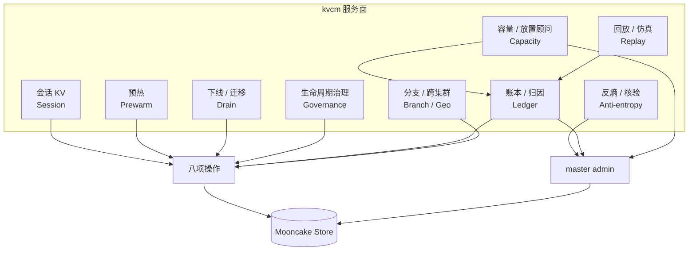
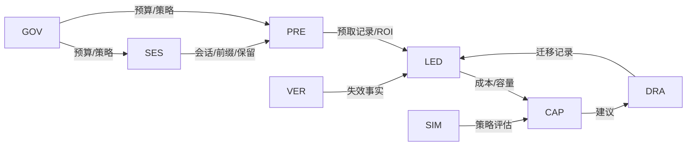
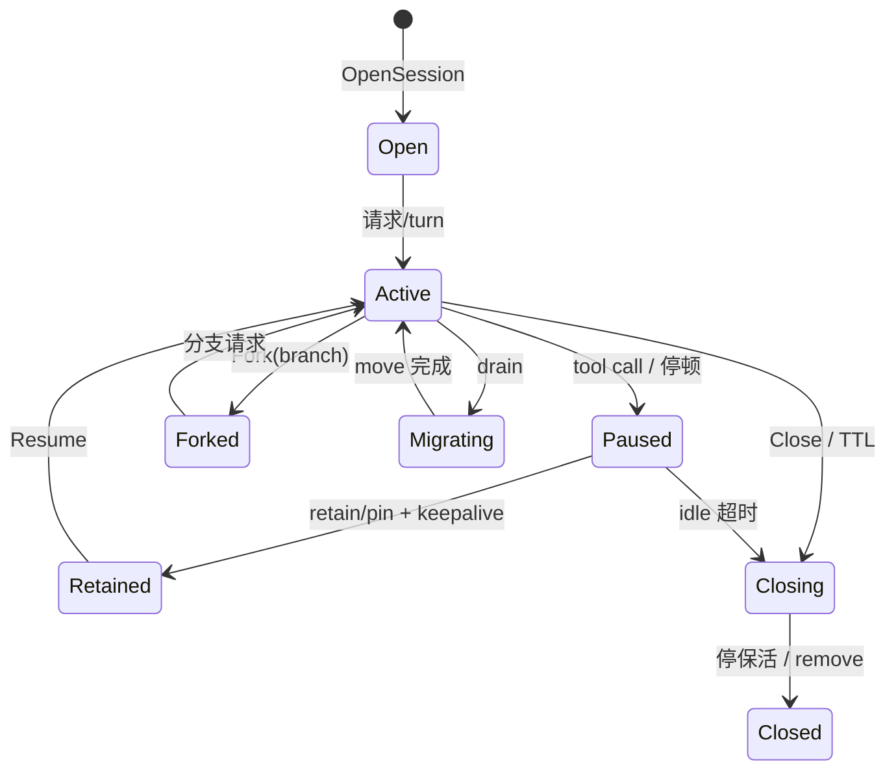
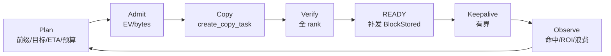
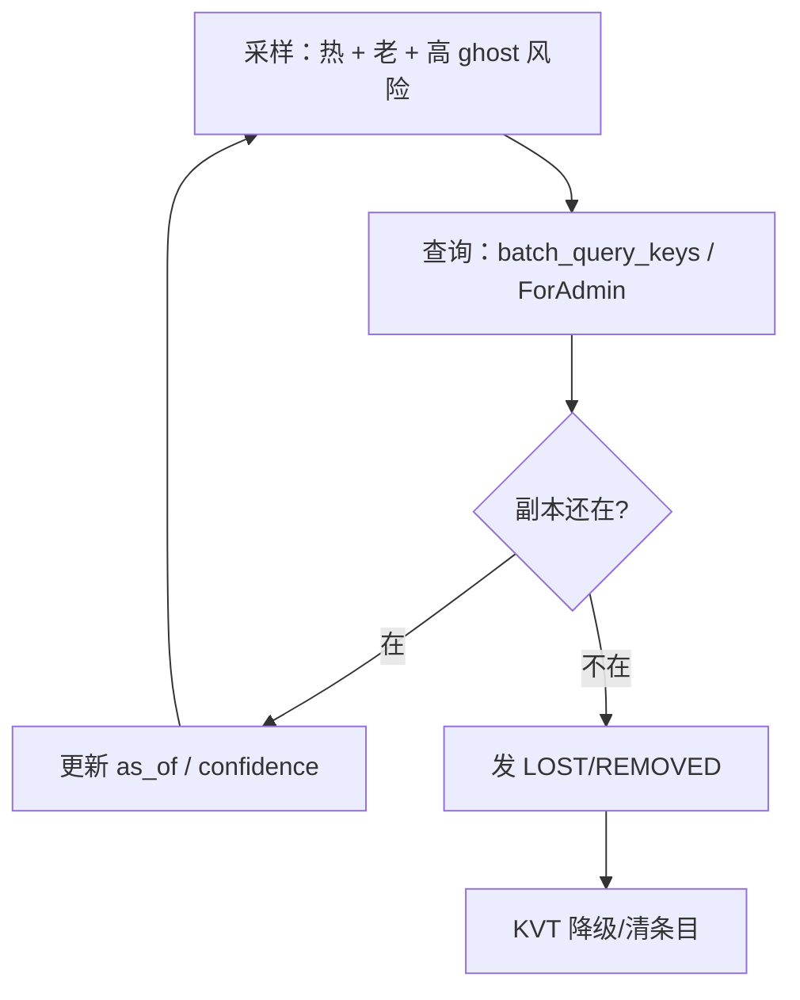
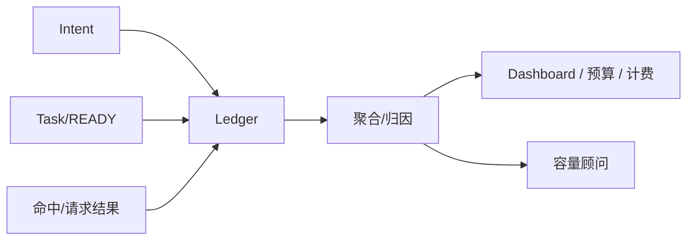
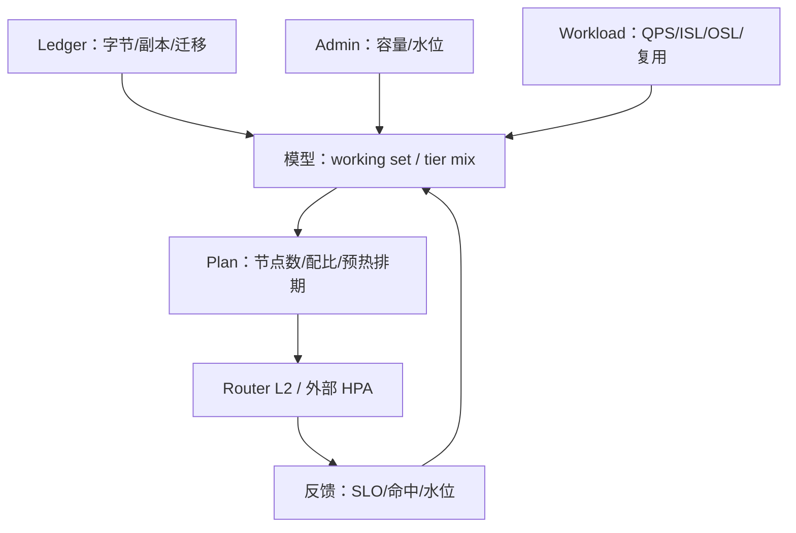
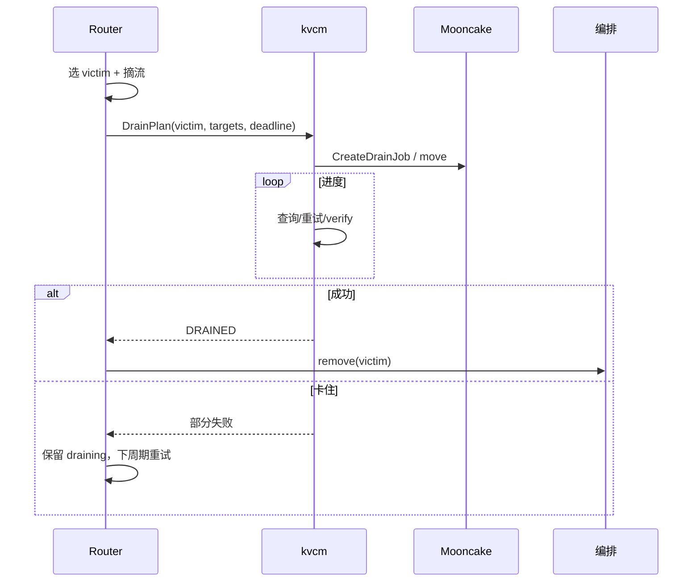
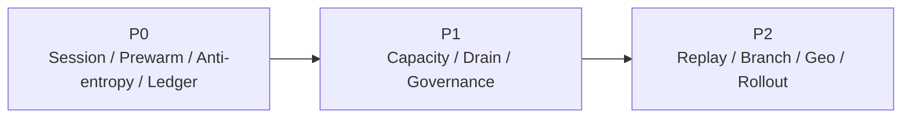

# D9: 基于 kvcm 的服务地图——目标形态与收益

- 状态: **设计草案**（服务边界与优先级；收益为模型估算，待真机校准）
- 版本基线: **Mooncake v0.3.13.post1**（master / client 同版本）
- 上游: [summary.md](../summary.md) D9；[D2-kv-operations.md](D2-kv-operations.md) 的操作集、[D8-joint-scheduling.md](D8-joint-scheduling.md) 的调度中心
- 适用部署: **vLLM-Ascend + Mooncake Store + kvcm** 独立部署
- 关系声明: **kvcm 是独立项目，本文不依赖 lake 运行时**；lake 文档仅作参考
- 一句话: 调度中心回答“请求/KV/扩缩怎么一起决策”；本文回答“除了调度中心，kvcm 还能对外提供哪些服务，收益在哪”。

---

## 0. 结论

1. kvcm 不做三件事：**不持有前缀索引、不决定请求去哪、不决定扩不扩**。它做四件事：**执行、核验、记账、发布**。
2. 基于八项操作，能长出的服务不是“更多 RPC”，而是五类长期能力：**会话 KV、预热、反熵、账本、容量/迁移**；再加治理、回放、分支/跨集群。
3. **最优先四件**：会话 KV（SESSION 级）、预热服务、反熵 + 账本。它们直接对应 D8 的“命中/保留”最大杠杆，也是调度中心可信的数据来源。
4. **v0.3.13.post1 下**：soft pin 空写有条件可用（PR73）；hard pin 事后设置拒绝；retain 未实现；copy/move 无取消；publisher 默认不开。服务设计必须按这个基线写。
5. 收益排序与 D8 一致：**避免重算（会话保留/命中）> 本地放置（预热）> HBM 命中（微优化）**。服务优先级按这个顺序，而不是按“操作是否酷”。

---

## 1. 服务地图



服务之间的闭环：



---

## 2. 为什么这些服务应该放在 kvcm

- **它离池最近**：copy/move/keepalive/pin/demote/promote 都是池操作，只有 kvcm 能执行。
- **它有台账**：任务、保活、副本、会话四类状态已在 ledger（D2 L5）；换任何上层都能复用。
- **它能核验**：`GET /batch_query_keys` / `GetReplicaListForAdmin` 零副作用；这是反熵和 READY 的基础。
- **它是独立进程**：不随引擎实例生死；会话/保留可以跨 Router 重启。
- **它不该做的**：选路（Router）、扩缩决策（Router L2/编排）、前缀索引（Router KVT）。越界会把后台控制面拖成在线服务。

---

## 3. 服务逐项

### 3.1 会话 KV（Session KV）

**问题**：agent 场景 90%+ token 是上一轮前缀复用；40–60% 墙钟在工具调用停顿；resume 可能 70K–200K token 重算。KV 在池里，但“会话回来时还在不在、在哪个实例”没有统一服务。

**终局形态**：



**能力**：

- Open/Attach/Pause/Resume/Close；Fork（共享前缀 + 独立分支）；
- 保留等级：`SESSION`（keepalive/soft pin）、`PIN`（有上限）、`DURABLE`（降层/迁移，当前受 retain 限制）；
- 按会话/前缀/预算做 TTL；默认软释放（停 keepalive），不是立即 Remove；
- 迁移：节点 drain 时 move 到活 seg；retain 未实现，暂不能保证跨引擎存亡。

**收益**：

```text
saved = p_resume × T_prefill × 命中长度比例
cost  = 保留字节 × TTL × c_mem + keepalive 开销
```

- 一次 70K resume 省 ~14s 重算（§D8 7.3）；保留 1.4GB 10 分钟通常远便宜于 14s GPU。
- 收益最大的是“防驱逐”，不是“把远端命中变本地”。

**依赖/限制（v0.3.13.post1）**：

- keepalive：`register_keepalive`/`unregister_keepalive` + 周期 `renew_once`；有界，不能无限续。
- soft pin：**有条件可用**（PR73）：Case B、单 slice、key 存在、无盘副本；`exists` 持 lease；地址检查。
- hard pin：**拒绝**事后设置；要 lease 保护用 keepalive。
- retain：未实现；跨引擎存亡只能 move 到活 seg / kvcm 自挂 SSD（登记手段）。
- 优先级：**P0**（先 SESSION 级）。

### 3.2 预热（Prewarm）

**问题**：预取现在更像“一次调用/脚本”，缺计划、预算、ROI、失败处理。

**终局形态**：



**能力**：

- 计划：哪些前缀、到哪些实例、何时、多少字节/带宽；
- 准入：按 `EV/bytes` 或最早 deadline；段容量不足不提交（PR72）；
- 执行：copy + verify + READY + 事件补发；
- 观察：命中率、浪费、ROI；失败/超时按最新状态重算；
- 弱取消：无 cancel，只能放弃跟踪 + 事后清理（P9）。

**收益**：

```text
EV = P_use × S − C_copy − C_occupancy
S  = p_miss_avoided×T_prefill + p_remote_to_local×(T_transfer−T_local)
```

- 如果预取只是把“远端命中”变“本机 DRAM”，收益是 4.8ms/42ms（8K/70K）；
- 如果它防止了一次驱逐/重算，收益是 1.6s/14s；
- **所以预取要和保留一起做**，单独预取往往不划算。

**依赖/限制**：

- copy 源由 master 随机选；不能指定源；无取消；
- 段容量准入（PR72）只查目标段剩余，不代替 E15 带宽限速；
- READY 是“本机 DRAM”，不是 HBM；要进 HBM 需方案 A 壳请求或引擎加载。

**优先级：P0**（copy 已端到端验证；先做计划/ROI/READY 回写）。

### 3.3 反熵 / 核验（Anti-entropy）

**问题**：引擎事件看不到池副本删除；KVT 会只增不减；ghost 条目把请求导向无副本实例。0.3.13.post1 的 publisher 默认不开，删除面更依赖反熵。

**终局形态**：



**能力**：

- 抽样核验热条目/老条目；按 `hotness × age × P_ghost` 排序；
- 发 `LOST/REMOVED/MOVED` 事实给 Router KVT；
- 审计 READY、key 口径漂移、副本计数；
- 0.3.13.post1 用 `GET /batch_query_keys`/`GetReplicaListForAdmin`（零副作用）；不要用会续租的普通查询做全量统计。

**收益**：

- 降低 ghost 率；避免“索引说有、实际没有”的无效路由；
- 让预取/保留的 ROI 可计算；
- 是事件索引可运维的前提。

**限制**：

- 全量 diff 太贵；只做抽样/热条目；
- 查询失败≠副本丢失；要区分 `QueryError` 与 `LOST`；
- 0.3.13 的 publisher 若开启，可先吃 removed/cleared，再补抽样。

**优先级：P0**（没有它，KVT 不可信）。

### 3.4 账本 / 归因（Ledger）

**问题**：预取/保留/迁移花了带宽和内存，但答不出“哪个模型/会话/前缀在浪费、ROI 多少、TTFT 改善是谁贡献的”。

**终局形态**：



**能力**：

- 记录：intent、copy/move、bytes、耗时、READY/FAILED、保留 TTL、命中结果；
- 归因：`hit = engine_apc + local_pool + remote_pool + prewarm + retain`；
- ROI：`saved / cost`；浪费：预取未用、保留未恢复、迁移失败；
- 成本：GPU 时间、带宽、驻留字节。

**收益**：

- 让“保留多久/预取多少”有数可依；
- 支持容量顾问、预算、外部计费；
- 解决 P8“预热贡献 vs 引擎 cache”的归因问题。

**限制**：

- 请求命中结果需要 Router/worker 回传；没有回传就只能估；
- 多模型/多租户归因依赖命名空间/tenant（0.3.13 的 tenant 能力有限）。

**优先级：P0/P1**（先做预取/保留/迁移的字节与 ROI）。

### 3.5 容量 / 放置顾问（Capacity Advisor）

**问题**：扩缩决策在 Router L2，但 Router 只看请求侧；kvcm 看得到池内副本、容量、驱逐、迁移。

**终局形态**：



**能力**：

- KV footprint：working set、hot/warm/cold、HBM/DRAM/SSD 配比；
- 池节点数：`N = ceil(working_set / usable_per_node)`；
- 预热排期：按 hook/热度/预算；
- what-if：不同保留策略/配比下的命中率与成本。

**边界**：只给建议/区间，不直接扩缩；决策归 Router L2/外部编排。

**优先级：P1**。

### 3.6 下线 / 迁移（Drain）

**问题**：缩容/维护/rollout 时，KV 要搬走或保留；搬不走的会被引擎下线带走。

**终局形态**：



**能力**：

- seg 级 `CreateDrainJob`（job 级可取消）或逐 key move/copy；
- 宽限期卸载（`GracefulUnmountSegment`）作为迁移时间窗；
- 失败保留 draining，不硬删；
- 与 Router 摘流、编排停实例配合。

**收益**：

- 缩容不丢热 KV；避免“缩完再扩、命中率掉”。
- `T_drain ≈ bytes/BW + tasks/concurrency + verify`；要卡 deadline。

**限制**：

- 单任务无取消；源必须在线；retain 未实现；DFS 依赖部署。
- 优先级：**P1**。

### 3.7 生命周期治理（Governance）

**内容**：

- retention class/TTL；pin 预算；模型/revision 隔离；删除审计；配额/借用；安全删除。
- 默认软释放；Remove 前按台账校验 model/revision；hard pin 有上限；所有删除可审计。

**收益**：

- 防 pin 滥用、防跨模型误删、满足合规；
- 让“保留”成为可控成本，而不是无限占内存。

**优先级：P1**（与 Session/Prewarm 同期做预算+审计最小集）。

### 3.8 回放 / 仿真（Replay & Simulation）

**能力**：

- 记录 hook、事实、决策、intent、READY、命中、延迟；
- 回放：同输入重跑策略；
- 反事实：换权重/TTL/warm gate，看命中率/成本/尾部延迟。

**收益**：

- 调参不拿生产试错；
- 事故复盘；容量 what-if；
- 策略版本可比较。

**优先级：P2**（先把 DecisionLog/Ledger 做全）。

### 3.9 分支 / 跨集群 / 模型 rollout

- **分支**：共享前缀 + 独立 delta；分支关闭只释放独有块；Mooncake 整对象 copy，不做块级 CoW。
- **跨集群**：DFS/对象存储副本（main 能力；0.3.13 需确认部署）；首版不做。
- **模型 rollout**：新 revision 独立命名空间、预热、灰度、旧 revision 失效/GC；防旧 KV 误命中（P1）。
- 优先级：**P1/P2**。

---

## 4. 收益模型

### 4.1 服务收益对照

| 服务 | 主要收益 | 量级 | 成本 |
|---|---|---|---|
| 会话 KV | 避免 resume 重算 | **秒级/次** | 驻留字节 × TTL + keepalive |
| 预热 | 避免跨机传输 / 防 miss | **十毫秒级**（防 miss 时秒级） | copy 字节 + 驻留 |
| 反熵 | 降 ghost、保命中率 | 间接（百分点） | 查询 QPS |
| 账本 | 让预算/ROI 可算 | 间接 | 存储/聚合 |
| 容量顾问 | 少扩/少浪费 | 容量百分点 | 计算/查询 |
| Drain | 缩容不丢热 KV | 避免命中率断崖 | 迁移带宽 |
| 治理 | 防滥用/误删 | 风险 | 策略/审计 |
| 回放 | 调参效率 | 间接 | 日志/仿真 |

### 4.2 公式

```text
# 会话保留
Net(T) = p_resume(T)×T_prefill − c_h×bytes×T − C_risk
break-even: μ·p0·e^{−μT}×S = c_h×bytes

# 预热
EV = P_use×S − C_copy − C_occupancy
S  = p_miss_avoided×T_prefill + p_remote_to_local×(T_transfer−T_local)

# 反熵采样
score(b) = hotness×age×P_ghost
P_ghost ≈ 1−e^{−λ_delete×age}

# 容量
N = ceil(working_set / usable_per_node)
c_min = ceil(λ/(μ×ρ_target))

# Drain
T_drain ≈ bytes/BW + tasks/concurrency + verify

# 归因
hit = engine_apc + local_pool + remote_pool + prewarm + retain
ROI = saved / cost
```

### 4.3 结论

- **会话 KV 的收益最大**：一次 resume 省秒级 prefill；保留成本通常是内存/带宽，远低于 GPU 时间。
- **预热单独做往往不划算**：如果只是远端→本地，收益十毫秒级；要和保留/防驱逐一起做。
- **反熵/账本不是“性能功能”**，但没有它们，前两者的 ROI 不可信、不可调。
- **容量/Drain** 是“保命中率”的防守型收益；不做会在扩缩时把前面赚的吐回去。

---

## 5. 优先级与路线图



| 优先级 | 服务 | 理由 |
|---|---|---|
| **P0** | 会话 KV（SESSION） | 收益最大；sessions/keepalive 已有 |
| **P0** | 预热 | copy 已验证；直接服务 D8 的本地放置 |
| **P0** | 反熵 | 事件索引可信的前提 |
| **P0/P1** | 账本 | ROI/预算/归因 |
| **P1** | 容量顾问 | 扩缩需要池侧事实 |
| **P1** | Drain | 缩容/维护必须 |
| **P1** | 治理 | 防 pin 滥用/误删 |
| **P2** | 回放/仿真 | 调参需要 |
| **P2** | 分支/跨集群/rollout | 远期 |

**建议顺序**：

1. 会话 KV（SESSION）+ 预热 + 反熵 + 账本最小集；
2. 容量顾问 + Drain + 治理；
3. 回放/仿真、分支/跨集群/rollout。

---

## 6. 版本与能力基线（v0.3.13.post1）

| 能力 | 现状 | 对 D9 的影响 |
|---|---|---|
| soft pin 空写 | **有条件可用**（PR73）：Case B、单 slice、key 存在、无盘副本；`exists` 持 lease；地址检查 | 会话保留可用；有边界 |
| hard pin 事后设置 | 拒绝（创建时固化） | 只能用 keepalive 做 lease 保护 |
| keepalive | 注册/注销 + 周期 `renew_once`；有界 | 会话基础 |
| demote | 停保活 + 等 lease TTL + 查盘；写回池不满仍失败 | 不是确定性降层 |
| promote | 触发式；READY 弱（看到内存副本，不保证任务完成） | 只能当“可尝试路由” |
| remove | 全局删 key，不支持 target；force 只跳过 lease | 释放默认软释放 |
| retain | 未实现；无 `AddReplicaForRetainedClient`；move 到活 seg / kvcm 自挂 SSD 是登记手段 | 跨引擎存亡还不能完全兜 |
| copy/move 取消 | 无 | 预取改道只能 abandon + 事后清理 |
| publisher | v0.3.13.post1 有代码，但构建默认 OFF、运行默认 false；copy 路径零发布 | 删除面靠 TTL/miss/核验，或显式开启 |
| kvcm 补发 | `feat/kvcm-e14-publish` 已实现 READY 后按实例端点发 `BlockStored`；未合入 main | 预热 READY 可回写 KVT |
| admin 查询 | `GET /batch_query_keys` / `GetReplicaListForAdmin` 零副作用 | 反熵/核验可用 |
| 实例注册 | E13 设计已定；代码归 E13 | 端点/seg 映射仍靠启动参数 |
| 段容量准入 | PR72：提交前查目标段剩余 | 预取可能因段满失败 |
| 带宽限速（E15） | 未做 | 预取/迁移要预算 |

**升级陷阱**：0.3.14/main 有 `has_read_lease` 门槛；有租约且全内存时同尺寸走 Case C，当前空写不可用。升级时必须重新评估 soft pin。

---

## 7. 参考实现

> kvcm 独立于 lake；下表是“可借鉴的机制”，不是依赖。

| 参考 | 锚点 | 借了什么 | 关键差异 |
|---|---|---|---|
| **kvcm D2** | `D2-kv-operations.md` §1/§4 | 八项操作、READY、状态四类、retain/release | 本文把操作组合成服务 |
| **SGLang session** | `mem_cache/unified_cache/session_ref_tracker.py::UnifiedSessionRefTracker`；`unified_tree_core.py::_session_lru_predicate` | session 软保护、frontier 引用 | SGLang 在引擎内；kvcm 在池侧，worker 无状态 |
| **vLLM Retention** | `v1/kv_hints/protocol.py::KvHintsEnvelope`；Retention API（#37003） | pin/retain/prefetch/demote/release 动词表 | vLLM 引擎内；kvcm 用池操作实现 |
| **KVCR Guard** | `src/kvcr/remote_fw_dram.py::fetch/query/_try_release_pin`；Guard 组件 | 传输窗口 pin、旁挂保活 | kvcm 集中式 + master 权威，不需要 fencing |
| **TensorCast** | `tensorcast/api/_config.py::StorePolicyProfile` | cache/durable/ha/cold/warm/pinned 策略预设 | 用作 retention class 命名，不照搬存储后端 |
| **Dynamo Planner** | `components/src/dynamo/planner/core/load_scaling.py::LoadScalingMixin`；`throughput_scaling.py` | 慢/快双环、SLA 驱动 | kvcm 只出容量建议，决策归 Router |
| **llm-d WVA** | `llm-d-autoscaling`（项目级） | SLO 感知的目标副本数、变体成本 | 本文只做池侧容量事实，不替代 WVA |
| **AIBrix PodAutoscaler** | `pkg/controller/podautoscaler/context/context.go`（`gpu_cache_usage_perc`） | KV 使用率/排队长度扩缩指标 | 决策在 Router L2，执行在外部 |
| **Mooncake** | `master_service.cpp::CreateDrainJob`、`CopyStart`、`GetReplicaListForAdmin` | drain job、copy 幂等、零副作用核验 | kvcm 封装，Router 不直连 |
| **LMCache controller** | `lmcache/v1/cache_controller`（lookup/pin/move/clear） | 操作集对照 | LMCache 无全局强一致元数据；kvcm 有 master 权威 |

---

## 8. 开放问题

1. **Session 的权威在哪**：kvcm ledger 单实例；多 kvcm/HA 时怎么共享？短期单实例跟随 master（D2 §1）。
2. **pin 的可达性**：生产能否保证 Case B（单 slice、无盘副本、key 存在）？不能则退回 keepalive。
3. **反熵成本**：0.3.13.post1 的 admin 查询零副作用，但采样率/查询 QPS 预算怎么定？
4. **Prewarm 取消**：无 cancel；abandon + 事后清理的窗口内，带宽浪费怎么计？
5. **容量顾问的边界**：建议与决策如何避免“两个大脑”？建议只出事实/区间。
6. **多模型/多租户**：0.3.13 的 tenant 能力有限；命名空间/配额怎么落？
7. **retain**：move 到活 seg / kvcm 自挂 SSD 是否足够？是否等 0.3.14/main 的 retained client/DFS？
8. **跨集群**：DFS 副本的读延迟/成本是否值得纳入 L1/L2？
9. **安全**：session/pin API 的鉴权、配额、审计边界。

---

## 9. 结论

- **D8 是大脑**：请求、KV、扩缩的联合决策。
- **D9 是手脚 + 感官 + 账本**：会话、预热、反熵、账本、容量、迁移、治理。
- 最优先不是“更多 RPC”，而是 **会话 KV + 预热 + 反熵 + 账本**；它们让 D8 的决策有数据、有反馈、有 ROI。
- 所有服务守三条边界：不持有前缀索引、不决定请求去哪、不决定扩不扩；KV 执行归 D2，扩缩执行归外部编排。
