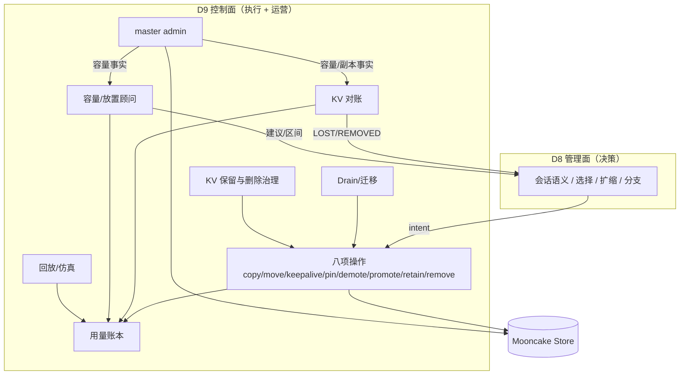
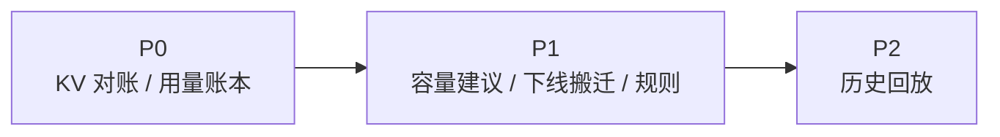

# D9: 控制面：执行与运营能力

- 状态: **设计草案**（能力边界与优先级；收益为模型估算，待真机校准）
- 版本基线: **Mooncake v0.3.13.post1**（master / client 同版本）
- 上游: [summary.md](../summary.md) D9；[D2-kv-operations.md](D2-kv-operations.md) 的操作集；管理面（调度）：[D8](D8-joint-scheduling.md)
- 适用部署: **vLLM-Ascend + Mooncake Store + kvcm** 独立部署
- 关系声明: **kvcm 是独立项目，本文不依赖 lake 运行时**；lake 文档仅作参考
- 分工: D8 管决定做什么，D9 管怎么执行、怎么核验、怎么记账、怎么运营。会话/预热/选路/扩缩是 D8 管理面动作，本文不重复。

---

## 0. 结论

1. kvcm 的**控制面**做四件事：**执行、核验、记账、发布**；不做选路、不做扩缩、不持有前缀索引。
2. **会话 KV、预热不是“调度之外的另一套系统”**：它们是 D8 管理面的 L1 动作，由 D8 决策、控制面执行。本文只保留“执行支撑”这一条边。
3. 控制面的独立运营能力是：**KV 对账、用量账本、容量规划建议、下线搬迁、KV 保留与删除治理、历史回放**。分支/跨地域/rollout 是 D8 决策，D9 只执行 copy/namespace/retain。
4. D9 **不造新机制**：索引、查询、指标、池操作大多有现成组件；D9 补的是“抽样比对、intent→命中归因、容量/迁移/治理的联动”。
5. 能力事实（RPC、前提、版本差异）在 [D2](D2-kv-operations.md) / [D1](D1-router-scheduling.md) / [summary.md](../summary.md)，本文不重复。

---

## 1. 能力总表

| 能力 | 做什么（人话） | 关键机制 | 收益 |
|---|---|---|---|
| **KV 对账** | 索引说有的 KV，池里是不是真的还有 | 抽样 + `batch_query_keys` / `GetReplicaListForAdmin`；回写 `LOST/REMOVED` | 降 ghost、保命中、让 ROI 可信 |
| **用量账本** | 谁花了多少、省了多少、值不值 | 记录 intent/copy/READY/命中；按模型/会话/前缀归因；算 ROI | 成本可见、预算可调、可计费 |
| **容量规划建议** | 池该多大、HBM/DRAM/SSD 怎么配 | working set + Little 定律 + admin 容量；what-if | 少扩/少浪费、容量可预测 |
| **下线搬迁** | 节点停之前，把热 KV 搬到别处 | `CreateDrainJob` / move / verify / 宽限期 | 缩容不丢热 KV、不砸命中率 |
| **KV 保留与删除治理** | 谁能留多久、最多占多少、删前验什么 | retention class + TTL + pin 预算 + 命名空间 + 审计 | 防 pin 滥用、防误删、合规 |
| **历史回放/策略试算** | 用历史请求重跑新策略，先看效果 | 决策日志 + 反事实重放 | 调参不拿生产试错、事故复盘 |

> **不在本表**：会话 KV、预热、选路、扩缩、分支/跨区/rollout。它们是 D8 管理面的动作；控制面只为它们提供 copy/keepalive/pin/verify/namespace 等执行接口。

优先级只在 §6 出现一次，避免和总表重复。

---

## 2. 服务地图

读法：

- **D8** 决定：会话保不保、预取到哪、请求去哪、扩不扩；
- **D9** 执行这些决定（八项操作），并独立做对账、记账、容量建议、搬迁、治理、回放；
- 会话/预热不画成 D9 的独立服务，只通过 `D8 决策 → D9 执行` 这条边出现。

---

## 3. 边界：为什么这些能力放控制面

- **离池最近**：copy/move/keepalive/pin/demote/promote 都是池操作，只有控制面能执行。
- **有台账**：任务、保活、副本、会话四类状态已在 ledger（D2 L5）；换上层也能复用。
- **能核验**：`GET /batch_query_keys` / `GetReplicaListForAdmin` 零副作用；这是对账和 READY 的基础。
- **独立进程**：不随引擎实例生死；会话/保留可以跨 Router 重启。
- **不该做**：选路、扩缩决策、前缀索引——这些归 D8。控制面越界会把后台服务拖成在线决策器。

---

## 4. 能力详解

每项按“解决什么问题 → 怎么做 → 边界/失败 → 验收”展开；例子只放在这里，不再单独做一张例子表。

### 4.1 KV 对账

**解决什么问题**：引擎事件看不到池副本删除；KVT 只增不减；ghost 条目把请求导向无副本实例。publisher 生产按开启规划；即使开启，事件也可能丢/乱序，copy/move 路径仍零发布，对账仍是兜底。

**怎么做**：

- 按热度、年龄、ghost 风险抽样，不做全量 diff；
- 用零副作用 admin 查询；查询失败与“副本丢失”分开；
- 输出去重后的 `LOST/REMOVED/MOVED` 事实，供 D8 KVT 消费。

**例子**：Router 索引说 B 有前缀 P；对账查 B 的副本，发现已被驱逐 → 发 `LOST(P, B)` → KVT 把 B 的条目标成失效，下一次不再往 B 送。

**边界/失败**：

- 全量 diff 太贵；只做抽样/热条目；
- 查询 QPS 要预算，不能阻塞请求；
- 误判（查询失败当丢失）要避免：失败与丢失分开记。

**验收**：ghost 检出率、误判率、查询 QPS 预算；预取/保留 ROI 可算；不因核验阻塞请求。

### 4.2 用量账本

**解决什么问题**：预取/保留/迁移花了带宽和内存，但答不出“哪个模型/会话/前缀在浪费、ROI 多少、TTFT 改善是谁贡献的”。

**怎么做**：

- 记录 intent、copy/move、bytes、耗时、READY/FAILED、保留 TTL、命中结果；
- 会话侧补 `session_e2e`、`resume_ttft`、`tool_wait`、`session_success`，用于判断“省了 KV 钱，但会话变慢/失败”的情况；
- 归因：`hit = engine_apc + local_pool + remote_pool + prewarm + retain`；
- ROI：`saved / cost`；浪费：预取未用、保留未恢复、迁移失败；
- 成本：GPU 时间、带宽、驻留字节。

**例子**：预热 100 次，只有 20 次被用上；账本按前缀算出 ROI，下次只预取高价值前缀，或降低低价值前缀的保留等级。

**边界/失败**：

- 请求命中结果需要 D8/worker 回传；没有回传只能估；
- 多模型/租户归因依赖命名空间；
- 账本是“事实 + 口径”，不是财务系统。

**验收**：每个会话/租户/模型能算 ROI；预取/保留的浪费可定位；账本与 D8 决策可对上。

### 4.3 容量规划建议

**解决什么问题**：扩缩决策在 D8，但 D8 只看请求侧；控制面看得到池内副本、容量、驱逐、迁移。

**怎么做**：

- working set、hot/warm/cold、HBM/DRAM/SSD 配比；
- SSD 不是 HBM 直连：直读要 staging，大 KV 分批；热前缀 promote 到 DRAM，会占 DRAM 容量；
- 容量建议要同时给 SSD 容量、staging buffer、DRAM promote cache、写预算/DWPD；
- 池节点数按 working set / 单节点可用容量估算；
- Little 定律：`TTFT` = 到首 token，`TTLT` = 到最后一个 token。
  - 首 token 段并发 ≈ `req/s × TTFT`；
  - decode 段并发 ≈ `req/s × (TTLT − TTFT)`；
  - 整系统并发 ≈ `req/s × TTLT`。
- 这三个数分别用于 P 段、D 段、整系统，不能混用。P 段用 **P 侧 TTFT**（P 排队 + P prefill 已经包含在 TTFT 里，不能再加一遍）。
- P/D 两池分开算容量，P:D 比例按负载调；
- warm pool（已加载权重、未预热 KV）的空闲成本要单独算，和冷启动损失比较；
- 预热排期按 hook/热度/预算；
- what-if：不同保留策略/配比下的命中率与成本。

**例子**：热前缀 2TB、温 10TB、冷 50TB → 给出 HBM/DRAM/SSD 配比和节点数区间，供采购/扩缩参考。

**边界**：只给建议/区间，不直接扩缩；决策归 D8。不能变成“第二个大脑”。

**验收**：容量预测误差、利用率、少扩/少浪费；建议与 D8 决策不打架。

### 4.4 下线搬迁

**解决什么问题**：缩容/维护/节点下线时，KV 要搬走或保留；搬不走的会被引擎下线带走。

**怎么做**：

- seg 级 `CreateDrainJob`（D2 F7 的批量 move 编排，不是单 key move）；源 seg 先 DRAINING，排空后 DRAINED；job 可 Cancel/Query；单 key 用 `CreateMoveTask`，无取消；
- 宽限期卸载（`GracefulUnmountSegment`）作为迁移时间窗；
- 失败保留 draining，不硬删；
- 与 D8 摘流、编排停实例配合。

**例子**：缩容节点 C：先摘流，再把 C 的会话前缀 move 到 D，verify 完成后停 C；卡住则保留“下线中”，下周期重试。

**边界/失败**：

- 单 key move/copy 无取消；DrainJob 有 job 级取消；源必须在线；
- retain 未实现，跨引擎存亡只能靠 move 到活 seg / 自挂 SSD；
- DFS 依赖部署。

**验收**：缩容不丢热 KV、命中率不断崖；迁移完成率/耗时在预算内。

### 4.5 KV 保留与删除治理

**解决什么问题**：pin/TTL/模型版本/删除没有统一规则，容易滥用、误删、没有审计。

**怎么做**：

- retention class/TTL；pin 预算；模型/revision 隔离；删除审计；配额/借用；安全删除；
- 默认软释放；Remove 前按台账校验 model/revision；hard pin 有上限；所有删除可审计。

**例子**：某会话 pin 了 50GB，超过配额就降级；删之前校验 model/revision，防误删别的模型。

**边界/失败**：

- soft pin 有条件（Case B；设计、后续 PR）；
- hard pin 不能事后加，PIN 一档只能用 lease 延长模拟；
- publisher 开时删除事件可用；但 copy/move 零发布、事件可能丢/乱序，仍要靠 TTL/miss/对账兜底。

**验收**：pin 超限可发现、误删为 0、删除有审计；保留成本可控。

### 4.6 历史回放/策略试算

**解决什么问题**：调权重/TTL/预热门控只能线上试错，出事难复盘。

**怎么做**：

- 记录 hook、事实、决策、intent、READY、命中、延迟；
- 回放：同输入重跑策略；
- 反事实：换权重/TTL/预热门控，看命中率/成本/尾部延迟。

**例子**：把 TTL 从 10 分钟改 30 分钟，先回放一周流量，看命中率/成本变化，再决定是否上线。

**边界**：依赖 D8 决策日志完整；仿真精度取决于负载/时延模型。

**验收**：回放结果与线上偏差可接受；策略版本可比较；事故可复盘。

---

## 5. 收益与验收

> 会话/预热的收益在 D8 §7 已算过（命中/保留省 prefill、本地放置省跨机传输）；本文只算控制面独立能力。

| 能力 | 指标 | 口径（人话） | 验收 |
|---|---|---|---|
| KV 对账 | ghost 率、误判率、查询 QPS | 按热/老/可疑抽样；查询失败与“副本丢失”分开 | ghost 降、请求不被阻塞 |
| 用量账本 | ROI、浪费、归因覆盖率 | 记录 intent/copy/READY/命中；按模型/会话/前缀归因 | 每会话/租户可算账 |
| 容量建议 | 预测误差、利用率 | working set / 单节点可用容量；what-if | 少扩/少浪费 |
| Drain | 迁移完成率、命中率下降 | 迁移字节/带宽 + 任务/并发 + 核验 | 缩容不丢热 KV |
| 治理 | pin 超限、误删、审计覆盖 | 配额/TTL/命名空间/审计 | 滥用可发现、误删 0 |
| 回放 | 回放偏差、策略对比 | 决策日志 + 反事实重放 | 调参可回归 |

---

## 6. 优先级与路线图

| 优先级 | 能力 | 理由 |
|---|---|---|
| **P0** | KV 对账 | 事件索引可信的前提 |
| **P0** | 用量账本 | ROI/预算/归因 |
| **P1** | 容量规划建议 | 扩缩需要池侧事实 |
| **P1** | 下线搬迁 | 缩容/维护必须 |
| **P1** | KV 保留与删除治理 | 防 pin 滥用/误删 |
| **P2** | 历史回放/策略试算 | 调参需要 |

> 会话 KV、预热不在本表：它们归 D8 管理面（L1），控制面只提供执行接口。
> 分支/跨地域/rollout 也不在本表：SC 决策，D9 只执行 copy/namespace/retain。

---

## 7. 能力前提

D9 的能力都依赖具体机制。**事实写在各处，本文不重复**：

| 要知道什么 | 去哪看 |
|---|---|
| 每个操作的 RPC、前提、版本差异 | [D2](D2-kv-operations.md)（§2 soft pin / §3 demote-promote / §4 retain / F11b 核验通道） |
| 池的事件、放置权威、lease 语义 | [D1](D1-router-scheduling.md) |
| kvcm 实现状态、工程项（E13/E15 等） | [summary.md](../summary.md) |

四条前提：

1. **soft pin 有条件**（Case B；设计、后续 PR）。治理规则不能假设“随时能 pin”；不满足就退 keepalive。
2. **hard pin 不能事后加**。保留等级里的 PIN 一档只能用 lease 延长模拟。
3. **retain 未实现**。跨引擎存亡要靠 move 到活 seg 或自挂 SSD，Drain 和 HA 的上限受此约束。
4. **publisher 开启后删除事件可用**；但 copy/move 路径零发布，事件也可能丢/乱序/延迟。所以 KV 对账仍是事件兜底、审计和 ROI 的必做项；publisher 关闭时才完全依赖 TTL/miss/对账。

---

## 8. 参考实现与复用

> kvcm 独立于 lake；下表是“可借鉴的机制”，不是依赖。

### 8.1 现成组件与我们补的胶水

| 能力 | 现成组件 | 已覆盖 | 还缺的“胶水” |
|---|---|---|---|
| KV 对账 | Mooncake Conductor（`prefix_indexer.cpp::PrefixCacheTable::Query/Register`）；Dynamo standalone indexer（`listener.rs::handle_gap`）；Mooncake admin `GET /batch_query_keys` | 索引、查询、gap replay、副本查询 | 抽样策略、索引 vs master 的比对循环、`LOST/REMOVED` 回写、限速/HA |
| 用量账本 | LMCache `observability.py::LMCStatsMonitor`；Prometheus/OTel；AIBrix usage/TPM 指标 | 字节/请求级指标、监控存储 | 把 intent、copy、READY、命中、APC 命中串成一条链；算 ROI/归因 |
| 容量建议 | Dynamo Planner、llm-d WVA、AIBrix PodAutoscaler；Mooncake 容量/水位 | 扩缩算法、指标源、目标副本数 | 池侧 KV footprint/tier mix/容量建议；和 D8 决策接口对齐 |
| 下线搬迁 | Mooncake `CreateDrainJob`、`CancelDrainJob`；K8s drain | seg 级搬迁、job 级取消 | 与 D8 摘流/选缩容节点联动；session-aware；搬完 verify |
| 保留/删除规则 | Mooncake pin/lease/tenant quota；K8s ResourceQuota | 单 key/tenant 的容量与租约 | 跨模型保留策略、pin 预算、删除审计、ROI 约束 |
| 历史回放 | 没有现成实现；trace + 模拟器自建 | 事件/指标存储 | 决策日志 schema、反事实重放、策略版本对比 |

### 8.2 关键代码锚点

| 参考 | 锚点 | 借了什么 | 关键差异 |
|---|---|---|---|
| **kvcm D2** | `D2-kv-operations.md` §1/§4 | 八项操作、READY、状态四类、retain/release | 本文把控制面组合成运营能力 |
| **SGLang session** | `unified_cache/session_ref_tracker.py::UnifiedSessionRefTracker` | session 软保护、frontier 引用 | 会话是 D8 L1；控制面只执行保留 |
| **vLLM Retention** | `v1/kv_hints/protocol.py::KvHintsEnvelope`；Retention API #37003 | pin/retain/prefetch/demote/release 动词表 | 管理面决策，控制面执行 |
| **KVCR Guard** | `remote_fw_dram.py::fetch/query/_try_release_pin`；Guard | 传输窗口 pin、旁挂保活 | kvcm 集中式 + master 权威，不需要 fencing |
| **TensorCast** | `tensorcast/api/_config.py::StorePolicyProfile` | cache/durable/ha/cold/warm/pinned 策略预设 | 用作 retention class 命名，不照搬存储后端 |
| **Dynamo Planner** | `planner/core/load_scaling.py::LoadScalingMixin`；`throughput_scaling.py` | 慢/快双环、SLA 驱动 | 容量顾问只出事实/建议，决策归 D8 |
| **llm-d WVA** | `llm-d-autoscaling`（项目级） | SLO 感知目标副本数、变体成本 | 只做池侧容量事实，不替代 WVA |
| **AIBrix PodAutoscaler** | `podautoscaler/context/context.go`（`gpu_cache_usage_perc`） | KV 使用率/排队长度扩缩指标 | 决策在 D8，执行在外部 |
| **Mooncake** | `master_service.cpp::CreateDrainJob`、`CopyStart`、`GetReplicaListForAdmin` | drain job、copy 幂等、零副作用核验 | kvcm 封装，D8 不直连 |
| **LMCache controller** | `lmcache/v1/cache_controller` | lookup/pin/move/clear | LMCache 无全局强一致元数据；kvcm 有 master 权威 |

---

## 9. 开放问题

1. **KV 对账成本**：admin 查询零副作用，但采样率/查询 QPS 预算怎么定？
2. **用量账本**：请求命中结果从 D8/worker 回传的字段与延迟；多模型/租户怎么切？
3. **容量顾问的边界**：建议与 D8 决策如何避免“两个大脑”？建议只出事实/区间。
4. **Drain**：单 key move/copy 无取消、DrainJob 可 job 级取消；retain 未实现时，跨引擎存亡只能靠 move 到活 seg / 自挂 SSD。
5. **治理**：pin/TTL 预算、模型版本、删除审计的默认策略。
6. **回放**：D8 决策日志的字段与采样率；仿真精度。
