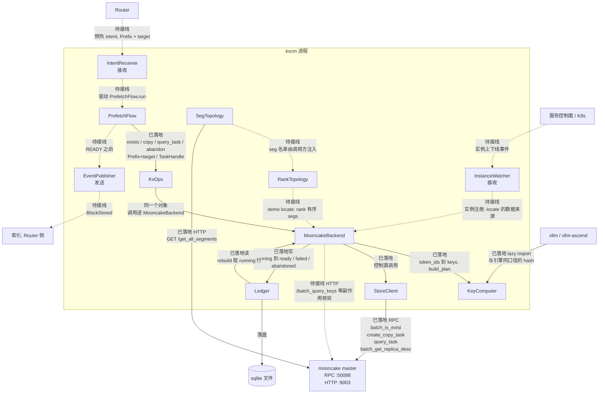
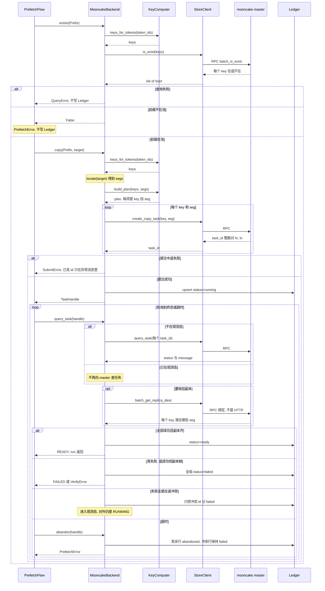
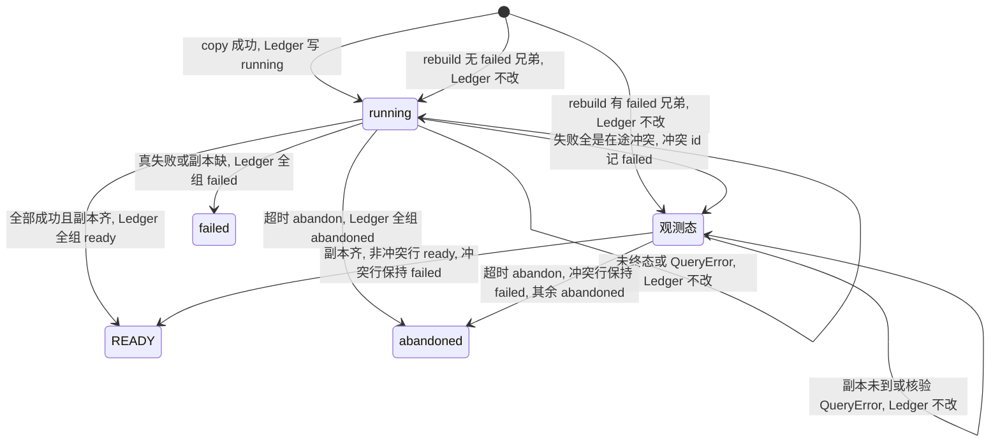
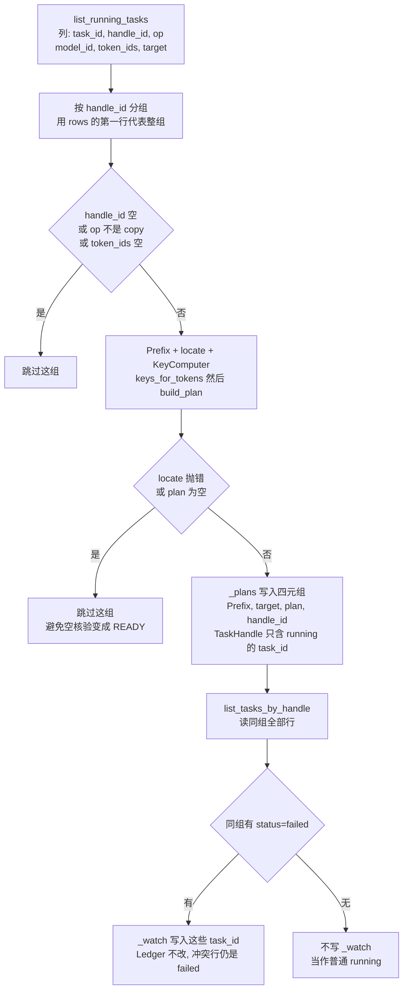

# kvcm 代码架构（五层）

- 定位：kvcm 服务化（E10 重构 / E11 进程化 / E15 并行限速）的模块分层设计。**E10 已落地**（[PR #67](https://github.com/5x8-40/lake/pull/67)，三步全量 + 九轮 review 终审），本文 = E10 落地定稿 + E11 开工依据
- 本文**不新增机制结论**——操作语义、完成信号、幂等性、能力事实全部引自 [D1-router-scheduling.md](D1-router-scheduling.md) / [D2-kv-operations.md](D2-kv-operations.md)；本文只把它们落成代码结构
- 语言：Python（**已定**，2026-10-23 定：继承现有 `demo/precopy/` 1577 行与 mooncake store_py 绑定、keys.py 与引擎同口径）

## 分层总览

这张图是运行时数据流：谁把什么交给谁。实线是代码里已经发生的调用，虚线是设计上要走、进程里还没接上的边（E11/E12/E13）。三个对外组件分开画，方向相反。

- `IntentReceiver`、`InstanceWatcher` 只接收，箭头从进程外进来。`EventPublisher` 只发送，箭头从进程里出去。三者互不调用
- 已落地的驱动是 `PrefetchFlow` 调 `KvOps`。运行时这个对象就是 `MooncakeBackend`，不是中间再转一跳。它写 `Ledger`，账本落在圈外的 sqlite 文件上；`rebuild` 再把 running 行读回来
- `StoreClient` 走 master 的 RPC `:50088`。`SegTopology` 自己会打 HTTP `:9003` 的 `/get_all_segments`。把这份 seg 名单交给 `RankTopology`、再交给 `locate`，进程里还没有这条装配
- 虚线都是类在、调用不在：Router 到接收器、控制面到实例监听、`EventPublisher` 到索引、`/batch_query_keys` 核验

## L1 接口层（进程对外通道）

| 模块 | 职责 | 出处 |
|------|------|------|
| IntentReceiver | 收 Router 预热 intent / 会话结束线索（E12；先占位，协议字段随 D4） | D1 §4 职责边界 |
| EventPublisher | READY 后按目标实例端点补发 `BlockStored`；端点生命周期（每实例一端点、注册给索引） | D1 §2 方案 a 落地、E14 |
| InstanceWatcher | 实例上线/销毁接入 → 触发预热 / seg 副本处理；「端点→实例」「seg→实例」注册的权威来源（E13；先占位，事件源随 D4） | D1 §3、E13 |

- 三条通道全部单向：intent 下行、事件上行、实例事件接入——与 D1 §4「两条单向通道」一致

## L2 编排层（复合流程）

复合流程由原子操作编排而成（D2 §1「复合流程表」即规格），一个流程 = 一段只调 L3 的编排代码：

| 流程 | 编排 | 状态 |
|------|------|------|
| PrefetchFlow | exists 前置检查 → copy → query_task 轮询到 READY（keepalive 注册与 READY 补发待接线） | **已落地**（`flows/prefetch.py`） |
| SessionEndFlow | 停 keepalive + demote | 待做（D1 §6） |
| DrainFlow | copy/move（或 seg 级批量 CreateDrainJob）+ 宽限期卸载 | 待做（D2 §4 计划下线四步） |
| RetainFlow | retain（主路径 = retained client 注册；0.3.11 过渡 = move 到活 seg） | 待做（D2 §4） |

- **失败分类（编排统一出口 = PrefetchError，编程错误除外直接传播）**：前置检查不过 / 提交失败（SubmitError，带已发任务号明细）→ 终态；核验失败（VerifyError）→ 终态带明细；查询失败（QueryError）→ 可重试继续轮询；任务 FAILED → 终态；超时 → 先 abandon 收口再抛

### PrefetchFlow.run 数据流

一次 `run` 的消息顺序。`PrefetchFlow` 只跟 `MooncakeBackend` 说话（类型是 `KvOps`）。失败用 `alt` / `opt` 分开。

- 形态变化：`Prefix` → `token_ids` → `keys` → `plan` → `task_id (hi, lo)` → Ledger 行（`"hi:lo"`、`handle_id`、`token_ids`）
- master 这一侧全是绑定 RPC。HTTP `/batch_query_keys` 不在这次 `run` 里
- Ledger 只在 copy 成功、终态、冲突、abandon 时写。exists 失败和提交失败不写行
- 图里的「超时」是 `run` 的截止时间到了，然后 `abandon`，不是 `query_task` 的一种返回值。观测态一旦进入，下一轮不再查任务，只核验副本

支撑组件（同进程内的常驻循环，E11 进程化的主体）：

- **TaskEngine**：任务状态机（排队 / 进行 / READY / 失败）+ 并发上限 + **限速器**——E11 的核心，E15 限速在这里实现（限速输入 = 网卡/RDMA 计数器采样的链路利用率，D1 §5）。**失败态策略（此处只留接口，随 E10 细化）**，失败后的动作三种：① 重发；② 弃置 + 事后清副本（后端没有任务取消能力 P9——做不到中途取消，只能放弃跟踪、事后清副本）；③ 源掉线衔接（D5，已闭环）。语义引 D2 §1 与 D5，不新造语义
- **KeepaliveLoop**：保活注册表驱动的周期续租（D3；机制 D2 F9，策略未定）
- **ReleaseLoop**：软释放 / demote / 主动 Remove 三级（D1 §6）
- **RetainLoop**：retain 与计划下线编排（D2 §4）

## L3 原子操作层（核心抽象）

- 接口规格直接抄 D2 §1：八项操作的语义、完成信号、READY 有无、幂等性都已定型——本层把它们落成 Python 抽象基类
- 八项分三类（D2 §1）：**原子动作**（copy / move / keepalive / demote / promote / remove）、**元数据标记**（pin）、**目的型**（retain——由 demote / move / pin 组合实现，对外仍呈现单步语义）
- 完成信号：copy / move / promote 有 READY（任务完成 + 目标侧副本核验）；retain 的空句柄在 `query_task` 入口直接 READY，0.3.11 的 move 过渡路径返回真句柄、走同一套轮询。keepalive / stop_keepalive / pin / demote / remove 无 READY（与 `kvcm/ops/base.py` 模块头一致）
- 幂等：控制面以（前缀 × 目标实例）为幂等键，在途不重复发、完成不重复发（D1 §4）；后端幂等兜底（D1 F11）

**接口形态（已定稿，`kvcm/ops/`）**

- **抽象收窄到五项最小集**：`capability / copy / query_task / abandon / exists` 为 abstractmethod；其余操作基类默认抛「适配器未接线」（UnsupportedCapabilityError）——第二后端接入不必先 stub 全部操作；编排层判断可用性读 capability()，异常只是兜底
- **任务号不透明对象**：`TaskHandle.task_ids: tuple[object, ...]`——L3 不透传不解释（mooncake 任务号是整数对，`str()` 化会让真实绑定的 `query_task` TypeError）；持久化编码 `"hi:lo"` 归实现侧（`encode_task_id`/`decode_task_id`，重启可还原）。一次前缀操作展开为 N 个后端任务（每 key 一个），句柄承载全部
- **READY 规则**：copy / move / promote 有 READY（任务完成 + 目标侧副本核验通过）；**retain 返回 TaskHandle**（D-5 裁定：结果必须可观测）——主路径 = main retained client 注册（一次 RPC，无异步工作）返回空句柄 `task_ids=()`，`query_task` 入口直接 READY；0.3.11 过渡 move 返回真句柄。其余方法（keepalive / stop_keepalive / pin / demote / remove）无 READY
- **exists 查询面**（非第九项操作）：读即续租（has_lease），兼预热前置检查与保活续租通道；查询失败（RPC/单 key -1）与「不存在」分家——前者转 QueryError 可重试，后者才触发重算/预热
- **abandon（放弃跟踪）**：删核验登记 + Ledger 记 abandoned；**非任务取消**（后端无此能力，在途传输可能仍完成），副本清理归 remove；放弃后句柄失效

**capability 声明（显式，不藏在接口后面假装统一）**

- 版本口径：**目标基线 = mooncake main**——E10 落地按 main 填充能力、按 main 语义实现；0.3.11 列仅为当前部署（demo 测试床 wheel）约束记录，部署升级后该列即废弃
- 初版清单（每项都能指回 D2 事实条目）。格内口径分两层：
  - **RPC**：master / C++ 客户端是否具备该能力（与 kvcm 语言无关）
    - 线协议 = ylt coro_rpc，序列化走 `rpc_types.h` 的 `YLT_REFL`（struct_pack 结构体反射——与 HA 快照落盘同一套宏，非 RPC 层专属证据；协议骨架在 `rpc_service.h`）
    - 没有独立的协议描述文件（无 `.proto` 类 IDL）：协议定义只在 C++ 结构体与编译产物里
    - 跨语言直连 = 自己实现一套协议客户端（编码规则、framing、函数 ID 都要从 C++ 源码反推），几千行且随版本漂移
    - 结论：kvcm 不看「RPC 有没有」，看下一条的「通道」
  - **通道**：kvcm（Python）当前实际可调 = **store_py 绑定 ∪ HTTP admin**；**L2 按能力选路径看通道**
    - 绑定：`store_py.cpp` 的 pybind 绑定（v0.3.11 共 112 个 `.def` / @1fc27b6 共 120 个）；demo 部署的 `mooncake_transfer_engine_npu` wheel 是**官方 NPU 构建变体**（`scripts/build_wheel.sh` 改包名发布，同机制另有 `-efa` 变体），`create_copy_task` / `batch_get_replica_desc` 为 v0.3.11 原生绑定（`store_py.cpp:2682` / `:2660`），非 fork 私有
    - HTTP admin：两版本都有（端点见下「三条接入通道」节）
  - RPC ✓ 而通道 ✗ 时的处理顺序：
    1. **自封装 .so**：照 `store_py.cpp` 的写法自写封装，link wheel 的 C++ 库，不改 mooncake 源码（两个断点待 E6 验证，见下）
    2. **替代实现**：原则 5
    3. **自研协议客户端**：仅兜底
  - △ = 待 E6 核对

| 能力 | mooncake 0.3.11（部署现状） | mooncake main（目标基线） | 出处 |
|------|------------------------------|----------------------------|------|
| has_lease（读续租） | RPC ✓ 通道 ✓（`is_exist`） | RPC ✓ 通道 ✓ | D2 F9 |
| soft pin 事后加（空写 upsert 通道） | RPC ✓ 通道 ✗（绑定只有一步式 `upsert_tensor`；HTTP 无写类端点） | RPC ✓ 通道 ✗（同左；自封装 .so 候选） | D2 F1/F12 |
| hard pin 事后加 | ✗（创建时固化、无 unpin） | ✗ | D2 F1 |
| can_copy_with_source（指定源复制） | ✗（move 才能指定源） | ✗ | D2 F7 |
| has_offload / has_promotion（池通道降层/提回） | RPC ✓ 通道 ✓（降层 = 停保活即可，无需调后端；提回 = HTTP `/query_key`） | RPC ✓ 通道 ✓（同左） | D2 §3 |
| has_per_key_demote（确定性立即降层） | ✗ | ✗ | D2 §3 缺口 |
| has_task_cancel（copy/move 任务取消） | ✗ | ✗ | D2 §1 审计 P9 |
| has_retained_client（保留身份注册） | ✗ | RPC ✓ 通道 ✗（绑定、HTTP 均无；自封装 .so 候选；替代 = move 到活 seg） | D2 F13② |
| has_dfs_replica（共享 3FS 副本） | ✗ | RPC ✓ 通道 △（写入路径待 E6 核对） | D2 F13② |
| has_admin_query（零副作用核验） | ✗（HTTP 版有副作用：续租 + 计命中） | **HTTP ✓**（`/batch_query_keys` 零副作用） | D2 F11b |

- L2 按能力选路径（**看通道**）：D2 §3 的写穿/写回分支、§4 的 retained client/DFS 前提，本质就是能力分支——本层把它落成显式声明
- 同一后端不同版本能力不同（0.3.11 vs main 已在表里）——capability 在适配器初始化时按版本填充，不写死在类上

## 失败语义与任务生命周期

**失败语义三类**（`kvcm/ops/base.py`；编排层统一出口 PrefetchError，编程错误直接传播不被吞）：

| 异常 | 语义 | 调用方处置 |
|------|------|-----------|
| SubmitError | 提交失败（copy/move/promote 发起阶段；消息带已发任务号——中途失败的任务需要跟踪） | 终态，重试策略归编排（幂等键 + 后端幂等兜底） |
| QueryError | 查询失败（RPC 错误等瞬时原因） | 可重试，继续轮询到超时兜底 |
| VerifyError | 核验失败（任务全部完成但副本不到位） | 终态，带缺失明细上抛 |

**在途冲突观测态**（D1 §4「在途不当失败」的代码落实）：任务失败 message 全部含 `OBJECT_HAS_REPLICATION_TASK`（别人在复制同 key，典型 = 同 intent 重发）时，**不按失败处理**——冲突任务如实记 failed，之后只核验副本，副本到位即 READY（字节是谁搬的不重要，到位是目的）。混合失败（部分冲突部分真失败）仍整组 FAILED。

**copy 任务生命周期**（`观测态` 不是 `TaskStatus` 的枚举值，调用方看到的仍是 `RUNNING`）：

- 从 `running` 出去的边就是 `query_task` 的分支：冲突进观测态，副本齐进 `ready`，真失败或核验缺进 `failed`
- 观测态不再查任务 RPC。缺副本留在观测态，不抛 `VerifyError`
- 超时从 `running` 或观测态进 `abandoned`，后端任务不取消
- `rebuild` 从账本里的 running 行回来：同组没有 failed 兄弟进 `running`，有则进观测态。全冲突组没有 running 行，不会出现在这张图的入口上

## L4 适配层（两个正交维度）

适配分两个正交维度：**存储后端**与**推理引擎**——两者各自独立可换。`MooncakeBackend` 的字段是 `StoreClient` 和 `KeyComputer`（算 key、做 `build_plan`）。`RankTopology` 只负责 rank↔seg 探测，结果经 `locate` 注入，不是 backend 的字段。

### StoreBackend（存储后端适配）

**MooncakeBackend**（首个实现，`backends/mooncake/backend.py`）：

| 子件 | 职责 | 包路径 |
|------|------|--------|
| StoreClient | store 绑定生命周期（lazy import；connect/close，setup 失败先 close）+ **双通道**：控制类走绑定（create_copy_task / query_task / is_exist / remove…）；查询/观测走 HTTP admin。副本核验当前走绑定通道（有续租副作用）；main 的零副作用核验（`/batch_query_keys`）随版本接线（has_admin_query） | `client.py` + `http_admin.py` |
| SegTopology | seg→client/实例映射（HTTP `/get_all_segments`）；seg、client_id、lease 语义 | `topology.py` |
| capability 填充 | 按连接上的版本填充（**构造必填**——不许默认冒充 main；目标基线 = **mooncake main**，0.3.11 仅为当前部署约束记录） | `capability.py` |

- **组装形态**：`MooncakeBackend(client, key_computer, locate, capability, ledger?)`——`locate`（实例 → rank 有序 seg 列表）以可调用注入：demo 环境 = RankTopology 探测，生产 = L1 InstanceWatcher 注册，backend 不关心来源。本类不 import `SegTopology` / `RankTopology` / `AdminClient`，这三件不是它的字段
- **copy 已落地**（发起式）：前缀 → KeyComputer 算 key → locate 得 seg → `KeyComputer.build_plan` 做 rank 映射（异构 TP 反向展开）→ 逐 key 提交；`query_task` 聚合判定 READY。**rank 映射归引擎侧**——存储适配零 key 格式依赖（换引擎本类不动）
- **seg 概念与 lease/client_id 语义归本层**：全是 mooncake 特有——放通用层会把后端概念带进通用接口
- **一个后端实例 = 一种 (源 TP, 目标 TP, put_step) 组合**：KeyComputer 的异构展开口径在构造期定死（`kvcm/engines/vllm/keys.py::KeyComputer` docstring 记了完整前提链），换组合必须新建实例——编排层持多组合时按组合各建一个，不复用
- **第二后端候选已登记在案**：昇腾 MemCache（`3rdparty/memcache`；kv-prefetch.md 待定项「生产默认走 MemCache，还是留 Mooncake」）——L3 抽象现在建正是时候；但只建一层接口，第二后端真接入时再修接口，不为假想后端过度设计

#### 三条接入通道（mooncake）

1. **client RPC 面**（`:50088`，coro_rpc）
   - 控制类操作全在这面（`RegisterRpcService` 注册 67 个方法）
   - 调用前必须先注册 client（UUID + 心跳）：控制类 RPC 的语义挂在 client UUID 上——任务校验「谁 Start 谁 End」、副本绑 seg 所在 client 的 liveness、下线清理按 client 走
   - kvcm 的接入方式只有一种：dlopen 动态库、在进程内实例化 client——store_py.so 是官方封装好的，自封装 .so 是自己补的，两者是同一件事。**所以 kvcm 在 master 眼里必然是一个 client**，这与它是否持有存储无关
   - store_py 与自封装 .so 必须共用同一个 client 实例/UUID：各注册一个 = 两份身份两份心跳，D2 §2 的 client_id 问题也会变成两份
2. **HTTP admin 面**（`:9003`，HTTP+JSON，无需 client 身份）
   - 查询/观测端点：`/batch_query_keys` `/query_key` `/get_all_keys` `/get_all_segments` `/query_segment` `/health` `/metrics` 等（0.3.11 在 `rpc_service.cpp`，main 拆到 `master_admin_service.cpp`）
   - `ForAdmin` 系列（零副作用核验）只在这面：它们是 master 进程内方法，不注册到 client RPC 面——RPC 调不到，HTTP 是唯一通道
   - 查询类走这面的好处：不用注册 client，kvcm 进程死了也不在 master 留任何状态
   - 版本差异：0.3.11 的 `/batch_query_keys` 走普通 `BatchGetReplicaList`（有续租副作用）；main 走 `BatchGetReplicaListForAdmin`（零副作用）
3. **C 接口**（`mooncake-store/include/store_c.h`，ctypes 可直调）
   - 数据面操作：put / get / is_exist / remove / register_buffer
   - put 的 config 带完整 pin 支持（`with_hard_pin`、`soft_pin_action` ENABLE/DISABLE/PRESERVE、TTL）——但注释明确是 `on publish`，即「写新 key 时挂 pin」：写新 key 是引擎的活，kvcm 不写新 key；kvcm 要的 pin 全是**事后操作**（key 已在池里）
   - 事后加/解 pin 的唯一通道 = upsert（D2 F3/F12），C 接口只有 put 没有 upsert；copy/move、retained 注册、admin 查询也都不在——所以补洞仍要自封装

**自封装 .so**（补两个缺口：空写 upsert、retained 注册——绑定、HTTP、C 接口都没有，C++ client 类有）：

- 写法：照 `store_py.cpp` 的写法——`#include` mooncake 头文件，调 C++ client 类方法，对外暴露 pybind 或 extern "C" 接口；产物放 kvcm 侧，不改 mooncake 源码
- 单 client 保证（约束见上「三条接入通道」节：store_py 与自封装 .so 必须共用同一 client 实例/UUID）：
  - 不能走的写法：自封装 .so 自己 `RealClient::create()` 再建一个 → 两个 UUID 两套心跳
  - **路径 A（首选）：自封装 .so 复用 store_py 已建的 client**
    - 依据：`MooncakeStorePyWrapper` 的成员 `store_` 是 public（`store_py.cpp:288`，holder 为 `std::shared_ptr<PyClient>`），另有 public 访问器 `get_real_client()`（`:1075`）
    - 做法：自封装 .so 用 pybind11 写，函数参数声明为 `MooncakeStorePyWrapper&`；Python 侧把 store_py 建好的 store 对象传进来，pybind11 跨模块按 typeid 查全局 registry 还原 C++ 对象 → 经 `store_` / `get_real_client()` 拿到同一个 `RealClient`，调缺口方法
    - 效果：全进程一个 client 实例、一个 UUID、一套心跳；已有绑定与自封装 .so 缺口方法落在同一 client 上
    - 前提：自封装 .so 编译用的 pybind11 与 wheel 内 store_py 的 internals 版本一致（不一致则跨模块 cast 查不到类型）；RTTI 开启（wheel 默认开）
  - **路径 B（退路）：自封装 .so 取代 store_py**——自封装 .so 照 `store_py.cpp` 把用到的绑定面（demo 十来个方法）+ 缺口方法重新绑定一遍，Python 只 import 自封装 .so；天然单 client、不依赖跨模块 cast，代价是复制绑定面
- 为什么不能 Python 直调（ctypes）：
  - ctypes 能调 C 函数，但造不了 C++ 对象
  - 方法参数和返回是 C++ 类型（`std::string` 的 SSO 布局、`UUID` struct、`tl::expected` 返回值），在 Python 里按字节拼这些对象 = 手工复刻编译器的类型布局，且布局随 libstdc++ 版本变
  - 所以中间必须有一层 C++：它用头文件调类方法（布局由编译器保证），对 Python 只暴露 C 类型
  - 备选：`cppyy`（JIT 解析 C++ 头文件直接调类，免手写封装；对 mooncake 头文件的兼容性待验证）
- 两个断点（E6；x86 参考已核一半，npu wheel 待测试机复核）：
  1. 符号可见性：**x86 0.3.13 wheel 已验证通过**——`Client` 类方法本体全部导出（`nm -D` 实测：`BatchUpsert` / `CreateCopyTask` / `CreateMoveTask` 及 `RealClient::upsert_*_helper` 均在，连 `MooncakeStorePyWrapper` 自身符号也导出）；npu 0.3.11 wheel 待测试机复核（同一构建系统，预期一致；符号不导出则此路不通，退回替代实现）
  2. ABI 匹配：gcc/libstdc++ 与 wheel 构建环境一致性待测试机；路径 A 的 pybind11 对齐已查明：mooncake 锁定 pybind11 **2.13.6**（@1fc27b6 `extern/pybind11` = 58c382a），自封装 .so 编译用同版本即可对齐 internals
- E6 另核：`/query_key` 的续租副作用在核验场景能否接受；retained 注册的具体符号名按 main 源码确认（0.3.13 x86 wheel 未见 retained 符号）。（已核一条：demo wheel 的 `create_copy_task` / `batch_get_replica_desc` 为 v0.3.11 原生绑定，上游亦原生支持 NPU——v0.3.11 tag 已有 `ascend_transport` 目录）

### EngineAdapter（引擎适配）

**VLLMAdapter**（文档里的分组名；代码里没有这个类，这一侧就是 `KeyComputer` 和 `RankTopology`）：

| 子件 | 职责 | 包路径 |
|------|------|--------|
| KeyComputer | 前缀 → hash 链 → PoolKey（与引擎同口径：上游 lazy-import 双布局 + 离线镜像回退 + 容器内漂移哨兵）；`build_plan`（key → 目标 seg 的 rank 映射，异构反向展开）；PYTHONHASHSEED 守卫 | `engines/vllm/keys.py` |
| RankTopology | rank↔KV shard 形状（TP/PP/DP 切分；异构 TP 的对端 TP 语义——引擎 env `PEER_TP_SIZE`，kvcm `peer_tp_size` 须与之同值）；rank↔seg 对号（probe：pidfile/进程树/ss//proc/ssh 自 pipe，ss/ssh 带超时） | `engines/vllm/topology.py` |
| 事件格式 | 引擎 KV 事件（`BlockStored` 等）schema 的生成/解析 | 待做（EventPublisher 补发时按本格式构造） |
| engine config | block_size / num_kv_heads / head_size / 层数读取（KV 大小估算，E14 容量规划输入） | 待做 |

- **KeyComputer 归引擎侧，不归存储侧**——PoolKey 的权威定义在**引擎**（引擎写 KV 时就以此 key 落池，kvcm 只是按同口径找回）；mooncake 对 key 无格式要求（不透明字符串），后端不掺和 key 语义
- **引擎之间 key 计算不一样**：vLLM 是链式 block hash（`vllm/v1/core/kv_cache_utils.py::hash_block_tokens`，`prefix_caching_hash_algo` + `init_none_hash` 的 seed 折入、block_size、Mamba/MLA 模型类型均影响结果）；SGLang 是 `RadixKey` = token id 序列本身（`sglang/srt/mem_cache/radix_cache.py`）——连 key 形态都不同（hash 值 vs token 序列）。KeyComputer 放通用层或存储侧都是放错了层
- **引擎强关联物全归本层**：key 计算、rank 拓扑、事件 schema、engine config——换引擎（如 SGLangAdapter）时 StoreBackend 一行不动

## L5 状态层

**Ledger**（sqlite，`kvcm/ledger.py`）：状态记录四类，按可丢性分级——

| 表 | 可丢性 | 内容 |
|----|--------|------|
| tasks 任务状态机 | 可丢 | task_id / handle_id（同组任务分组键）/ op / prefix_key / target / status（running/ready/failed/abandoned，写入校验）/ model_id / token_ids / 时间戳；`gc_tasks` 清超龄终态 |
| keepalive 保活注册表 | 不可丢 | prefix_key / model_id / token_ids（还原 Prefix 必需，重启后续上保活） |
| replicas 副本台账 | 半可丢 | key / instance / verified_at（可从 master 副本查询重建） |
| sessions 会话绑定 | 不可丢 | session_id / prefix_key / instance / model_id / token_ids |

- **记账归实现侧（L4 持有，L2 不直接碰）**：copy / query_task / abandon 时由 MooncakeBackend 经 Ledger 迁移状态——记账需要任务号的持久化编码与状态迁移的时机，两样都只在实现侧手里；编排层记账两头都缺还会漏分支
- **批量写入单事务**（多任务同迁移不出现半新半旧）；只管新建库（kvcm 未部署，不做老库迁移，旧结构文件删除重建）
- **单线程约束**：sqlite 连接 check_same_thread——E11 把 TaskEngine 挪进独立线程时第一件事处理（调用侧加锁或每线程一连接），否则第一次跨线程调用即 ProgrammingError
- 部署形态：kvcm 单实例跟随 master（D2 §1）；上 HA 时再换 Redis/etcd

**重启恢复（`MooncakeBackend.rebuild()`，D-4 裁定：放 token 不放 key）**

key/seg 不落库。输入只有 `status='running'` 的行，输出是进程内的 `_plans` 和 `_watch`。

- 全冲突的组没有 running 行，进不了 `In`，所以没有指向 `_plans` 的出口
- 重算用本实例的 `KeyComputer`，不按行上的 `model_id` 过滤。多模型共用一个 Ledger 时会算错别人的任务；多模型前要先加「model_id 不符则跳过」
- 恢复进 `_watch` 之后，缺副本保持 RUNNING，不走 `VerifyError`

## 设计原则

1. **原子操作屏蔽后端与引擎语义**：L2 不出现 seg / lease / client_id / PoolKey / rank——这些词只允许出现在 L4
2. **能力显式，不假装统一**：后端差异走 capability 声明，L2 按能力分支；不在接口里塞进只有 mooncake 有的概念
3. **只建一层抽象**：L3 接口服务当前唯一后端（mooncake），第二后端（MemCache）接入时再修——不预判假想需求
4. **语义规格以 D1/D2 为准**：本文任何接口定义与 D1/D2 冲突时，改本文
5. **多实现方式：先落地一种，其余登记**：一个操作有多种实现方式时（D2 已有实例：retain = retained client / DFS 副本 / move 到活 seg / 自挂 SSD 兜底，§4；降层写穿 vs 写回分支，§3；copy 无指定源能力时以 move 替代，F7），**优先实现一种**，其余作为已知替代方式登记在 API 文档（能力前提、语义差异、补齐条件），后续按 capability 补齐——不同时实现多个

## 与 E10 / E11 / E15 的对位

- **E10（重构）✅ 已落地**（[PR #67](https://github.com/5x8-40/lake/pull/67)，三步全量 + 九轮 grok-4.7-high review 终审问题全清）：L3 抽象 + capability；1577 行重组为 MooncakeBackend + VLLMAdapter 子件 + Ledger；PrefetchFlow + L1 空骨架。测试 `kvcm/tests/`（pytest，73 passed + 1 skipped；fake-store 锁任务号往返、重启恢复全剧本）；CI 路径隔离（`kvcm/kvcm/`+`kvcm/tests/` → kvcm job ~8s；`kvcm/demo/` → kvcm-demo 冒烟；文档与 build.yml 自身不触发语言 job）
- **E11（进程化）**：进程壳 + TaskEngine + Keepalive/Release/Retain 三个 Loop 常驻化；IntentReceiver / InstanceWatcher 占位接口随 E12/E13 填。**前置提醒**：Ledger 线程约束（见 L5）；PrefetchFlow 的同步轮询由 TaskEngine 接管（并发上限 + 限速），流程本体不变
- **E15（并行限速）**：TaskEngine 内的并发调度 + 限速器（链路利用率采样，D1 §5）——不独立做

## 参考实现

- **mooncake 三条通道的代码依据**（均 @1fc27b6）：`rpc_service.cpp::RegisterRpcService`（client RPC 面 67 个注册方法，无 `ForAdmin` 系列）；`master_admin_service.cpp`（HTTP admin 面，main；0.3.11 在 `rpc_service.cpp` 内）；`store_c.h`（C 接口）；`store_py.cpp`（pybind 绑定，自封装 .so 的参照）；线协议：`rpc_service.h:8`（coro_rpc）、`rpc_types.h`（`YLT_REFL`）
- **UCM 可插拔 KVStore**（[`../docs/research/ucm/architecture.md`](../../docs/research/ucm/architecture.md)）与 **LMCache 多存储后端**（[`../docs/research/lmcache/sharing-and-backends.md`](../../docs/research/lmcache/sharing-and-backends.md)）：后端抽象同构。关键差异：它们的抽象在**数据面**（connector get/put），本架构 L3 在**管理面**（copy/pin/lease/remove 控制操作）——管理语义无跨后端天然对应物，故 capability 必须显式
- **LMCache controller**（D2 §1 完备性审计同表）：控制面对外 = 命令集——L1 IntentReceiver 对应其命令入口
- **Dynamo standalone indexer**（`3rdparty/dynamo/lib/kv-router/src/services/indexer/`）：独立进程 + 契约接口的组件形态参照；本架构是 kvcm 单进程内部结构，组件拓扑已定（kvcm 独立控制面、索引归 Router 侧，D1 §4）
