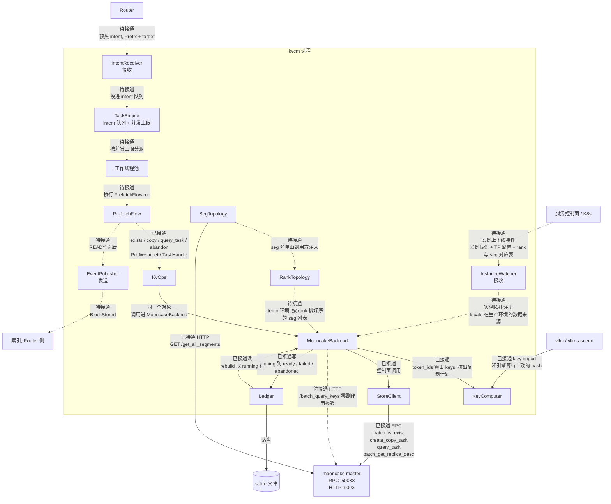
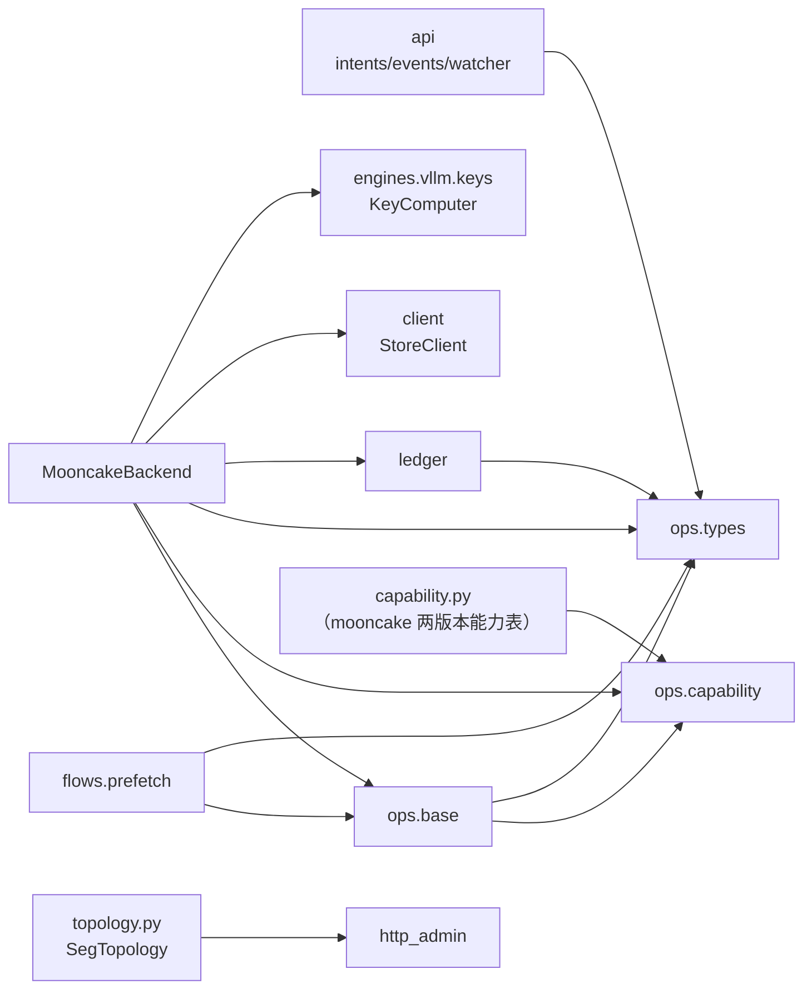
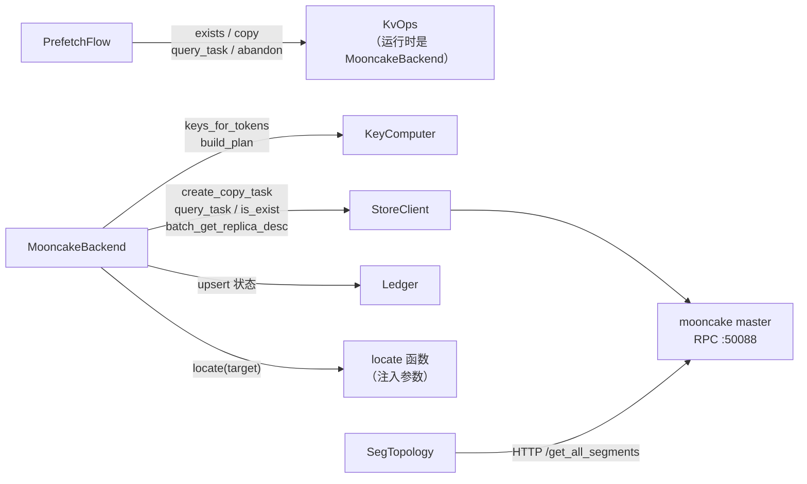
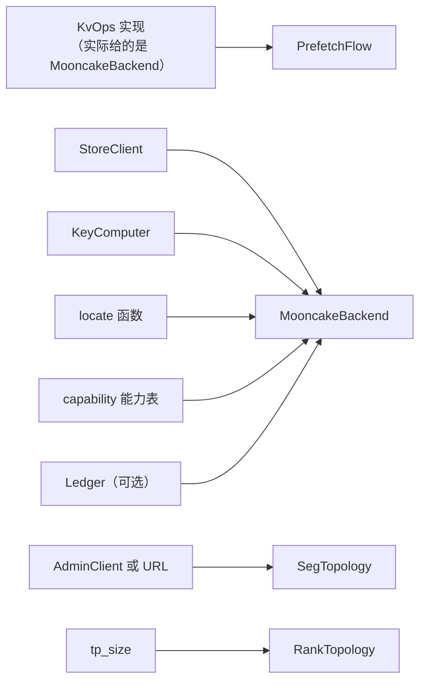
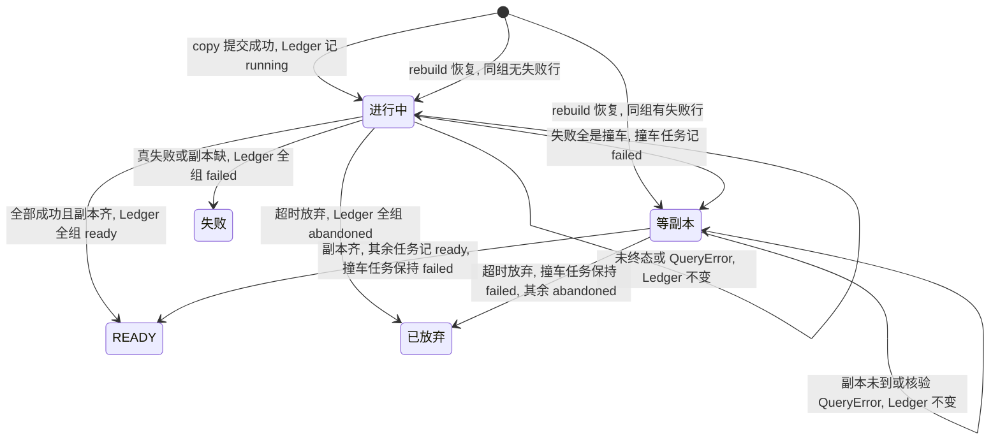
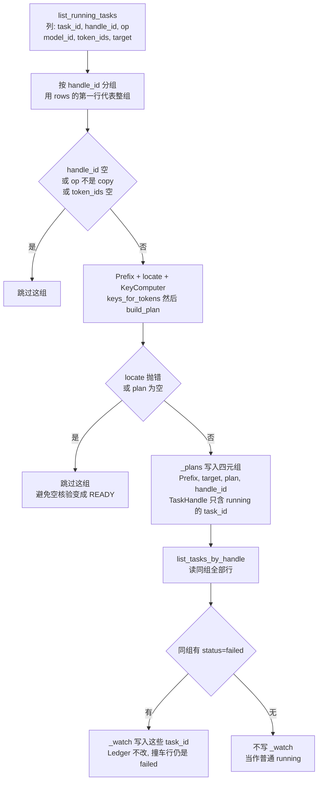
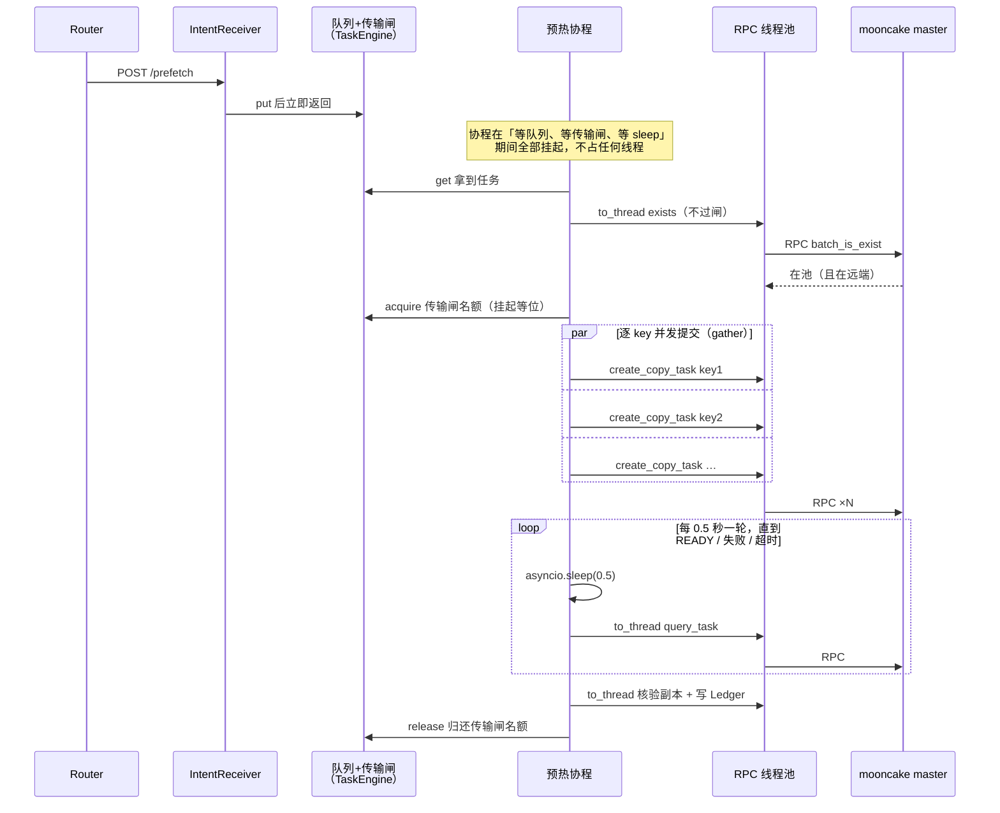

# kvcm 代码架构（五层）

- 定位：kvcm 服务化（E10 重构 / E11 进程化 / E15 并行限速）的模块分层设计——E10 已完成（[PR #67](https://github.com/5x8-40/lake/pull/67)），本文是 E11 开工依据
- 本文**不新增机制结论**——操作语义、完成信号、幂等性、能力事实全部引自 [D1-router-scheduling.md](D1-router-scheduling.md) / [D2-kv-operations.md](D2-kv-operations.md)；本文只把它们落成代码结构
- 语言：Python（继承现有 `demo/precopy/` 1577 行与 mooncake store_py 绑定、keys.py 与引擎算法一致）

## 分层总览

代码分五层，依赖方向只允许向下（L1 → L2 → L3 ← L4；L5 由 L4 持有）：

```text
L1 接口层     IntentReceiver / EventPublisher / InstanceWatcher      kvcm/api/
              进程对外通道；不含任何存储概念（空骨架，协议随 D4/E12/E13）
L2 编排层     PrefetchFlow 已实现；SessionEnd/Drain/Retain 未实现    kvcm/flows/
              只调 L3 接口；代码里不出现 seg / lease / client_id / PoolKey / rank
L3 原子操作层 KvOps：八操作 + query_task / exists / abandon          kvcm/ops/
              抽象接口（语义规格 = D2 §1）+ capability 声明结构
L4 适配层     MooncakeBackend = StoreClient + SegTopology            kvcm/backends/mooncake/
              引擎侧子件   = KeyComputer + RankTopology                kvcm/engines/vllm/
L5 状态层     Ledger（sqlite，四类状态记录）                          kvcm/kvcm/ledger.py
```

核心思想：**原子操作屏蔽后端与引擎语义**——编排对任何存储后端、任何推理引擎成立；换后端换 StoreBackend，换引擎换引擎侧子件。

### 运行时数据流

谁把什么交给谁。实线是已接通的调用，虚线是设计要走、进程里还没接通的边（E11/E12/E13）。



- `IntentReceiver`、`InstanceWatcher` 只接收，箭头从进程外进来。`EventPublisher` 只发送，箭头从进程里出去。三者互不调用
- **intent 的走法（E11 形态）**：`IntentReceiver` 收到后不直接跑流程，只投进 `TaskEngine` 的队列；TaskEngine 看执行中的任务数低于并发上限，就把任务分给线程池里一个空闲线程，那个线程才跑 `PrefetchFlow.run`。当前代码还没有这两个部件，流程只能被直接调用
- 已接通的驱动是 `PrefetchFlow` 调 `KvOps`——运行时这个对象就是 `MooncakeBackend`，不是中间再转一跳。它写 `Ledger`，账本落在圈外的 sqlite 文件上；`rebuild` 再把 running 行读回来
- **实例拓扑的两条来路**：demo 环境没有注册通道，`RankTopology` 用探测法推断「哪个 rank 对应哪个 seg」（见 L4 节）；生产环境由实例启动时把自己的拓扑（TP 配置、rank 与 seg 对应表）经 `InstanceWatcher` 注册进来（D1 §3、E13）——两条来路汇成一个 `locate` 函数注入 backend
- `StoreClient` 走 master 的 RPC `:50088`。`SegTopology` 自己会打 HTTP `:9003` 的 `/get_all_segments`（查存储池当前挂了哪些 seg）。demo 里把这份名单交给 `RankTopology` 做比对，进程里还没有这条装配
- 虚线都是类已建、调用未接通：Router 到接收器、控制面到实例监听、`EventPublisher` 到索引、`/batch_query_keys` 核验

### 模块依赖（参考）

三张图各回答一个问题：谁 import 谁、谁调谁、谁是构造参数。三张合起来说明一件事：**分层约束在代码里是成立的**——编排层（flows）只认识接口（ops），不知道存储后端是谁；引擎侧（engines）不认识存储后端；两边的组装只发生在一个地方：`MooncakeBackend` 的构造函数。

**谁 import 谁**（静态依赖）：



- `engines.vllm.keys`、`engines.vllm.topology`、`client`、`http_admin` 不 import 任何 kvcm 模块（图上没有它们的出边）

**谁调谁**（运行时方法调用）：



**谁是构造参数**（箭头 = 「作为参数传给」；创建对象时这些依赖从外部给进来，不是对象自己造的）：



- `MooncakeBackend` 自己不创建这些依赖——五个参数全从外部给（依赖注入）；换掉其中任何一个（比如换引擎的 KeyComputer），这个类的代码一行不动
- `locate` 是唯一没有对应 kvcm 模块的参数——它只是一个函数签名，生产环境由实例注册提供数据，demo 环境由 RankTopology 探测提供

## L1 接口层（进程对外通道）

| 模块 | 职责 | 出处 |
|------|------|------|
| IntentReceiver | 收 Router 预热 intent / 会话结束线索（E12；先占位，协议字段随 D4）。占位形态：进程内函数调用 + 最小 HTTP 端点 `POST /prefetch {model_id, token_ids, target}`（stdlib `http.server` 经线程池执行，量上来换 aiohttp；响应同步等 READY 返回，可选 `?wait=0` 立即返回任务标识）——只调 TaskEngine 公开方法（`queue.put`），E12 正式协议来了只换这层皮 | D1 §4 职责边界 |
| EventPublisher | READY 后按目标实例端点补发 `BlockStored`；端点生命周期（每实例一端点、注册给索引） | D1 §2 方案 a 落地、E14 |
| InstanceWatcher | 实例上线/销毁接入 → 触发预热 / seg 副本处理；「端点→实例」「seg→实例」注册的权威来源（E13；先占位，事件源随 D4） | D1 §3、E13 |

- 三条通道全部单向：intent 进来、事件发出去、实例事件接入——与 D1 §4「两条单向通道」一致

## L2 编排层（复合流程）

复合流程由原子操作编排而成（D2 §1「复合流程表」即规格），一个流程 = 一段只调 L3 的编排代码：

| 流程 | 编排 | 状态 |
|------|------|------|
| PrefetchFlow | exists 前置检查 → copy → query_task 轮询到 READY（keepalive 注册与 READY 补发待接通） | 已实现（`flows/prefetch.py`） |
| SessionEndFlow | 停 keepalive + demote | 未实现（D1 §6） |
| DrainFlow | copy/move（或 seg 级批量 CreateDrainJob）+ 宽限期卸载 | 未实现（D2 §4 计划下线四步） |
| RetainFlow | retain（主路径 = retained client 注册；0.3.11 过渡 = move 到存活节点的 seg） | 未实现（D2 §4） |

- **失败处理**：流程对调用方只抛一种异常（当前叫 `PrefetchError`——这个名字绑死在 Prefetch 上，其他流程没法用，将改为一般化的 `FlowError`，随 KeySet 一起实施）——调用方不用关心失败发生在哪一步，具体原因写在异常消息里。编程错误（KeyError、TypeError 这类代码 bug）不包装，直接向上抛。各分支：

| 发生了什么 | 流程怎么处理 |
|-----------|-------------|
| 前缀不在池（exists 返回 False） | 报错，不发起复制（复制了也没意义） |
| 复制提交中途出错（SubmitError） | 报错；异常里带已提交的任务号——那些任务还在池里跑，需要有人跟 |
| 查任务状态时 RPC 出错（QueryError） | 不报失败，等一会儿重查，直到超时 |
| 任务全部完成、但副本核验缺（VerifyError） | 报错，带缺哪些副本的明细 |
| 任务失败（FAILED） | 报错 |
| 超过时限没完成 | 先放弃跟踪（abandon，见 L3 节），再报错 |

流程的步骤、数据流与失败分支：**[flows/prefetch.md](flows/prefetch.md)**（每流程一篇，新增流程同目录另立）。

## L3 原子操作层（核心抽象）

- 接口规格直接抄 D2 §1：八项操作的语义、完成信号、READY 有无、幂等性都已定型——本层把它们落成 Python 抽象基类
- 八项分三类（D2 §1）：**原子动作**（copy / move / keepalive / demote / promote / remove）、**元数据标记**（pin）、**目的型**（retain——由 demote / move / pin 组合完成，但调用方看起来仍像一步）
- 完成信号：copy / move / promote 有 READY（任务完成 + 目标侧副本核验）；retain 也返回任务凭据（定义见下「接口形态」）：无异步工作的路径返回空凭据，`query_task` 入口直接 READY；0.3.11 的 move 过渡路径返回真凭据、走同一套轮询。keepalive / stop_keepalive / pin / demote / remove 无 READY
- 幂等：同一个前缀对同一台实例，已经在复制就不重复发、已完成也不重复发（D1 §4）；后端侧重复调用也有幂等保护（D1 F11）

**接口形态（`kvcm/ops/`）**

- **接口只强制五个方法**：`capability / copy / query_task / abandon / exists` 为 abstractmethod；其余操作基类默认抛「适配器未接通」（UnsupportedCapabilityError）——第二后端接入时不必把全部操作先写成空实现；编排层判断可用性读 capability()，异常只是兜底
- **任务凭据（TaskHandle）**：一次 `copy(前缀)` 在 mooncake 上是逐条 key 各发一个复制任务——一个前缀通常对应多条 key（块数 × rank 数），所以一次操作会产生多个任务。凭据里的 `task_ids` 装着这次操作的全部任务号，查询时一起查。任务号的类型对 L3 不透明（`tuple[object, ...]`）：mooncake 的任务号是两个整数组成的整数对，L3 原样保存、原样回传，不做字符串化（`str()` 化后真实绑定的 `query_task` 会报 TypeError）；要写进 Ledger 时由实现侧编码成 `"整数:整数"` 的字符串（`encode_task_id`/`decode_task_id`，重启可还原）
- **READY 规则**：copy / move / promote 有 READY（任务完成 + 目标侧副本核验通过）；**retain 返回 TaskHandle**——结果必须可观测（「保住了没有」是本操作存在的意义；实现路径 = D2 §4）。主路径 = mooncake 主线版本的 retained client 注册（一次 RPC，无异步工作）返回空凭据 `task_ids=()`，`query_task` 入口直接 READY；0.3.11 过渡 move 返回真凭据。其余方法（keepalive / stop_keepalive / pin / demote / remove）无 READY
- **exists（查询，不是第九项管理操作）**：实现是 `batch_is_exist`，它有个副作用——被查到的 key 会被续租，所以预热前的存在性检查顺便就起了保活作用。两种结果必须分清：「不在池里」（key 确实没有 → 该预热）和「查询本身失败」（RPC 出错或单 key 返回 -1 → 转成 QueryError 等一会儿重查）——把查询失败当成「不在池里」会误判成需要重新计算
- **abandon（放弃跟踪）**：kvcm 发起任务后要定期查它完成没有，这叫跟踪。abandon = 不再查了：删掉进程内的核验登记，Ledger 记为 abandoned，凭据从此失效（再查报 KeyError）。它**不是取消任务**——后端没有取消接口，传输可能照常完成。**abandon 之后不会自动删副本**：副本留在池里，按冷热策略自然降层、过期；要立刻删除得显式调 remove（未实现，归释放流程 ReleaseLoop，D1 §6）


### 失败语义

异常分三类（`kvcm/ops/base.py`；流程对调用方统一只抛 PrefetchError）：

| 异常 | 什么时候抛 | 调用方怎么办 |
|------|-----------|-------------|
| SubmitError | 提交任务的中途出错。异常消息带已提交的任务号——那些任务还在池里跑，需要有人跟 | 视为失败；重试与否由编排层决定（重复提交有幂等保护，见下） |
| QueryError | 查任务状态、查副本时 RPC 出错（网络抖动这类临时问题） | 等一会儿重查，不算失败 |
| VerifyError | 任务全部显示完成、但副本核验缺副本。异常带明细 | 视为失败 |

**重复提交不视为失败（等副本状态，代码里叫 `_watch`）**

- 场景：同一个预热请求发了两遍。第二遍的复制任务会全部失败——mooncake 发现同样的 key 已有任务在复制，报错 `OBJECT_HAS_REPLICATION_TASK`
- 处理：这种失败**不算失败**（语义出处 = D1 §4「在途不当失败」）。这些任务在 Ledger 里如实记 failed（它们确实没跑成），但流程不等它们——改为只定期检查副本到位没有：第一遍的任务正在搬同样的数据，搬完了，第二遍的目的就达到了
- 副本没到位时保持「进行中」，不报 VerifyError——这个状态下「缺副本」只意味着第一遍还没搬完
- 失败原因里混着撞车以外的原因（哪怕只有一条），整组按真失败处理

### 任务生命周期（以 copy 为例；等副本状态对外仍显示 `RUNNING`，不是 `TaskStatus` 的独立枚举值）



- `进行中` 的四条出口就是 `query_task` 的四种结果：全是撞车进等副本；副本齐进 READY；真失败或核验缺进失败；编排层超时进已放弃
- 等副本状态不再查任务状态，只查副本；缺副本不报 VerifyError
- `rebuild` 的两个入口看同组任务里有没有失败行：没有则回「进行中」，有（撞车失败的行）则回「等副本」。整组都撞车失败的组没有 running 行，不会出现在这张图的入口


**接口演进：KeySet（已定方向，待实施）**

- 问题：exists / copy / keepalive 等操作各自以 Prefix 为入参、各自算一遍 key。长序列下 key 计算不便宜（链式块 hash 逐块串行，块数 × rank 数 个 key 字符串），一次预热算两遍不合理
- 方案（已定，PR 合入后实施）：
  - L3 新增 `keys_of(prefix) -> KeySet`；`KeySet` = 不透明类型（内容 = 算好的 key 列表），与 TaskHandle 同一设计哲学——编排层持有、传递、不解释
  - 全部操作方法的入参从 `Prefix` 改为 `KeySet`：`exists(ks)` / `copy(ks, target)` / ……编排流程在开头算一次，之后全程复用
  - `Prefix` 保留在入口：intent 载荷、幂等键（前缀 × 实例）、Ledger 记 token_ids 的输入
  - 不选「keys 裸露进编排层」：PoolKey 出现在 L2 违反原则 1；不选「backend 内缓存」：引入缓存增长管理与淘汰语义
  - 影响面：KvOps 全部方法签名 + MooncakeBackend + PrefetchFlow + 测试；rebuild 内部重算路径不变（它本来就从 token_ids 现场算）
  - **同批实施（都动方法签名，一次改完）**：`wait_ready` 挪进 ops——「等到 READY」的轮询循环从 flow 挪进 ops（跨流程通用件：Drain/Retain 同样需要等；flow 只剩编排 exists → copy → wait_ready）；`PrefetchError` → `FlowError`（统一出口异常一般化）。async 化不属于本批——它随 E11 本期完成（见「运行时结构」节）

**capability 声明（显式，不藏在接口后面假装统一）**

- 版本基准：**目标基线 = mooncake main**——实现按 main 填充能力、按 main 语义实现；0.3.11 列仅为当前部署（demo 测试床 wheel）约束记录，部署升级后该列即废弃
- 初版清单（每项都能指回 D2 事实条目）。格内填写分两层：
  - **RPC**：master / C++ 客户端是否具备该能力（与 kvcm 语言无关）
    - 线协议 = ylt coro_rpc，序列化走 `rpc_types.h` 的 `YLT_REFL`（struct_pack 结构体反射。注意：这个宏 HA 快照落盘也在用，所以它不是「这是 RPC 协议」的专属证据；协议骨架在 `rpc_service.h`）
    - 没有独立的协议描述文件（无 `.proto` 类 IDL）：协议定义只在 C++ 结构体与编译产物里
    - 跨语言直连 = 自己实现一套协议客户端（编码规则、报文边界、函数 ID 都要从 C++ 源码反推），几千行且随版本漂移
    - 结论：kvcm 不看「RPC 有没有」，看下一条的「通道」
  - **通道**：kvcm（Python）当前实际可调 = store_py 绑定和 HTTP admin 两条路；**L2 按能力选路径看通道**
    - 绑定：`store_py.cpp` 的 pybind 绑定（v0.3.11 共 112 个 `.def` / @1fc27b6 共 120 个）；demo 部署的 `mooncake_transfer_engine_npu` wheel 是**官方 NPU 构建变体**（`scripts/build_wheel.sh` 改包名发布，同机制另有 `-efa` 变体），`create_copy_task` / `batch_get_replica_desc` 为 v0.3.11 原生绑定（`store_py.cpp:2682` / `:2660`），非 fork 私有
    - HTTP admin：两版本都有（端点见下「三条接入通道」节）
  - RPC ✓ 而通道 ✗ 时的处理顺序：
    1. **自封装 .so**：照 `store_py.cpp` 的写法自写封装，link wheel 的 C++ 库，不改 mooncake 源码（两个断点待 E6 验证，见下）
    2. **替代实现**：原则 5
    3. **自研协议客户端**：仅兜底
  - △ = 待 E6 核对

| 能力 | mooncake 0.3.11（部署现状） | mooncake main（目标基线） | 出处 |
|------|------------------------------|----------------------------|------|
| has_lease（读续租） | RPC ✓ 通道 ✓（`is_exist`） | RPC ✓ 通道 ✓ | D2 F9 |
| soft pin 事后加（用 upsert 空写的方式） | RPC ✓ 通道 ✗（绑定只有一步式 `upsert_tensor`；HTTP 无写类端点） | RPC ✓ 通道 ✗（同左；自封装 .so 候选） | D2 F1/F12 |
| hard pin 事后加 | ✗（创建时固化、无 unpin） | ✗ | D2 F1 |
| can_copy_with_source（指定源复制） | ✗（move 才能指定源） | ✗ | D2 F7 |
| has_offload / has_promotion（池通道降层/提回） | RPC ✓ 通道 ✓（降层 = 停保活即可，无需调后端；提回 = HTTP `/query_key`） | RPC ✓ 通道 ✓（同左） | D2 §3 |
| has_per_key_demote（确定性立即降层） | ✗ | ✗ | D2 §3 缺口 |
| has_task_cancel（copy/move 任务取消） | ✗ | ✗ | D2 §1 审计 P9 |
| has_retained_client（保留身份注册） | ✗ | RPC ✓ 通道 ✗（绑定、HTTP 均无；自封装 .so 候选；替代 = move 到存活节点的 seg） | D2 F13② |
| has_dfs_replica（共享 3FS 副本） | ✗ | RPC ✓ 通道 △（写入路径待 E6 核对） | D2 F13② |
| has_admin_query（零副作用核验） | ✗（HTTP 版有副作用：续租 + 计命中） | **HTTP ✓**（`/batch_query_keys` 零副作用） | D2 F11b |

- L2 按能力选路径（**看通道**）：D2 §3 的写穿/写回分支、§4 的 retained client/DFS 前提，本质就是能力分支——本层把它落成显式声明
- 同一后端不同版本能力不同（0.3.11 vs main 已在表里）——capability 在适配器初始化时按版本填充，不写死在类上

## L4 适配层（两个正交维度）

适配分两个正交维度：**存储后端**与**推理引擎**——两者各自独立可换。`MooncakeBackend` 的字段是 `StoreClient` 和 `KeyComputer`（算 key、做 `build_plan`）。

先解释三个容易混淆的东西：

- **locate**：一个函数，输入实例标识，输出「这个实例的每个 rank 对应哪个 seg」（rank 有序的 seg 列表）。复制前必须知道它——key 是按 rank 生成的，每条 key 要发到对应 rank 的 seg 上。它不是某个类，是构造 backend 时注入的参数；生产环境的数据来自实例注册（InstanceWatcher），demo 环境来自 RankTopology 探测
- **SegTopology**：查 master 当前挂了哪些 seg（HTTP `/get_all_segments`）——存储池视角的 seg 全量名单。它不知道 seg 属于哪个实例、哪个 rank
- **RankTopology**：demo 环境推断「rank ↔ seg」对应关系的探测机制。做法：从启动脚本写的 pidfile 找到 worker 进程树 → 读每个进程监听的 TCP 端口（`ss` 或 `/proc`，带超时）→ 拿端口与 SegTopology 给的 seg 名单比对（端口匹配上的 seg 就是这个进程的）→ 从进程名 `VLLM::Worker_TP<N>` 读出 rank 号 → 得到每个 rank 对应哪个 seg。任何一步对不上都直接报错（拿错对应关系 = 把 KV 复制到错误的机器内存）。生产环境不需要它——实例启动时自己把拓扑注册上来

### StoreBackend（存储后端适配）

**MooncakeBackend**（首个实现，`backends/mooncake/backend.py`）：

| 子件 | 职责 | 包路径 |
|------|------|--------|
| StoreClient | store 绑定生命周期（lazy import；connect/close，setup 失败先 close）+ **双通道**：控制类走绑定（create_copy_task / query_task / is_exist / remove…）；查询/观测走 HTTP admin。副本核验当前走绑定通道（有续租副作用）；main 的零副作用核验（`/batch_query_keys`）等升级到 mooncake 主线后接通（has_admin_query） | `client.py` + `http_admin.py` |
| SegTopology | 查 master 的 seg 名单（见上）；seg、client_id、lease 语义归这里 | `topology.py` |
| capability 填充 | 按连接上的版本填充（**构造必填**——不许默认冒充 main；目标基线 = **mooncake main**，0.3.11 仅为当前部署约束记录） | `capability.py` |

- **组装形态**：`MooncakeBackend(client, key_computer, locate, capability, ledger?)`——`locate`（实例 → rank 有序 seg 列表）以可调用注入：demo 环境 = RankTopology 探测，生产 = L1 InstanceWatcher 注册，backend 不关心来源。本类不 import `SegTopology` / `RankTopology` / `AdminClient`，这三件不是它的字段
- **copy 实现**（发起式）：前缀 → KeyComputer 算 key → locate 得 seg → `KeyComputer.build_plan` 做 rank 映射（异构 TP 反向展开）→ 逐 key 提交；`query_task` 聚合判定 READY。**rank 映射归引擎侧**——存储适配零 key 格式依赖（换引擎本类不动）
- **exists 与 copy 目前各自独立算 key**：两个操作在接口上相互独立，同一前缀在一次预热里算两遍。短序列时成本可忽略，但长序列下不是——链式块 hash 逐块串行（token 数 ÷ block_size 次，不能并行），外加 块数 × rank 数 个 key 字符串。不设缓存（长驻进程的缓存增长管理问题更大）；正解见下「接口演进：KeySet」
- **seg 概念与 lease/client_id 语义归本层**：全是 mooncake 特有——放通用层会把后端概念带进通用接口
- **一个后端实例 = 一种 (源 TP, 目标 TP, put_step) 组合**：KeyComputer 的「key 按多少 rank 展开」规则在构造期定死（`kvcm/engines/vllm/keys.py::KeyComputer` docstring 记了完整前提链），换组合必须新建实例——编排层持多组合时按组合各建一个，不复用
- **第二后端候选已登记在案**：昇腾 MemCache（`3rdparty/memcache`；kv-prefetch.md 待定项「生产默认走 MemCache，还是留 Mooncake」）——L3 抽象现在建正是时候；但只建一层接口，第二后端真接入时再修接口，不为假想后端过度设计

#### 三条接入通道（mooncake）

1. **client RPC 面**（`:50088`，coro_rpc）
   - 控制类操作全在这面（`RegisterRpcService` 注册 67 个方法）
   - 调用前必须先注册 client（UUID + 心跳）：控制类 RPC 的语义挂在 client UUID 上——任务校验「谁 Start 谁 End」、副本绑 seg 所在 client 的 liveness、下线清理按 client 走
   - kvcm 的接入方式只有一种：把动态库加载进进程、在进程里创建 client——store_py.so 是官方封装好的，自封装 .so 是自己补的，两者是同一件事。**所以 kvcm 在 master 眼里必然是一个 client**，这与它是否持有存储无关
   - store_py 与自封装 .so 必须共用同一个 client 实例/UUID：各注册一个 = 两份身份两份心跳，D2 §2 的 client_id 问题也会变成两份
2. **HTTP admin 面**（`:9003`，HTTP+JSON，无需 client 身份）
   - 查询/观测端点：`/batch_query_keys` `/query_key` `/get_all_keys` `/get_all_segments` `/query_segment` `/health` `/metrics` 等（0.3.11 在 `rpc_service.cpp`，main 拆到 `master_admin_service.cpp`）
   - `ForAdmin` 系列（零副作用核验）只在这面：它们是 master 进程内方法，不注册到 client RPC 面——RPC 调不到，HTTP 是唯一通道
   - 查询类走这面的好处：不用注册 client，kvcm 进程死了也不在 master 留任何状态
   - 版本差异：0.3.11 的 `/batch_query_keys` 走普通 `BatchGetReplicaList`（有续租副作用）；main 走 `BatchGetReplicaListForAdmin`（零副作用）
3. **C 接口**（`mooncake-store/include/store_c.h`，ctypes 可直调）
   - 数据面操作：put / get / is_exist / remove / register_buffer
   - put 的 config 带完整 pin 支持（`with_hard_pin`、`soft_pin_action` ENABLE/DISABLE/PRESERVE、TTL）——但注释明确这只是发布时的行为，即「写新 key 时挂 pin」：写新 key 是引擎的活，kvcm 不写新 key；kvcm 要的 pin 全是**事后操作**（key 已在池里）
   - 事后加/解 pin 的唯一通道 = upsert（D2 F3/F12），C 接口只有 put 没有 upsert；copy/move、retained 注册、admin 查询也都不在——所以缺的接口仍要自封装 .so 补

**自封装 .so**（补两个缺口：空写 upsert、retained 注册——绑定、HTTP、C 接口都没有，C++ client 类有）：

- 写法：照 `store_py.cpp` 的写法——`#include` mooncake 头文件，调 C++ client 类方法，对外暴露 pybind 或 extern "C" 接口；产物放 kvcm 侧，不改 mooncake 源码
- 单 client 保证（约束见上「三条接入通道」节：store_py 与自封装 .so 必须共用同一 client 实例/UUID）：
  - 不能走的写法：自封装 .so 自己 `RealClient::create()` 再建一个 → 两个 UUID 两套心跳
  - **路径 A（首选）：自封装 .so 复用 store_py 已建的 client**
    - 依据：`MooncakeStorePyWrapper` 的成员 `store_` 是 public（`store_py.cpp:288`，holder 为 `std::shared_ptr<PyClient>`），另有 public 访问器 `get_real_client()`（`:1075`）
    - 做法：自封装 .so 用 pybind11 写，函数参数声明为 `MooncakeStorePyWrapper&`；Python 侧把 store_py 建好的 store 对象传进来，pybind11 跨模块按类型名在全局类型表里找到已注册的类型，还原出 C++ 对象 → 经 `store_` / `get_real_client()` 拿到同一个 `RealClient`，调缺口方法
    - 效果：全进程一个 client 实例、一个 UUID、一套心跳；已有绑定与自封装 .so 缺口方法落在同一 client 上
    - 前提：自封装 .so 编译用的 pybind11 与 wheel 内 store_py 的 internals 版本一致（不一致则跨模块 cast 查不到类型）；RTTI 开启（wheel 默认开）
  - **路径 B（退路）：自封装 .so 取代 store_py**——自封装 .so 照 `store_py.cpp` 把用到的绑定面（demo 十来个方法）+ 缺口方法重新绑定一遍，Python 只 import 自封装 .so；天然单 client、不依赖跨模块 cast，代价是复制绑定面
- 为什么不能 Python 直调（ctypes）：
  - ctypes 能调 C 函数，但造不了 C++ 对象
  - 方法参数和返回是 C++ 类型（`std::string` 的内存布局（短字符串内嵌）、`UUID` struct、`tl::expected` 返回值），在 Python 里按字节拼这些对象 = 手工复刻编译器的类型布局，且布局随 libstdc++ 版本变
  - 所以中间必须有一层 C++：它用头文件调类方法（布局由编译器保证），对 Python 只暴露 C 类型
  - 备选：`cppyy`（JIT 解析 C++ 头文件直接调类，免手写封装；对 mooncake 头文件的兼容性待验证）
- 两个断点（E6）：
  1. 符号可见性：x86 0.3.13 wheel 实测 `Client` 类方法本体全部导出（`nm -D`：`BatchUpsert` / `CreateCopyTask` / `CreateMoveTask` 及 `RealClient::upsert_*_helper` 均在，连 `MooncakeStorePyWrapper` 自身符号也导出）；npu 0.3.11 wheel 待测试机复核（同一构建系统，预期一致；符号不导出则此路不通，退回替代实现）
  2. ABI 匹配：gcc/libstdc++ 与 wheel 构建环境一致性待测试机；路径 A 的 pybind11 对齐：mooncake 锁定 pybind11 **2.13.6**（@1fc27b6 `extern/pybind11` = 58c382a），自封装 .so 编译用同版本即可对齐 internals
- E6 另核：`/query_key` 的续租副作用在核验场景能否接受；retained 注册的具体符号名按 main 源码确认（0.3.13 x86 wheel 未见 retained 符号）。另：demo wheel 的 `create_copy_task` / `batch_get_replica_desc` 为 v0.3.11 原生绑定（`store_py.cpp:2682` / `:2660`），上游原生支持 NPU（v0.3.11 tag 已有 `ascend_transport` 目录）

### EngineAdapter（引擎适配）

**VLLMAdapter**（分组名：代码里是 `KeyComputer` 与 `RankTopology` 两个类，无同名类）：

| 子件 | 职责 | 包路径 |
|------|------|--------|
| KeyComputer | 前缀 → hash 链 → PoolKey。key 格式直接从 vllm-ascend 库导入（两个版本的导入路径都试），保证和引擎算得一致；容器外没有库时回退到内置的格式副本并警告可能和引擎不一致，容器内有测试逐字节比对兜底。`build_plan`：每条 key 映射到目标 seg（源和目标 TP 不同时按倍数归并）。PYTHONHASHSEED 必须为 0 的检查 | `engines/vllm/keys.py` |
| RankTopology | rank 与 KV 切片的对应关系（TP/PP/DP 切分；源和目标 TP 不同时，kvcm `peer_tp_size` 必须与引擎环境变量 `PEER_TP_SIZE` 同值）；rank 与 seg 对号（探测：pidfile/进程树/ss//proc，跨机时把脚本源码经 ssh 送到目标机执行，ss/ssh 带超时） | `engines/vllm/topology.py` |
| 事件格式 | 引擎 KV 事件（`BlockStored` 等）schema 的生成/解析 | 待做（EventPublisher 补发时按本格式构造） |
| engine config | block_size / num_kv_heads / head_size / 层数读取（KV 大小估算，E14 容量规划输入） | 待做 |

- **KeyComputer 归引擎侧，不归存储侧**——PoolKey 的权威定义在**引擎**（引擎写 KV 时用的就是这个 key；kvcm 不定自己的格式，只是按同样的规则把 key 再算出来）；mooncake 对 key 无格式要求（不透明字符串），后端不掺和 key 语义
- **引擎之间 key 计算不一样**：vLLM 是链式 block hash（`vllm/v1/core/kv_cache_utils.py::hash_block_tokens`，`prefix_caching_hash_algo` + `init_none_hash` 的初始种子参与计算、block_size、Mamba/MLA 模型类型均影响结果）；SGLang 是 `RadixKey` = token id 序列本身（`sglang/srt/mem_cache/radix_cache.py`）——连 key 形态都不同（hash 值 vs token 序列）。KeyComputer 放通用层或存储侧都是放错了层
- **引擎强关联物全归本层**：key 计算、rank 拓扑、事件 schema、engine config——换引擎（如 SGLangAdapter）时 StoreBackend 一行不动

## L5 状态层

**Ledger**（sqlite，`kvcm/ledger.py`）：状态记录四类，按可丢性分级——

| 表 | 可丢性 | 内容 |
|----|--------|------|
| tasks 任务状态机 | 可丢 | task_id / handle_id（同组任务分组键）/ op / prefix_key / target / status（running/ready/failed/abandoned，写入校验）/ model_id / token_ids / 时间戳；`gc_tasks` 清超龄终态 |
| keepalive 保活注册表 | 不可丢 | prefix_key / model_id / token_ids（还原 Prefix 必需，重启后续上保活） |
| replicas 副本台账 | 半可丢 | key / instance / verified_at（可从 master 副本查询重建） |
| sessions 会话绑定 | 不可丢 | session_id / prefix_key / instance / model_id / token_ids |

- **记账归实现侧（L4 持有，L2 不直接碰）**：copy / query_task / abandon 时由 MooncakeBackend 经 Ledger 迁移状态——记账需要任务号的持久化编码与状态迁移的时机，两样都只在实现侧手里；编排层记账两头都缺还会漏分支
- **批量写入单事务**（多任务同迁移不出现半新半旧）；只管新建库（kvcm 未部署，不做老库迁移，旧结构文件删除重建）
- **单线程约束**：sqlite 连接 check_same_thread——E11 把 TaskEngine 挪进独立线程时第一件事处理（调用侧加锁或每线程一连接），否则第一次跨线程调用即 ProgrammingError
- 部署形态：kvcm 单实例跟随 master（D2 §1）；上 HA 时再换 Redis/etcd

**重启恢复（`MooncakeBackend.rebuild()`；状态记录规格 = D2 §1）**

key/seg 不落库。输入只有 `status='running'` 的行。输出是内存里的两张登记表（backend 对象里的两个字典）：

- `_plans`：每个任务凭据对应哪个前缀、哪台目标实例、复制计划（哪条 key 发到哪个 seg）——恢复后 `query_task` 靠它继续跟踪
- `_watch`：哪些凭据处于「等副本」状态（同组里有撞车失败的任务）——恢复后这些凭据只查副本、不再查任务

**恢复范围**：目前只恢复 copy（唯一已实现的操作）。move / promote 实现时要同步补各自的恢复路径——否则重启后这两类任务的跟踪会静默丢失。



- 全部任务都撞车的组没有 running 行，进不了 `In`，所以没有指向 `_plans` 的出口
- 重算用本实例的 `KeyComputer`，不按行上的 `model_id` 过滤。多模型共用一个 Ledger 时会算错别人的任务；多模型前要先加「model_id 不符则跳过」
- 恢复进 `_watch` 之后，缺副本保持 RUNNING，不走 `VerifyError`

## 运行时结构（E11）

进程内分三层：**事件循环管调度与等待，线程池执行阻塞调用，Ledger 记账**。

### 执行模型

单事件循环 + 全部任务协程化 + `ThreadPoolExecutor` 只执行同步阻塞调用。

- **KvOps 接口 async 化**：`async def exists / copy / query_task / abandon / ……`——等待的源头（轮询 `sleep`、RPC 阻塞）全在 ops 实现内部，只有这一层 async 才能让等待挂起；只在 flow 外层包 async，省不到这些等待
- **阻塞调用走 executor**：mooncake 同步 RPC、sqlite 读写等，经 `asyncio.to_thread` 交给线程池执行。mooncake 绑定等 RPC 时释放 GIL，executor 内多个 RPC 能真并行
- **线程池与任务数解耦**：executor 大小按 RPC 执行密度配（4~8），不随传输闸的名额数变。一个 copy 任务 30 秒里 RPC 执行合计约 1 秒，其余是 `await` 挂起——协程化后 100 个任务挂着也只占这几个线程
- **backend 共享态（`_plans`/`_watch`）无锁**：事件循环单线程，协程只在 `await` 点切换——字典操作不跨 `await` 就天然原子（纪律写进注释：禁止在 `_plans`/`_watch` 读写之间 `await`）
- **纪律（反例）**：协程里直接调同步阻塞函数 = 整个事件循环停摆（所有协程一起卡住）。所有阻塞调用必须 `to_thread`
- **RPC 卡死防护**：同步 RPC 在对端无响应时可能永不返回，线程被永久占死。协程侧用 `asyncio.wait_for` 给调用加超时：超时后协程按失败处理（abandon），卡死的线程泄漏一个、由泄漏监控暴露。根治靠 RPC 自带超时参数（mooncake 绑定有无该参数，列入 E6 核对）

**厨房比方**：线程池 = 厨师（就几个，真正下锅的活只有他们炒）；协程 = 点菜单（来一张挂一张，挂一千张也不占厨师）；事件循环 = 前台（收单、叫号，绝不能自己进厨房）；信号量 = 灶台数（同时只炒 4 锅菜，等灶的是单子不是人）。**厨师数决定干活速度，单子数决定能接多少活、等待多便宜**——协程化不是让这批活更快，是让等待与排队免费。

**时序（一次预热，协程视角）**：



- 线程只在 `Ex`（线程池）这一列出现：每个 RPC 执行的几毫秒
- 协程（W）全程只是一段代码状态，挂起时不占线程——排队 100 个这样的协程也免费

**线程池大小**：

- **禁用 `to_thread` 默认池**（`min(32, cpu+4)`，大小不可控）——自建 executor 并显式配置
- **RPC executor**：按 RPC 执行密度配（4~8），与传输闸的名额数**不绑定**——传输闸限「同时在后端传输的任务数」（保护后端），线程只为 RPC 执行的那一瞬间服务
- **Ledger 专用单线程 executor**（`max_workers=1`）：sqlite 调用全部 `to_thread` 到它——天然串行，不用加锁
- **线程泄漏监控**：RPC 卡死会慢性漏线程——定期看各池活跃线程数，持续偏高即告警（根治靠 RPC 超时参数，有无该参数列入 E6 核对）

### TaskEngine

`asyncio.Queue` + 传输闸限并发 + 协程消费者，无优先级、不分轻重通道。

- **队列与拿取**：intent 进 `asyncio.Queue`；K 个协程循环 `get`（K 可以很大，协程便宜——在队列里等、在传输闸上等，都是协程挂起，不占线程）
- **传输闸 = `asyncio.Semaphore`（默认 4，参数化）**：限「同时在后端传输的任务数」（带宽管控）——**只在确认要发后台传输时拿名额**（copy / move / drain 提交前 acquire，任务终态 release）。**毫秒级操作不过闸**：exists 探测、promote（刷热度）、查询、副本核验、keepalive——它们的瞬时并发由 RPC executor（4~8 线程）天然限制，多余请求协程挂起等线程、毫秒即返，不会被传输任务堵几十秒
- **任务状态机**：队列位置 + Ledger `running` 迁移的组合，不另建状态存储
- **轻重任务统一协程**：保活、查询、promote 等轻任务也是协程，天然不占线程，且**不过传输闸**（见上）——不分优先级、不设单独通道；`session_end` 类可延迟任务排队无妨
- **gather 并发提交**（E15 并行限速接入点）：copy 的逐 key 串行提交改为 `asyncio.gather` + 子信号量——提交阶段从 N 倍往返时间缩到约（N ÷ 并发度）倍往返时间；E15 的并发调度与限速器在这一层信号量上实现
- **排队超时**：intent 在队列等待的语义（等多久算放弃）随 E12 intent 字段一起定；执行超时沿用 flow 现有 `timeout_s`
- **失败态策略**（只留接口，随 E11 细化）：失败后的动作三种——① 重发；② 放弃这批任务，事后把留下的副本清掉（后端没有任务取消能力 P9——做不到中途取消，只能放弃跟踪、事后清副本）；③ 复制中途源实例下线时的处理（D5）。语义引 D2 §1 与 D5，不新造语义

### KeepaliveLoop

- **为什么要保活**：mooncake 副本租约默认只有 5~10 秒（`types.h` `DEFAULT_DEFAULT_KV_LEASE_TTL`：0.3.11 = 5000ms，main = 10000ms）——预热完成后副本没人碰，10 秒内就可被驱逐；而真实流量晚于这个间隔到达是常态。保活 = 桥接「预热完成 → 首次流量」的空窗，**不是一直保**：窗口到即停租，之后副本冷热由池自己判断
- **占位策略 = 固定窗口**（READY 后续租一个可配置窗口，窗口到即停租注销）：会话期（依赖 E12 会话信号）与首次命中后停（依赖 E13/E14 命中信号）现在都没有信号，做不了；固定窗口什么都不依赖，且有明确终点（不会把副本变相钉死在热层）。窗口时长参数化，默认 10 分钟只是起步值（真机观察「预热完成到首次流量」的典型间隔后再调）
- **实现通道**：定期 `exists`（`batch_is_exist`，读即续租）——不依赖 L3 的 `keepalive()` 方法（NotImplementedError，留待将来语义更丰富的保活策略）
- **形态**：协程定时器（事件循环内 `asyncio.sleep` 周期触发），不是独立线程

### ReleaseLoop / RetainLoop

只留类骨架——依赖的 `demote` / `retain` / `remove` 在 L4 全是 NotImplementedError，能力接通（E10 后续）前无内容可跑。职责：ReleaseLoop = 软释放 / demote / 主动 Remove 三级（D1 §6）；RetainLoop = retain 与计划下线编排（D2 §4）。

### 进程生命周期

- **启动**：`rebuild()` 接通——重启后恢复 running 任务的跟踪（见 L5 节）
- **优雅退出**（SIGTERM/SIGINT）五步：
  1. **停收 intent**——占位入口关闭，不接新活
  2. **取消在途协程**（`task.cancel()`）——协程在 `await` 点收到 `CancelledError`；flow 捕获后做 abandon 处理（Ledger 记 abandoned；后端无任务取消能力 P9，传输不取消，副本清理归 remove）
  3. **等在途协程全部退出**——有界等待 5 秒（RPC 毫秒级 + abandon 记账毫秒级，余量充足）；**等满还有协程未退则不再等**，直接走后续步骤，泄漏线程随进程消失
  4. **KeepaliveLoop 停止**
  5. **`StoreClient.close()`**——显式关闭（demo 已知退出期析构竞态）
- 协程取消只在 `await` 点生效——不会在 RPC 执行中途切走，是干净的中断点。恢复语义两种退出路径一致：优雅退出遗留的 abandoned 记录、SIGKILL（强杀）停在 running 的记录，重启后都由 rebuild 兜底（后者当「还在跑」恢复跟踪）

## 设计原则

1. **原子操作屏蔽后端与引擎语义**：L2 不出现 seg / lease / client_id / PoolKey / rank——这些词只允许出现在 L4
2. **能力显式，不假装统一**：后端差异走 capability 声明，L2 按能力分支；不在接口里塞进只有 mooncake 有的概念
3. **只建一层抽象**：L3 接口服务当前唯一后端（mooncake），第二后端（MemCache）接入时再修——不预判假想需求
4. **语义规格以 D1/D2 为准**：本文任何接口定义与 D1/D2 冲突时，改本文
5. **多实现方式：先落地一种，其余登记**：一个操作有多种实现方式时（D2 已有实例：retain = retained client / DFS 副本 / move 到存活节点的 seg / 自挂 SSD 兜底，§4；降层写穿 vs 写回分支，§3；copy 无指定源能力时以 move 替代，F7），**优先实现一种**，其余作为已知替代方式登记在 API 文档（能力前提、语义差异、补齐条件），后续按 capability 补齐——不同时实现多个

## 与 E10 / E11 / E15 的对位

- **E10（重构）✅ 已完成**（[PR #67](https://github.com/5x8-40/lake/pull/67)）：L3 抽象 + capability；demo 1577 行重组为 MooncakeBackend + 引擎侧子件 + Ledger；PrefetchFlow + L1 空骨架。测试 `kvcm/tests/`（pytest，73 passed + 1 skipped）；CI 路径隔离（`kvcm/kvcm/` 与 `kvcm/tests/` 改动跑 kvcm 单测，`kvcm/demo/` 改动跑 demo 冒烟，文档与 build.yml 自身不触发语言 job）
- **E11（进程化）**：设计 = 本文「运行时结构」节。**范围切分**：
  - 本期做：进程壳（启动/退出/rebuild 接通）+ TaskEngine + KeepaliveLoop（唯一常驻循环）+ IntentReceiver 占位
  - 只留类骨架：ReleaseLoop、RetainLoop（依赖的操作全是 NotImplementedError，能力接通前无内容可跑）
  - 不做：限速器（E15）、重发策略（随 E12）、多模型归属判定（多模型接入前置，已登记）、E12/E13/E14 协议
- **E11 阶段计划**：
  1. 进程壳 + 状态恢复：Ledger 单线程 executor → 启动时 `rebuild()` 接通 → KeepaliveLoop（固定窗口，协程定时器）→ 优雅退出（协程取消 + abandon 处理）
  2. TaskEngine + flow/ops async 化：intent 占位入口 → `asyncio.Queue` + 传输闸（默认 4）→ 协程消费者直接调 async flow；KvOps 全方法 async 化 → 终态记账 → 超时处理（复用现有 abandon）
  3. 测试：并发多 intent 单测；重启端到端（杀进程 → rebuild → READY）；优雅退出回归；真机冒烟
  4. 后续 PR（接口演进）：KeySet + wait_ready 挪进 ops + `PrefetchError` → `FlowError`
- **E15（并行限速）**：TaskEngine 内的并发调度 + 限速器（链路利用率采样，D1 §5）——不独立做

## 参考实现

- **mooncake 三条通道的代码依据**（均 @1fc27b6）：`rpc_service.cpp::RegisterRpcService`（client RPC 面 67 个注册方法，无 `ForAdmin` 系列）；`master_admin_service.cpp`（HTTP admin 面，main；0.3.11 在 `rpc_service.cpp` 内）；`store_c.h`（C 接口）；`store_py.cpp`（pybind 绑定，自封装 .so 的参照）；线协议：`rpc_service.h:8`（coro_rpc）、`rpc_types.h`（`YLT_REFL`）
- **UCM 可插拔 KVStore**（[`../docs/research/ucm/architecture.md`](../../docs/research/ucm/architecture.md)）与 **LMCache 多存储后端**（[`../docs/research/lmcache/sharing-and-backends.md`](../../docs/research/lmcache/sharing-and-backends.md)）：后端抽象同构。关键差异：它们的抽象在**数据面**（connector get/put），本架构 L3 在**管理面**（copy/pin/lease/remove 控制操作）——管理语义无跨后端天然对应物，故 capability 必须显式
- **LMCache controller**（D2 §1 完备性审计同表）：控制面对外 = 命令集——L1 IntentReceiver 对应其命令入口
- **Dynamo standalone indexer**（`3rdparty/dynamo/lib/kv-router/src/services/indexer/`）：独立进程 + 契约接口的组件形态参照；本架构是 kvcm 单进程内部结构，组件拓扑已定（kvcm 独立控制面、索引归 Router 侧，D1 §4）
