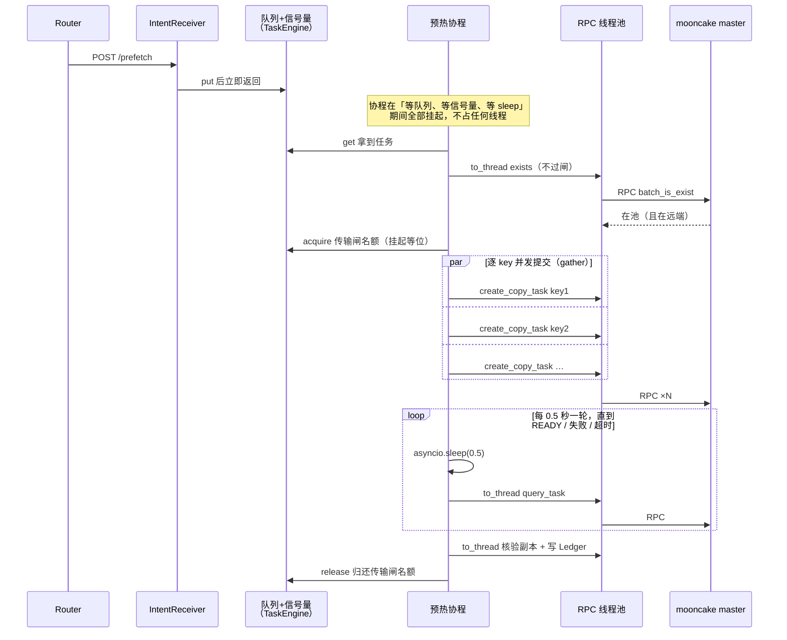

# E11 进程化设计记录（临时文档）

> **性质**：E11 开工的阶段 0 决策底稿。决策经用户确认（2026-10-26）即生效；
> 正式表述由文档负责人回填进 [code-architecture.md](code-architecture.md) 后，
> **本文件删除**。
>
> 依据：code-architecture.md（#69 修订版）「与 E10/E11/E15 的对位」节只给了方向
> （进程壳 + TaskEngine + 三 Loop 常驻化），以下六项是方向之内、代码之前的决策。

## 决策一：执行模型——协程调度 + 线程池承接阻塞调用

单事件循环 + 全部任务协程化 + `ThreadPoolExecutor` 只执行同步阻塞调用。

- **KvOps 接口 async 化**：`async def exists / copy / query_task / abandon / ……`
  ——等待的源头（轮询 `sleep`、RPC 阻塞）全在 ops 实现内部，只有这一层
  async 才能让等待挂起；只在 flow 外层包 async，省不到这些等待
- **阻塞调用走 executor**：mooncake 同步 RPC、sqlite 读写等，经
  `asyncio.to_thread` 交给线程池执行。mooncake 绑定等 RPC 时释放
  GIL，executor 内多个 RPC 能真并行
- **线程池与任务数解耦**：executor 大小按 RPC 执行密度配（4~8），不再等于
  并发上限。一个 copy 任务 30 秒里 RPC 执行合计约 1 秒，其余是
  `await` 挂起——协程化后 100 个任务挂着也只占这几个线程
- **backend 共享态（`_plans`/`_watch`）无锁**：事件循环单线程，协程只在
  `await` 点切换——字典操作不跨 `await` 就天然原子（纪律写进注释：禁止
  在 `_plans`/`_watch` 读写之间 `await`）
- **纪律（反例）**：协程里直接调同步阻塞函数 = 整个事件循环停摆（所有
  协程一起卡住）。所有阻塞调用必须 `to_thread`
- **RPC 卡死防护**：同步 RPC 在对端无响应时可能永不返回，线程被永久
  占死。协程侧用 `asyncio.wait_for` 给调用加超时：超时后协程按失败处理
  （abandon），卡死的线程泄漏一个、由泄漏监控暴露。根治靠 RPC 自带超
  时参数（mooncake 绑定有无该参数，列入 E6 核对）

**厨房比方**：线程池 = 厨师（就几个，真正下锅的活只有他们炒）；协程 =
点菜单（来一张挂一张，挂一千张也不占厨师）；事件循环 = 前台（收单、
叫号，绝不能自己进厨房）；信号量 = 灶台数（同时只炒 4 锅菜，等灶的是
单子不是人）。**厨师数决定干活速度，单子数决定能接多少活、等待多便
宜**——协程化不是让这批活更快，是让等待与排队免费。

**时序（一次预热，协程视角）**：

- 线程只在 `Ex`（线程池）这一列出现：每个 RPC 执行的几毫秒
- 协程（W）全程只是一段代码状态，挂起时不占线程——排队 100 个这样的协程也免费

- 不选「有界队列 + 固定 worker 线程池」：copy 任务约 97%
  时间在等（sleep / 等 RPC），线程池模式下等待也把线程占死；协程模式
  下等待不占线程，排队（等信号量、等队列）也是挂起
- 同类问题在网络领域的做法（任务跟踪和连接管理是同一种问题）：
  nginx / redis 就是事件循环加少量线程跑阻塞段——「等待为主的 IO 任
  务」的标准形态

**一次走完，不分两步**：flow/ops 的 async 化与 TaskEngine 同批做
（签名 async + RPC 包 `to_thread` + `sleep` 换 `asyncio.sleep`，flow
轮询循环改 `await`——约一天工作量）。

不选的走法 = 分两步：本期 flow 保持同步代码、整个交给线程池执行；E15
时再把 flow 改写成异步。不走这条路的原因：E15 要做并发提交
（`asyncio.gather`），那在同步代码里做不了，flow 到时**必须**改成异
步——所以本期写的「同步 flow + 线程池承接」就是一份注定要被拆掉重
写的临时代码，flow 前后要写两遍。既然改写躲不过，不如本期一次改完。

**线程池大小**：

- **禁用 `to_thread` 默认池**（`min(32, cpu+4)`，大小不可控）——自建
  executor 并显式配置
- **RPC executor**：按 RPC 执行密度配（4~8），与信号量的并发数**不绑
  定**——信号量限「同时在 mooncake 上跑的任务」（保护后端），线程只
  为 RPC 执行的那一瞬间服务
- **Ledger 专用单线程 executor**（`max_workers=1`）：sqlite 调用全部
  `to_thread` 到它——天然串行，不用加锁
- **线程泄漏监控**：RPC 卡死会慢性漏线程——定期看各池活跃线程数，
  持续偏高即告警（根治靠 RPC 超时参数，有无该参数列入 E6 核对）

## 决策二：TaskEngine 形态（协程版）

`asyncio.Queue` + 信号量限并发 + 协程消费者，无优先级、不分轻重通道。

- **队列与拿取**：intent 进 `asyncio.Queue`；K 个协程循环 `get`（K 可以很
  大，协程便宜——在队列里等、在信号量上等，都是协程挂起，不占线程）
- **传输闸 = `asyncio.Semaphore`（默认 4，参数化）**：限「同时在后端传
  输的任务数」（带宽管控）——**只在确认要发后台传输时拿名额**
  （copy / move / drain 提交前 acquire，任务终态 release）。**毫秒级操
  作不过闸**：exists 探测、promote（刷热度）、查询、副本核验、
  keepalive——它们的瞬时并发由 RPC executor（4~8 线程）天然限制，多
  余请求协程挂起等线程、毫秒即返，不会被传输任务堵几十秒
- **任务状态机**：队列位置 + Ledger `running` 迁移的组合，不另建状态存储
- **轻重任务统一协程**：保活、查询、promote 等轻任务也是协程，天然不
  占线程，且**不过传输闸**（见上）——不分优先级、不设单独通道；
  `session_end` 类可延迟任务排队无妨
- **gather 并发提交**（E15 并行限速接入点）：copy 的逐 key 串行提交改为
  `asyncio.gather` + 子信号量——提交阶段从 N 倍往返时间缩到约 往返时间×(N/并发度)；
  E15 的并发调度与限速器在这一层信号量上实现
- **排队超时**：intent 在队列等待的语义（等多久算放弃）随 E12 intent 字
  段一起定；执行超时沿用 flow 现有 `timeout_s`
- 失败态策略三选（重发 / 放弃清副本 / 复制中途源实例下线时的处理）本期仍只留接口

## 决策三：保活占位策略（D3 未定项的临时默认）

**固定窗口**：副本 READY 后 KeepaliveLoop 续租一个可配置窗口，窗口到即停租注销。

- **为什么选它**（三候选里最保守、后改成本最低）：
  - 会话期——依赖 E12 的会话信号，现在没有
  - 首次命中后停——依赖 E13/E14 的命中信号，现在没有
  - 固定窗口——什么都不依赖，且有明确终点（不会把副本变相钉死在热层）
- **窗口时长**：参数化；默认 10 分钟只是起步值，真机观察「预热完成到
  首次流量」的典型间隔后再调
- **重复预热同一前缀**：新的 READY 刷新该前缀的截止时间——前缀还在被
  需要，保活就延续
- **与 D3 的关系**：D3 正式定型时只换「什么时候停」的判断，Loop 机制
  （注册表驱动的周期 `batch_is_exist`）不变
- **形态**：协程定时器（事件循环内 `asyncio.sleep` 周期触发），不是独
  立线程

## 决策四：优雅退出语义（协程取消）

SIGTERM/SIGINT 后的五步：

1. **停收 intent**——占位入口关闭，不接新活
2. **取消在途协程**（`task.cancel()`）——协程在 `await` 点收到
   `CancelledError`；flow 捕获后做 abandon 处理（Ledger 记 abandoned；
   后端无任务取消能力 P9，传输不取消，副本清理归 remove）
3. **等在途协程全部退出**——有界等待 5 秒（RPC 毫秒级 + abandon 记账
   毫秒级，余量充足）；**等满还有协程未退则不再等**，直接走后续步骤，
   泄漏线程随进程消失
4. **KeepaliveLoop 停止**
5. **`StoreClient.close()`**——显式关闭（demo 已知退出期析构竞态）

- 协程取消只在 `await` 点生效——不会在 RPC 执行中途切走，是干净的中
  断点
- 恢复语义两种退出路径一致：优雅退出遗留的 abandoned 记录、SIGKILL
  （强杀）停在 running 的记录，重启后都由 rebuild 兜底（后者当「还在
  跑」恢复跟踪）

## 决策五：IntentReceiver 占位形态

E12 的正式协议未定，本期先做一个能跑能测的临时入口：

- **两个入口**：进程内函数调用 + 一个最小 HTTP 端点
  `POST /prefetch {model_id, token_ids, target}`
- **HTTP 端点的用处**：真机测试一条 curl 即可发预热，比进 Python 调函
  数方便
- **占位期实现**：stdlib `http.server` 经线程池执行；量上来换 aiohttp
  （本身就是协程的）
- **响应**：同步等——READY / 失败才返回（占位期测试方便；HTTP 线程被
  占几十秒在占位期无所谓）；可选 `?wait=0` 立即返回任务标识
- **与 E12 的关系**：协议字段、通道（gRPC 候选）随 E12 定型后替换——
  占位入口只调 TaskEngine 公开方法（`queue.put`），替换不动引擎

## 决策六：范围切分

- **本期做**：进程壳（启动/退出/rebuild 接通）+ TaskEngine + **KeepaliveLoop**
  （唯一常驻循环）+ IntentReceiver 占位。其中 KeepaliveLoop 走 `exists`
  通道（`batch_is_exist`，读即续租）——**不依赖** L3 的 `keepalive()`
  方法（NotImplementedError，留待将来语义更丰富的保活策略）
- **只留类骨架**：ReleaseLoop、RetainLoop——依赖的 `demote`/`retain`/`remove`
  在 L4 全是 NotImplementedError，能力接通（E10 后续）前无内容可跑
- **不做**：限速器（E15）、重发策略（随 E12）、多模型归属判定（多模型接入前
  置，已登记）、E12/E13/E14 协议

## 阶段计划

1. **阶段 1 进程壳 + 状态恢复**：Ledger 单线程 executor → 启动时
   `rebuild()` 接通 → KeepaliveLoop（固定窗口策略，协程定时器）→ 优雅退
   出（协程取消 + abandon 处理）
2. **阶段 2 TaskEngine + flow/ops async 化**：intent 占位入口 →
   `asyncio.Queue` + Semaphore(4) → 协程消费者直接调 async flow；KvOps
   全方法 async 化（签名 + RPC 包 executor + sleep 换 `asyncio.sleep`）
   → 终态记账 → 超时处理（复用现有 abandon）
3. **阶段 3 测试**：并发多 intent 单测；重启端到端（杀进程 → rebuild →
   READY）；优雅退出回归（退出不崩、账本状态正确）；真机冒烟
4. **后续 PR（接口演进）**：KeySet + wait_ready 挪进 ops +
   `PrefetchError` → `FlowError`

## 接口演进（后续 PR）

async 化已随本期（决策一）完成。后续一个 PR 做这三项（都动方法签名，一次改完）：

1. **KeySet**：`keys_of(prefix) -> KeySet`（不透明类型），操作方法入参
   `Prefix` → `KeySet`——长序列下 key 只算一次（现状 exists 与 copy 各
   算一遍；链式块 hash 逐块串行，长序列下开销大）。Prefix 保留在入口
   （intent 载荷、幂等键、Ledger 记 token_ids）
2. **wait_ready 挪进 ops**：`async def wait_ready(handle, *, timeout_s)` —
   —「等到 READY」的轮询循环（QueryError 重试 / VerifyError 上抛 / 超时
   先 abandon 再上抛）从 flow 挪进 ops。它是跨流程通用件（Drain/Retain
   同样需要等），放 flow 层是实现细节泄漏 + 每个流程重复一遍；flow 只
   剩编排（exists → copy → wait_ready）
3. 同步改名：`PrefetchError` → `FlowError`（统一出口异常一般化，
   其他流程实现后共用）

## 参考实现

- **SGLang HiCache** `hiradix_cache.py::can_terminate_prefetch` / prefetch 线程：
  prefetch 三策略（best_effort/wait_complete/timeout）与 timeout 预算公式
  （`base + per_ki_token * tokens/1024`）→ 我们 TaskEngine 失败态策略三选与
  PrefetchFlow 超时处理的语义对照；差异：HiCache 是引擎内 L1/L2 私有、追求
  prefill 衔接，kvcm 是池控制面、以副本核验为 READY 依据
- **TensorCast** Global Store / Store Daemon 分离 + 「CLI 管服务、worker 只
  connect、不持有基础设施进程」（`docs/research/tensorcast/overview.md`）→
  kvcm 进程形态在工业界的同类做法：常驻服务生命周期显式化，与计算进程解耦
- **mooncake 任务无取消能力**（capability `has_task_cancel=NO`，P9）→ 决策四
  abandon 而非 cancel 的直接依据
