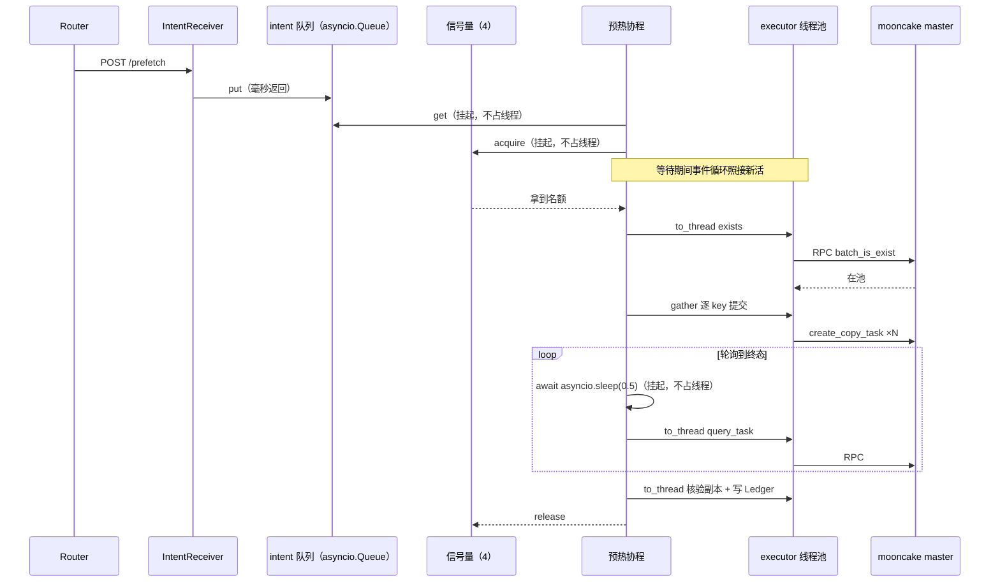

# E11 进程化设计记录（临时文档）

> **性质**：E11 开工的阶段 0 决策底稿。决策经用户拍板（2026-10-26）即生效；
> 正式表述由文档负责人回填进 [code-architecture.md](code-architecture.md) 后，
> **本文件删除**。
>
> 依据：code-architecture.md（#69 回填版）「与 E10/E11/E15 的对位」节只给了方向
> （进程壳 + TaskEngine + 三 Loop 常驻化），以下六项是方向之内、代码之前的决策。

## 决策一：执行模型——协程调度 + 线程池承接阻塞调用

单事件循环 + 全部任务协程化 + `ThreadPoolExecutor` 只跑同步原语。

- **KvOps 接口 async 化**：`async def exists / copy / query_task / abandon / ……`
  ——等待的源头（轮询 `sleep`、RPC 阻塞）全在 ops 实现内部，只有这一层
  async 才能让等待挂起；只在 flow 包 async 壳省不到
- **阻塞原语走 executor**：mooncake 同步 RPC、`time.sleep` 之外的慢调用
  （含 sqlite）经 `asyncio.to_thread` 交给线程池。mooncake 绑定等 RPC 时
  释放 GIL，executor 内多 RPC 真并行
- **线程池与任务数解耦**：executor 大小按 RPC 执行密度配（4~8），不再等于
  并发上限。一个 copy 任务 30 秒里 RPC 执行合计约 1 秒，其余是
  `await` 挂起——协程化后 100 个任务挂着也只占这几个线程
- **Ledger 专用单线程 executor**（`max_workers=1`）：sqlite 调用全部
  `to_thread` 到它——天然串行，不用加锁
- **backend 共享态（`_plans`/`_watch`）无锁**：事件循环单线程，协程只在
  `await` 点切换——字典操作不跨 `await` 就天然原子（纪律写进注释：禁止
  在 `_plans`/`_watch` 读写之间 `await`）
- **纪律（反例）**：协程里直接调同步阻塞函数 = 前台自己下厨，整个事件循
  环停摆。所有阻塞调用必须 `to_thread`

**厨房比方**：线程池 = 厨师（就几个，真正下锅的活只有他们炒）；协程 =
点菜单（来一张挂一张，挂一千张也不占厨师）；事件循环 = 前台（收单、
叫号，绝不能自己进厨房）；信号量 = 灶台数（同时只炒 4 锅菜，等灶的是
单子不是人）。**厨师数决定干活速度，单子数决定能接多少活、等待多便
宜**——协程化不是让这批活更快，是让等待与排队免费。

**时序（一次预热，协程视角）**：

- 不选「有界队列 + 固定 worker 线程池」（前一版底稿）：copy 任务约 97%
  时间在等（sleep / 等 RPC），线程池模式下等待也把线程占死；协程模式
  下等待不占线程，排队（等信号量、等队列）也是挂起
- 网络领域同构（任务跟踪 ≈ 连接管理）：nginx/redis 的事件循环 + 少量
  线程跑阻塞段，是「等待为主的 IO 任务」的标准形态

**与现有同步代码的衔接（实施顺序）**：TaskEngine 先行，**flow/ops 本期
保持同步阻塞**——协程消费者经 `asyncio.to_thread(flow.run, ...)` 执行现
有 `PrefetchFlow.run`，TaskEngine 的队列/信号量/保活/退出全部照常成立
（「协程调度 + 线程池承接阻塞调用」本就是本决策的名称）。接口三批合一
（见下「接口演进」）后续独立 PR 实施，届时拆掉 to_thread 包装直连——
不把 TaskEngine 与接口大改绑在一次 PR 里。

## 决策二：TaskEngine 形态（协程版）

`asyncio.Queue` + 信号量限并发 + 协程消费者，无优先级、不分轻重通道。

- **队列与拿取**：intent 进 `asyncio.Queue`；K 个协程循环 `get`（K 可以很
  大，协程便宜——排队等队列、等信号量都是挂起，零线程成本）
- **并发上限 = `asyncio.Semaphore`（默认 4，参数化）**：限制的是「同时在
  mooncake 上跑的任务数」（保护后端与带宽的语义不变），与线程数解耦
- **任务状态机**：队列位置 + Ledger `running` 迁移的组合，不另建状态存储
- **轻重任务统一协程**：保活、查询、promote 等轻活也是协程，天然不占线
  程——不分优先级、不设单独通道（轻活挂起等 executor 毫秒即返，不会被
  copy 堵；`session_end` 类可延迟任务排队无妨）
- **gather 并发提交**（E15 并行限速接入点）：copy 的逐 key 串行提交改为
  `asyncio.gather` + 子信号量——提交阶段从 N×RTT 缩到约 RTT×(N/并发度)；
  E15 的并发调度与限速器落点 = 这层信号量
- **排队超时**：intent 在队列等待的语义（等多久算放弃）随 E12 intent 字
  段一起定；执行超时沿用 flow 现有 `timeout_s`
- 失败态策略三选（重发 / 放弃清副本 / 源掉线衔接）本期仍只留接口

## 接口演进（三批合一，后续 PR 实施）

KvOps 接口的三项改动共享签名面（全部方法都动），分三次改不如一次改，
**合为一个后续 PR**；本期 TaskEngine 先以 to_thread 承接同步 flow。

1. **KeySet**：`keys_of(prefix) -> KeySet`（不透明类型），操作方法入参
   `Prefix` → `KeySet`——长序列下 key 只算一次（现状 exists 与 copy 各
   算一遍；链式块 hash 逐块串行，长序列不便宜）。Prefix 保留在入口
   （intent 载荷、幂等键、Ledger 记 token_ids）
2. **async 化**：KvOps 全部方法 `async def`——等待（轮询 sleep、RPC 阻
   塞）发生在 ops 内部，只有这层 async 才能让等待挂起；backend 内 RPC
   走 executor、sleep 用 `asyncio.sleep`
3. **wait_ready 下沉**：`async def wait_ready(handle, *, timeout_s)` —
   —「等到 READY」的轮询循环（QueryError 重试 / VerifyError 上抛 / 超时
   先 abandon 再上抛）从 flow 撤进 ops。它是跨流程通用件（Drain/Retain
   同样需要等），放 flow 层是实现细节泄漏 + 每个流程重复一遍；flow 瘦
   成纯编排（exists → copy → wait_ready）

同步改名（同批）：`PrefetchError` → `FlowError`（统一出口异常一般化，
其他流程实现后共用）。

## 决策三：保活占位策略（D3 未定项的临时默认）

**固定窗口**：副本 READY 后 KeepaliveLoop 续租一个可配置窗口（默认 10 分钟），
窗口到即停租注销。选它的理由：三候选（会话期/固定窗口/首流量后停租）里最保
守、最不容易写成事实 pin、后改成本最低。D3 正式定型时替换策略实现，Loop 机
制（注册表驱动的周期 `batch_is_exist`）不变。形态 = 协程定时器（事件循环内
`asyncio.sleep` 周期触发），不是独立线程。

## 决策四：优雅退出语义（协程取消）

SIGTERM/SIGINT → ① 停收 intent（占位入口关闭）→ ② **对在途协程
`task.cancel()`**——协程在 `await` 点收到 `CancelledError`，flow 捕获后做
abandon 收口（Ledger 记 abandoned；后端无任务取消能力 P9，传输不取消，副本
清理归 remove）→ ③ 等在途协程全部退出（有界等待）→ ④ KeepaliveLoop 停止
→ ⑤ `StoreClient.close()`（demo 已知退出期析构竞态，显式 close 是既有结论）。

- 协程取消是干净的中断点：`await` 处才生效，不会在 RPC 执行中途切走
- 重启后 orphan（abandoned 行）由 rebuild 兜底，与既有恢复语义一致

## 决策五：IntentReceiver 占位形态

进程内函数调用 + 一个最小 HTTP 端点（`POST /prefetch {model_id, token_ids,
target}`），便于手工与脚本测试——占位期用 stdlib `http.server` 经 executor
承接即可，量上来换 aiohttp（协程原生）。协议字段、通道（gRPC 候选）随 E12
定型后替换——占位入口只调 TaskEngine 公开方法（`queue.put`），替换不动引擎。

## 决策六：范围切分

- **本期做**：进程壳（启动/退出/rebuild 接线）+ TaskEngine + **KeepaliveLoop**
  （唯一常驻循环）+ IntentReceiver 占位
- **只留类骨架**：ReleaseLoop、RetainLoop——依赖的 `demote`/`retain`/`remove`
  在 L4 全是 NotImplementedError，能力接线（E10 后续/backlog）前无内容可跑
- **不做**：限速器（E15）、重发策略（随 E12）、多模型归属判定（多模型接入前
  置，已登记）、E12/E13/E14 协议

## 阶段计划

1. **阶段 1 进程壳 + 状态恢复**：Ledger 单线程 executor → 启动时
   `rebuild()` 接线 → KeepaliveLoop（固定窗口策略，协程定时器）→ 优雅退
   出（协程取消 + abandon 收口）
2. **阶段 2 TaskEngine**：intent 占位入口 → `asyncio.Queue` + Semaphore(4)
   → 协程消费者经 `to_thread` 执行同步 `PrefetchFlow.run` → 终态记账 →
   超时收口（复用现有 abandon）
3. **阶段 3 测试**：并发多 intent 单测；重启 e2e（杀进程 → rebuild →
   READY）；优雅退出回归（退出不崩、账本会收口）；真机冒烟
4. **后续 PR（接口三批合一）**：KeySet + KvOps async 化 + wait_ready 下
   沉（+ `PrefetchError` → `FlowError`）；拆 to_thread 包装，flow 直连协
   程消费者

## 参考实现

- **SGLang HiCache** `hiradix_cache.py::can_terminate_prefetch` / prefetch 线程：
  prefetch 三策略（best_effort/wait_complete/timeout）与 timeout 预算公式
  （`base + per_ki_token * tokens/1024`）→ 我们 TaskEngine 失败态策略三选与
  PrefetchFlow 超时收口的语义对照；差异：HiCache 是引擎内 L1/L2 私有、追求
  prefill 衔接，kvcm 是池控制面、以副本核验为 READY 依据
- **TensorCast** Global Store / Store Daemon 分离 + 「CLI 管服务、worker 只
  connect、不持有基础设施进程」（`docs/research/tensorcast/overview.md`）→
  kvcm 进程壳形态的工业佐证：常驻服务生命周期显式化，与计算进程解耦
- **mooncake 任务无取消能力**（capability `has_task_cancel=NO`，P9）→ 决策四
  abandon 而非 cancel 的直接依据
