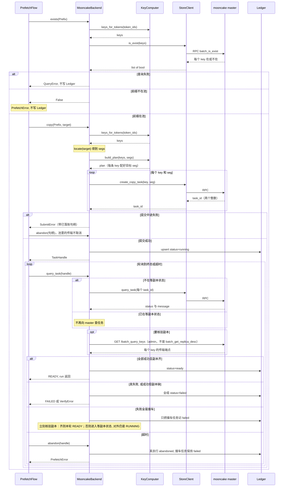

# PrefetchFlow（预热流程）

预热流程的步骤与数据流。定位、失败语义总表与任务生命周期见
[../code-architecture.md](../code-architecture.md)（L2 节、L3 节「失败语义」「任务生命周期」）；实现 = `kvcm/flows/prefetch.py`。

## 流程步骤

1. **exists 前置检查**：前缀完整在池才继续——warm 未覆盖该前缀，或 key
   口径与引擎漂移，直接失败（复制了也没意义）
2. **copy 发起**：前缀 → key 列表 → rank 映射计划 → 逐 key 提交复制任务
3. **query_task 轮询到 READY**：任务全部完成 + 副本核验通过
4. 保活由 `TaskEngine._run_prefetch` 在流程返回后注册。READY 事件补发（`BlockStored`）仍未接通

## 数据流

一次预热执行（`run()` 方法）的完整消息顺序。`PrefetchFlow` 只调用
`KvOps` 接口——运行时这个对象是 `MooncakeBackend`。图里的方块是条件
分支：标 alt 的是「二选一」（满足哪个条件走哪条），标 opt 的是「可选
步骤」（需要才执行）。

## 读图要点

- 数据在各步骤之间怎么变：`Prefix`（模型名 + token 序列）→ 逐块算出
  `keys` → 排出 `plan`（复制计划：每条 key 复制到哪个 seg）→ 每条
  key 提交后拿回一个任务号（两个整数组成的整数对）→ 写进 Ledger（任务
  号编码成 `"整数:整数"` 的字符串，连同 handle_id、token_ids）
- 任务查询走绑定 RPC。副本核验走 admin 的 `GET /batch_query_keys`，
  不用 `batch_get_replica_desc`
- Ledger 只在 copy 成功、到终态、进入等副本状态、abandon 时写。
  exists 失败和提交失败不写行
- 图里的「超时」指本次预热的截止时间到了，接下来流程调用
  `abandon`——它不是 `query_task` 的一种返回值
- 「等副本」状态（代码里叫 `_watch`）：失败全是撞车时先记 failed、立
  刻核验一轮——副本已齐本轮就 READY；未齐才进入等副本，之后不再查任
  务状态（那些任务已经失败，查了也没意义），只定期核验副本是否到位
  （第一遍的任务搬完没有），到位就算这次预热成功。完整语义见
  [../code-architecture.md](../code-architecture.md) L3 节「失败语义」
  「任务生命周期」

## 失败分支

失败处理总表（每种情况怎么处理）见
[../code-architecture.md](../code-architecture.md) L2 节。本流程特有的
一点：「前缀不在池」在 exists 阶段直接失败，不发起复制。

## 与其他部件的衔接

- **KeyComputer**：前缀 → key 列表（引擎算法一致）；rank 映射计划
- **locate**：目标实例 → rank 有序 seg 列表（demo 探测 / 生产实例注册）
- **StoreClient**：绑定 RPC（exists / copy 提交 / query_task）。副本核验走 admin 的 `GET /batch_query_keys`
- **Ledger**：任务状态（running → ready/failed/abandoned）
- **EventPublisher**（待接通）：READY 后按目标实例端点补发 `BlockStored`
- **keepalive**：`TaskEngine._run_prefetch` 在流程返回 READY 后注册保活（见
  [../code-architecture.md](../code-architecture.md) 运行时结构节）
