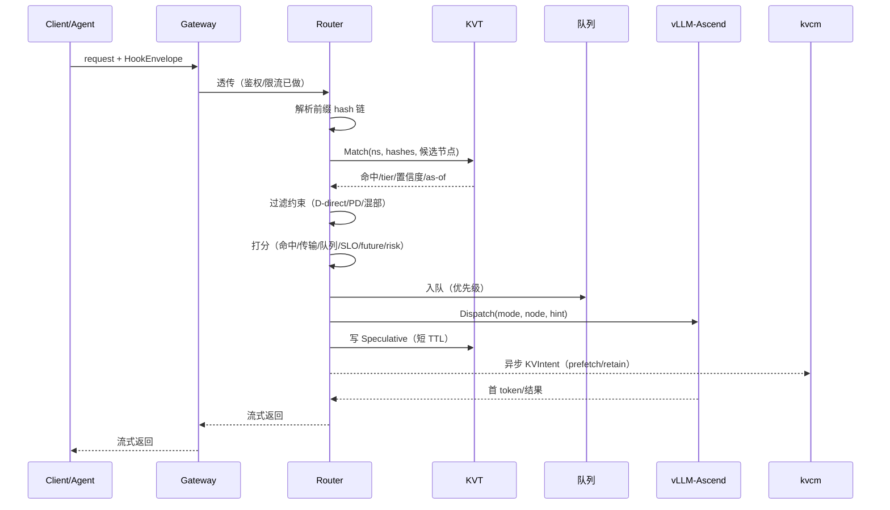
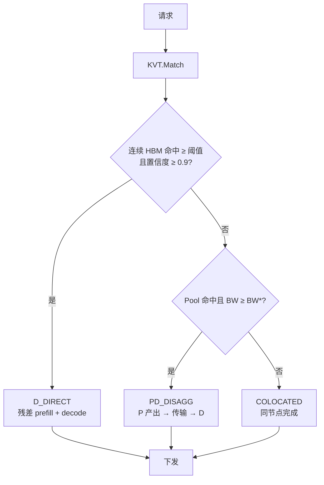
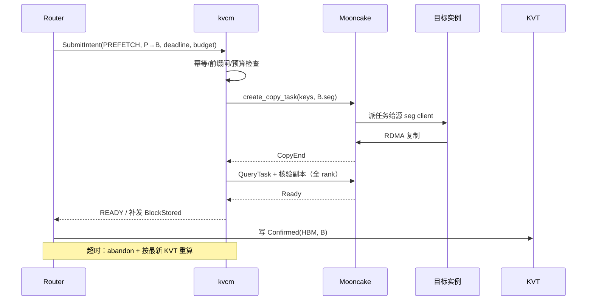
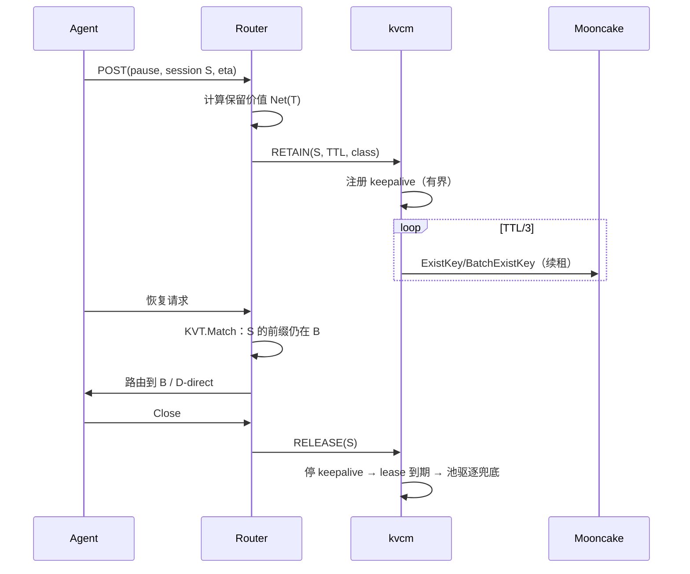
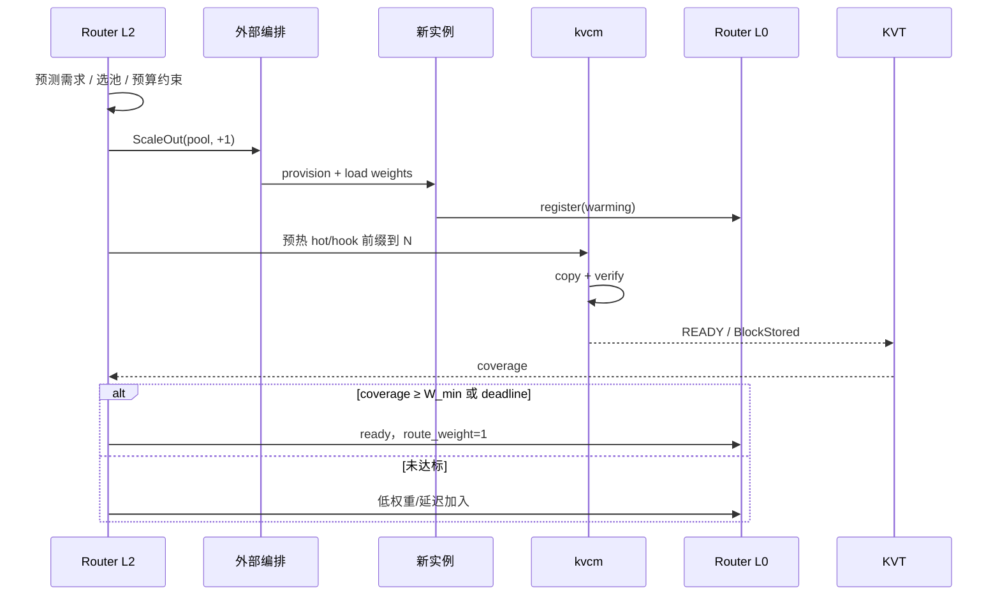
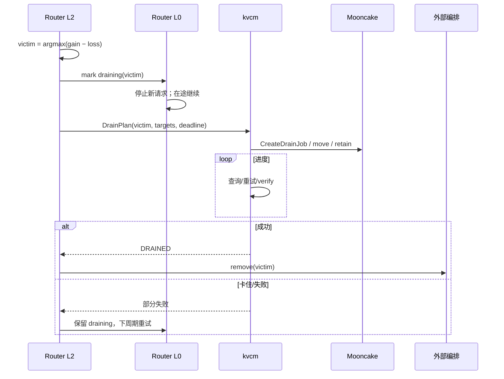
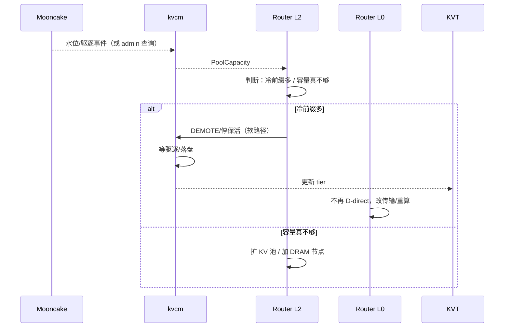
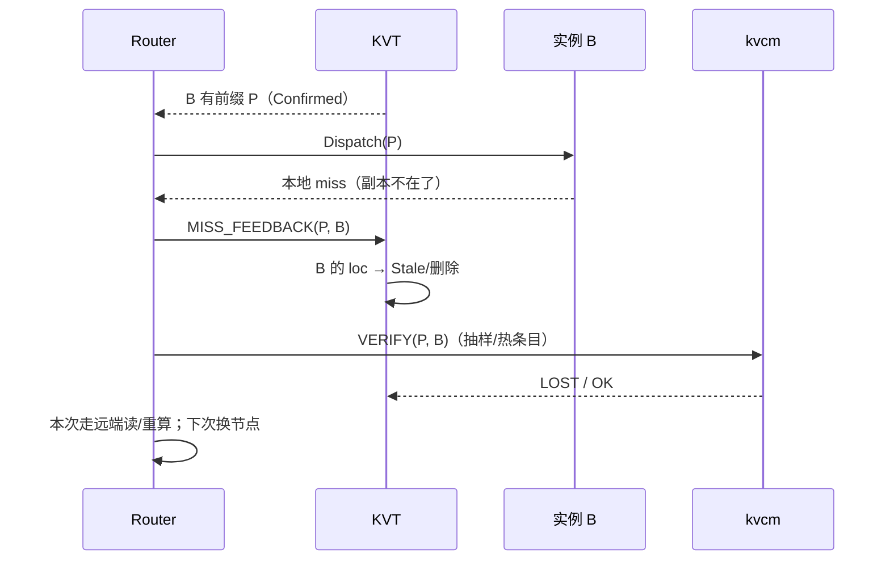
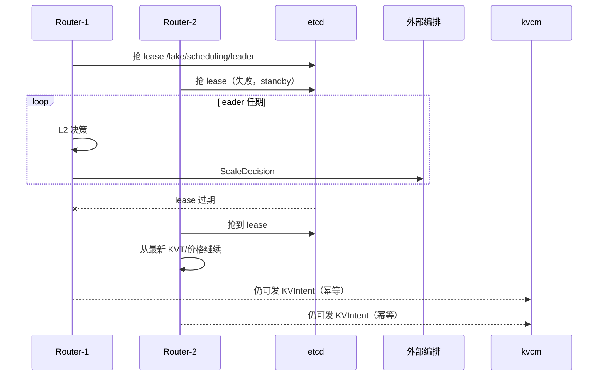
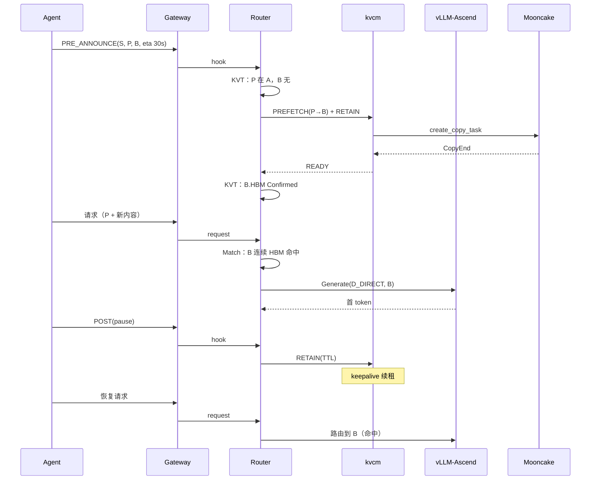

# 调度流程（L0 / L1 / L2）

- 定位: [D8-joint-scheduling.md](../D8-joint-scheduling.md) 的流程视图——每张图对应一个决策环或联合场景
- 状态: 设计草案
- 读法: `->>` 调用/数据流；`-->>` 响应/异步回执；`--x` 失败/断线；`rect` 底色区分并列场景

---

## 1. L0 请求环：一次选路

要点：

- KVT 查询是纯内存，<5ms；miss 回退权威不在 L0 热路径（可选异步）。
- 预取 intent 不阻塞本次请求；READY 回写由 L1/摄入层处理。
- `Speculative` 只用于同批请求的亲和，不参与 D-direct。

---

## 2. L0：D-direct / PD / 混部分支

---

## 3. L1：预取 → READY → 回写

---

## 4. L1：会话停顿 → 保留 → 恢复

要点：

- 默认软释放（停 keepalive），不是立即 Remove；
- 保留有 TTL/字节上限；到期未用要能回收；
- 恢复时如果前缀不在，按普通请求走，不阻塞。

---

## 5. L2：扩容 + warm gate

---

## 6. L2：缩容 + drain

要点：

- victim 不是 LIFO；看 unique hot KV、会话风险、迁移成本；
- drain 卡住不硬删；
- 迁移失败按最新状态重算，不写 fallback 链。

---

## 7. L2：池压 → 降层/扩池

---

## 8. 失败：ghost / miss 反馈

要点：

- ghost 只损性能；
- miss 反馈是最便宜的反熵；
- 不要把“查询失败”当成“副本丢失”。

---

## 9. 多 Router：L2 leader

---

## 10. 联合场景：Agent 多轮全链路

---

## 11. 读图要点

- **L0 不阻塞**：所有 KV intent 都是异步；请求走当前最优路径。
- **READY 是回写事件**：KVT 的 `Confirmed` 以 kvcm READY/引擎事件为准，不以 intent 提交为准。
- **L2 只出决策**：provision 在外部编排；kvcm 只执行 KV 搬迁。
- **失败不 fallback**：按最新 KVT/价格重算；读路径兜底不叫 fallback。
- **多 Router**：请求环可水平扩；L2 单 leader；intent 幂等。
