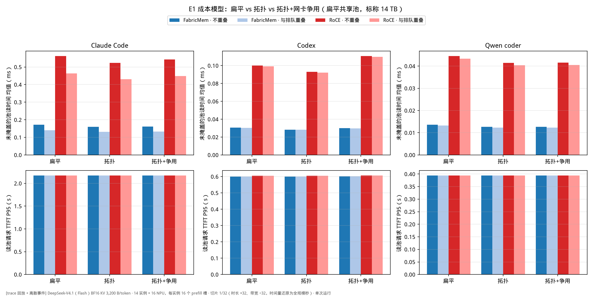
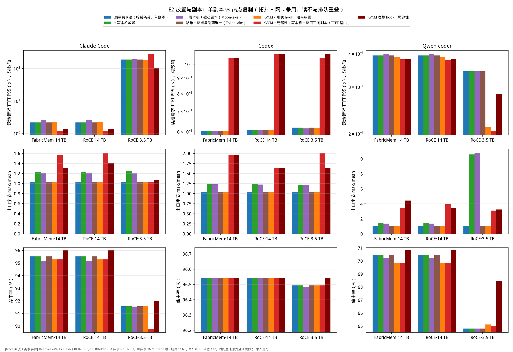
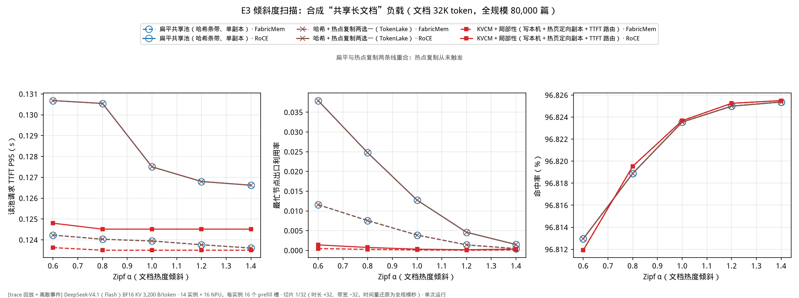
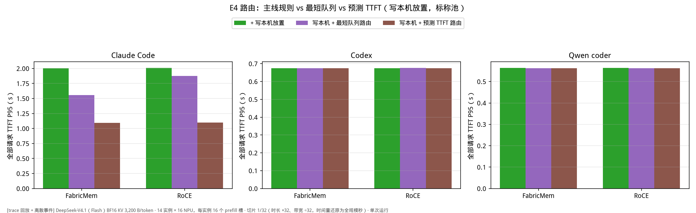
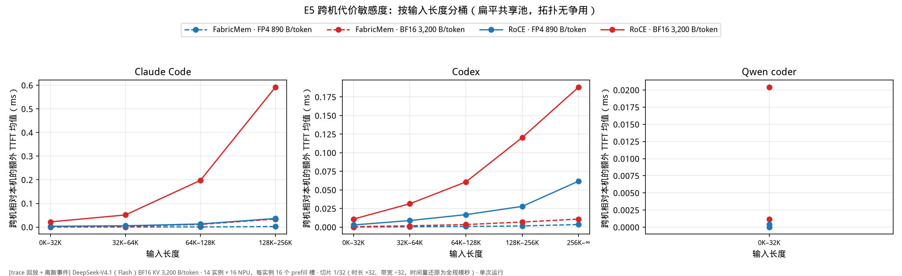
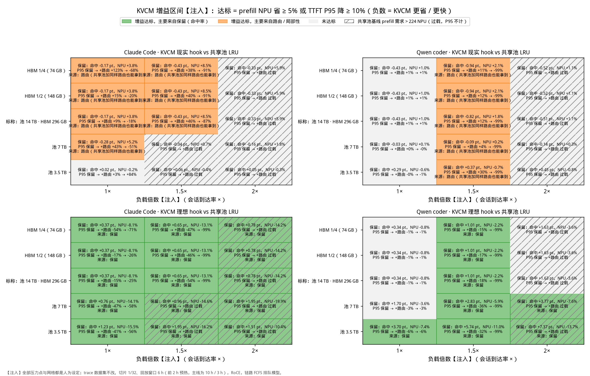
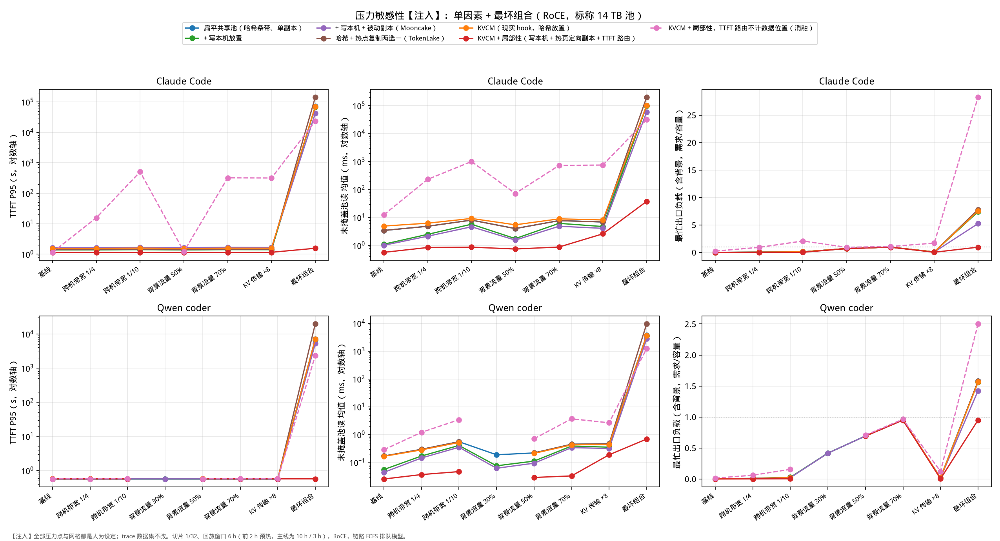
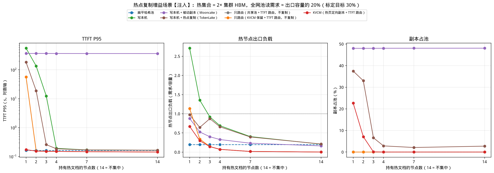

# KVCM 池局部性实验（自动生成）

由 `python3 -m kvcm_sim.locality_report` 从 `results/locality/*.json` 生成；模型与参数见 [`../README.md`](../README.md)「池局部性扩展」节与 [`../params.md`](../params.md) §6。

口径：共享 DRAM 池的块有所在节点；池→HBM 读本机走 H2D、跨机走 FabricMem 或 RoCE；“拓扑+争用”下每节点出口按 `B/(1+在途流数)` 共享；计入 TTFT 的读时间为 `max(0, τ − W)`（W = prefill 排队）；副本占池容量。TTFT 来自离散事件仿真（每实例 16 个 prefill 槽），与主线 summary 的无排队 TTFT 不可直接比较。

## E1 成本模型：扁平 vs 拓扑 vs 争用（扁平共享池，标称 14 TB）

| trace | 传输 | 成本模型 | 读与排队 | 读池请求占比 | 本机字节占比 | 未掩盖读 均值 (ms) | 未掩盖读占 TTFT | TTFT 均值 (s) | TTFT P95 (s) | 读池请求 TTFT P95 (s) | 最忙出口利用率 |
|---|---|---|---|---:|---:|---:|---:|---:|---:|---:|---:|
| Claude Code | FabricMem | 扁平（一律跨机带宽、无争用） | 不重叠 | 3.9% | 0% | 0.2 | 0.03% | 0.510 | 2.005 | 2.172 | 0.0% |
| Claude Code | FabricMem | 扁平（一律跨机带宽、无争用） | 重叠 | 3.9% | 0% | 0.1 | 0.03% | 0.510 | 2.003 | 2.172 | 0.0% |
| Claude Code | FabricMem | 拓扑（分本机/跨机） | 不重叠 | 3.9% | 7% | 0.2 | 0.03% | 0.510 | 2.004 | 2.172 | 0.4% |
| Claude Code | FabricMem | 拓扑（分本机/跨机） | 重叠 | 3.9% | 7% | 0.1 | 0.03% | 0.510 | 2.003 | 2.172 | 0.4% |
| Claude Code | FabricMem | 拓扑 + 网卡争用 | 不重叠 | 3.9% | 7% | 0.2 | 0.03% | 0.510 | 2.004 | 2.172 | 0.4% |
| Claude Code | FabricMem | 拓扑 + 网卡争用 | 重叠 | 3.9% | 7% | 0.1 | 0.03% | 0.510 | 2.003 | 2.172 | 0.4% |
| Claude Code | RoCE | 扁平（一律跨机带宽、无争用） | 不重叠 | 3.9% | 0% | 0.6 | 0.11% | 0.511 | 2.010 | 2.172 | 0.0% |
| Claude Code | RoCE | 扁平（一律跨机带宽、无争用） | 重叠 | 3.9% | 0% | 0.5 | 0.09% | 0.510 | 2.004 | 2.172 | 0.0% |
| Claude Code | RoCE | 拓扑（分本机/跨机） | 不重叠 | 3.9% | 7% | 0.5 | 0.10% | 0.511 | 2.010 | 2.172 | 1.5% |
| Claude Code | RoCE | 拓扑（分本机/跨机） | 重叠 | 3.9% | 7% | 0.4 | 0.08% | 0.510 | 2.004 | 2.172 | 1.5% |
| Claude Code | RoCE | 拓扑 + 网卡争用 | 不重叠 | 3.9% | 7% | 0.5 | 0.11% | 0.511 | 2.010 | 2.172 | 1.5% |
| Claude Code | RoCE | 拓扑 + 网卡争用 | 重叠 | 3.9% | 7% | 0.4 | 0.09% | 0.510 | 2.004 | 2.172 | 1.5% |
| Codex | FabricMem | 扁平（一律跨机带宽、无争用） | 不重叠 | 1.1% | 0% | 0.0 | 0.01% | 0.208 | 0.675 | 0.600 | 0.0% |
| Codex | FabricMem | 扁平（一律跨机带宽、无争用） | 重叠 | 1.1% | 0% | 0.0 | 0.01% | 0.208 | 0.675 | 0.600 | 0.0% |
| Codex | FabricMem | 拓扑（分本机/跨机） | 不重叠 | 1.1% | 7% | 0.0 | 0.01% | 0.208 | 0.675 | 0.600 | 0.1% |
| Codex | FabricMem | 拓扑（分本机/跨机） | 重叠 | 1.1% | 7% | 0.0 | 0.01% | 0.208 | 0.675 | 0.600 | 0.1% |
| Codex | FabricMem | 拓扑 + 网卡争用 | 不重叠 | 1.1% | 7% | 0.0 | 0.01% | 0.208 | 0.675 | 0.601 | 0.1% |
| Codex | FabricMem | 拓扑 + 网卡争用 | 重叠 | 1.1% | 7% | 0.0 | 0.01% | 0.208 | 0.675 | 0.601 | 0.1% |
| Codex | RoCE | 扁平（一律跨机带宽、无争用） | 不重叠 | 1.1% | 0% | 0.1 | 0.05% | 0.208 | 0.675 | 0.606 | 0.0% |
| Codex | RoCE | 扁平（一律跨机带宽、无争用） | 重叠 | 1.1% | 0% | 0.1 | 0.05% | 0.208 | 0.675 | 0.606 | 0.0% |
| Codex | RoCE | 拓扑（分本机/跨机） | 不重叠 | 1.1% | 7% | 0.1 | 0.04% | 0.208 | 0.675 | 0.605 | 0.4% |
| Codex | RoCE | 拓扑（分本机/跨机） | 重叠 | 1.1% | 7% | 0.1 | 0.04% | 0.208 | 0.675 | 0.605 | 0.4% |
| Codex | RoCE | 拓扑 + 网卡争用 | 不重叠 | 1.1% | 7% | 0.1 | 0.05% | 0.208 | 0.675 | 0.607 | 0.4% |
| Codex | RoCE | 拓扑 + 网卡争用 | 重叠 | 1.1% | 7% | 0.1 | 0.05% | 0.208 | 0.675 | 0.606 | 0.4% |
| Qwen coder | FabricMem | 扁平（一律跨机带宽、无争用） | 不重叠 | 10.5% | 0% | 0.0 | 0.01% | 0.155 | 0.564 | 0.394 | 0.0% |
| Qwen coder | FabricMem | 扁平（一律跨机带宽、无争用） | 重叠 | 10.5% | 0% | 0.0 | 0.01% | 0.155 | 0.564 | 0.394 | 0.0% |
| Qwen coder | FabricMem | 拓扑（分本机/跨机） | 不重叠 | 10.5% | 7% | 0.0 | 0.01% | 0.155 | 0.564 | 0.394 | 0.1% |
| Qwen coder | FabricMem | 拓扑（分本机/跨机） | 重叠 | 10.5% | 7% | 0.0 | 0.01% | 0.155 | 0.564 | 0.394 | 0.1% |
| Qwen coder | FabricMem | 拓扑 + 网卡争用 | 不重叠 | 10.5% | 7% | 0.0 | 0.01% | 0.155 | 0.564 | 0.394 | 0.1% |
| Qwen coder | FabricMem | 拓扑 + 网卡争用 | 重叠 | 10.5% | 7% | 0.0 | 0.01% | 0.155 | 0.564 | 0.394 | 0.1% |
| Qwen coder | RoCE | 扁平（一律跨机带宽、无争用） | 不重叠 | 10.5% | 0% | 0.0 | 0.03% | 0.155 | 0.564 | 0.394 | 0.0% |
| Qwen coder | RoCE | 扁平（一律跨机带宽、无争用） | 重叠 | 10.5% | 0% | 0.0 | 0.03% | 0.155 | 0.564 | 0.394 | 0.0% |
| Qwen coder | RoCE | 拓扑（分本机/跨机） | 不重叠 | 10.5% | 7% | 0.0 | 0.03% | 0.155 | 0.564 | 0.394 | 0.2% |
| Qwen coder | RoCE | 拓扑（分本机/跨机） | 重叠 | 10.5% | 7% | 0.0 | 0.03% | 0.155 | 0.564 | 0.394 | 0.2% |
| Qwen coder | RoCE | 拓扑 + 网卡争用 | 不重叠 | 10.5% | 7% | 0.0 | 0.03% | 0.155 | 0.564 | 0.394 | 0.2% |
| Qwen coder | RoCE | 拓扑 + 网卡争用 | 重叠 | 10.5% | 7% | 0.0 | 0.03% | 0.155 | 0.564 | 0.394 | 0.2% |

## E2 放置与副本（拓扑 + 网卡争用，读不与排队重叠）

相对扁平共享池的变化：ΔP95 为读池请求 TTFT P95 的相对变化；负数 = 更好。

### Claude Code

| 传输 · 池 | 变体 | 命中率 | 本机字节占比 | 副本占池 | 读池请求 TTFT P95 (s) | ΔP95 vs 扁平 | TTFT 均值 (s) | Δ均值 vs 扁平 | 出口 max/mean | 最忙出口利用率 | prefill 占用 NPU |
|---|---|---:|---:|---:|---:|---:|---:|---:|---:|---:|---:|
| FabricMem · 14 TB | 扁平共享池（哈希条带、单副本） | 95.52% | 7% | 0.0% | 2.172 | +0.0% | 0.510 | +0.0% | 1.03 | 0.4% | 137.9 |
| FabricMem · 14 TB | + 写本机放置 | 95.52% | 12% | 0.0% | 2.172 | +0.0% | 0.510 | +0.0% | 1.22 | 0.5% | 137.9 |
| FabricMem · 14 TB | + 写本机 + 被动副本（Mooncake） | 95.18% | 21% | 28.1% | 2.559 | +17.8% | 0.649 | +27.2% | 1.21 | 0.4% | 147.6 |
| FabricMem · 14 TB | 哈希 + 热点复制两选一（TokenLake） | 95.52% | 7% | 0.0% | 2.172 | +0.0% | 0.510 | +0.0% | 1.03 | 0.4% | 137.9 |
| FabricMem · 14 TB | KVCM（现实 hook，哈希放置） | 95.28% | 7% | 0.0% | 2.273 | +4.6% | 0.607 | +19.0% | 1.03 | 0.4% | 144.8 |
| FabricMem · 14 TB | KVCM + 局部性（写本机 + 热页定向副本 + TTFT 路由） | 95.28% | 44% | 0.0% | 1.160 | -46.6% | 0.378 | -25.8% | 1.57 | 1.0% | 144.8 |
| FabricMem · 14 TB | KVCM 理想 hook + 局部性 | 96.01% | 64% | 0.0% | 1.334 | -38.6% | 0.323 | -36.7% | 1.31 | 0.4% | 123.5 |
| RoCE · 14 TB | 扁平共享池（哈希条带、单副本） | 95.52% | 7% | 0.0% | 2.172 | +0.0% | 0.511 | +0.0% | 1.03 | 1.5% | 137.9 |
| RoCE · 14 TB | + 写本机放置 | 95.52% | 12% | 0.0% | 2.172 | +0.0% | 0.511 | -0.0% | 1.22 | 1.7% | 137.9 |
| RoCE · 14 TB | + 写本机 + 被动副本（Mooncake） | 95.18% | 21% | 28.1% | 2.577 | +18.6% | 0.650 | +27.2% | 1.22 | 1.4% | 147.6 |
| RoCE · 14 TB | 哈希 + 热点复制两选一（TokenLake） | 95.52% | 7% | 0.0% | 2.172 | +0.0% | 0.511 | +0.0% | 1.03 | 1.5% | 137.9 |
| RoCE · 14 TB | KVCM（现实 hook，哈希放置） | 95.28% | 7% | 0.0% | 2.289 | +5.4% | 0.609 | +19.1% | 1.03 | 1.4% | 144.8 |
| RoCE · 14 TB | KVCM + 局部性（写本机 + 热页定向副本 + TTFT 路由） | 95.28% | 50% | 0.0% | 1.187 | -45.3% | 0.379 | -25.8% | 1.61 | 2.5% | 144.8 |
| RoCE · 14 TB | KVCM 理想 hook + 局部性 | 96.01% | 69% | 0.0% | 1.355 | -37.6% | 0.323 | -36.8% | 1.40 | 1.1% | 123.5 |
| RoCE · 3.5 TB | 扁平共享池（哈希条带、单副本） | 91.56% | 7% | 0.0% | 190.206 | +0.0% | 56.827 | +0.0% | 1.02 | 0.1% | 251.9 |
| RoCE · 3.5 TB | + 写本机放置 | 91.56% | 21% | 0.0% | 190.202 | -0.0% | 56.827 | -0.0% | 1.25 | 0.1% | 251.9 |
| RoCE · 3.5 TB | + 写本机 + 被动副本（Mooncake） | 91.54% | 19% | 0.9% | 192.251 | +1.1% | 57.288 | +0.8% | 1.20 | 0.1% | 252.3 |
| RoCE · 3.5 TB | 哈希 + 热点复制两选一（TokenLake） | 91.56% | 7% | 0.0% | 190.206 | +0.0% | 56.827 | +0.0% | 1.02 | 0.1% | 251.9 |
| RoCE · 3.5 TB | KVCM（现实 hook，哈希放置） | 91.60% | 7% | 0.0% | 185.202 | -2.6% | 55.492 | -2.3% | 1.02 | 0.1% | 250.9 |
| RoCE · 3.5 TB | KVCM + 局部性（写本机 + 热页定向副本 + TTFT 路由） | 89.79% | 13% | 0.0% | 278.473 | +46.4% | 120.499 | +112.0% | 1.03 | 11.7% | 303.2 |
| RoCE · 3.5 TB | KVCM 理想 hook + 局部性 | 91.97% | 15% | 0.0% | 105.317 | -44.6% | 40.598 | -28.6% | 1.07 | 10.4% | 241.3 |

### Codex

| 传输 · 池 | 变体 | 命中率 | 本机字节占比 | 副本占池 | 读池请求 TTFT P95 (s) | ΔP95 vs 扁平 | TTFT 均值 (s) | Δ均值 vs 扁平 | 出口 max/mean | 最忙出口利用率 | prefill 占用 NPU |
|---|---|---:|---:|---:|---:|---:|---:|---:|---:|---:|---:|
| FabricMem · 14 TB | 扁平共享池（哈希条带、单副本） | 96.54% | 7% | 0.0% | 0.601 | +0.0% | 0.208 | +0.0% | 1.03 | 0.1% | 112.0 |
| FabricMem · 14 TB | + 写本机放置 | 96.54% | 2% | 0.0% | 0.602 | +0.0% | 0.208 | +0.0% | 1.24 | 0.1% | 112.0 |
| FabricMem · 14 TB | + 写本机 + 被动副本（Mooncake） | 96.54% | 2% | 18.0% | 0.602 | +0.0% | 0.208 | +0.0% | 1.23 | 0.1% | 112.0 |
| FabricMem · 14 TB | 哈希 + 热点复制两选一（TokenLake） | 96.54% | 7% | 0.0% | 0.601 | +0.0% | 0.208 | +0.0% | 1.03 | 0.1% | 112.0 |
| FabricMem · 14 TB | KVCM（现实 hook，哈希放置） | 96.54% | 7% | 0.0% | 0.601 | +0.0% | 0.208 | +0.0% | 1.03 | 0.1% | 112.0 |
| FabricMem · 14 TB | KVCM + 局部性（写本机 + 热页定向副本 + TTFT 路由） | 96.54% | 12% | 0.0% | 1.048 | +74.3% | 0.206 | -0.6% | 1.96 | 0.2% | 112.0 |
| FabricMem · 14 TB | KVCM 理想 hook + 局部性 | 96.54% | 12% | 0.0% | 1.048 | +74.3% | 0.206 | -0.6% | 1.96 | 0.2% | 112.0 |
| RoCE · 14 TB | 扁平共享池（哈希条带、单副本） | 96.54% | 7% | 0.0% | 0.607 | +0.0% | 0.208 | +0.0% | 1.03 | 0.4% | 112.0 |
| RoCE · 14 TB | + 写本机放置 | 96.54% | 2% | 0.0% | 0.607 | +0.0% | 0.208 | +0.0% | 1.24 | 0.5% | 112.0 |
| RoCE · 14 TB | + 写本机 + 被动副本（Mooncake） | 96.54% | 2% | 18.0% | 0.607 | +0.0% | 0.208 | +0.0% | 1.23 | 0.5% | 112.0 |
| RoCE · 14 TB | 哈希 + 热点复制两选一（TokenLake） | 96.54% | 7% | 0.0% | 0.607 | +0.0% | 0.208 | +0.0% | 1.03 | 0.4% | 112.0 |
| RoCE · 14 TB | KVCM（现实 hook，哈希放置） | 96.54% | 7% | 0.0% | 0.607 | +0.0% | 0.208 | +0.0% | 1.03 | 0.4% | 112.0 |
| RoCE · 14 TB | KVCM + 局部性（写本机 + 热页定向副本 + TTFT 路由） | 96.54% | 12% | 0.0% | 1.078 | +77.7% | 0.206 | -0.7% | 1.64 | 0.4% | 112.0 |
| RoCE · 14 TB | KVCM 理想 hook + 局部性 | 96.54% | 12% | 0.0% | 1.078 | +77.7% | 0.206 | -0.7% | 1.64 | 0.4% | 112.0 |
| RoCE · 3.5 TB | 扁平共享池（哈希条带、单副本） | 96.49% | 7% | 0.0% | 0.618 | +0.0% | 0.210 | +0.0% | 1.04 | 0.4% | 113.2 |
| RoCE · 3.5 TB | + 写本机放置 | 96.49% | 1% | 0.0% | 0.619 | +0.1% | 0.210 | +0.0% | 1.22 | 0.4% | 113.2 |
| RoCE · 3.5 TB | + 写本机 + 被动副本（Mooncake） | 96.48% | 1% | 5.6% | 0.615 | -0.6% | 0.211 | +0.2% | 1.21 | 0.4% | 113.4 |
| RoCE · 3.5 TB | 哈希 + 热点复制两选一（TokenLake） | 96.49% | 7% | 0.0% | 0.618 | +0.0% | 0.210 | +0.0% | 1.04 | 0.4% | 113.2 |
| RoCE · 3.5 TB | KVCM（现实 hook，哈希放置） | 96.49% | 7% | 0.0% | 0.616 | -0.3% | 0.210 | +0.0% | 1.04 | 0.4% | 113.2 |
| RoCE · 3.5 TB | KVCM + 局部性（写本机 + 热页定向副本 + TTFT 路由） | 96.49% | 7% | 0.0% | 1.049 | +69.6% | 0.209 | -0.7% | 2.01 | 0.5% | 113.2 |
| RoCE · 3.5 TB | KVCM 理想 hook + 局部性 | 96.54% | 12% | 0.0% | 1.078 | +74.4% | 0.206 | -1.8% | 1.64 | 0.4% | 112.0 |

### Qwen coder

| 传输 · 池 | 变体 | 命中率 | 本机字节占比 | 副本占池 | 读池请求 TTFT P95 (s) | ΔP95 vs 扁平 | TTFT 均值 (s) | Δ均值 vs 扁平 | 出口 max/mean | 最忙出口利用率 | prefill 占用 NPU |
|---|---|---:|---:|---:|---:|---:|---:|---:|---:|---:|---:|
| FabricMem · 14 TB | 扁平共享池（哈希条带、单副本） | 70.48% | 7% | 0.0% | 0.394 | +0.0% | 0.155 | +0.0% | 1.04 | 0.1% | 113.0 |
| FabricMem · 14 TB | + 写本机放置 | 70.48% | 17% | 0.0% | 0.394 | +0.0% | 0.155 | +0.0% | 1.45 | 0.1% | 113.0 |
| FabricMem · 14 TB | + 写本机 + 被动副本（Mooncake） | 70.24% | 23% | 11.2% | 0.398 | +1.1% | 0.156 | +0.6% | 1.37 | 0.1% | 113.6 |
| FabricMem · 14 TB | 哈希 + 热点复制两选一（TokenLake） | 70.48% | 7% | 0.0% | 0.394 | +0.0% | 0.155 | +0.0% | 1.04 | 0.1% | 113.0 |
| FabricMem · 14 TB | KVCM（现实 hook，哈希放置） | 69.85% | 7% | 0.0% | 0.388 | -1.5% | 0.157 | +1.5% | 1.04 | 0.1% | 114.6 |
| FabricMem · 14 TB | KVCM + 局部性（写本机 + 热页定向副本 + TTFT 路由） | 69.85% | 89% | 0.0% | 0.381 | -3.2% | 0.156 | +0.7% | 3.48 | 0.0% | 114.6 |
| FabricMem · 14 TB | KVCM 理想 hook + 局部性 | 70.83% | 91% | 0.0% | 0.382 | -3.1% | 0.152 | -1.5% | 4.43 | 0.0% | 112.1 |
| RoCE · 14 TB | 扁平共享池（哈希条带、单副本） | 70.48% | 7% | 0.0% | 0.394 | +0.0% | 0.155 | +0.0% | 1.04 | 0.2% | 113.0 |
| RoCE · 14 TB | + 写本机放置 | 70.48% | 17% | 0.0% | 0.394 | +0.0% | 0.155 | -0.0% | 1.45 | 0.3% | 113.0 |
| RoCE · 14 TB | + 写本机 + 被动副本（Mooncake） | 70.24% | 23% | 11.2% | 0.399 | +1.1% | 0.156 | +0.6% | 1.37 | 0.2% | 113.6 |
| RoCE · 14 TB | 哈希 + 热点复制两选一（TokenLake） | 70.48% | 7% | 0.0% | 0.394 | +0.0% | 0.155 | +0.0% | 1.04 | 0.2% | 113.0 |
| RoCE · 14 TB | KVCM（现实 hook，哈希放置） | 69.85% | 7% | 0.0% | 0.389 | -1.4% | 0.157 | +1.5% | 1.04 | 0.2% | 114.6 |
| RoCE · 14 TB | KVCM + 局部性（写本机 + 热页定向副本 + TTFT 路由） | 69.85% | 89% | 0.0% | 0.377 | -4.3% | 0.156 | +0.7% | 3.91 | 0.1% | 114.6 |
| RoCE · 14 TB | KVCM 理想 hook + 局部性 | 70.83% | 92% | 0.0% | 0.381 | -3.3% | 0.152 | -1.5% | 3.45 | 0.1% | 112.1 |
| RoCE · 3.5 TB | 扁平共享池（哈希条带、单副本） | 64.82% | 7% | 0.0% | 0.344 | +0.0% | 0.177 | +0.0% | 1.06 | 0.0% | 127.4 |
| RoCE · 3.5 TB | + 写本机放置 | 64.82% | 16% | 0.0% | 0.344 | -0.1% | 0.177 | -0.0% | 10.59 | 0.0% | 127.4 |
| RoCE · 3.5 TB | + 写本机 + 被动副本（Mooncake） | 64.81% | 16% | 0.2% | 0.344 | -0.0% | 0.177 | +0.0% | 10.78 | 0.0% | 127.4 |
| RoCE · 3.5 TB | 哈希 + 热点复制两选一（TokenLake） | 64.82% | 7% | 0.0% | 0.344 | +0.0% | 0.177 | +0.0% | 1.06 | 0.0% | 127.4 |
| RoCE · 3.5 TB | KVCM（现实 hook，哈希放置） | 65.12% | 7% | 0.0% | 0.211 | -38.6% | 0.176 | -0.7% | 1.07 | 0.0% | 126.6 |
| RoCE · 3.5 TB | KVCM + 局部性（写本机 + 热页定向副本 + TTFT 路由） | 64.98% | 28% | 0.0% | 0.204 | -40.6% | 0.173 | -2.5% | 3.09 | 0.1% | 127.0 |
| RoCE · 3.5 TB | KVCM 理想 hook + 局部性 | 68.49% | 84% | 0.0% | 0.282 | -18.1% | 0.160 | -9.4% | 3.24 | 0.1% | 118.1 |

## E3 倾斜度扫描（合成共享长文档负载，标称池）

| α | 传输 | 变体 | 命中率 | 读池请求占比 | 读池请求 TTFT P95 (s) | ΔP95 vs 扁平 | 出口 max/mean | 最忙出口利用率 | 副本占池 |
|---:|---|---|---:|---:|---:|---:|---:|---:|---:|
| 0.6 | FabricMem | 扁平共享池（哈希条带、单副本） | 96.81% | 16.6% | 0.124 | +0.0% | 1.01 | 1.2% | 0.0% |
| 0.6 | FabricMem | 哈希 + 热点复制两选一（TokenLake） | 96.81% | 16.6% | 0.124 | +0.0% | 1.01 | 1.2% | 0.0% |
| 0.6 | FabricMem | KVCM + 局部性（写本机 + 热页定向副本 + TTFT 路由） | 96.81% | 12.3% | 0.124 | -0.5% | 1.37 | 0.0% | 0.0% |
| 0.6 | RoCE | 扁平共享池（哈希条带、单副本） | 96.81% | 16.6% | 0.131 | +0.0% | 1.01 | 3.8% | 0.0% |
| 0.6 | RoCE | 哈希 + 热点复制两选一（TokenLake） | 96.81% | 16.6% | 0.131 | +0.0% | 1.01 | 3.8% | 0.0% |
| 0.6 | RoCE | KVCM + 局部性（写本机 + 热页定向副本 + TTFT 路由） | 96.81% | 12.2% | 0.125 | -4.5% | 1.31 | 0.1% | 0.0% |
| 0.8 | FabricMem | 扁平共享池（哈希条带、单副本） | 96.82% | 10.9% | 0.124 | +0.0% | 1.01 | 0.8% | 0.0% |
| 0.8 | FabricMem | 哈希 + 热点复制两选一（TokenLake） | 96.82% | 10.9% | 0.124 | +0.0% | 1.01 | 0.8% | 0.0% |
| 0.8 | FabricMem | KVCM + 局部性（写本机 + 热页定向副本 + TTFT 路由） | 96.82% | 7.6% | 0.124 | -0.4% | 1.41 | 0.0% | 0.0% |
| 0.8 | RoCE | 扁平共享池（哈希条带、单副本） | 96.82% | 10.9% | 0.131 | +0.0% | 1.01 | 2.5% | 0.0% |
| 0.8 | RoCE | 哈希 + 热点复制两选一（TokenLake） | 96.82% | 10.9% | 0.131 | +0.0% | 1.01 | 2.5% | 0.0% |
| 0.8 | RoCE | KVCM + 局部性（写本机 + 热页定向副本 + TTFT 路由） | 96.82% | 7.5% | 0.125 | -4.6% | 1.26 | 0.1% | 0.0% |
| 1.0 | FabricMem | 扁平共享池（哈希条带、单副本） | 96.82% | 5.5% | 0.124 | +0.0% | 1.02 | 0.4% | 0.0% |
| 1.0 | FabricMem | 哈希 + 热点复制两选一（TokenLake） | 96.82% | 5.5% | 0.124 | +0.0% | 1.02 | 0.4% | 0.0% |
| 1.0 | FabricMem | KVCM + 局部性（写本机 + 热页定向副本 + TTFT 路由） | 96.82% | 3.9% | 0.124 | -0.4% | 1.33 | 0.0% | 0.0% |
| 1.0 | RoCE | 扁平共享池（哈希条带、单副本） | 96.82% | 5.5% | 0.128 | +0.0% | 1.02 | 1.3% | 0.0% |
| 1.0 | RoCE | 哈希 + 热点复制两选一（TokenLake） | 96.82% | 5.5% | 0.128 | +0.0% | 1.02 | 1.3% | 0.0% |
| 1.0 | RoCE | KVCM + 局部性（写本机 + 热页定向副本 + TTFT 路由） | 96.82% | 3.8% | 0.125 | -2.3% | 1.32 | 0.0% | 0.0% |
| 1.2 | FabricMem | 扁平共享池（哈希条带、单副本） | 96.82% | 1.9% | 0.124 | +0.0% | 1.02 | 0.1% | 0.0% |
| 1.2 | FabricMem | 哈希 + 热点复制两选一（TokenLake） | 96.82% | 1.9% | 0.124 | +0.0% | 1.02 | 0.1% | 0.0% |
| 1.2 | FabricMem | KVCM + 局部性（写本机 + 热页定向副本 + TTFT 路由） | 96.83% | 1.5% | 0.124 | -0.2% | 1.31 | 0.0% | 0.0% |
| 1.2 | RoCE | 扁平共享池（哈希条带、单副本） | 96.82% | 1.9% | 0.127 | +0.0% | 1.02 | 0.5% | 0.0% |
| 1.2 | RoCE | 哈希 + 热点复制两选一（TokenLake） | 96.82% | 1.9% | 0.127 | +0.0% | 1.02 | 0.5% | 0.0% |
| 1.2 | RoCE | KVCM + 局部性（写本机 + 热页定向副本 + TTFT 路由） | 96.83% | 1.5% | 0.125 | -1.8% | 1.89 | 0.0% | 0.0% |
| 1.4 | FabricMem | 扁平共享池（哈希条带、单副本） | 96.83% | 0.7% | 0.124 | +0.0% | 1.03 | 0.0% | 0.0% |
| 1.4 | FabricMem | 哈希 + 热点复制两选一（TokenLake） | 96.83% | 0.7% | 0.124 | +0.0% | 1.03 | 0.0% | 0.0% |
| 1.4 | FabricMem | KVCM + 局部性（写本机 + 热页定向副本 + TTFT 路由） | 96.83% | 0.9% | 0.124 | -0.1% | 4.65 | 0.0% | 0.0% |
| 1.4 | RoCE | 扁平共享池（哈希条带、单副本） | 96.83% | 0.7% | 0.127 | +0.0% | 1.03 | 0.1% | 0.0% |
| 1.4 | RoCE | 哈希 + 热点复制两选一（TokenLake） | 96.83% | 0.7% | 0.127 | +0.0% | 1.03 | 0.1% | 0.0% |
| 1.4 | RoCE | KVCM + 局部性（写本机 + 热页定向副本 + TTFT 路由） | 96.83% | 0.8% | 0.125 | -1.7% | 4.54 | 0.0% | 0.0% |

## E4 路由（写本机放置，标称池，拓扑 + 争用）

| trace | 传输 | 路由 | 命中率 | lost reuse | 本机字节占比 | TTFT 均值 (s) | TTFT P95 (s) | 排队 P95 (s) |
|---|---|---|---:|---:|---:|---:|---:|---:|
| Claude Code | FabricMem | + 写本机放置 | 95.52% | 0.75% | 12% | 0.510 | 2.005 | 0.955 |
| Claude Code | FabricMem | 写本机 + 最短队列路由 | 95.52% | 0.75% | 6% | 0.431 | 1.558 | 0.407 |
| Claude Code | FabricMem | 写本机 + 预测 TTFT 路由 | 95.52% | 0.75% | 50% | 0.360 | 1.096 | 0.000 |
| Claude Code | RoCE | + 写本机放置 | 95.52% | 0.75% | 12% | 0.511 | 2.010 | 0.960 |
| Claude Code | RoCE | 写本机 + 最短队列路由 | 95.52% | 0.75% | 6% | 0.490 | 1.874 | 0.748 |
| Claude Code | RoCE | 写本机 + 预测 TTFT 路由 | 95.52% | 0.75% | 56% | 0.361 | 1.098 | 0.000 |
| Codex | FabricMem | + 写本机放置 | 96.54% | 0.00% | 2% | 0.208 | 0.675 | 0.000 |
| Codex | FabricMem | 写本机 + 最短队列路由 | 96.54% | 0.00% | 7% | 0.208 | 0.675 | 0.000 |
| Codex | FabricMem | 写本机 + 预测 TTFT 路由 | 96.54% | 0.00% | 12% | 0.206 | 0.675 | 0.000 |
| Codex | RoCE | + 写本机放置 | 96.54% | 0.00% | 2% | 0.208 | 0.675 | 0.000 |
| Codex | RoCE | 写本机 + 最短队列路由 | 96.54% | 0.00% | 7% | 0.215 | 0.677 | 0.000 |
| Codex | RoCE | 写本机 + 预测 TTFT 路由 | 96.54% | 0.00% | 12% | 0.206 | 0.675 | 0.000 |
| Qwen coder | FabricMem | + 写本机放置 | 70.48% | 0.69% | 17% | 0.155 | 0.564 | 0.000 |
| Qwen coder | FabricMem | 写本机 + 最短队列路由 | 70.48% | 0.69% | 5% | 0.154 | 0.563 | 0.000 |
| Qwen coder | FabricMem | 写本机 + 预测 TTFT 路由 | 70.48% | 0.69% | 90% | 0.154 | 0.562 | 0.000 |
| Qwen coder | RoCE | + 写本机放置 | 70.48% | 0.69% | 17% | 0.155 | 0.564 | 0.000 |
| Qwen coder | RoCE | 写本机 + 最短队列路由 | 70.48% | 0.69% | 5% | 0.154 | 0.563 | 0.000 |
| Qwen coder | RoCE | 写本机 + 预测 TTFT 路由 | 70.48% | 0.69% | 92% | 0.154 | 0.562 | 0.000 |

## E5 跨机代价敏感度（扁平共享池，拓扑无争用）

额外 TTFT = 跨机读字节 × (1/B_跨机 − 1/B_本机)，即同一请求的池读若全在本机能省下的时间。

| trace | 传输 | KV 口径 | 输入长度 | 请求数 | 额外 TTFT 均值 (ms) | P95 (ms) | 该桶 TTFT 均值 (s) |
|---|---|---|---|---:|---:|---:|---:|
| Claude Code | FabricMem | BF16 3,200 B | 0K–32K | 44872 | 0.00 | 0.00 | 0.413 |
| Claude Code | FabricMem | BF16 3,200 B | 32K–64K | 69434 | 0.00 | 0.00 | 0.518 |
| Claude Code | FabricMem | BF16 3,200 B | 64K–128K | 95291 | 0.01 | 0.00 | 0.542 |
| Claude Code | FabricMem | BF16 3,200 B | 128K–256K | 92058 | 0.03 | 0.43 | 0.518 |
| Claude Code | FabricMem | FP4 890 B | 0K–32K | 44872 | 0.00 | 0.00 | 0.318 |
| Claude Code | FabricMem | FP4 890 B | 32K–64K | 69434 | 0.00 | 0.00 | 0.397 |
| Claude Code | FabricMem | FP4 890 B | 64K–128K | 95291 | 0.00 | 0.00 | 0.410 |
| Claude Code | FabricMem | FP4 890 B | 128K–256K | 92058 | 0.00 | 0.00 | 0.316 |
| Claude Code | RoCE | BF16 3,200 B | 0K–32K | 44872 | 0.02 | 0.00 | 0.414 |
| Claude Code | RoCE | BF16 3,200 B | 32K–64K | 69434 | 0.05 | 0.00 | 0.519 |
| Claude Code | RoCE | BF16 3,200 B | 64K–128K | 95291 | 0.20 | 0.00 | 0.544 |
| Claude Code | RoCE | BF16 3,200 B | 128K–256K | 92058 | 0.59 | 7.48 | 0.519 |
| Claude Code | RoCE | FP4 890 B | 0K–32K | 44872 | 0.00 | 0.00 | 0.318 |
| Claude Code | RoCE | FP4 890 B | 32K–64K | 69434 | 0.01 | 0.00 | 0.397 |
| Claude Code | RoCE | FP4 890 B | 64K–128K | 95291 | 0.01 | 0.00 | 0.410 |
| Claude Code | RoCE | FP4 890 B | 128K–256K | 92058 | 0.04 | 0.00 | 0.316 |
| Codex | FabricMem | BF16 3,200 B | 0K–32K | 66397 | 0.00 | 0.00 | 0.373 |
| Codex | FabricMem | BF16 3,200 B | 32K–64K | 157509 | 0.00 | 0.00 | 0.195 |
| Codex | FabricMem | BF16 3,200 B | 64K–128K | 178032 | 0.00 | 0.00 | 0.161 |
| Codex | FabricMem | BF16 3,200 B | 128K–256K | 25272 | 0.01 | 0.00 | 0.180 |
| Codex | FabricMem | BF16 3,200 B | 256K–∞ | 440 | 0.01 | 0.00 | 0.120 |
| Codex | FabricMem | FP4 890 B | 0K–32K | 66397 | 0.00 | 0.00 | 0.372 |
| Codex | FabricMem | FP4 890 B | 32K–64K | 157509 | 0.00 | 0.00 | 0.195 |
| Codex | FabricMem | FP4 890 B | 64K–128K | 178032 | 0.00 | 0.00 | 0.161 |
| Codex | FabricMem | FP4 890 B | 128K–256K | 25272 | 0.00 | 0.00 | 0.180 |
| Codex | FabricMem | FP4 890 B | 256K–∞ | 440 | 0.00 | 0.00 | 0.120 |
| Codex | RoCE | BF16 3,200 B | 0K–32K | 66397 | 0.01 | 0.00 | 0.373 |
| Codex | RoCE | BF16 3,200 B | 32K–64K | 157509 | 0.03 | 0.00 | 0.196 |
| Codex | RoCE | BF16 3,200 B | 64K–128K | 178032 | 0.06 | 0.00 | 0.161 |
| Codex | RoCE | BF16 3,200 B | 128K–256K | 25272 | 0.12 | 0.00 | 0.180 |
| Codex | RoCE | BF16 3,200 B | 256K–∞ | 440 | 0.19 | 0.00 | 0.121 |
| Codex | RoCE | FP4 890 B | 0K–32K | 66397 | 0.00 | 0.00 | 0.372 |
| Codex | RoCE | FP4 890 B | 32K–64K | 157509 | 0.01 | 0.00 | 0.195 |
| Codex | RoCE | FP4 890 B | 64K–128K | 178032 | 0.02 | 0.00 | 0.161 |
| Codex | RoCE | FP4 890 B | 128K–256K | 25272 | 0.03 | 0.00 | 0.180 |
| Codex | RoCE | FP4 890 B | 256K–∞ | 440 | 0.06 | 0.00 | 0.121 |
| Qwen coder | FabricMem | BF16 3,200 B | 0K–32K | 579362 | 0.00 | 0.01 | 0.155 |
| Qwen coder | FabricMem | FP4 890 B | 0K–32K | 579362 | 0.00 | 0.00 | 0.152 |
| Qwen coder | RoCE | BF16 3,200 B | 0K–32K | 579362 | 0.02 | 0.10 | 0.155 |
| Qwen coder | RoCE | FP4 890 B | 0K–32K | 579362 | 0.00 | 0.00 | 0.152 |

## 图

## KVCM 增益区间【注入】（负载 × 池 / HBM）

【注入】全部压力点与网格都是人为设定；trace 数据集不改。切片 1/32、回放窗口 6 h（前 2 h 预热，主线为 10 h / 3 h），RoCE，链路 FCFS 排队模型。 负载放大用**提高会话到达率**实现（回放器本来就是从 trace 会话模板有放回抽样、加盐隔离，等价于复制会话）：会话内请求间隔与复用距离不变，变化的是并发会话数，即同时争 HBM / 池容量的工作集变大。没有压缩 trace 时间（那会缩短会话内停顿、人为提高会话内复用）。

增益 = 相对共享池 LRU（哈希条带、单副本、主线路由）的下降比例；正数 = KVCM 更好。“保留”= KVCM（哈希放置、主线路由）相对共享池，只有保留 / 驱逐策略不同；“+局部性”= 再加写本机 + 热页定向副本 + 预测 TTFT 路由；“局部性/路由增量”= 两者之差。达标：NPU ≥ 5% 或 P95 ≥ 10%（共享池基线 prefill 需求 > 224 NPU 时视为过载，只看 NPU）。

### Claude Code

| 池 / HBM | 负载 | 共享池 命中率 | 共享池 NPU | 共享池 P95 (s) | hook | 保留：Δ命中 (pt) | 保留：NPU 省 | 保留：TTFT 均值 | 保留：P95 | +局部性：Δ命中 | +局部性：NPU 省 | +局部性：TTFT 均值 | +局部性：P95 | 局部性/路由增量 P95 | 对照：共享池 + TTFT 路由 P95 | 达标 / 来源 |
|---|---:|---:|---:|---:|---|---:|---:|---:|---:|---:|---:|---:|---:|---:|---:|---|
| 池 3.5 TB | 1× | 92.49% | 199.2 | 35.3 | 现实 hook | +0.02 | +0.2% | -2% | -3% | -1.90 | -24.6% | -104% | -84% | -81% | -77% | 否 |
| 池 3.5 TB | 1× | 92.49% | 199.2 | 35.3 | 理想 hook | +1.23 | +15.5% | +42% | +41% | +0.30 | +3.3% | +52% | +56% | +15% | -77% | 是 · 保留 |
| 池 3.5 TB | 1.5× | 88.64% | 441.5（过载） | 564 | 现实 hook | +0.06 | +0.4% | -5% | -4% | -1.44 | -12.5% | -10% | -0% | +3% | +1% | 否 |
| 池 3.5 TB | 1.5× | 88.64% | 441.5（过载） | 564 | 理想 hook | +1.95 | +16.2% | +0% | +3% | +0.43 | +3.0% | +24% | +27% | +23% | +1% | 是 · 保留 |
| 池 3.5 TB | 2× | 86.28% | 697.4（过载） | 1.2e+03 | 现实 hook | +0.05 | +0.3% | -3% | -3% | -1.71 | -12.3% | -6% | -2% | +1% | +0% | 否 |
| 池 3.5 TB | 2× | 86.28% | 697.4（过载） | 1.2e+03 | 理想 hook | +1.51 | +10.4% | -1% | -0% | -0.51 | -4.1% | +8% | +10% | +10% | +0% | 是 · 保留 |
| 池 7 TB | 1× | 94.90% | 137.5 | 2.7 | 现实 hook | -0.28 | -5.2% | -33% | -43% | -0.29 | -5.4% | +36% | +51% | +94% | +53% | 是 · 路由（共享池加同样路由也能拿到） |
| 池 7 TB | 1× | 94.90% | 137.5 | 2.7 | 理想 hook | +0.76 | +14.1% | +39% | +47% | +0.76 | +14.1% | +48% | +58% | +11% | +53% | 是 · 保留 |
| 池 7 TB | 1.5× | 93.84% | 244.1（过载） | 217 | 现实 hook | -0.04 | -0.7% | -3% | -3% | -0.04 | -0.7% | +78% | +72% | +75% | +74% | 否 |
| 池 7 TB | 1.5× | 93.84% | 244.1（过载） | 217 | 理想 hook | +0.96 | +14.6% | +52% | +41% | +0.96 | +14.6% | +96% | +95% | +53% | +74% | 是 · 保留 |
| 池 7 TB | 2× | 90.73% | 476.2（过载） | 865 | 现实 hook | -0.16 | -1.8% | -3% | -2% | -0.16 | -1.9% | +43% | +40% | +42% | +42% | 否 |
| 池 7 TB | 2× | 90.73% | 476.2（过载） | 865 | 理想 hook | +1.95 | +19.9% | +26% | +26% | +1.94 | +19.9% | +66% | +63% | +37% | +42% | 是 · 保留 |
| 标称：池 14 TB · HBM 296 GB | 1× | 95.72% | 116.8 | 1.41 | 现实 hook | -0.17 | -3.8% | -9% | -9% | -0.17 | -3.8% | +9% | +18% | +28% | +21% | 是 · 路由（共享池加同样路由也能拿到） |
| 标称：池 14 TB · HBM 296 GB | 1× | 95.72% | 116.8 | 1.41 | 理想 hook | +0.37 | +8.1% | +14% | +15% | +0.37 | +8.1% | +20% | +25% | +10% | +21% | 是 · 保留 |
| 标称：池 14 TB · HBM 296 GB | 1.5× | 95.28% | 190.2 | 85 | 现实 hook | -0.43 | -8.5% | -62% | -46% | -0.43 | -8.5% | +90% | +87% | +133% | +97% | 是 · 路由（共享池加同样路由也能拿到） |
| 标称：池 14 TB · HBM 296 GB | 1.5× | 95.28% | 190.2 | 85 | 理想 hook | +0.65 | +13.1% | +62% | +54% | +0.65 | +13.1% | +99% | +99% | +44% | +97% | 是 · 保留 |
| 标称：池 14 TB · HBM 296 GB | 2× | 94.80% | 273.3（过载） | 319 | 现实 hook | -0.33 | -5.9% | -25% | -17% | -0.33 | -5.9% | +63% | +58% | +75% | +67% | 否 |
| 标称：池 14 TB · HBM 296 GB | 2× | 94.80% | 273.3（过载） | 319 | 理想 hook | +0.78 | +14.2% | +41% | +35% | +0.78 | +14.2% | +91% | +87% | +52% | +67% | 是 · 保留 |
| HBM 1/2（148 GB） | 1× | 95.72% | 116.8 | 1.43 | 现实 hook | -0.17 | -3.8% | -12% | -15% | -0.17 | -3.8% | +13% | +20% | +35% | +22% | 是 · 路由（共享池加同样路由也能拿到） |
| HBM 1/2（148 GB） | 1× | 95.72% | 116.8 | 1.43 | 理想 hook | +0.37 | +8.1% | +15% | +17% | +0.37 | +8.1% | +23% | +26% | +10% | +22% | 是 · 保留 |
| HBM 1/2（148 GB） | 1.5× | 95.28% | 190.2 | 123 | 现实 hook | -0.43 | -8.5% | -52% | -40% | -0.43 | -8.5% | +94% | +91% | +130% | +98% | 是 · 路由（共享池加同样路由也能拿到） |
| HBM 1/2（148 GB） | 1.5× | 95.28% | 190.2 | 123 | 理想 hook | +0.65 | +13.1% | +50% | +46% | +0.65 | +13.1% | +99% | +99% | +53% | +98% | 是 · 保留 |
| HBM 1/2（148 GB） | 2× | 94.80% | 273.3（过载） | 421 | 现实 hook | -0.33 | -5.9% | -20% | -15% | -0.33 | -5.9% | +72% | +67% | +83% | +75% | 否 |
| HBM 1/2（148 GB） | 2× | 94.80% | 273.3（过载） | 421 | 理想 hook | +0.78 | +14.2% | +32% | +30% | +0.78 | +14.2% | +94% | +89% | +59% | +75% | 是 · 保留 |
| HBM 1/4（74 GB） | 1× | 95.72% | 116.8 | 3.59 | 现实 hook | -0.17 | -3.8% | -134% | -123% | -0.17 | -3.8% | +65% | +68% | +191% | +69% | 是 · 路由（共享池加同样路由也能拿到） |
| HBM 1/4（74 GB） | 1× | 95.72% | 116.8 | 3.59 | 理想 hook | +0.37 | +8.1% | +57% | +54% | +0.37 | +8.1% | +69% | +71% | +16% | +69% | 是 · 保留 |
| HBM 1/4（74 GB） | 1.5× | 95.28% | 190.2 | 143 | 现实 hook | -0.43 | -8.5% | -48% | -38% | -0.43 | -8.5% | +95% | +91% | +130% | +98% | 是 · 路由（共享池加同样路由也能拿到） |
| HBM 1/4（74 GB） | 1.5× | 95.28% | 190.2 | 143 | 理想 hook | +0.65 | +13.1% | +52% | +47% | +0.65 | +13.1% | +99% | +99% | +53% | +98% | 是 · 保留 |
| HBM 1/4（74 GB） | 2× | 94.80% | 273.3（过载） | 431 | 现实 hook | -0.33 | -5.9% | -16% | -12% | -0.33 | -5.9% | +73% | +67% | +79% | +74% | 否 |
| HBM 1/4（74 GB） | 2× | 94.80% | 273.3（过载） | 431 | 理想 hook | +0.78 | +14.2% | +30% | +29% | +0.78 | +14.2% | +93% | +89% | +60% | +74% | 是 · 保留 |

### Qwen coder

| 池 / HBM | 负载 | 共享池 命中率 | 共享池 NPU | 共享池 P95 (s) | hook | 保留：Δ命中 (pt) | 保留：NPU 省 | 保留：TTFT 均值 | 保留：P95 | +局部性：Δ命中 | +局部性：NPU 省 | +局部性：TTFT 均值 | +局部性：P95 | 局部性/路由增量 P95 | 对照：共享池 + TTFT 路由 P95 | 达标 / 来源 |
|---|---:|---:|---:|---:|---|---:|---:|---:|---:|---:|---:|---:|---:|---:|---:|---|
| 池 3.5 TB | 1× | 64.76% | 127.7 | 0.624 | 现实 hook | +0.29 | +0.6% | +1% | +0% | +0.10 | +0.2% | +2% | +1% | +1% | +1% | 否 |
| 池 3.5 TB | 1× | 64.76% | 127.7 | 0.624 | 理想 hook | +3.70 | +7.4% | +8% | +6% | +3.66 | +7.3% | +9% | +6% | +0% | +1% | 是 · 保留 |
| 池 3.5 TB | 1.5× | 62.76% | 199.3 | 78.7 | 现实 hook | +0.37 | +0.7% | -249% | -30% | -1.60 | -3.1% | +99% | +99% | +129% | +99% | 是 · 路由（共享池加同样路由也能拿到） |
| 池 3.5 TB | 1.5× | 62.76% | 199.3 | 78.7 | 理想 hook | +5.74 | +11.0% | -91% | +32% | +5.28 | +10.1% | +99% | +99% | +68% | +99% | 是 · 保留 |
| 池 3.5 TB | 2× | 60.99% | 274.2（过载） | 318 | 现实 hook | +0.45 | +0.8% | -50% | -20% | -2.01 | -3.7% | +38% | +50% | +69% | +50% | 否 |
| 池 3.5 TB | 2× | 60.99% | 274.2（过载） | 318 | 理想 hook | +7.37 | +13.7% | -23% | +4% | +6.37 | +11.8% | +81% | +85% | +81% | +50% | 是 · 保留 |
| 池 7 TB | 1× | 68.11% | 119.2 | 0.591 | 现实 hook | -0.03 | -0.1% | -0% | -0% | -0.04 | -0.1% | +1% | +0% | +0% | +0% | 否 |
| 池 7 TB | 1× | 68.11% | 119.2 | 0.591 | 理想 hook | +1.70 | +3.6% | +4% | +3% | +1.70 | +3.6% | +5% | +3% | +0% | +0% | 否 |
| 池 7 TB | 1.5× | 66.85% | 183.7 | 73.3 | 现实 hook | -0.09 | -0.2% | -4% | -4% | -0.17 | -0.4% | +100% | +99% | +103% | +99% | 是 · 路由（共享池加同样路由也能拿到） |
| 池 7 TB | 1.5× | 66.85% | 183.7 | 73.3 | 理想 hook | +2.83 | +5.9% | +35% | +36% | +2.83 | +5.9% | +100% | +99% | +63% | +99% | 是 · 保留 |
| 池 7 TB | 2× | 65.53% | 251.1（过载） | 344 | 现实 hook | -0.14 | -0.3% | -1% | -1% | -0.16 | -0.3% | +80% | +79% | +80% | +80% | 否 |
| 池 7 TB | 2× | 65.53% | 251.1（过载） | 344 | 理想 hook | +3.77 | +7.6% | +13% | +14% | +3.77 | +7.6% | +94% | +94% | +80% | +80% | 是 · 保留 |
| 标称：池 14 TB · HBM 296 GB | 1× | 70.46% | 113.2 | 0.565 | 现实 hook | -0.43 | -1.0% | -1% | -1% | -0.43 | -1.0% | -0% | -1% | +0% | +0% | 否 |
| 标称：池 14 TB · HBM 296 GB | 1× | 70.46% | 113.2 | 0.565 | 理想 hook | +0.34 | +0.8% | +1% | +1% | +0.34 | +0.8% | +2% | +1% | +0% | +0% | 否 |
| 标称：池 14 TB · HBM 296 GB | 1.5× | 69.84% | 172.3 | 50 | 现实 hook | -0.82 | -1.8% | -10% | -12% | -0.89 | -2.0% | +100% | +99% | +110% | +99% | 是 · 路由（共享池加同样路由也能拿到） |
| 标称：池 14 TB · HBM 296 GB | 1.5× | 69.84% | 172.3 | 50 | 理想 hook | +1.01 | +2.2% | +17% | +18% | +1.01 | +2.2% | +100% | +99% | +81% | +99% | 是 · 保留 |
| 标称：池 14 TB · HBM 296 GB | 2× | 69.14% | 232.8（过载） | 305 | 现实 hook | -0.51 | -1.1% | -1% | -2% | -0.52 | -1.1% | +91% | +91% | +92% | +93% | 否 |
| 标称：池 14 TB · HBM 296 GB | 2× | 69.14% | 232.8（过载） | 305 | 理想 hook | +1.63 | +3.6% | +6% | +6% | +1.63 | +3.6% | +99% | +99% | +93% | +93% | 否 |
| HBM 1/2（148 GB） | 1× | 70.46% | 113.2 | 0.565 | 现实 hook | -0.43 | -1.0% | -1% | -1% | -0.43 | -1.0% | -0% | -1% | +0% | +0% | 否 |
| HBM 1/2（148 GB） | 1× | 70.46% | 113.2 | 0.565 | 理想 hook | +0.34 | +0.8% | +1% | +1% | +0.34 | +0.8% | +1% | +1% | +0% | +0% | 否 |
| HBM 1/2（148 GB） | 1.5× | 69.84% | 172.3 | 55.5 | 现实 hook | -0.94 | -2.1% | -9% | -12% | -0.94 | -2.1% | +100% | +99% | +111% | +99% | 是 · 路由（共享池加同样路由也能拿到） |
| HBM 1/2（148 GB） | 1.5× | 69.84% | 172.3 | 55.5 | 理想 hook | +1.01 | +2.2% | +16% | +17% | +1.01 | +2.2% | +100% | +99% | +82% | +99% | 是 · 保留 |
| HBM 1/2（148 GB） | 2× | 69.14% | 232.8（过载） | 316 | 现实 hook | -0.52 | -1.1% | -2% | -2% | -0.52 | -1.1% | +91% | +91% | +93% | +93% | 否 |
| HBM 1/2（148 GB） | 2× | 69.14% | 232.8（过载） | 316 | 理想 hook | +1.63 | +3.6% | +6% | +6% | +1.63 | +3.6% | +99% | +99% | +93% | +93% | 否 |
| HBM 1/4（74 GB） | 1× | 70.46% | 113.2 | 0.564 | 现实 hook | -0.43 | -1.0% | -1% | -1% | -0.43 | -1.0% | -0% | -1% | +0% | +0% | 否 |
| HBM 1/4（74 GB） | 1× | 70.46% | 113.2 | 0.564 | 理想 hook | +0.34 | +0.8% | +1% | +1% | +0.34 | +0.8% | +1% | +1% | +0% | +0% | 否 |
| HBM 1/4（74 GB） | 1.5× | 69.84% | 172.3 | 64.8 | 现实 hook | -0.94 | -2.1% | -9% | -11% | -0.94 | -2.1% | +100% | +99% | +110% | +99% | 是 · 路由（共享池加同样路由也能拿到） |
| HBM 1/4（74 GB） | 1.5× | 69.84% | 172.3 | 64.8 | 理想 hook | +1.01 | +2.2% | +14% | +15% | +1.01 | +2.2% | +100% | +99% | +85% | +99% | 是 · 保留 |
| HBM 1/4（74 GB） | 2× | 69.14% | 232.8（过载） | 331 | 现实 hook | -0.52 | -1.1% | -2% | -2% | -0.52 | -1.1% | +92% | +91% | +93% | +93% | 否 |
| HBM 1/4（74 GB） | 2× | 69.14% | 232.8（过载） | 331 | 理想 hook | +1.63 | +3.6% | +5% | +6% | +1.63 | +3.6% | +99% | +99% | +93% | +93% | 否 |

## 压力敏感性【注入】（单因素 + 最坏组合）

【注入】全部压力点与网格都是人为设定；trace 数据集不改。切片 1/32、回放窗口 6 h（前 2 h 预热，主线为 10 h / 3 h），RoCE，链路 FCFS 排队模型。 压力点：跨机带宽 ×1/4、×1/10；每节点网卡背景流量均值 30/50/70%（各节点取 均值 × U(0.5, 1.5)，同时占出口与入口）；KV 传输字节 ×4、×8（HBM 与池按 token 容量不变，只放大传输，模拟 KV 大的模型）；最坏组合 = HBM 1/4 + KV ×8 + 跨机带宽 1/10 + 背景 70%。HBM 缩小见下一节增益网格。

“最忙出口负载”= 最忙节点（背景 + 池读需求）/ 链路容量；> 100% 表示链路饱和、排队无界增长。“KVCM + 局部性，TTFT 路由不计数据位置”是消融：放置与副本同 KVCM + 局部性，路由只看排队与命中。

### Claude Code：TTFT P95（s）

| 压力点 | 扁平共享池（哈希条带、单副本） | + 写本机放置 | + 写本机 + 被动副本（Mooncake） | 哈希 + 热点复制两选一（TokenLake） | KVCM（现实 hook，哈希放置） | KVCM + 局部性（写本机 + 热页定向副本 + TTFT 路由） | KVCM + 局部性，TTFT 路由不计数据位置（消融） |
|---|---:|---:|---:|---:|---:|---:|---:|
| 基线 | 1.41 | 1.38 | 1.64 | 1.41 | 1.54 | 1.15 | 1.16 |
| 跨机带宽 1/4 | 1.41 | 1.39 | 1.64 | 1.41 | 1.55 | 1.15 | 15.7 |
| 跨机带宽 1/10 | 1.43 | 1.41 | 1.66 | 1.43 | 1.57 | 1.15 | 508 |
| 背景流量 50% | 1.41 | 1.39 | 1.64 | 1.41 | 1.54 | 1.15 | 1.22 |
| 背景流量 70% | 1.43 | 1.41 | 1.67 | 1.43 | 1.57 | 1.15 | 322 |
| KV 传输 ×8 | 1.42 | 1.4 | 1.66 | 1.42 | 1.56 | 1.15 | 319 |
| 最坏组合 | 7.15e+04 | 6.91e+04 | 4.21e+04 | 1.44e+05 | 7.12e+04 | 1.56 | 2.35e+04 |

### Claude Code：逐点明细

| 压力点 | 变体 | 命中率 | 读池请求占比 | 未掩盖读 均值 (ms) | 最忙出口负载 | TTFT 均值 (s) | TTFT P95 (s) | prefill NPU | 副本占池 | 热点复制 GB/s |
|---|---|---:|---:|---:|---:|---:|---:|---:|---:|---:|
| 基线 | 扁平共享池（哈希条带、单副本） | 95.72% | 3.3% | 3.41 | 1% | 0.404 | 1.41 | 116.8 | 0.0% | 0.00 |
| 基线 | + 写本机放置 | 95.72% | 3.3% | 1.1 | 1% | 0.4 | 1.38 | 116.8 | 0.0% | 0.00 |
| 基线 | + 写本机 + 被动副本（Mooncake） | 95.45% | 3.0% | 1.01 | 1% | 0.451 | 1.64 | 123.6 | 24.9% | 0.00 |
| 基线 | 哈希 + 热点复制两选一（TokenLake） | 95.72% | 3.3% | 3.41 | 1% | 0.404 | 1.41 | 116.8 | 0.0% | 0.00 |
| 基线 | KVCM（现实 hook，哈希放置） | 95.54% | 3.2% | 4.91 | 1% | 0.439 | 1.54 | 121.3 | 0.0% | 0.00 |
| 基线 | KVCM + 局部性（写本机 + 热页定向副本 + TTFT 路由） | 95.54% | 7.2% | 0.562 | 1% | 0.366 | 1.15 | 121.3 | 0.0% | 0.00 |
| 基线 | KVCM + 局部性，TTFT 路由不计数据位置（消融） | 95.54% | 81.0% | 12.5 | 24% | 0.377 | 1.16 | 121.3 | 0.0% | 0.00 |
| 跨机带宽 1/4 | 扁平共享池（哈希条带、单副本） | 95.72% | 3.3% | 4.82 | 4% | 0.406 | 1.41 | 116.8 | 0.0% | 0.00 |
| 跨机带宽 1/4 | + 写本机放置 | 95.72% | 3.3% | 2.48 | 4% | 0.402 | 1.39 | 116.8 | 0.0% | 0.00 |
| 跨机带宽 1/4 | + 写本机 + 被动副本（Mooncake） | 95.45% | 3.0% | 2.13 | 4% | 0.454 | 1.64 | 123.6 | 24.9% | 0.00 |
| 跨机带宽 1/4 | 哈希 + 热点复制两选一（TokenLake） | 95.72% | 3.3% | 4.82 | 4% | 0.406 | 1.41 | 116.8 | 0.0% | 0.00 |
| 跨机带宽 1/4 | KVCM（现实 hook，哈希放置） | 95.54% | 3.2% | 6.22 | 4% | 0.441 | 1.55 | 121.3 | 0.0% | 0.00 |
| 跨机带宽 1/4 | KVCM + 局部性（写本机 + 热页定向副本 + TTFT 路由） | 95.54% | 5.7% | 0.837 | 2% | 0.367 | 1.15 | 121.3 | 0.0% | 0.00 |
| 跨机带宽 1/4 | KVCM + 局部性，TTFT 路由不计数据位置（消融） | 95.42% | 81.2% | 230 | 91% | 4.6 | 15.7 | 124.6 | 8.0% | 0.00 |
| 跨机带宽 1/10 | 扁平共享池（哈希条带、单副本） | 95.72% | 3.3% | 8 | 11% | 0.412 | 1.43 | 116.8 | 0.0% | 0.00 |
| 跨机带宽 1/10 | + 写本机放置 | 95.72% | 3.3% | 5.7 | 11% | 0.408 | 1.41 | 116.8 | 0.0% | 0.00 |
| 跨机带宽 1/10 | + 写本机 + 被动副本（Mooncake） | 95.45% | 3.0% | 4.62 | 9% | 0.46 | 1.66 | 123.6 | 24.9% | 0.00 |
| 跨机带宽 1/10 | 哈希 + 热点复制两选一（TokenLake） | 95.72% | 3.3% | 8 | 11% | 0.412 | 1.43 | 116.8 | 0.0% | 0.00 |
| 跨机带宽 1/10 | KVCM（现实 hook，哈希放置） | 95.54% | 3.2% | 9.18 | 10% | 0.448 | 1.57 | 121.3 | 0.0% | 0.00 |
| 跨机带宽 1/10 | KVCM + 局部性（写本机 + 热页定向副本 + TTFT 路由） | 95.54% | 4.5% | 0.863 | 2% | 0.368 | 1.15 | 121.3 | 0.0% | 0.00 |
| 跨机带宽 1/10 | KVCM + 局部性，TTFT 路由不计数据位置（消融） | 95.04% | 81.0% | 998 | 208% | 281 | 508 | 134.1 | 26.1% | 0.00 |
| 背景流量 50% | 扁平共享池（哈希条带、单副本） | 95.72% | 3.3% | 3.99 | 70% | 0.405 | 1.41 | 116.8 | 0.0% | 0.00 |
| 背景流量 50% | + 写本机放置 | 95.72% | 3.3% | 1.74 | 70% | 0.401 | 1.39 | 116.8 | 0.0% | 0.00 |
| 背景流量 50% | + 写本机 + 被动副本（Mooncake） | 95.45% | 3.0% | 1.54 | 70% | 0.453 | 1.64 | 123.6 | 24.9% | 0.00 |
| 背景流量 50% | 哈希 + 热点复制两选一（TokenLake） | 95.72% | 3.3% | 3.99 | 70% | 0.405 | 1.41 | 116.8 | 0.0% | 0.00 |
| 背景流量 50% | KVCM（现实 hook，哈希放置） | 95.54% | 3.2% | 5.45 | 70% | 0.44 | 1.54 | 121.3 | 0.0% | 0.00 |
| 背景流量 50% | KVCM + 局部性（写本机 + 热页定向副本 + TTFT 路由） | 95.54% | 6.3% | 0.74 | 69% | 0.366 | 1.15 | 121.3 | 0.0% | 0.00 |
| 背景流量 50% | KVCM + 局部性，TTFT 路由不计数据位置（消融） | 95.52% | 81.1% | 71.9 | 93% | 0.443 | 1.22 | 122.0 | 1.6% | 0.00 |
| 背景流量 70% | 扁平共享池（哈希条带、单副本） | 95.72% | 3.3% | 7.68 | 96% | 0.411 | 1.43 | 116.8 | 0.0% | 0.00 |
| 背景流量 70% | + 写本机放置 | 95.72% | 3.3% | 6.13 | 96% | 0.408 | 1.41 | 116.8 | 0.0% | 0.00 |
| 背景流量 70% | + 写本机 + 被动副本（Mooncake） | 95.45% | 3.0% | 4.83 | 96% | 0.462 | 1.67 | 123.6 | 24.9% | 0.00 |
| 背景流量 70% | 哈希 + 热点复制两选一（TokenLake） | 95.72% | 3.3% | 7.68 | 96% | 0.411 | 1.43 | 116.8 | 0.0% | 0.00 |
| 背景流量 70% | KVCM（现实 hook，哈希放置） | 95.54% | 3.2% | 8.87 | 96% | 0.448 | 1.57 | 121.3 | 0.0% | 0.00 |
| 背景流量 70% | KVCM + 局部性（写本机 + 热页定向副本 + TTFT 路由） | 95.54% | 5.5% | 0.873 | 95% | 0.367 | 1.15 | 121.3 | 0.0% | 0.00 |
| 背景流量 70% | KVCM + 局部性，TTFT 路由不计数据位置（消融） | 95.12% | 80.7% | 726 | 107% | 187 | 322 | 132.2 | 23.7% | 0.00 |
| KV 传输 ×8 | 扁平共享池（哈希条带、单副本） | 95.72% | 3.3% | 6.87 | 9% | 0.41 | 1.42 | 116.8 | 0.0% | 0.00 |
| KV 传输 ×8 | + 写本机放置 | 95.72% | 3.3% | 4.71 | 9% | 0.406 | 1.4 | 116.8 | 0.0% | 0.00 |
| KV 传输 ×8 | + 写本机 + 被动副本（Mooncake） | 95.45% | 3.0% | 4.07 | 7% | 0.459 | 1.66 | 123.6 | 24.9% | 0.00 |
| KV 传输 ×8 | 哈希 + 热点复制两选一（TokenLake） | 95.72% | 3.3% | 6.87 | 9% | 0.41 | 1.42 | 116.8 | 0.0% | 0.00 |
| KV 传输 ×8 | KVCM（现实 hook，哈希放置） | 95.54% | 3.2% | 8.12 | 8% | 0.446 | 1.56 | 121.3 | 0.0% | 0.00 |
| KV 传输 ×8 | KVCM + 局部性（写本机 + 热页定向副本 + TTFT 路由） | 95.54% | 5.0% | 2.59 | 3% | 0.37 | 1.15 | 121.3 | 0.0% | 0.00 |
| KV 传输 ×8 | KVCM + 局部性，TTFT 路由不计数据位置（消融） | 95.13% | 81.1% | 748 | 169% | 170 | 319 | 131.8 | 22.7% | 0.00 |
| 最坏组合 | 扁平共享池（哈希条带、单副本） | 95.72% | 28.3% | 1.01e+05 | 758% | 4.13e+04 | 7.15e+04 | 116.8 | 0.0% | 0.00 |
| 最坏组合 | + 写本机放置 | 95.72% | 28.3% | 9.8e+04 | 740% | 3.99e+04 | 6.91e+04 | 116.8 | 0.0% | 0.00 |
| 最坏组合 | + 写本机 + 被动副本（Mooncake） | 94.47% | 27.1% | 5.92e+04 | 525% | 2.43e+04 | 4.21e+04 | 148.5 | 59.4% | 0.00 |
| 最坏组合 | 哈希 + 热点复制两选一（TokenLake） | 94.32% | 27.0% | 2e+05 | 780% | 8.09e+04 | 1.44e+05 | 152.3 | 62.0% | 189.98 |
| 最坏组合 | KVCM（现实 hook，哈希放置） | 95.54% | 28.2% | 1.01e+05 | 754% | 4.12e+04 | 7.12e+04 | 121.3 | 0.0% | 0.00 |
| 最坏组合 | KVCM + 局部性（写本机 + 热页定向副本 + TTFT 路由） | 95.54% | 27.9% | 37.4 | 95% | 0.477 | 1.56 | 121.3 | 0.0% | 0.00 |
| 最坏组合 | KVCM + 局部性，TTFT 路由不计数据位置（消融） | 94.82% | 83.2% | 3.15e+04 | 2826% | 1.39e+04 | 2.35e+04 | 139.7 | 32.6% | 0.00 |

### Qwen coder：TTFT P95（s）

| 压力点 | 扁平共享池（哈希条带、单副本） | + 写本机放置 | + 写本机 + 被动副本（Mooncake） | 哈希 + 热点复制两选一（TokenLake） | KVCM（现实 hook，哈希放置） | KVCM + 局部性（写本机 + 热页定向副本 + TTFT 路由） | KVCM + 局部性，TTFT 路由不计数据位置（消融） |
|---|---:|---:|---:|---:|---:|---:|---:|
| 基线 | 0.565 | 0.565 | 0.568 | 0.565 | 0.572 | 0.57 | 0.57 |
| 跨机带宽 1/4 | 0.565 | 0.565 | 0.568 | 0.565 | 0.572 | 0.57 | 0.57 |
| 跨机带宽 1/10 | 0.565 | 0.565 | 0.568 | 0.565 | 0.572 | 0.57 | 0.57 |
| 背景流量 30% | 0.565 | 0.565 | 0.568 | — | — | — | — |
| 背景流量 50% | 0.565 | 0.565 | 0.568 | 0.565 | 0.572 | 0.57 | 0.57 |
| 背景流量 70% | 0.565 | 0.565 | 0.568 | 0.565 | 0.572 | 0.57 | 0.57 |
| KV 传输 ×8 | 0.565 | 0.565 | 0.568 | 0.565 | 0.572 | 0.57 | 0.57 |
| 最坏组合 | 7.14e+03 | 6.62e+03 | 5.23e+03 | 1.97e+04 | 7.03e+03 | 0.57 | 2.31e+03 |

### Qwen coder：逐点明细

| 压力点 | 变体 | 命中率 | 读池请求占比 | 未掩盖读 均值 (ms) | 最忙出口负载 | TTFT 均值 (s) | TTFT P95 (s) | prefill NPU | 副本占池 | 热点复制 GB/s |
|---|---|---:|---:|---:|---:|---:|---:|---:|---:|---:|
| 基线 | 扁平共享池（哈希条带、单副本） | 70.46% | 10.5% | 0.169 | 0% | 0.155 | 0.565 | 113.2 | 0.0% | 0.00 |
| 基线 | + 写本机放置 | 70.46% | 10.5% | 0.0554 | 0% | 0.155 | 0.565 | 113.2 | 0.0% | 0.00 |
| 基线 | + 写本机 + 被动副本（Mooncake） | 70.21% | 10.1% | 0.0439 | 0% | 0.156 | 0.568 | 113.8 | 11.1% | 0.00 |
| 基线 | 哈希 + 热点复制两选一（TokenLake） | 70.46% | 10.5% | 0.169 | 0% | 0.155 | 0.565 | 113.2 | 0.0% | 0.00 |
| 基线 | KVCM（现实 hook，哈希放置） | 70.03% | 9.7% | 0.165 | 0% | 0.156 | 0.572 | 114.3 | 0.0% | 0.00 |
| 基线 | KVCM + 局部性（写本机 + 热页定向副本 + TTFT 路由） | 70.03% | 10.6% | 0.0253 | 0% | 0.155 | 0.57 | 114.3 | 0.0% | 0.00 |
| 基线 | KVCM + 局部性，TTFT 路由不计数据位置（消融） | 70.03% | 53.4% | 0.285 | 2% | 0.155 | 0.57 | 114.3 | 0.0% | 0.00 |
| 跨机带宽 1/4 | 扁平共享池（哈希条带、单副本） | 70.46% | 10.5% | 0.294 | 1% | 0.155 | 0.565 | 113.2 | 0.0% | 0.00 |
| 跨机带宽 1/4 | + 写本机放置 | 70.46% | 10.5% | 0.169 | 1% | 0.155 | 0.565 | 113.2 | 0.0% | 0.00 |
| 跨机带宽 1/4 | + 写本机 + 被动副本（Mooncake） | 70.21% | 10.1% | 0.144 | 1% | 0.156 | 0.568 | 113.8 | 11.1% | 0.00 |
| 跨机带宽 1/4 | 哈希 + 热点复制两选一（TokenLake） | 70.46% | 10.5% | 0.294 | 1% | 0.155 | 0.565 | 113.2 | 0.0% | 0.00 |
| 跨机带宽 1/4 | KVCM（现实 hook，哈希放置） | 70.03% | 9.7% | 0.281 | 1% | 0.157 | 0.572 | 114.3 | 0.0% | 0.00 |
| 跨机带宽 1/4 | KVCM + 局部性（写本机 + 热页定向副本 + TTFT 路由） | 70.03% | 10.6% | 0.0365 | 0% | 0.155 | 0.57 | 114.3 | 0.0% | 0.00 |
| 跨机带宽 1/4 | KVCM + 局部性，TTFT 路由不计数据位置（消融） | 70.03% | 53.4% | 1.2 | 6% | 0.156 | 0.57 | 114.3 | 0.0% | 0.00 |
| 跨机带宽 1/10 | 扁平共享池（哈希条带、单副本） | 70.46% | 10.5% | 0.554 | 2% | 0.155 | 0.565 | 113.2 | 0.0% | 0.00 |
| 跨机带宽 1/10 | + 写本机放置 | 70.46% | 10.5% | 0.406 | 3% | 0.155 | 0.565 | 113.2 | 0.0% | 0.00 |
| 跨机带宽 1/10 | + 写本机 + 被动副本（Mooncake） | 70.21% | 10.1% | 0.35 | 2% | 0.156 | 0.568 | 113.8 | 11.1% | 0.00 |
| 跨机带宽 1/10 | 哈希 + 热点复制两选一（TokenLake） | 70.46% | 10.5% | 0.554 | 2% | 0.155 | 0.565 | 113.2 | 0.0% | 0.00 |
| 跨机带宽 1/10 | KVCM（现实 hook，哈希放置） | 70.03% | 9.7% | 0.521 | 2% | 0.157 | 0.572 | 114.3 | 0.0% | 0.00 |
| 跨机带宽 1/10 | KVCM + 局部性（写本机 + 热页定向副本 + TTFT 路由） | 70.03% | 10.6% | 0.0466 | 0% | 0.155 | 0.57 | 114.3 | 0.0% | 0.00 |
| 跨机带宽 1/10 | KVCM + 局部性，TTFT 路由不计数据位置（消融） | 70.03% | 53.4% | 3.41 | 16% | 0.159 | 0.57 | 114.3 | 0.0% | 0.00 |
| 背景流量 30% | 扁平共享池（哈希条带、单副本） | 70.46% | 10.5% | 0.188 | 42% | 0.155 | 0.565 | 113.2 | 0.0% | 0.00 |
| 背景流量 30% | + 写本机放置 | 70.46% | 10.5% | 0.0753 | 42% | 0.155 | 0.565 | 113.2 | 0.0% | 0.00 |
| 背景流量 30% | + 写本机 + 被动副本（Mooncake） | 70.21% | 10.1% | 0.0616 | 42% | 0.156 | 0.568 | 113.8 | 11.1% | 0.00 |
| 背景流量 50% | 扁平共享池（哈希条带、单副本） | 70.46% | 10.5% | 0.218 | 69% | 0.155 | 0.565 | 113.2 | 0.0% | 0.00 |
| 背景流量 50% | + 写本机放置 | 70.46% | 10.5% | 0.111 | 69% | 0.155 | 0.565 | 113.2 | 0.0% | 0.00 |
| 背景流量 50% | + 写本机 + 被动副本（Mooncake） | 70.21% | 10.1% | 0.0934 | 69% | 0.156 | 0.568 | 113.8 | 11.1% | 0.00 |
| 背景流量 50% | 哈希 + 热点复制两选一（TokenLake） | 70.46% | 10.5% | 0.218 | 69% | 0.155 | 0.565 | 113.2 | 0.0% | 0.00 |
| 背景流量 50% | KVCM（现实 hook，哈希放置） | 70.03% | 9.7% | 0.211 | 69% | 0.156 | 0.572 | 114.3 | 0.0% | 0.00 |
| 背景流量 50% | KVCM + 局部性（写本机 + 热页定向副本 + TTFT 路由） | 70.03% | 10.4% | 0.0287 | 69% | 0.155 | 0.57 | 114.3 | 0.0% | 0.00 |
| 背景流量 50% | KVCM + 局部性，TTFT 路由不计数据位置（消融） | 70.03% | 53.4% | 0.709 | 71% | 0.156 | 0.57 | 114.3 | 0.0% | 0.00 |
| 背景流量 70% | 扁平共享池（哈希条带、单副本） | 70.46% | 10.5% | 0.449 | 95% | 0.155 | 0.565 | 113.2 | 0.0% | 0.00 |
| 背景流量 70% | + 写本机放置 | 70.46% | 10.5% | 0.387 | 95% | 0.155 | 0.565 | 113.2 | 0.0% | 0.00 |
| 背景流量 70% | + 写本机 + 被动副本（Mooncake） | 70.21% | 10.1% | 0.339 | 95% | 0.156 | 0.568 | 113.8 | 11.1% | 0.00 |
| 背景流量 70% | 哈希 + 热点复制两选一（TokenLake） | 70.46% | 10.5% | 0.449 | 95% | 0.155 | 0.565 | 113.2 | 0.0% | 0.00 |
| 背景流量 70% | KVCM（现实 hook，哈希放置） | 70.03% | 9.7% | 0.426 | 95% | 0.157 | 0.572 | 114.3 | 0.0% | 0.00 |
| 背景流量 70% | KVCM + 局部性（写本机 + 热页定向副本 + TTFT 路由） | 70.03% | 10.5% | 0.0327 | 95% | 0.155 | 0.57 | 114.3 | 0.0% | 0.00 |
| 背景流量 70% | KVCM + 局部性，TTFT 路由不计数据位置（消融） | 70.03% | 53.4% | 3.68 | 96% | 0.159 | 0.57 | 114.3 | 0.0% | 0.00 |
| KV 传输 ×8 | 扁平共享池（哈希条带、单副本） | 70.46% | 10.5% | 0.467 | 2% | 0.155 | 0.565 | 113.2 | 0.0% | 0.00 |
| KV 传输 ×8 | + 写本机放置 | 70.46% | 10.5% | 0.352 | 2% | 0.155 | 0.565 | 113.2 | 0.0% | 0.00 |
| KV 传输 ×8 | + 写本机 + 被动副本（Mooncake） | 70.21% | 10.1% | 0.315 | 2% | 0.156 | 0.568 | 113.8 | 11.1% | 0.00 |
| KV 传输 ×8 | 哈希 + 热点复制两选一（TokenLake） | 70.46% | 10.5% | 0.467 | 2% | 0.155 | 0.565 | 113.2 | 0.0% | 0.00 |
| KV 传输 ×8 | KVCM（现实 hook，哈希放置） | 70.03% | 9.7% | 0.44 | 2% | 0.157 | 0.572 | 114.3 | 0.0% | 0.00 |
| KV 传输 ×8 | KVCM + 局部性（写本机 + 热页定向副本 + TTFT 路由） | 70.03% | 10.2% | 0.188 | 0% | 0.155 | 0.57 | 114.3 | 0.0% | 0.00 |
| KV 传输 ×8 | KVCM + 局部性，TTFT 路由不计数据位置（消融） | 70.03% | 53.4% | 2.65 | 12% | 0.158 | 0.57 | 114.3 | 0.0% | 0.00 |
| 最坏组合 | 扁平共享池（哈希条带、单副本） | 70.46% | 32.1% | 3.7e+03 | 158% | 4.77e+03 | 7.14e+03 | 113.2 | 0.0% | 0.00 |
| 最坏组合 | + 写本机放置 | 70.46% | 32.1% | 3.46e+03 | 156% | 4.45e+03 | 6.62e+03 | 113.2 | 0.0% | 0.00 |
| 最坏组合 | + 写本机 + 被动副本（Mooncake） | 69.61% | 30.8% | 2.74e+03 | 142% | 3.53e+03 | 5.23e+03 | 115.3 | 28.6% | 0.00 |
| 最坏组合 | 哈希 + 热点复制两选一（TokenLake） | 69.65% | 30.9% | 9.52e+03 | 158% | 1.37e+04 | 1.97e+04 | 115.3 | 27.9% | 20.32 |
| 最坏组合 | KVCM（现实 hook，哈希放置） | 70.03% | 31.4% | 3.63e+03 | 156% | 4.73e+03 | 7.03e+03 | 114.3 | 0.0% | 0.00 |
| 最坏组合 | KVCM + 局部性（写本机 + 热页定向副本 + TTFT 路由） | 70.03% | 31.6% | 0.69 | 95% | 0.156 | 0.57 | 114.3 | 0.0% | 0.00 |
| 最坏组合 | KVCM + 局部性，TTFT 路由不计数据位置（消融） | 69.85% | 57.1% | 1.23e+03 | 250% | 1.59e+03 | 2.31e+03 | 114.7 | 4.9% | 0.00 |

### 合成 Zipf 共享长文档负载在压力下（α = 0.6，最倾斜的一档）

| 压力点 | 变体 | 读池请求占比 | 未掩盖读 均值 (ms) | 最忙出口负载 | TTFT 均值 (s) | TTFT P95 (s) | 副本占池 | 热点复制 GB/s |
|---|---|---:|---:|---:|---:|---:|---:|---:|
| 跨机带宽 1/10 | 扁平共享池（哈希条带、单副本） | 16.7% | 13.7 | 38% | 0.137 | 0.222 | 0.0% | 0.00 |
| 跨机带宽 1/10 | 哈希 + 热点复制两选一（TokenLake） | 16.7% | 13.7 | 38% | 0.137 | 0.222 | 0.0% | 0.00 |
| 跨机带宽 1/10 | KVCM + 局部性（写本机 + 热页定向副本 + TTFT 路由） | 11.8% | 0.228 | 0% | 0.123 | 0.125 | 0.0% | 0.00 |
| 跨机带宽 1/10 | + 写本机 + 被动副本（Mooncake） | 15.2% | 9.55 | 35% | 0.165 | 0.221 | 45.3% | 0.00 |
| 最坏组合 | 扁平共享池（哈希条带、单副本） | 77.8% | 7.29e+04 | 1498% | 1.32e+05 | 1.91e+05 | 0.0% | 0.00 |
| 最坏组合 | 哈希 + 热点复制两选一（TokenLake） | 70.8% | 2.27e+05 | 1433% | 4.11e+05 | 5.95e+05 | 65.0% | 500.11 |
| 最坏组合 | KVCM + 局部性（写本机 + 热页定向副本 + TTFT 路由） | 77.0% | 32.4 | 95% | 0.162 | 0.247 | 0.1% | 0.00 |
| 最坏组合 | + 写本机 + 被动副本（Mooncake） | 70.9% | 5.07e+04 | 1200% | 9.19e+04 | 1.33e+05 | 64.7% | 0.00 |

## 热点复制增益场景【注入】

【注入】合成负载，不改原有 trace。每个会话从共享长文档集合里均匀选一篇（256 页 = 128K token，跨会话共享、不加盐），之后 1–4 轮问答。热集合取集群 HBM 的 0.5× 与 2×：2× 时热文档在 HBM 里互相挤出，读真正落到池上。写本机放置下，热文档主副本固定在 n_hot 个节点（等价于这几台节点上的加载器写入）；扁平哈希池按键条带化，不受影响。到达率在扁平池上标定（728599 会话/h 全规模），全网池读需求约为全网 RoCE 出口容量的 20%，所以 n_hot 小时热节点出口需求 > 容量，全网总需求 < 总容量。RoCE、链路 FCFS 排队、14 TB 池、切片 1/32、回放窗口 3 h（前 1 h 预热；截止时间裁剪）。

“净收益”判定：复制变体与同放置、同路由、不复制的对照比 TTFT P95（写本机 + 热点复制 / 被动副本 对 写本机；KVCM 热页定向副本 对 只路由（KVCM 保留））。

### 热集合 0.5× 集群 HBM（154 篇文档 / 切片）

| 持有热文档节点数 | 变体 | 命中率 | prefill NPU | TTFT 均值 (s) | TTFT P95 (s) | 热节点出口负载 | 全网出口负载 | 读池请求占比 | 复制流量 GB/s | 副本占池 |
|---:|---|---:|---:|---:|---:|---:|---:|---:|---:|---:|
| 1 | 扁平哈希池 | 99.16% | 68.5 | 0.135 | 0.134 | 2% | 2% | 7% | 0.0 | 0.0% |
| 1 | 写本机 | 99.16% | 68.5 | 0.136 | 0.134 | 22% | 2% | 7% | 0.0 | 0.0% |
| 1 | 写本机 + 被动副本（Mooncake） | 99.16% | 68.5 | 0.134 | 0.134 | 3% | 1% | 7% | 0.0 | 59.1% |
| 1 | 写本机 + 热点复制（TokenLake） | 99.16% | 68.5 | 0.136 | 0.134 | 21% | 2% | 7% | 0.0 | 0.5% |
| 1 | 只路由（共享池 + TTFT 路由，不复制） | 99.16% | 68.5 | 0.134 | 0.134 | 0% | 0% | 0% | 0.0 | 0.0% |
| 1 | 只路由（KVCM 保留 + TTFT 路由，不复制） | 99.16% | 68.5 | 0.134 | 0.134 | 0% | 0% | 0% | 0.0 | 0.0% |
| 1 | KVCM（热页定向副本 + TTFT 路由） | 99.16% | 68.5 | 0.134 | 0.134 | 0% | 0% | 0% | 0.0 | 0.0% |

复制相对不复制对照的 TTFT P95 变化（负 = 收益）：

| 持有热文档节点数 | 写本机 + 热点复制（TokenLake） 对 写本机 | 写本机 + 被动副本（Mooncake） 对 写本机 | KVCM（热页定向副本 + TTFT 路由） 对 只路由（KVCM 保留 + TTFT 路由，不复制） |
|---:|---:|---:|---:|
| 1 | +0% | +0% | +0% |

### 热集合 2× 集群 HBM（618 篇文档 / 切片）

| 持有热文档节点数 | 变体 | 命中率 | prefill NPU | TTFT 均值 (s) | TTFT P95 (s) | 热节点出口负载 | 全网出口负载 | 读池请求占比 | 复制流量 GB/s | 副本占池 |
|---:|---|---:|---:|---:|---:|---:|---:|---:|---:|---:|
| 1 | 扁平哈希池 | 99.16% | 68.5 | 0.141 | 0.163 | 20% | 20% | 49% | 0.0 | 0.0% |
| 1 | 写本机 | 99.16% | 68.5 | 386 | 559 | 271% | 20% | 49% | 0.0 | 0.0% |
| 1 | 写本机 + 被动副本（Mooncake） | 93.86% | 332.6 | 253 | 367 | 88% | 15% | 42% | 0.0 | 48.0% |
| 1 | 写本机 + 热点复制（TokenLake） | 98.04% | 124.4 | 133 | 184 | 97% | 24% | 48% | 19.4 | 37.5% |
| 1 | 只路由（共享池 + TTFT 路由，不复制） | 99.16% | 68.5 | 43.3 | 57 | 114% | 8% | 45% | 0.0 | 0.0% |
| 1 | 只路由（KVCM 保留 + TTFT 路由，不复制） | 99.16% | 68.5 | 43.3 | 57 | 114% | 8% | 45% | 0.0 | 0.0% |
| 1 | KVCM（热页定向副本 + TTFT 路由） | 99.13% | 70.0 | 0.145 | 0.174 | 67% | 5% | 46% | 0.0 | 22.6% |
| 2 | 扁平哈希池 | 99.16% | 68.5 | 0.141 | 0.163 | 20% | 20% | 49% | 0.0 | 0.0% |
| 2 | 写本机 | 99.16% | 68.5 | 99 | 135 | 136% | 20% | 49% | 0.0 | 0.0% |
| 2 | 写本机 + 被动副本（Mooncake） | 93.86% | 332.7 | 255 | 368 | 53% | 15% | 42% | 0.0 | 48.0% |
| 2 | 写本机 + 热点复制（TokenLake） | 98.85% | 83.7 | 14.4 | 18.9 | 64% | 22% | 49% | 10.7 | 33.0% |
| 2 | 只路由（共享池 + TTFT 路由，不复制） | 99.16% | 68.5 | 0.14 | 0.157 | 34% | 5% | 46% | 0.0 | 0.0% |
| 2 | 只路由（KVCM 保留 + TTFT 路由，不复制） | 99.16% | 68.5 | 0.14 | 0.157 | 34% | 5% | 46% | 0.0 | 0.0% |
| 2 | KVCM（热页定向副本 + TTFT 路由） | 99.15% | 68.7 | 0.14 | 0.155 | 30% | 4% | 46% | 0.0 | 7.1% |
| 3 | 扁平哈希池 | 99.16% | 68.5 | 0.141 | 0.163 | 20% | 20% | 49% | 0.0 | 0.0% |
| 3 | 写本机 | 99.16% | 68.5 | 5.66 | 12.5 | 92% | 20% | 49% | 0.0 | 0.0% |
| 3 | 写本机 + 被动副本（Mooncake） | 93.86% | 332.8 | 254 | 367 | 40% | 15% | 42% | 0.0 | 48.0% |
| 3 | 写本机 + 热点复制（TokenLake） | 99.16% | 68.5 | 0.158 | 0.259 | 87% | 20% | 49% | 0.6 | 6.6% |
| 3 | 只路由（共享池 + TTFT 路由，不复制） | 99.16% | 68.5 | 0.139 | 0.151 | 15% | 3% | 47% | 0.0 | 0.0% |
| 3 | 只路由（KVCM 保留 + TTFT 路由，不复制） | 99.16% | 68.5 | 0.139 | 0.151 | 15% | 3% | 47% | 0.0 | 0.0% |
| 3 | KVCM（热页定向副本 + TTFT 路由） | 99.16% | 68.5 | 0.139 | 0.151 | 14% | 3% | 47% | 0.0 | 0.1% |
| 4 | 扁平哈希池 | 99.16% | 68.5 | 0.141 | 0.163 | 20% | 20% | 49% | 0.0 | 0.0% |
| 4 | 写本机 | 99.16% | 68.5 | 0.147 | 0.193 | 69% | 20% | 49% | 0.0 | 0.0% |
| 4 | 写本机 + 被动副本（Mooncake） | 93.84% | 333.6 | 254 | 367 | 33% | 15% | 42% | 0.0 | 48.0% |
| 4 | 写本机 + 热点复制（TokenLake） | 99.16% | 68.5 | 0.146 | 0.187 | 66% | 20% | 49% | 0.3 | 2.8% |
| 4 | 只路由（共享池 + TTFT 路由，不复制） | 99.16% | 68.5 | 0.139 | 0.151 | 7% | 2% | 48% | 0.0 | 0.0% |
| 4 | 只路由（KVCM 保留 + TTFT 路由，不复制） | 99.16% | 68.5 | 0.139 | 0.151 | 7% | 2% | 48% | 0.0 | 0.0% |
| 4 | KVCM（热页定向副本 + TTFT 路由） | 99.16% | 68.5 | 0.139 | 0.151 | 7% | 2% | 48% | 0.0 | 0.0% |
| 7 | 扁平哈希池 | 99.16% | 68.5 | 0.141 | 0.163 | 20% | 20% | 49% | 0.0 | 0.0% |
| 7 | 写本机 | 99.16% | 68.5 | 0.143 | 0.17 | 41% | 20% | 49% | 0.0 | 0.0% |
| 7 | 写本机 + 被动副本（Mooncake） | 93.84% | 333.8 | 253 | 366 | 23% | 15% | 42% | 0.0 | 48.1% |
| 7 | 写本机 + 热点复制（TokenLake） | 99.16% | 68.5 | 0.143 | 0.169 | 40% | 20% | 49% | 0.2 | 2.1% |
| 7 | 只路由（共享池 + TTFT 路由，不复制） | 99.16% | 68.5 | 0.138 | 0.148 | 2% | 1% | 49% | 0.0 | 0.0% |
| 7 | 只路由（KVCM 保留 + TTFT 路由，不复制） | 99.16% | 68.5 | 0.138 | 0.148 | 2% | 1% | 49% | 0.0 | 0.0% |
| 7 | KVCM（热页定向副本 + TTFT 路由） | 99.16% | 68.5 | 0.138 | 0.148 | 2% | 1% | 49% | 0.0 | 0.0% |
| 14 | 扁平哈希池 | 99.16% | 68.5 | 0.141 | 0.163 | 20% | 20% | 49% | 0.0 | 0.0% |
| 14 | 写本机 | 99.16% | 68.5 | 0.142 | 0.167 | 21% | 20% | 49% | 0.0 | 0.0% |
| 14 | 写本机 + 被动副本（Mooncake） | 93.83% | 334.5 | 251 | 365 | 16% | 15% | 42% | 0.0 | 48.1% |
| 14 | 写本机 + 热点复制（TokenLake） | 99.16% | 68.5 | 0.142 | 0.166 | 21% | 20% | 49% | 0.2 | 2.7% |
| 14 | 只路由（共享池 + TTFT 路由，不复制） | 99.16% | 68.5 | 0.137 | 0.144 | 0% | 0% | 49% | 0.0 | 0.0% |
| 14 | 只路由（KVCM 保留 + TTFT 路由，不复制） | 99.16% | 68.5 | 0.137 | 0.144 | 0% | 0% | 49% | 0.0 | 0.0% |
| 14 | KVCM（热页定向副本 + TTFT 路由） | 99.16% | 68.5 | 0.137 | 0.144 | 0% | 0% | 49% | 0.0 | 0.0% |

复制相对不复制对照的 TTFT P95 变化（负 = 收益）：

| 持有热文档节点数 | 写本机 + 热点复制（TokenLake） 对 写本机 | 写本机 + 被动副本（Mooncake） 对 写本机 | KVCM（热页定向副本 + TTFT 路由） 对 只路由（KVCM 保留 + TTFT 路由，不复制） |
|---:|---:|---:|---:|
| 1 | -67% | -34% | -100% |
| 2 | -86% | +172% | -1% |
| 3 | -98% | +2847% | -0% |
| 4 | -3% | +189616% | +0% |
| 7 | -0% | +214901% | +0% |
| 14 | -0% | +218859% | +0% |

