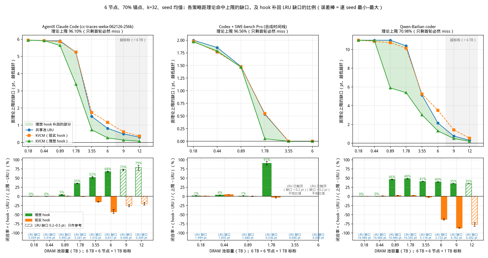
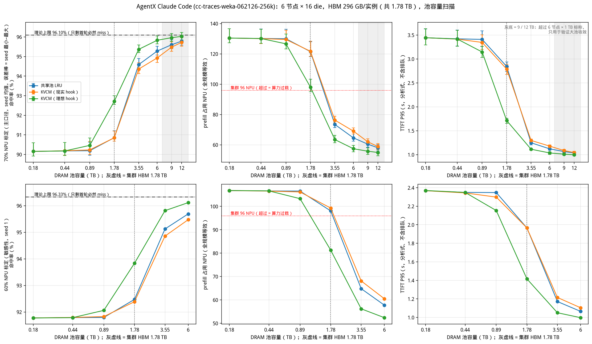
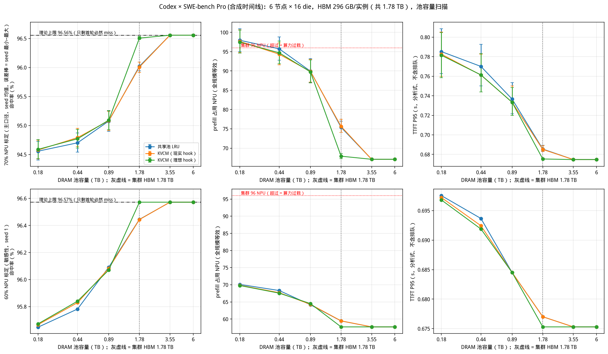
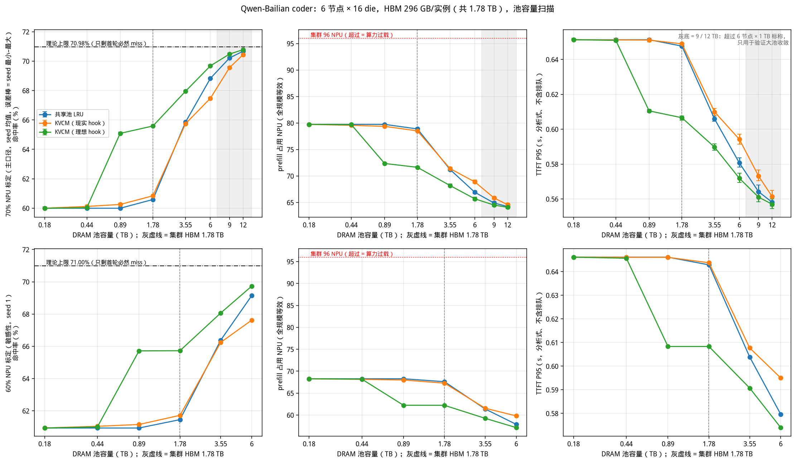

# KVCM 保留收益：6 节点主口径（自动生成）

由 `python3 -m kvcm_sim.report_n6` 从 `results/n6/` 生成；参数见 [`../../params.md`](../../params.md) §9，方法与结论见 [`../../README.md`](../../README.md)「6 节点保留收益主口径」。14 节点结果保留在 [`../summary.md`](../summary.md) 作为基线。

DeepSeek-V4.1-Flash，BF16 KV 3,200 B/token；Ascend A3 6 节点 × 16 die = 96 NPU，每实例 HBM 296 GB（共 1.78 TB），HBM 为引擎纯 LRU（各策略相同），KVCM 只管 DRAM 池。TTFT 为分析式（不含排队），NPU 利用率 > 100% 的格子标“过载”。

## 到达率标定

锚点：6 TB 共享池 LRU 的实际 prefill NPU 占用（迭代外推到相对误差 < 0.5%，seed 1）。比值相对 14 节点主线（理想命中下占 50%）的到达率。被弃用的“理想命中下占 70%”锚点（约 0.595×）会让 Claude Code 在 1.78 TB 需要 204% NPU，见 `ideal_anchor_coarse/`。

| trace | 14 节点主线（会话/h） | 6 节点 70%（主口径） | 比值 | 6 节点 60%（敏感性） | 比值 |
|---|---:|---:|---:|---:|---:|
| AgentX Claude Code (cc-traces-weka-062126-256k) | 10,871 | 5,123 | 0.471 | 4,571 | 0.420 |
| Codex × SWE-bench Pro (合成时间线) | 59,259 | 35,336 | 0.596 | 30,265 | 0.511 |
| Qwen-Bailian coder | 1,626,604 | 928,967 | 0.571 | 803,520 | 0.494 |

## 理论命中上限与缺口闭合率

理论上限 = 无限容量、全局共享下的前缀命中率（只剩每个 block 首次出现的必然 miss；预热期见过的 key 也算见过，decode 输出 KV 入缓存，与主口径一致），从回放记录的 `ideal_hit_rate` 计算。它只随 seed 变，与池容量和策略无关。闭合率 =（hook − LRU）/（上限 − LRU），按 seed 配对，取 seed 均值之比，括号为逐 seed 最小–最大。LRU 缺口 < 0.2 pt 视为已触顶、不给比值；0.2–0.5 pt 只作参考（分母趋零时比值被 seed 噪声放大）。逐点数据在 `closure.json`。

| trace | 理论上限（seed 均值） | seed 最小–最大 |
|---|---:|---:|
| AgentX Claude Code (cc-traces-weka-062126-256k) | 96.10% | 95.90%–96.31% |
| Codex × SWE-bench Pro (合成时间线) | 96.56% | 96.54%–96.57% |
| Qwen-Bailian coder | 70.98% | 70.93%–71.04% |

## AgentX Claude Code (cc-traces-weka-062126-256k)

#### 主口径：70% NPU 标定，k=32，seed 均值（± 为 seed 极差的一半）

| 池 TB | 策略 | 命中率 | 其中 HBM | prefill NPU | NPU 利用率 | TTFT P95 (s) | 命中率差（pt） | NPU 差 | P95 差 | seed |
|---:|---|---:|---:|---:|---:|---:|---:|---:|---:|---|
| 0.18 | 共享池 LRU | 90.16% ±0.33 | 90.14% | 130.4 | 136%（过载） | 3.44 | — | — | — | 1,2,3 |
| 0.18 | KVCM（现实 hook） | 90.16% ±0.33 | 90.14% | 130.4 | 136%（过载） | 3.44 | -0.00 | +0.0% | +0.0% | 1,2,3 |
| 0.18 | KVCM（理想 hook） | 90.16% ±0.34 | 90.14% | 130.4 | 136%（过载） | 3.44 | -0.00 | +0.0% | +0.0% | 1,2,3 |
| 0.44 | 共享池 LRU | 90.18% ±0.33 | 90.14% | 130.1 | 136%（过载） | 3.42 | — | — | — | 1,2,3 |
| 0.44 | KVCM（现实 hook） | 90.19% ±0.33 | 90.14% | 130.1 | 135%（过载） | 3.42 | +0.01 | -0.1% | -0.2% | 1,2,3 |
| 0.44 | KVCM（理想 hook） | 90.18% ±0.33 | 90.14% | 130.1 | 136%（过载） | 3.42 | -0.00 | +0.0% | -0.1% | 1,2,3 |
| 0.89 | 共享池 LRU | 90.19% ±0.33 | 90.14% | 130.0 | 135%（过载） | 3.41 | — | — | — | 1,2,3 |
| 0.89 | KVCM（现实 hook） | 90.23% ±0.34 | 90.14% | 129.5 | 135%（过载） | 3.35 | +0.04 | -0.4% | -1.9% | 1,2,3 |
| 0.89 | KVCM（理想 hook） | 90.46% ±0.29 | 90.14% | 126.6 | 132%（过载） | 3.15 | +0.27 | -2.6% | -7.7% | 1,2,3 |
| 1.78 | 共享池 LRU | 90.86% ±0.27 | 90.14% | 121.5 | 127%（过载） | 2.84 | — | — | — | 1,2,3 |
| 1.78 | KVCM（现实 hook） | 90.85% ±0.26 | 90.14% | 121.7 | 127%（过载） | 2.79 | -0.00 | +0.2% | -1.9% | 1,2,3 |
| 1.78 | KVCM（理想 hook） | 92.71% ±0.22 | 90.14% | 98.0 | 102%（过载） | 1.71 | +1.86 | -19.3% | -39.8% | 1,2,3 |
| 3.55 | 共享池 LRU | 94.59% ±0.26 | 90.14% | 73.4 | 76% | 1.25 | — | — | — | 1,2,3 |
| 3.55 | KVCM（现实 hook） | 94.36% ±0.28 | 90.14% | 76.3 | 79% | 1.30 | -0.23 | +3.9% | +3.9% | 1,2,3 |
| 3.55 | KVCM（理想 hook） | 95.36% ±0.20 | 90.14% | 63.5 | 66% | 1.11 | +0.78 | -13.6% | -10.8% | 1,2,3 |
| 6 | 共享池 LRU | 95.28% ±0.22 | 90.14% | 64.6 | 67% | 1.12 | — | — | — | 1,2,3 |
| 6 | KVCM（现实 hook） | 94.93% ±0.27 | 90.14% | 69.0 | 72% | 1.18 | -0.35 | +6.9% | +5.1% | 1,2,3 |
| 6 | KVCM（理想 hook） | 95.83% ±0.21 | 90.14% | 57.4 | 60% | 1.04 | +0.55 | -11.1% | -7.6% | 1,2,3 |
| 9（超标称） | 共享池 LRU | 95.60% ±0.22 | 90.14% | 60.4 | 63% | 1.06 | — | — | — | 1,2,3 |
| 9（超标称） | KVCM（现实 hook） | 95.48% ±0.24 | 90.14% | 62.0 | 65% | 1.09 | -0.12 | +2.6% | +1.9% | 1,2,3 |
| 9（超标称） | KVCM（理想 hook） | 95.96% ±0.20 | 90.14% | 55.8 | 58% | 1.01 | +0.36 | -7.7% | -5.1% | 1,2,3 |
| 12（超标称） | 共享池 LRU | 95.79% ±0.22 | 90.14% | 58.0 | 60% | 1.03 | — | — | — | 1,2,3 |
| 12（超标称） | KVCM（现实 hook） | 95.72% ±0.23 | 90.14% | 58.8 | 61% | 1.04 | -0.06 | +1.4% | +0.9% | 1,2,3 |
| 12（超标称） | KVCM（理想 hook） | 96.03% ±0.19 | 90.14% | 54.9 | 57% | 1.00 | +0.24 | -5.3% | -3.7% | 1,2,3 |

#### 大池收敛检查（理想 hook / 现实 hook 相对共享池 LRU）

| 池 TB | 理想 hook 命中率差（pt） | 理想 hook NPU 差 | 现实 hook 命中率差（pt） | 现实 hook NPU 差 |
|---:|---:|---:|---:|---:|
| 3.55 | +0.78 | -13.6% | -0.23 | +3.9% |
| 6 | +0.55 | -11.1% | -0.35 | +6.9% |
| 9（超标称） | +0.36 | -7.7% | -0.12 | +2.6% |
| 12（超标称） | +0.24 | -5.3% | -0.06 | +1.4% |

#### 距理论上限的缺口与闭合率（主口径）

| 池 TB | 理论上限 | LRU 缺口（pt） | 现实 hook 缺口 | 理想 hook 缺口 | 理想 hook 闭合率 | 现实 hook 闭合率 | 备注 |
|---:|---:|---:|---:|---:|---:|---:|---|
| 0.18 | 96.10% | 5.939 | 5.940 | 5.940 | 0% | 0% |  |
| 0.44 | 96.10% | 5.916 | 5.910 | 5.916 | 0% | 0% |  |
| 0.89 | 96.10% | 5.905 | 5.863 | 5.633 | 5%（4% ~ 5%） | 1% |  |
| 1.78 | 96.10% | 5.241 | 5.246 | 3.384 | 35%（35% ~ 36%） | 0% |  |
| 3.55 | 96.10% | 1.510 | 1.738 | 0.732 | 52%（49% ~ 54%） | -15%（-16% ~ -14%） |  |
| 6 | 96.10% | 0.817 | 1.166 | 0.265 | 68%（66% ~ 69%） | -43%（-46% ~ -36%） |  |
| 9（超标称） | 96.10% | 0.496 | 0.618 | 0.136 | 73%（70% ~ 74%） | -25%（-28% ~ -22%） | （只作参考） |
| 12（超标称） | 96.10% | 0.309 | 0.372 | 0.066 | 79%（71% ~ 85%） | -20%（-24% ~ -17%） | （只作参考） |

#### 敏感性：60% NPU 标定，k=32，seed 1

| 池 TB | 策略 | 命中率 | 其中 HBM | prefill NPU | NPU 利用率 | TTFT P95 (s) | 命中率差（pt） | NPU 差 | P95 差 | seed |
|---:|---|---:|---:|---:|---:|---:|---:|---:|---:|---|
| 0.18 | 共享池 LRU | 91.78% | 91.77% | 106.8 | 111%（过载） | 2.37 | — | — | — | 1 |
| 0.18 | KVCM（现实 hook） | 91.78% | 91.77% | 106.8 | 111%（过载） | 2.37 | -0.00 | +0.0% | +0.0% | 1 |
| 0.18 | KVCM（理想 hook） | 91.78% | 91.77% | 106.8 | 111%（过载） | 2.37 | -0.00 | +0.0% | +0.1% | 1 |
| 0.44 | 共享池 LRU | 91.79% | 91.77% | 106.6 | 111%（过载） | 2.35 | — | — | — | 1 |
| 0.44 | KVCM（现实 hook） | 91.80% | 91.77% | 106.6 | 111%（过载） | 2.34 | +0.01 | -0.1% | -0.2% | 1 |
| 0.44 | KVCM（理想 hook） | 91.79% | 91.77% | 106.6 | 111%（过载） | 2.35 | -0.00 | +0.0% | +0.0% | 1 |
| 0.89 | 共享池 LRU | 91.79% | 91.77% | 106.6 | 111%（过载） | 2.35 | — | — | — | 1 |
| 0.89 | KVCM（现实 hook） | 91.83% | 91.77% | 106.2 | 111%（过载） | 2.30 | +0.03 | -0.4% | -2.1% | 1 |
| 0.89 | KVCM（理想 hook） | 92.06% | 91.77% | 103.3 | 108%（过载） | 2.15 | +0.27 | -3.0% | -8.3% | 1 |
| 1.78 | 共享池 LRU | 92.47% | 91.77% | 98.1 | 102%（过载） | 1.97 | — | — | — | 1 |
| 1.78 | KVCM（现实 hook） | 92.39% | 91.77% | 99.3 | 103%（过载） | 1.97 | -0.09 | +1.3% | -0.0% | 1 |
| 1.78 | KVCM（理想 hook） | 93.83% | 91.77% | 81.3 | 85% | 1.42 | +1.36 | -17.1% | -28.0% | 1 |
| 3.55 | 共享池 LRU | 95.12% | 91.77% | 64.8 | 68% | 1.17 | — | — | — | 1 |
| 3.55 | KVCM（现实 hook） | 94.86% | 91.77% | 68.1 | 71% | 1.22 | -0.27 | +5.1% | +3.7% | 1 |
| 3.55 | KVCM（理想 hook） | 95.81% | 91.77% | 56.2 | 59% | 1.05 | +0.69 | -13.3% | -10.3% | 1 |
| 6 | 共享池 LRU | 95.69% | 91.77% | 57.8 | 60% | 1.07 | — | — | — | 1 |
| 6 | KVCM（现实 hook） | 95.47% | 91.77% | 60.5 | 63% | 1.10 | -0.22 | +4.7% | +3.7% | 1 |
| 6 | KVCM（理想 hook） | 96.12% | 91.77% | 52.4 | 55% | 1.00 | +0.42 | -9.3% | -6.4% | 1 |

#### 距理论上限的缺口与闭合率（60% 敏感性，seed 1）

| 池 TB | 理论上限 | LRU 缺口（pt） | 现实 hook 缺口 | 理想 hook 缺口 | 理想 hook 闭合率 | 现实 hook 闭合率 | 备注 |
|---:|---:|---:|---:|---:|---:|---:|---|
| 0.18 | 96.33% | 4.555 | 4.555 | 4.557 | 0% | 0% |  |
| 0.44 | 96.33% | 4.542 | 4.536 | 4.544 | 0% | 0% |  |
| 0.89 | 96.33% | 4.537 | 4.503 | 4.270 | 6% | 1% |  |
| 1.78 | 96.33% | 3.859 | 3.945 | 2.499 | 35% | -2% |  |
| 3.55 | 96.33% | 1.207 | 1.476 | 0.519 | 57% | -22% |  |
| 6 | 96.33% | 0.641 | 0.859 | 0.216 | 66% | -34% |  |

#### 切片对照（k=32 对 k=16，seed 1）

| 池 TB | 策略 | 命中率 k=32 | 命中率 k=16 | 差（pt） | NPU k=32 | NPU k=16 |
|---:|---|---:|---:|---:|---:|---:|
| 0.44 | 共享池 LRU | 90.61% | 90.45% | -0.16 | 136.4 | 134.1 |
| 0.44 | KVCM（现实 hook） | 90.62% | 90.45% | -0.16 | 136.3 | 134.1 |
| 0.44 | KVCM（理想 hook） | 90.61% | 90.44% | -0.17 | 136.3 | 134.3 |
| 1.78 | 共享池 LRU | 91.21% | 91.00% | -0.20 | 128.0 | 126.7 |
| 1.78 | KVCM（现实 hook） | 91.20% | 91.00% | -0.20 | 128.3 | 126.9 |
| 1.78 | KVCM（理想 hook） | 92.99% | 92.84% | -0.15 | 103.3 | 102.1 |
| 6 | 共享池 LRU | 95.53% | 95.46% | -0.07 | 67.2 | 66.0 |
| 6 | KVCM（现实 hook） | 95.25% | 95.13% | -0.12 | 71.1 | 70.5 |
| 6 | KVCM（理想 hook） | 96.06% | 96.01% | -0.05 | 59.7 | 58.5 |

## Codex × SWE-bench Pro (合成时间线)

#### 主口径：70% NPU 标定，k=32，seed 均值（± 为 seed 极差的一半）

| 池 TB | 策略 | 命中率 | 其中 HBM | prefill NPU | NPU 利用率 | TTFT P95 (s) | 命中率差（pt） | NPU 差 | P95 差 | seed |
|---:|---|---:|---:|---:|---:|---:|---:|---:|---:|---|
| 0.18 | 共享池 LRU | 94.56% ±0.16 | 94.49% | 98.0 | 102%（过载） | 0.79 | — | — | — | 1,2,3 |
| 0.18 | KVCM（现实 hook） | 94.58% ±0.16 | 94.49% | 97.7 | 102%（过载） | 0.78 | +0.02 | -0.3% | -0.3% | 1,2,3 |
| 0.18 | KVCM（理想 hook） | 94.59% ±0.16 | 94.49% | 97.5 | 102%（过载） | 0.78 | +0.03 | -0.5% | -0.5% | 1,2,3 |
| 0.44 | 共享池 LRU | 94.70% ±0.17 | 94.49% | 95.7 | 100% | 0.77 | — | — | — | 1,2,3 |
| 0.44 | KVCM（现实 hook） | 94.79% ±0.16 | 94.49% | 94.3 | 98% | 0.76 | +0.09 | -1.4% | -1.1% | 1,2,3 |
| 0.44 | KVCM（理想 hook） | 94.77% ±0.16 | 94.49% | 94.7 | 99% | 0.76 | +0.07 | -1.1% | -1.1% | 1,2,3 |
| 0.89 | 共享池 LRU | 95.08% ±0.18 | 94.49% | 89.9 | 94% | 0.74 | — | — | — | 1,2,3 |
| 0.89 | KVCM（现实 hook） | 95.08% ±0.17 | 94.49% | 89.9 | 94% | 0.73 | +0.01 | -0.1% | -0.4% | 1,2,3 |
| 0.89 | KVCM（理想 hook） | 95.09% ±0.17 | 94.49% | 89.8 | 94% | 0.73 | +0.02 | -0.2% | -0.4% | 1,2,3 |
| 1.78 | 共享池 LRU | 96.02% ±0.08 | 94.49% | 75.4 | 79% | 0.69 | — | — | — | 1,2,3 |
| 1.78 | KVCM（现实 hook） | 96.01% ±0.09 | 94.49% | 75.6 | 79% | 0.69 | -0.01 | +0.3% | -0.1% | 1,2,3 |
| 1.78 | KVCM（理想 hook） | 96.51% ±0.03 | 94.49% | 67.9 | 71% | 0.68 | +0.49 | -9.9% | -1.5% | 1,2,3 |
| 3.55 | 共享池 LRU | 96.56% ±0.02 | 94.49% | 67.1 | 70% | 0.67 | — | — | — | 1,2,3 |
| 3.55 | KVCM（现实 hook） | 96.56% ±0.02 | 94.49% | 67.1 | 70% | 0.67 | +0.00 | +0.0% | +0.0% | 1,2,3 |
| 3.55 | KVCM（理想 hook） | 96.56% ±0.02 | 94.49% | 67.1 | 70% | 0.67 | +0.00 | +0.0% | +0.0% | 1,2,3 |
| 6 | 共享池 LRU | 96.56% ±0.02 | 94.49% | 67.1 | 70% | 0.67 | — | — | — | 1,2,3 |
| 6 | KVCM（现实 hook） | 96.56% ±0.02 | 94.49% | 67.1 | 70% | 0.67 | +0.00 | +0.0% | +0.0% | 1,2,3 |
| 6 | KVCM（理想 hook） | 96.56% ±0.02 | 94.49% | 67.1 | 70% | 0.67 | +0.00 | +0.0% | +0.0% | 1,2,3 |

#### 大池收敛检查（理想 hook / 现实 hook 相对共享池 LRU）

| 池 TB | 理想 hook 命中率差（pt） | 理想 hook NPU 差 | 现实 hook 命中率差（pt） | 现实 hook NPU 差 |
|---:|---:|---:|---:|---:|
| 3.55 | +0.00 | +0.0% | +0.00 | +0.0% |
| 6 | +0.00 | +0.0% | +0.00 | +0.0% |

#### 距理论上限的缺口与闭合率（主口径）

| 池 TB | 理论上限 | LRU 缺口（pt） | 现实 hook 缺口 | 理想 hook 缺口 | 理想 hook 闭合率 | 现实 hook 闭合率 | 备注 |
|---:|---:|---:|---:|---:|---:|---:|---|
| 0.18 | 96.56% | 1.999 | 1.980 | 1.968 | 2%（1% ~ 2%） | 1% |  |
| 0.44 | 96.56% | 1.855 | 1.766 | 1.786 | 4%（3% ~ 4%） | 5% |  |
| 0.89 | 96.56% | 1.480 | 1.474 | 1.465 | 1%（0% ~ 2%） | 0%（-1% ~ 1%） |  |
| 1.78 | 96.56% | 0.536 | 0.549 | 0.050 | 91%（86% ~ 95%） | -2%（-4% ~ 0%） |  |
| 3.55 | 96.56% | 0.000 | 0.000 | 0.000 | — | — | LRU 已触顶 |
| 6 | 96.56% | 0.000 | 0.000 | 0.000 | — | — | LRU 已触顶 |

#### 敏感性：60% NPU 标定，k=32，seed 1

| 池 TB | 策略 | 命中率 | 其中 HBM | prefill NPU | NPU 利用率 | TTFT P95 (s) | 命中率差（pt） | NPU 差 | P95 差 | seed |
|---:|---|---:|---:|---:|---:|---:|---:|---:|---:|---|
| 0.18 | 共享池 LRU | 95.65% | 95.58% | 70.1 | 73% | 0.70 | — | — | — | 1 |
| 0.18 | KVCM（现实 hook） | 95.67% | 95.58% | 69.9 | 73% | 0.70 | +0.02 | -0.4% | -0.0% | 1 |
| 0.18 | KVCM（理想 hook） | 95.67% | 95.58% | 69.8 | 73% | 0.70 | +0.02 | -0.5% | -0.1% | 1 |
| 0.44 | 共享池 LRU | 95.78% | 95.58% | 68.3 | 71% | 0.69 | — | — | — | 1 |
| 0.44 | KVCM（现实 hook） | 95.83% | 95.58% | 67.7 | 71% | 0.69 | +0.05 | -0.9% | -0.2% | 1 |
| 0.44 | KVCM（理想 hook） | 95.84% | 95.58% | 67.6 | 70% | 0.69 | +0.06 | -1.1% | -0.3% | 1 |
| 0.89 | 共享池 LRU | 96.09% | 95.58% | 64.2 | 67% | 0.68 | — | — | — | 1 |
| 0.89 | KVCM（现实 hook） | 96.08% | 95.58% | 64.3 | 67% | 0.68 | -0.01 | +0.2% | +0.0% | 1 |
| 0.89 | KVCM（理想 hook） | 96.07% | 95.58% | 64.5 | 67% | 0.68 | -0.02 | +0.5% | +0.0% | 1 |
| 1.78 | 共享池 LRU | 96.44% | 95.58% | 59.5 | 62% | 0.68 | — | — | — | 1 |
| 1.78 | KVCM（现实 hook） | 96.44% | 95.58% | 59.5 | 62% | 0.68 | -0.00 | +0.0% | +0.0% | 1 |
| 1.78 | KVCM（理想 hook） | 96.57% | 95.58% | 57.7 | 60% | 0.68 | +0.13 | -2.9% | -0.3% | 1 |
| 3.55 | 共享池 LRU | 96.57% | 95.58% | 57.7 | 60% | 0.68 | — | — | — | 1 |
| 3.55 | KVCM（现实 hook） | 96.57% | 95.58% | 57.7 | 60% | 0.68 | +0.00 | +0.0% | +0.0% | 1 |
| 3.55 | KVCM（理想 hook） | 96.57% | 95.58% | 57.7 | 60% | 0.68 | +0.00 | +0.0% | +0.0% | 1 |
| 6 | 共享池 LRU | 96.57% | 95.58% | 57.7 | 60% | 0.68 | — | — | — | 1 |
| 6 | KVCM（现实 hook） | 96.57% | 95.58% | 57.7 | 60% | 0.68 | +0.00 | +0.0% | +0.0% | 1 |
| 6 | KVCM（理想 hook） | 96.57% | 95.58% | 57.7 | 60% | 0.68 | +0.00 | +0.0% | +0.0% | 1 |

#### 距理论上限的缺口与闭合率（60% 敏感性，seed 1）

| 池 TB | 理论上限 | LRU 缺口（pt） | 现实 hook 缺口 | 理想 hook 缺口 | 理想 hook 闭合率 | 现实 hook 闭合率 | 备注 |
|---:|---:|---:|---:|---:|---:|---:|---|
| 0.18 | 96.57% | 0.925 | 0.906 | 0.900 | 3% | 2% |  |
| 0.44 | 96.57% | 0.790 | 0.743 | 0.732 | 7% | 6% |  |
| 0.89 | 96.57% | 0.481 | 0.490 | 0.502 | -4% | -2% | （只作参考） |
| 1.78 | 96.57% | 0.127 | 0.129 | 0.000 | — | — | LRU 已触顶 |
| 3.55 | 96.57% | 0.000 | 0.000 | 0.000 | — | — | LRU 已触顶 |
| 6 | 96.57% | 0.000 | 0.000 | 0.000 | — | — | LRU 已触顶 |

#### 切片对照（k=32 对 k=16，seed 1）

| 池 TB | 策略 | 命中率 k=32 | 命中率 k=16 | 差（pt） | NPU k=32 | NPU k=16 |
|---:|---|---:|---:|---:|---:|---:|
| 0.44 | 共享池 LRU | 94.54% | 95.71% | +1.17 | 98.8 | 79.9 |
| 0.44 | KVCM（现实 hook） | 94.64% | 95.73% | +1.09 | 97.3 | 79.7 |
| 0.44 | KVCM（理想 hook） | 94.61% | 95.72% | +1.11 | 97.7 | 79.7 |
| 1.78 | 共享池 LRU | 95.94% | 96.10% | +0.16 | 77.0 | 73.9 |
| 1.78 | KVCM（现实 hook） | 95.91% | 96.10% | +0.19 | 77.5 | 74.0 |
| 1.78 | KVCM（理想 hook） | 96.48% | 96.55% | +0.06 | 68.6 | 67.1 |
| 6 | 共享池 LRU | 96.57% | 96.55% | -0.02 | 67.2 | 67.0 |
| 6 | KVCM（现实 hook） | 96.57% | 96.55% | -0.02 | 67.2 | 67.0 |
| 6 | KVCM（理想 hook） | 96.57% | 96.55% | -0.02 | 67.2 | 67.0 |

## Qwen-Bailian coder

#### 主口径：70% NPU 标定，k=32，seed 均值（± 为 seed 极差的一半）

| 池 TB | 策略 | 命中率 | 其中 HBM | prefill NPU | NPU 利用率 | TTFT P95 (s) | 命中率差（pt） | NPU 差 | P95 差 | seed |
|---:|---|---:|---:|---:|---:|---:|---:|---:|---:|---|
| 0.18 | 共享池 LRU | 59.99% ±0.08 | 59.99% | 79.7 | 83% | 0.65 | — | — | — | 1,2,3 |
| 0.18 | KVCM（现实 hook） | 60.00% ±0.08 | 59.99% | 79.7 | 83% | 0.65 | +0.00 | -0.0% | -0.0% | 1,2,3 |
| 0.18 | KVCM（理想 hook） | 59.99% ±0.08 | 59.99% | 79.7 | 83% | 0.65 | +0.00 | +0.0% | +0.0% | 1,2,3 |
| 0.44 | 共享池 LRU | 59.99% ±0.08 | 59.99% | 79.7 | 83% | 0.65 | — | — | — | 1,2,3 |
| 0.44 | KVCM（现实 hook） | 60.12% ±0.07 | 59.99% | 79.6 | 83% | 0.65 | +0.12 | -0.2% | -0.0% | 1,2,3 |
| 0.44 | KVCM（理想 hook） | 60.03% ±0.07 | 59.99% | 79.7 | 83% | 0.65 | +0.04 | -0.1% | -0.1% | 1,2,3 |
| 0.89 | 共享池 LRU | 59.99% ±0.08 | 59.99% | 79.7 | 83% | 0.65 | — | — | — | 1,2,3 |
| 0.89 | KVCM（现实 hook） | 60.25% ±0.07 | 59.99% | 79.4 | 83% | 0.65 | +0.26 | -0.5% | -0.0% | 1,2,3 |
| 0.89 | KVCM（理想 hook） | 65.09% ±0.09 | 59.99% | 72.4 | 75% | 0.61 | +5.09 | -9.3% | -6.3% | 1,2,3 |
| 1.78 | 共享池 LRU | 60.59% ±0.03 | 59.99% | 78.9 | 82% | 0.65 | — | — | — | 1,2,3 |
| 1.78 | KVCM（现实 hook） | 60.84% ±0.02 | 59.99% | 78.5 | 82% | 0.65 | +0.25 | -0.5% | +0.2% | 1,2,3 |
| 1.78 | KVCM（理想 hook） | 65.59% ±0.02 | 59.99% | 71.6 | 75% | 0.61 | +5.00 | -9.2% | -6.3% | 1,2,3 |
| 3.55 | 共享池 LRU | 65.86% ±0.02 | 59.99% | 71.2 | 74% | 0.61 | — | — | — | 1,2,3 |
| 3.55 | KVCM（现实 hook） | 65.75% ±0.02 | 59.99% | 71.4 | 74% | 0.61 | -0.12 | +0.2% | +0.7% | 1,2,3 |
| 3.55 | KVCM（理想 hook） | 67.95% ±0.06 | 59.99% | 68.2 | 71% | 0.59 | +2.09 | -4.3% | -2.7% | 1,2,3 |
| 6 | 共享池 LRU | 68.83% ±0.05 | 59.99% | 66.9 | 70% | 0.58 | — | — | — | 1,2,3 |
| 6 | KVCM（现实 hook） | 67.47% ±0.08 | 59.99% | 68.9 | 72% | 0.59 | -1.35 | +2.9% | +2.3% | 1,2,3 |
| 6 | KVCM（理想 hook） | 69.68% ±0.06 | 59.99% | 65.7 | 68% | 0.57 | +0.85 | -1.8% | -1.5% | 1,2,3 |
| 9（超标称） | 共享池 LRU | 70.22% ±0.06 | 59.99% | 64.9 | 68% | 0.56 | — | — | — | 1,2,3 |
| 9（超标称） | KVCM（现实 hook） | 69.56% ±0.06 | 59.99% | 65.9 | 69% | 0.57 | -0.66 | +1.5% | +1.6% | 1,2,3 |
| 9（超标称） | KVCM（理想 hook） | 70.48% ±0.06 | 59.99% | 64.5 | 67% | 0.56 | +0.27 | -0.6% | -0.6% | 1,2,3 |
| 12（超标称） | 共享池 LRU | 70.68% ±0.05 | 59.99% | 64.2 | 67% | 0.56 | — | — | — | 1,2,3 |
| 12（超标称） | KVCM（现实 hook） | 70.45% ±0.05 | 59.99% | 64.6 | 67% | 0.56 | -0.23 | +0.5% | +0.6% | 1,2,3 |
| 12（超标称） | KVCM（理想 hook） | 70.78% ±0.05 | 59.99% | 64.1 | 67% | 0.56 | +0.10 | -0.2% | -0.2% | 1,2,3 |

#### 大池收敛检查（理想 hook / 现实 hook 相对共享池 LRU）

| 池 TB | 理想 hook 命中率差（pt） | 理想 hook NPU 差 | 现实 hook 命中率差（pt） | 现实 hook NPU 差 |
|---:|---:|---:|---:|---:|
| 3.55 | +2.09 | -4.3% | -0.12 | +0.2% |
| 6 | +0.85 | -1.8% | -1.35 | +2.9% |
| 9（超标称） | +0.27 | -0.6% | -0.66 | +1.5% |
| 12（超标称） | +0.10 | -0.2% | -0.23 | +0.5% |

#### 距理论上限的缺口与闭合率（主口径）

| 池 TB | 理论上限 | LRU 缺口（pt） | 现实 hook 缺口 | 理想 hook 缺口 | 理想 hook 闭合率 | 现实 hook 闭合率 | 备注 |
|---:|---:|---:|---:|---:|---:|---:|---|
| 0.18 | 70.98% | 10.986 | 10.984 | 10.986 | 0% | 0% |  |
| 0.44 | 70.98% | 10.986 | 10.863 | 10.948 | 0% | 1% |  |
| 0.89 | 70.98% | 10.986 | 10.728 | 5.891 | 46%（46% ~ 47%） | 2% |  |
| 1.78 | 70.98% | 10.392 | 10.139 | 5.391 | 48%（48% ~ 49%） | 2%（2% ~ 3%） |  |
| 3.55 | 70.98% | 5.118 | 5.234 | 3.025 | 41%（40% ~ 41%） | -2% |  |
| 6 | 70.98% | 2.152 | 3.505 | 1.302 | 40%（39% ~ 40%） | -63%（-65% ~ -61%） |  |
| 9（超标称） | 70.98% | 0.762 | 1.421 | 0.496 | 35% | -87%（-87% ~ -86%） |  |
| 12（超标称） | 70.98% | 0.302 | 0.531 | 0.197 | 35%（34% ~ 35%） | -76%（-82% ~ -72%） | （只作参考） |

#### 敏感性：60% NPU 标定，k=32，seed 1

| 池 TB | 策略 | 命中率 | 其中 HBM | prefill NPU | NPU 利用率 | TTFT P95 (s) | 命中率差（pt） | NPU 差 | P95 差 | seed |
|---:|---|---:|---:|---:|---:|---:|---:|---:|---:|---|
| 0.18 | 共享池 LRU | 60.93% | 60.93% | 68.3 | 71% | 0.65 | — | — | — | 1 |
| 0.18 | KVCM（现实 hook） | 60.94% | 60.93% | 68.3 | 71% | 0.65 | +0.00 | -0.0% | +0.0% | 1 |
| 0.18 | KVCM（理想 hook） | 60.93% | 60.93% | 68.3 | 71% | 0.65 | +0.00 | +0.0% | +0.0% | 1 |
| 0.44 | 共享池 LRU | 60.93% | 60.93% | 68.3 | 71% | 0.65 | — | — | — | 1 |
| 0.44 | KVCM（现实 hook） | 61.04% | 60.93% | 68.1 | 71% | 0.65 | +0.10 | -0.2% | -0.0% | 1 |
| 0.44 | KVCM（理想 hook） | 61.00% | 60.93% | 68.2 | 71% | 0.65 | +0.07 | -0.1% | -0.1% | 1 |
| 0.89 | 共享池 LRU | 60.93% | 60.93% | 68.3 | 71% | 0.65 | — | — | — | 1 |
| 0.89 | KVCM（现实 hook） | 61.15% | 60.93% | 68.0 | 71% | 0.65 | +0.22 | -0.4% | -0.0% | 1 |
| 0.89 | KVCM（理想 hook） | 65.72% | 60.93% | 62.2 | 65% | 0.61 | +4.78 | -8.8% | -5.9% | 1 |
| 1.78 | 共享池 LRU | 61.45% | 60.93% | 67.6 | 70% | 0.64 | — | — | — | 1 |
| 1.78 | KVCM（现实 hook） | 61.72% | 60.93% | 67.3 | 70% | 0.64 | +0.27 | -0.5% | +0.1% | 1 |
| 1.78 | KVCM（理想 hook） | 65.73% | 60.93% | 62.2 | 65% | 0.61 | +4.27 | -8.0% | -5.4% | 1 |
| 3.55 | 共享池 LRU | 66.38% | 60.93% | 61.4 | 64% | 0.60 | — | — | — | 1 |
| 3.55 | KVCM（现实 hook） | 66.24% | 60.93% | 61.6 | 64% | 0.61 | -0.14 | +0.3% | +0.6% | 1 |
| 3.55 | KVCM（理想 hook） | 68.07% | 60.93% | 59.3 | 62% | 0.59 | +1.68 | -3.5% | -2.2% | 1 |
| 6 | 共享池 LRU | 69.15% | 60.93% | 57.9 | 60% | 0.58 | — | — | — | 1 |
| 6 | KVCM（现实 hook） | 67.62% | 60.93% | 59.8 | 62% | 0.60 | -1.52 | +3.3% | +2.7% | 1 |
| 6 | KVCM（理想 hook） | 69.73% | 60.93% | 57.1 | 60% | 0.57 | +0.58 | -1.3% | -1.0% | 1 |

#### 距理论上限的缺口与闭合率（60% 敏感性，seed 1）

| 池 TB | 理论上限 | LRU 缺口（pt） | 现实 hook 缺口 | 理想 hook 缺口 | 理想 hook 闭合率 | 现实 hook 闭合率 | 备注 |
|---:|---:|---:|---:|---:|---:|---:|---|
| 0.18 | 71.00% | 10.062 | 10.059 | 10.062 | 0% | 0% |  |
| 0.44 | 71.00% | 10.062 | 9.958 | 9.996 | 1% | 1% |  |
| 0.89 | 71.00% | 10.062 | 9.844 | 5.280 | 48% | 2% |  |
| 1.78 | 71.00% | 9.543 | 9.277 | 5.270 | 45% | 3% |  |
| 3.55 | 71.00% | 4.614 | 4.753 | 2.929 | 37% | -3% |  |
| 6 | 71.00% | 1.850 | 3.373 | 1.265 | 32% | -82% |  |

#### 切片对照（k=32 对 k=16，seed 1）

| 池 TB | 策略 | 命中率 k=32 | 命中率 k=16 | 差（pt） | NPU k=32 | NPU k=16 |
|---:|---|---:|---:|---:|---:|---:|
| 0.44 | 共享池 LRU | 60.09% | 62.81% | +2.72 | 79.9 | 75.7 |
| 0.44 | KVCM（现实 hook） | 60.21% | 62.92% | +2.71 | 79.7 | 75.6 |
| 0.44 | KVCM（理想 hook） | 60.13% | 62.85% | +2.72 | 79.8 | 75.7 |
| 1.78 | 共享池 LRU | 60.60% | 63.12% | +2.52 | 79.1 | 75.3 |
| 1.78 | KVCM（现实 hook） | 60.85% | 63.41% | +2.56 | 78.8 | 74.8 |
| 1.78 | KVCM（理想 hook） | 65.62% | 68.05% | +2.43 | 71.8 | 68.1 |
| 6 | 共享池 LRU | 68.78% | 69.96% | +1.18 | 67.2 | 65.3 |
| 6 | KVCM（现实 hook） | 67.38% | 68.79% | +1.41 | 69.2 | 67.0 |
| 6 | KVCM（理想 hook） | 69.62% | 70.75% | +1.12 | 66.0 | 64.2 |
