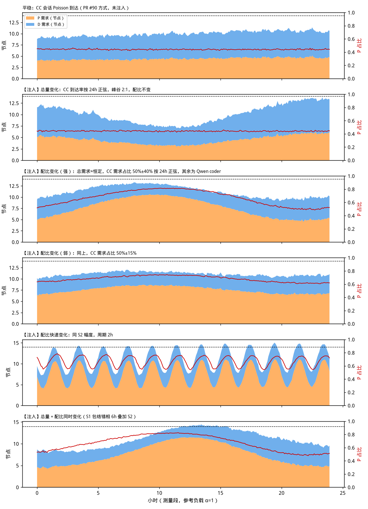
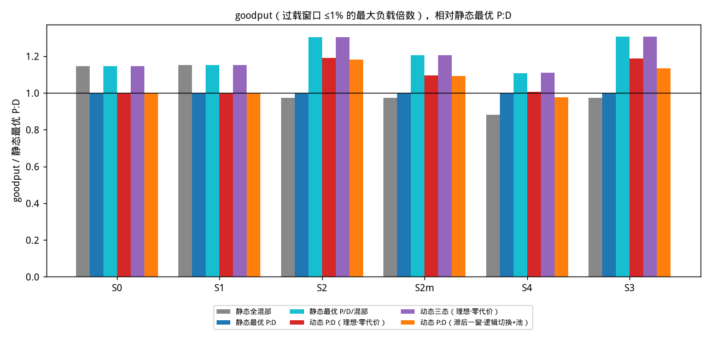
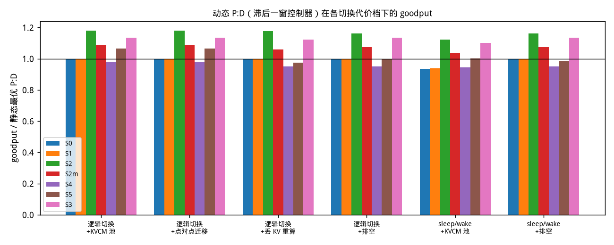
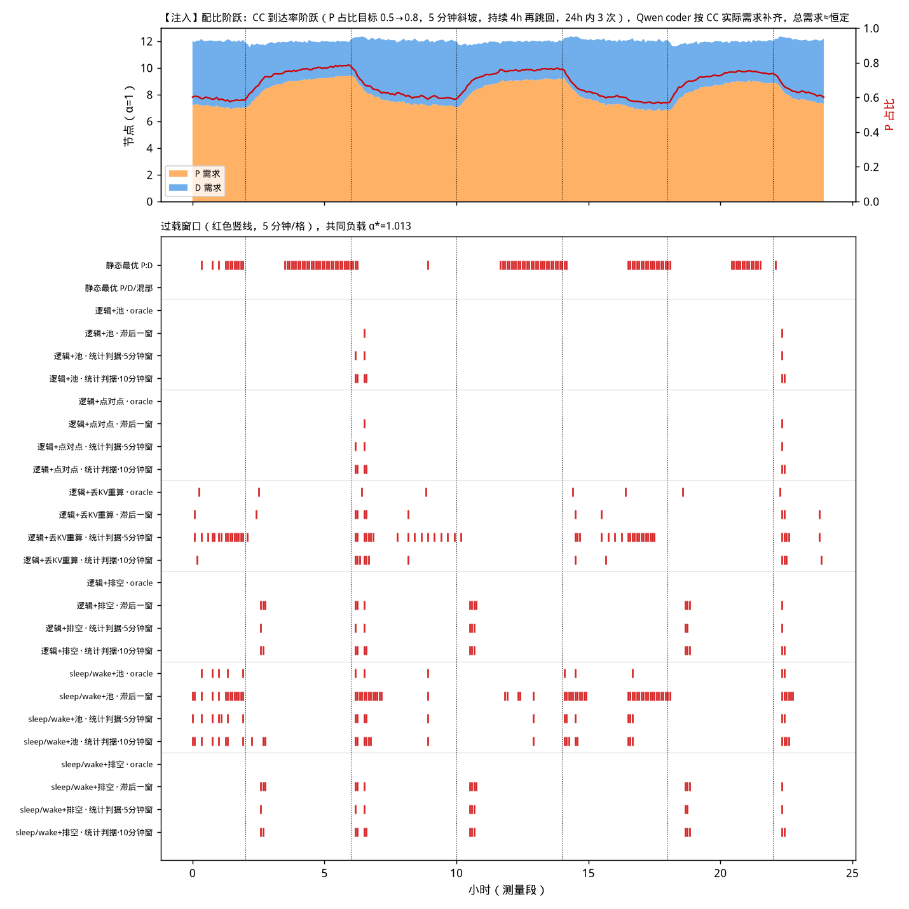
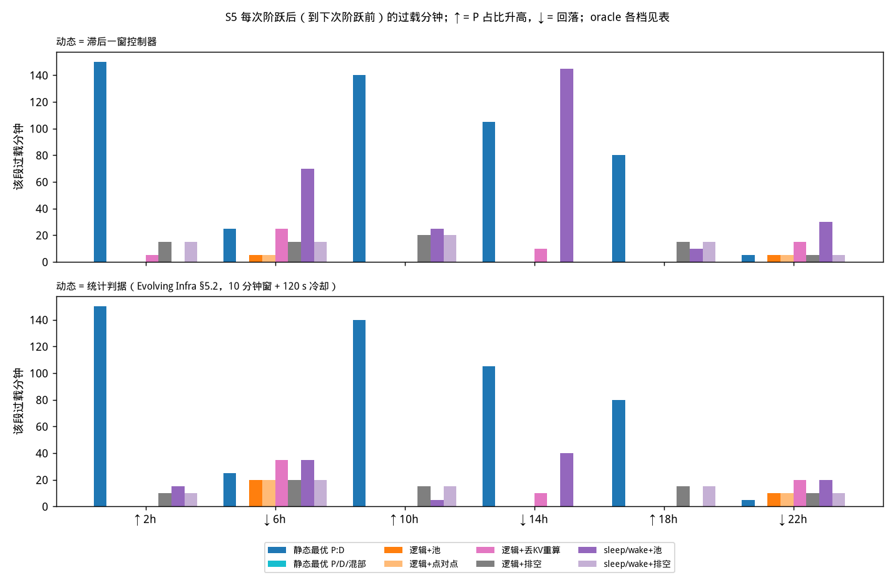
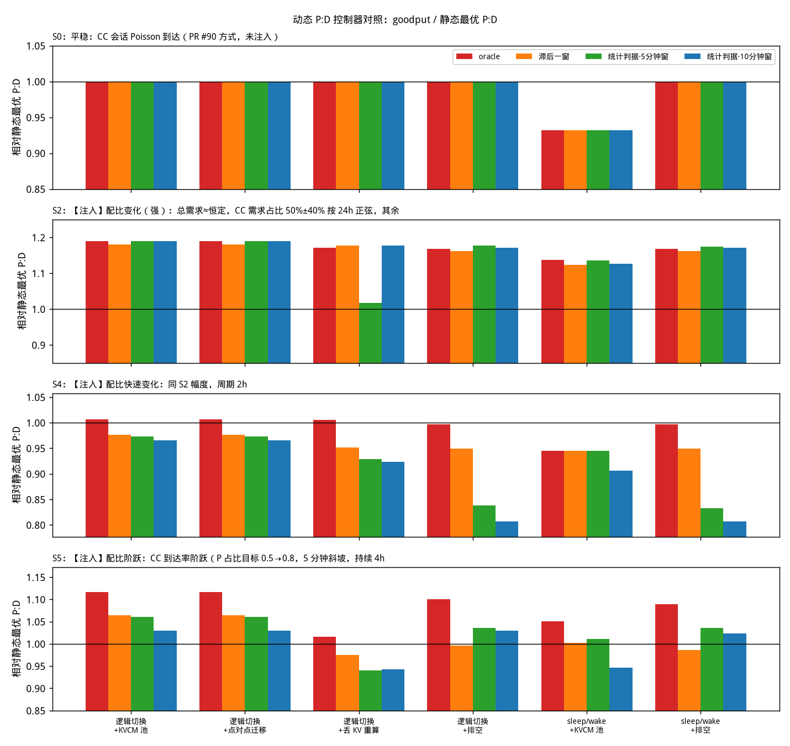
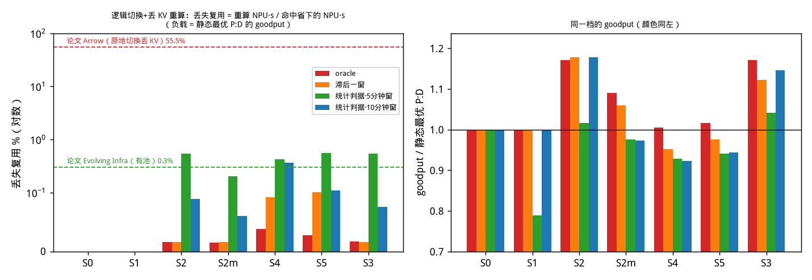
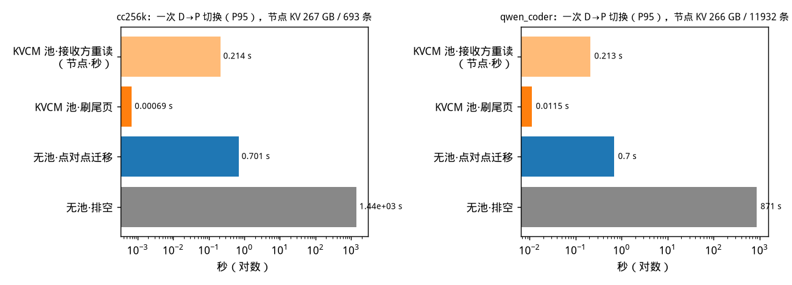

# PD 转换仿真结果（E1 流体模型 + E4 切换代价，自动生成）

由 `PYTHONPATH=. python3 -m pd.run` 生成；方法与假设见 [`../../README.md`](../../README.md)「PD 转换」节与 [`../../params.md`](../../params.md)「PD 转换」节。全部为 **[trace 回放] + [解析]**，单次运行（seed=1），无真机校准。

口径：BF16 KV 3200 B/token；HBM KV 296 GB/节点（gpu_memory_utilization 0.85）；14 节点 × 16 NPU；decode 每步 25 ms、TPOT SLO 50 ms、KV 填充 ≤ 90%；P 节点利用率 ≤ 80%；混部节点 prefill 占比 ≤ 50%；窗口 300 s；goodput = 过载窗口 ≤ 1% 的最大负载倍数 α（α=1 为参考负载，约 12 个节点的平均需求）。

**场景里带【注入】的，到达率包络或 trace 组合是人为设定的；会话内时间一律保持 trace 原值。**

## 1. 需求形态

| 场景 | 注入 | 平均需求（节点） | 峰值（节点） | 总量 CV | P 占比范围 | 闭式上界 s_max−s_min |
|---|---|---:|---:|---:|---|---:|
| S0：平稳：CC 会话 Poisson 到达（PR #90 方式，未注入） | 否 | 10.01 | 11.38 | 5.7% | 0.42–0.46 | 0.04 |
| S1：【注入】总量变化：CC 到达率按 24h 正弦，峰谷 2:1，配比不变 | 是 | 10.09 | 13.75 | 20.0% | 0.43–0.46 | 0.04 |
| S2：【注入】配比变化（强）：总需求≈恒定，CC 需求占比 50%±40% 按 24h 正弦，其余为 Qwen coder | 是 | 11.21 | 13.29 | 11.5% | 0.49–0.82 | 0.33 |
| S2m：【注入】配比变化（弱）：同上，CC 需求占比 50%±15% | 是 | 11.05 | 12.03 | 4.1% | 0.61–0.74 | 0.14 |
| S4：【注入】配比快速变化：同 S2 幅度，周期 2h | 是 | 11.09 | 15.06 | 22.1% | 0.54–0.78 | 0.24 |
| S5：【注入】配比阶跃：CC 到达率阶跃（P 占比目标 0.5→0.8，5 分钟斜坡，持续 4h 再跳回，24h 内 3 次），Qwen coder 按 CC 实际需求补齐，总需求≈恒定 | 是 | 12.00 | 12.35 | 1.2% | 0.56–0.79 | 0.22 |
| S3：【注入】总量 + 配比同时变化（S1 包络错相 6h 叠加 S2） | 是 | 11.14 | 14.46 | 18.7% | 0.48–0.83 | 0.35 |

每会话平均需求（节点·秒）：cc256k P 4.33 / D 5.41（P 占 44%）；qwen_coder P 0.0214 / D 0.00276（P 占 89%）

## 2. goodput：基线 vs 动态（切换零代价的理想上界）

| 场景 | 静态全混部 | 静态最优 P:D | 静态最优 P/D/混部 | 动态 P:D 理想 | 动态三态理想 | 动态 P:D 滞后一窗（逻辑切换+池） |
|---|---:|---:|---:|---:|---:|---:|
| S0 | 1.388（+14.6%） | 1.211 | 1.388（+14.6%） | 1.211（+0.0%） | 1.388（+14.6%） | 1.211（+0.0%） |
| S1 | 1.129（+15.3%） | 0.979 | 1.129（+15.3%） | 0.979（+0.0%） | 1.129（+15.3%） | 0.979（+0.0%） |
| S2 | 0.827（-2.8%） | 0.850 | 1.109（+30.4%） | 1.012（+19.0%） | 1.109（+30.4%） | 1.004（+18.0%） |
| S2m | 1.009（-2.8%） | 1.038 | 1.251（+20.5%） | 1.137（+9.5%） | 1.251（+20.5%） | 1.132（+9.1%） |
| S4 | 0.794（-11.9%） | 0.902 | 0.999（+10.8%） | 0.908（+0.7%） | 1.000（+10.9%） | 0.880（-2.4%） |
| S5 | 0.932（-2.4%） | 0.955 | 1.172（+22.7%） | 1.067（+11.7%） | 1.215（+27.2%） | 1.017（+6.5%） |
| S3 | 0.763（-2.8%） | 0.785 | 1.024（+30.5%） | 0.930（+18.6%） | 1.024（+30.6%） | 0.890（+13.5%） |

括号内为相对静态最优 P:D。静态最优组合（P, D, 混部 节点数）：S0 P:D=(6, 8)，三态=(0, 0, 14)；S1 P:D=(6, 8)，三态=(0, 0, 14)；S2 P:D=(9, 5)，三态=(8, 0, 6)；S2m P:D=(9, 5)，三态=(6, 0, 8)；S4 P:D=(10, 4)，三态=(6, 0, 8)；S5 P:D=(9, 5)，三态=(6, 0, 8)；S3 P:D=(9, 5)，三态=(8, 0, 6)。

## 3. 切换代价分档（动态 P:D）

| 档 | D→P 耗时 (s) | P→D 耗时 (s) | prefill 乘数 | S0 oracle / 滞后 | S1 oracle / 滞后 | S2 oracle / 滞后 | S2m oracle / 滞后 | S4 oracle / 滞后 | S5 oracle / 滞后 | S3 oracle / 滞后 |
|---|---:|---:|---:|---:|---:|---:|---:|---:|---:|---:|
| 同布局逻辑切换 + KVCM 池（丢弃后从池重读） | 2.2 | 2.0 | 1 | +0.0% / +0.0% | +0.0% / +0.0% | +19.0% / +18.0% | +9.5% / +9.1% | +0.7% / -2.4% | +11.7% / +6.5% | +18.6% / +13.5% |
| 同布局逻辑切换 + 无池点对点迁移（需引擎支持） | 2.7 | 2.0 | 1 | +0.0% / +0.0% | +0.0% / +0.0% | +19.0% / +18.0% | +9.5% / +9.1% | +0.7% / -2.4% | +11.7% / +6.5% | +18.6% / +13.5% |
| 同布局逻辑切换 + 无池快切（杀在途，被切节点 KV 全丢，按未命中重算） | 2.0 | 2.0 | 1 | +0.0% / +0.0% | +0.0% / +0.0% | +17.1% / +17.8% | +9.1% / +6.0% | +0.5% / -4.9% | +1.7% / -2.5% | +17.1% / +12.2% |
| 同布局逻辑切换 + 无池排空（等在途跑完） | 1439.3 | 2.0 | 1 | +0.0% / +0.0% | +0.0% / +0.0% | +16.8% / +16.1% | +9.1% / +7.5% | -0.3% / -5.0% | +10.0% / -0.4% | +17.8% / +13.5% |
| PR #89 sleep/wake + host H2D + KVCM 池（host 副本挤占池） | 32.2 | 32.0 | 按场景 | -6.8% / -6.8% | -6.2% / -6.2% | +13.7% / +12.4% | +3.7% / +3.6% | -5.5% / -5.5% | +5.1% / +0.2% | +14.0% / +10.1% |
| PR #89 sleep/wake + host H2D + 无池排空 | 1469.3 | 32.0 | 1 | +0.0% / +0.0% | +0.0% / +0.0% | +16.8% / +16.1% | +9.1% / +7.5% | -0.3% / -5.0% | +8.9% / -1.3% | +17.8% / +13.5% |

滞后控制器在其 goodput 处 24h 内的切换节点次数（逻辑+池档）：S0 0；S1 0；S2 5；S2m 4；S4 6；S5 15；S3 5。

表中为相对静态最优 P:D 的 goodput 变化。sleep/wake 档的 prefill 乘数来自 host 权重副本挤占 DRAM 池后命中下降（见 §4）。

动态三态（P/D/混部，oracle）各档：

| 档 | S0 | S1 | S2 | S2m | S4 | S5 | S3 |
|---|---:|---:|---:|---:|---:|---:|---:|
| 同布局逻辑切换 + KVCM 池（丢弃后从池重读） | +14.6% | +15.3% | +30.4% | +20.5% | +10.9% | +26.0% | +30.6% |
| 同布局逻辑切换 + 无池点对点迁移（需引擎支持） | +14.6% | +15.3% | +30.4% | +20.5% | +10.9% | +26.0% | +30.6% |
| 同布局逻辑切换 + 无池快切（杀在途，被切节点 KV 全丢，按未命中重算） | +14.6% | +15.3% | +30.4% | +20.4% | +10.8% | +23.4% | +30.4% |
| 同布局逻辑切换 + 无池排空（等在途跑完） | +14.6% | +15.3% | +29.8% | +19.2% | +9.5% | +19.1% | +29.0% |
| PR #89 sleep/wake + host H2D + KVCM 池（host 副本挤占池） | +6.6% | +7.5% | +24.6% | +14.6% | +5.4% | +18.4% | +24.4% |
| PR #89 sleep/wake + host H2D + 无池排空 | +14.6% | +15.3% | +29.8% | +19.2% | +9.5% | +19.1% | +29.0% |

## 3a. S5 配比阶跃：每次阶跃后的过载（有池 vs 无池）

场景：【注入】配比阶跃：CC 到达率阶跃（P 占比目标 0.5→0.8，5 分钟斜坡，持续 4h 再跳回，24h 内 3 次），Qwen coder 按 CC 实际需求补齐，总需求≈恒定。实际 P 占比 0.56–0.79，总量 CV 1.2%。CC 会话长（中位约 1.8 小时），到达率阶跃后 CC 需求要逐步衰减/累积，P 占比实际约 45–60 分钟完成大部分变化，不是几分钟；Qwen 到达率按 CC 实际需求补齐（同一 seed 先单跑 CC 求需求），保证总需求≈恒定。

统计口径：所有策略在同一负载 α* = 0.95 × 理想动态 P:D goodput = 1.013 下比较；“过载窗口”= 该 5 分钟窗口平均需求超过可用节点；每格为“该阶跃到下一次阶跃之间的过载窗口数 / 首段连续过载分钟”。

| 策略 | 全天过载窗口 | 切换节点次数 | ↑2h | ↓6h | ↑10h | ↓14h | ↑18h | ↓22h |
|---|---:|---:|---:|---:|---:|---:|---:|---:|
| 静态最优 P:D | 113 | 0 | 30 / 150 | 5 / 20 | 28 / 140 | 21 / 15 | 16 / 10 | 1 / 5 |
| 静态最优 P/D/混部 | 0 | 0 | 0 / 0 | 0 / 0 | 0 / 0 | 0 / 0 | 0 / 0 | 0 / 0 |
| 逻辑+池 · oracle | 0 | 12 | 0 / 0 | 0 / 0 | 0 / 0 | 0 / 0 | 0 / 0 | 0 / 0 |
| 逻辑+池 · 滞后一窗 | 2 | 15 | 0 / 0 | 1 / 5 | 0 / 0 | 0 / 0 | 0 / 0 | 1 / 5 |
| 逻辑+池 · 统计判据·5分钟窗 | 3 | 17 | 0 / 0 | 2 / 5 | 0 / 0 | 0 / 0 | 0 / 0 | 1 / 5 |
| 逻辑+池 · 统计判据·10分钟窗 | 6 | 15 | 0 / 0 | 4 / 10 | 0 / 0 | 0 / 0 | 0 / 0 | 2 / 10 |
| 逻辑+点对点 · oracle | 0 | 12 | 0 / 0 | 0 / 0 | 0 / 0 | 0 / 0 | 0 / 0 | 0 / 0 |
| 逻辑+点对点 · 滞后一窗 | 2 | 15 | 0 / 0 | 1 / 5 | 0 / 0 | 0 / 0 | 0 / 0 | 1 / 5 |
| 逻辑+点对点 · 统计判据·5分钟窗 | 3 | 17 | 0 / 0 | 2 / 5 | 0 / 0 | 0 / 0 | 0 / 0 | 1 / 5 |
| 逻辑+点对点 · 统计判据·10分钟窗 | 6 | 15 | 0 / 0 | 4 / 10 | 0 / 0 | 0 / 0 | 0 / 0 | 2 / 10 |
| 逻辑+丢KV重算 · oracle | 8 | 12 | 1 / 5 | 2 / 5 | 0 / 0 | 2 / 5 | 1 / 5 | 1 / 5 |
| 逻辑+丢KV重算 · 滞后一窗 | 12 | 15 | 1 / 5 | 5 / 10 | 0 / 0 | 2 / 5 | 0 / 0 | 3 / 10 |
| 逻辑+丢KV重算 · 统计判据·5分钟窗 | 59 | 72 | 1 / 5 | 16 / 10 | 1 / 5 | 20 / 15 | 0 / 0 | 5 / 20 |
| 逻辑+丢KV重算 · 统计判据·10分钟窗 | 14 | 15 | 0 / 0 | 7 / 15 | 0 / 0 | 2 / 5 | 0 / 0 | 4 / 15 |
| 逻辑+排空 · oracle | 0 | 12 | 0 / 0 | 0 / 0 | 0 / 0 | 0 / 0 | 0 / 0 | 0 / 0 |
| 逻辑+排空 · 滞后一窗 | 14 | 15 | 3 / 15 | 3 / 10 | 4 / 20 | 0 / 0 | 3 / 15 | 1 / 5 |
| 逻辑+排空 · 统计判据·5分钟窗 | 9 | 17 | 1 / 5 | 2 / 5 | 3 / 15 | 0 / 0 | 2 / 10 | 1 / 5 |
| 逻辑+排空 · 统计判据·10分钟窗 | 14 | 15 | 2 / 10 | 4 / 10 | 3 / 15 | 0 / 0 | 3 / 15 | 2 / 10 |
| sleep/wake+池 · oracle | 13 | 13 | 0 / 0 | 3 / 5 | 0 / 0 | 3 / 5 | 0 / 0 | 2 / 10 |
| sleep/wake+池 · 滞后一窗 | 70 | 11 | 0 / 0 | 14 / 65 | 5 / 10 | 29 / 55 | 2 / 10 | 6 / 30 |
| sleep/wake+池 · 统计判据·5分钟窗 | 21 | 17 | 0 / 0 | 5 / 10 | 1 / 5 | 6 / 10 | 0 / 0 | 2 / 10 |
| sleep/wake+池 · 统计判据·10分钟窗 | 31 | 15 | 3 / 5 | 7 / 10 | 1 / 5 | 8 / 15 | 0 / 0 | 4 / 20 |
| sleep/wake+排空 · oracle | 0 | 12 | 0 / 0 | 0 / 0 | 0 / 0 | 0 / 0 | 0 / 0 | 0 / 0 |
| sleep/wake+排空 · 滞后一窗 | 14 | 15 | 3 / 15 | 3 / 10 | 4 / 20 | 0 / 0 | 3 / 15 | 1 / 5 |
| sleep/wake+排空 · 统计判据·5分钟窗 | 9 | 17 | 1 / 5 | 2 / 5 | 3 / 15 | 0 / 0 | 2 / 10 | 1 / 5 |
| sleep/wake+排空 · 统计判据·10分钟窗 | 14 | 15 | 2 / 10 | 4 / 10 | 3 / 15 | 0 / 0 | 3 / 15 | 2 / 10 |
| 静态全混部 | 109 | 0 | 35 / 175 | 5 / 25 | 35 / 175 | 4 / 20 | 27 / 135 | 3 / 15 |

↑ = P 占比升高（D→P 方向切换，慢的那一侧）；↓ = 回落（P→D）。sleep/wake+池 档的过载里有一部分来自 host 权重副本挤占池导致的 prefill 增量（×1.04–1.18），不全是切换时延。统计判据控制器见 §3b，丢 KV 重算档见 §3c。

## 3b. 控制器对照：滞后一窗 vs 统计判据（Evolving Infra §5.2 / 算法 E.3）

统计判据：每个规划窗口（5 或 10 分钟，翻滚）结束时把窗口切成 60 s 切片，对每个 P 节点数 p ≠ 当前，逐片收益 g_i = Θ(p) − Θ(当前)，Θ = min(P 侧能力 / P 需求, D 侧能力 / D 需求)（论文式 (5) 的流体版）；均值 > 2 × 标准误（ḡ > 2σ/√m）才合格，取 ḡ 最大的切换；上一次切换未完成（排空/权重回填）或距其开始不足 120 s 则跳过本窗口。滞后一窗：只看上一窗需求 × 1.05，当前组合承不住才换。两者都只用过去的观测；oracle 已知未来。

goodput 相对静态最优 P:D（每格：oracle / 滞后一窗 / 判据·5 分钟 / 判据·10 分钟）：

| 档 | S0 | S1 | S2 | S2m | S4 | S5 | S3 |
|---|---|---|---|---|---|---|---|
| 逻辑+池 | +0.0% / +0.0% / +0.0% / +0.0% | +0.0% / +0.0% / +0.0% / +0.0% | +19.0% / +18.0% / +19.0% / +19.0% | +9.5% / +9.1% / +9.1% / +9.1% | +0.7% / -2.4% / -2.7% / -3.4% | +11.7% / +6.5% / +6.0% / +3.0% | +18.6% / +13.5% / +17.8% / +16.3% |
| 逻辑+点对点 | +0.0% / +0.0% / +0.0% / +0.0% | +0.0% / +0.0% / +0.0% / +0.0% | +19.0% / +18.0% / +19.0% / +19.0% | +9.5% / +9.1% / +9.1% / +9.1% | +0.7% / -2.4% / -2.7% / -3.4% | +11.7% / +6.5% / +6.0% / +3.0% | +18.6% / +13.5% / +17.8% / +16.3% |
| 逻辑+丢KV重算 | +0.0% / +0.0% / +0.0% / +0.0% | +0.0% / +0.0% / -21.1% / +0.0% | +17.1% / +17.8% / +1.7% / +17.8% | +9.1% / +6.0% / -2.5% / -2.7% | +0.5% / -4.9% / -7.2% / -7.7% | +1.7% / -2.5% / -5.9% / -5.7% | +17.1% / +12.2% / +4.1% / +14.5% |
| 逻辑+排空 | +0.0% / +0.0% / +0.0% / +0.0% | +0.0% / +0.0% / +0.0% / +0.0% | +16.8% / +16.1% / +17.8% / +17.1% | +9.1% / +7.5% / +9.1% / +7.5% | -0.3% / -5.0% / -16.1% / -19.3% | +10.0% / -0.4% / +3.6% / +2.9% | +17.8% / +13.5% / +17.8% / +16.3% |
| sleep/wake+池 | -6.8% / -6.8% / -6.8% / -6.8% | -6.2% / -6.2% / -6.2% / -6.2% | +13.7% / +12.4% / +13.5% / +12.7% | +3.7% / +3.6% / +3.6% / +3.6% | -5.5% / -5.5% / -5.5% / -9.4% | +5.1% / +0.2% / +1.1% / -5.3% | +14.0% / +10.1% / +11.7% / +11.7% |
| sleep/wake+排空 | +0.0% / +0.0% / +0.0% / +0.0% | +0.0% / +0.0% / +0.0% / +0.0% | +16.8% / +16.1% / +17.5% / +17.1% | +9.1% / +7.5% / +9.1% / +7.5% | -0.3% / -5.0% / -16.7% / -19.3% | +8.9% / -1.3% / +3.6% / +2.4% | +17.8% / +13.5% / +17.8% / +16.3% |

共同负载 α_ref = 静态最优 P:D 的 goodput 下，24h 切换节点次数 / 过载窗口数（每格：oracle / 滞后 / 判据·5 / 判据·10）：

| 档 | S0 | S1 | S2 | S2m | S4 | S5 | S3 |
|---|---|---|---|---|---|---|---|
| 逻辑+池 | 0·2 / 0·2 / 0·2 / 0·2 | 0·2 / 0·2 / 0·2 / 0·2 | 2·0 / 2·0 / 10·0 / 10·0 | 2·0 / 2·0 / 8·0 / 6·0 | 4·0 / 10·3 / 52·4 / 50·17 | 4·0 / 10·0 / 17·0 / 15·1 | 2·0 / 2·0 / 12·0 / 10·0 |
| 逻辑+点对点 | 0·2 / 0·2 / 0·2 / 0·2 | 0·2 / 0·2 / 0·2 / 0·2 | 2·0 / 2·0 / 10·0 / 10·0 | 2·0 / 2·0 / 8·0 / 6·0 | 4·0 / 10·3 / 52·4 / 50·17 | 4·0 / 10·0 / 17·0 / 15·1 | 2·0 / 2·0 / 12·0 / 10·0 |
| 逻辑+丢KV重算 | 0·2 / 0·2 / 0·2 / 0·2 | 0·2 / 0·2 / 0·2 / 0·2 | 2·0 / 2·0 / 73·2 / 12·0 | 2·1 / 2·0 / 26·8 / 8·4 | 4·0 / 10·9 / 60·15 / 50·37 | 4·2 / 14·7 / 72·39 / 15·8 | 2·0 / 2·0 / 67·0 / 10·0 |
| 逻辑+排空 | 0·2 / 0·2 / 0·2 / 0·2 | 0·2 / 0·2 / 0·2 / 0·2 | 2·0 / 2·0 / 10·0 / 10·0 | 2·0 / 2·0 / 6·0 / 6·0 | 4·7 / 10·28 / 48·85 / 50·85 | 4·0 / 10·4 / 17·0 / 15·1 | 2·0 / 2·0 / 10·0 / 10·0 |
| sleep/wake+池 | 0·100 / 0·100 / 0·100 / 0·100 | 0·41 / 0·41 / 0·41 / 0·41 | 1·0 / 3·0 / 16·0 / 10·0 | 3·0 / 3·0 / 5·0 / 5·0 | 12·42 / 16·61 / 58·58 / 56·72 | 8·0 / 12·1 / 16·2 / 14·6 | 1·0 / 1·0 / 10·0 / 10·0 |
| sleep/wake+排空 | 0·2 / 0·2 / 0·2 / 0·2 | 0·2 / 0·2 / 0·2 / 0·2 | 2·0 / 2·0 / 10·0 / 10·0 | 2·0 / 2·0 / 6·0 / 6·0 | 4·7 / 10·28 / 48·85 / 50·85 | 4·0 / 10·4 / 17·0 / 15·1 | 2·0 / 2·0 / 10·0 / 10·0 |

格式“切换节点次数·过载窗口数”；静态最优 P:D 在 α_ref 下的过载窗口按定义 ≤ 1%（≤ 2–3 个窗口）。

## 3c. 无池快切·丢 KV 重算档（对照 Evolving Infra 图 3a）

做法：同布局逻辑切换，控制面 2 s 即切（D→P 直接杀在途 decode，P→D 等在途 prefill 排空），切换期间旧角色不保留；被切节点上的 KV 全部丢失，后续请求按未命中重算。每切一个节点的重算量 = E4“杀掉重算”的满载值（CC 6390 / Qwen 5647 NPU·s，按当窗两类 KV 占比加权）× 切换时刻 D 侧 KV 占用比例，在之后 5 分钟内摊进 prefill 需求（滞后控制器和判据都能看到这部分需求）。P→D 方向按同样数量计（P 节点 HBM 前缀缓存丢失），偏保守。

丢失复用 = 重算 NPU·s / 测量段内命中省下的 NPU·s（与论文 1 − h/h* 同义：h* 为无限共享缓存、无切换）；命中省下的 prefill 是实际 prefill 的 CC 22.7× / Qwen 1.37×。有池各档在本模型里丢失复用为 0（KV 留在池里，接收方重读）；论文实测 Evolving Infra 0.3%、Dynamo 5.1%、Arrow 55.5%（34 次原地切换/小时，9 节点）。

| 场景 | goodput：oracle / 滞后 / 判据·5 / 判据·10 | 对照 逻辑+池 滞后 | α_ref 下切换节点次数 | α_ref 下丢失复用 | 每切一个节点折合 1 小时复用 |
|---|---|---:|---|---|---:|
| S0 | +0.0% / +0.0% / +0.0% / +0.0% | +0.0% | 0 / 0 / 0 / 0 | 0.00% / 0.00% / 0.00% / 0.00% | ≤0.1% |
| S1 | +0.0% / +0.0% / -21.1% / +0.0% | +0.0% | 0 / 0 / 0 / 0 | 0.00% / 0.00% / 0.00% / 0.00% | ≤0.1% |
| S2 | +17.1% / +17.8% / +1.7% / +17.8% | +18.0% | 2 / 2 / 73 / 12 | 0.02% / 0.02% / 0.54% / 0.09% | ≤0.3% |
| S2m | +9.1% / +6.0% / -2.5% / -2.7% | +9.1% | 2 / 2 / 26 / 8 | 0.02% / 0.02% / 0.20% / 0.06% | ≤0.2% |
| S4 | +0.5% / -4.9% / -7.2% / -7.7% | -2.4% | 4 / 10 / 60 / 50 | 0.04% / 0.09% / 0.43% / 0.37% | ≤0.3% |
| S5 | +1.7% / -2.5% / -5.9% / -5.7% | +6.5% | 4 / 14 / 72 / 15 | 0.03% / 0.10% / 0.56% / 0.11% | ≤0.2% |
| S3 | +17.1% / +12.2% / +4.1% / +14.5% | +13.5% | 2 / 2 / 67 / 10 | 0.02% / 0.02% / 0.54% / 0.08% | ≤0.3% |

“每切一个节点折合 1 小时复用”= 满载节点的重算量 / α_ref 下每小时命中省下的 NPU·s（实际按占用比例缩小）。全天丢失复用很小，是因为本模型里每天只切几次到几十次；代价主要体现在切换后 5 分钟的 prefill 突增（见 goodput 列）。

## 4. E4：一次 D→P 切换的代价（P95，满载 D 节点快照）

| trace | 节点 KV (GB) | 在途条数 | 无池·排空 (s) | 无池·点对点迁移 (s) | 无池·杀掉重算 (NPU·s) | KVCM 池·刷尾页 (s) | KVCM 池·接收方重读 (节点·s) | 单请求重读停顿 P95 (ms) |
|---|---:|---:|---:|---:|---:|---:|---:|---:|
| cc256k | 267 | 693 | 1439 | 0.70 | 6390 | 0.0007 | 0.21 | 9.8 |
| qwen_coder | 266 | 11932 | 871 | 0.70 | 5647 | 0.0115 | 0.21 | 0.7 |

host 权重副本（510 GB/节点）从 DRAM 池扣除后的 prefill 乘数（读 PR #90 MRC，KVCM 现实 hook）：
- cc256k：池 1× → 0.49×，prefill 占用 144.8 → 171.5 NPU（×1.185）
- qwen_coder：池 1× → 0.49×，prefill 占用 114.6 → 119.3 NPU（×1.041）

## 5. 敏感性（S2 / S4，相对同一变体下的静态最优 P:D）

| 场景 | 变体 | 静态最优 P:D（α） | 静态全混部 | 静态最优 P/D/混部 | 动态·逻辑+池 | 动态·逻辑+排空 | 动态·sleep/wake+池 |
|---|---|---:|---:|---:|---:|---:|---:|
| S2 | 基准 | 0.850 | -2.8% | +30.4% | +18.0% | +16.1% | +12.4% |
| S2 | HBM KV 360 GB/节点 | 0.945 | -12.5% | +21.1% | +10.0% | +10.0% | +4.3% |
| S2 | decode 每步 12.5 ms | 1.039 | +19.3% | +23.3% | +9.1% | +9.1% | +3.5% |
| S2 | decode 每步 37.5 ms | 0.756 | -45.3% | +14.8% | +17.6% | +8.9% | +13.1% |
| S2 | sleep/wake 权重 10 s | 0.850 | -2.8% | +30.4% | +18.0% | +16.1% | +12.4% |
| S2 | sleep/wake 权重 120 s | 0.850 | -2.8% | +30.4% | +18.0% | +16.1% | +12.4% |
| S2 | sleep/wake 权重 600 s | 0.850 | -2.8% | +30.4% | +18.0% | +16.1% | +12.3% |
| S4 | 基准 | 0.902 | -11.9% | +10.8% | -2.4% | -5.0% | -5.5% |
| S4 | HBM KV 360 GB/节点 | 0.908 | -12.5% | +14.3% | +0.1% | -0.0% | -5.3% |
| S4 | decode 每步 12.5 ms | 0.999 | +19.3% | +21.7% | +0.1% | -0.0% | -4.5% |
| S4 | decode 每步 37.5 ms | 0.753 | -47.3% | +12.2% | +1.1% | -3.5% | -2.7% |
| S4 | sleep/wake 权重 10 s | 0.902 | -11.9% | +10.8% | -2.4% | -5.0% | -5.5% |
| S4 | sleep/wake 权重 120 s | 0.902 | -11.9% | +10.8% | -2.4% | -5.0% | -5.5% |
| S4 | sleep/wake 权重 600 s | 0.902 | -11.9% | +10.8% | -2.4% | -5.0% | -7.5% |

动态均为滞后一窗控制器。排空耗时随 decode 每步耗时同比缩放；E4 快照未随 HBM 变体重抽。

## 6. 简化与局限

- 流体模型只看窗口平均（5 分钟），不排队，不出 TTFT/TPOT 分位；“过载窗口”代表该窗口平均需求超过可用节点，窗口内的突发与尾延迟没算。
- decode 按 HBM 容量约束建模（KV 占用 ≤ 296 GB × 90%），每步耗时 25 ms 是 roofline 假设；混部节点 TPOT = t_step/(1−f)，均为假设，A3 无实测。
- 命中率取 trace 的无限容量上限 h*，各配置相同（HBM 前缀缓存与 decode KV 争用 HBM 的效应未建模）；只有 sleep/wake + 池档按 PR #90 MRC 计入池收缩。
- 切换：oracle 已知未来需求，按切换耗时前瞻（组合要承得住切换完成前的需求峰值）；滞后控制器看上一窗需求 × 1.05。切换期间新角色不可用，排空档旧角色保留 50%。
- E4 是满载 D 节点的静态快照，不含接收方 HBM 余量与网络争用；点对点迁移和池重读都按 16 NPU 链路带宽线性叠加（乐观）。
- 无池档的命中率沿用有池口径（实际无池时命中更低，对无池偏乐观）；只有“丢 KV 重算”档计入切换造成的复用丢失，排空/点对点迁移档不计（论文里 Dynamo 也丢 5.1%）。
- 丢 KV 重算档：重算量取 E4 满载快照 × 切换时刻 D 侧占用比例，摊在 5 分钟内（摊得更久则突增更小）；P→D 方向按同量计。
- 统计判据控制器用流体 Θ 代替论文的迭代时间模型（无在线拟合误差），规划窗口翻滚、只做 P:D；冷却按“上一次切换未完成或开始不足 120 s 则跳过本窗口”实现。
- Codex trace 时间线是合成的，未纳入；Qwen coder 会话很短，作为 prefill 偏重的一极用于配比注入。
