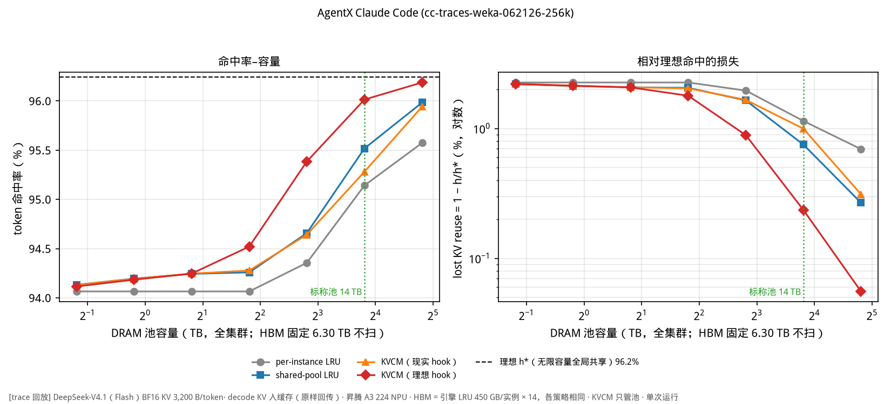
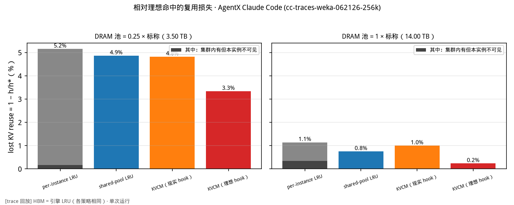
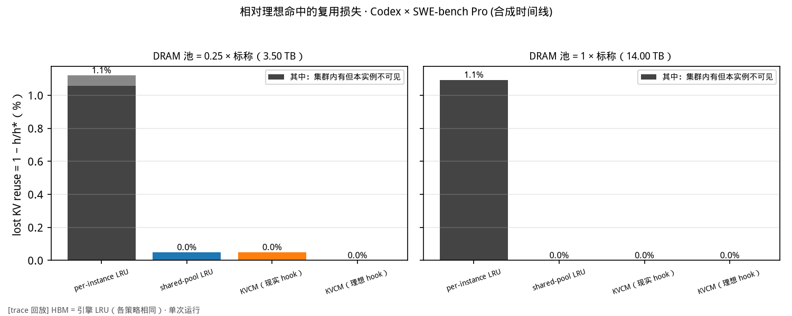

# KVCM trace 回放结果（自动生成）

由 `python3 -m kvcm_sim.report` 从 `results/*.json` 生成；参数与假设见 [`../params.md`](../params.md)，方法见 [`../README.md`](../README.md)。
全部为 **[trace 回放] + [解析]**，每个点单次运行（seed=1），无真机校准。

模型：HBM 归推理引擎：每实例 296 GB 前缀缓存、纯 LRU，所有策略相同且不随 x 轴变化；KVCM 只管 DRAM 池（停顿期池保活 + 零引用优先）。x 轴与表中“池容量”只指 DRAM 池（标称 14 TB = 14 节点 × 1 TB）。

模型规格：DeepSeek-V4.1（即 V4.1-Flash）官方 config / 技术报告，全局 KV 按 BF16 存储 3,200 B/token（官方 FP4 口径为 890 B）；decode 写出的 KV 入缓存，主结果按“下一轮原样回传上一轮输出（含思维链）”计命中，末尾附“剥掉思维链”下界对照。

HBM 预算：vLLM `gpu_memory_utilization=0.85`，每 die 64 × 0.85 − 31.9 权重 − 4 激活 = 18.5 GB，每实例 296 GB（全集群 4.15 TB）；图中黄色带 = 收益工作区间（池 ≈ 1–2× 集群 HBM = 4.1–8.3 TB）。

## AgentX Claude Code (cc-traces-weka-062126-256k)

- 负载：全规模 10871 会话/h，383.1 req/s，理想命中 h* = 96.24%；仿真切片 1/32。

### 命中率–容量（MRC）数据

| 池容量 × 标称 | 池 TB | per-instance LRU | shared-pool LRU | KVCM（现实 hook） | KVCM（理想 hook） | 理想 h* |
|---:|---:|---:|---:|---:|---:|---:|
| 0.03125 | 0.44 | 91.28% | 91.34% | 91.33% | 91.32% | 96.24% |
| 0.0625 | 0.88 | 91.28% | 91.38% | 91.39% | 91.38% | 96.24% |
| 0.125 | 1.75 | 91.28% | 91.42% | 91.45% | 91.47% | 96.24% |
| 0.25 | 3.50 | 91.28% | 91.56% | 91.60% | 93.03% | 96.24% |
| 0.2961 | 4.15 | 91.28% | 92.15% | 92.09% | 93.54% | 96.24% |
| 0.5 | 7.00 | 94.36% | 94.62% | 94.46% | 95.38% | 96.24% |
| 0.5922 | 8.29 | 94.63% | 94.94% | 94.61% | 95.65% | 96.24% |
| 1 | 14.00 | 95.14% | 95.52% | 95.28% | 96.01% | 96.24% |
| 2 | 28.00 | 95.57% | 95.98% | 95.94% | 96.19% | 96.24% |

### TTFT 与等效 NPU（DRAM 池 = 0.25 × 标称 = 3.50 TB）

A3 TTFT = 2 × 950 拟合 TTFT（token 相关项按 V4.1 prefill 激活参数比 8/49 缩放）+ 未掩盖 KV 加载；NPU 数为全规模等效的 prefill 平均占用（D8a §8.2）。

| 策略 | 命中率 | 其中 HBM | TTFT 均值 (s) | P50 | P95 | P95（池走 ROCE） | prefill 占用 NPU | 相对 per-instance 省 | 相对 shared-pool 省 |
|---|---:|---:|---:|---:|---:|---:|---:|---:|---:|
| per-instance LRU | 91.28% | 91.28% | 0.68 | 0.15 | 2.67 | 2.67 | 259.8 | +0.0 | -7.9 |
| shared-pool LRU | 91.56% | 91.28% | 0.66 | 0.14 | 2.38 | 2.38 | 251.9 | +7.9 | +0.0 |
| KVCM（无 hook） | 91.56% | 91.28% | 0.66 | 0.14 | 2.38 | 2.38 | 251.9 | +7.9 | +0.0 |
| KVCM（现实 hook） | 91.60% | 91.28% | 0.66 | 0.14 | 2.31 | 2.31 | 250.9 | +8.9 | +0.9 |
| KVCM（理想 hook） | 93.03% | 91.28% | 0.55 | 0.14 | 1.64 | 1.64 | 210.4 | +49.4 | +41.5 |

按前一停顿长度分组的复用损失（1 − h/h*，DRAM 池 = 0.25 × 标称）：

| 策略 \ 前一停顿 | first-turn（5% 请求） | <10s（82% 请求） | 10-60s（6% 请求） | 1-10min（5% 请求） | 10-60min（1% 请求） | >1h（0% 请求） |
|---|---:|---:|---:|---:|---:|---:|
| per-instance LRU | 19.3% | 0.3% | 0.4% | 44.4% | 97.4% | 96.1% |
| shared-pool LRU | 19.0% | 0.1% | 0.2% | 42.7% | 97.3% | 96.1% |
| KVCM（现实 hook） | 19.0% | 0.1% | 0.2% | 42.3% | 96.2% | 96.1% |
| KVCM（理想 hook） | 19.0% | 0.1% | 0.2% | 23.1% | 90.0% | 96.1% |

### TTFT 与等效 NPU（DRAM 池 = 1 × 标称 = 14.00 TB）

A3 TTFT = 2 × 950 拟合 TTFT（token 相关项按 V4.1 prefill 激活参数比 8/49 缩放）+ 未掩盖 KV 加载；NPU 数为全规模等效的 prefill 平均占用（D8a §8.2）。

| 策略 | 命中率 | 其中 HBM | TTFT 均值 (s) | P50 | P95 | P95（池走 ROCE） | prefill 占用 NPU | 相对 per-instance 省 | 相对 shared-pool 省 |
|---|---:|---:|---:|---:|---:|---:|---:|---:|---:|
| per-instance LRU | 95.14% | 91.03% | 0.39 | 0.14 | 1.17 | 1.17 | 148.6 | +0.0 | -10.6 |
| shared-pool LRU | 95.52% | 91.28% | 0.36 | 0.14 | 1.10 | 1.10 | 137.9 | +10.6 | +0.0 |
| KVCM（无 hook） | 95.52% | 91.28% | 0.36 | 0.14 | 1.10 | 1.10 | 137.9 | +10.6 | +0.0 |
| KVCM（现实 hook） | 95.28% | 91.28% | 0.38 | 0.14 | 1.13 | 1.13 | 144.8 | +3.8 | -6.9 |
| KVCM（理想 hook） | 96.01% | 91.28% | 0.32 | 0.14 | 1.02 | 1.02 | 123.5 | +25.1 | +14.4 |

按前一停顿长度分组的复用损失（1 − h/h*，DRAM 池 = 1 × 标称）：

| 策略 \ 前一停顿 | first-turn（5% 请求） | <10s（82% 请求） | 10-60s（6% 请求） | 1-10min（5% 请求） | 10-60min（1% 请求） | >1h（0% 请求） |
|---|---:|---:|---:|---:|---:|---:|
| per-instance LRU | 8.8% | 0.4% | 0.3% | 0.3% | 35.4% | 94.6% |
| shared-pool LRU | 8.3% | 0.0% | 0.0% | 0.0% | 30.9% | 94.6% |
| KVCM（现实 hook） | 9.0% | 0.0% | 0.0% | 0.0% | 51.5% | 92.9% |
| KVCM（理想 hook） | 5.2% | 0.0% | 0.0% | 0.0% | 0.6% | 56.4% |

### decode KV 命中口径对照：原样回传（主结果）vs 剥掉思维链（下界）

同一负载（到达率按原样回传口径校准）。剥掉思维链 = 下一轮输入不含上一轮 decode 写出的 token 序列，输出部分全部不命中。

DRAM 池 = 0.25 × 标称（3.50 TB）：

理想 h*：原样回传 96.24%，剥掉思维链 95.71%。

| 策略 | 命中率（原样回传） | 命中率（剥掉思维链） | lost reuse（原样） | lost reuse（剥掉） | prefill 占用 NPU（原样） | prefill 占用 NPU（剥掉） |
|---|---:|---:|---:|---:|---:|---:|
| per-instance LRU | 91.28% | 90.69% | 5.15% | 5.24% | 259.8 | 276.3 |
| shared-pool LRU | 91.56% | 90.94% | 4.87% | 4.98% | 251.9 | 269.3 |
| KVCM（现实 hook） | 91.60% | 90.99% | 4.82% | 4.94% | 250.9 | 268.2 |
| KVCM（理想 hook） | 93.03% | 92.46% | 3.34% | 3.39% | 210.4 | 226.1 |

DRAM 池 = 1 × 标称（14.00 TB）：

理想 h*：原样回传 96.24%，剥掉思维链 95.71%。

| 策略 | 命中率（原样回传） | 命中率（剥掉思维链） | lost reuse（原样） | lost reuse（剥掉） | prefill 占用 NPU（原样） | prefill 占用 NPU（剥掉） |
|---|---:|---:|---:|---:|---:|---:|
| per-instance LRU | 95.14% | 94.58% | 1.14% | 1.19% | 148.6 | 164.2 |
| shared-pool LRU | 95.52% | 94.99% | 0.75% | 0.75% | 137.9 | 152.6 |
| KVCM（现实 hook） | 95.28% | 94.75% | 1.00% | 1.00% | 144.8 | 159.4 |
| KVCM（理想 hook） | 96.01% | 95.48% | 0.24% | 0.24% | 123.5 | 138.2 |

### HBM 预算敏感性：296 GB/实例（主结果）vs 360 GB/实例（激活不从 0.85 预算里扣）

DRAM 池 = 0.25 × 标称（3.50 TB）：

| 策略 | 命中率（296 GB） | 命中率（360 GB） | 其中 HBM（296） | 其中 HBM（360） | prefill 占用 NPU（296） | prefill 占用 NPU（360） |
|---|---:|---:|---:|---:|---:|---:|
| per-instance LRU | 91.28% | 93.03% | 91.28% | 93.03% | 259.8 | 209.2 |
| shared-pool LRU | 91.56% | 93.21% | 91.28% | 93.03% | 251.9 | 204.3 |
| KVCM（现实 hook） | 91.60% | 93.25% | 91.28% | 93.03% | 250.9 | 203.2 |
| KVCM（理想 hook） | 93.03% | 93.93% | 91.28% | 93.03% | 210.4 | 183.9 |

DRAM 池 = 1 × 标称（14.00 TB）：

| 策略 | 命中率（296 GB） | 命中率（360 GB） | 其中 HBM（296） | 其中 HBM（360） | prefill 占用 NPU（296） | prefill 占用 NPU（360） |
|---|---:|---:|---:|---:|---:|---:|
| per-instance LRU | 95.14% | 95.14% | 91.03% | 92.74% | 148.6 | 148.6 |
| shared-pool LRU | 95.52% | 95.52% | 91.28% | 93.03% | 137.9 | 137.9 |
| KVCM（现实 hook） | 95.28% | 95.28% | 91.28% | 93.03% | 144.8 | 144.8 |
| KVCM（理想 hook） | 96.01% | 96.01% | 91.28% | 93.03% | 123.5 | 123.5 |

## Codex × SWE-bench Pro (合成时间线)

- 负载：全规模 59259 会话/h，543.0 req/s，理想命中 h* = 96.54%；仿真切片 1/32。

### 命中率–容量（MRC）数据

| 池容量 × 标称 | 池 TB | per-instance LRU | shared-pool LRU | KVCM（现实 hook） | KVCM（理想 hook） | 理想 h* |
|---:|---:|---:|---:|---:|---:|---:|
| 0.03125 | 0.44 | 95.46% | 95.58% | 95.64% | 95.64% | 96.54% |
| 0.0625 | 0.88 | 95.46% | 95.78% | 95.86% | 95.84% | 96.54% |
| 0.125 | 1.75 | 95.46% | 96.26% | 96.25% | 96.21% | 96.54% |
| 0.25 | 3.50 | 95.46% | 96.49% | 96.49% | 96.54% | 96.54% |
| 0.2961 | 4.15 | 95.46% | 96.51% | 96.51% | 96.54% | 96.54% |
| 0.5 | 7.00 | 95.50% | 96.54% | 96.54% | 96.54% | 96.54% |
| 0.5922 | 8.29 | 95.48% | 96.54% | 96.54% | 96.54% | 96.54% |
| 1 | 14.00 | 95.48% | 96.54% | 96.54% | 96.54% | 96.54% |
| 2 | 28.00 | 95.48% | 96.54% | 96.54% | 96.54% | 96.54% |

### TTFT 与等效 NPU（DRAM 池 = 0.25 × 标称 = 3.50 TB）

A3 TTFT = 2 × 950 拟合 TTFT（token 相关项按 V4.1 prefill 激活参数比 8/49 缩放）+ 未掩盖 KV 加载；NPU 数为全规模等效的 prefill 平均占用（D8a §8.2）。

| 策略 | 命中率 | 其中 HBM | TTFT 均值 (s) | P50 | P95 | P95（池走 ROCE） | prefill 占用 NPU | 相对 per-instance 省 | 相对 shared-pool 省 |
|---|---:|---:|---:|---:|---:|---:|---:|---:|---:|
| per-instance LRU | 95.46% | 95.46% | 0.26 | 0.10 | 0.70 | 0.70 | 139.8 | +0.0 | -26.5 |
| shared-pool LRU | 96.49% | 95.46% | 0.21 | 0.10 | 0.68 | 0.68 | 113.2 | +26.5 | +0.0 |
| KVCM（无 hook） | 96.49% | 95.46% | 0.21 | 0.10 | 0.68 | 0.68 | 113.2 | +26.5 | +0.0 |
| KVCM（现实 hook） | 96.49% | 95.46% | 0.21 | 0.10 | 0.68 | 0.68 | 113.2 | +26.5 | -0.0 |
| KVCM（理想 hook） | 96.54% | 95.46% | 0.21 | 0.10 | 0.67 | 0.67 | 112.0 | +27.8 | +1.3 |

按前一停顿长度分组的复用损失（1 − h/h*，DRAM 池 = 0.25 × 标称）：

| 策略 \ 前一停顿 | first-turn（3% 请求） | <10s（70% 请求） | 10-60s（26% 请求） | 1-10min（2% 请求） | 10-60min（0% 请求） | >1h（0% 请求） |
|---|---:|---:|---:|---:|---:|---:|
| per-instance LRU | 0.0% | 1.1% | 1.1% | 4.9% | — | — |
| shared-pool LRU | 0.0% | 0.0% | 0.0% | 3.0% | — | — |
| KVCM（现实 hook） | 0.0% | 0.0% | 0.0% | 3.0% | — | — |
| KVCM（理想 hook） | 0.0% | 0.0% | 0.0% | 0.0% | — | — |

### TTFT 与等效 NPU（DRAM 池 = 1 × 标称 = 14.00 TB）

A3 TTFT = 2 × 950 拟合 TTFT（token 相关项按 V4.1 prefill 激活参数比 8/49 缩放）+ 未掩盖 KV 加载；NPU 数为全规模等效的 prefill 平均占用（D8a §8.2）。

| 策略 | 命中率 | 其中 HBM | TTFT 均值 (s) | P50 | P95 | P95（池走 ROCE） | prefill 占用 NPU | 相对 per-instance 省 | 相对 shared-pool 省 |
|---|---:|---:|---:|---:|---:|---:|---:|---:|---:|
| per-instance LRU | 95.48% | 95.41% | 0.26 | 0.10 | 0.70 | 0.70 | 139.0 | +0.0 | -27.0 |
| shared-pool LRU | 96.54% | 95.46% | 0.21 | 0.10 | 0.67 | 0.67 | 112.0 | +27.0 | +0.0 |
| KVCM（无 hook） | 96.54% | 95.46% | 0.21 | 0.10 | 0.67 | 0.67 | 112.0 | +27.0 | +0.0 |
| KVCM（现实 hook） | 96.54% | 95.46% | 0.21 | 0.10 | 0.67 | 0.67 | 112.0 | +27.0 | +0.0 |
| KVCM（理想 hook） | 96.54% | 95.46% | 0.21 | 0.10 | 0.67 | 0.67 | 112.0 | +27.0 | +0.0 |

按前一停顿长度分组的复用损失（1 − h/h*，DRAM 池 = 1 × 标称）：

| 策略 \ 前一停顿 | first-turn（3% 请求） | <10s（70% 请求） | 10-60s（26% 请求） | 1-10min（2% 请求） | 10-60min（0% 请求） | >1h（0% 请求） |
|---|---:|---:|---:|---:|---:|---:|
| per-instance LRU | 0.0% | 1.1% | 1.1% | 1.3% | — | — |
| shared-pool LRU | 0.0% | 0.0% | 0.0% | 0.0% | — | — |
| KVCM（现实 hook） | 0.0% | 0.0% | 0.0% | 0.0% | — | — |
| KVCM（理想 hook） | 0.0% | 0.0% | 0.0% | 0.0% | — | — |

### decode KV 命中口径对照：原样回传（主结果）vs 剥掉思维链（下界）

同一负载（到达率按原样回传口径校准）。剥掉思维链 = 下一轮输入不含上一轮 decode 写出的 token 序列，输出部分全部不命中。

DRAM 池 = 0.25 × 标称（3.50 TB）：

理想 h*：原样回传 96.54%，剥掉思维链 95.92%。

| 策略 | 命中率（原样回传） | 命中率（剥掉思维链） | lost reuse（原样） | lost reuse（剥掉） | prefill 占用 NPU（原样） | prefill 占用 NPU（剥掉） |
|---|---:|---:|---:|---:|---:|---:|
| per-instance LRU | 95.46% | 94.78% | 1.12% | 1.18% | 139.8 | 156.6 |
| shared-pool LRU | 96.49% | 95.82% | 0.05% | 0.10% | 113.2 | 129.9 |
| KVCM（现实 hook） | 96.49% | 95.83% | 0.05% | 0.10% | 113.2 | 129.8 |
| KVCM（理想 hook） | 96.54% | 95.92% | 0.00% | 0.00% | 112.0 | 127.4 |

DRAM 池 = 1 × 标称（14.00 TB）：

理想 h*：原样回传 96.54%，剥掉思维链 95.92%。

| 策略 | 命中率（原样回传） | 命中率（剥掉思维链） | lost reuse（原样） | lost reuse（剥掉） | prefill 占用 NPU（原样） | prefill 占用 NPU（剥掉） |
|---|---:|---:|---:|---:|---:|---:|
| per-instance LRU | 95.48% | 94.86% | 1.09% | 1.10% | 139.0 | 154.5 |
| shared-pool LRU | 96.54% | 95.92% | 0.00% | 0.00% | 112.0 | 127.4 |
| KVCM（现实 hook） | 96.54% | 95.92% | 0.00% | 0.00% | 112.0 | 127.4 |
| KVCM（理想 hook） | 96.54% | 95.92% | 0.00% | 0.00% | 112.0 | 127.4 |

### HBM 预算敏感性：296 GB/实例（主结果）vs 360 GB/实例（激活不从 0.85 预算里扣）

DRAM 池 = 0.25 × 标称（3.50 TB）：

| 策略 | 命中率（296 GB） | 命中率（360 GB） | 其中 HBM（296） | 其中 HBM（360） | prefill 占用 NPU（296） | prefill 占用 NPU（360） |
|---|---:|---:|---:|---:|---:|---:|
| per-instance LRU | 95.46% | 95.48% | 95.46% | 95.48% | 139.8 | 139.2 |
| shared-pool LRU | 96.49% | 96.52% | 95.46% | 95.48% | 113.2 | 112.5 |
| KVCM（现实 hook） | 96.49% | 96.52% | 95.46% | 95.48% | 113.2 | 112.5 |
| KVCM（理想 hook） | 96.54% | 96.54% | 95.46% | 95.48% | 112.0 | 112.0 |

DRAM 池 = 1 × 标称（14.00 TB）：

| 策略 | 命中率（296 GB） | 命中率（360 GB） | 其中 HBM（296） | 其中 HBM（360） | prefill 占用 NPU（296） | prefill 占用 NPU（360） |
|---|---:|---:|---:|---:|---:|---:|
| per-instance LRU | 95.48% | 95.48% | 95.41% | 95.46% | 139.0 | 139.0 |
| shared-pool LRU | 96.54% | 96.54% | 95.46% | 95.48% | 112.0 | 112.0 |
| KVCM（现实 hook） | 96.54% | 96.54% | 95.46% | 95.48% | 112.0 | 112.0 |
| KVCM（理想 hook） | 96.54% | 96.54% | 95.46% | 95.48% | 112.0 | 112.0 |

## Qwen-Bailian coder

- 负载：全规模 1626604 会话/h，735.7 req/s，理想命中 h* = 70.97%；仿真切片 1/32。

### 命中率–容量（MRC）数据

| 池容量 × 标称 | 池 TB | per-instance LRU | shared-pool LRU | KVCM（现实 hook） | KVCM（理想 hook） | 理想 h* |
|---:|---:|---:|---:|---:|---:|---:|
| 0.03125 | 0.44 | 64.71% | 64.71% | 64.73% | 64.71% | 70.97% |
| 0.0625 | 0.88 | 64.71% | 64.71% | 64.76% | 64.75% | 70.97% |
| 0.125 | 1.75 | 64.71% | 64.71% | 64.85% | 68.51% | 70.97% |
| 0.25 | 3.50 | 64.71% | 64.82% | 65.12% | 68.52% | 70.97% |
| 0.2961 | 4.15 | 64.71% | 65.11% | 65.41% | 68.56% | 70.97% |
| 0.5 | 7.00 | 68.19% | 68.18% | 68.14% | 69.87% | 70.97% |
| 0.5922 | 8.29 | 68.99% | 68.96% | 68.69% | 70.24% | 70.97% |
| 1 | 14.00 | 70.45% | 70.48% | 69.85% | 70.83% | 70.97% |
| 2 | 28.00 | 70.94% | 70.95% | 70.93% | 70.96% | 70.97% |

### TTFT 与等效 NPU（DRAM 池 = 0.25 × 标称 = 3.50 TB）

A3 TTFT = 2 × 950 拟合 TTFT（token 相关项按 V4.1 prefill 激活参数比 8/49 缩放）+ 未掩盖 KV 加载；NPU 数为全规模等效的 prefill 平均占用（D8a §8.2）。

| 策略 | 命中率 | 其中 HBM | TTFT 均值 (s) | P50 | P95 | P95（池走 ROCE） | prefill 占用 NPU | 相对 per-instance 省 | 相对 shared-pool 省 |
|---|---:|---:|---:|---:|---:|---:|---:|---:|---:|
| per-instance LRU | 64.71% | 64.71% | 0.17 | 0.09 | 0.62 | 0.62 | 127.7 | +0.0 | -0.3 |
| shared-pool LRU | 64.82% | 64.71% | 0.17 | 0.09 | 0.62 | 0.62 | 127.4 | +0.3 | +0.0 |
| KVCM（无 hook） | 64.82% | 64.71% | 0.17 | 0.09 | 0.62 | 0.62 | 127.4 | +0.3 | +0.0 |
| KVCM（现实 hook） | 65.12% | 64.71% | 0.17 | 0.08 | 0.62 | 0.62 | 126.6 | +1.0 | +0.8 |
| KVCM（理想 hook） | 68.52% | 64.71% | 0.16 | 0.08 | 0.59 | 0.59 | 118.0 | +9.7 | +9.4 |

按前一停顿长度分组的复用损失（1 − h/h*，DRAM 池 = 0.25 × 标称）：

| 策略 \ 前一停顿 | first-turn（62% 请求） | <10s（6% 请求） | 10-60s（9% 请求） | 1-10min（17% 请求） | 10-60min（5% 请求） | >1h（0% 请求） |
|---|---:|---:|---:|---:|---:|---:|
| per-instance LRU | 6.7% | 0.0% | 0.0% | 0.9% | 78.5% | 97.5% |
| shared-pool LRU | 6.6% | 0.0% | 0.0% | 0.4% | 78.5% | 97.5% |
| KVCM（现实 hook） | 6.0% | 0.0% | 0.0% | 0.6% | 76.1% | 97.2% |
| KVCM（理想 hook） | 6.6% | 0.0% | 0.0% | 0.1% | 0.2% | 0.0% |

### TTFT 与等效 NPU（DRAM 池 = 1 × 标称 = 14.00 TB）

A3 TTFT = 2 × 950 拟合 TTFT（token 相关项按 V4.1 prefill 激活参数比 8/49 缩放）+ 未掩盖 KV 加载；NPU 数为全规模等效的 prefill 平均占用（D8a §8.2）。

| 策略 | 命中率 | 其中 HBM | TTFT 均值 (s) | P50 | P95 | P95（池走 ROCE） | prefill 占用 NPU | 相对 per-instance 省 | 相对 shared-pool 省 |
|---|---:|---:|---:|---:|---:|---:|---:|---:|---:|
| per-instance LRU | 70.45% | 64.61% | 0.15 | 0.08 | 0.56 | 0.56 | 113.1 | +0.0 | -0.1 |
| shared-pool LRU | 70.48% | 64.71% | 0.15 | 0.08 | 0.56 | 0.56 | 113.0 | +0.1 | +0.0 |
| KVCM（无 hook） | 70.48% | 64.71% | 0.15 | 0.08 | 0.56 | 0.56 | 113.0 | +0.1 | +0.0 |
| KVCM（现实 hook） | 69.85% | 64.71% | 0.16 | 0.08 | 0.57 | 0.57 | 114.6 | -1.5 | -1.6 |
| KVCM（理想 hook） | 70.83% | 64.71% | 0.15 | 0.08 | 0.56 | 0.56 | 112.1 | +1.0 | +0.9 |

按前一停顿长度分组的复用损失（1 − h/h*，DRAM 池 = 1 × 标称）：

| 策略 \ 前一停顿 | first-turn（62% 请求） | <10s（6% 请求） | 10-60s（9% 请求） | 1-10min（17% 请求） | 10-60min（5% 请求） | >1h（0% 请求） |
|---|---:|---:|---:|---:|---:|---:|
| per-instance LRU | 0.4% | 0.0% | 0.0% | 0.0% | 3.7% | 94.7% |
| shared-pool LRU | 0.4% | 0.0% | 0.0% | 0.0% | 3.1% | 96.6% |
| KVCM（现实 hook） | 1.0% | 0.0% | 0.0% | 0.0% | 12.6% | 88.1% |
| KVCM（理想 hook） | 0.4% | 0.0% | 0.0% | 0.0% | 0.0% | 0.0% |

### decode KV 命中口径对照：原样回传（主结果）vs 剥掉思维链（下界）

同一负载（到达率按原样回传口径校准）。剥掉思维链 = 下一轮输入不含上一轮 decode 写出的 token 序列，输出部分全部不命中。

DRAM 池 = 0.25 × 标称（3.50 TB）：

理想 h*：原样回传 70.97%，剥掉思维链 66.31%。

| 策略 | 命中率（原样回传） | 命中率（剥掉思维链） | lost reuse（原样） | lost reuse（剥掉） | prefill 占用 NPU（原样） | prefill 占用 NPU（剥掉） |
|---|---:|---:|---:|---:|---:|---:|
| per-instance LRU | 64.71% | 60.99% | 8.82% | 8.03% | 127.7 | 137.1 |
| shared-pool LRU | 64.82% | 61.06% | 8.66% | 7.92% | 127.4 | 136.9 |
| KVCM（现实 hook） | 65.12% | 61.37% | 8.24% | 7.46% | 126.6 | 136.1 |
| KVCM（理想 hook） | 68.52% | 63.97% | 3.45% | 3.54% | 118.0 | 129.5 |

DRAM 池 = 1 × 标称（14.00 TB）：

理想 h*：原样回传 70.97%，剥掉思维链 66.31%。

| 策略 | 命中率（原样回传） | 命中率（剥掉思维链） | lost reuse（原样） | lost reuse（剥掉） | prefill 占用 NPU（原样） | prefill 占用 NPU（剥掉） |
|---|---:|---:|---:|---:|---:|---:|
| per-instance LRU | 70.45% | 65.89% | 0.73% | 0.63% | 113.1 | 124.6 |
| shared-pool LRU | 70.48% | 65.92% | 0.69% | 0.60% | 113.0 | 124.5 |
| KVCM（现实 hook） | 69.85% | 65.42% | 1.57% | 1.35% | 114.6 | 125.8 |
| KVCM（理想 hook） | 70.83% | 66.18% | 0.20% | 0.20% | 112.1 | 123.9 |

### HBM 预算敏感性：296 GB/实例（主结果）vs 360 GB/实例（激活不从 0.85 预算里扣）

DRAM 池 = 0.25 × 标称（3.50 TB）：

| 策略 | 命中率（296 GB） | 命中率（360 GB） | 其中 HBM（296） | 其中 HBM（360） | prefill 占用 NPU（296） | prefill 占用 NPU（360） |
|---|---:|---:|---:|---:|---:|---:|
| per-instance LRU | 64.71% | 66.20% | 64.71% | 66.20% | 127.7 | 123.9 |
| shared-pool LRU | 64.82% | 66.20% | 64.71% | 66.20% | 127.4 | 123.9 |
| KVCM（现实 hook） | 65.12% | 66.40% | 64.71% | 66.20% | 126.6 | 123.4 |
| KVCM（理想 hook） | 68.52% | 69.15% | 64.71% | 66.20% | 118.0 | 116.4 |

DRAM 池 = 1 × 标称（14.00 TB）：

| 策略 | 命中率（296 GB） | 命中率（360 GB） | 其中 HBM（296） | 其中 HBM（360） | prefill 占用 NPU（296） | prefill 占用 NPU（360） |
|---|---:|---:|---:|---:|---:|---:|
| per-instance LRU | 70.45% | 70.45% | 64.61% | 66.11% | 113.1 | 113.1 |
| shared-pool LRU | 70.48% | 70.48% | 64.71% | 66.20% | 113.0 | 113.0 |
| KVCM（现实 hook） | 69.85% | 69.86% | 64.71% | 66.20% | 114.6 | 114.6 |
| KVCM（理想 hook） | 70.83% | 70.83% | 64.71% | 66.20% | 112.1 | 112.1 |

## PD 转换实验（单独生成，不由 `kvcm_sim.report` 管理）

E1 窗口级流体模型、E4 切换代价、S5 配比阶跃下逐次阶跃的过载分钟（有池 vs 无池）、“无池快切·丢 KV 重算”档与 Evolving Infra 统计判据控制器对照见 [`pd/summary.md`](pd/summary.md)（由 `PYTHONPATH=. python3 -m pd.run` 生成）。
