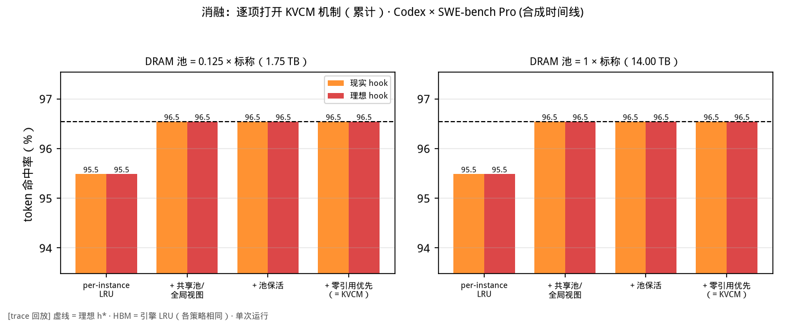
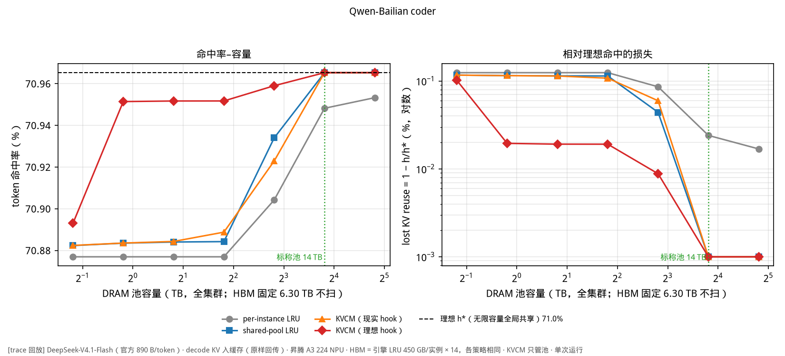

# KVCM trace 回放结果（自动生成）

由 `python3 -m kvcm_sim.report` 从 `results/*.json` 生成；参数与假设见 [`../params.md`](../params.md)，方法见 [`../README.md`](../README.md)。
全部为 **[trace 回放] + [解析]**，每个点单次运行（seed=1），无真机校准。

模型：HBM 归推理引擎：每实例 450 GB 前缀缓存、纯 LRU，所有策略相同且不随 x 轴变化；KVCM 只管 DRAM 池（停顿期池保活 + 零引用优先）。x 轴与表中“池容量”只指 DRAM 池（标称 14 TB = 14 节点 × 1 TB）。

模型规格：DeepSeek-V4.1-Flash 官方 config / 技术报告，全局 KV 890 B/token；decode 写出的 KV 入缓存，主结果按“下一轮原样回传上一轮输出（含思维链）”计命中，末尾附“剥掉思维链”下界对照。

## AgentX Claude Code (cc-traces-weka-062126-256k)

- 负载：全规模 10871 会话/h，383.1 req/s，理想命中 h* = 96.24%；仿真切片 1/32。

### 命中率–容量（MRC）数据

| 池容量 × 标称 | 池 TB | per-instance LRU | shared-pool LRU | KVCM（现实 hook） | KVCM（理想 hook） | 理想 h* |
|---:|---:|---:|---:|---:|---:|---:|
| 0.03125 | 0.44 | 95.48% | 95.76% | 95.76% | 95.77% | 96.24% |
| 0.0625 | 0.88 | 95.48% | 95.79% | 95.79% | 95.80% | 96.24% |
| 0.125 | 1.75 | 95.48% | 95.81% | 95.81% | 95.82% | 96.24% |
| 0.25 | 3.50 | 95.48% | 95.82% | 95.83% | 96.00% | 96.24% |
| 0.5 | 7.00 | 95.47% | 95.93% | 95.90% | 96.16% | 96.24% |
| 1 | 14.00 | 95.81% | 96.17% | 96.16% | 96.24% | 96.24% |
| 2 | 28.00 | 95.79% | 96.24% | 96.23% | 96.24% | 96.24% |

### TTFT 与等效 NPU（DRAM 池 = 0.125 × 标称 = 1.75 TB）

A3 TTFT = 2 × 950 拟合 TTFT（token 相关项按 V4.1 prefill 激活参数比 8/49 缩放）+ 未掩盖 KV 加载；NPU 数为全规模等效的 prefill 平均占用（D8a §8.2）。

| 策略 | 命中率 | 其中 HBM | TTFT 均值 (s) | P50 | P95 | P95（池走 ROCE） | prefill 占用 NPU | 相对 per-instance 省 | 相对 shared-pool 省 |
|---|---:|---:|---:|---:|---:|---:|---:|---:|---:|
| per-instance LRU | 95.48% | 95.48% | 0.36 | 0.14 | 1.11 | 1.11 | 138.9 | +0.0 | -9.5 |
| shared-pool LRU | 95.81% | 95.48% | 0.34 | 0.14 | 1.05 | 1.05 | 129.4 | +9.5 | +0.0 |
| KVCM（无 hook） | 95.81% | 95.48% | 0.34 | 0.14 | 1.05 | 1.05 | 129.4 | +9.5 | +0.0 |
| KVCM（现实 hook） | 95.81% | 95.48% | 0.34 | 0.14 | 1.05 | 1.05 | 129.4 | +9.5 | +0.0 |
| KVCM（理想 hook） | 95.82% | 95.48% | 0.34 | 0.14 | 1.05 | 1.05 | 129.2 | +9.7 | +0.2 |

按前一停顿长度分组的复用损失（1 − h/h*，DRAM 池 = 0.125 × 标称）：

| 策略 \ 前一停顿 | first-turn（5% 请求） | <10s（82% 请求） | 10-60s（6% 请求） | 1-10min（5% 请求） | 10-60min（1% 请求） | >1h（0% 请求） |
|---|---:|---:|---:|---:|---:|---:|
| per-instance LRU | 5.8% | 0.4% | 0.4% | 0.4% | 9.2% | 91.8% |
| shared-pool LRU | 5.4% | 0.0% | 0.0% | 0.0% | 9.2% | 91.8% |
| KVCM（现实 hook） | 5.4% | 0.0% | 0.0% | 0.0% | 9.1% | 91.8% |
| KVCM（理想 hook） | 5.4% | 0.0% | 0.0% | 0.0% | 8.8% | 91.8% |

### TTFT 与等效 NPU（DRAM 池 = 0.25 × 标称 = 3.50 TB）

A3 TTFT = 2 × 950 拟合 TTFT（token 相关项按 V4.1 prefill 激活参数比 8/49 缩放）+ 未掩盖 KV 加载；NPU 数为全规模等效的 prefill 平均占用（D8a §8.2）。

| 策略 | 命中率 | 其中 HBM | TTFT 均值 (s) | P50 | P95 | P95（池走 ROCE） | prefill 占用 NPU | 相对 per-instance 省 | 相对 shared-pool 省 |
|---|---:|---:|---:|---:|---:|---:|---:|---:|---:|
| per-instance LRU | 95.48% | 95.48% | 0.36 | 0.14 | 1.11 | 1.11 | 138.9 | +0.0 | -9.7 |
| shared-pool LRU | 95.82% | 95.48% | 0.34 | 0.14 | 1.05 | 1.05 | 129.2 | +9.7 | +0.0 |
| KVCM（现实 hook） | 95.83% | 95.48% | 0.34 | 0.14 | 1.04 | 1.04 | 128.8 | +10.0 | +0.4 |
| KVCM（理想 hook） | 96.00% | 95.48% | 0.32 | 0.14 | 1.02 | 1.02 | 124.0 | +14.8 | +5.2 |

按前一停顿长度分组的复用损失（1 − h/h*，DRAM 池 = 0.25 × 标称）：

| 策略 \ 前一停顿 | first-turn（5% 请求） | <10s（82% 请求） | 10-60s（6% 请求） | 1-10min（5% 请求） | 10-60min（1% 请求） | >1h（0% 请求） |
|---|---:|---:|---:|---:|---:|---:|
| per-instance LRU | 5.8% | 0.4% | 0.4% | 0.4% | 9.2% | 91.8% |
| shared-pool LRU | 5.4% | 0.0% | 0.0% | 0.0% | 8.9% | 91.8% |
| KVCM（现实 hook） | 5.3% | 0.0% | 0.0% | 0.0% | 8.5% | 89.3% |
| KVCM（理想 hook） | 5.0% | 0.0% | 0.0% | 0.0% | 0.6% | 64.3% |

### TTFT 与等效 NPU（DRAM 池 = 1 × 标称 = 14.00 TB）

A3 TTFT = 2 × 950 拟合 TTFT（token 相关项按 V4.1 prefill 激活参数比 8/49 缩放）+ 未掩盖 KV 加载；NPU 数为全规模等效的 prefill 平均占用（D8a §8.2）。

| 策略 | 命中率 | 其中 HBM | TTFT 均值 (s) | P50 | P95 | P95（池走 ROCE） | prefill 占用 NPU | 相对 per-instance 省 | 相对 shared-pool 省 |
|---|---:|---:|---:|---:|---:|---:|---:|---:|---:|
| per-instance LRU | 95.81% | 95.48% | 0.34 | 0.14 | 1.05 | 1.05 | 129.1 | +0.0 | -10.0 |
| shared-pool LRU | 96.17% | 95.48% | 0.31 | 0.13 | 0.99 | 0.99 | 119.1 | +10.0 | +0.0 |
| KVCM（无 hook） | 96.17% | 95.48% | 0.31 | 0.13 | 0.99 | 0.99 | 119.1 | +10.0 | +0.0 |
| KVCM（现实 hook） | 96.16% | 95.48% | 0.31 | 0.13 | 0.99 | 0.99 | 119.5 | +9.7 | -0.3 |
| KVCM（理想 hook） | 96.24% | 95.48% | 0.31 | 0.13 | 0.97 | 0.97 | 117.2 | +11.9 | +2.0 |

按前一停顿长度分组的复用损失（1 − h/h*，DRAM 池 = 1 × 标称）：

| 策略 \ 前一停顿 | first-turn（5% 请求） | <10s（82% 请求） | 10-60s（6% 请求） | 1-10min（5% 请求） | 10-60min（1% 请求） | >1h（0% 请求） |
|---|---:|---:|---:|---:|---:|---:|
| per-instance LRU | 2.1% | 0.4% | 0.3% | 0.3% | 0.5% | 25.3% |
| shared-pool LRU | 1.5% | 0.0% | 0.0% | 0.0% | 0.2% | 20.0% |
| KVCM（现实 hook） | 1.7% | 0.0% | 0.0% | 0.0% | 0.1% | 23.0% |
| KVCM（理想 hook） | 0.0% | 0.0% | 0.0% | 0.0% | 0.0% | 0.0% |

### decode KV 命中口径对照：原样回传（主结果）vs 剥掉思维链（下界）

同一负载（到达率按原样回传口径校准）。剥掉思维链 = 下一轮输入不含上一轮 decode 写出的 token 序列，输出部分全部不命中。

DRAM 池 = 0.125 × 标称（1.75 TB）：

理想 h*：原样回传 96.24%，剥掉思维链 95.71%。

| 策略 | 命中率（原样回传） | 命中率（剥掉思维链） | lost reuse（原样） | lost reuse（剥掉） | prefill 占用 NPU（原样） | prefill 占用 NPU（剥掉） |
|---|---:|---:|---:|---:|---:|---:|
| per-instance LRU | 95.48% | 94.93% | 0.80% | 0.81% | 138.9 | 154.0 |
| shared-pool LRU | 95.81% | 95.29% | 0.44% | 0.44% | 129.4 | 143.9 |
| KVCM（现实 hook） | 95.81% | 95.29% | 0.44% | 0.44% | 129.4 | 143.9 |
| KVCM（理想 hook） | 95.82% | 95.30% | 0.44% | 0.43% | 129.2 | 143.7 |

DRAM 池 = 1 × 标称（14.00 TB）：

理想 h*：原样回传 96.24%，剥掉思维链 95.71%。

| 策略 | 命中率（原样回传） | 命中率（剥掉思维链） | lost reuse（原样） | lost reuse（剥掉） | prefill 占用 NPU（原样） | prefill 占用 NPU（剥掉） |
|---|---:|---:|---:|---:|---:|---:|
| per-instance LRU | 95.81% | 95.25% | 0.44% | 0.48% | 129.1 | 144.8 |
| shared-pool LRU | 96.17% | 95.64% | 0.07% | 0.07% | 119.1 | 133.9 |
| KVCM（现实 hook） | 96.16% | 95.63% | 0.09% | 0.08% | 119.5 | 134.2 |
| KVCM（理想 hook） | 96.24% | 95.71% | 0.00% | 0.00% | 117.2 | 131.9 |

## Codex × SWE-bench Pro (合成时间线)

- 负载：全规模 59259 会话/h，543.0 req/s，理想命中 h* = 96.54%；仿真切片 1/32。

### 命中率–容量（MRC）数据

| 池容量 × 标称 | 池 TB | per-instance LRU | shared-pool LRU | KVCM（现实 hook） | KVCM（理想 hook） | 理想 h* |
|---:|---:|---:|---:|---:|---:|---:|
| 0.03125 | 0.44 | 95.48% | 96.24% | 96.23% | 96.19% | 96.54% |
| 0.0625 | 0.88 | 95.48% | 96.54% | 96.54% | 96.54% | 96.54% |
| 0.125 | 1.75 | 95.48% | 96.54% | 96.54% | 96.54% | 96.54% |
| 0.25 | 3.50 | 95.48% | 96.54% | 96.54% | 96.54% | 96.54% |
| 0.5 | 7.00 | 95.48% | 96.54% | 96.54% | 96.54% | 96.54% |
| 1 | 14.00 | 95.48% | 96.54% | 96.54% | 96.54% | 96.54% |
| 2 | 28.00 | 95.48% | 96.54% | 96.54% | 96.54% | 96.54% |

### TTFT 与等效 NPU（DRAM 池 = 0.125 × 标称 = 1.75 TB）

A3 TTFT = 2 × 950 拟合 TTFT（token 相关项按 V4.1 prefill 激活参数比 8/49 缩放）+ 未掩盖 KV 加载；NPU 数为全规模等效的 prefill 平均占用（D8a §8.2）。

| 策略 | 命中率 | 其中 HBM | TTFT 均值 (s) | P50 | P95 | P95（池走 ROCE） | prefill 占用 NPU | 相对 per-instance 省 | 相对 shared-pool 省 |
|---|---:|---:|---:|---:|---:|---:|---:|---:|---:|
| per-instance LRU | 95.48% | 95.48% | 0.26 | 0.10 | 0.70 | 0.70 | 139.0 | +0.0 | -27.0 |
| shared-pool LRU | 96.54% | 95.48% | 0.21 | 0.10 | 0.67 | 0.67 | 112.0 | +27.0 | +0.0 |
| KVCM（无 hook） | 96.54% | 95.48% | 0.21 | 0.10 | 0.67 | 0.67 | 112.0 | +27.0 | +0.0 |
| KVCM（现实 hook） | 96.54% | 95.48% | 0.21 | 0.10 | 0.67 | 0.67 | 112.0 | +27.0 | +0.0 |
| KVCM（理想 hook） | 96.54% | 95.48% | 0.21 | 0.10 | 0.67 | 0.67 | 112.0 | +27.0 | +0.0 |

按前一停顿长度分组的复用损失（1 − h/h*，DRAM 池 = 0.125 × 标称）：

| 策略 \ 前一停顿 | first-turn（3% 请求） | <10s（70% 请求） | 10-60s（26% 请求） | 1-10min（2% 请求） | 10-60min（0% 请求） | >1h（0% 请求） |
|---|---:|---:|---:|---:|---:|---:|
| per-instance LRU | 0.0% | 1.1% | 1.1% | 1.3% | — | — |
| shared-pool LRU | 0.0% | 0.0% | 0.0% | 0.0% | — | — |
| KVCM（现实 hook） | 0.0% | 0.0% | 0.0% | 0.0% | — | — |
| KVCM（理想 hook） | 0.0% | 0.0% | 0.0% | 0.0% | — | — |

### TTFT 与等效 NPU（DRAM 池 = 0.25 × 标称 = 3.50 TB）

A3 TTFT = 2 × 950 拟合 TTFT（token 相关项按 V4.1 prefill 激活参数比 8/49 缩放）+ 未掩盖 KV 加载；NPU 数为全规模等效的 prefill 平均占用（D8a §8.2）。

| 策略 | 命中率 | 其中 HBM | TTFT 均值 (s) | P50 | P95 | P95（池走 ROCE） | prefill 占用 NPU | 相对 per-instance 省 | 相对 shared-pool 省 |
|---|---:|---:|---:|---:|---:|---:|---:|---:|---:|
| per-instance LRU | 95.48% | 95.48% | 0.26 | 0.10 | 0.70 | 0.70 | 139.0 | +0.0 | -27.0 |
| shared-pool LRU | 96.54% | 95.48% | 0.21 | 0.10 | 0.67 | 0.67 | 112.0 | +27.0 | +0.0 |
| KVCM（现实 hook） | 96.54% | 95.48% | 0.21 | 0.10 | 0.67 | 0.67 | 112.0 | +27.0 | +0.0 |
| KVCM（理想 hook） | 96.54% | 95.48% | 0.21 | 0.10 | 0.67 | 0.67 | 112.0 | +27.0 | +0.0 |

按前一停顿长度分组的复用损失（1 − h/h*，DRAM 池 = 0.25 × 标称）：

| 策略 \ 前一停顿 | first-turn（3% 请求） | <10s（70% 请求） | 10-60s（26% 请求） | 1-10min（2% 请求） | 10-60min（0% 请求） | >1h（0% 请求） |
|---|---:|---:|---:|---:|---:|---:|
| per-instance LRU | 0.0% | 1.1% | 1.1% | 1.3% | — | — |
| shared-pool LRU | 0.0% | 0.0% | 0.0% | 0.0% | — | — |
| KVCM（现实 hook） | 0.0% | 0.0% | 0.0% | 0.0% | — | — |
| KVCM（理想 hook） | 0.0% | 0.0% | 0.0% | 0.0% | — | — |

### TTFT 与等效 NPU（DRAM 池 = 1 × 标称 = 14.00 TB）

A3 TTFT = 2 × 950 拟合 TTFT（token 相关项按 V4.1 prefill 激活参数比 8/49 缩放）+ 未掩盖 KV 加载；NPU 数为全规模等效的 prefill 平均占用（D8a §8.2）。

| 策略 | 命中率 | 其中 HBM | TTFT 均值 (s) | P50 | P95 | P95（池走 ROCE） | prefill 占用 NPU | 相对 per-instance 省 | 相对 shared-pool 省 |
|---|---:|---:|---:|---:|---:|---:|---:|---:|---:|
| per-instance LRU | 95.48% | 95.48% | 0.26 | 0.10 | 0.70 | 0.70 | 139.0 | +0.0 | -27.0 |
| shared-pool LRU | 96.54% | 95.48% | 0.21 | 0.10 | 0.67 | 0.67 | 112.0 | +27.0 | +0.0 |
| KVCM（无 hook） | 96.54% | 95.48% | 0.21 | 0.10 | 0.67 | 0.67 | 112.0 | +27.0 | +0.0 |
| KVCM（现实 hook） | 96.54% | 95.48% | 0.21 | 0.10 | 0.67 | 0.67 | 112.0 | +27.0 | +0.0 |
| KVCM（理想 hook） | 96.54% | 95.48% | 0.21 | 0.10 | 0.67 | 0.67 | 112.0 | +27.0 | +0.0 |

按前一停顿长度分组的复用损失（1 − h/h*，DRAM 池 = 1 × 标称）：

| 策略 \ 前一停顿 | first-turn（3% 请求） | <10s（70% 请求） | 10-60s（26% 请求） | 1-10min（2% 请求） | 10-60min（0% 请求） | >1h（0% 请求） |
|---|---:|---:|---:|---:|---:|---:|
| per-instance LRU | 0.0% | 1.1% | 1.1% | 1.3% | — | — |
| shared-pool LRU | 0.0% | 0.0% | 0.0% | 0.0% | — | — |
| KVCM（现实 hook） | 0.0% | 0.0% | 0.0% | 0.0% | — | — |
| KVCM（理想 hook） | 0.0% | 0.0% | 0.0% | 0.0% | — | — |

### decode KV 命中口径对照：原样回传（主结果）vs 剥掉思维链（下界）

同一负载（到达率按原样回传口径校准）。剥掉思维链 = 下一轮输入不含上一轮 decode 写出的 token 序列，输出部分全部不命中。

DRAM 池 = 0.125 × 标称（1.75 TB）：

理想 h*：原样回传 96.54%，剥掉思维链 95.92%。

| 策略 | 命中率（原样回传） | 命中率（剥掉思维链） | lost reuse（原样） | lost reuse（剥掉） | prefill 占用 NPU（原样） | prefill 占用 NPU（剥掉） |
|---|---:|---:|---:|---:|---:|---:|
| per-instance LRU | 95.48% | 94.86% | 1.09% | 1.10% | 139.0 | 154.5 |
| shared-pool LRU | 96.54% | 95.92% | 0.00% | 0.00% | 112.0 | 127.4 |
| KVCM（现实 hook） | 96.54% | 95.92% | 0.00% | 0.00% | 112.0 | 127.4 |
| KVCM（理想 hook） | 96.54% | 95.92% | 0.00% | 0.00% | 112.0 | 127.4 |

DRAM 池 = 1 × 标称（14.00 TB）：

理想 h*：原样回传 96.54%，剥掉思维链 95.92%。

| 策略 | 命中率（原样回传） | 命中率（剥掉思维链） | lost reuse（原样） | lost reuse（剥掉） | prefill 占用 NPU（原样） | prefill 占用 NPU（剥掉） |
|---|---:|---:|---:|---:|---:|---:|
| per-instance LRU | 95.48% | 94.86% | 1.09% | 1.10% | 139.0 | 154.5 |
| shared-pool LRU | 96.54% | 95.92% | 0.00% | 0.00% | 112.0 | 127.4 |
| KVCM（现实 hook） | 96.54% | 95.92% | 0.00% | 0.00% | 112.0 | 127.4 |
| KVCM（理想 hook） | 96.54% | 95.92% | 0.00% | 0.00% | 112.0 | 127.4 |

## Qwen-Bailian coder

- 负载：全规模 1626604 会话/h，735.7 req/s，理想命中 h* = 70.97%；仿真切片 1/32。

### 命中率–容量（MRC）数据

| 池容量 × 标称 | 池 TB | per-instance LRU | shared-pool LRU | KVCM（现实 hook） | KVCM（理想 hook） | 理想 h* |
|---:|---:|---:|---:|---:|---:|---:|
| 0.03125 | 0.44 | 70.88% | 70.88% | 70.88% | 70.89% | 70.97% |
| 0.0625 | 0.88 | 70.88% | 70.88% | 70.88% | 70.95% | 70.97% |
| 0.125 | 1.75 | 70.88% | 70.88% | 70.88% | 70.95% | 70.97% |
| 0.25 | 3.50 | 70.88% | 70.88% | 70.89% | 70.95% | 70.97% |
| 0.5 | 7.00 | 70.90% | 70.93% | 70.92% | 70.96% | 70.97% |
| 1 | 14.00 | 70.95% | 70.97% | 70.97% | 70.97% | 70.97% |
| 2 | 28.00 | 70.95% | 70.97% | 70.97% | 70.97% | 70.97% |

### TTFT 与等效 NPU（DRAM 池 = 0.125 × 标称 = 1.75 TB）

A3 TTFT = 2 × 950 拟合 TTFT（token 相关项按 V4.1 prefill 激活参数比 8/49 缩放）+ 未掩盖 KV 加载；NPU 数为全规模等效的 prefill 平均占用（D8a §8.2）。

| 策略 | 命中率 | 其中 HBM | TTFT 均值 (s) | P50 | P95 | P95（池走 ROCE） | prefill 占用 NPU | 相对 per-instance 省 | 相对 shared-pool 省 |
|---|---:|---:|---:|---:|---:|---:|---:|---:|---:|
| per-instance LRU | 70.88% | 70.88% | 0.15 | 0.08 | 0.56 | 0.56 | 112.0 | +0.0 | -0.0 |
| shared-pool LRU | 70.88% | 70.88% | 0.15 | 0.08 | 0.56 | 0.56 | 112.0 | +0.0 | +0.0 |
| KVCM（无 hook） | 70.88% | 70.88% | 0.15 | 0.08 | 0.56 | 0.56 | 112.0 | +0.0 | +0.0 |
| KVCM（现实 hook） | 70.88% | 70.88% | 0.15 | 0.08 | 0.56 | 0.56 | 112.0 | +0.0 | +0.0 |
| KVCM（理想 hook） | 70.95% | 70.88% | 0.15 | 0.08 | 0.56 | 0.56 | 111.8 | +0.2 | +0.2 |

按前一停顿长度分组的复用损失（1 − h/h*，DRAM 池 = 0.125 × 标称）：

| 策略 \ 前一停顿 | first-turn（62% 请求） | <10s（6% 请求） | 10-60s（9% 请求） | 1-10min（17% 请求） | 10-60min（5% 请求） | >1h（0% 请求） |
|---|---:|---:|---:|---:|---:|---:|
| per-instance LRU | 0.0% | 0.0% | 0.0% | 0.0% | 0.0% | 29.2% |
| shared-pool LRU | 0.0% | 0.0% | 0.0% | 0.0% | 0.0% | 29.2% |
| KVCM（现实 hook） | 0.0% | 0.0% | 0.0% | 0.0% | 0.0% | 29.2% |
| KVCM（理想 hook） | 0.0% | 0.0% | 0.0% | 0.0% | 0.0% | 0.0% |

### TTFT 与等效 NPU（DRAM 池 = 0.25 × 标称 = 3.50 TB）

A3 TTFT = 2 × 950 拟合 TTFT（token 相关项按 V4.1 prefill 激活参数比 8/49 缩放）+ 未掩盖 KV 加载；NPU 数为全规模等效的 prefill 平均占用（D8a §8.2）。

| 策略 | 命中率 | 其中 HBM | TTFT 均值 (s) | P50 | P95 | P95（池走 ROCE） | prefill 占用 NPU | 相对 per-instance 省 | 相对 shared-pool 省 |
|---|---:|---:|---:|---:|---:|---:|---:|---:|---:|
| per-instance LRU | 70.88% | 70.88% | 0.15 | 0.08 | 0.56 | 0.56 | 112.0 | +0.0 | -0.0 |
| shared-pool LRU | 70.88% | 70.88% | 0.15 | 0.08 | 0.56 | 0.56 | 112.0 | +0.0 | +0.0 |
| KVCM（现实 hook） | 70.89% | 70.88% | 0.15 | 0.08 | 0.56 | 0.56 | 111.9 | +0.0 | +0.0 |
| KVCM（理想 hook） | 70.95% | 70.88% | 0.15 | 0.08 | 0.56 | 0.56 | 111.8 | +0.2 | +0.2 |

按前一停顿长度分组的复用损失（1 − h/h*，DRAM 池 = 0.25 × 标称）：

| 策略 \ 前一停顿 | first-turn（62% 请求） | <10s（6% 请求） | 10-60s（9% 请求） | 1-10min（17% 请求） | 10-60min（5% 请求） | >1h（0% 请求） |
|---|---:|---:|---:|---:|---:|---:|
| per-instance LRU | 0.0% | 0.0% | 0.0% | 0.0% | 0.0% | 29.2% |
| shared-pool LRU | 0.0% | 0.0% | 0.0% | 0.0% | 0.0% | 29.2% |
| KVCM（现实 hook） | 0.0% | 0.0% | 0.0% | 0.0% | 0.0% | 27.5% |
| KVCM（理想 hook） | 0.0% | 0.0% | 0.0% | 0.0% | 0.0% | 0.0% |

### TTFT 与等效 NPU（DRAM 池 = 1 × 标称 = 14.00 TB）

A3 TTFT = 2 × 950 拟合 TTFT（token 相关项按 V4.1 prefill 激活参数比 8/49 缩放）+ 未掩盖 KV 加载；NPU 数为全规模等效的 prefill 平均占用（D8a §8.2）。

| 策略 | 命中率 | 其中 HBM | TTFT 均值 (s) | P50 | P95 | P95（池走 ROCE） | prefill 占用 NPU | 相对 per-instance 省 | 相对 shared-pool 省 |
|---|---:|---:|---:|---:|---:|---:|---:|---:|---:|
| per-instance LRU | 70.95% | 70.86% | 0.15 | 0.08 | 0.56 | 0.56 | 111.8 | +0.0 | -0.0 |
| shared-pool LRU | 70.97% | 70.88% | 0.15 | 0.08 | 0.56 | 0.56 | 111.8 | +0.0 | +0.0 |
| KVCM（无 hook） | 70.97% | 70.88% | 0.15 | 0.08 | 0.56 | 0.56 | 111.8 | +0.0 | +0.0 |
| KVCM（现实 hook） | 70.97% | 70.88% | 0.15 | 0.08 | 0.56 | 0.56 | 111.8 | +0.0 | +0.0 |
| KVCM（理想 hook） | 70.97% | 70.88% | 0.15 | 0.08 | 0.56 | 0.56 | 111.8 | +0.0 | +0.0 |

按前一停顿长度分组的复用损失（1 − h/h*，DRAM 池 = 1 × 标称）：

| 策略 \ 前一停顿 | first-turn（62% 请求） | <10s（6% 请求） | 10-60s（9% 请求） | 1-10min（17% 请求） | 10-60min（5% 请求） | >1h（0% 请求） |
|---|---:|---:|---:|---:|---:|---:|
| per-instance LRU | 0.0% | 0.0% | 0.0% | 0.0% | 0.0% | 0.0% |
| shared-pool LRU | 0.0% | 0.0% | 0.0% | 0.0% | 0.0% | 0.0% |
| KVCM（现实 hook） | 0.0% | 0.0% | 0.0% | 0.0% | 0.0% | 0.0% |
| KVCM（理想 hook） | 0.0% | 0.0% | 0.0% | 0.0% | 0.0% | 0.0% |

### decode KV 命中口径对照：原样回传（主结果）vs 剥掉思维链（下界）

同一负载（到达率按原样回传口径校准）。剥掉思维链 = 下一轮输入不含上一轮 decode 写出的 token 序列，输出部分全部不命中。

DRAM 池 = 0.125 × 标称（1.75 TB）：

理想 h*：原样回传 70.97%，剥掉思维链 66.31%。

| 策略 | 命中率（原样回传） | 命中率（剥掉思维链） | lost reuse（原样） | lost reuse（剥掉） | prefill 占用 NPU（原样） | prefill 占用 NPU（剥掉） |
|---|---:|---:|---:|---:|---:|---:|
| per-instance LRU | 70.88% | 66.24% | 0.12% | 0.11% | 112.0 | 123.7 |
| shared-pool LRU | 70.88% | 66.25% | 0.11% | 0.10% | 112.0 | 123.7 |
| KVCM（现实 hook） | 70.88% | 66.25% | 0.11% | 0.10% | 112.0 | 123.7 |
| KVCM（理想 hook） | 70.95% | 66.30% | 0.02% | 0.02% | 111.8 | 123.6 |

DRAM 池 = 1 × 标称（14.00 TB）：

理想 h*：原样回传 70.97%，剥掉思维链 66.31%。

| 策略 | 命中率（原样回传） | 命中率（剥掉思维链） | lost reuse（原样） | lost reuse（剥掉） | prefill 占用 NPU（原样） | prefill 占用 NPU（剥掉） |
|---|---:|---:|---:|---:|---:|---:|
| per-instance LRU | 70.95% | 66.31% | 0.02% | 0.01% | 111.8 | 123.5 |
| shared-pool LRU | 70.97% | 66.31% | 0.00% | 0.00% | 111.8 | 123.5 |
| KVCM（现实 hook） | 70.97% | 66.31% | 0.00% | 0.00% | 111.8 | 123.5 |
| KVCM（理想 hook） | 70.97% | 66.31% | 0.00% | 0.00% | 111.8 | 123.5 |

