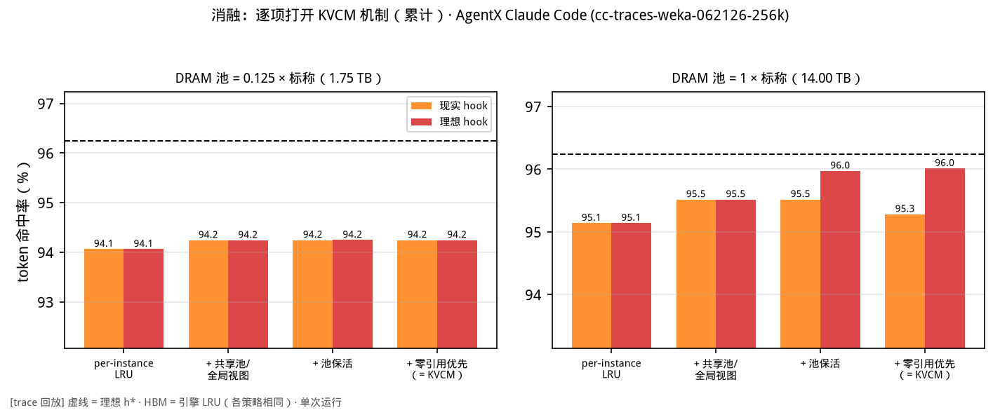
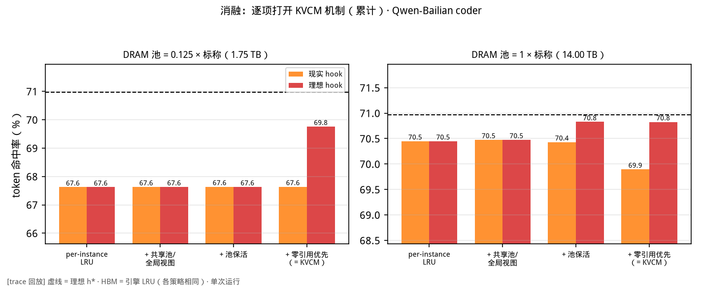

# KVCM trace 回放结果（自动生成）

由 `python3 -m kvcm_sim.report` 从 `results/*.json` 生成；参数与假设见 [`../params.md`](../params.md)，方法见 [`../README.md`](../README.md)。
全部为 **[trace 回放] + [解析]**，每个点单次运行（seed=1），无真机校准。

模型：HBM 归推理引擎：每实例 450 GB 前缀缓存、纯 LRU，所有策略相同且不随 x 轴变化；KVCM 只管 DRAM 池（停顿期池保活 + 零引用优先）。x 轴与表中“池容量”只指 DRAM 池（标称 14 TB = 14 节点 × 1 TB）。

模型规格：DeepSeek-V4.1（即 V4.1-Flash）官方 config / 技术报告，全局 KV 按 BF16 存储 3,200 B/token（官方 FP4 口径为 890 B）；decode 写出的 KV 入缓存，主结果按“下一轮原样回传上一轮输出（含思维链）”计命中，末尾附“剥掉思维链”下界对照。

## AgentX Claude Code (cc-traces-weka-062126-256k)

- 负载：全规模 10871 会话/h，383.1 req/s，理想命中 h* = 96.24%；仿真切片 1/32。

### 命中率–容量（MRC）数据

| 池容量 × 标称 | 池 TB | per-instance LRU | shared-pool LRU | KVCM（现实 hook） | KVCM（理想 hook） | 理想 h* |
|---:|---:|---:|---:|---:|---:|---:|
| 0.03125 | 0.44 | 94.07% | 94.13% | 94.13% | 94.12% | 96.24% |
| 0.0625 | 0.88 | 94.07% | 94.20% | 94.19% | 94.18% | 96.24% |
| 0.125 | 1.75 | 94.07% | 94.24% | 94.25% | 94.25% | 96.24% |
| 0.25 | 3.50 | 94.07% | 94.26% | 94.28% | 94.52% | 96.24% |
| 0.5 | 7.00 | 94.36% | 94.66% | 94.64% | 95.39% | 96.24% |
| 1 | 14.00 | 95.14% | 95.52% | 95.28% | 96.01% | 96.24% |
| 2 | 28.00 | 95.57% | 95.98% | 95.94% | 96.19% | 96.24% |

### TTFT 与等效 NPU（DRAM 池 = 0.125 × 标称 = 1.75 TB）

A3 TTFT = 2 × 950 拟合 TTFT（token 相关项按 V4.1 prefill 激活参数比 8/49 缩放）+ 未掩盖 KV 加载；NPU 数为全规模等效的 prefill 平均占用（D8a §8.2）。

| 策略 | 命中率 | 其中 HBM | TTFT 均值 (s) | P50 | P95 | P95（池走 ROCE） | prefill 占用 NPU | 相对 per-instance 省 | 相对 shared-pool 省 |
|---|---:|---:|---:|---:|---:|---:|---:|---:|---:|
| per-instance LRU | 94.07% | 94.07% | 0.47 | 0.14 | 1.40 | 1.40 | 179.4 | +0.0 | -5.0 |
| shared-pool LRU | 94.24% | 94.07% | 0.46 | 0.14 | 1.34 | 1.34 | 174.4 | +5.0 | +0.0 |
| KVCM（无 hook） | 94.24% | 94.07% | 0.46 | 0.14 | 1.34 | 1.34 | 174.4 | +5.0 | +0.0 |
| KVCM（现实 hook） | 94.25% | 94.07% | 0.46 | 0.14 | 1.34 | 1.34 | 174.3 | +5.1 | +0.1 |
| KVCM（理想 hook） | 94.25% | 94.07% | 0.46 | 0.14 | 1.34 | 1.34 | 174.3 | +5.1 | +0.1 |

按前一停顿长度分组的复用损失（1 − h/h*，DRAM 池 = 0.125 × 标称）：

| 策略 \ 前一停顿 | first-turn（5% 请求） | <10s（82% 请求） | 10-60s（6% 请求） | 1-10min（5% 请求） | 10-60min（1% 请求） | >1h（0% 请求） |
|---|---:|---:|---:|---:|---:|---:|
| per-instance LRU | 15.1% | 0.3% | 0.3% | 6.2% | 93.3% | 96.1% |
| shared-pool LRU | 14.9% | 0.1% | 0.2% | 6.2% | 93.3% | 96.1% |
| KVCM（现实 hook） | 14.9% | 0.1% | 0.2% | 6.2% | 93.2% | 96.1% |
| KVCM（理想 hook） | 14.9% | 0.1% | 0.2% | 6.2% | 93.3% | 96.1% |

### TTFT 与等效 NPU（DRAM 池 = 0.25 × 标称 = 3.50 TB）

A3 TTFT = 2 × 950 拟合 TTFT（token 相关项按 V4.1 prefill 激活参数比 8/49 缩放）+ 未掩盖 KV 加载；NPU 数为全规模等效的 prefill 平均占用（D8a §8.2）。

| 策略 | 命中率 | 其中 HBM | TTFT 均值 (s) | P50 | P95 | P95（池走 ROCE） | prefill 占用 NPU | 相对 per-instance 省 | 相对 shared-pool 省 |
|---|---:|---:|---:|---:|---:|---:|---:|---:|---:|
| per-instance LRU | 94.07% | 94.07% | 0.47 | 0.14 | 1.40 | 1.40 | 179.4 | +0.0 | -5.5 |
| shared-pool LRU | 94.26% | 94.07% | 0.45 | 0.14 | 1.34 | 1.34 | 173.9 | +5.5 | +0.0 |
| KVCM（现实 hook） | 94.28% | 94.07% | 0.45 | 0.14 | 1.33 | 1.33 | 173.5 | +5.9 | +0.5 |
| KVCM（理想 hook） | 94.52% | 94.07% | 0.43 | 0.14 | 1.28 | 1.28 | 166.6 | +12.8 | +7.4 |

按前一停顿长度分组的复用损失（1 − h/h*，DRAM 池 = 0.25 × 标称）：

| 策略 \ 前一停顿 | first-turn（5% 请求） | <10s（82% 请求） | 10-60s（6% 请求） | 1-10min（5% 请求） | 10-60min（1% 请求） | >1h（0% 请求） |
|---|---:|---:|---:|---:|---:|---:|
| per-instance LRU | 15.1% | 0.3% | 0.3% | 6.2% | 93.3% | 96.1% |
| shared-pool LRU | 14.9% | 0.1% | 0.1% | 6.2% | 93.3% | 96.1% |
| KVCM（现实 hook） | 14.9% | 0.1% | 0.1% | 6.1% | 92.3% | 96.1% |
| KVCM（理想 hook） | 14.9% | 0.1% | 0.1% | 3.5% | 87.3% | 96.1% |

### TTFT 与等效 NPU（DRAM 池 = 1 × 标称 = 14.00 TB）

A3 TTFT = 2 × 950 拟合 TTFT（token 相关项按 V4.1 prefill 激活参数比 8/49 缩放）+ 未掩盖 KV 加载；NPU 数为全规模等效的 prefill 平均占用（D8a §8.2）。

| 策略 | 命中率 | 其中 HBM | TTFT 均值 (s) | P50 | P95 | P95（池走 ROCE） | prefill 占用 NPU | 相对 per-instance 省 | 相对 shared-pool 省 |
|---|---:|---:|---:|---:|---:|---:|---:|---:|---:|
| per-instance LRU | 95.14% | 93.90% | 0.39 | 0.14 | 1.17 | 1.17 | 148.6 | +0.0 | -10.6 |
| shared-pool LRU | 95.52% | 94.07% | 0.36 | 0.14 | 1.10 | 1.10 | 137.9 | +10.6 | +0.0 |
| KVCM（无 hook） | 95.52% | 94.07% | 0.36 | 0.14 | 1.10 | 1.10 | 137.9 | +10.6 | +0.0 |
| KVCM（现实 hook） | 95.28% | 94.07% | 0.38 | 0.14 | 1.13 | 1.13 | 144.7 | +3.8 | -6.8 |
| KVCM（理想 hook） | 96.01% | 94.07% | 0.32 | 0.14 | 1.02 | 1.02 | 123.5 | +25.1 | +14.4 |

按前一停顿长度分组的复用损失（1 − h/h*，DRAM 池 = 1 × 标称）：

| 策略 \ 前一停顿 | first-turn（5% 请求） | <10s（82% 请求） | 10-60s（6% 请求） | 1-10min（5% 请求） | 10-60min（1% 请求） | >1h（0% 请求） |
|---|---:|---:|---:|---:|---:|---:|
| per-instance LRU | 8.8% | 0.4% | 0.3% | 0.3% | 35.4% | 94.6% |
| shared-pool LRU | 8.3% | 0.0% | 0.0% | 0.0% | 30.9% | 94.6% |
| KVCM（现实 hook） | 9.0% | 0.0% | 0.0% | 0.0% | 51.3% | 92.9% |
| KVCM（理想 hook） | 5.2% | 0.0% | 0.0% | 0.0% | 0.6% | 56.4% |

### decode KV 命中口径对照：原样回传（主结果）vs 剥掉思维链（下界）

同一负载（到达率按原样回传口径校准）。剥掉思维链 = 下一轮输入不含上一轮 decode 写出的 token 序列，输出部分全部不命中。

DRAM 池 = 0.125 × 标称（1.75 TB）：

理想 h*：原样回传 96.24%，剥掉思维链 95.71%。

| 策略 | 命中率（原样回传） | 命中率（剥掉思维链） | lost reuse（原样） | lost reuse（剥掉） | prefill 占用 NPU（原样） | prefill 占用 NPU（剥掉） |
|---|---:|---:|---:|---:|---:|---:|
| per-instance LRU | 94.07% | 93.49% | 2.26% | 2.32% | 179.4 | 195.4 |
| shared-pool LRU | 94.24% | 93.67% | 2.08% | 2.14% | 174.4 | 190.5 |
| KVCM（现实 hook） | 94.25% | 93.67% | 2.07% | 2.13% | 174.3 | 190.5 |
| KVCM（理想 hook） | 94.25% | 93.67% | 2.07% | 2.13% | 174.3 | 190.4 |

DRAM 池 = 1 × 标称（14.00 TB）：

理想 h*：原样回传 96.24%，剥掉思维链 95.71%。

| 策略 | 命中率（原样回传） | 命中率（剥掉思维链） | lost reuse（原样） | lost reuse（剥掉） | prefill 占用 NPU（原样） | prefill 占用 NPU（剥掉） |
|---|---:|---:|---:|---:|---:|---:|
| per-instance LRU | 95.14% | 94.58% | 1.14% | 1.19% | 148.6 | 164.2 |
| shared-pool LRU | 95.52% | 94.99% | 0.75% | 0.75% | 137.9 | 152.6 |
| KVCM（现实 hook） | 95.28% | 94.75% | 1.00% | 1.00% | 144.7 | 159.4 |
| KVCM（理想 hook） | 96.01% | 95.48% | 0.24% | 0.24% | 123.5 | 138.2 |

## Codex × SWE-bench Pro (合成时间线)

- 负载：全规模 59259 会话/h，543.0 req/s，理想命中 h* = 96.54%；仿真切片 1/32。

### 命中率–容量（MRC）数据

| 池容量 × 标称 | 池 TB | per-instance LRU | shared-pool LRU | KVCM（现实 hook） | KVCM（理想 hook） | 理想 h* |
|---:|---:|---:|---:|---:|---:|---:|
| 0.03125 | 0.44 | 95.43% | 95.57% | 95.63% | 95.63% | 96.54% |
| 0.0625 | 0.88 | 95.43% | 95.78% | 95.87% | 95.85% | 96.54% |
| 0.125 | 1.75 | 95.43% | 96.29% | 96.28% | 96.24% | 96.54% |
| 0.25 | 3.50 | 95.43% | 96.54% | 96.54% | 96.54% | 96.54% |
| 0.5 | 7.00 | 95.50% | 96.54% | 96.54% | 96.54% | 96.54% |
| 1 | 14.00 | 95.48% | 96.54% | 96.54% | 96.54% | 96.54% |
| 2 | 28.00 | 95.48% | 96.54% | 96.54% | 96.54% | 96.54% |

### TTFT 与等效 NPU（DRAM 池 = 0.125 × 标称 = 1.75 TB）

A3 TTFT = 2 × 950 拟合 TTFT（token 相关项按 V4.1 prefill 激活参数比 8/49 缩放）+ 未掩盖 KV 加载；NPU 数为全规模等效的 prefill 平均占用（D8a §8.2）。

| 策略 | 命中率 | 其中 HBM | TTFT 均值 (s) | P50 | P95 | P95（池走 ROCE） | prefill 占用 NPU | 相对 per-instance 省 | 相对 shared-pool 省 |
|---|---:|---:|---:|---:|---:|---:|---:|---:|---:|
| per-instance LRU | 95.43% | 95.43% | 0.26 | 0.10 | 0.70 | 0.70 | 140.5 | +0.0 | -22.2 |
| shared-pool LRU | 96.29% | 95.43% | 0.22 | 0.10 | 0.68 | 0.68 | 118.3 | +22.2 | +0.0 |
| KVCM（无 hook） | 96.29% | 95.43% | 0.22 | 0.10 | 0.68 | 0.68 | 118.3 | +22.2 | +0.0 |
| KVCM（现实 hook） | 96.28% | 95.43% | 0.22 | 0.10 | 0.68 | 0.68 | 118.7 | +21.8 | -0.4 |
| KVCM（理想 hook） | 96.24% | 95.43% | 0.22 | 0.10 | 0.68 | 0.68 | 119.8 | +20.7 | -1.5 |

按前一停顿长度分组的复用损失（1 − h/h*，DRAM 池 = 0.125 × 标称）：

| 策略 \ 前一停顿 | first-turn（3% 请求） | <10s（70% 请求） | 10-60s（26% 请求） | 1-10min（2% 请求） | 10-60min（0% 请求） | >1h（0% 请求） |
|---|---:|---:|---:|---:|---:|---:|
| per-instance LRU | 0.0% | 1.1% | 1.2% | 1.3% | — | — |
| shared-pool LRU | 0.0% | 0.0% | 0.8% | 1.3% | — | — |
| KVCM（现实 hook） | 0.0% | 0.0% | 0.8% | 1.3% | — | — |
| KVCM（理想 hook） | 0.0% | 0.1% | 0.7% | 1.3% | — | — |

### TTFT 与等效 NPU（DRAM 池 = 0.25 × 标称 = 3.50 TB）

A3 TTFT = 2 × 950 拟合 TTFT（token 相关项按 V4.1 prefill 激活参数比 8/49 缩放）+ 未掩盖 KV 加载；NPU 数为全规模等效的 prefill 平均占用（D8a §8.2）。

| 策略 | 命中率 | 其中 HBM | TTFT 均值 (s) | P50 | P95 | P95（池走 ROCE） | prefill 占用 NPU | 相对 per-instance 省 | 相对 shared-pool 省 |
|---|---:|---:|---:|---:|---:|---:|---:|---:|---:|
| per-instance LRU | 95.43% | 95.43% | 0.26 | 0.10 | 0.70 | 0.70 | 140.5 | +0.0 | -28.4 |
| shared-pool LRU | 96.54% | 95.43% | 0.21 | 0.10 | 0.67 | 0.67 | 112.1 | +28.4 | +0.0 |
| KVCM（现实 hook） | 96.54% | 95.43% | 0.21 | 0.10 | 0.67 | 0.67 | 112.1 | +28.4 | -0.0 |
| KVCM（理想 hook） | 96.54% | 95.43% | 0.21 | 0.10 | 0.67 | 0.67 | 112.0 | +28.5 | +0.1 |

按前一停顿长度分组的复用损失（1 − h/h*，DRAM 池 = 0.25 × 标称）：

| 策略 \ 前一停顿 | first-turn（3% 请求） | <10s（70% 请求） | 10-60s（26% 请求） | 1-10min（2% 请求） | 10-60min（0% 请求） | >1h（0% 请求） |
|---|---:|---:|---:|---:|---:|---:|
| per-instance LRU | 0.0% | 1.1% | 1.2% | 1.3% | — | — |
| shared-pool LRU | 0.0% | 0.0% | 0.0% | 0.3% | — | — |
| KVCM（现实 hook） | 0.0% | 0.0% | 0.0% | 0.3% | — | — |
| KVCM（理想 hook） | 0.0% | 0.0% | 0.0% | 0.0% | — | — |

### TTFT 与等效 NPU（DRAM 池 = 1 × 标称 = 14.00 TB）

A3 TTFT = 2 × 950 拟合 TTFT（token 相关项按 V4.1 prefill 激活参数比 8/49 缩放）+ 未掩盖 KV 加载；NPU 数为全规模等效的 prefill 平均占用（D8a §8.2）。

| 策略 | 命中率 | 其中 HBM | TTFT 均值 (s) | P50 | P95 | P95（池走 ROCE） | prefill 占用 NPU | 相对 per-instance 省 | 相对 shared-pool 省 |
|---|---:|---:|---:|---:|---:|---:|---:|---:|---:|
| per-instance LRU | 95.48% | 95.48% | 0.26 | 0.10 | 0.70 | 0.70 | 139.0 | +0.0 | -27.0 |
| shared-pool LRU | 96.54% | 95.43% | 0.21 | 0.10 | 0.67 | 0.67 | 112.0 | +27.0 | +0.0 |
| KVCM（无 hook） | 96.54% | 95.43% | 0.21 | 0.10 | 0.67 | 0.67 | 112.0 | +27.0 | +0.0 |
| KVCM（现实 hook） | 96.54% | 95.43% | 0.21 | 0.10 | 0.67 | 0.67 | 112.0 | +27.0 | +0.0 |
| KVCM（理想 hook） | 96.54% | 95.43% | 0.21 | 0.10 | 0.67 | 0.67 | 112.0 | +27.0 | +0.0 |

按前一停顿长度分组的复用损失（1 − h/h*，DRAM 池 = 1 × 标称）：

| 策略 \ 前一停顿 | first-turn（3% 请求） | <10s（70% 请求） | 10-60s（26% 请求） | 1-10min（2% 请求） | 10-60min（0% 请求） | >1h（0% 请求） |
|---|---:|---:|---:|---:|---:|---:|
| per-instance LRU | 0.0% | 1.1% | 1.1% | 1.3% | — | — |
| shared-pool LRU | 0.0% | 0.0% | 0.0% | 0.0% | — | — |
| KVCM（现实 hook） | 0.0% | 0.0% | 0.0% | 0.0% | — | — |
| KVCM（理想 hook） | 0.0% | 0.0% | 0.0% | 0.0% | — | — |

### decode KV 命中口径对照：原样回传（主结果）vs 剥掉思维链（下界）

同一负载（到达率按原样回传口径校准）。剥掉思维链 = 下一轮输入不含上一轮 decode 写出的 token 序列，输出部分全部不命中。

DRAM 池 = 0.125 × 标称（1.75 TB）：

理想 h*：原样回传 96.54%，剥掉思维链 95.92%。

| 策略 | 命中率（原样回传） | 命中率（剥掉思维链） | lost reuse（原样） | lost reuse（剥掉） | prefill 占用 NPU（原样） | prefill 占用 NPU（剥掉） |
|---|---:|---:|---:|---:|---:|---:|
| per-instance LRU | 95.43% | 94.96% | 1.15% | 1.00% | 140.5 | 152.1 |
| shared-pool LRU | 96.29% | 95.62% | 0.26% | 0.31% | 118.3 | 135.1 |
| KVCM（现实 hook） | 96.28% | 95.61% | 0.27% | 0.32% | 118.7 | 135.4 |
| KVCM（理想 hook） | 96.24% | 95.59% | 0.31% | 0.34% | 119.8 | 135.9 |

DRAM 池 = 1 × 标称（14.00 TB）：

理想 h*：原样回传 96.54%，剥掉思维链 95.92%。

| 策略 | 命中率（原样回传） | 命中率（剥掉思维链） | lost reuse（原样） | lost reuse（剥掉） | prefill 占用 NPU（原样） | prefill 占用 NPU（剥掉） |
|---|---:|---:|---:|---:|---:|---:|
| per-instance LRU | 95.48% | 94.86% | 1.09% | 1.10% | 139.0 | 154.5 |
| shared-pool LRU | 96.54% | 95.92% | 0.00% | 0.00% | 112.0 | 127.4 |
| KVCM（现实 hook） | 96.54% | 95.92% | 0.00% | 0.00% | 112.0 | 127.4 |
| KVCM（理想 hook） | 96.54% | 95.92% | 0.00% | 0.00% | 112.0 | 127.4 |

## Qwen-Bailian coder

- 负载：全规模 1626604 会话/h，735.7 req/s，理想命中 h* = 70.97%；仿真切片 1/32。

### 命中率–容量（MRC）数据

| 池容量 × 标称 | 池 TB | per-instance LRU | shared-pool LRU | KVCM（现实 hook） | KVCM（理想 hook） | 理想 h* |
|---:|---:|---:|---:|---:|---:|---:|
| 0.03125 | 0.44 | 67.62% | 67.63% | 67.63% | 67.63% | 70.97% |
| 0.0625 | 0.88 | 67.62% | 67.63% | 67.63% | 67.63% | 70.97% |
| 0.125 | 1.75 | 67.62% | 67.63% | 67.64% | 69.76% | 70.97% |
| 0.25 | 3.50 | 67.62% | 67.63% | 67.70% | 69.76% | 70.97% |
| 0.5 | 7.00 | 68.19% | 68.23% | 68.50% | 69.91% | 70.97% |
| 1 | 14.00 | 70.45% | 70.48% | 69.90% | 70.83% | 70.97% |
| 2 | 28.00 | 70.94% | 70.95% | 70.93% | 70.96% | 70.97% |

### TTFT 与等效 NPU（DRAM 池 = 0.125 × 标称 = 1.75 TB）

A3 TTFT = 2 × 950 拟合 TTFT（token 相关项按 V4.1 prefill 激活参数比 8/49 缩放）+ 未掩盖 KV 加载；NPU 数为全规模等效的 prefill 平均占用（D8a §8.2）。

| 策略 | 命中率 | 其中 HBM | TTFT 均值 (s) | P50 | P95 | P95（池走 ROCE） | prefill 占用 NPU | 相对 per-instance 省 | 相对 shared-pool 省 |
|---|---:|---:|---:|---:|---:|---:|---:|---:|---:|
| per-instance LRU | 67.62% | 67.62% | 0.16 | 0.08 | 0.59 | 0.59 | 120.2 | +0.0 | -0.0 |
| shared-pool LRU | 67.63% | 67.62% | 0.16 | 0.08 | 0.59 | 0.59 | 120.2 | +0.0 | +0.0 |
| KVCM（无 hook） | 67.63% | 67.62% | 0.16 | 0.08 | 0.59 | 0.59 | 120.2 | +0.0 | +0.0 |
| KVCM（现实 hook） | 67.64% | 67.62% | 0.16 | 0.08 | 0.59 | 0.59 | 120.2 | +0.0 | +0.0 |
| KVCM（理想 hook） | 69.76% | 67.62% | 0.16 | 0.08 | 0.57 | 0.57 | 114.8 | +5.4 | +5.4 |

按前一停顿长度分组的复用损失（1 − h/h*，DRAM 池 = 0.125 × 标称）：

| 策略 \ 前一停顿 | first-turn（62% 请求） | <10s（6% 请求） | 10-60s（9% 请求） | 1-10min（17% 请求） | 10-60min（5% 请求） | >1h（0% 请求） |
|---|---:|---:|---:|---:|---:|---:|
| per-instance LRU | 3.3% | 0.0% | 0.0% | 0.0% | 43.4% | 96.9% |
| shared-pool LRU | 3.3% | 0.0% | 0.0% | 0.0% | 43.4% | 96.9% |
| KVCM（现实 hook） | 3.3% | 0.0% | 0.0% | 0.0% | 43.3% | 96.9% |
| KVCM（理想 hook） | 3.2% | 0.0% | 0.0% | 0.0% | 0.1% | 0.0% |

### TTFT 与等效 NPU（DRAM 池 = 0.25 × 标称 = 3.50 TB）

A3 TTFT = 2 × 950 拟合 TTFT（token 相关项按 V4.1 prefill 激活参数比 8/49 缩放）+ 未掩盖 KV 加载；NPU 数为全规模等效的 prefill 平均占用（D8a §8.2）。

| 策略 | 命中率 | 其中 HBM | TTFT 均值 (s) | P50 | P95 | P95（池走 ROCE） | prefill 占用 NPU | 相对 per-instance 省 | 相对 shared-pool 省 |
|---|---:|---:|---:|---:|---:|---:|---:|---:|---:|
| per-instance LRU | 67.62% | 67.62% | 0.16 | 0.08 | 0.59 | 0.59 | 120.2 | +0.0 | -0.0 |
| shared-pool LRU | 67.63% | 67.62% | 0.16 | 0.08 | 0.59 | 0.59 | 120.2 | +0.0 | +0.0 |
| KVCM（现实 hook） | 67.70% | 67.62% | 0.16 | 0.08 | 0.59 | 0.59 | 120.0 | +0.2 | +0.2 |
| KVCM（理想 hook） | 69.76% | 67.62% | 0.16 | 0.08 | 0.57 | 0.57 | 114.8 | +5.4 | +5.4 |

按前一停顿长度分组的复用损失（1 − h/h*，DRAM 池 = 0.25 × 标称）：

| 策略 \ 前一停顿 | first-turn（62% 请求） | <10s（6% 请求） | 10-60s（9% 请求） | 1-10min（17% 请求） | 10-60min（5% 请求） | >1h（0% 请求） |
|---|---:|---:|---:|---:|---:|---:|
| per-instance LRU | 3.3% | 0.0% | 0.0% | 0.0% | 43.4% | 96.9% |
| shared-pool LRU | 3.3% | 0.0% | 0.0% | 0.0% | 43.4% | 96.9% |
| KVCM（现实 hook） | 3.2% | 0.0% | 0.0% | 0.0% | 42.6% | 96.7% |
| KVCM（理想 hook） | 3.2% | 0.0% | 0.0% | 0.0% | 0.1% | 0.0% |

### TTFT 与等效 NPU（DRAM 池 = 1 × 标称 = 14.00 TB）

A3 TTFT = 2 × 950 拟合 TTFT（token 相关项按 V4.1 prefill 激活参数比 8/49 缩放）+ 未掩盖 KV 加载；NPU 数为全规模等效的 prefill 平均占用（D8a §8.2）。

| 策略 | 命中率 | 其中 HBM | TTFT 均值 (s) | P50 | P95 | P95（池走 ROCE） | prefill 占用 NPU | 相对 per-instance 省 | 相对 shared-pool 省 |
|---|---:|---:|---:|---:|---:|---:|---:|---:|---:|
| per-instance LRU | 70.45% | 67.56% | 0.15 | 0.08 | 0.56 | 0.56 | 113.1 | +0.0 | -0.1 |
| shared-pool LRU | 70.48% | 67.62% | 0.15 | 0.08 | 0.56 | 0.56 | 113.0 | +0.1 | +0.0 |
| KVCM（无 hook） | 70.48% | 67.62% | 0.15 | 0.08 | 0.56 | 0.56 | 113.0 | +0.1 | +0.0 |
| KVCM（现实 hook） | 69.90% | 67.62% | 0.16 | 0.08 | 0.57 | 0.57 | 114.5 | -1.4 | -1.5 |
| KVCM（理想 hook） | 70.83% | 67.62% | 0.15 | 0.08 | 0.56 | 0.56 | 112.1 | +1.0 | +0.9 |

按前一停顿长度分组的复用损失（1 − h/h*，DRAM 池 = 1 × 标称）：

| 策略 \ 前一停顿 | first-turn（62% 请求） | <10s（6% 请求） | 10-60s（9% 请求） | 1-10min（17% 请求） | 10-60min（5% 请求） | >1h（0% 请求） |
|---|---:|---:|---:|---:|---:|---:|
| per-instance LRU | 0.4% | 0.0% | 0.0% | 0.0% | 3.7% | 94.7% |
| shared-pool LRU | 0.4% | 0.0% | 0.0% | 0.0% | 3.1% | 96.6% |
| KVCM（现实 hook） | 0.9% | 0.0% | 0.0% | 0.0% | 11.9% | 88.1% |
| KVCM（理想 hook） | 0.4% | 0.0% | 0.0% | 0.0% | 0.0% | 0.0% |

### decode KV 命中口径对照：原样回传（主结果）vs 剥掉思维链（下界）

同一负载（到达率按原样回传口径校准）。剥掉思维链 = 下一轮输入不含上一轮 decode 写出的 token 序列，输出部分全部不命中。

DRAM 池 = 0.125 × 标称（1.75 TB）：

理想 h*：原样回传 70.97%，剥掉思维链 66.31%。

| 策略 | 命中率（原样回传） | 命中率（剥掉思维链） | lost reuse（原样） | lost reuse（剥掉） | prefill 占用 NPU（原样） | prefill 占用 NPU（剥掉） |
|---|---:|---:|---:|---:|---:|---:|
| per-instance LRU | 67.62% | 63.49% | 4.71% | 4.27% | 120.2 | 130.7 |
| shared-pool LRU | 67.63% | 63.49% | 4.70% | 4.25% | 120.2 | 130.7 |
| KVCM（现实 hook） | 67.64% | 63.50% | 4.69% | 4.24% | 120.2 | 130.7 |
| KVCM（理想 hook） | 69.76% | 65.14% | 1.70% | 1.78% | 114.8 | 126.5 |

DRAM 池 = 1 × 标称（14.00 TB）：

理想 h*：原样回传 70.97%，剥掉思维链 66.31%。

| 策略 | 命中率（原样回传） | 命中率（剥掉思维链） | lost reuse（原样） | lost reuse（剥掉） | prefill 占用 NPU（原样） | prefill 占用 NPU（剥掉） |
|---|---:|---:|---:|---:|---:|---:|
| per-instance LRU | 70.45% | 65.89% | 0.73% | 0.63% | 113.1 | 124.6 |
| shared-pool LRU | 70.48% | 65.92% | 0.69% | 0.60% | 113.0 | 124.5 |
| KVCM（现实 hook） | 69.90% | 65.45% | 1.51% | 1.30% | 114.5 | 125.7 |
| KVCM（理想 hook） | 70.83% | 66.18% | 0.20% | 0.20% | 112.1 | 123.9 |

