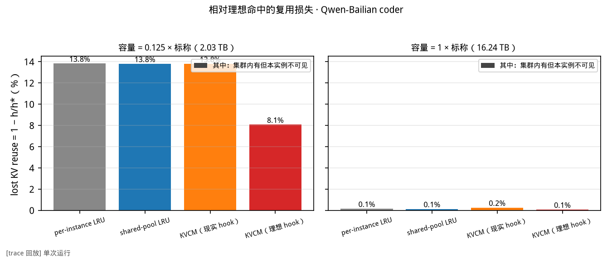

# KVCM trace 回放结果（自动生成）

由 `python3 -m kvcm_sim.report` 从 `results/*.json` 生成；参数与假设见 [`../params.md`](../params.md)，方法见 [`../README.md`](../README.md)。
全部为 **[trace 回放] + [解析]**，每个点单次运行（seed=1），无真机校准。

## AgentX Claude Code (cc-traces-weka-062126-256k)

- 负载：全规模 1729 会话/h，61.3 req/s，理想命中 h* = 95.83%；仿真切片 1/8。

### 命中率–容量（MRC）数据

| 容量 × 标称 | 总容量 TB | per-instance LRU | shared-pool LRU | KVCM（现实 hook） | KVCM（理想 hook） | 理想 h* |
|---:|---:|---:|---:|---:|---:|---:|
| 0.015625 | 0.25 | 15.23% | 13.49% | 14.42% | 19.82% | 95.83% |
| 0.03125 | 0.51 | 39.97% | 42.73% | 41.31% | 42.91% | 95.83% |
| 0.0625 | 1.01 | 75.63% | 77.55% | 76.62% | 76.54% | 95.83% |
| 0.125 | 2.03 | 89.15% | 89.29% | 89.13% | 91.16% | 95.83% |
| 0.25 | 4.06 | 94.07% | 94.27% | 94.10% | 95.03% | 95.83% |
| 0.5 | 8.12 | 94.84% | 95.14% | 94.92% | 95.61% | 95.83% |
| 1 | 16.24 | 95.24% | 95.58% | 95.54% | 95.77% | 95.83% |
| 2 | 32.48 | 95.48% | 95.77% | 95.76% | 95.83% | 95.83% |

### TTFT 与等效 NPU（容量 = 0.125 × 标称）

A3 TTFT = 2 × 950 拟合 TTFT + 未掩盖 KV 加载；NPU 数为全规模等效的 prefill 平均占用（D8a §8.2）。

| 策略 | 命中率 | 其中 HBM | TTFT 均值 (s) | P50 | P95 | P95（池走 ROCE） | prefill 占用 NPU | 相对 per-instance 省 | 相对 shared-pool 省 |
|---|---:|---:|---:|---:|---:|---:|---:|---:|---:|
| per-instance LRU | 89.15% | 22.52% | 4.97 | 0.94 | 26.40 | 26.40 | 304.2 | +0.0 | -4.0 |
| shared-pool LRU | 89.29% | 21.35% | 4.91 | 0.94 | 25.35 | 25.35 | 300.2 | +4.0 | +0.0 |
| KVCM（无 hook） | 89.29% | 21.35% | 4.91 | 0.94 | 25.35 | 25.35 | 300.2 | +4.0 | +0.0 |
| KVCM（现实 hook） | 89.13% | 21.88% | 4.99 | 0.94 | 26.06 | 26.06 | 305.1 | -1.0 | -4.9 |
| KVCM（理想 hook） | 91.16% | 25.90% | 4.05 | 0.92 | 13.15 | 13.16 | 248.0 | +56.2 | +52.2 |

按前一停顿长度分组的复用损失（1 − h/h*，容量 = 0.125 × 标称）：

| 策略 \ 前一停顿 | first-turn（5% 请求） | <10s（82% 请求） | 10-60s（6% 请求） | 1-10min（5% 请求） | 10-60min（1% 请求） | >1h（0% 请求） |
|---|---:|---:|---:|---:|---:|---:|
| per-instance LRU | 20.0% | 0.6% | 1.8% | 65.3% | 97.6% | 97.3% |
| shared-pool LRU | 19.9% | 0.5% | 0.5% | 66.3% | 97.6% | 97.3% |
| KVCM（现实 hook） | 19.7% | 0.5% | 0.7% | 68.0% | 96.4% | 97.3% |
| KVCM（理想 hook） | 20.3% | 0.6% | 1.3% | 38.1% | 90.1% | 97.3% |

### TTFT 与等效 NPU（容量 = 1 × 标称）

A3 TTFT = 2 × 950 拟合 TTFT + 未掩盖 KV 加载；NPU 数为全规模等效的 prefill 平均占用（D8a §8.2）。

| 策略 | 命中率 | 其中 HBM | TTFT 均值 (s) | P50 | P95 | P95（池走 ROCE） | prefill 占用 NPU | 相对 per-instance 省 | 相对 shared-pool 省 |
|---|---:|---:|---:|---:|---:|---:|---:|---:|---:|
| per-instance LRU | 95.24% | 91.35% | 2.10 | 0.90 | 6.64 | 6.64 | 128.5 | +0.0 | -9.5 |
| shared-pool LRU | 95.58% | 91.84% | 1.94 | 0.89 | 6.26 | 6.26 | 119.0 | +9.5 | +0.0 |
| KVCM（无 hook） | 95.58% | 91.84% | 1.94 | 0.89 | 6.26 | 6.26 | 119.0 | +9.5 | +0.0 |
| KVCM（现实 hook） | 95.54% | 91.70% | 1.96 | 0.89 | 6.28 | 6.28 | 120.0 | +8.5 | -1.0 |
| KVCM（理想 hook） | 95.77% | 94.40% | 1.85 | 0.89 | 6.05 | 6.05 | 113.5 | +15.0 | +5.5 |

按前一停顿长度分组的复用损失（1 − h/h*，容量 = 1 × 标称）：

| 策略 \ 前一停顿 | first-turn（5% 请求） | <10s（82% 请求） | 10-60s（6% 请求） | 1-10min（5% 请求） | 10-60min（1% 请求） | >1h（0% 请求） |
|---|---:|---:|---:|---:|---:|---:|
| per-instance LRU | 4.3% | 0.3% | 0.3% | 0.3% | 2.1% | 81.3% |
| shared-pool LRU | 3.7% | 0.0% | 0.0% | 0.0% | 0.2% | 77.1% |
| KVCM（现实 hook） | 4.4% | 0.0% | 0.0% | 0.0% | 3.4% | 75.3% |
| KVCM（理想 hook） | 0.9% | 0.0% | 0.0% | 0.0% | 0.1% | 17.3% |

## Codex × SWE-bench Pro (合成时间线)

- 负载：全规模 10354 会话/h，95.2 req/s，理想命中 h* = 95.95%；仿真切片 1/8。

### 命中率–容量（MRC）数据

| 容量 × 标称 | 总容量 TB | per-instance LRU | shared-pool LRU | KVCM（现实 hook） | KVCM（理想 hook） | 理想 h* |
|---:|---:|---:|---:|---:|---:|---:|
| 0.015625 | 0.25 | 2.10% | 1.37% | 4.32% | 6.21% | 95.95% |
| 0.03125 | 0.51 | 14.83% | 15.24% | 20.61% | 25.90% | 95.95% |
| 0.0625 | 1.01 | 57.72% | 59.97% | 59.17% | 58.03% | 95.95% |
| 0.125 | 2.03 | 93.34% | 95.14% | 95.16% | 95.95% | 95.95% |
| 0.25 | 4.06 | 94.63% | 95.95% | 95.95% | 95.95% | 95.95% |
| 0.5 | 8.12 | 94.59% | 95.95% | 95.95% | 95.95% | 95.95% |
| 1 | 16.24 | 94.59% | 95.95% | 95.95% | 95.95% | 95.95% |
| 2 | 32.48 | 94.59% | 95.95% | 95.95% | 95.95% | 95.95% |

### TTFT 与等效 NPU（容量 = 0.125 × 标称）

A3 TTFT = 2 × 950 拟合 TTFT + 未掩盖 KV 加载；NPU 数为全规模等效的 prefill 平均占用（D8a §8.2）。

| 策略 | 命中率 | 其中 HBM | TTFT 均值 (s) | P50 | P95 | P95（池走 ROCE） | prefill 占用 NPU | 相对 per-instance 省 | 相对 shared-pool 省 |
|---|---:|---:|---:|---:|---:|---:|---:|---:|---:|
| per-instance LRU | 93.34% | 5.16% | 1.94 | 0.55 | 5.24 | 5.24 | 183.7 | +0.0 | -49.9 |
| shared-pool LRU | 95.14% | 4.21% | 1.41 | 0.54 | 4.07 | 4.07 | 133.8 | +49.9 | +0.0 |
| KVCM（无 hook） | 95.14% | 4.21% | 1.41 | 0.54 | 4.07 | 4.07 | 133.8 | +49.9 | +0.0 |
| KVCM（现实 hook） | 95.16% | 5.60% | 1.41 | 0.54 | 4.05 | 4.06 | 133.4 | +50.3 | +0.4 |
| KVCM（理想 hook） | 95.95% | 8.95% | 1.18 | 0.54 | 3.91 | 3.91 | 111.5 | +72.2 | +22.3 |

按前一停顿长度分组的复用损失（1 − h/h*，容量 = 0.125 × 标称）：

| 策略 \ 前一停顿 | first-turn（3% 请求） | <10s（70% 请求） | 10-60s（26% 请求） | 1-10min（2% 请求） | 10-60min（0% 请求） | >1h（0% 请求） |
|---|---:|---:|---:|---:|---:|---:|
| per-instance LRU | 0.0% | 2.0% | 2.8% | 33.5% | — | — |
| shared-pool LRU | 0.0% | 0.5% | 0.7% | 18.0% | — | — |
| KVCM（现实 hook） | 0.0% | 0.5% | 0.7% | 18.0% | — | — |
| KVCM（理想 hook） | 0.0% | 0.0% | 0.0% | 0.0% | — | — |

### TTFT 与等效 NPU（容量 = 1 × 标称）

A3 TTFT = 2 × 950 拟合 TTFT + 未掩盖 KV 加载；NPU 数为全规模等效的 prefill 平均占用（D8a §8.2）。

| 策略 | 命中率 | 其中 HBM | TTFT 均值 (s) | P50 | P95 | P95（池走 ROCE） | prefill 占用 NPU | 相对 per-instance 省 | 相对 shared-pool 省 |
|---|---:|---:|---:|---:|---:|---:|---:|---:|---:|
| per-instance LRU | 94.59% | 94.39% | 1.57 | 0.54 | 4.29 | 4.29 | 149.0 | +0.0 | -37.5 |
| shared-pool LRU | 95.95% | 94.56% | 1.17 | 0.53 | 3.91 | 3.91 | 111.5 | +37.5 | +0.0 |
| KVCM（无 hook） | 95.95% | 94.56% | 1.17 | 0.53 | 3.91 | 3.91 | 111.5 | +37.5 | +0.0 |
| KVCM（现实 hook） | 95.95% | 94.52% | 1.17 | 0.53 | 3.91 | 3.91 | 111.5 | +37.5 | +0.0 |
| KVCM（理想 hook） | 95.95% | 94.62% | 1.17 | 0.53 | 3.91 | 3.91 | 111.5 | +37.5 | +0.0 |

按前一停顿长度分组的复用损失（1 − h/h*，容量 = 1 × 标称）：

| 策略 \ 前一停顿 | first-turn（3% 请求） | <10s（70% 请求） | 10-60s（26% 请求） | 1-10min（2% 请求） | 10-60min（0% 请求） | >1h（0% 请求） |
|---|---:|---:|---:|---:|---:|---:|
| per-instance LRU | 0.0% | 1.4% | 1.5% | 1.3% | — | — |
| shared-pool LRU | 0.0% | 0.0% | 0.0% | 0.0% | — | — |
| KVCM（现实 hook） | 0.0% | 0.0% | 0.0% | 0.0% | — | — |
| KVCM（理想 hook） | 0.0% | 0.0% | 0.0% | 0.0% | — | — |

## Qwen-Bailian coder

- 负载：全规模 323654 会话/h，146.6 req/s，理想命中 h* = 66.31%；仿真切片 1/8。

### 命中率–容量（MRC）数据

| 容量 × 标称 | 总容量 TB | per-instance LRU | shared-pool LRU | KVCM（现实 hook） | KVCM（理想 hook） | 理想 h* |
|---:|---:|---:|---:|---:|---:|---:|
| 0.015625 | 0.25 | 36.95% | 36.99% | 37.01% | 39.60% | 66.31% |
| 0.03125 | 0.51 | 43.24% | 43.21% | 43.00% | 47.11% | 66.31% |
| 0.0625 | 1.01 | 50.54% | 50.57% | 50.40% | 55.53% | 66.31% |
| 0.125 | 2.03 | 57.14% | 57.16% | 57.17% | 60.96% | 66.31% |
| 0.25 | 4.06 | 62.31% | 62.32% | 62.13% | 64.07% | 66.31% |
| 0.5 | 8.12 | 65.30% | 65.29% | 63.97% | 65.79% | 66.31% |
| 1 | 16.24 | 66.21% | 66.22% | 66.14% | 66.26% | 66.31% |
| 2 | 32.48 | 66.30% | 66.31% | 66.30% | 66.31% | 66.31% |

### TTFT 与等效 NPU（容量 = 0.125 × 标称）

A3 TTFT = 2 × 950 拟合 TTFT + 未掩盖 KV 加载；NPU 数为全规模等效的 prefill 平均占用（D8a §8.2）。

| 策略 | 命中率 | 其中 HBM | TTFT 均值 (s) | P50 | P95 | P95（池走 ROCE） | prefill 占用 NPU | 相对 per-instance 省 | 相对 shared-pool 省 |
|---|---:|---:|---:|---:|---:|---:|---:|---:|---:|
| per-instance LRU | 57.14% | 38.86% | 0.96 | 0.45 | 3.71 | 3.71 | 140.4 | +0.0 | -0.1 |
| shared-pool LRU | 57.16% | 38.89% | 0.96 | 0.45 | 3.72 | 3.72 | 140.3 | +0.1 | +0.0 |
| KVCM（无 hook） | 57.16% | 38.89% | 0.96 | 0.45 | 3.72 | 3.72 | 140.3 | +0.1 | +0.0 |
| KVCM（现实 hook） | 57.17% | 38.06% | 0.96 | 0.44 | 3.75 | 3.75 | 140.3 | +0.1 | +0.0 |
| KVCM（理想 hook） | 60.96% | 55.32% | 0.88 | 0.44 | 3.46 | 3.46 | 128.6 | +11.8 | +11.8 |

按前一停顿长度分组的复用损失（1 − h/h*，容量 = 0.125 × 标称）：

| 策略 \ 前一停顿 | first-turn（62% 请求） | <10s（6% 请求） | 10-60s（9% 请求） | 1-10min（17% 请求） | 10-60min（6% 请求） | >1h（0% 请求） |
|---|---:|---:|---:|---:|---:|---:|
| per-instance LRU | 12.0% | 0.1% | 0.4% | 10.9% | 92.9% | 97.5% |
| shared-pool LRU | 11.7% | 0.1% | 0.4% | 11.4% | 93.0% | 97.6% |
| KVCM（现实 hook） | 11.3% | 0.1% | 0.4% | 13.7% | 90.4% | 97.3% |
| KVCM（理想 hook） | 14.1% | 0.1% | 0.4% | 0.7% | 1.0% | 0.5% |

### TTFT 与等效 NPU（容量 = 1 × 标称）

A3 TTFT = 2 × 950 拟合 TTFT + 未掩盖 KV 加载；NPU 数为全规模等效的 prefill 平均占用（D8a §8.2）。

| 策略 | 命中率 | 其中 HBM | TTFT 均值 (s) | P50 | P95 | P95（池走 ROCE） | prefill 占用 NPU | 相对 per-instance 省 | 相对 shared-pool 省 |
|---|---:|---:|---:|---:|---:|---:|---:|---:|---:|
| per-instance LRU | 66.21% | 59.09% | 0.77 | 0.37 | 3.18 | 3.18 | 112.2 | +0.0 | -0.0 |
| shared-pool LRU | 66.22% | 59.14% | 0.77 | 0.37 | 3.18 | 3.18 | 112.2 | +0.0 | +0.0 |
| KVCM（无 hook） | 66.22% | 59.14% | 0.77 | 0.37 | 3.18 | 3.18 | 112.2 | +0.0 | +0.0 |
| KVCM（现实 hook） | 66.14% | 58.36% | 0.77 | 0.37 | 3.19 | 3.19 | 112.5 | -0.2 | -0.3 |
| KVCM（理想 hook） | 66.26% | 62.65% | 0.76 | 0.37 | 3.17 | 3.17 | 112.1 | +0.2 | +0.1 |

按前一停顿长度分组的复用损失（1 − h/h*，容量 = 1 × 标称）：

| 策略 \ 前一停顿 | first-turn（62% 请求） | <10s（6% 请求） | 10-60s（9% 请求） | 1-10min（17% 请求） | 10-60min（6% 请求） | >1h（0% 请求） |
|---|---:|---:|---:|---:|---:|---:|
| per-instance LRU | 0.1% | 0.0% | 0.0% | 0.0% | 0.2% | 24.1% |
| shared-pool LRU | 0.1% | 0.0% | 0.0% | 0.0% | 0.0% | 21.3% |
| KVCM（现实 hook） | 0.2% | 0.0% | 0.0% | 0.0% | 0.1% | 45.0% |
| KVCM（理想 hook） | 0.1% | 0.0% | 0.0% | 0.0% | 0.0% | 0.0% |

