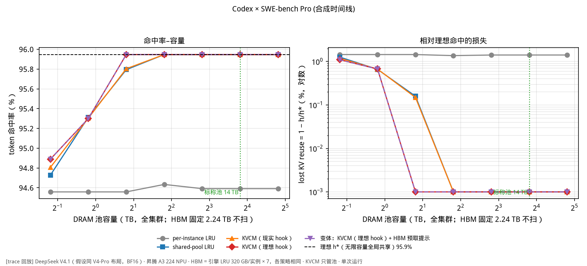

# KVCM trace 回放结果（自动生成）

由 `python3 -m kvcm_sim.report` 从 `results/*.json` 生成；参数与假设见 [`../params.md`](../params.md)，方法见 [`../README.md`](../README.md)。
全部为 **[trace 回放] + [解析]**，每个点单次运行（seed=1），无真机校准。

模型：HBM 归推理引擎：每实例 320 GB 前缀缓存、纯 LRU，所有策略相同且不随 x 轴变化；KVCM 只管 DRAM 池（停顿期池保活 + 零引用优先）。“HBM 预取提示”是单列变体（kvcm/design/kv-prefetch.md 方案 A：预取请求把池里前缀载入引擎 HBM，进 LRU、不钉）。x 轴与表中“池容量”只指 DRAM 池（标称 14 TB = 14 节点 × 1 TB）。

## AgentX Claude Code (cc-traces-weka-062126-256k)

- 负载：全规模 1729 会话/h，61.3 req/s，理想命中 h* = 95.83%；仿真切片 1/8。

### 命中率–容量（MRC）数据

| 池容量 × 标称 | 池 TB | per-instance LRU | shared-pool LRU | KVCM（现实 hook） | KVCM（理想 hook） | 变体：KVCM（理想 hook）+ HBM 预取提示 | 理想 h* |
|---:|---:|---:|---:|---:|---:|---:|---:|
| 0.03125 | 0.44 | 91.84% | 91.88% | 91.88% | 91.89% | 91.78% | 95.83% |
| 0.0625 | 0.88 | 91.84% | 91.91% | 91.93% | 91.95% | 91.91% | 95.83% |
| 0.125 | 1.75 | 91.84% | 91.94% | 92.00% | 93.13% | 93.07% | 95.83% |
| 0.25 | 3.50 | 94.07% | 94.27% | 94.11% | 95.03% | 95.03% | 95.83% |
| 0.5 | 7.00 | 94.84% | 95.14% | 94.92% | 95.61% | 95.61% | 95.83% |
| 1 | 14.00 | 95.24% | 95.58% | 95.54% | 95.77% | 95.77% | 95.83% |
| 2 | 28.00 | 95.48% | 95.77% | 95.76% | 95.83% | 95.83% | 95.83% |

### TTFT 与等效 NPU（DRAM 池 = 0.125 × 标称 = 1.75 TB）

A3 TTFT = 2 × 950 拟合 TTFT + 未掩盖 KV 加载；NPU 数为全规模等效的 prefill 平均占用（D8a §8.2）。

| 策略 | 命中率 | 其中 HBM | TTFT 均值 (s) | P50 | P95 | P95（池走 ROCE） | prefill 占用 NPU | 相对 per-instance 省 | 相对 shared-pool 省 |
|---|---:|---:|---:|---:|---:|---:|---:|---:|---:|
| per-instance LRU | 91.84% | 91.84% | 3.70 | 0.91 | 12.27 | 12.27 | 226.5 | +0.0 | -2.7 |
| shared-pool LRU | 91.94% | 91.84% | 3.65 | 0.91 | 11.97 | 11.97 | 223.8 | +2.7 | +0.0 |
| KVCM（无 hook） | 91.94% | 91.84% | 3.65 | 0.91 | 11.97 | 11.97 | 223.8 | +2.7 | +0.0 |
| KVCM（现实 hook） | 92.00% | 91.84% | 3.62 | 0.91 | 11.79 | 11.79 | 222.1 | +4.4 | +1.7 |
| KVCM（理想 hook） | 93.13% | 91.84% | 3.10 | 0.91 | 9.31 | 9.31 | 190.0 | +36.5 | +33.8 |
| 变体：KVCM（现实 hook）+ HBM 预取提示 | 92.01% | 91.84% | 3.62 | 0.91 | 11.84 | 11.84 | 221.8 | +4.6 | +2.0 |
| 变体：KVCM（理想 hook）+ HBM 预取提示 | 93.07% | 92.54% | 3.13 | 0.91 | 9.37 | 9.37 | 191.8 | +34.7 | +32.0 |

按前一停顿长度分组的复用损失（1 − h/h*，DRAM 池 = 0.125 × 标称）：

| 策略 \ 前一停顿 | first-turn（5% 请求） | <10s（82% 请求） | 10-60s（6% 请求） | 1-10min（5% 请求） | 10-60min（1% 请求） | >1h（0% 请求） |
|---|---:|---:|---:|---:|---:|---:|
| per-instance LRU | 18.1% | 0.2% | 0.2% | 32.5% | 97.1% | 97.3% |
| shared-pool LRU | 18.1% | 0.1% | 0.2% | 32.4% | 97.1% | 97.3% |
| KVCM（现实 hook） | 18.0% | 0.1% | 0.2% | 31.7% | 95.7% | 97.3% |
| KVCM（理想 hook） | 18.0% | 0.1% | 0.2% | 16.8% | 89.3% | 97.3% |
| 变体：KVCM（理想 hook）+ HBM 预取提示 | 17.7% | 0.1% | 0.2% | 17.7% | 89.4% | 97.3% |

### TTFT 与等效 NPU（DRAM 池 = 0.25 × 标称 = 3.50 TB）

A3 TTFT = 2 × 950 拟合 TTFT + 未掩盖 KV 加载；NPU 数为全规模等效的 prefill 平均占用（D8a §8.2）。

| 策略 | 命中率 | 其中 HBM | TTFT 均值 (s) | P50 | P95 | P95（池走 ROCE） | prefill 占用 NPU | 相对 per-instance 省 | 相对 shared-pool 省 |
|---|---:|---:|---:|---:|---:|---:|---:|---:|---:|
| per-instance LRU | 94.07% | 91.67% | 2.65 | 0.91 | 7.92 | 7.92 | 162.3 | +0.0 | -5.8 |
| shared-pool LRU | 94.27% | 91.84% | 2.55 | 0.91 | 7.67 | 7.68 | 156.5 | +5.8 | +0.0 |
| KVCM（现实 hook） | 94.11% | 91.84% | 2.63 | 0.91 | 7.83 | 7.84 | 161.2 | +1.1 | -4.7 |
| KVCM（理想 hook） | 95.03% | 91.84% | 2.20 | 0.90 | 6.89 | 6.89 | 134.6 | +27.6 | +21.9 |
| 变体：KVCM（理想 hook）+ HBM 预取提示 | 95.03% | 93.92% | 2.20 | 0.90 | 6.89 | 6.89 | 134.6 | +27.7 | +21.9 |

按前一停顿长度分组的复用损失（1 − h/h*，DRAM 池 = 0.25 × 标称）：

| 策略 \ 前一停顿 | first-turn（5% 请求） | <10s（82% 请求） | 10-60s（6% 请求） | 1-10min（5% 请求） | 10-60min（1% 请求） | >1h（0% 请求） |
|---|---:|---:|---:|---:|---:|---:|
| per-instance LRU | 12.9% | 0.2% | 0.2% | 2.6% | 90.4% | 97.2% |
| shared-pool LRU | 12.4% | 0.1% | 0.0% | 1.6% | 91.3% | 97.2% |
| KVCM（现实 hook） | 14.2% | 0.1% | 0.0% | 4.3% | 87.6% | 97.3% |
| KVCM（理想 hook） | 11.0% | 0.1% | 0.0% | 0.3% | 33.7% | 96.3% |
| 变体：KVCM（理想 hook）+ HBM 预取提示 | 11.0% | 0.1% | 0.0% | 0.3% | 33.6% | 96.3% |

### TTFT 与等效 NPU（DRAM 池 = 1 × 标称 = 14.00 TB）

A3 TTFT = 2 × 950 拟合 TTFT + 未掩盖 KV 加载；NPU 数为全规模等效的 prefill 平均占用（D8a §8.2）。

| 策略 | 命中率 | 其中 HBM | TTFT 均值 (s) | P50 | P95 | P95（池走 ROCE） | prefill 占用 NPU | 相对 per-instance 省 | 相对 shared-pool 省 |
|---|---:|---:|---:|---:|---:|---:|---:|---:|---:|
| per-instance LRU | 95.24% | 91.35% | 2.10 | 0.90 | 6.64 | 6.64 | 128.5 | +0.0 | -9.5 |
| shared-pool LRU | 95.58% | 91.84% | 1.94 | 0.89 | 6.26 | 6.26 | 119.0 | +9.5 | +0.0 |
| KVCM（无 hook） | 95.58% | 91.84% | 1.94 | 0.89 | 6.26 | 6.26 | 119.0 | +9.5 | +0.0 |
| KVCM（现实 hook） | 95.54% | 91.84% | 1.96 | 0.89 | 6.28 | 6.28 | 120.0 | +8.5 | -1.0 |
| KVCM（理想 hook） | 95.77% | 91.84% | 1.85 | 0.89 | 6.05 | 6.05 | 113.5 | +15.0 | +5.5 |
| 变体：KVCM（现实 hook）+ HBM 预取提示 | 95.54% | 91.81% | 1.96 | 0.89 | 6.28 | 6.28 | 120.0 | +8.5 | -1.0 |
| 变体：KVCM（理想 hook）+ HBM 预取提示 | 95.77% | 94.41% | 1.85 | 0.89 | 6.05 | 6.05 | 113.5 | +15.0 | +5.5 |

按前一停顿长度分组的复用损失（1 − h/h*，DRAM 池 = 1 × 标称）：

| 策略 \ 前一停顿 | first-turn（5% 请求） | <10s（82% 请求） | 10-60s（6% 请求） | 1-10min（5% 请求） | 10-60min（1% 请求） | >1h（0% 请求） |
|---|---:|---:|---:|---:|---:|---:|
| per-instance LRU | 4.3% | 0.3% | 0.3% | 0.3% | 2.1% | 81.3% |
| shared-pool LRU | 3.7% | 0.0% | 0.0% | 0.0% | 0.2% | 77.1% |
| KVCM（现实 hook） | 4.4% | 0.0% | 0.0% | 0.0% | 3.4% | 75.3% |
| KVCM（理想 hook） | 0.9% | 0.0% | 0.0% | 0.0% | 0.1% | 17.3% |
| 变体：KVCM（理想 hook）+ HBM 预取提示 | 0.9% | 0.0% | 0.0% | 0.0% | 0.1% | 17.3% |

## Codex × SWE-bench Pro (合成时间线)

- 负载：全规模 10354 会话/h，95.2 req/s，理想命中 h* = 95.95%；仿真切片 1/8。

### 命中率–容量（MRC）数据

| 池容量 × 标称 | 池 TB | per-instance LRU | shared-pool LRU | KVCM（现实 hook） | KVCM（理想 hook） | 变体：KVCM（理想 hook）+ HBM 预取提示 | 理想 h* |
|---:|---:|---:|---:|---:|---:|---:|---:|
| 0.03125 | 0.44 | 94.56% | 94.73% | 94.81% | 94.89% | 94.89% | 95.95% |
| 0.0625 | 0.88 | 94.56% | 95.31% | 95.30% | 95.30% | 95.30% | 95.95% |
| 0.125 | 1.75 | 94.56% | 95.79% | 95.80% | 95.95% | 95.95% | 95.95% |
| 0.25 | 3.50 | 94.63% | 95.95% | 95.95% | 95.95% | 95.95% | 95.95% |
| 0.5 | 7.00 | 94.59% | 95.95% | 95.95% | 95.95% | 95.95% | 95.95% |
| 1 | 14.00 | 94.59% | 95.95% | 95.95% | 95.95% | 95.95% | 95.95% |
| 2 | 28.00 | 94.59% | 95.95% | 95.95% | 95.95% | 95.95% | 95.95% |

### TTFT 与等效 NPU（DRAM 池 = 0.125 × 标称 = 1.75 TB）

A3 TTFT = 2 × 950 拟合 TTFT + 未掩盖 KV 加载；NPU 数为全规模等效的 prefill 平均占用（D8a §8.2）。

| 策略 | 命中率 | 其中 HBM | TTFT 均值 (s) | P50 | P95 | P95（池走 ROCE） | prefill 占用 NPU | 相对 per-instance 省 | 相对 shared-pool 省 |
|---|---:|---:|---:|---:|---:|---:|---:|---:|---:|
| per-instance LRU | 94.56% | 94.56% | 1.58 | 0.54 | 4.28 | 4.28 | 150.0 | +0.0 | -34.2 |
| shared-pool LRU | 95.79% | 94.56% | 1.22 | 0.53 | 3.92 | 3.92 | 115.8 | +34.2 | +0.0 |
| KVCM（无 hook） | 95.79% | 94.56% | 1.22 | 0.53 | 3.92 | 3.92 | 115.8 | +34.2 | +0.0 |
| KVCM（现实 hook） | 95.80% | 94.56% | 1.21 | 0.53 | 3.92 | 3.92 | 115.6 | +34.5 | +0.3 |
| KVCM（理想 hook） | 95.95% | 94.56% | 1.17 | 0.53 | 3.91 | 3.91 | 111.5 | +38.5 | +4.3 |
| 变体：KVCM（现实 hook）+ HBM 预取提示 | 95.80% | 94.56% | 1.21 | 0.53 | 3.92 | 3.92 | 115.6 | +34.5 | +0.3 |
| 变体：KVCM（理想 hook）+ HBM 预取提示 | 95.95% | 94.49% | 1.17 | 0.53 | 3.91 | 3.91 | 111.5 | +38.5 | +4.3 |

按前一停顿长度分组的复用损失（1 − h/h*，DRAM 池 = 0.125 × 标称）：

| 策略 \ 前一停顿 | first-turn（3% 请求） | <10s（70% 请求） | 10-60s（26% 请求） | 1-10min（2% 请求） | 10-60min（0% 请求） | >1h（0% 请求） |
|---|---:|---:|---:|---:|---:|---:|
| per-instance LRU | 0.0% | 1.3% | 1.5% | 6.2% | — | — |
| shared-pool LRU | 0.0% | 0.1% | 0.1% | 5.0% | — | — |
| KVCM（现实 hook） | 0.0% | 0.1% | 0.1% | 4.9% | — | — |
| KVCM（理想 hook） | 0.0% | 0.0% | 0.0% | 0.0% | — | — |
| 变体：KVCM（理想 hook）+ HBM 预取提示 | 0.0% | 0.0% | 0.0% | 0.0% | — | — |

### TTFT 与等效 NPU（DRAM 池 = 0.25 × 标称 = 3.50 TB）

A3 TTFT = 2 × 950 拟合 TTFT + 未掩盖 KV 加载；NPU 数为全规模等效的 prefill 平均占用（D8a §8.2）。

| 策略 | 命中率 | 其中 HBM | TTFT 均值 (s) | P50 | P95 | P95（池走 ROCE） | prefill 占用 NPU | 相对 per-instance 省 | 相对 shared-pool 省 |
|---|---:|---:|---:|---:|---:|---:|---:|---:|---:|
| per-instance LRU | 94.63% | 94.45% | 1.55 | 0.54 | 4.26 | 4.26 | 147.9 | +0.0 | -36.3 |
| shared-pool LRU | 95.95% | 94.56% | 1.17 | 0.53 | 3.91 | 3.91 | 111.5 | +36.3 | +0.0 |
| KVCM（现实 hook） | 95.95% | 94.56% | 1.17 | 0.53 | 3.91 | 3.91 | 111.5 | +36.3 | +0.0 |
| KVCM（理想 hook） | 95.95% | 94.56% | 1.17 | 0.53 | 3.91 | 3.91 | 111.5 | +36.3 | +0.0 |
| 变体：KVCM（理想 hook）+ HBM 预取提示 | 95.95% | 94.49% | 1.17 | 0.53 | 3.91 | 3.91 | 111.5 | +36.3 | +0.0 |

按前一停顿长度分组的复用损失（1 − h/h*，DRAM 池 = 0.25 × 标称）：

| 策略 \ 前一停顿 | first-turn（3% 请求） | <10s（70% 请求） | 10-60s（26% 请求） | 1-10min（2% 请求） | 10-60min（0% 请求） | >1h（0% 请求） |
|---|---:|---:|---:|---:|---:|---:|
| per-instance LRU | 0.0% | 1.4% | 1.3% | 1.6% | — | — |
| shared-pool LRU | 0.0% | 0.0% | 0.0% | 0.0% | — | — |
| KVCM（现实 hook） | 0.0% | 0.0% | 0.0% | 0.0% | — | — |
| KVCM（理想 hook） | 0.0% | 0.0% | 0.0% | 0.0% | — | — |
| 变体：KVCM（理想 hook）+ HBM 预取提示 | 0.0% | 0.0% | 0.0% | 0.0% | — | — |

### TTFT 与等效 NPU（DRAM 池 = 1 × 标称 = 14.00 TB）

A3 TTFT = 2 × 950 拟合 TTFT + 未掩盖 KV 加载；NPU 数为全规模等效的 prefill 平均占用（D8a §8.2）。

| 策略 | 命中率 | 其中 HBM | TTFT 均值 (s) | P50 | P95 | P95（池走 ROCE） | prefill 占用 NPU | 相对 per-instance 省 | 相对 shared-pool 省 |
|---|---:|---:|---:|---:|---:|---:|---:|---:|---:|
| per-instance LRU | 94.59% | 94.39% | 1.57 | 0.54 | 4.29 | 4.29 | 149.0 | +0.0 | -37.5 |
| shared-pool LRU | 95.95% | 94.56% | 1.17 | 0.53 | 3.91 | 3.91 | 111.5 | +37.5 | +0.0 |
| KVCM（无 hook） | 95.95% | 94.56% | 1.17 | 0.53 | 3.91 | 3.91 | 111.5 | +37.5 | +0.0 |
| KVCM（现实 hook） | 95.95% | 94.56% | 1.17 | 0.53 | 3.91 | 3.91 | 111.5 | +37.5 | +0.0 |
| KVCM（理想 hook） | 95.95% | 94.56% | 1.17 | 0.53 | 3.91 | 3.91 | 111.5 | +37.5 | +0.0 |
| 变体：KVCM（现实 hook）+ HBM 预取提示 | 95.95% | 94.56% | 1.17 | 0.53 | 3.91 | 3.91 | 111.5 | +37.5 | +0.0 |
| 变体：KVCM（理想 hook）+ HBM 预取提示 | 95.95% | 94.49% | 1.17 | 0.53 | 3.91 | 3.91 | 111.5 | +37.5 | +0.0 |

按前一停顿长度分组的复用损失（1 − h/h*，DRAM 池 = 1 × 标称）：

| 策略 \ 前一停顿 | first-turn（3% 请求） | <10s（70% 请求） | 10-60s（26% 请求） | 1-10min（2% 请求） | 10-60min（0% 请求） | >1h（0% 请求） |
|---|---:|---:|---:|---:|---:|---:|
| per-instance LRU | 0.0% | 1.4% | 1.5% | 1.3% | — | — |
| shared-pool LRU | 0.0% | 0.0% | 0.0% | 0.0% | — | — |
| KVCM（现实 hook） | 0.0% | 0.0% | 0.0% | 0.0% | — | — |
| KVCM（理想 hook） | 0.0% | 0.0% | 0.0% | 0.0% | — | — |
| 变体：KVCM（理想 hook）+ HBM 预取提示 | 0.0% | 0.0% | 0.0% | 0.0% | — | — |

## Qwen-Bailian coder

- 负载：全规模 323654 会话/h，146.6 req/s，理想命中 h* = 66.31%；仿真切片 1/8。

### 命中率–容量（MRC）数据

| 池容量 × 标称 | 池 TB | per-instance LRU | shared-pool LRU | KVCM（现实 hook） | KVCM（理想 hook） | 变体：KVCM（理想 hook）+ HBM 预取提示 | 理想 h* |
|---:|---:|---:|---:|---:|---:|---:|---:|
| 0.03125 | 0.44 | 59.14% | 59.14% | 59.20% | 59.17% | 59.16% | 66.31% |
| 0.0625 | 0.88 | 59.14% | 59.14% | 59.29% | 62.71% | 62.73% | 66.31% |
| 0.125 | 1.75 | 59.14% | 59.19% | 59.51% | 62.72% | 62.74% | 66.31% |
| 0.25 | 3.50 | 62.31% | 62.32% | 62.41% | 64.07% | 64.07% | 66.31% |
| 0.5 | 7.00 | 65.30% | 65.29% | 64.12% | 65.79% | 65.79% | 66.31% |
| 1 | 14.00 | 66.21% | 66.22% | 66.14% | 66.26% | 66.26% | 66.31% |
| 2 | 28.00 | 66.30% | 66.31% | 66.30% | 66.31% | 66.31% | 66.31% |

### TTFT 与等效 NPU（DRAM 池 = 0.125 × 标称 = 1.75 TB）

A3 TTFT = 2 × 950 拟合 TTFT + 未掩盖 KV 加载；NPU 数为全规模等效的 prefill 平均占用（D8a §8.2）。

| 策略 | 命中率 | 其中 HBM | TTFT 均值 (s) | P50 | P95 | P95（池走 ROCE） | prefill 占用 NPU | 相对 per-instance 省 | 相对 shared-pool 省 |
|---|---:|---:|---:|---:|---:|---:|---:|---:|---:|
| per-instance LRU | 59.14% | 59.14% | 0.92 | 0.43 | 3.60 | 3.60 | 134.2 | +0.0 | -0.1 |
| shared-pool LRU | 59.19% | 59.14% | 0.91 | 0.43 | 3.60 | 3.60 | 134.1 | +0.1 | +0.0 |
| KVCM（无 hook） | 59.19% | 59.14% | 0.91 | 0.43 | 3.60 | 3.60 | 134.1 | +0.1 | +0.0 |
| KVCM（现实 hook） | 59.51% | 59.14% | 0.91 | 0.42 | 3.60 | 3.60 | 133.1 | +1.1 | +1.0 |
| KVCM（理想 hook） | 62.72% | 59.14% | 0.84 | 0.42 | 3.39 | 3.39 | 123.1 | +11.1 | +10.9 |
| 变体：KVCM（现实 hook）+ HBM 预取提示 | 59.53% | 59.16% | 0.91 | 0.42 | 3.60 | 3.60 | 133.0 | +1.2 | +1.1 |
| 变体：KVCM（理想 hook）+ HBM 预取提示 | 62.74% | 62.68% | 0.84 | 0.42 | 3.39 | 3.39 | 123.1 | +11.1 | +11.0 |

按前一停顿长度分组的复用损失（1 − h/h*，DRAM 池 = 0.125 × 标称）：

| 策略 \ 前一停顿 | first-turn（62% 请求） | <10s（6% 请求） | 10-60s（9% 请求） | 1-10min（17% 请求） | 10-60min（6% 请求） | >1h（0% 请求） |
|---|---:|---:|---:|---:|---:|---:|
| per-instance LRU | 9.6% | 0.0% | 0.3% | 3.0% | 86.8% | 97.3% |
| shared-pool LRU | 9.5% | 0.0% | 0.3% | 2.8% | 86.8% | 97.2% |
| KVCM（现实 hook） | 8.9% | 0.0% | 0.3% | 2.8% | 84.4% | 97.1% |
| KVCM（理想 hook） | 9.4% | 0.0% | 0.3% | 0.5% | 0.7% | 0.4% |
| 变体：KVCM（理想 hook）+ HBM 预取提示 | 9.4% | 0.0% | 0.3% | 0.5% | 0.7% | 0.4% |

### TTFT 与等效 NPU（DRAM 池 = 0.25 × 标称 = 3.50 TB）

A3 TTFT = 2 × 950 拟合 TTFT + 未掩盖 KV 加载；NPU 数为全规模等效的 prefill 平均占用（D8a §8.2）。

| 策略 | 命中率 | 其中 HBM | TTFT 均值 (s) | P50 | P95 | P95（池走 ROCE） | prefill 占用 NPU | 相对 per-instance 省 | 相对 shared-pool 省 |
|---|---:|---:|---:|---:|---:|---:|---:|---:|---:|
| per-instance LRU | 62.31% | 59.13% | 0.85 | 0.40 | 3.43 | 3.43 | 124.4 | +0.0 | -0.0 |
| shared-pool LRU | 62.32% | 59.14% | 0.85 | 0.40 | 3.43 | 3.43 | 124.3 | +0.0 | +0.0 |
| KVCM（现实 hook） | 62.41% | 59.14% | 0.85 | 0.40 | 3.44 | 3.44 | 124.1 | +0.3 | +0.3 |
| KVCM（理想 hook） | 64.07% | 59.14% | 0.81 | 0.40 | 3.33 | 3.33 | 118.9 | +5.4 | +5.4 |
| 变体：KVCM（理想 hook）+ HBM 预取提示 | 64.07% | 62.68% | 0.81 | 0.40 | 3.33 | 3.33 | 118.9 | +5.4 | +5.4 |

按前一停顿长度分组的复用损失（1 − h/h*，DRAM 池 = 0.25 × 标称）：

| 策略 \ 前一停顿 | first-turn（62% 请求） | <10s（6% 请求） | 10-60s（9% 请求） | 1-10min（17% 请求） | 10-60min（6% 请求） | >1h（0% 请求） |
|---|---:|---:|---:|---:|---:|---:|
| per-instance LRU | 5.4% | 0.0% | 0.2% | 0.4% | 49.4% | 96.1% |
| shared-pool LRU | 5.4% | 0.0% | 0.2% | 0.4% | 49.4% | 96.3% |
| KVCM（现实 hook） | 5.0% | 0.0% | 0.2% | 0.7% | 50.5% | 95.6% |
| KVCM（理想 hook） | 5.9% | 0.0% | 0.2% | 0.4% | 0.5% | 0.2% |
| 变体：KVCM（理想 hook）+ HBM 预取提示 | 5.9% | 0.0% | 0.2% | 0.4% | 0.5% | 0.2% |

### TTFT 与等效 NPU（DRAM 池 = 1 × 标称 = 14.00 TB）

A3 TTFT = 2 × 950 拟合 TTFT + 未掩盖 KV 加载；NPU 数为全规模等效的 prefill 平均占用（D8a §8.2）。

| 策略 | 命中率 | 其中 HBM | TTFT 均值 (s) | P50 | P95 | P95（池走 ROCE） | prefill 占用 NPU | 相对 per-instance 省 | 相对 shared-pool 省 |
|---|---:|---:|---:|---:|---:|---:|---:|---:|---:|
| per-instance LRU | 66.21% | 59.09% | 0.77 | 0.37 | 3.18 | 3.18 | 112.2 | +0.0 | -0.0 |
| shared-pool LRU | 66.22% | 59.14% | 0.77 | 0.37 | 3.18 | 3.18 | 112.2 | +0.0 | +0.0 |
| KVCM（无 hook） | 66.22% | 59.14% | 0.77 | 0.37 | 3.18 | 3.18 | 112.2 | +0.0 | +0.0 |
| KVCM（现实 hook） | 66.14% | 59.14% | 0.77 | 0.37 | 3.19 | 3.19 | 112.5 | -0.2 | -0.3 |
| KVCM（理想 hook） | 66.26% | 59.14% | 0.76 | 0.37 | 3.17 | 3.17 | 112.1 | +0.2 | +0.1 |
| 变体：KVCM（现实 hook）+ HBM 预取提示 | 66.14% | 58.89% | 0.77 | 0.37 | 3.19 | 3.19 | 112.5 | -0.2 | -0.3 |
| 变体：KVCM（理想 hook）+ HBM 预取提示 | 66.26% | 62.68% | 0.76 | 0.37 | 3.17 | 3.17 | 112.1 | +0.2 | +0.1 |

按前一停顿长度分组的复用损失（1 − h/h*，DRAM 池 = 1 × 标称）：

| 策略 \ 前一停顿 | first-turn（62% 请求） | <10s（6% 请求） | 10-60s（9% 请求） | 1-10min（17% 请求） | 10-60min（6% 请求） | >1h（0% 请求） |
|---|---:|---:|---:|---:|---:|---:|
| per-instance LRU | 0.1% | 0.0% | 0.0% | 0.0% | 0.2% | 24.1% |
| shared-pool LRU | 0.1% | 0.0% | 0.0% | 0.0% | 0.0% | 21.3% |
| KVCM（现实 hook） | 0.2% | 0.0% | 0.0% | 0.0% | 0.1% | 45.0% |
| KVCM（理想 hook） | 0.1% | 0.0% | 0.0% | 0.0% | 0.0% | 0.0% |
| 变体：KVCM（理想 hook）+ HBM 预取提示 | 0.1% | 0.0% | 0.0% | 0.0% | 0.0% | 0.0% |

