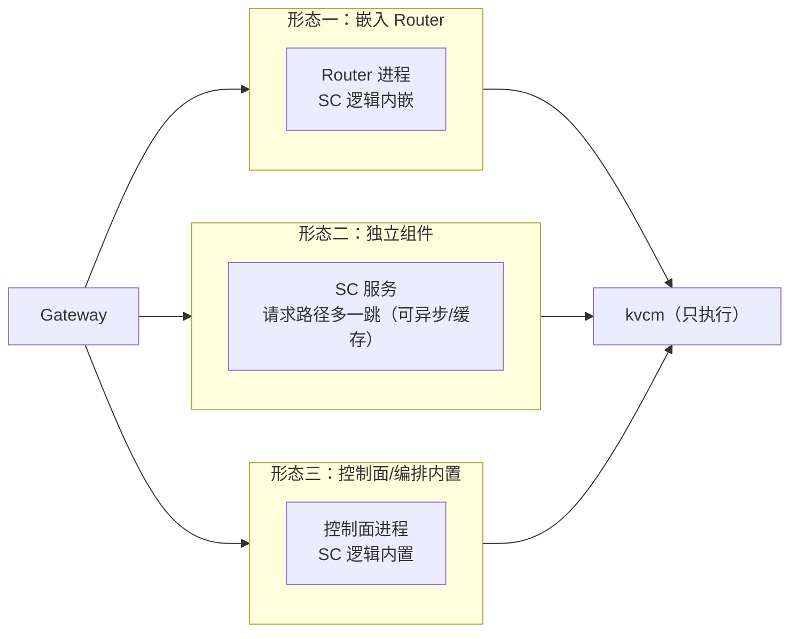

# 调度中心（Scheduling Center）

调度中心（SC）是**独立于 kvcm** 的请求/容量决策面：决定请求去哪个实例、KV 要不要预取/保留/释放、集群扩不扩。

> **kvcm 自身没有调度**。kvcm 只执行 KV 操作（copy/move/keepalive/pin/demote/promote/retain/remove）、核验、记账、发布事件；调度中心向它发 intent。两者是“决策”和“执行”的边界，不是同一个组件。

## 进程形态

SC 是**逻辑角色**，不绑定进程：

选择哪一种取决于：请求路径延迟预算、SC 是否多消费者、HA/扩缩单元、与 Router 的部署耦合。**D8 的决策逻辑三种形态相同**，差别只在“谁持有 KVT/会话状态、请求路径是否多一跳”。

## 文档

| 文档 | 内容 |
|---|---|
| [design/D8-joint-scheduling.md](design/D8-joint-scheduling.md) | 调度中心的目标形态、KVT、Hook、L0/L1/L2、性能模型与收益 |
| [design/scheduling.md](design/scheduling.md) | L0 选路、L1 预取/保留、L2 扩缩/drain、ghost、多实例、Agent 全链路时序 |

## 与 kvcm 的关系

- SC：请求/容量决策；持有 KVT、会话缓存、容量/价格、决策日志。
- kvcm：KV 执行 + 核验 + 记账 + 发布；不选路、不扩缩、不持有前缀索引。
- 两条通道：SC → kvcm 的 **intent**（异步，可拒绝/推迟）；kvcm → SC 的 **READY/事件**（放置回写、删除/失效）。
- kvcm 的服务面（会话 KV、预热、反熵、账本等）见 [../kvcm/design/D9-kv-services.md](../kvcm/design/D9-kv-services.md)。

## 版本基线

Mooncake **v0.3.13.post1**（master / client 同版本）；vLLM-Ascend 0.26 系。能力边界以 [../kvcm/summary.md](../kvcm/summary.md) 与 [../kvcm/design/D2-kv-operations.md](../kvcm/design/D2-kv-operations.md) 为准。
