# D8: 统一调度中心——目标形态与性能模型

- 状态: **设计草案**（目标形态与收益模型；数值为模型估算，待真机校准）
- 版本基线: **Mooncake v0.3.13.post1**（master / client 同版本）；vLLM-Ascend 0.26 系（kvcm D1 的事实基线）
- 归属: **调度中心（Scheduling Center，SC）**，不属于 kvcm；可以是独立组件，也可以嵌入 Router（或在编排/控制面内置）。本文用“SC”这一逻辑角色，不绑定进程形态
- 相关: kvcm 的 [D1](../../kvcm/design/D1-router-scheduling.md) / [D2](../../kvcm/design/D2-kv-operations.md)（KV 执行语义）、[D9](../../kvcm/design/D9-kv-services.md)（kvcm 服务面）
- 适用部署: **vLLM-Ascend + Mooncake Store + kvcm** 独立部署；SC 是请求/容量决策面（实现语言不限）
- 关系声明: **kvcm 是独立项目，本文不依赖 lake 运行时**。lake 仓库只提供参考文档与原型经验；文中引用 lake 的地方都是“可借鉴”，不是依赖
- 非目标:
  - 不重新定义 kvcm 八项操作的语义（归 D2）；本文只定义“何时、对谁、花多少预算”发 intent
  - 不实现节点级 scheduler（continuous batching / block 分配归 vLLM Scheduler）
  - 不实现真实 provision（起 pod / 拉镜像 / 加载权重归外部编排）
  - 不做多租户计费/鉴权（归 gateway / 外部控制面）
  - 首版不做跨机房，只做单集群
  - 不写代码结构/接口 IDL；本文只保留目标形态、控制原理、收益模型

---

## 0. 结论

1. **终局不是“再加一个调度器进程”，而是建一个调度中心（SC）**：可以是独立组件，也可以嵌入 Router；逻辑上是一个共享状态 + 三条时间尺度不同的决策环，把“请求去哪、KV 怎么动、集群扩不扩”放进同一套目标与预算。
2. **索引是事件派生的决策视图，不是第二权威**：引擎 KV events、kvcm READY、Mooncake publisher、SC 推测条目、worker miss 反馈，合成一棵 KVT；Mooncake master 仍是副本权威。
3. **最大的性能杠杆是“命中/保留”，不是 HBM 命中后的本地拷贝优化**：命中省掉的是秒级 prefill；本地放置省掉的是十毫秒级跨机传输；HBM 命中再省掉毫秒级本地拷贝。三者的量级差一个数量级以上，调度优先级必须按这个顺序设计。
4. **kvcm 的定位是“KV 执行 + 核验 + 记账 + 发布”**：不做选路、不做扩缩决策、不持有前缀索引。它的八项操作组合成会话、预热、反熵、账本、容量、迁移等服务。
5. **v0.3.13.post1 下，soft pin 空写已“有条件可用”**（PR73）；hard pin 事后设置已明确拒绝；copy/move 仍无取消；retain 仍未实现；池 publisher 代码有、但默认构建/运行都不开。设计必须按这个基线写，而不是按 main。

---

## 1. 目标形态

### 1.0 进程形态：SC 不是 kvcm，也不一定是 Router

SC 是逻辑角色，进程形态三选一（也可以组合：请求环嵌 Router、容量环独立）：

| 形态 | 请求路径 | 状态归属 | 适用 |
|---|---|---|---|
| **嵌入 Router** | 无额外一跳 | Router 进程内 | 强延迟敏感、Router 已是唯一入口 |
| **独立组件** | 多一跳（可异步/缓存/批量） | SC 自己持有 KVT/会话缓存 | 多消费者、独立 HA/扩缩、请求环与容量环解耦 |
| **编排/控制面内置** | 不接在线请求（批量/离线） | 控制面持有 | 离线调度、容量规划、非交互场景 |

三种形态的**决策逻辑相同**；差别在“谁持有 KVT/会话状态、请求路径是否多一跳、HA/扩缩单元是谁”。本文用 SC 这个逻辑角色，不绑定进程；如果放 Router 里，它也只是 Router 的一个模块，不是 kvcm 的一部分。

### 1.1 一张图

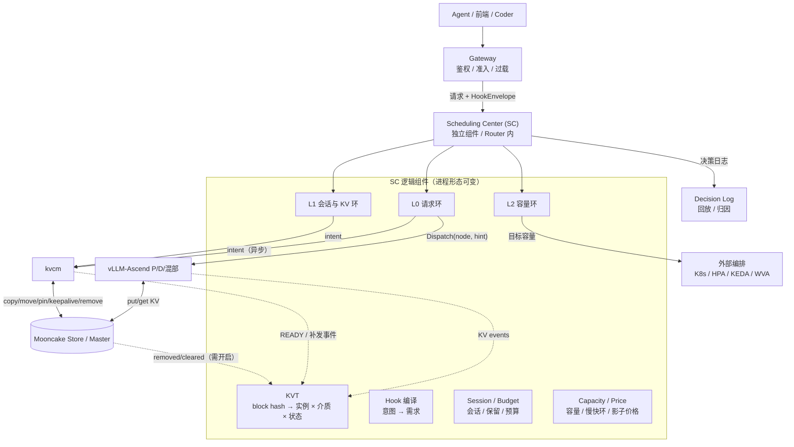

四个角色：

| 角色 | 终局职责 | 不做什么 |
|---|---|---|
| **Scheduling Center (SC)** | KVT、hook 编译、L0/L1/L2、intent、决策日志 | 不直连 master、不读写 KV、不开机器；不归 kvcm |
| **kvcm** | KV 执行、READY 核验、补发事件、会话/保活/台账、反熵 | 不选路、不扩缩、不持有前缀索引 |
| **vLLM-Ascend** | 执行、产生 KV events、本地 APC | 不做跨实例调度 |
| **Mooncake** | KV 数据/副本/lease/驱逐/offload | 不解释 token/hash |

### 1.2 终局的五个特征

1. **需求前置**：hook 在请求前给出会话、前缀、ETA、保留意图；SC 提前预取/保留/扩容，而不是等请求到了再反应。
2. **视图统一**：请求、KV 位置、会话、容量、价格在同一决策状态里；不是“路由看一套、KV 看一套、扩缩看一套”。
3. **决策分层**：L0 <5ms、L1 100ms–1s、L2 5–60s；三条环通过价格/预算耦合，不互相阻塞。
4. **KV 生命周期服务化**：会话保留、预热、反熵、账本、迁移是长期运行的服务，不是一次性脚本。
5. **弹性闭环**：扩缩不只看队列，还看 KV 价值、warm gate、会话风险；缩容不丢热 KV。

### 1.3 终局能力清单

| 面 | 终局能力 | 关键输入 | 关键输出 |
|---|---|---|---|
| 请求 | 两模式选路（PD 分离/混部）+ HBM 命中利用；节点/队列 | KVT、负载、SLO、价格 | target + hint |
| KV | 预取、保留、释放、降层、迁移 | hook、会话、KVT、预算 | intent（异步） |
| 扩缩 | 计算池 + KV 池；扩容 warm gate；缩容 KV-aware victim | 需求预测、SLO、水位、KV 价值 | 目标容量/期望状态 |
| 观测 | 命中归因、预热 ROI、决策回放 | KVT、intent、READY、请求结果 | 指标/账本/策略版本 |

### 1.4 现状与终局的差距

截至 2026-11-04，按分支现状（**以合入 main 为准**）：

| 能力 | 现状 | 对 D8 的影响 |
|---|---|---|
| E10/E11/E12 | 已合入 main：五层重构、常驻进程、gRPC intent（仅预热） | L0/L1 可以先接 intent；其他操作还没有 intent |
| E14 补发 | `feat/kvcm-e14-publish` 已实现真机补发：READY 后按实例端点发 `BlockStored`（`medium=CPU`、`full_attention`、低 64 位 hash） | KVT 的“预复制放置”有来源；move/remove 事件仍未接 |
| soft pin | `feat/kvcm-ops-mainline`（PR73）：空写 **有条件可用**；hard pin 拒绝 | 会话保留可以先用 soft pin；有前置条件 |
| 实例注册 | E13 设计已定：实例 id、rank 有序段、端点、DP、kind 一次交全；代码归 E13 | 端点/seg 映射仍靠启动参数；生产要多一次注册 |
| 段容量准入 | PR72：提交前查目标段剩余；不够不发 | 预取会因段满失败；L1 要有退避 |
| E15 带宽限速 | 未做：只有并发窗口，没有网卡利用率感知 | 预取/迁移会争带宽；L1 要预算 |
| retain | 未实现：没有 `AddReplicaForRetainedClient`；可登记 move 到活 seg / kvcm 自挂 SSD | 会话跨实例存亡还不能完全兜住 |
| publisher | v0.3.13.post1 有代码，但构建默认 OFF、运行默认 false；copy 路径零发布 | 删除面要么开启 publisher，要么靠 TTL/miss/核验 |

> 结论：D8 的终局形态可以现在设计，但**落地必须按 v0.3.13.post1 的能力写**；不能把 main/0.3.14 的 `has_read_lease`、retained client、DFS 当成已具备。

### 1.5 明确不做

- 不做“全局在线优化器”：请求路径算不动，也会把扩缩抖动带进 TTFT。
- 不让 SC 直读 Mooncake master：SC 会变成池感知组件，且每请求多一跳；kvcm D1 §2 已排除。
- 不让 kvcm 持有前缀索引：索引是在线服务，kvcm 是后台控制面（D1 §4）。
- 不做固定降级链：失败按最新状态重跑。
- 不做“无限 pin/无限预取”：没有预算的保留等于没有策略。

---

## 2. 为什么必须联合

### 2.1 三个决策互相抵消

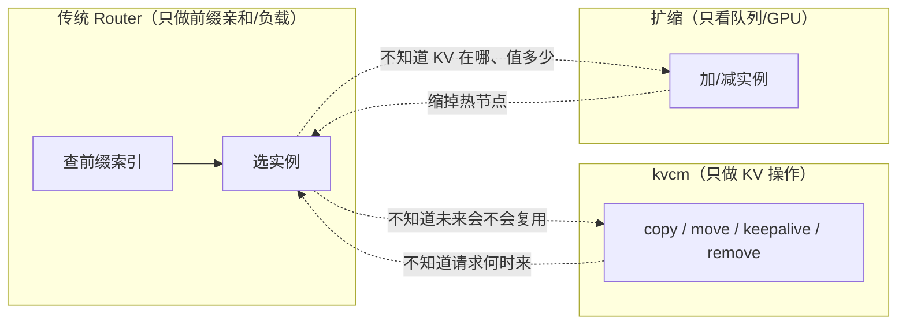

典型互相抵消：

- 传统 Router 把请求发到 A，kvcm 把 KV 预取到 B——预取白做；
- 扩缩把持有热前缀的节点缩掉——命中率下降，再扩回来；
- hook 说“30 秒后还要用”，但没人把它变成预取/保留/不缩容；
- kvcm READY 只写日志，没回写索引——下一次还是不知道 B 有了。

### 2.2 时间尺度差三个数量级

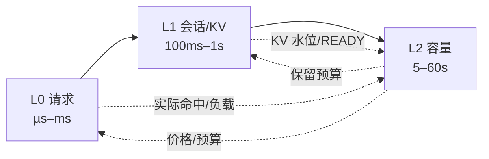

把三者塞进一个在线优化器会有三个问题：

- 算不动：候选节点 × 前缀块 × KV 动作 × 扩缩组合；
- 抖动传导：扩缩慢决策让请求路径抖动；
- 不可解释：出错无法判断是索引错、打分错还是扩缩错。

### 2.3 用“价格”做耦合

L2 根据全局需求算容量/带宽/预取的**影子价格**；L0/L1 在价格下做局部最优。价格是三条环之间唯一的耦合信号：

```text
λ_gpu      每 GPU 秒的边际成本
λ_hbm      每 GB HBM/DRAM 占用的边际成本
λ_bw       每 GB 传输的边际成本
λ_prewarm  预取预算的边际成本
λ_slo      SLO 违约的边际成本
```

这样既“联合”，又保持每层可解释、可回滚、可单独限流。

---

## 3. 统一决策状态

### 3.1 KVT：KV 索引树

KVT 不是第二权威，是**决策视图**：

- **权威**：Mooncake master 记副本；引擎记 HBM/APC；kvcm 记操作与核验。
- **KVT**：把“哪里可能有这个前缀、以什么置信度”整理成可查询的树，服务选路与预取。
- **允许陈旧**：陈旧只损性能，不损正确性（读路径会远端读/重算兜底）。

#### 介质分层

| 层 | 含义 | 事件来源 | 对调度的意义 |
|---|---|---|---|
| **HBM** | 实例 APC/显存里的块 | 引擎 `BlockStored(medium=GPU)` | 真本地命中；HBM 命中的唯一依据 |
| **本机 DRAM** | 本机 Mooncake seg | 引擎 `BlockStored(medium=CPU)` / kvcm READY | 本地读，省跨机传输；仍要拷进 HBM |
| **远端 DRAM/SSD/DFS** | 池内其他节点/介质 | 池事件、kvcm 核验 | Pool 命中，省重算但要传输 |

**关键区分**：kvcm 预取到目标 seg，得到的是“本机 DRAM”，不是 HBM。它让请求走本地读，避免跨机 RDMA；但第一次使用仍要把 KV 从 DRAM 拷进 HBM。**要认定 HBM 命中，需要 HBM 证据**（引擎 GPU 事件，或方案 A 壳请求把 KV 带进 HBM）。这个区分决定了性能收益的量级（见 §7）。

#### 状态与置信度

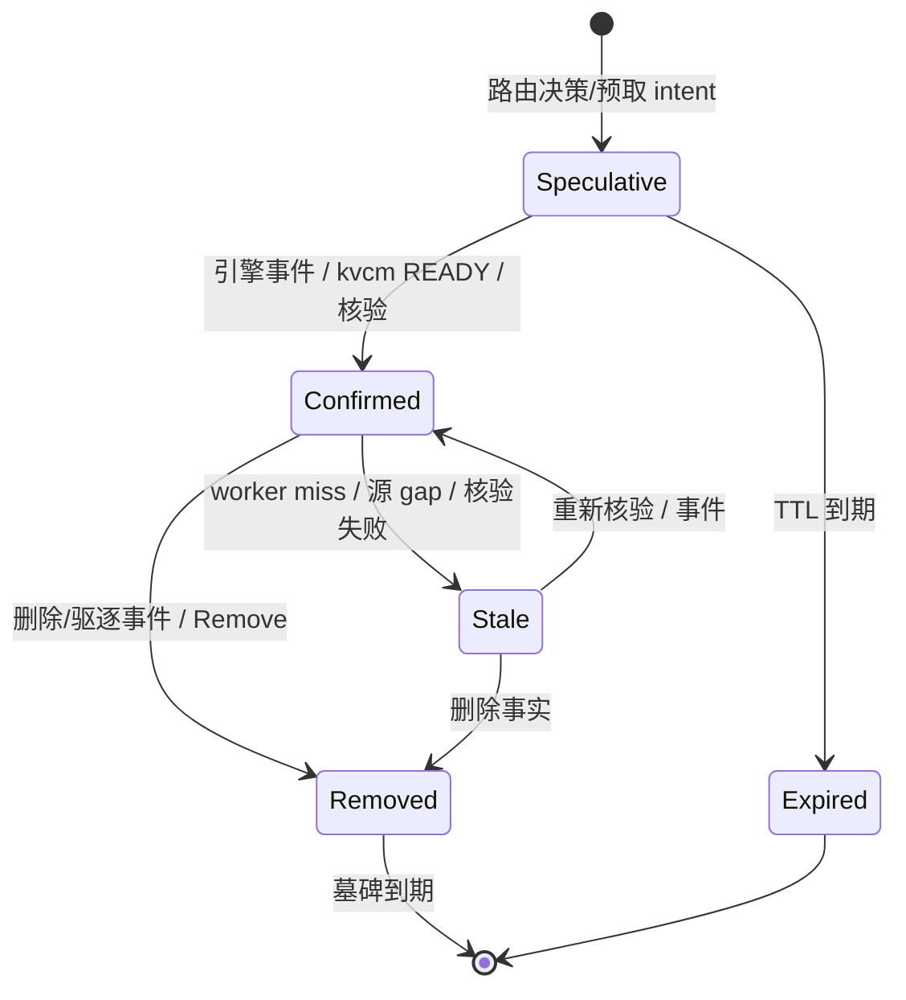

- `Speculative` 只做亲和排序，不当作 HBM 命中；
- `Confirmed` 才可作为“可路由”的依据；
- 删除/失效事实带墓碑，防止延迟到达的 `Stored` 复活；
- 置信度随时间衰减；低于阈值只做亲和，不当作 HBM 命中。

#### 合并规则（概念）

- 每个源独立序号；gap → replay/snapshot；拿不到就标 stale。
- 同一块同一实例同一介质只保留一条位置；不同介质可并存。
- 负事实优先；源信任级：核验 > kvcm READY > 引擎事件 ≈ 池事件 > 推测 > miss 反馈（负事实最高）。
- `miss` 反馈是最便宜的反熵：worker 说没有，就降级该条；不需要全量轮询 master。

### 3.2 Session / Demand

会话状态回答四个问题：

- 这个会话上一轮在哪个实例、前缀到哪；
- 下一轮大概什么时候来、还会不会来；
- 前缀值不值得保留、保留多久；
- 已经花了多少预取/保留预算。

**权威在 kvcm ledger 的 sessions 表**（kvcm D2 的“不可丢”状态），SC 持缓存；SC 重启后回读，不丢会话。

### 3.3 Capacity / Price

容量视图包括：

- 实例：角色、队列、in-flight、prefill/decode 速率、HBM/DRAM 余量、NIC 利用率；
- 池：DRAM/SSD/DFS 水位、驱逐率、promote 速率、shard 环；
- 预算：GPU/节点上限、后台带宽上限、pin 字节上限。

价格是这些约束的“影子”：

```text
λ_{t+1} = clip(λ_t + η × (u_t − u*), 0, λ_max)     （对偶上升）
λ = λ_base × (u / u*)^k                             （工程比例式）
```

`u` 是利用率/水位，`u*` 是目标。L0/L1 只读价格；L2 单点更新。

---

## 4. Hook：把意图变成需求

### 4.1 三个时序

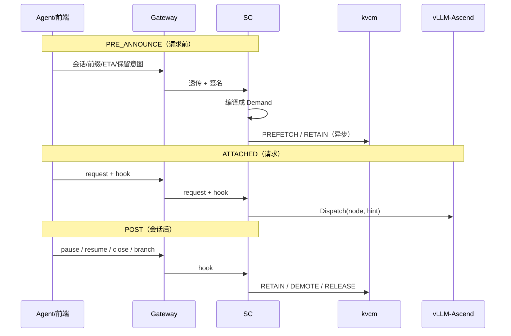

### 4.2 信封（概念字段）

| 字段 | 作用 | 约束 |
|---|---|---|
| `version` / `hook_id` | 兼容/幂等 | 未知版本降级为 observe |
| `session_id` / `workflow_id` / `step` / `branch` | 会话/分支定位 | 与路由键对齐 |
| `prefix`（token_ids 或 hash 链） | 要预取/保留的前缀 | 优先 hash；必须与引擎口径一致 |
| `timing` / `eta_ms` / `expected_turns` / `reuse_prob` | 请求前/中/后；预计到达 | ETA 决定提前量 |
| `retention` / `ttl_ms` / `prefetch` | 保留等级与生命周期 | TTL/pin 上限可裁剪 |
| `affinity`（node/zone/strict） | 会话亲和 | strict 也不能违反容量/SLO |
| `deadline` / `priority` | SLO/优先级 | 优先级只影响排队，不做准入 |
| `budget` | 预取/保留/字节上限 | 超预算裁剪或拒绝 |
| `signature` | 网关签名 | 匿名来源只能 observe |

### 4.3 语义

- **hint ≠ command**：SC/kvcm 可裁剪、推迟、拒绝；请求正确性不依赖 hook。
- **fail-open**：解析失败/版本不认识/预算超限 → 丢弃 + metric，不影响请求。
- **预算与审计**：每 session/租户有 pin/预取/带宽上限；hook 可审计。
- **key 口径**：vLLM-Ascend 是链式 block hash（`parent_hash`、block_size、模型类型、初始种子参与），TP 下同一逻辑块多把 key。SC 必须用与引擎逐字节一致的 hash 算法；hook 优先带 hash/token_ids，不要用估算 token 数。
- **不等待**：pre_announce 只影响未来；attached 请求走当前最优路径，不等 READY。

---

## 5. 三条决策环

### 5.1 L0 请求环（<5ms）

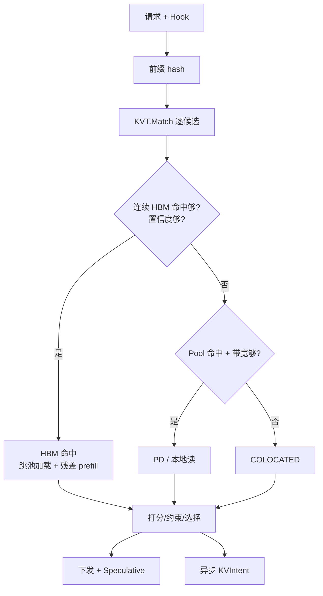

打分（示意）：

```text
U = w_hit·H·c_prefill + w_pool·P·c_prefill·κ
  − w_bw·(B/BW)·c_bw − w_q·Q·c_queue
  − w_slo·max(0, TTFT−D)·c_slo
  + w_future·F − w_risk·R
```

TTFT 估算：

```text
TTFT = Q + residual/v_prefill + B/BW + T_handoff
```

传 vs 算：

```text
C_transfer  = B/BW × c_bw
C_recompute = residual × c_prefill
BW*         = B×c_bw / (residual×c_prefill)
```

约束：

- HBM 命中判定仅当连续 HBM confirmed 命中 ≥ 阈值（通常整段，末 token 可能重算）；
- PD 仅当角色/拓扑允许、残差 prefill 足够大；
- 不拒绝请求；优先级只影响排队；
- 选择后写 Speculative，异步 intent 不阻塞。

**重要**：kvcm READY 是“本机 DRAM 副本就绪”，不是“HBM 命中”。L0 不能因为 kvcm READY 就认定 HBM 命中；HBM 命中要有 HBM 事件或方案 A 壳请求的证据。

### 5.2 L1 会话与 KV 环（100ms–1s）

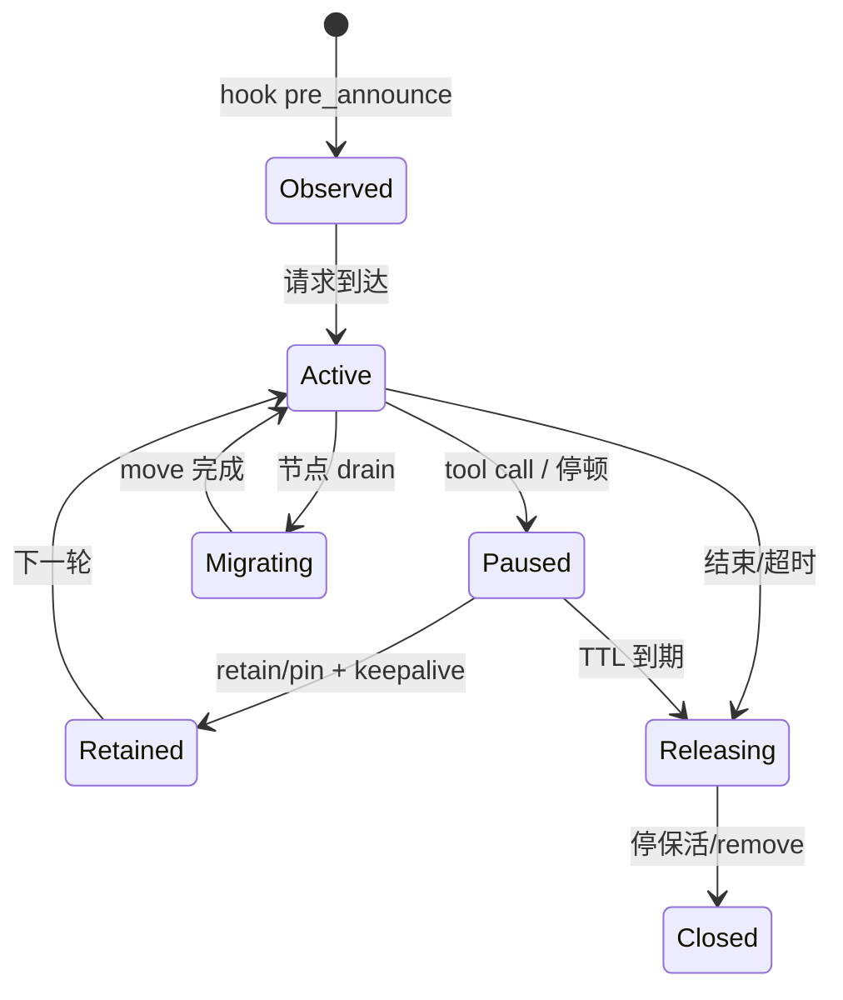

动作：

| 动作 | 触发 | 机制 | 预算 |
|---|---|---|---|
| keepalive | 会话活跃/保留 | 周期续租（有界） | lease TTL 的 1/3 左右 |
| prefetch | hook/预测 | copy 到目标 seg | 后台带宽 <10%；按 EV/bytes |
| retain | 停顿/长会话 | soft pin（条件可用）或 lease 延长 | TTL/字节上限 |
| promote | 只剩盘副本且预期复用 | 池 promotion 或读删写 | 触发式，非确定 |
| demote | 冷/水位高 | 停保活 + 等驱逐/落盘 | 写回模式时机不可控 |
| release | 会话结束 | 停 keepalive；确认没人用才 Remove | 默认软释放 |
| move | drain/迁移 | 指定源→目标 | 源在线；无取消 |

预取价值（Poisson 近似）：

```text
Λ = ∫λ; P_use = 1 − e^{−Λ}
EV = P_use × S − C_copy − C_occupancy
```

保留 TTL：

```text
Net(T) = p_resume(T)×S − c_h×bytes×T − C_risk
break-even: μ·p0·e^{−μT}×S = c_h×bytes
```

预算：

```text
Σ bytes_i / deadline_i ≤ B_budget
Σ pinned_bytes ≤ B_pin
TTL ≤ T_max
```

### 5.3 L2 容量环（5–60s）

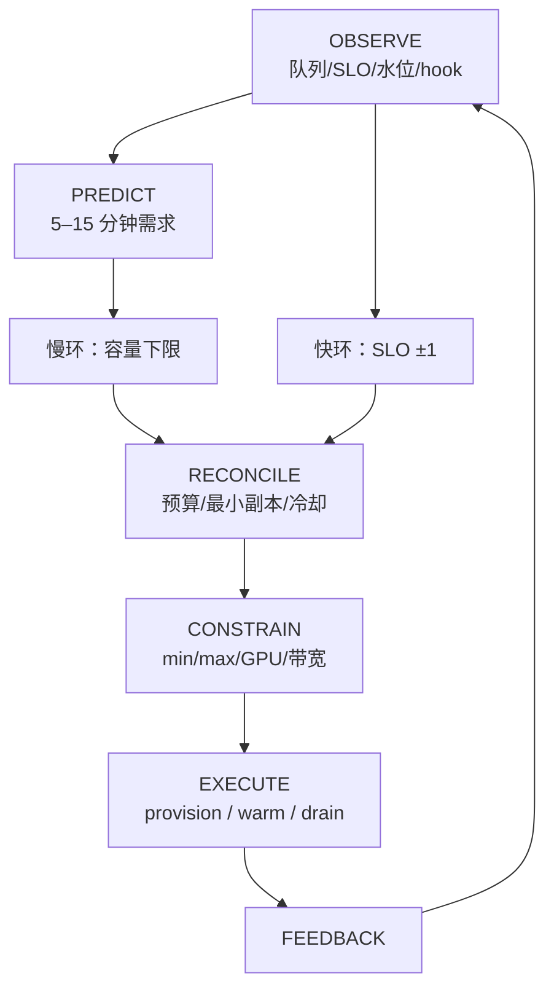

容量公式：

```text
ρ = λ/(c×μ)
c_min = ceil(λ/(μ×ρ_target))
L = λ×W                （Little 定律）
```

扩缩维度：计算池（P/D/混部）、KV 池（shard/节点）、模型 revision。按瓶颈选择：

| 信号 | 优先 |
|---|---|
| P 队列长 / TTFT 高 / prefill 满 | P 池 |
| D ITL 高 / decode 满 | D 池 |
| 池 DRAM 水位高 / 驱逐高 | KV 池 |
| 带宽满 / 传输排队 | 更多本地副本或网络 |
| 本地命中低但池命中高 | 先预取，不扩 |

扩容 warm gate：

```text
coverage = Σw_b×1[b confirmed] / Σw_b
ready if coverage ≥ W_min or t ≥ deadline
route_weight = min(1, coverage/W_min)
```

新实例先 `warming`，不接或低权重接流量；warm 可与权重加载重叠。`T_ready = provision + gate + warm` 必须满足 <10s 目标。

缩容 victim：

```text
loss(v) = uniqueHotKV(v)×refill + sessionRisk(v) + migrationCost(v)
gain(v) = idleCapacity(v)×c_capacity
choose max(gain − loss)
```

不要 LIFO；有活跃会话/唯一热 KV 的节点优先保留；drain 卡住不硬删。

### 5.4 三条环的协调

- **冷却**：`T_cool ≥ T_provision + T_warm + T_drain`，防扩缩振荡。
- **滞回**：扩容阈值 > 缩容阈值；连续 N 周期才动作。
- **优先级**：L0 永远不被 L1/L2 阻塞；L1 intent 异步；L2 只发目标容量。
- **价格**：L2 单点更新；L0/L1 只读；多 SC 实例时 L2 走 leader。

---

## 6. 联合闭环场景

### 6.1 Agent 多轮：预取 → 本地读 → 可选 HBM → 保留 → 恢复

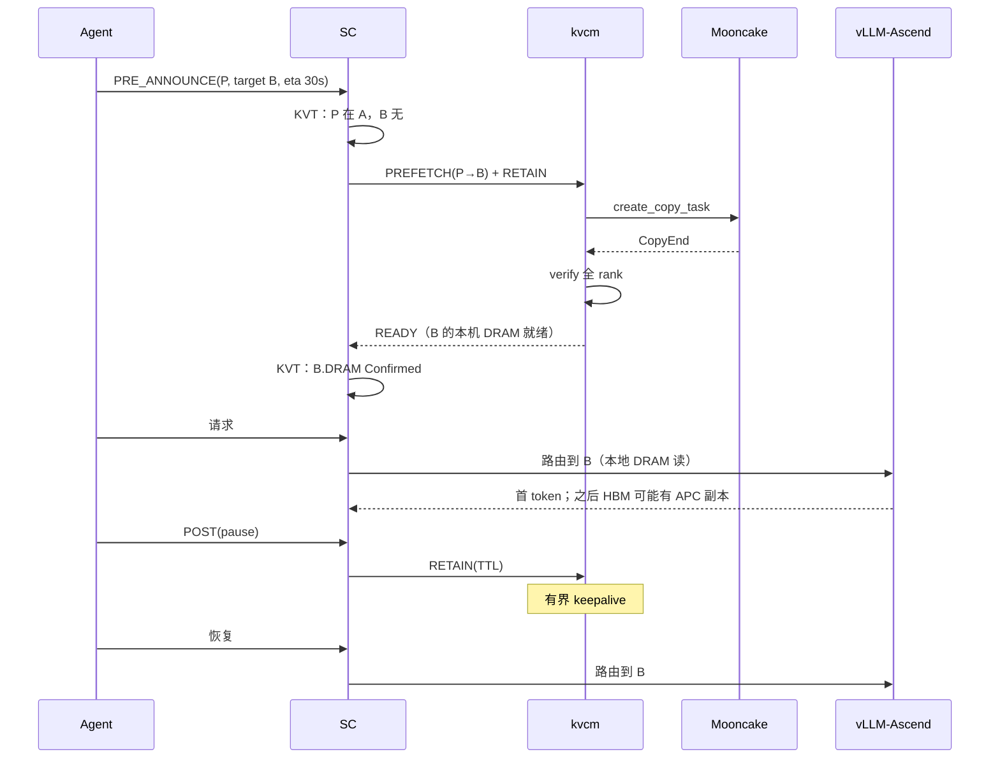

要点：

- kvcm READY 只保证“本机 DRAM 有副本”，第一次请求仍然要把 KV 从 DRAM 读进 HBM；它省的是跨机 RDMA，不是本地拷贝，更不是 prefill（prefill 已在池命中时省掉）。
- 若 B 的引擎在请求后把块放进 APC，下一次才可能 HBM 命中；这由引擎事件/KVT 决定，不由 kvcm 保证。
- 若预取没赶上，请求照常走远端读；下一次受益。

### 6.2 扩容：warm gate

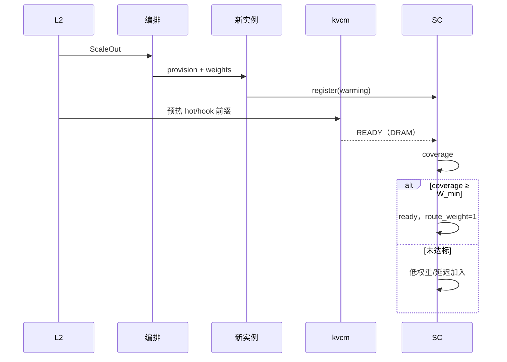

### 6.3 缩容：KV-aware victim

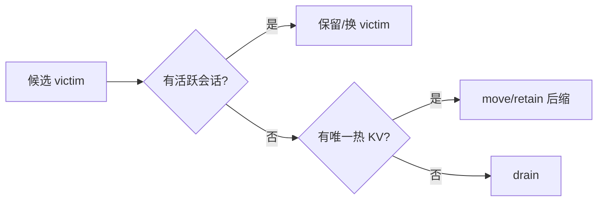

### 6.4 池压：降层/扩池

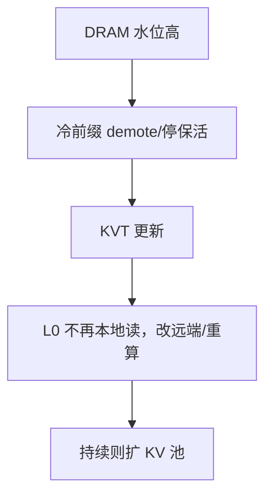

### 6.5 Ghost：miss 反馈

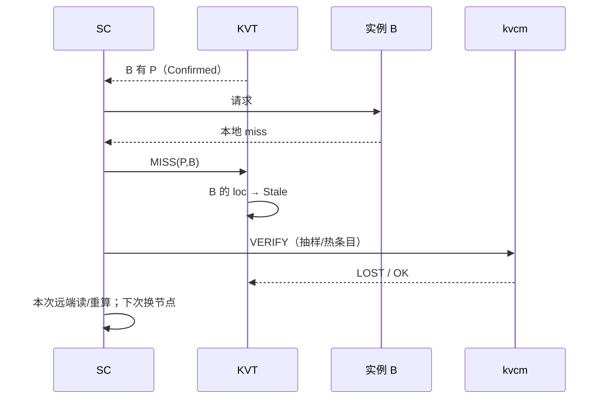

---

## 7. 性能模型与整体收益

这一节回答：“联合调度到底赚什么、赚多少、什么时候不赚”。

### 7.1 收益分解

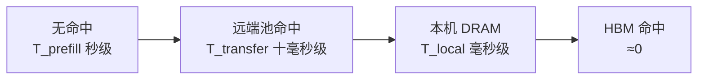

一次请求的 KV 相关成本可以拆成四段：

```text
T_total ≈ Q + T_prefill + T_transfer + T_local_copy
```

> 这不是四项同时发生：miss 有 `T_prefill`；远端池命中只有很小的残差 prefill、有 `T_transfer`；本机 DRAM 有 `T_local_copy`；HBM 命中两者都接近 0。按命中层级取项。

| 段 | 由什么决定 | 调度能做什么 | 量级（见 §7.3） |
|---|---|---|---|
| `Q` 队列 | 实例负载/扩缩 | L0 负载打分、L2 扩容 | ms–s |
| `T_prefill` | 残差 token / 算力 | 命中/保留（避免重算） | **秒级** |
| `T_transfer` | 跨机字节 / 网络 | 本地放置、预取 | **十毫秒级** |
| `T_local_copy` | 本地字节 / HBM 带宽 | HBM 命中 | **毫秒级** |

**收益优先级**：

1. **命中/保留**（省 `T_prefill`）——最大；
2. **本地放置**（省 `T_transfer`）——次之；
3. **HBM 命中**（省 `T_local_copy`）——再次；
4. **队列/弹性**（省 `Q`）——尾部与吞吐。

这解释了为什么“HBM 命中后的本地拷贝优化”不是终局的核心：它是第三层优化，真正决定 TTFT 的是“KV 还在不在、能不能命中”。

### 7.2 公式

```text
T_prefill   = P / v_prefill
T_transfer  = S / BW_wan
T_local     = S / BW_local
S = P × bytes_per_token
```

其中 `P` 是 prompt token 数，`S` 是前缀字节数。

命中的收益：

```text
Benefit = p_miss_avoided × T_prefill
        + p_remote_to_local × (T_transfer − T_local)
        + p_hbm × T_local
```

- `p_miss_avoided`：本来会 miss/重算，现在命中（保留/预取防驱逐）；
- `p_remote_to_local`：本来是远端池命中，现在本机 DRAM；
- `p_hbm`：本来是本地 DRAM，现在 HBM。

预取 ROI：

```text
ROI = Benefit / (S/BW_copy × c_bw + S×T_hold×c_hbm + waste)
```

保留 TTL：

```text
Net(T) = p_resume(T)×T_prefill − c_h×S×T − C_risk
```

### 7.3 量化示例（模型估算，非真机）

假设（只用于说明量级，真机替换）：

- `bytes_per_token = 20KB`（薄 KV/MLA 类；胖 GQA 会更大）
- `v_prefill = 5000 token/s/GPU`
- `BW_wan = 25 GB/s`
- `BW_local = 100 GB/s`

| 指标 | 8K prompt | 70K prompt |
|---|---:|---:|
| 前缀字节 `S` | 160 MB | 1.4 GB |
| 重算 `T_prefill` | 1.6 s | 14 s |
| 跨机传输 `T_transfer` | 6.4 ms | 56 ms |
| 本地拷贝 `T_local` | 1.6 ms | 14 ms |

由此：

| 优化 | 8K 收益 | 70K 收益 | 说明 |
|---|---:|---:|---|
| 命中 vs 重算 | ~1.6 s | ~14 s | 最大杠杆：保留/防驱逐 |
| 本机 DRAM vs 远端 | ~4.8 ms | ~42 ms | 预取/本地放置 |
| HBM vs 本机 DRAM | ~1.6 ms | ~14 ms | HBM 命中（APC） |
| 队列/扩容 | 看负载 | 看负载 | 尾部与吞吐 |

> 表中“命中”按整段前缀命中估算；实际 vLLM 可能仍重算末 token，残差很小。真机要按模型/并行配置替换 `bytes_per_token`、`v_prefill`、`BW_wan`、`BW_local`。

**读数**：

- 命中的收益是“秒级”，本地放置是“十毫秒级”，HBM 是“毫秒级”。**不要为了毫秒级优化牺牲命中率**。
- 预取如果只是把“远端命中”变成“本地命中”，收益是 4.8ms/42ms；如果它防止了一次驱逐/重算，收益是 1.6s/14s。**预取的真正价值在“防 miss”，不是“搬家”**。
- 保留一个 70K 会话的前缀（1.4GB）10 分钟，换一次 14s 重算，通常非常划算；但要有 TTL/预算，不能无限 pin。

### 7.4 吞吐与成本

命中率提升的吞吐价值：

```text
节省的 GPU 时间/秒 = QPS × Δhit_rate × T_prefill
等效 GPU 数 ≈ 节省的 GPU 时间/秒
```

示例（说明量级）：

- 8K、100 QPS、命中率 +10% → `100×0.1×1.6 = 16 GPU·s/s` ≈ 16 张卡的 prefill 产能；
- 70K、10 QPS、命中率 +10% → `10×0.1×14 = 14 GPU·s/s`。

成本侧：

```text
C_total = GPU 时间×c_gpu + 传输字节×c_bw + 驻留字节×T×c_mem + 失败/浪费
```

通常 `c_gpu` 远高于 `c_bw/c_mem`，所以“用带宽/内存换 GPU 时间”是合算的；但带宽有上限（后台 <10%），所以要有预算和优先级。

### 7.5 什么时候不赚

| 场景 | 为什么不赚 | 策略 |
|---|---|---|
| prompt 很短 | prefill 小，传输/队列占比高 | 少预取，优先队列/负载 |
| 复用率低 | 保留/预取浪费内存和带宽 | 短 TTL；按 EV/bytes 准入 |
| 带宽已满 | 预取与请求争带宽，TTFT 反而变差 | 后台预算 <10%；避让/限速 |
| HBM 压力大 | pin 太多挤掉其他前缀，全局命中率下降 | pin 预算；soft 优先；TTL |
| hook 不准 | 预取到错误实例/前缀 | 置信度、ETA 过期、只 observe |
| 扩容急 | warm gate 延迟接流量 | 老节点先接；warm 后台；低权重 |

### 7.6 要观测的收益指标

| 指标 | 回答 |
|---|---|
| `hit_rate`（pool/local/HBM 分层） | 命中率是否提升 |
| `prefill_saved_tokens` | 省了多少重算 |
| `transfer_saved_bytes` | 省了多少跨机传输 |
| `prefetch_hit_rate` / `waste_bytes` | 预取是否值 |
| `retention_hit_rate` / `wasted_retention` | 保留是否值 |
| `TTFT_p99` / `ITL_p99` | 用户感知 |
| `gpu_seconds_saved` / `cost_per_1k_tokens` | 成本 |
| `scale_ready_latency` / `warm_coverage` | 弹性 |
| `ghost_ratio` / `verify_miss_rate` | 索引可信度 |

---

## 8. 一致性与失效

- KVT 陈旧只损性能；读路径兜底（远端读/重算）。
- 删除面：0.3.13.post1 的 publisher 需构建+运行开启；默认无删除事件，用 TTL + miss + 抽样核验。
- 源 gap：replay → snapshot → stale；stale 不当作 HBM 命中。
- kvcm 挂：intent 失败/排队，路由不受影响；ledger 持久化，恢复后继续。
- 编排挂：不扩缩，告警；已发决策幂等重试。
- 多 SC 实例：KVT 各一份；会话粘性；L2 leader；intent 幂等。
- 失败不写固定降级链；按最新状态重跑。

---

## 9. 版本与能力基线（v0.3.13.post1）

### 9.1 关键事实

| 能力 | v0.3.13.post1 | 对 D8 的影响 |
|---|---|---|
| 引擎 KV events | vLLM-Ascend `enable_kv_cache_events`；`BlockStored/Removed` + `medium` | KVT 的 HBM/池 put 来源 |
| master publisher | 代码有；CMake `ENABLE_KV_EVENTS` 默认 OFF，运行 `--enable_kv_events` 默认 false；copy 路径零发布 | 删除面需显式开启；预复制放置仍靠 kvcm 补发 |
| admin 查询 | `GET /batch_query_keys` / `GetReplicaListForAdmin`（零副作用） | 反熵/核验可用，不污染 lease |
| soft pin 空写 | **有条件可用**（PR73）：Case B、单 slice、key 存在、无盘副本；`exists` 持 lease；地址检查 | 会话保留可用；有边界 |
| hard pin 事后设置 | **拒绝**（创建时固化） | 只能用 keepalive 做 lease 保护 |
| keepalive | 注册/注销 + 周期 `renew_once`（有界） | 会话保留的基础 |
| demote | 停保活 + 等一个 lease TTL + 查盘；写回模式池不满仍失败 | 不是确定性降层 |
| promote | 反复 `GetReplicaList`/触发；READY 较弱（看到内存副本，不保证任务完成） | 只能当“可尝试路由” |
| remove | 全局删 key，不支持 target；force 只跳过 lease | 释放走软释放优先 |
| retain | 未实现；无 `AddReplicaForRetainedClient`；可登记 move 到活 seg / kvcm 自挂 SSD | 跨引擎存亡还不能完全兜 |
| copy/move 取消 | 无 | 预取改道只能 abandon + 事后清理 |
| 实例注册 | E13 设计已定；代码归 E13 | 端点/seg 映射仍靠启动参数 |
| 段容量准入 | PR72：提交前查目标段剩余 | 预取可能因段满失败 |
| 带宽限速（E15） | 未做；只有并发窗口 | 预取/迁移要预算 |

### 9.2 0.3.13.post1 的 soft pin 边界

- **版本前提**：v0.3.13.post1 使用 `SoftPinAction` 三态，**没有** `has_read_lease` 门槛；Case B 只看尺寸。
- **安全前提**：Case B（同尺寸、单 slice、key 存在、无盘副本）；`put_step=1`；soft pin 前 `exists` 持 lease。
- **不保证**：Case C-by-size/Case A、Start/End 崩溃、读者短暂不可读、`client_id` 改写、30min 不续期、并发重写。
- **取消**：`SoftPinAction::DISABLE`；或用 keepalive + lease，不依赖空写。
- **升级陷阱**：0.3.14/main 有 `has_read_lease` 门槛；有租约且全内存时同尺寸也会走 Case C，当前空写不可用。升级时必须重新评估，不能默认沿用。

### 9.3 分支现状（截至 2026-11-04）

- `feat/kvcm-ops-mainline`（PR73）：soft pin 空写、hard pin 拒绝、keepalive 拆分、demote/promote/remove 语义、admin 核验；**未合入 main**。
- `feat/kvcm-e14-publish`：READY 后按实例端点补发 `BlockStored`，真机验证；move/remove 事件未接；**未合入 main**。
- `feat/kvcm-segment-admission`（PR72）：段容量准入；**未合入 main**。
- E13（InstanceWatcher）、E15（带宽限速）、retain：未做。
- 设计以 `summary.md` / `D1` / `D2` 的最新合入状态为准；本文不把分支能力当成已合入。

---

## 10. 实施节奏（目标形态分阶段）

| 阶段 | 目标 | 验收 |
|---|---|---|
| **P0 观测与索引** | 引擎事件 + kvcm READY + miss 反馈接入 KVT；hook 只 observe；L0 用 KVT 选路；决策日志 | KVT 合并/墓碑/置信度；L0 <5ms；不改变现有行为 |
| **P1 命中与保留** | 会话表；keepalive/soft pin（条件可用）；预取预算；反熵抽样；账本归因 | 命中率、resume TTFT、预取 ROI、ghost 率 |
| **P2 容量与弹性** | L2 双环；warm gate；KV-aware victim；池扩缩；价格 | 扩容 Ready <10s 且 warm 达标；缩容零丢失；无振荡 |
| **P3 服务化** | 会话 KV、预热服务、容量顾问、Drain、治理、回放 | 服务 SLA；ROI；容量预测误差；回放一致 |

原则：**先把“命中/保留”做对，再优化“本地放置”，最后才做 HBM 命中微优化**。这与 §7 的收益量级一致。

---

## 11. 开放问题

1. **publisher 是否开启**：0.3.13.post1 默认 OFF；生产构建/运行是否开？不开则删除面靠 TTL/miss/核验。
2. **实例注册与端点**：E13 未接；生产怎么分配/回收端点？kind 为空时是否接受“不补发”？
3. **soft pin 前置**：生产能否保证 Case B（单 slice、无盘副本、key 存在）？不能则退回 keepalive。
4. **retain**：move 到活 seg / kvcm 自挂 SSD 是否足够？是否等 0.3.14/main 的 retained client/DFS？
5. **E15 带宽限速**：预取/迁移与在线流量怎么隔离？是否需要网卡采样？
6. **多 SC 实例 leader**：etcd 还是复用现有控制面？leader 故障时扩缩暂停容忍多久？
7. **权重/阈值**：`w_*`/`λ_*`、warm gate、TTL 需真机校准。
8. **layerwise**：vLLM-Ascend layerwise 读路径改变传输成本；D6 未定，L0 成本模型要留接口。
9. **hook 标准**：agent 框架怎么发？header/body/独立端点？谁签名？
10. **安全**：hook 伪造、pin 滥用、跨模型误删的防护边界。

---

## 12. 参考实现

> 说明：三环 + 影子价格的整体组合没有一一对应的参考实现；下面按部件列锚点。**kvcm 独立于 lake**，lake 仅作参考文档。

| 参考 | 锚点 | 借了什么 | 关键差异 |
|---|---|---|---|
| **kvcm D1/D2** | `kvcm/design/D1-router-scheduling.md` §2/§4；`kvcm/design/D2-kv-operations.md` §1/§4 | intent ≠ command、READY、补发事件、单向边界、八操作/状态四类 | 本文补 hook/KVT/L2；不改变 kvcm actuator 定位 |
| **Dynamo** | `lib/kv-router/src/protocols.rs::WorkerSelectionResult`；`components/src/dynamo/planner/core/load_scaling.py::LoadScalingMixin`；`lib/kv-router/src/services/indexer/listener.rs::handle_gap` | overlap 作为一等输入；慢/快双环；gap + replay | Dynamo 索引是事件派生副本；本文用多源 + 墓碑 + 置信度 |
| **llm-d** | `pkg/kvcache/prefix_match.go::SpeculativeTier`；`.../preciseprefixcache/prerequest.go::defaultSpeculativeTTL`；`pkg/epp/scheduling/scheduler.go::Scheduler.Schedule` | 推测索引补窗口；scorer 插件化 | 推测只做亲和，不当作 HBM 命中；不依赖“逼近引擎真相” |
| **AIBrix** | `pkg/kvevent/manager.go::Manager`；`pkg/controller/podautoscaler/context/context.go`（`gpu_cache_usage_perc`） | ZMQ 事件→前缀索引；KV 使用率/排队长度扩缩 | AIBrix 各副本各自收敛；本文 KVT 单实例内合并 + L2 leader |
| **SGLang** | `sgl-model-gateway/src/policies/cache_aware.rs::CacheAwarePolicy`；`policies/tree.rs::Tree`；`srt/managers/kv_hints.py::KvHintsEnvelope`；`unified_cache/session_ref_tracker.py::UnifiedSessionRefTracker` | 近似树 + 最短队列；带版本 hint；session 软保护 | 目标部署用 vLLM-Ascend；session 保留落 kvcm，不落引擎 |
| **vLLM** | `vllm/v1/kv_hints/protocol.py::KvHintsEnvelope`；`vllm/v1/core/sched/scheduler.py::Scheduler` | hint 动词表；节点级 scheduler 分层 | hint 在本文被编译成 Demand；仍 hint ≠ command |
| **Mooncake** | `master_service.cpp::CopyStart`、`BatchEvict`、`CreateDrainJob`、`GetReplicaListForAdmin`；`KvEventPublisher` | copy 幂等、lease/驱逐、drain、零副作用核验、池事件 | SC 不碰 PoolKey/seg；全部经 kvcm intent |
| **KVCR** | `src/kvcr/remote_fw_dram.py::fetch` / `query` / `_try_release_pin` | 目的地发起 fetch、传输窗口 pin | kvcm 集中式 + master 权威；不需要 fencing |
| **TensorCast** | `tensorcast/api/_config.py::StorePolicyProfile` | 声明式 policy 预设 | 仅借用 retention class 命名，不照搬存储后端 |

关键差异：

- 参考实现的索引多是大规模事件派生、最终一致；本文承认这一点，用 **墓碑 + 置信度 + miss 反馈 + 抽样核验** 把“不精确”控制在性能层。
- 参考实现的扩缩多在独立组件；本文把决策放进 SC 的共享状态，但**执行仍分离**（kvcm 执行 KV，编排执行 provision）。
- 参考实现的 hint/session 多在引擎内；本文把 session/retention 放到 kvcm，worker 保持无状态。
- vLLM-Ascend 的 TP/DP per-rank key、Mooncake 的 key 不透明性，决定了“索引必须按逻辑块去重、SC 不能碰 PoolKey”——这是与通用 vLLM router 最大的工程差异。

---

## 附录：公式速查

```text
# 请求收益
U = w_hit·H·c_prefill + w_pool·P·c_prefill·κ
  − w_bw·(B/BW)·c_bw − w_q·Q·c_queue
  − w_slo·max(0,TTFT−D)·c_slo + w_future·F − w_risk·R

# TTFT
TTFT = Q + residual/v_prefill + B/BW + T_handoff

# 传 vs 算
BW* = B·c_bw / (residual·c_prefill)

# 预取 EV（Poisson）
Λ = ∫λ; P_use = 1−e^{−Λ}
EV = P_use·S − C_copy − C_occupancy

# 保留 TTL
Net(T) = p0·e^{−μT}·S − c_h·bytes·T − C_risk
break-even: μ·p0·e^{−μT}·S = c_h·bytes

# 容量
ρ = λ/(c·μ); c_min = ceil(λ/(μ·ρ_target)); L = λ·W

# warm gate
coverage = Σw_b·1[b confirmed]/Σw_b
ready if coverage ≥ W_min or t ≥ deadline

# victim
loss(v) = uniqueHotRefill + sessionRisk + migrationCost
gain(v) = idleCapacity·c_capacity
choose max(gain−loss)

# 价格
λ_{t+1} = clip(λ_t + η(u−u*), 0, λ_max)

# 置信度/ghost
conf(t) = conf0·e^{−(t−t0)/τ}
P_ghost ≈ 1−e^{−λ_delete·age}
```
